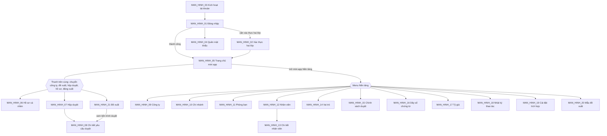
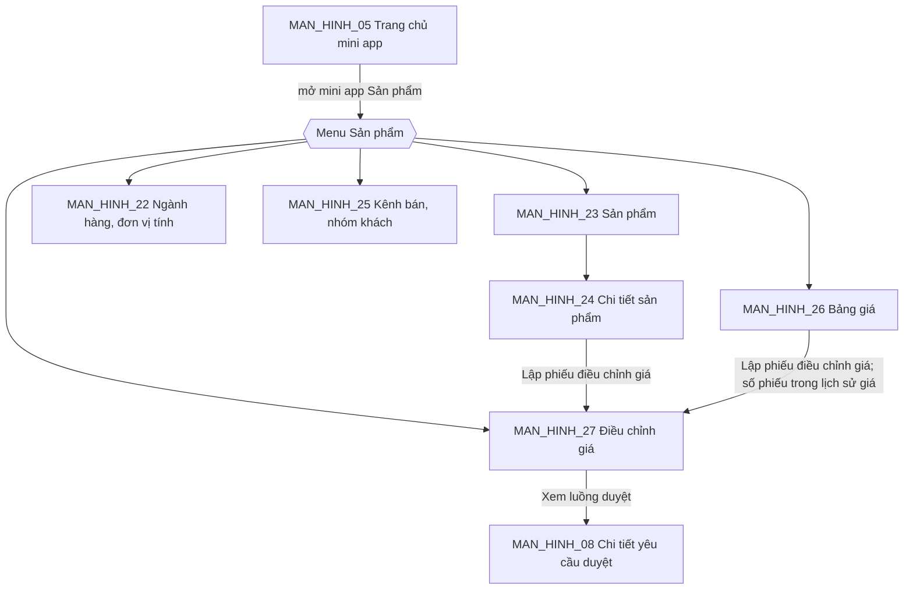
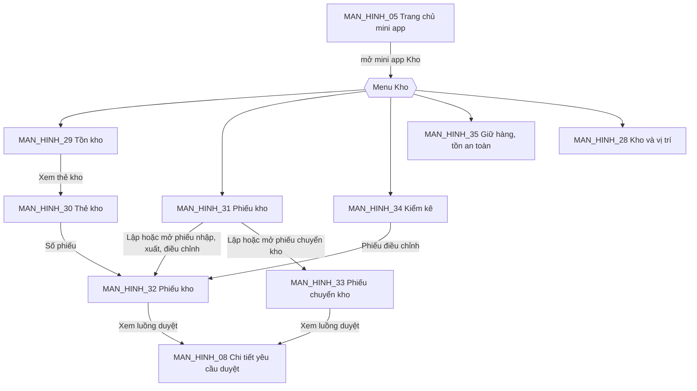
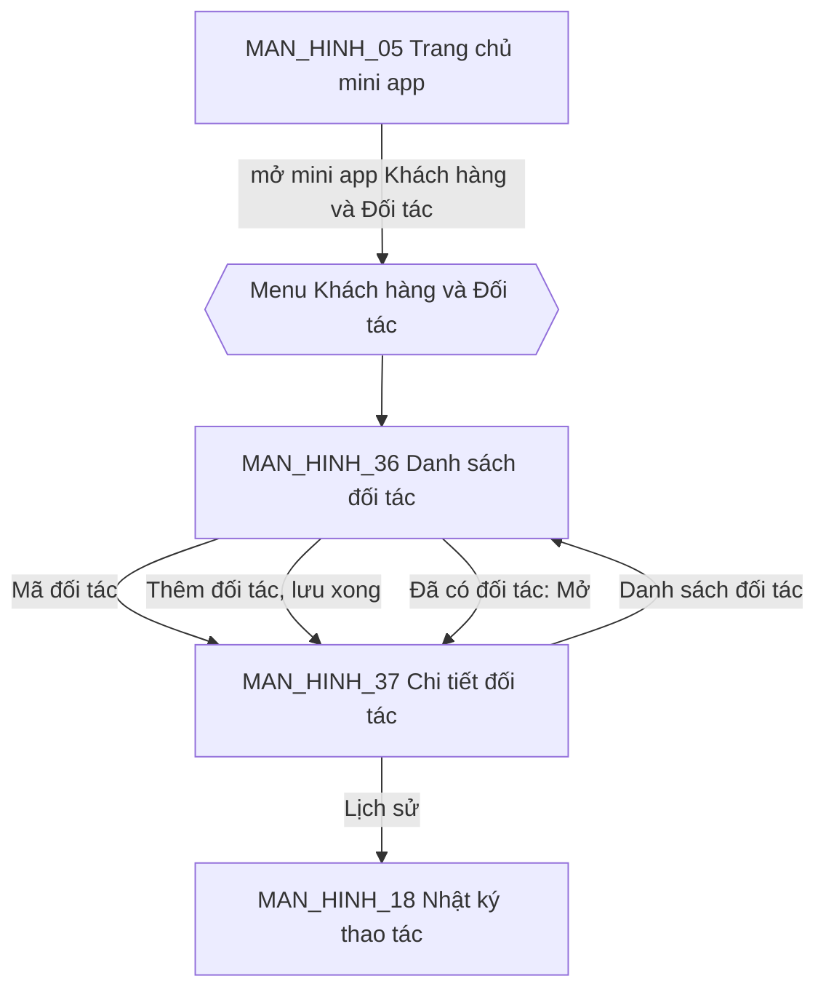
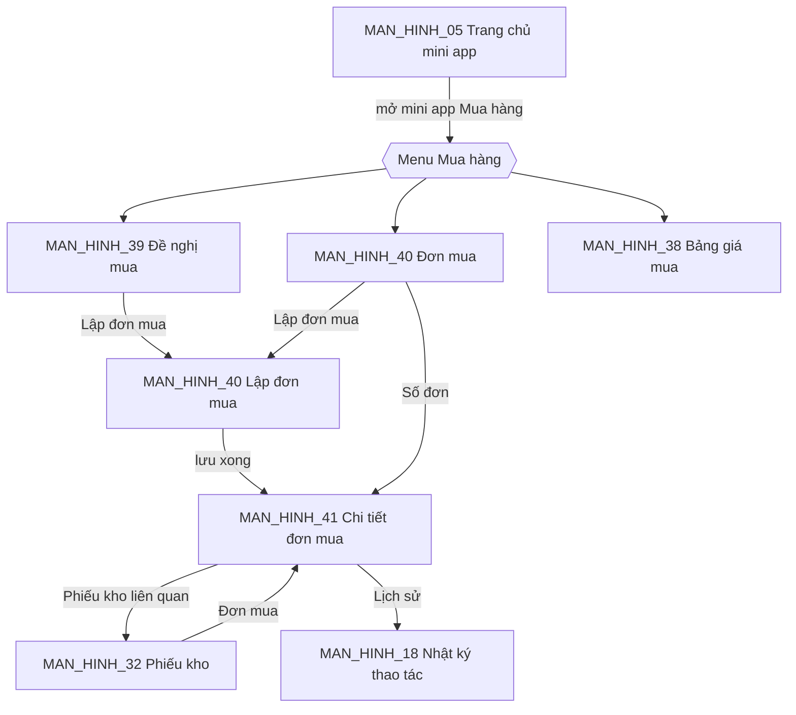
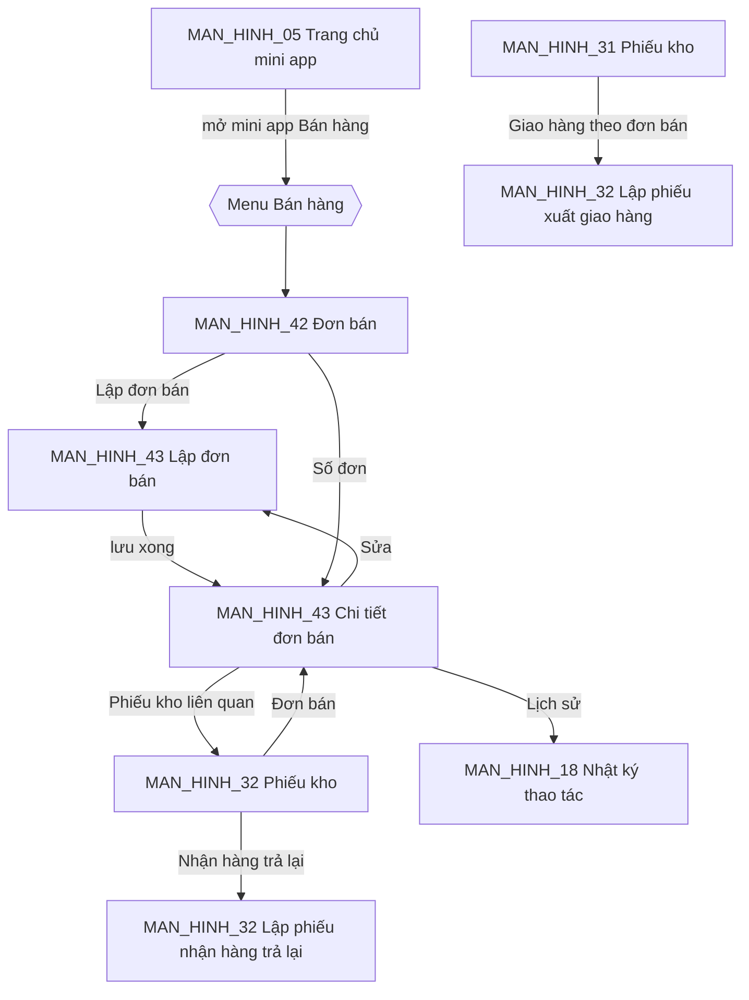
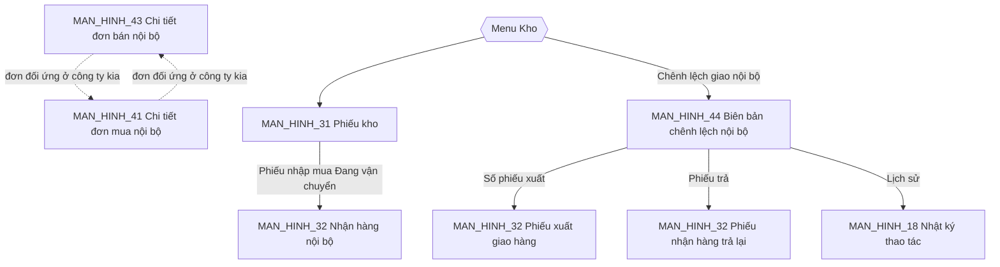
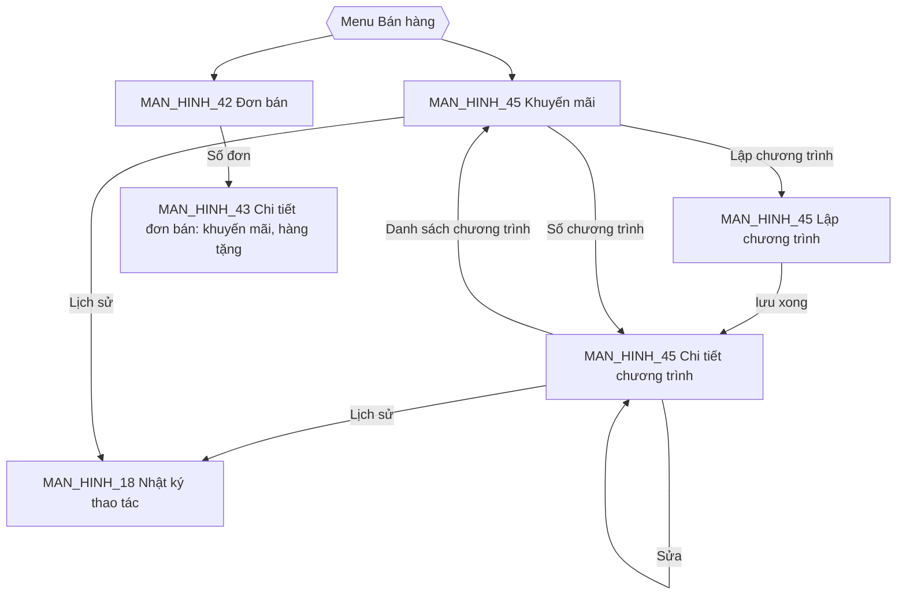
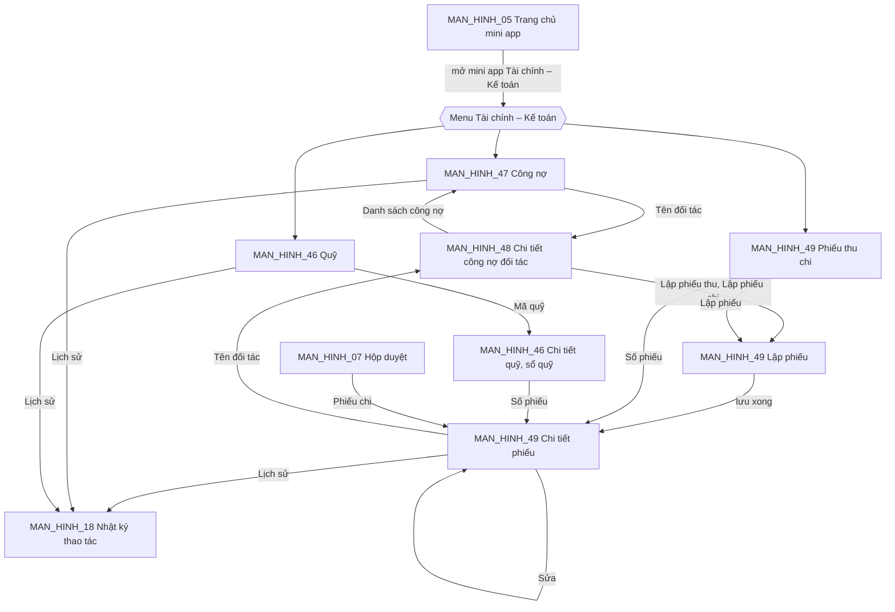
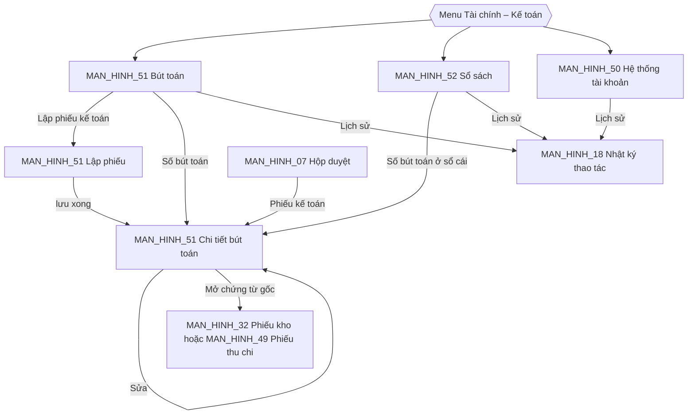

# 14. ĐẶC TẢ GIAO DIỆN

- Mô tả: Danh sách màn hình, sơ đồ điều hướng, bảng vai trò – màn hình, đặc tả từng màn hình.
- Phiên bản: 2.1
- Ngày cập nhật: 2026-11-10
- Trạng thái: Đã phê duyệt 2026-11-09 (bước 06.1, 06.2, 06.4; gồm THAY_DOI_01)
- Cập nhật giai đoạn 07: bổ sung mã API cho từng màn hình
- Cập nhật CONG_VIEC_03 (2026-11-09): thêm MAN_HINH_19, MAN_HINH_20, MAN_HINH_21; mở rộng MAN_HINH_01, MAN_HINH_06, MAN_HINH_08 (THAY_DOI_04, THAY_DOI_08)
- Cập nhật CONG_VIEC_04 (2026-11-09): thêm MODULE_02 phần Sản phẩm, MAN_HINH_22 đến MAN_HINH_27 (mục 5 đến mục 7)
- Cập nhật CONG_VIEC_05 (2026-11-10): thêm MODULE_03 Kho phần web, MAN_HINH_28 đến MAN_HINH_35 (mục 8 đến mục 10)
- Cập nhật CONG_VIEC_06 (2026-11-10): thêm MODULE_07 Khách hàng và Đối tác phần tối thiểu, MAN_HINH_36, MAN_HINH_37 (mục 11 đến mục 13)
- Cập nhật CONG_VIEC_07 (2026-11-10): thêm MODULE_04 Mua hàng phần 1, MAN_HINH_38 đến MAN_HINH_41 (mục 14 đến mục 16); sửa MAN_HINH_22, MAN_HINH_31, MAN_HINH_32
- Cập nhật CONG_VIEC_08 (2026-11-10): thêm MODULE_05 Bán hàng phần 1, MAN_HINH_42, MAN_HINH_43 (mục 17 đến mục 19); sửa MAN_HINH_31, MAN_HINH_32
- Cập nhật CONG_VIEC_09 (2026-11-10): thêm MODULE_05 phần 2 Giao dịch nội bộ, MAN_HINH_44 (mục 20 đến mục 22); sửa MAN_HINH_31, MAN_HINH_32, MAN_HINH_40, MAN_HINH_41, MAN_HINH_43
- Cập nhật CONG_VIEC_12 (2026-11-10): thêm MODULE_05 phần 3 Khuyến mãi, MAN_HINH_45 (mục 23 đến mục 25); sửa MAN_HINH_42 (menu), MAN_HINH_43 (khuyến mãi trên dòng đơn)
- Cập nhật CONG_VIEC_13 (2026-11-10): thêm MODULE_06 Tài chính – Kế toán phần 1, MAN_HINH_46 đến MAN_HINH_49 (mục 26 đến mục 28)
- Cập nhật CONG_VIEC_14 (2026-11-10): thêm MODULE_06 Tài chính – Kế toán phần 2, MAN_HINH_50 đến MAN_HINH_52 (mục 29 đến mục 31); menu mini app Tài chính – Kế toán thêm ba mục

## MODULE_01 Nền tảng

## 1. Danh sách màn hình và điều hướng

| Mã | Tên màn hình | Chức năng (10) | Vai trò được truy cập (08) | Mở từ | Bản mẫu |
|---|---|---|---|---|---|
| MAN_HINH_01 | Đăng nhập | CHUC_NANG_06, CHUC_NANG_07, CHUC_NANG_08, CHUC_NANG_22, CHUC_NANG_24 | Mọi người | Địa chỉ trang web; đăng xuất | Chưa có |
| MAN_HINH_02 | Xác thực hai lớp (nhập mã, đăng ký lần đầu) | CHUC_NANG_09 | Mọi người | MAN_HINH_01 | Chưa có |
| MAN_HINH_03 | Kích hoạt tài khoản | CHUC_NANG_04 | Nhân viên được mời | Đường dẫn trong email, SMS | Chưa có |
| MAN_HINH_04 | Quên mật khẩu, đặt lại mật khẩu | CHUC_NANG_06 | Mọi người | MAN_HINH_01; đường dẫn trong email, SMS | Chưa có |
| MAN_HINH_05 | Trang chủ mini app | CHUC_NANG_14, CHUC_NANG_11 | Mọi nhân viên | Sau đăng nhập; biểu tượng trang chủ ở thanh trên cùng | Chưa có |
| MAN_HINH_06 | Hồ sơ cá nhân | CHUC_NANG_10, CHUC_NANG_09, CHUC_NANG_22, CHUC_NANG_24 | Mọi nhân viên | Thanh trên cùng | Chưa có |
| MAN_HINH_07 | Hộp duyệt | CHUC_NANG_17, CHUC_NANG_16 | Mọi nhân viên | Thanh trên cùng; MAN_HINH_05 | Chưa có |
| MAN_HINH_08 | Chi tiết yêu cầu duyệt | CHUC_NANG_16, CHUC_NANG_28, CHUC_NANG_29 | Người lập, người duyệt | MAN_HINH_07; mini app sở hữu chứng từ; MAN_HINH_21 | Chưa có |
| MAN_HINH_09 | Công ty | CHUC_NANG_01 | Quản trị tập đoàn | Menu Nền tảng | Chưa có |
| MAN_HINH_10 | Chi nhánh | CHUC_NANG_02 | Quản trị tập đoàn, quản trị công ty | Menu Nền tảng | Chưa có |
| MAN_HINH_11 | Phòng ban | CHUC_NANG_03 | Quản trị tập đoàn, quản trị công ty | Menu Nền tảng | Chưa có |
| MAN_HINH_12 | Danh sách nhân viên (kèm hộp thoại mời, nhập Excel) | CHUC_NANG_04, CHUC_NANG_05, CHUC_NANG_19 | Quản trị tập đoàn, quản trị công ty | Menu Nền tảng | Chưa có |
| MAN_HINH_13 | Chi tiết nhân viên (công ty, vai trò, phiên, khóa, vô hiệu hóa) | CHUC_NANG_13, CHUC_NANG_19, CHUC_NANG_09 | Quản trị tập đoàn, quản trị công ty | MAN_HINH_12 | Chưa có |
| MAN_HINH_14 | Vai trò và ma trận quyền | CHUC_NANG_12 | Quản trị tập đoàn, quản trị công ty | Menu Nền tảng | Chưa có |
| MAN_HINH_15 | Chính sách duyệt | CHUC_NANG_15 | Quản trị tập đoàn, quản trị công ty | Menu Nền tảng | Chưa có |
| MAN_HINH_16 | Dãy số chứng từ | CHUC_NANG_20 | Quản trị tập đoàn, quản trị công ty | Menu Nền tảng | Chưa có |
| MAN_HINH_17 | Tiền tệ và tỷ giá | CHUC_NANG_21 | Mọi nhân viên (xem); quản trị tập đoàn, quản lý tỷ giá (sửa) | Menu Nền tảng | Chưa có |
| MAN_HINH_18 | Nhật ký thao tác | CHUC_NANG_23 | Quản trị tập đoàn, quản trị công ty | Menu Nền tảng; nút "Lịch sử" ở MAN_HINH_09 đến MAN_HINH_16 | Chưa có |
| MAN_HINH_19 | Cài đặt tích hợp | CHUC_NANG_25, CHUC_NANG_26 | Quản trị tập đoàn | Menu Nền tảng | Không lập (CONG_VIEC_03 mục 6) |
| MAN_HINH_20 | Mẫu đề xuất | CHUC_NANG_27 | Quản trị tập đoàn, quản trị công ty | Menu Nền tảng | Không lập (CONG_VIEC_03 mục 6) |
| MAN_HINH_21 | Đề xuất (danh sách, lập, sửa nháp, chi tiết) | CHUC_NANG_28, CHUC_NANG_29 | Mọi nhân viên | Thanh trên cùng ("Đề xuất") | Không lập (CONG_VIEC_03 mục 6) |

CHUC_NANG_18 (nhắc, chuyển duyệt quá hạn) chạy nền, không có màn hình; kết quả hiện ở MAN_HINH_07 (đánh dấu quá hạn) và thông báo.

CHUC_NANG_26 (thông báo Zalo ZNS) chạy nền, không có màn hình riêng; cài mẫu tin và xem tin gửi gần đây ở MAN_HINH_19.

Sơ đồ điều hướng:

- Màn hình mở đầu của mọi vai trò: MAN_HINH_05.
- Menu Nền tảng chỉ hiện mục mà nhân viên có quyền; nhân viên thường chỉ thấy mục "Tỷ giá".
- Thanh trên cùng giống nhau ở mọi mini app.

## 2. Bảng vai trò – màn hình

| Màn hình | Quản trị tập đoàn | Quản trị công ty | Quản lý tỷ giá | Nhân viên |
|---|---|---|---|---|
| MAN_HINH_01 đến MAN_HINH_04 | Dùng | Dùng | Dùng | Dùng |
| MAN_HINH_05 Trang chủ | Xem | Xem | Xem | Xem |
| MAN_HINH_06 Hồ sơ cá nhân | Xem, Sửa (của mình) | Xem, Sửa (của mình) | Xem, Sửa (của mình) | Xem, Sửa (của mình) |
| MAN_HINH_07, MAN_HINH_08 Duyệt | Xem, Duyệt khi được chỉ định | Xem, Duyệt khi được chỉ định | Xem, Duyệt khi được chỉ định | Xem, Duyệt khi được chỉ định |
| MAN_HINH_09 Công ty | Xem, Thêm, Sửa, Ngừng | Không thấy | Không thấy | Không thấy |
| MAN_HINH_10 Chi nhánh | Xem, Thêm, Sửa, Ngừng | Trong công ty mình | Không thấy | Không thấy |
| MAN_HINH_11 Phòng ban | Xem, Thêm, Sửa, Ngừng | Trong công ty mình | Không thấy | Không thấy |
| MAN_HINH_12 Nhân viên | Xem, Mời, Nhập Excel | Trong công ty mình | Không thấy | Không thấy |
| MAN_HINH_13 Chi tiết nhân viên | Gán mọi phạm vi, Khóa, Vô hiệu hóa, Đặt lại xác thực hai lớp | Trong công ty mình, trừ chính mình | Không thấy | Không thấy |
| MAN_HINH_14 Vai trò | Xem, Thêm, Sửa (cả vai trò dùng chung) | Vai trò riêng công ty mình | Không thấy | Không thấy |
| MAN_HINH_15 Chính sách duyệt | Xem, Thêm, Sửa | Trong công ty mình | Không thấy | Không thấy |
| MAN_HINH_16 Dãy số chứng từ | Xem, Thêm, Sửa | Trong công ty mình | Không thấy | Không thấy |
| MAN_HINH_17 Tỷ giá | Xem, Thêm, Sửa | Xem | Xem, Thêm, Sửa | Xem |
| MAN_HINH_18 Nhật ký thao tác | Toàn tập đoàn | Trong công ty mình | Không thấy | Không thấy |
| MAN_HINH_19 Cài đặt tích hợp | Xem, Sửa | Không thấy | Không thấy | Không thấy |
| MAN_HINH_20 Mẫu đề xuất | Xem, Thêm, Sửa | Trong công ty mình | Không thấy | Không thấy |
| MAN_HINH_21 Đề xuất | Lập, xem đề xuất của mình; xem toàn công ty | Lập, xem đề xuất của mình; xem toàn công ty mình | Lập, xem đề xuất của mình | Lập, xem đề xuất của mình |

## 3. Đặc tả từng màn hình

Quy ước chung cho mọi màn hình sau đăng nhập:
- Bố cục: thanh trên cùng (logo, nút trang chủ, chọn công ty, hộp duyệt kèm số chờ, thông báo, ảnh đại diện mở hồ sơ cá nhân và đăng xuất); menu bên trái của mini app; vùng nội dung bên phải.
- Màn hình danh sách: tiêu đề, nút thao tác chính góc phải, ô tìm kiếm và bộ lọc, bảng có phân trang 20 dòng, nút "Lịch sử" mở MAN_HINH_18 lọc theo đối tượng.
- Thêm, sửa bằng ngăn kéo bên phải (màn hình rộng) hoặc trang riêng (điện thoại); lỗi kiểm tra dữ liệu hiện ngay dưới ô nhập.
- Trạng thái: đang tải = khung xám nhấp nháy theo bố cục; rỗng = hình minh họa, câu giải thích, nút thao tác chính; lỗi = thông báo kèm nút "Thử lại"; không có quyền = câu "Bạn không có quyền xem trang này" và nút về trang chủ.
- Thông báo thành công, thất bại hiện góc trên phải, tự ẩn sau 5 giây; thao tác ngừng hoạt động, khóa, vô hiệu hóa, thu hồi phiên có hộp thoại xác nhận.
- Điện thoại (dưới 768 điểm ảnh): menu trái thu thành nút mở; bảng chuyển thành danh sách thẻ.
- API: mã trong tài liệu `17`, ghi ở từng màn hình.
- Bản khung thang xám: `tai_lieu/ban_mau/KHUNG_GIAO_DIEN_MODULE_01.html`.

### MAN_HINH_01: Đăng nhập
- Mục đích: Vào hệ thống.
- Chức năng thực hiện: CHUC_NANG_06, CHUC_NANG_07, CHUC_NANG_08, CHUC_NANG_22, CHUC_NANG_24
- Bố cục: một cột giữa màn hình: logo; chọn ngôn ngữ; thẻ "Mật khẩu" và "Số điện thoại"; ô nhập; nút "Đăng nhập"; liên kết "Quên mật khẩu"; dải phân cách "hoặc"; ba nút Google, Microsoft, Zalo.
- Dữ liệu hiển thị: Không có.
- Thành phần: ONhap, Nut, NutDangNhapLienKet, KhoiCanhBao (tài liệu `15`).
- API: API_01, API_02, API_03, API_04, API_05 (tài liệu `17`).
- Thao tác: nhập, bấm Đăng nhập → MAN_HINH_02 nếu cần xác thực hai lớp, ngược lại MAN_HINH_05; thẻ Số điện thoại: nhập số → "Gửi mã" → ô nhập mã 6 chữ số; nút "Gửi lại mã" khóa 60 giây sau mỗi lần gửi, hiện "Gửi lại mã sau N giây".
- Trạng thái: đang xử lý (nút khóa, vòng quay); lỗi (thông báo trên ô nhập); bị khóa 15 phút (thông báo kèm thời gian còn lại).
- Thông báo: theo CHUC_NANG_06, CHUC_NANG_07, CHUC_NANG_08, CHUC_NANG_24.
- Quyền hiển thị: Không áp dụng.
- Responsive: thẻ chiếm toàn chiều ngang trên điện thoại.
- Trạng thái phê duyệt: Đã phê duyệt 2026-11-09

### MAN_HINH_02: Xác thực hai lớp
- Mục đích: Nhập mã xác thực hoặc đăng ký lần đầu.
- Chức năng thực hiện: CHUC_NANG_09
- Bố cục: một cột giữa: tiêu đề; nhập mã 6 chữ số; liên kết "Dùng mã dự phòng"; khi đăng ký lần đầu: mã QR, mã nhập tay, ô xác nhận, danh sách 10 mã dự phòng kèm nút tải về.
- Dữ liệu hiển thị: cách xác thực đã đăng ký (ứng dụng, SMS, email; che bớt số điện thoại, email).
- Thành phần: ONhap (mã OTP), Nut, KhoiCanhBao (tài liệu `15`).
- API: API_06, API_07, API_08 (tài liệu `17`).
- Thao tác: nhập mã → MAN_HINH_05.
- Trạng thái: đang xử lý; lỗi mã sai.
- Thông báo: "Mã xác thực không đúng."
- Quyền hiển thị: Không áp dụng.
- Responsive: như MAN_HINH_01.
- Trạng thái phê duyệt: Đã phê duyệt 2026-11-09

### MAN_HINH_03: Kích hoạt tài khoản
- Mục đích: Nhân viên được mời đặt mật khẩu lần đầu.
- Chức năng thực hiện: CHUC_NANG_04
- Bố cục: một cột giữa: lời chào kèm họ tên, tên công ty; ô mật khẩu, nhập lại mật khẩu, chỉ báo độ mạnh; nút "Kích hoạt"; hoặc nút Google, Microsoft.
- Dữ liệu hiển thị: họ tên, công ty mời.
- Thành phần: ONhap (mật khẩu), Nut, NutDangNhapLienKet, KhoiCanhBao (tài liệu `15`).
- API: API_11, API_04, API_05 (tài liệu `17`).
- Thao tác: kích hoạt → MAN_HINH_01 kèm thông báo thành công.
- Trạng thái: đường dẫn hết hạn hoặc đã dùng (thông báo, hướng dẫn liên hệ quản trị).
- Thông báo: theo CHUC_NANG_04.
- Quyền hiển thị: Không áp dụng.
- Responsive: như MAN_HINH_01.
- Trạng thái phê duyệt: Đã phê duyệt 2026-11-09

### MAN_HINH_04: Quên mật khẩu, đặt lại mật khẩu
- Mục đích: Lấy lại quyền truy cập.
- Chức năng thực hiện: CHUC_NANG_06
- Bố cục: bước 1: ô email hoặc số điện thoại, nút "Gửi đường dẫn"; bước 2 (mở từ đường dẫn): ô mật khẩu mới, nhập lại, nút "Đặt lại".
- Dữ liệu hiển thị: Không có.
- Thành phần: ONhap, Nut, KhoiCanhBao (tài liệu `15`).
- API: API_12, API_13 (tài liệu `17`).
- Thao tác: gửi → thông báo chung "Nếu tài khoản tồn tại, bạn sẽ nhận được đường dẫn"; đặt lại → MAN_HINH_01.
- Trạng thái: đường dẫn hết hạn.
- Thông báo: theo CHUC_NANG_06.
- Quyền hiển thị: Không áp dụng.
- Responsive: như MAN_HINH_01.
- Trạng thái phê duyệt: Đã phê duyệt 2026-11-09

### MAN_HINH_05: Trang chủ mini app
- Mục đích: Điểm vào mọi mini app.
- Chức năng thực hiện: CHUC_NANG_14, CHUC_NANG_11
- Bố cục: thanh trên cùng; lời chào; lưới ô mini app (biểu tượng, tên, số việc chờ); khối "Chờ tôi duyệt" tóm tắt 5 yêu cầu mới nhất.
- Dữ liệu hiển thị: mini app được dùng trong công ty đang chọn; số việc chờ; yêu cầu duyệt.
- Thành phần: ThanhTrenCung, OMiniApp, BangDuLieu, TrangThaiRong (tài liệu `15`).
- API: API_14, API_19, API_48 (tài liệu `17`).
- Thao tác: bấm ô → mở mini app; chọn công ty ở thanh trên → tải lại trang chủ theo công ty mới.
- Trạng thái: rỗng (chưa được cấp mini app nào, theo CHUC_NANG_14).
- Thông báo: Không có.
- Quyền hiển thị: ô mini app theo quyền `<app>.access`.
- Responsive: lưới 4 cột (rộng), 2 cột (điện thoại).
- Trạng thái phê duyệt: Đã phê duyệt 2026-11-09

### MAN_HINH_06: Hồ sơ cá nhân
- Mục đích: Tự quản lý tài khoản.
- Chức năng thực hiện: CHUC_NANG_10, CHUC_NANG_09, CHUC_NANG_22, CHUC_NANG_24
- Bố cục: các thẻ: "Thông tin" (họ tên, email, số điện thoại, công ty, ngôn ngữ); "Đăng nhập" (đổi mật khẩu; liên kết, hủy liên kết Google, Microsoft, Zalo); "Xác thực hai lớp" (bật, tắt, tạo lại mã dự phòng); "Phiên đăng nhập" (bảng thiết bị, địa chỉ IP, thời điểm, nút thu hồi).
- Dữ liệu hiển thị: như trên.
- Thành phần: ThanhTrenCung, ONhap, OChon, Nut, NutDangNhapLienKet, BangDuLieu, HopThoaiXacNhan, ThongBaoNoi (tài liệu `15`).
- API: API_04, API_05, API_07, API_08, API_15, API_16, API_17, API_18 (tài liệu `17`).
- Thao tác: lưu từng thẻ; thu hồi phiên có xác nhận.
- Trạng thái: nút tắt xác thực hai lớp bị vô hiệu kèm giải thích khi đang bắt buộc.
- Thông báo: theo CHUC_NANG_10, CHUC_NANG_24.
- Quyền hiển thị: chỉ của chính mình.
- Responsive: thẻ chuyển thành danh sách xổ xuống.
- Trạng thái phê duyệt: Đã phê duyệt 2026-11-09

### MAN_HINH_07: Hộp duyệt
- Mục đích: Xem, duyệt chứng từ đang chờ mình.
- Chức năng thực hiện: CHUC_NANG_17, CHUC_NANG_16
- Bố cục: tiêu đề kèm số chờ; bộ lọc công ty, mini app, loại chứng từ, chỉ quá hạn; danh sách: số chứng từ, loại, công ty, người lập, giá trị, cấp hiện tại, thời điểm gửi, nhãn "Quá hạn"; nút Đồng ý, Từ chối trên mỗi dòng.
- Dữ liệu hiển thị: yêu cầu đang chờ nhân viên ở mọi công ty.
- Thành phần: ThanhTrenCung, BoLoc, BangDuLieu, NhanTrangThai, Nut, HopThoaiXacNhan, TrangThaiRong, ThongBaoNoi (tài liệu `15`).
- API: API_39, API_41 (tài liệu `17`).
- Thao tác: bấm dòng → MAN_HINH_08; Từ chối → hộp thoại bắt buộc nhập lý do.
- Trạng thái: rỗng ("Không có chứng từ nào chờ bạn duyệt").
- Thông báo: duyệt thành công, thất bại.
- Quyền hiển thị: Không áp dụng.
- Responsive: thẻ chứng từ, nút Đồng ý, Từ chối cố định cuối thẻ.
- Trạng thái phê duyệt: Đã phê duyệt 2026-11-09

### MAN_HINH_08: Chi tiết yêu cầu duyệt
- Mục đích: Xem đầy đủ một yêu cầu và quyết định.
- Chức năng thực hiện: CHUC_NANG_16
- Bố cục: đầu trang: số chứng từ, trạng thái, giá trị (kèm quy đổi nếu ngoại tệ); dòng thời gian các cấp (người duyệt, người thay thế, quyết định, ý kiến, thời điểm); liên kết "Mở chứng từ" sang mini app sở hữu; nút Đồng ý, Từ chối (người duyệt cấp hiện tại); nút Rút lại (người lập, khi cấp 1 chưa quyết định).
- Dữ liệu hiển thị: yêu cầu duyệt và các bước.
- Thành phần: ThanhTrenCung, NhanTrangThai, DongThoiGian, Nut, HopThoaiXacNhan, ThongBaoNoi (tài liệu `15`).
- API: API_40, API_41, API_42 (tài liệu `17`).
- Thao tác: như trên.
- Trạng thái: không có quyền (không phải người lập hoặc người duyệt).
- Thông báo: theo CHUC_NANG_16.
- Quyền hiển thị: nút theo vai trò trong yêu cầu.
- Responsive: dòng thời gian dọc.
- Trạng thái phê duyệt: Đã phê duyệt 2026-11-09

### MAN_HINH_09: Công ty
- Mục đích: Quản lý cây công ty.
- Chức năng thực hiện: CHUC_NANG_01
- Bố cục: cây công ty bên trái; chi tiết công ty được chọn bên phải; nút "Thêm công ty".
- Dữ liệu hiển thị: mã, tên, mã số thuế, tiền tệ, chế độ kế toán, trạng thái, số chi nhánh.
- Thành phần: ThanhTrenCung, MenuMiniApp, CayDuLieu, NganKeo, Nut, HopThoaiXacNhan (tài liệu `15`).
- API: API_20, API_21 (tài liệu `17`).
- Thao tác: thêm, sửa, ngừng hoạt động (xác nhận).
- Trạng thái: chung.
- Thông báo: theo CHUC_NANG_01.
- Quyền hiển thị: chỉ quản trị tập đoàn.
- Responsive: cây và chi tiết xếp dọc.
- Trạng thái phê duyệt: Đã phê duyệt 2026-11-09

### MAN_HINH_10: Chi nhánh
- Mục đích: Quản lý chi nhánh.
- Chức năng thực hiện: CHUC_NANG_02
- Bố cục: danh sách chung; lọc loại, tỉnh thành, trạng thái.
- Dữ liệu hiển thị: mã, tên, loại, tỉnh thành, địa chỉ, trạng thái.
- Thành phần: ThanhTrenCung, MenuMiniApp, BoLoc, BangDuLieu, NhanTrangThai, NganKeo, HopThoaiXacNhan (tài liệu `15`).
- API: API_22 (tài liệu `17`).
- Thao tác: thêm, sửa, ngừng hoạt động.
- Trạng thái: chung.
- Thông báo: theo CHUC_NANG_02.
- Quyền hiển thị: theo bảng vai trò – màn hình.
- Responsive: chung.
- Trạng thái phê duyệt: Đã phê duyệt 2026-11-09

### MAN_HINH_11: Phòng ban
- Mục đích: Quản lý cây phòng ban.
- Chức năng thực hiện: CHUC_NANG_03
- Bố cục: như MAN_HINH_09 (cây bên trái, chi tiết bên phải).
- Dữ liệu hiển thị: mã, tên, phòng ban cha, trưởng phòng, số nhân viên.
- Thành phần: ThanhTrenCung, MenuMiniApp, CayDuLieu, NganKeo, OChon, HopThoaiXacNhan (tài liệu `15`).
- API: API_23 (tài liệu `17`).
- Thao tác: thêm, sửa, ngừng hoạt động.
- Trạng thái: chung.
- Thông báo: theo CHUC_NANG_03.
- Quyền hiển thị: theo bảng vai trò – màn hình.
- Responsive: như MAN_HINH_09.
- Trạng thái phê duyệt: Đã phê duyệt 2026-11-09

### MAN_HINH_12: Danh sách nhân viên
- Mục đích: Tìm, mời, nhập nhân viên.
- Chức năng thực hiện: CHUC_NANG_04, CHUC_NANG_05, CHUC_NANG_19
- Bố cục: danh sách chung; nút "Mời nhân viên" (ngăn kéo), "Nhập từ Excel" (hộp thoại: tải mẫu, chọn tệp, kết quả số dòng thành công, lỗi, tải tệp dòng lỗi); lọc chi nhánh, phòng ban, vai trò, trạng thái.
- Dữ liệu hiển thị: họ tên, email, số điện thoại, chi nhánh, phòng ban, vai trò, trạng thái, lần đăng nhập cuối.
- Thành phần: ThanhTrenCung, MenuMiniApp, BoLoc, BangDuLieu, NhanTrangThai, NganKeo, HopThoaiXacNhan (tài liệu `15`).
- API: API_24, API_25, API_26, API_27, API_28 (tài liệu `17`).
- Thao tác: bấm dòng → MAN_HINH_13; gửi lại đường dẫn kích hoạt với dòng "Đã mời".
- Trạng thái: chung.
- Thông báo: theo CHUC_NANG_04, CHUC_NANG_05.
- Quyền hiển thị: theo bảng vai trò – màn hình.
- Responsive: chung.
- Trạng thái phê duyệt: Đã phê duyệt 2026-11-09

### MAN_HINH_13: Chi tiết nhân viên
- Mục đích: Gán vai trò, khóa, vô hiệu hóa.
- Chức năng thực hiện: CHUC_NANG_13, CHUC_NANG_19, CHUC_NANG_09
- Bố cục: đầu trang: họ tên, trạng thái, nút Khóa, Mở khóa, Vô hiệu hóa, Đặt lại xác thực hai lớp; thẻ "Công ty" (các công ty thuộc về, chi nhánh, phòng ban, chức danh); thẻ "Vai trò" (bảng vai trò, phạm vi, ngày bắt đầu, ngày kết thúc; nút Gán vai trò, Gỡ); thẻ "Phiên đăng nhập" (thu hồi).
- Dữ liệu hiển thị: như trên.
- Thành phần: ThanhTrenCung, MenuMiniApp, NhanTrangThai, BangDuLieu, OChon, Nut, HopThoaiXacNhan (tài liệu `15`).
- API: API_29, API_30, API_31, API_32, API_33, API_34 (tài liệu `17`).
- Thao tác: Vô hiệu hóa → hộp thoại bàn giao: danh sách chứng từ chờ duyệt và phòng ban đang làm trưởng phòng, chọn người nhận cho từng mục, xác nhận.
- Trạng thái: chung.
- Thông báo: theo CHUC_NANG_13, CHUC_NANG_19.
- Quyền hiển thị: nút ẩn khi xem chính mình; phạm vi gán chỉ hiện phạm vi được phép.
- Responsive: thẻ xếp dọc.
- Trạng thái phê duyệt: Đã phê duyệt 2026-11-09

### MAN_HINH_14: Vai trò và ma trận quyền
- Mục đích: Quản lý vai trò.
- Chức năng thực hiện: CHUC_NANG_12
- Bố cục: danh sách vai trò bên trái (nhãn "Hệ thống", "Dùng chung", "Riêng công ty"); bên phải: thông tin vai trò và ma trận quyền nhóm theo mini app (dòng là đối tượng, cột là hành động, ô đánh dấu); quyền nhạy cảm có nhãn.
- Dữ liệu hiển thị: vai trò, quyền, số người đang có vai trò.
- Thành phần: ThanhTrenCung, MenuMiniApp, MaTranQuyen, NhanTrangThai, NganKeo (tài liệu `15`).
- API: API_35, API_36 (tài liệu `17`).
- Thao tác: thêm, sửa, ngừng dùng; lưu ma trận.
- Trạng thái: ô quyền người dùng không có bị vô hiệu.
- Thông báo: theo CHUC_NANG_12.
- Quyền hiển thị: vai trò hệ thống chỉ xem.
- Responsive: ma trận cuộn ngang trong khung riêng.
- Trạng thái phê duyệt: Đã phê duyệt 2026-11-09

### MAN_HINH_15: Chính sách duyệt
- Mục đích: Cấu hình cấp duyệt theo hạn mức.
- Chức năng thực hiện: CHUC_NANG_15
- Bố cục: danh sách loại chứng từ kèm chính sách đang hiệu lực; chi tiết: tiền tệ, ngày hiệu lực; bảng cấp duyệt (thứ tự, ngưỡng, người duyệt, người thay thế, thời hạn giờ); lịch sử chính sách.
- Dữ liệu hiển thị: như trên.
- Thành phần: ThanhTrenCung, MenuMiniApp, BangDuLieu, OChon, ONhap, NganKeo (tài liệu `15`).
- API: API_37 (tài liệu `17`).
- Thao tác: tạo chính sách mới từ ngày chọn; thêm, bớt cấp.
- Trạng thái: chung.
- Thông báo: theo CHUC_NANG_15.
- Quyền hiển thị: theo bảng vai trò – màn hình.
- Responsive: bảng cấp duyệt thành thẻ.
- Trạng thái phê duyệt: Đã phê duyệt 2026-11-09

### MAN_HINH_16: Dãy số chứng từ
- Mục đích: Cấu hình đánh số.
- Chức năng thực hiện: CHUC_NANG_20
- Bố cục: danh sách chung: loại chứng từ, tiền tố, kiểu đặt lại, số chữ số, số tiếp theo kỳ hiện tại, ví dụ số kế tiếp.
- Dữ liệu hiển thị: như trên.
- Thành phần: ThanhTrenCung, MenuMiniApp, BangDuLieu, NganKeo (tài liệu `15`).
- API: API_43 (tài liệu `17`).
- Thao tác: sửa (ngăn kéo).
- Trạng thái: chung.
- Thông báo: theo CHUC_NANG_20.
- Quyền hiển thị: theo bảng vai trò – màn hình.
- Responsive: chung.
- Trạng thái phê duyệt: Đã phê duyệt 2026-11-09

### MAN_HINH_17: Tiền tệ và tỷ giá
- Mục đích: Xem, nhập tỷ giá.
- Chức năng thực hiện: CHUC_NANG_21
- Bố cục: chọn ngày; bảng tỷ giá theo cặp tiền tệ, loại, nguồn; nút "Nhập tỷ giá"; nhãn cảnh báo khi hôm nay chưa có tỷ giá hạch toán.
- Dữ liệu hiển thị: như trên.
- Thành phần: ThanhTrenCung, MenuMiniApp, KhoiCanhBao, BangDuLieu, NganKeo (tài liệu `15`).
- API: API_45, API_46 (tài liệu `17`).
- Thao tác: nhập, sửa (quản lý tỷ giá).
- Trạng thái: chung.
- Thông báo: theo CHUC_NANG_21.
- Quyền hiển thị: nút nhập, sửa chỉ với quản trị tập đoàn, quản lý tỷ giá.
- Responsive: chung.
- Trạng thái phê duyệt: Đã phê duyệt 2026-11-09

### MAN_HINH_18: Nhật ký thao tác
- Mục đích: Tra cứu ai làm gì.
- Chức năng thực hiện: CHUC_NANG_23
- Bố cục: bộ lọc người làm, mini app, đối tượng, hành động, khoảng thời gian; bảng: thời điểm, người làm, công ty, hành động, đối tượng; bấm dòng mở ngăn kéo so sánh dữ liệu trước và sau.
- Dữ liệu hiển thị: như trên.
- Thành phần: ThanhTrenCung, MenuMiniApp, BoLoc, BangDuLieu, NganKeo (tài liệu `15`).
- API: API_47 (tài liệu `17`).
- Thao tác: lọc, xem chi tiết. Không có sửa, xóa.
- Trạng thái: chung.
- Thông báo: Không có.
- Quyền hiển thị: theo bảng vai trò – màn hình.
- Responsive: chung.
- Trạng thái phê duyệt: Đã phê duyệt 2026-11-09

### MAN_HINH_19: Cài đặt tích hợp
- Mục đích: Nhập mã ứng dụng đăng nhập và khóa nhà cung cấp gửi tin, có hiệu lực ngay.
- Chức năng thực hiện: CHUC_NANG_25, CHUC_NANG_26
- Đường dẫn: `/platform/integrations`
- Bố cục: tiêu đề kèm nút "Lịch sử"; câu giải thích; bốn thẻ nhóm: "Google", "Microsoft", "Zalo (đăng nhập)" (mỗi thẻ có đường dẫn chuyển hướng cần khai báo ở nhà cung cấp), "eSMS.vn (SMS, Zalo ZNS)" (API key, Secret key, Brandname SMS, mã Zalo OA, chế độ thử, mã mẫu ZNS cho mã OTP đăng nhập, có chứng từ chờ duyệt, nhắc quá hạn, kết quả duyệt; gợi ý tham số mẫu tin; nút "Kiểm tra kết nối eSMS" và khối kết quả liệt kê Zalo OA); nút "Lưu"; thẻ "Tin gửi gần đây" (thời điểm, kênh, mục đích, số điện thoại đã che, trạng thái, lỗi).
- Dữ liệu hiển thị: giá trị thường; khóa bí mật chỉ hiện "Đã lưu ••••<4 ký tự cuối>. Để trống để giữ." hoặc "Chưa nhập"; 50 tin gửi gần nhất.
- Thành phần: ThanhTrenCung, MenuMiniApp, ONhap (kiểu mật khẩu cho khóa bí mật), OChon (chế độ thử), Nut, KhoiCanhBao, BangDuLieu, NhanTrangThai, ThongBaoNoi (tài liệu `15`).
- API: API_49 (tài liệu `17`).
- Thao tác: nhập, "Lưu"; khóa bí mật đã lưu có nút "Xóa khóa" (bấm lại để hủy, xóa khi lưu); "Kiểm tra kết nối eSMS" dùng khóa đã lưu; "Gửi thử tin": nhập số điện thoại, gửi một tin theo mẫu mã OTP đã đăng ký (Zalo trước, SMS sau, có tính phí), kết quả hiện ngay và ghi vào nhật ký gửi tin.
- Trạng thái: chung; kiểm tra kết nối thành công (khối thông tin) hoặc thất bại (khối lỗi kèm lỗi nhà cung cấp).
- Thông báo: "Đã lưu cài đặt tích hợp."; theo CHUC_NANG_25.
- Quyền hiển thị: mục menu và màn hình chỉ với quyền `platform.integration.manage`; API kiểm tra quyền phạm vi tập đoàn.
- Responsive: chung; bảng tin gửi chuyển thành thẻ.
- Trạng thái phê duyệt: Chưa phê duyệt (người dùng bỏ dừng chờ ở điểm xem trước, CONG_VIEC_03 mục 14)

### MAN_HINH_20: Mẫu đề xuất
- Mục đích: Tạo, sửa mẫu đề xuất của công ty.
- Chức năng thực hiện: CHUC_NANG_27
- Đường dẫn: `/platform/proposal-templates`
- Bố cục: tiêu đề kèm nút "Lịch sử", "Thêm 3 mẫu có sẵn", "Thêm mẫu"; câu giải thích; bảng: mã mẫu, tên mẫu, số trường, tiền tệ, trạng thái, nhãn chính sách duyệt, nút "Sửa". Ngăn kéo tạo, sửa: mã mẫu (chỉ khi tạo), tên, tên tiếng Anh, mô tả, tiền tệ, trạng thái (khi sửa), giá trị duyệt (chọn trường tiền hoặc "Tổng thành tiền bảng chi tiết"), danh sách trường (mã, nhãn, kiểu, bắt buộc; lựa chọn mỗi dòng một lựa chọn; cột của bảng mỗi dòng `mã|nhãn|kiểu`), nút "Thêm trường", "Xóa trường".
- Dữ liệu hiển thị: mẫu đang dùng và ngừng dùng của công ty đang chọn.
- Thành phần: ThanhTrenCung, MenuMiniApp, BangDuLieu, NhanTrangThai, NganKeo, ONhap, OChon, Nut, ThongBaoNoi (tài liệu `15`).
- API: API_50 (tài liệu `17`).
- Thao tác: thêm, sửa mẫu; thêm 3 mẫu có sẵn (Phiếu đề nghị chi, Đề nghị tạm ứng, Đề nghị mua sắm).
- Trạng thái: rỗng ("Công ty chưa có mẫu đề xuất."); nhãn "Chưa có chính sách duyệt" khi loại chứng từ của mẫu chưa có chính sách ở MAN_HINH_15.
- Thông báo: "Đã lưu mẫu đề xuất."; theo CHUC_NANG_27.
- Quyền hiển thị: quyền `platform.proposal_template.manage`.
- Responsive: chung.
- Trạng thái phê duyệt: Chưa phê duyệt (người dùng bỏ dừng chờ ở điểm xem trước, CONG_VIEC_03 mục 14)

### MAN_HINH_21: Đề xuất
- Mục đích: Lập, gửi, theo dõi đề xuất; tải PDF.
- Chức năng thực hiện: CHUC_NANG_28, CHUC_NANG_29
- Đường dẫn: `/de-xuat` (danh sách); `/de-xuat/moi?mau=<id của mẫu>` (lập mới); `/de-xuat/{id}` (sửa nháp hoặc xem chi tiết).
- Bố cục:
  - Danh sách: tiêu đề, nút "Lập đề xuất"; thẻ "Đề xuất của tôi", "Toàn công ty" (chỉ người quản lý mẫu); lọc trạng thái; bảng số (nháp hiện "Nháp"), tiêu đề, mẫu, giá trị, trạng thái, người đề xuất, ngày lập; phân trang 20 dòng. "Lập đề xuất" mở ngăn kéo "Chọn mẫu đề xuất" (thẻ mẫu kèm mô tả, nhãn "Loại đề xuất này chưa có chính sách duyệt nên chưa gửi được.").
  - Lập mới, sửa nháp: tiêu đề; các trường theo mẫu (bảng chi tiết có "Thêm dòng", "Xóa dòng", "Tổng thành tiền"); nút "Lưu nháp", "Gửi duyệt" (hộp thoại xác nhận "Sau khi gửi, đề xuất nhận số và không sửa được nữa."); khối tệp đính kèm (sau khi lưu nháp).
  - Chi tiết: đầu trang số đề xuất (hoặc tên mẫu khi nháp) và nhãn trạng thái; nút "Xem tiến trình duyệt" (mở MAN_HINH_08), "Tải PDF", "Rút đề xuất" (khi rút được), "Xóa nháp" (khi Nháp); người đề xuất, ngày lập, tên mẫu; nội dung các trường và bảng chi tiết; khối tệp đính kèm (tải về; thêm, xóa khi Nháp; gợi ý "PDF, JPG, PNG, XLSX, DOCX; tối đa 10 tệp, mỗi tệp 10 MB.").
- Dữ liệu hiển thị: đề xuất theo bản chụp mẫu lúc lập; giá trị tiền định dạng Việt Nam (dấu chấm hàng nghìn, dấu phẩy thập phân).
- Thành phần: ThanhTrenCung, BoLoc, BangDuLieu, NhanTrangThai, NganKeo, ONhap, OChon, Nut, HopThoaiXacNhan, KhoiCanhBao, TrangThaiRong (tài liệu `15`).
- API: API_50 (đọc mẫu), API_51, API_52, API_53 (tài liệu `17`).
- Thao tác: như bố cục; lưu nháp lần đầu chuyển sang `/de-xuat/{id}`.
- Trạng thái: rỗng ("Chưa có đề xuất."); công ty chưa có mẫu ("Công ty chưa có mẫu đề xuất. Liên hệ quản trị công ty."); mẫu chưa có chính sách duyệt (khối cảnh báo, nút "Gửi duyệt" bị vô hiệu); không xem được đề xuất (thông báo "Không tìm thấy dữ liệu hoặc bạn không có quyền xem.").
- Thông báo: "Đã lưu nháp." · "Đã gửi đề xuất đi duyệt." · "Đã rút đề xuất."; lỗi theo CHUC_NANG_28, hiện dưới đúng ô nhập.
- Quyền hiển thị: lập với quyền `platform.proposal.create`; xem theo QUYTAC_NGHIEPVU_36; thẻ "Toàn công ty" với quyền `platform.proposal_template.manage`.
- Responsive: bảng chuyển thành thẻ; nút xếp dọc.
- Trạng thái phê duyệt: Chưa phê duyệt (người dùng bỏ dừng chờ ở điểm xem trước, CONG_VIEC_03 mục 14)

### Phần mở rộng MAN_HINH_01, MAN_HINH_03, MAN_HINH_06, MAN_HINH_08 (CONG_VIEC_03)
- MAN_HINH_01 Đăng nhập: gọi API_54 khi mở trang. Thẻ "Mật khẩu", "Số điện thoại" chỉ hiện khi đã cài eSMS; thẻ "Số điện thoại": ô số điện thoại, nút "Gửi mã", ô "Mã xác minh" 6 chữ số kèm câu "Đã gửi mã qua Zalo hoặc SMS nếu số này có tài khoản. Mã hiệu lực 5 phút.", liên kết "Đổi số điện thoại". Nút "Đăng nhập bằng Google", "Đăng nhập bằng Microsoft", "Đăng nhập bằng Zalo" (API_04 chế độ `login`) chỉ hiện với nhà cung cấp đã cài đủ ở MAN_HINH_19. Nhà cung cấp trả về lỗi thì trang nhận tham số `loi` và hiện thông báo theo ngôn ngữ đang chọn; kích hoạt bằng nhà cung cấp xong hiện "Đã kích hoạt tài khoản. Đăng nhập bằng <nhà cung cấp> để bắt đầu.".
- MAN_HINH_03 Kích hoạt tài khoản: nút Google, Microsoft (API_04 chế độ `activate`) chỉ hiện khi đã cài; email của tài khoản nhà cung cấp phải trùng email được mời.
- MAN_HINH_06 Hồ sơ cá nhân, thẻ "Đăng nhập": danh sách "Cách đăng nhập" (nhà cung cấp, định danh, nút "Hủy liên kết" trừ mật khẩu, có hộp thoại xác nhận); nút "Liên kết Google", "Liên kết Microsoft", "Liên kết Zalo" (API_04 chế độ `link`) cho nhà cung cấp đã cài mà chưa liên kết; câu "Liên kết tài khoản để đăng nhập nhanh. Zalo phải liên kết ở đây trước khi dùng để đăng nhập."; liên kết xong quay về kèm thông báo "Đã liên kết <nhà cung cấp>.", lỗi quay về kèm thông báo lỗi. API thêm: API_54.
- MAN_HINH_08 Chi tiết yêu cầu duyệt: khi chứng từ là đề xuất (loại chứng từ `platform.proposal_*`) hiện thêm khối đề xuất: tiêu đề, nút "Tải PDF", nội dung các trường và bảng chi tiết, tệp đính kèm (tải về). API thêm: API_51, API_52, API_53.
- Thanh trên cùng: thêm liên kết "Đề xuất" mở MAN_HINH_21.

## 4. Bản mẫu và kết quả rà soát giao diện – 2026-11-09

Bản mẫu: [ban_mau/index.html](ban_mau/index.html) (18 tệp `MAN_HINH_<số>_<TÊN>.html`, dùng chung `chung.css`, `chung.js`). Bảng điều khiển góc dưới trái đổi vai trò và trạng thái hiển thị.

| # | Mục rà soát | Kết quả |
|---|---|---|
| 1 | Khớp bản khung và đặc tả đã duyệt | Đạt |
| 2 | Chỉ dùng giá trị trong tài liệu `15` | Đạt; ngoại lệ: màu viền của KhoiCanhBao (#F1D38A, #F5B5B5, #BFD0FA) chưa có trong tài liệu `15`, đề xuất bổ sung |
| 3 | Đủ trạng thái có dữ liệu, rỗng, đang tải, lỗi, không có quyền | Đạt, 18 màn hình × 5 trạng thái |
| 4 | Thông báo rõ lỗi gì, cách xử lý | Đạt |
| 5 | Không tràn ngang ở 1440 và 375 điểm ảnh | Đạt (kiểm tra tự động 180 trường hợp) |
| 6 | Tiếng Việt có dấu, nội dung dài không tràn khung | Đạt |
| 7 | Tương phản tối thiểu 4,5:1 | Đạt theo tài liệu `15` mục 2 |
| 8 | Bàn phím, viền phần tử đang chọn, ô nhập có nhãn | Đạt; mọi ô nhập có nhãn (kiểm tra tự động); Esc đóng hộp thoại |
| 9 | Thành phần hiện theo vai trò | Đạt; nhân viên chỉ thấy mục Tỷ giá, mở MAN_HINH_09 bị chặn |
| 10 | Nút có trạng thái đang xử lý; thao tác không hoàn tác có xác nhận | Đạt |
| 11 | Lỗi hiện tại đúng ô nhập | Đạt |
| 12 | Màn hình cũ không bị ảnh hưởng | Không áp dụng (chưa có giao diện cũ) |

## MODULE_02 Sản phẩm và Nhà bán (phần Sản phẩm, CONG_VIEC_04)

Mini app `apps/web-catalog`, đường dẫn gốc `/catalog` (mini app Nền tảng chuyển tiếp `/catalog` sang ứng dụng này, cùng tên miền và cookie phiên). Khung trang, thanh trên cùng, thành phần dùng chung lấy từ `packages/ui`; quy ước chung như mục 3 của MODULE_01. Mở `/catalog` thì chuyển tới mục menu đầu tiên có quyền; không có mục nào thì hiện "Bạn không có quyền xem trang này".

## 5. Danh sách màn hình và điều hướng (MODULE_02)

| Mã | Tên màn hình | Chức năng (10) | Vai trò được truy cập (08) | Mở từ | Bản mẫu |
|---|---|---|---|---|---|
| MAN_HINH_22 | Ngành hàng và đơn vị tính | CHUC_NANG_30 | Quản trị tập đoàn (sửa); quản trị công ty, Quản lý sản phẩm (xem) | Menu Sản phẩm | Không lập (CONG_VIEC_04 mục 6) |
| MAN_HINH_23 | Danh sách sản phẩm (kèm ngăn kéo nhập Excel) | CHUC_NANG_31, CHUC_NANG_33 | Quản trị tập đoàn, quản trị công ty, Quản lý sản phẩm | Menu Sản phẩm | Không lập |
| MAN_HINH_24 | Chi tiết sản phẩm (thêm, sửa; phần Giá bán, Liên kết công ty khác) | CHUC_NANG_31, CHUC_NANG_32, CHUC_NANG_34, CHUC_NANG_36 | Quản trị tập đoàn, quản trị công ty, Quản lý sản phẩm | MAN_HINH_23 | Không lập |
| MAN_HINH_25 | Kênh bán và nhóm khách hàng | CHUC_NANG_35 | Quản trị tập đoàn, quản trị công ty | Menu Sản phẩm | Không lập |
| MAN_HINH_26 | Bảng giá (giá hiện hành, lịch sử giá) | CHUC_NANG_36 | Quản trị tập đoàn, quản trị công ty (sửa); Quản lý sản phẩm (xem) | Menu Sản phẩm | Không lập |
| MAN_HINH_27 | Phiếu điều chỉnh giá (danh sách, lập, sửa nháp, chi tiết) | CHUC_NANG_37 | Quản trị tập đoàn, quản trị công ty (lập); Quản lý sản phẩm (xem) | Menu Sản phẩm; MAN_HINH_24, MAN_HINH_26 | Không lập |

Sơ đồ điều hướng:

- Thứ tự menu và quyền hiện mục: Sản phẩm (`catalog.product.view`), Ngành hàng, đơn vị tính (`catalog.access`), Bảng giá (`catalog.price.view`), Điều chỉnh giá (`catalog.price.view`), Kênh bán, nhóm khách (`catalog.price.manage`).
- Mỗi màn hình có nút "Lịch sử" mở MAN_HINH_18 lọc theo đối tượng.

## 6. Bảng vai trò – màn hình (MODULE_02)

| Màn hình | Quản trị tập đoàn | Quản trị công ty | Quản lý sản phẩm | Nhân viên |
|---|---|---|---|---|
| MAN_HINH_22 Ngành hàng, đơn vị tính | Xem, Thêm, Sửa, Ngừng | Xem | Xem | Không thấy |
| MAN_HINH_23 Sản phẩm | Xem, Thêm, Nhập Excel | Trong công ty mình | Trong công ty mình | Không thấy |
| MAN_HINH_24 Chi tiết sản phẩm | Xem, Sửa, Ngừng bán, Ảnh; xem giá; liên kết, sao chép khi có quyền ở công ty kia | Trong công ty mình; xem giá; liên kết, sao chép chỉ khi có quyền quản lý sản phẩm ở công ty kia | Trong công ty mình; xem giá (không lập phiếu); liên kết, sao chép như quản trị công ty | Không thấy |
| MAN_HINH_25 Kênh bán, nhóm khách hàng | Xem, Thêm, Sửa, Ngừng | Trong công ty mình | Không thấy | Không thấy |
| MAN_HINH_26 Bảng giá | Xem, Thêm, Sửa, Ngừng | Trong công ty mình | Xem | Không thấy |
| MAN_HINH_27 Phiếu điều chỉnh giá | Xem, Lập, Gửi, Rút (phiếu của mình) | Trong công ty mình | Xem | Không thấy |

## 7. Đặc tả từng màn hình (MODULE_02)

### MAN_HINH_22: Ngành hàng và đơn vị tính
- Mục đích: Xem và quản lý cây ngành hàng, danh mục đơn vị tính dùng chung tập đoàn.
- Chức năng thực hiện: CHUC_NANG_30
- Đường dẫn: `/catalog/categories`
- Bố cục: tiêu đề kèm nút "Lịch sử"; câu giải thích "Dùng chung cho mọi công ty trong tập đoàn. Chỉ quản trị tập đoàn thêm, sửa. Mã ngành hàng là tiền tố mã hàng của sản phẩm."; hai thẻ "Ngành hàng", "Đơn vị tính". Thẻ Ngành hàng: cây bên trái (mã · tên, nhãn "Ngừng dùng"), nút "Thêm ngành hàng cấp 1"; khối chi tiết bên phải (mã, tên tiếng Anh, cấp, theo dõi, bảo hành, số sản phẩm, trạng thái; nút "Sửa", "Thêm ngành hàng con", "Ngừng dùng"/"Dùng lại"). Ngăn kéo: ngành hàng cha, mã, tên tiếng Việt, tên tiếng Anh, theo dõi (không, lô và hạn dùng, serial và IMEI), bảo hành (tháng). Thẻ Đơn vị tính: bảng mã, tên tiếng Việt, tên tiếng Anh, trạng thái, nút "Sửa", "Ngừng dùng"/"Dùng lại"; nút "Thêm đơn vị tính"; ngăn kéo mã (chỉ khi thêm), tên tiếng Việt, tên tiếng Anh.
- Dữ liệu hiển thị: mọi ngành hàng, đơn vị tính kể cả ngừng dùng.
- Thành phần: ThanhTrenCung, MenuMiniApp, NganKeo, ONhap, OChon, Nut, BangDuLieu, NhanTrangThai, HopThoaiXacNhan (tài liệu `15`).
- API: API_55 (tài liệu `17`).
- Thao tác: thêm, sửa, ngừng dùng, dùng lại (có hộp thoại xác nhận).
- Trạng thái: rỗng ("Chưa có ngành hàng."); chưa chọn ("Chọn một ngành hàng để xem chi tiết.").
- Thông báo: "Đã lưu."; lỗi theo CHUC_NANG_30 dưới đúng ô nhập.
- Quyền hiển thị: nút thêm, sửa, ngừng dùng chỉ với `catalog.category.manage`.
- Responsive: chung.
- Bổ sung CONG_VIEC_07: khối chi tiết thêm dòng "Kiểm tra chất lượng khi nhập mua" (Có, Không); ngăn kéo thêm ô đánh dấu "Cần kiểm tra chất lượng khi nhập mua (hàng chưa vào tồn đến khi kiểm xong)", ngành hàng con mặc định theo ngành hàng cha; sửa không gửi ô này thì giữ nguyên (CHUC_NANG_52, QUYTAC_NGHIEPVU_65).
- Trạng thái phê duyệt: Chưa phê duyệt (người dùng cho AI làm tiếp không dừng ở điểm xem trước, CONG_VIEC_04 mục 14)

### MAN_HINH_23: Danh sách sản phẩm
- Mục đích: Tìm, lọc sản phẩm của công ty; thêm; nhập Excel.
- Chức năng thực hiện: CHUC_NANG_31, CHUC_NANG_33
- Đường dẫn: `/catalog/products`
- Bố cục: tiêu đề, nút "Nhập Excel", "Thêm sản phẩm"; ô tìm "Tên (không cần dấu), mã hàng, mã vạch"; lọc ngành hàng, trạng thái (Đang bán, Ngừng bán); bảng ảnh đại diện, mã sản phẩm, tên, ngành hàng, đơn vị cơ sở, số biến thể, trạng thái, ngày cập nhật; phân trang. Ngăn kéo "Nhập sản phẩm từ Excel": hướng dẫn cách ghi cột, "Tải tệp mẫu", chọn tệp (".xlsx, tối đa 2.000 dòng, 5 MB"), kết quả số sản phẩm, biến thể, dòng lỗi, danh sách dòng lỗi, "Tải tệp dòng lỗi".
- Dữ liệu hiển thị: sản phẩm của công ty đang chọn, mới cập nhật trước.
- Thành phần: ThanhTrenCung, MenuMiniApp, BoLoc, BangDuLieu, NhanTrangThai, NganKeo, Nut, TrangThaiRong (tài liệu `15`).
- API: API_55 (đọc ngành hàng), API_56, API_57 (ảnh đại diện), API_58.
- Thao tác: bấm mã sản phẩm mở MAN_HINH_24; "Thêm sản phẩm" mở `/catalog/products/new`.
- Trạng thái: rỗng ("Chưa có sản phẩm."); không có kết quả lọc.
- Thông báo: theo CHUC_NANG_33.
- Quyền hiển thị: màn hình với `catalog.product.view`; nút "Nhập Excel", "Thêm sản phẩm" với `catalog.product.manage`.
- Responsive: bảng chuyển thành thẻ.
- Trạng thái phê duyệt: Chưa phê duyệt (CONG_VIEC_04 mục 14)

### MAN_HINH_24: Chi tiết sản phẩm
- Mục đích: Thêm, sửa sản phẩm; xem giá bán; liên kết, sao chép sang công ty khác.
- Chức năng thực hiện: CHUC_NANG_31, CHUC_NANG_32, CHUC_NANG_34, CHUC_NANG_36
- Đường dẫn: `/catalog/products/[id]` (`/catalog/products/new` khi thêm)
- Bố cục: đầu trang mã · tên và nhãn trạng thái, nút "Lịch sử", "Danh sách", "Ngừng bán"/"Bán lại". Một trang gồm các phần (không chia thẻ): "Thông tin chung" (ngành hàng, mã sản phẩm, tên, thuế suất, theo dõi, bảo hành, đơn vị cơ sở, thương hiệu, xuất xứ, trọng lượng, thể tích, mô tả); "Đơn vị quy đổi" (đơn vị, hệ số, "Thêm đơn vị quy đổi"); "Phân loại và biến thể" (thuộc tính phân loại và các giá trị, "Tạo biến thể theo phân loại"; bảng biến thể: phân loại, mã hàng, mã vạch kèm đơn vị, "+ Mã vạch", đang bán); "Thông số"; nút "Lưu". Sau khi lưu lần đầu có thêm: "Ảnh" (lưới ảnh, "Ảnh đại diện", "Đặt làm ảnh đại diện", "Xóa", "Thêm ảnh"; gợi ý "JPG, PNG, WEBP; tối đa 10 ảnh, mỗi ảnh 5 MB."); "Giá bán" (mỗi bảng giá đang dùng một bảng mã hàng, đơn vị, giá, hiệu lực từ; nút "Lập phiếu điều chỉnh giá"); "Liên kết công ty khác" (bảng mã hàng, công ty, sản phẩm tương ứng, hệ số, "Bỏ liên kết"; chọn công ty, "Sao chép sang công ty này", "Gợi ý theo mã vạch" kèm danh sách gợi ý và nút "Liên kết").
- Dữ liệu hiển thị: sản phẩm của công ty đang chọn; giá hiện hành hôm nay; liên kết đọc cả hai chiều.
- Thành phần: ThanhTrenCung, MenuMiniApp, ONhap, OChon, Nut, BangDuLieu, NhanTrangThai, HopThoaiXacNhan, KhoiCanhBao (tài liệu `15`).
- API: API_55 (đọc), API_56, API_57, API_59, API_61 (đọc giá).
- Thao tác: chọn ngành hàng thì điền sẵn theo dõi, bảo hành; lưu lần đầu chuyển sang `/catalog/products/{id}`; liên kết từ giao diện qua gợi ý theo mã vạch với hệ số 1 (hệ số khác chỉ qua API_59).
- Trạng thái: chung; sản phẩm công ty khác hoặc không tồn tại hiện "Không tìm thấy dữ liệu hoặc bạn không có quyền xem."; chưa có giá ("Sản phẩm chưa có giá trong bảng giá này."); chưa liên kết ("Chưa liên kết với công ty nào."); không có gợi ý ("Không có sản phẩm cùng mã vạch chưa liên kết.").
- Thông báo: "Đã lưu sản phẩm." · "Đã liên kết." · "Đã sao chép sang <công ty> và liên kết từng biến thể."; lỗi theo CHUC_NANG_31, 32, 34 dưới đúng ô, đúng dòng.
- Quyền hiển thị: sửa, ảnh, liên kết với `catalog.product.manage`; khu chọn công ty để sao chép, gợi ý chỉ hiện khi nhân viên thuộc công ty khác, kèm câu "Cần quyền quản lý sản phẩm ở cả công ty đích."; phần Giá bán với `catalog.price.view`, nút lập phiếu với `catalog.price.manage`.
- Responsive: bảng chuyển thành thẻ.
- Trạng thái phê duyệt: Chưa phê duyệt (CONG_VIEC_04 mục 14)

### MAN_HINH_25: Kênh bán và nhóm khách hàng
- Mục đích: Khai báo kênh bán, nhóm khách hàng của công ty.
- Chức năng thực hiện: CHUC_NANG_35
- Đường dẫn: `/catalog/channels`
- Bố cục: tiêu đề kèm "Lịch sử"; hai thẻ "Kênh bán", "Nhóm khách hàng"; nút "Thêm kênh bán" hoặc "Thêm nhóm khách hàng"; thẻ Kênh bán thêm nút "Thêm kênh có sẵn" và câu "Kênh có sẵn: Bán sỉ, Bán lẻ, Sàn VComm, Nội bộ. Kênh đã có thì không thêm lại."; bảng mã, tên, trạng thái, "Sửa", "Ngừng dùng"/"Dùng lại"; ngăn kéo mã (chỉ khi thêm), tên.
- Dữ liệu hiển thị: kênh, nhóm khách của công ty đang chọn.
- Thành phần: ThanhTrenCung, MenuMiniApp, BangDuLieu, NhanTrangThai, NganKeo, ONhap, Nut (tài liệu `15`).
- API: API_60.
- Thao tác: như bố cục.
- Trạng thái: rỗng ("Chưa có kênh bán.", "Chưa có nhóm khách hàng.").
- Thông báo: "Đã lưu."; "Mã đã có trong công ty.".
- Quyền hiển thị: mục menu với `catalog.price.manage`.
- Responsive: chung.
- Trạng thái phê duyệt: Chưa phê duyệt (CONG_VIEC_04 mục 14)

### MAN_HINH_26: Bảng giá
- Mục đích: Quản lý bảng giá; xem giá hiện hành tại một ngày, lịch sử giá.
- Chức năng thực hiện: CHUC_NANG_36
- Đường dẫn: `/catalog/price-lists`
- Bố cục: tiêu đề kèm "Lịch sử", nút "Lập phiếu điều chỉnh giá", "Thêm bảng giá"; câu giải thích thứ tự chọn bảng giá; bảng mã, tên, kênh bán ("Mọi kênh"), nhóm khách ("Mọi nhóm khách"), tiền tệ, thuế ("Đã gồm thuế"/"Chưa gồm thuế"), trạng thái, "Xem giá", "Sửa", "Ngừng dùng"/"Dùng lại". Khối "Giá hiện hành: <tên>": ô ngày "Tại ngày", ô tìm tên sản phẩm, mã hàng; bảng mã hàng, sản phẩm, đơn vị, giá, hiệu lực từ, nút "Lịch sử giá". Ngăn kéo "Lịch sử giá": giá, hiệu lực từ, số phiếu (mở MAN_HINH_27). Ngăn kéo bảng giá: mã, tên, kênh, nhóm khách, tiền tệ (ba ô này chỉ khi thêm, câu "Kênh, nhóm khách hàng, tiền tệ không đổi sau khi tạo."), "Giá đã gồm thuế giá trị gia tăng".
- Dữ liệu hiển thị: bảng giá của công ty đang chọn.
- Thành phần: ThanhTrenCung, MenuMiniApp, BangDuLieu, NhanTrangThai, NganKeo, ONhap, OChon, Nut (tài liệu `15`).
- API: API_60 (đọc kênh, nhóm khách), API_46, API_61.
- Thao tác: như bố cục.
- Trạng thái: rỗng ("Chưa có bảng giá."; "Bảng giá chưa có giá. Lập phiếu điều chỉnh giá để đặt giá.").
- Thông báo: "Đã lưu."; lỗi theo CHUC_NANG_36.
- Quyền hiển thị: màn hình với `catalog.price.view`; nút thêm, sửa, ngừng, lập phiếu với `catalog.price.manage`.
- Responsive: bảng chuyển thành thẻ.
- Trạng thái phê duyệt: Chưa phê duyệt (CONG_VIEC_04 mục 14)

### MAN_HINH_27: Phiếu điều chỉnh giá
- Mục đích: Lập, gửi duyệt, rút, theo dõi phiếu điều chỉnh giá.
- Chức năng thực hiện: CHUC_NANG_37
- Đường dẫn: `/catalog/price-changes` (danh sách); `/catalog/price-changes/new` (lập mới); `/catalog/price-changes/[id]` (sửa nháp hoặc xem chi tiết).
- Bố cục:
  - Danh sách: tiêu đề, nút "Lập phiếu"; câu "Giá chỉ thay đổi qua phiếu. Công ty có chính sách duyệt thì giá đổi sau khi duyệt xong; chưa có chính sách thì giá đổi ngay khi gửi."; lọc trạng thái; bảng số phiếu (nháp hiện "(Nháp)"), bảng giá, hiệu lực từ, số dòng, trạng thái, người lập, ngày lập; phân trang.
  - Lập, sửa nháp, chi tiết: đầu trang "Lập phiếu điều chỉnh giá" hoặc "Phiếu điều chỉnh giá <số>", nút "Danh sách phiếu", "Xem luồng duyệt" (khi đã gửi, mở MAN_HINH_08 `/hop-duyet/{id}`); bảng giá, hiệu lực từ ("Không trước ngày gửi."), ghi chú; phần "Mặt hàng điều chỉnh": ô "Tìm sản phẩm để thêm" (chọn sản phẩm rồi "Thêm <n> mã hàng"), "Nhập từ Excel", "Tải tệp mẫu", danh sách dòng không đọc được; bảng mã hàng, sản phẩm, đơn vị, giá hiện hành, giá mới, "Bỏ dòng"; nút "Lưu nháp", "Gửi duyệt" (hộp thoại "Sau khi gửi, phiếu nhận số và không sửa được nữa. Gửi phiếu này?"), "Xóa phiếu", "Rút phiếu".
- Dữ liệu hiển thị: phiếu của công ty đang chọn; nhãn trạng thái Nháp, Chờ duyệt, Đã duyệt, Bị từ chối, Đã rút.
- Thành phần: ThanhTrenCung, MenuMiniApp, BoLoc, BangDuLieu, NhanTrangThai, ONhap, OChon, Nut, HopThoaiXacNhan, KhoiCanhBao (tài liệu `15`).
- API: API_56 (tìm sản phẩm), API_61 (đọc bảng giá), API_62.
- Thao tác: như bố cục; lưu lần đầu chuyển sang `/catalog/price-changes/{id}`.
- Trạng thái: rỗng ("Chưa có phiếu điều chỉnh giá."; "Chưa có mặt hàng. Tìm sản phẩm để thêm hoặc nhập từ Excel.").
- Thông báo: "Đã lưu nháp." · "Đã gửi phiếu đi duyệt." · "Công ty chưa có chính sách duyệt cho phiếu điều chỉnh giá nên giá đã được áp dụng." · "Đã xóa phiếu nháp." · "Đã rút phiếu."; lỗi theo CHUC_NANG_37.
- Quyền hiển thị: màn hình với `catalog.price.view`; lập, sửa, gửi, xóa, rút với `catalog.price.manage` và chỉ người lập (theo `canEdit`, `canWithdraw` của API).
- Responsive: bảng chuyển thành thẻ; nút xếp dọc.
- Trạng thái phê duyệt: Chưa phê duyệt (CONG_VIEC_04 mục 14)

## MODULE_03 Kho (phần web, CONG_VIEC_05)

Mini app `apps/web-inventory`, đường dẫn gốc `/inventory` (mini app Nền tảng chuyển tiếp `/inventory` sang ứng dụng này, cùng tên miền và cookie phiên). Khung trang, thành phần dùng chung lấy từ `packages/ui`; quy ước chung như mục 3 của MODULE_01. Mở `/inventory` thì chuyển tới mục menu đầu tiên có quyền; không có mục nào thì hiện "Bạn không có quyền xem trang này". Mọi ô tìm mặt hàng nhận máy quét mã vạch gõ phím kèm Enter. Giá vốn, giá trị hiện trống với người không có quyền xem giá vốn.

## 8. Danh sách màn hình và điều hướng (MODULE_03)

| Mã | Tên màn hình | Chức năng (10) | Vai trò được truy cập (08) | Mở từ | Bản mẫu |
|---|---|---|---|---|---|
| MAN_HINH_28 | Kho và vị trí (kèm cài đặt giữ hàng, in tem vị trí) | CHUC_NANG_38, CHUC_NANG_45 | Quản trị tập đoàn, quản trị công ty, Quản lý kho (sửa); Thủ kho, nhân viên công ty chủ hàng (xem) | Menu Kho | Không lập (CONG_VIEC_05 mục 6) |
| MAN_HINH_29 | Tồn kho (kèm chi tiết lô, serial, vị trí, hàng giữ; in tem sản phẩm) | CHUC_NANG_39, CHUC_NANG_45 | Quản trị tập đoàn, quản trị công ty, Quản lý kho, Thủ kho; nhân viên công ty chủ hàng có quyền xem tồn | Menu Kho | Không lập |
| MAN_HINH_30 | Thẻ kho | CHUC_NANG_39 | Như MAN_HINH_29 | MAN_HINH_29 | Không lập |
| MAN_HINH_31 | Danh sách phiếu kho | CHUC_NANG_40, CHUC_NANG_41 | Như MAN_HINH_29 (lập phiếu: có quyền lập phiếu kho) | Menu Kho | Không lập |
| MAN_HINH_32 | Phiếu nhập khác, xuất khác, điều chỉnh | CHUC_NANG_40, CHUC_NANG_45 | Quản trị tập đoàn, quản trị công ty, Quản lý kho, Thủ kho (lập); nhân viên công ty chủ hàng (xem) | MAN_HINH_31, MAN_HINH_30, MAN_HINH_34 | Không lập |
| MAN_HINH_33 | Phiếu chuyển kho | CHUC_NANG_41 | Như MAN_HINH_32; xuất ở kho nguồn, nhận ở kho đích | MAN_HINH_31 | Không lập |
| MAN_HINH_34 | Kiểm kê (danh sách, lập; đếm và kết thúc) | CHUC_NANG_42 | Quản trị tập đoàn, quản trị công ty, Quản lý kho | Menu Kho | Không lập |
| MAN_HINH_35 | Giữ hàng và tồn an toàn | CHUC_NANG_43, CHUC_NANG_44 | Quản trị tập đoàn, quản trị công ty, Quản lý kho (sửa); Thủ kho (xem) | Menu Kho | Không lập |

Sơ đồ điều hướng:

- Thứ tự menu và quyền hiện mục: Tồn kho (`inventory.stock.view`), Phiếu kho (`inventory.stock.view`), Kiểm kê (`inventory.stocktake.manage`), Giữ hàng, tồn an toàn (`inventory.access`), Kho và vị trí (`inventory.access`). Thẻ kho không có mục menu, mở từ MAN_HINH_29.
- MAN_HINH_32 và MAN_HINH_33 cùng một trang `/inventory/documents/[id]` (`/inventory/documents/new?type=<loại>` khi lập), hiện phần chuyển kho theo loại phiếu.
- Màn hình Kho và vị trí, Phiếu kho, Kiểm kê, Giữ hàng và tồn an toàn có nút "Lịch sử" mở MAN_HINH_18 lọc theo đối tượng.

## 9. Bảng vai trò – màn hình (MODULE_03)

| Màn hình | Quản trị tập đoàn, quản trị công ty | Quản lý kho | Thủ kho | Nhân viên công ty chủ hàng có quyền xem tồn |
|---|---|---|---|---|
| MAN_HINH_28 Kho và vị trí | Xem, Thêm kho, Sửa, Ngừng, Vị trí, Cài đặt, In tem vị trí | Xem, Sửa, Ngừng, Vị trí, In tem vị trí ở kho trong phạm vi; Thêm kho, Cài đặt khi gán ở phạm vi công ty | Xem, In tem vị trí | Xem kho nhận hàng của công ty mình (nhãn "Chỉ xem tồn") |
| MAN_HINH_29 Tồn kho | Xem mọi chủ hàng, giá vốn, In tem | Như bên trái, ở kho trong phạm vi | Xem mọi chủ hàng ở kho trong phạm vi, không giá vốn, In tem | Chỉ hàng của công ty mình, không thao tác |
| MAN_HINH_30 Thẻ kho | Xem | Xem | Xem, không giá vốn | Chỉ hàng của công ty mình |
| MAN_HINH_31, MAN_HINH_32 Phiếu kho | Xem, Lập, Gửi, Rút (phiếu của mình) | Như bên trái | Như bên trái, không thấy giá trị | Xem phiếu của công ty mình |
| MAN_HINH_33 Phiếu chuyển kho | Xem, Lập, Gửi, Rút, Xuất, Nhận | Như bên trái, theo kho nguồn, kho đích trong phạm vi | Như Quản lý kho | Xem |
| MAN_HINH_34 Kiểm kê | Xem, Lập, Bắt đầu, Đếm, Kết thúc, Hủy | Như bên trái | Không thấy mục menu | Không thấy |
| MAN_HINH_35 Giữ hàng, tồn an toàn | Xem, Giữ, Gia hạn, Nhả, Đặt tồn an toàn | Như bên trái | Xem | Không thấy |

## 10. Đặc tả từng màn hình (MODULE_03)

### MAN_HINH_28: Kho và vị trí
- Mục đích: Khai báo kho, công ty chủ hàng, vị trí kệ; cài đặt giữ hàng; in tem vị trí.
- Chức năng thực hiện: CHUC_NANG_38, CHUC_NANG_45
- Đường dẫn: `/inventory/warehouses`
- Bố cục: tiêu đề kèm "Lịch sử", nút "Thêm kho"; câu giải thích kho thuộc chi nhánh và quyền của công ty chủ hàng; bảng mã kho, tên kho (kèm tên công ty sở hữu khi chỉ xem), chi nhánh, công ty chủ hàng, vị trí kệ (số vị trí hoặc "Không dùng"), trạng thái, nhãn "Chỉ xem tồn", "Sửa", "Ngừng dùng"/"Dùng lại". Ngăn kéo kho: chi nhánh, mã kho ("Chữ in hoa, số, dấu gạch; không đổi sau khi tạo."), tên, địa chỉ, "Công ty khác được gửi hàng", "Quản lý tồn theo vị trí kệ". Khối "Vị trí kệ: <tên kho>": bảng mã, tên, trạng thái, nút "In tem vị trí", "Thêm vị trí" (ô nhiều dòng, mỗi dòng mã rồi tên). Khối "Cài đặt kho của công ty": "Thời hạn giữ hàng cho đơn bán (giờ)".
- Dữ liệu hiển thị: kho thao tác được và kho nhận hàng của công ty đang chọn.
- Thành phần: ThanhTrenCung, MenuMiniApp, BangDuLieu, NhanTrangThai, NganKeo, ONhap, OChon, Nut, HopThoaiXacNhan (tài liệu `15`).
- API: API_63, API_70.
- Thao tác: như bố cục; lỗi mã vị trí trùng chỉ ra "Dòng <n>".
- Trạng thái: rỗng ("Chưa có kho.", "Kho chưa có vị trí.").
- Thông báo: "Đã lưu."; lỗi theo CHUC_NANG_38.
- Quyền hiển thị: nút "Thêm kho", khối cài đặt với `inventory.warehouse.manage`; sửa, ngừng, thêm vị trí theo `canManage` của từng kho.
- Responsive: bảng chuyển thành thẻ.
- Trạng thái phê duyệt: Chưa phê duyệt (người dùng cho AI làm tiếp không dừng ở điểm xem trước, CONG_VIEC_05 mục 14)

### MAN_HINH_29: Tồn kho
- Mục đích: Xem tồn thực, đang giữ, khả dụng, đang chuyển đến, giá vốn theo kho và công ty chủ hàng.
- Chức năng thực hiện: CHUC_NANG_39, CHUC_NANG_45
- Đường dẫn: `/inventory/stock`
- Bố cục: tiêu đề; bộ lọc kho, ô tìm "Tìm theo tên, mã hàng, mã vạch", "Gồm mặt hàng hết tồn"; bảng kho, chủ hàng, mã hàng, sản phẩm, tồn thực, đang giữ, khả dụng, đang chuyển đến, giá vốn, giá trị, nhãn "Dưới tồn an toàn"; phân trang. Bấm một dòng mở khối chi tiết: "Theo lô, vị trí" (lô, hạn, vị trí, số lượng), "Serial trong kho (<số>)", "Hàng đang giữ"; nút "Xem thẻ kho", "In tem sản phẩm".
- Dữ liệu hiển thị: theo phạm vi quyền (QUYTAC_NGHIEPVU_46).
- Thành phần: ThanhTrenCung, MenuMiniApp, BoLoc, BangDuLieu, NhanTrangThai, Nut, TrangThaiRong (tài liệu `15`).
- API: API_63 (đọc kho), API_64, API_70.
- Thao tác: như bố cục.
- Trạng thái: rỗng ("Không có tồn."; "Không có hàng giữ.").
- Thông báo: lỗi tải tem hiện thông báo lỗi chung.
- Quyền hiển thị: màn hình với `inventory.stock.view`.
- Responsive: bảng chuyển thành thẻ.
- Trạng thái phê duyệt: Chưa phê duyệt (người dùng cho AI làm tiếp không dừng ở điểm xem trước, CONG_VIEC_05 mục 14)

### MAN_HINH_30: Thẻ kho
- Mục đích: Xem biến động của một mặt hàng tại một kho trong khoảng ngày.
- Chức năng thực hiện: CHUC_NANG_39
- Đường dẫn: `/inventory/stock-card?warehouseId=&companyId=&variantId=`
- Bố cục: tiêu đề mã hàng · tên, nút "Tồn kho"; ô "Từ ngày", "Đến ngày"; dòng "Tồn đầu kỳ"; bảng thời điểm, phiếu (số phiếu mở MAN_HINH_32 hoặc MAN_HINH_33), lô và vị trí, số lượng, đơn giá vốn, giá trị, tồn sau; dòng "Tồn cuối kỳ".
- Dữ liệu hiển thị: biến động theo ngày giờ Việt Nam, tối đa 5.000 dòng.
- Thành phần: ThanhTrenCung, MenuMiniApp, ONhap, BangDuLieu (tài liệu `15`).
- API: API_64.
- Thao tác: đổi khoảng ngày.
- Trạng thái: thiếu tham số ("Chọn mặt hàng từ màn hình Tồn kho."); rỗng ("Không có biến động trong kỳ.").
- Thông báo: không có.
- Quyền hiển thị: như MAN_HINH_29.
- Responsive: bảng cuộn ngang.
- Trạng thái phê duyệt: Chưa phê duyệt (người dùng cho AI làm tiếp không dừng ở điểm xem trước, CONG_VIEC_05 mục 14)

### MAN_HINH_31: Danh sách phiếu kho
- Mục đích: Tìm phiếu kho; lập phiếu mới.
- Chức năng thực hiện: CHUC_NANG_40, CHUC_NANG_41
- Đường dẫn: `/inventory/documents`
- Bố cục: tiêu đề kèm "Lịch sử", nút "Lập phiếu nhập khác", "Lập phiếu xuất khác", "Lập phiếu điều chỉnh kho", "Lập phiếu chuyển kho"; lọc loại phiếu, trạng thái, kho; bảng số phiếu (nháp hiện "(Nháp)"), loại, ngày, kho (kèm kho đích), công ty chủ hàng, diễn giải, trạng thái, giá trị, người lập; phân trang.
- Dữ liệu hiển thị: phiếu thấy được theo phạm vi quyền, mới lập trước. Lọc theo ngày chưa làm.
- Thành phần: ThanhTrenCung, MenuMiniApp, BoLoc, BangDuLieu, NhanTrangThai, Nut, TrangThaiRong (tài liệu `15`).
- API: API_63 (đọc kho), API_65.
- Thao tác: bấm số phiếu mở MAN_HINH_32 hoặc MAN_HINH_33.
- Trạng thái: rỗng ("Chưa có phiếu kho.").
- Thông báo: không có.
- Quyền hiển thị: màn hình với `inventory.stock.view`; nút lập phiếu với `inventory.document.manage`.
- Responsive: bảng chuyển thành thẻ.
- Bổ sung CONG_VIEC_07: nút "Nhập mua theo đơn" (mở `/inventory/purchase-receipts/new`) với `inventory.purchase.receive`; lọc, hiện thêm loại "Phiếu nhập mua", "Phiếu trả hàng nhà cung cấp", trạng thái "Chờ kiểm tra chất lượng". Phiếu nhập mua, trả hàng không lập bằng các nút lập phiếu thường.
- Bổ sung CONG_VIEC_08: nút "Giao hàng theo đơn bán" (mở `/inventory/sales-issues/new`) với `inventory.sales.issue`; lọc, hiện thêm loại "Phiếu xuất giao hàng", "Phiếu nhận hàng trả lại". Hai loại phiếu này không lập bằng các nút lập phiếu thường.
- Bổ sung CONG_VIEC_09: phiếu nhập mua nội bộ sinh từ phiếu xuất giao hàng của công ty bán hiện ở công ty mua với loại "Phiếu nhập mua", trạng thái "Đang vận chuyển" (chờ nhận; lọc được), chưa có số đến khi nhận.
- Trạng thái phê duyệt: Chưa phê duyệt (người dùng cho AI làm tiếp không dừng ở điểm xem trước, CONG_VIEC_05 mục 14)

### MAN_HINH_32: Phiếu nhập khác, xuất khác, điều chỉnh
- Mục đích: Lập, gửi duyệt, rút, xem phiếu kho không có chứng từ gốc.
- Chức năng thực hiện: CHUC_NANG_40, CHUC_NANG_45
- Đường dẫn: `/inventory/documents/new?type=receipt_other|issue_other|adjustment` (lập); `/inventory/documents/[id]` (sửa nháp, xem).
- Bố cục: đầu trang loại phiếu và số phiếu, nhãn trạng thái, nút "Danh sách phiếu", "Xem luồng duyệt" (mở MAN_HINH_08 `/hop-duyet/{id}`), "In tem". Phần chung: kho, công ty chủ hàng ("Phiếu đánh số, duyệt, hạch toán theo công ty chủ hàng."), ngày phiếu, lý do, diễn giải, ghi chú. Phần "Mặt hàng": ô "Quét mã vạch hoặc gõ mã hàng, tên rồi nhấn Enter"; mỗi dòng: mặt hàng, số lượng (phiếu điều chỉnh: "Số lượng dương là tăng, âm là giảm (ví dụ -5)."), đơn vị, đơn giá (nhập khác bắt buộc; điều chỉnh "để trống: giá vốn hiện hành"), vị trí (kho có vị trí), lô (dòng nhập: số lô, hạn dùng, ngày sản xuất; dòng xuất: chọn lô có nhãn "gợi ý", "hết hạn", "không hạn"), "Lý do chọn lô khác lô gợi ý", serial (mỗi dòng một serial), "Bỏ dòng". Nút "Lưu nháp", "Gửi duyệt" (hộp thoại xác nhận), "Xóa phiếu", "Rút phiếu".
- Dữ liệu hiển thị: chi tiết phiếu kèm giá trị đã ghi sổ từng dòng; phiếu điều chỉnh sinh từ kiểm kê chỉ xem, kèm người chịu trách nhiệm và tiền bồi thường.
- Thành phần: ThanhTrenCung, MenuMiniApp, ONhap, OChon, Nut, BangDuLieu, NhanTrangThai, HopThoaiXacNhan, KhoiCanhBao (tài liệu `15`).
- API: API_63 (đọc kho, vị trí), API_65, API_70.
- Thao tác: như bố cục; lưu lần đầu chuyển sang `/inventory/documents/{id}`.
- Trạng thái: rỗng ("Chưa có mặt hàng."); không tìm thấy ("Không tìm thấy mặt hàng của công ty chủ hàng.").
- Thông báo: "Đã lưu nháp." · "Đã gửi phiếu đi duyệt." · "Công ty chủ hàng chưa có chính sách duyệt cho loại phiếu này nên phiếu đã ghi sổ." · "Đã xóa phiếu nháp." · "Đã rút phiếu."; lỗi theo CHUC_NANG_40 dưới đúng ô, đúng dòng.
- Quyền hiển thị: sửa, gửi, xóa theo `canEdit`; rút theo `canWithdraw` của API.
- Responsive: dòng mặt hàng xếp dọc trên điện thoại.
- Bổ sung CONG_VIEC_07 (CHUC_NANG_52, CHUC_NANG_53; API_76):
  - Lập phiếu nhập mua `/inventory/purchase-receipts/new`: chọn "Đơn mua" ("Chọn đơn mua…"; đơn đã duyệt nhận vào kho người dùng có quyền; không có thì "Không có đơn mua đã duyệt cần nhận vào kho bạn quản lý."); ngày phiếu; câu "Nhập số thực nhận cho dòng có hàng về; dòng để trống không nhận lần này."; mỗi dòng đơn: mặt hàng, nhãn "Cần kiểm tra chất lượng", "Đặt <số> <đơn vị>, còn nhận được <số> <đơn vị>", ô "Thực nhận (<đơn vị>)", số lô, hạn dùng (hàng theo lô), vị trí (kho dùng vị trí), serial (hàng serial); nút "Lưu nháp".
  - Lập phiếu trả hàng `/inventory/purchase-returns/new?receiptId=<phiếu nhập>` (mở bằng nút "Trả hàng nhà cung cấp" ở phiếu nhập mua đã ghi sổ): tiêu đề "Trả hàng nhà cung cấp: <số phiếu nhập>", nhà cung cấp và câu "Hàng trả xuất theo giá trên phiếu nhập gốc."; ngày phiếu, lý do; mỗi dòng gốc "Đã nhập <số> <đơn vị cơ sở>", ô "Số trả (<đơn vị>)" hoặc chọn serial; nút "Lưu nháp".
  - Chi tiết phiếu nhập mua, trả hàng `/inventory/documents/[id]`: thêm "Nhà cung cấp", "Đơn mua" (liên kết sang MAN_HINH_41) hoặc "Phiếu nhập gốc"; dòng có phần không đạt hiện nhãn "không đạt <số> <đơn vị>: <lý do>". Phiếu nháp chỉ có nút "Xóa nháp", "Gửi" (không sửa; cần sửa thì xóa, lập lại); thông báo "Đã gửi phiếu.". Phiếu chờ kiểm tra hiện khối "Kiểm tra chất lượng" ("Nhập số không đạt từng dòng; phần đạt ghi sổ kho, phần không đạt ghi biên bản kèm lý do."): mỗi dòng "Số không đạt (<đơn vị>)" hoặc "Serial không đạt", "Lý do không đạt"; nút "Ghi kết quả kiểm tra"; thông báo "Đã ghi kết quả kiểm tra, phần đạt đã vào tồn.". Quyền hiển thị theo `canQualityCheck`, `canReturn` của API.
- Bổ sung CONG_VIEC_08 (CHUC_NANG_56, CHUC_NANG_57; API_79):
  - Lập phiếu xuất giao hàng `/inventory/sales-issues/new`: tiêu đề "Giao hàng theo đơn bán"; chọn "Đơn bán" (đơn đã xác nhận xuất từ kho người dùng có quyền, hiện số đơn, khách hoặc người mua, kho; không có thì "Không có đơn bán đã xác nhận cần giao từ kho bạn quản lý."); ngày phiếu; câu "Nhập số giao cho dòng có hàng xuất lần này; dòng để trống không giao lần này."; mỗi dòng đơn: mặt hàng, "Đặt <số> <đơn vị>, còn phải giao <số> <đơn vị>", ô "Giao (<đơn vị>)", "Lô" (hàng theo lô; gợi ý lô hết hạn trước, chọn sẵn lô đầu, "Chọn lô…"), "Vị trí" (kho dùng vị trí), "Serial" (hàng serial, mỗi dòng một serial); nút "Lưu nháp" (chỉ bật khi có ít nhất một dòng nhập số giao), lưu xong mở chi tiết phiếu.
  - Lập phiếu nhận hàng trả lại `/inventory/sales-returns/new?issueId=<phiếu xuất>` (mở bằng nút "Nhận hàng trả lại" ở phiếu xuất giao hàng đã ghi sổ; thiếu `issueId` thì "Chọn phiếu xuất giao hàng để nhận hàng trả lại."): tiêu đề "Nhận hàng trả lại: <số phiếu xuất>", tên khách và câu "Hàng trả nhập lại theo giá vốn trên phiếu xuất gốc."; ngày phiếu, lý do (bắt buộc); mỗi dòng gốc "Đã giao <số> <đơn vị cơ sở>", ô "Số trả (<đơn vị cơ sở>)" hoặc ô chọn từng serial đã giao (số trả bằng số serial chọn); nút "Lưu nháp".
  - Chi tiết phiếu xuất giao hàng, nhận hàng trả lại `/inventory/documents/[id]`: thêm "Khách hàng", "Đơn bán" (liên kết sang MAN_HINH_43) hoặc "Phiếu xuất gốc" (liên kết sang phiếu xuất). Phiếu nháp chỉ có nút "Xóa nháp", "Gửi" (không sửa; cần sửa thì xóa, lập lại). Phiếu xuất đã ghi sổ có nút "Nhận hàng trả lại" theo `canReturn` của API.
- Bổ sung CONG_VIEC_09 (CHUC_NANG_60; API_82):
  - Chi tiết phiếu nhập mua nội bộ `/inventory/documents/[id]`: thêm "Phiếu xuất của bên bán" (<tên công ty bán>: <số phiếu xuất>).
  - Phiếu "Đang vận chuyển" mà người dùng có quyền nhận tại kho nhận hiện khối "Nhận hàng nội bộ" ("Nhập số thực nhận theo đơn vị cơ sở; hàng serial chọn serial đã nhận. Nhận thiếu thì ghi lý do, công ty bán nhận biên bản chênh lệch để xử lý."): mỗi dòng mặt hàng (mã, tên), "Đã xuất <số> <đơn vị cơ sở>"; hàng không serial có ô "Số thực nhận (<đơn vị cơ sở>)" (mặc định bằng số xuất); hàng serial có ô chọn từng serial đã xuất (mặc định chọn hết, số nhận bằng số serial chọn); "Vị trí" (kho dùng vị trí); khi có dòng nhận thiếu hiện ô "Lý do nhận thiếu" (bắt buộc); nút "Xác nhận nhận hàng". Thông báo "Đã nhận hàng nội bộ."; lỗi dưới ô số nhận, serial, vị trí, lý do; lỗi lô, hạn dùng hiện kèm mã hàng. Quyền hiển thị theo `canReceiveInternal` của API.
- Trạng thái phê duyệt: Chưa phê duyệt (người dùng cho AI làm tiếp không dừng ở điểm xem trước, CONG_VIEC_05 mục 14)

### MAN_HINH_33: Phiếu chuyển kho
- Mục đích: Lập, gửi duyệt phiếu chuyển kho; kho nguồn xác nhận xuất; kho đích nhận theo số thực nhận.
- Chức năng thực hiện: CHUC_NANG_41
- Đường dẫn: `/inventory/documents/new?type=transfer` (lập); `/inventory/documents/[id]`.
- Bố cục: như MAN_HINH_32, thêm ô "Kho đích" (kho nhận hàng của công ty chủ hàng). Phiếu đã duyệt: nút "Xác nhận xuất" (kho nguồn). Phiếu đang vận chuyển: khối "Nhận hàng tại kho đích" ("Nhập số thực nhận theo đơn vị cơ sở. Nhận thiếu hoặc thừa sẽ lập biên bản chênh lệch."), mỗi dòng "Số thực nhận", vị trí đích, serial nhận; "Ghi chú biên bản"; nút "Xác nhận nhận". Khối "Biên bản chênh lệch": mã hàng, "xuất <số>, nhận <số>, chênh lệch <số>", giá trị.
- Dữ liệu hiển thị: chi tiết phiếu, biên bản chênh lệch.
- Thành phần: như MAN_HINH_32.
- API: API_63, API_65, API_66.
- Thao tác: như bố cục.
- Trạng thái: chung.
- Thông báo: "Công ty chủ hàng chưa có chính sách duyệt chuyển kho nên phiếu đã được duyệt; kho nguồn xác nhận xuất." · "Đã xuất, hàng đang vận chuyển." · "Đã nhận hàng."; lỗi theo CHUC_NANG_41.
- Quyền hiển thị: "Xác nhận xuất" theo `canShip`, khối nhận theo `canReceive` của API.
- Responsive: như MAN_HINH_32.
- Trạng thái phê duyệt: Chưa phê duyệt (người dùng cho AI làm tiếp không dừng ở điểm xem trước, CONG_VIEC_05 mục 14)

### MAN_HINH_34: Kiểm kê
- Mục đích: Lập phạm vi kiểm kê, đếm, kết thúc sinh phiếu điều chỉnh.
- Chức năng thực hiện: CHUC_NANG_42
- Đường dẫn: `/inventory/stocktakes` (danh sách, lập); `/inventory/stocktakes/[id]` (đếm, kết thúc).
- Bố cục:
  - Danh sách: tiêu đề kèm "Lịch sử", nút "Lập kiểm kê"; câu giải thích khóa mặt hàng; bảng số phiếu, kho, công ty chủ hàng, phạm vi, đã đếm ("<n>/<tổng> dòng"), trạng thái, ngày lập. Ngăn kéo lập: kho, công ty chủ hàng, phạm vi (Toàn kho, Theo ngành hàng, Theo vị trí, Theo danh sách sản phẩm), chọn ngành hàng hoặc vị trí, hoặc ô "Thêm sản phẩm (quét mã vạch hoặc gõ mã hàng rồi nhấn Enter)", ghi chú.
  - Chi tiết: đầu trang số phiếu, trạng thái, nút "Danh sách kiểm kê", "Phiếu điều chỉnh <số>"; nút "Bắt đầu kiểm kê", "Hủy kiểm kê" (Nháp); ô "Quét mã vạch để đếm (mỗi lần quét cộng 1)"; bảng mặt hàng, lô, vị trí, sổ sách, số đếm, chênh lệch, giá trị chênh lệch, người chịu trách nhiệm, serial đếm được; khối "Hàng có thực tế nhưng sổ sách không có"; nút "Lưu số đếm", "Kết thúc kiểm kê", "Hủy kiểm kê".
- Dữ liệu hiển thị: kiểm kê của kho thao tác được, tối đa 200 lần gần nhất.
- Thành phần: ThanhTrenCung, MenuMiniApp, BangDuLieu, NhanTrangThai, NganKeo, ONhap, OChon, Nut, HopThoaiXacNhan (tài liệu `15`).
- API: API_63 (đọc kho, vị trí), API_67, API_65 (tìm mặt hàng).
- Thao tác: bắt đầu, kết thúc, hủy có hộp thoại xác nhận.
- Trạng thái: rỗng ("Chưa có lần kiểm kê nào."); không tìm thấy ("Không tìm thấy mặt hàng.").
- Thông báo: "Đã bắt đầu kiểm kê." · "Đã lưu số đếm." · "Đã kết thúc kiểm kê." · "Đã hủy kiểm kê."; lỗi theo CHUC_NANG_42.
- Quyền hiển thị: mục menu, nút lập với `inventory.stocktake.manage`; thao tác theo `canManage` của API.
- Responsive: bảng chuyển thành thẻ.
- Trạng thái phê duyệt: Chưa phê duyệt (người dùng cho AI làm tiếp không dừng ở điểm xem trước, CONG_VIEC_05 mục 14)

### MAN_HINH_35: Giữ hàng và tồn an toàn
- Mục đích: Theo dõi, gia hạn, nhả hàng giữ; đặt tồn an toàn, xem cảnh báo và số gợi ý.
- Chức năng thực hiện: CHUC_NANG_43, CHUC_NANG_44
- Đường dẫn: `/inventory/reservations`
- Bố cục: tiêu đề kèm "Lịch sử"; hai thẻ "Giữ hàng", "Tồn an toàn". Thẻ Giữ hàng: lọc trạng thái (Đang giữ, Đã nhả, Đã xuất); khối giữ thủ công (kho, công ty chủ hàng, mặt hàng quét hoặc gõ rồi Enter, số lượng theo đơn vị cơ sở, lý do giữ, nút "Giữ hàng"); bảng mặt hàng, kho, chủ hàng, số lượng, nguồn (Giữ thủ công, Phiếu kho, Đơn bán), hạn giữ ("Đến khi phiếu kết thúc"), người giữ, trạng thái, nút "Gia hạn 24 giờ", "Nhả". Thẻ Tồn an toàn: ô "Chỉ hiện hàng dưới tồn an toàn"; khối đặt mức (kho, công ty chủ hàng, mặt hàng, tối thiểu, tối đa, "Lưu tồn an toàn"); bảng mặt hàng, kho, tối thiểu, tối đa, khả dụng, đang chuyển đến, nhãn "Dưới tối thiểu", gợi ý bổ sung, nút "Bỏ".
- Dữ liệu hiển thị: theo kho thao tác được.
- Thành phần: ThanhTrenCung, MenuMiniApp, BoLoc, BangDuLieu, NhanTrangThai, ONhap, OChon, Nut, TrangThaiRong (tài liệu `15`).
- API: API_63 (đọc kho), API_65 (tìm mặt hàng), API_68, API_69.
- Thao tác: như bố cục; "Nhả" không hiện với hàng giữ cho phiếu kho.
- Trạng thái: rỗng ("Không có hàng giữ.", "Chưa đặt tồn an toàn.", "Không có hàng dưới tồn an toàn.").
- Thông báo: "Đã giữ hàng." · "Đã gia hạn." · "Đã nhả hàng giữ." · "Đã lưu tồn an toàn."; lỗi theo CHUC_NANG_43, CHUC_NANG_44.
- Quyền hiển thị: khối giữ, đặt mức, nút gia hạn, nhả, bỏ với `inventory.reservation.manage`.
- Responsive: bảng chuyển thành thẻ.
- Trạng thái phê duyệt: Chưa phê duyệt (người dùng cho AI làm tiếp không dừng ở điểm xem trước, CONG_VIEC_05 mục 14)

## MODULE_07 Khách hàng và Đối tác (phần tối thiểu, CONG_VIEC_06)

Mini app `apps/web-crm`, tên "Khách hàng và Đối tác", đường dẫn gốc `/crm` (mini app Nền tảng chuyển tiếp `/crm` sang ứng dụng này, cùng tên miền và cookie phiên). Khung trang, thành phần dùng chung lấy từ `packages/ui`; quy ước chung như mục 3 của MODULE_01. Mở `/crm` thì chuyển tới mục menu đầu tiên có quyền; không có mục nào thì hiện "Bạn không có quyền xem trang này". Số Căn cước công dân luôn hiện dạng che `*********` + 3 số cuối, trừ khi người có quyền bấm "Xem đầy đủ".

## 11. Danh sách màn hình và điều hướng (MODULE_07)

| Mã | Tên màn hình | Chức năng (10) | Vai trò được truy cập (08) | Mở từ | Bản mẫu |
|---|---|---|---|---|---|
| MAN_HINH_36 | Danh sách đối tác (kèm ngăn kéo thêm đối tác) | CHUC_NANG_46, CHUC_NANG_47 | Quản trị tập đoàn, quản trị công ty, Quản lý đối tác (thêm); Thủ kho (xem) | Menu Khách hàng và Đối tác | Không lập (CONG_VIEC_06 mục 14) |
| MAN_HINH_37 | Chi tiết đối tác (kèm ngăn kéo sửa thông tin chung, sửa hồ sơ của công ty) | CHUC_NANG_46, CHUC_NANG_47, CHUC_NANG_48 | Như MAN_HINH_36; sửa hồ sơ: quản trị tập đoàn, quản trị công ty | MAN_HINH_36 | Không lập |

Sơ đồ điều hướng:

- Thứ tự menu và quyền hiện mục: Đối tác (`crm.partner.view`).
- Danh sách và chi tiết có nút "Lịch sử" mở MAN_HINH_18 lọc theo đối tượng.

## 12. Bảng vai trò – màn hình (MODULE_07)

| Màn hình | Quản trị tập đoàn, quản trị công ty | Quản lý đối tác | Thủ kho |
|---|---|---|---|
| MAN_HINH_36 Danh sách đối tác | Xem, Thêm | Xem, Thêm | Xem |
| MAN_HINH_37 Chi tiết đối tác | Xem, Sửa, Ngừng giao dịch, Giao dịch lại (trừ đối tác nội bộ), Xem đầy đủ số Căn cước công dân, Lập, sửa hồ sơ | Xem, Sửa, Ngừng giao dịch, Giao dịch lại (trừ đối tác nội bộ) | Xem |

## 13. Đặc tả từng màn hình (MODULE_07)

### MAN_HINH_36: Danh sách đối tác
- Mục đích: Tìm đối tác dùng chung tập đoàn, biết vai trò của đối tác với công ty đang chọn; thêm đối tác mới không trùng.
- Chức năng thực hiện: CHUC_NANG_46, CHUC_NANG_47
- Đường dẫn: `/crm/partners`
- Bố cục: tiêu đề "Đối tác" kèm "Lịch sử", nút "Thêm đối tác"; câu "Đối tác dùng chung toàn tập đoàn; hồ sơ khách hàng, nhà cung cấp riêng từng công ty."; bộ lọc: ô tìm "Tên, mã, mã số thuế, điện thoại", "Loại" (Tổ chức, Hộ kinh doanh, Cá nhân), "Vai trò với công ty" (Khách hàng, Nhà cung cấp, Nội bộ), "Trạng thái" (Đang giao dịch, Ngừng giao dịch); bảng mã (liên kết mở MAN_HINH_37), tên kèm tên viết tắt, loại, giấy tờ (mã số thuế hoặc số Căn cước công dân đã che), điện thoại, nhãn "Nội bộ", "Khách hàng", "Nhà cung cấp", trạng thái; phân trang 20 dòng. Ngăn kéo "Thêm đối tác": loại; cá nhân nhập "Số Căn cước công dân" (gợi ý "12 số. Khách không cung cấp thì không lập đối tác; bán hàng chọn người mua không lấy hóa đơn."), loại khác nhập "Mã số thuế" (gợi ý "10 số, hoặc 10 số kèm "-" và 3 số chi nhánh."); rời ô thì kiểm trùng, trùng hiện "Đã có đối tác <mã> · <tên>." kèm nút "Mở"; tên, tên viết tắt, địa chỉ, điện thoại, email; khối "Người liên hệ" (họ tên, chức vụ, điện thoại, email, "Liên hệ chính", "Bỏ", "Thêm người liên hệ"); khối "Tài khoản ngân hàng" (ngân hàng, số tài khoản, chủ tài khoản, chi nhánh ngân hàng, "Mặc định", "Bỏ", "Thêm tài khoản").
- Dữ liệu hiển thị: mọi đối tác của tập đoàn, đang giao dịch trước, theo tên; vai trò khách hàng, nhà cung cấp theo hồ sơ của công ty đang chọn.
- Thành phần: ThanhTrenCung, MenuMiniApp, BoLoc, BangDuLieu, NhanTrangThai, NganKeo, ONhap, OChon, Nut, TrangThaiRong (tài liệu `15`).
- API: API_71.
- Thao tác: gõ ô tìm thì tìm sau 300 mili giây; đổi bộ lọc về trang 1; lưu đối tác mới thì mở MAN_HINH_37 của đối tác đó.
- Trạng thái: rỗng ("Chưa có đối tác."; có lọc thì "Không có kết quả phù hợp.").
- Thông báo: "Đã lưu đối tác."; lỗi theo CHUC_NANG_46.
- Quyền hiển thị: màn hình với `crm.partner.view`; nút "Thêm đối tác" với `crm.partner.manage`.
- Responsive: bảng chuyển thành thẻ.
- Trạng thái phê duyệt: Chưa phê duyệt (người dùng cho AI làm tiếp không dừng ở điểm xem trước, CONG_VIEC_06 mục 14)

### MAN_HINH_37: Chi tiết đối tác
- Mục đích: Xem, sửa thông tin chung của đối tác; xem, lập hồ sơ đối tác của công ty đang chọn.
- Chức năng thực hiện: CHUC_NANG_46, CHUC_NANG_47, CHUC_NANG_48
- Đường dẫn: `/crm/partners/[id]`
- Bố cục: liên kết "Danh sách đối tác"; tiêu đề mã · tên, nhãn trạng thái, nhãn "Nội bộ", "Lịch sử", nút "Ngừng giao dịch"/"Giao dịch lại", "Sửa thông tin chung"; đối tác nội bộ hiện khối "Đối tác nội bộ lấy thông tin từ công ty con; sửa ở màn hình Công ty.". Thẻ "Thông tin chung": loại, số Căn cước công dân (đã che, nút "Xem đầy đủ" có chú thích "Mỗi lần xem số đầy đủ được ghi nhật ký.") hoặc mã số thuế, tên viết tắt, địa chỉ, điện thoại, email. Thẻ "Người liên hệ", "Tài khoản ngân hàng". Thẻ "Hồ sơ của công ty đang chọn": vai trò với công ty, số ngày được nợ, hạn mức công nợ ("Không giới hạn" khi trống), nhóm khách hàng, nhân viên phụ trách, ghi chú, trạng thái hồ sơ; nút "Lập hồ sơ"/"Sửa hồ sơ" mở ngăn kéo: "Là khách hàng", "Là nhà cung cấp", số ngày được nợ, hạn mức công nợ ("Theo tiền tệ công ty. Để trống: không giới hạn."), nhóm khách hàng, nhân viên phụ trách, ghi chú, trạng thái hồ sơ. Ngăn kéo sửa thông tin chung như ngăn kéo thêm của MAN_HINH_36; cá nhân để trống số Căn cước công dân thì giữ số đã lưu (gợi ý hiện số đã che).
- Dữ liệu hiển thị: đối tác dùng chung; hồ sơ chỉ của công ty đang chọn.
- Thành phần: ThanhTrenCung, MenuMiniApp, The, NhanTrangThai, NganKeo, ONhap, OChon, Nut, HopThoaiXacNhan (tài liệu `15`).
- API: API_71, API_72.
- Thao tác: "Ngừng giao dịch" hỏi xác nhận "Ngừng giao dịch với <tên>? Đối tác không chọn được trên chứng từ mới, dữ liệu cũ giữ nguyên."; "Giao dịch lại" không hỏi. "Xem đầy đủ" thay số đã che bằng số đầy đủ đến khi rời trang.
- Trạng thái: rỗng ("Chưa có người liên hệ.", "Chưa có tài khoản ngân hàng.", "Công ty đang chọn chưa giao dịch với đối tác này."); đối tác nội bộ của chính công ty đang chọn hiện "Đây là công ty đang chọn, không lập hồ sơ đối tác.".
- Thông báo: "Đã lưu đối tác." · "Đã lưu hồ sơ."; lỗi theo CHUC_NANG_46 đến CHUC_NANG_48.
- Quyền hiển thị: nút sửa, ngừng giao dịch theo `canManage` (có `crm.partner.manage`, không phải đối tác nội bộ); "Xem đầy đủ" theo `canViewIdentity`; nút hồ sơ theo `canManageProfile`.
- Responsive: thẻ xếp dọc; nhãn và giá trị xếp hai cột.
- Trạng thái phê duyệt: Chưa phê duyệt (người dùng cho AI làm tiếp không dừng ở điểm xem trước, CONG_VIEC_06 mục 14)

## MODULE_04 Mua hàng (phần 1: Mua hàng trong nước, CONG_VIEC_07)

Mini app `apps/web-purchasing`, tên "Mua hàng", đường dẫn gốc `/purchasing` (mini app Nền tảng chuyển tiếp `/purchasing` sang ứng dụng này, cùng tên miền và cookie phiên). Khung trang, thành phần dùng chung lấy từ `packages/ui`; quy ước chung như mục 3 của MODULE_01. Mở `/purchasing` thì chuyển tới mục menu đầu tiên có quyền; không có mục nào thì hiện "Bạn không có quyền xem trang này". Phiếu nhập mua, kiểm tra chất lượng, phiếu trả hàng nhà cung cấp làm ở mini app Kho (MAN_HINH_31, MAN_HINH_32); ô cần kiểm tra chất lượng ở MAN_HINH_22.

## 14. Danh sách màn hình và điều hướng (MODULE_04)

| Mã | Tên màn hình | Chức năng (10) | Vai trò được truy cập (08) | Mở từ | Bản mẫu |
|---|---|---|---|---|---|
| MAN_HINH_38 | Bảng giá mua (kèm ngăn kéo thêm, sửa giá) | CHUC_NANG_49 | Quản trị tập đoàn, quản trị công ty, Nhân viên mua hàng (thêm, sửa); Thủ kho (xem) | Menu Mua hàng | Không lập (CONG_VIEC_07 mục 14) |
| MAN_HINH_39 | Đề nghị mua: danh sách, chi tiết (kèm ngăn kéo lập, sửa) | CHUC_NANG_50 | Quản trị tập đoàn, quản trị công ty, Nhân viên mua hàng, Thủ kho | Menu Mua hàng | Không lập |
| MAN_HINH_40 | Đơn mua: danh sách, lập đơn (kèm ngăn kéo cài đặt dung sai) | CHUC_NANG_51 | Quản trị tập đoàn, quản trị công ty, Nhân viên mua hàng (lập); Thủ kho (xem) | Menu Mua hàng; nút "Lập đơn mua" ở MAN_HINH_39 | Không lập |
| MAN_HINH_41 | Chi tiết đơn mua (kèm sửa đơn, hộp thoại đóng đơn) | CHUC_NANG_51 | Như MAN_HINH_40 | MAN_HINH_40; liên kết "Đơn mua" ở MAN_HINH_32 | Không lập |

Sơ đồ điều hướng:

- Thứ tự menu và quyền hiện mục: Đơn mua (`purchasing.order.view`), Đề nghị mua (`purchasing.requisition.create`), Bảng giá mua (`purchasing.access`).
- Danh sách và chi tiết có nút "Lịch sử" mở MAN_HINH_18 lọc theo đối tượng.

## 15. Bảng vai trò – màn hình (MODULE_04)

| Màn hình | Quản trị tập đoàn, quản trị công ty | Nhân viên mua hàng | Thủ kho | Quản lý kho |
|---|---|---|---|---|
| MAN_HINH_38 Bảng giá mua | Xem, Thêm, Sửa, Ngừng dùng, Dùng lại | Xem, Thêm, Sửa, Ngừng dùng, Dùng lại | Xem | Không |
| MAN_HINH_39 Đề nghị mua | Xem, Lập, Sửa, Gửi duyệt, Rút (của mình), Đóng, Lập đơn mua | Xem, Lập, Sửa, Gửi duyệt, Rút (của mình), Đóng, Lập đơn mua | Xem, Lập, Sửa, Gửi duyệt, Rút (của mình) | Không |
| MAN_HINH_40 Đơn mua | Xem, Lập đơn, Cài đặt | Xem, Lập đơn | Xem | Không |
| MAN_HINH_41 Chi tiết đơn mua | Xem, Sửa, Gửi, Rút (của mình), Đóng đơn | Xem, Sửa, Gửi, Rút (của mình), Đóng đơn | Xem | Không |
| MAN_HINH_31, MAN_HINH_32 phần nhập mua, kiểm tra, trả hàng | Lập, Gửi, Xóa nháp, Kiểm tra chất lượng, Trả hàng (kho của công ty mình) | Không | Kho trong phạm vi gán | Kho trong phạm vi gán |

## 16. Đặc tả từng màn hình (MODULE_04)

### MAN_HINH_38: Bảng giá mua
- Mục đích: Xem, quản lý giá mua đã thỏa thuận với nhà cung cấp để đơn mua gợi ý đúng giá.
- Chức năng thực hiện: CHUC_NANG_49
- Đường dẫn: `/purchasing/supplier-prices`
- Bố cục: tiêu đề "Bảng giá mua" kèm "Lịch sử", nút "Thêm giá mua"; câu "Giá chưa gồm thuế giá trị gia tăng, theo tiền tệ công ty. Đơn mua gợi ý giá có hiệu lực tại ngày đơn với số lượng tối thiểu lớn nhất không vượt số lượng đặt."; bộ lọc: ô tìm "Mã hàng, tên, mã hàng nhà cung cấp", "Nhà cung cấp", "Trạng thái" (Đang dùng, Ngừng dùng); bảng nhà cung cấp, mặt hàng, đơn vị mua, số lượng tối thiểu, đơn giá, hiệu lực ("từ – đến" hoặc "không thời hạn"), trạng thái, nút "Sửa", "Ngừng dùng"/"Dùng lại"; phân trang 20 dòng. Ngăn kéo "Thêm giá mua"/"Sửa giá mua": "Nhà cung cấp" (gợi ý "Chỉ hiện đối tác có hồ sơ nhà cung cấp ở công ty."), "Mặt hàng" (ô tìm "Mã vạch, mã hàng hoặc tên rồi nhấn Enter", nút "Đổi mặt hàng"), "Đơn vị mua", "Số lượng tối thiểu" ("Mua từ số lượng này trở lên thì áp dụng giá. 0: mọi số lượng."), "Đơn giá" ("Chưa gồm thuế giá trị gia tăng."), "Mã hàng nhà cung cấp", "Hiệu lực từ", "Hiệu lực đến" ("Để trống: không có ngày kết thúc.").
- Dữ liệu hiển thị: giá mua của công ty đang chọn, đang dùng trước.
- Thành phần: ThanhTrenCung, MenuMiniApp, BoLoc, BangDuLieu, NhanTrangThai, NganKeo, ONhap, OChon, Nut, TrangThaiRong (tài liệu `15`).
- API: API_73.
- Thao tác: gõ ô tìm thì tìm sau 300 mili giây; đổi bộ lọc về trang 1; "Ngừng dùng", "Dùng lại" đổi trạng thái ngay.
- Trạng thái: rỗng ("Chưa có giá mua."; có lọc thì "Không có kết quả phù hợp.").
- Thông báo: "Đã lưu giá mua."; lỗi theo CHUC_NANG_49 dưới đúng ô.
- Quyền hiển thị: màn hình với `purchasing.access`; nút thêm, sửa, ngừng dùng với `purchasing.price.manage`.
- Responsive: bảng chuyển thành thẻ.
- Trạng thái phê duyệt: Chưa phê duyệt (người dùng cho AI làm tiếp không dừng ở điểm xem trước, CONG_VIEC_07 mục 14)

### MAN_HINH_39: Đề nghị mua
- Mục đích: Lập, gửi duyệt đề nghị mua; xem đã đặt bao nhiêu.
- Chức năng thực hiện: CHUC_NANG_50
- Đường dẫn: `/purchasing/requisitions` (danh sách); `/purchasing/requisitions/[id]` (chi tiết).
- Bố cục: danh sách: tiêu đề "Đề nghị mua" kèm "Lịch sử", nút "Lập đề nghị mua"; lọc "Trạng thái" (các trạng thái và "Còn đặt được"); bảng số (nháp hiện "(nháp)"), lý do, kho nhận, ngày cần, giá trị ước tính, người lập, trạng thái. Chi tiết: liên kết "Danh sách đề nghị mua"; số, nhãn trạng thái, "Lịch sử", nút "Sửa", "Gửi duyệt", "Rút", "Đóng đề nghị", "Lập đơn mua"; kho nhận, ngày cần, người lập, giá trị ước tính; bảng dòng: mặt hàng, đơn vị, số lượng, đơn giá ước tính, nhà cung cấp đề xuất, đã đặt ("<đã đặt> / <số lượng> đơn vị cơ sở"). Ngăn kéo "Lập đề nghị mua"/"Sửa đề nghị mua": "Kho nhận", "Ngày cần", "Lý do"; khối "Dòng hàng" mỗi dòng mặt hàng, đơn vị, số lượng, đơn giá ước tính, nhà cung cấp đề xuất, "Bỏ dòng"; ô "Thêm mặt hàng".
- Dữ liệu hiển thị: đề nghị của công ty đang chọn, mới lập trước.
- Thành phần: ThanhTrenCung, MenuMiniApp, BoLoc, BangDuLieu, NhanTrangThai, NganKeo, ONhap, OChon, Nut, TrangThaiRong (tài liệu `15`).
- API: API_73 (danh sách chọn, tìm mặt hàng), API_74.
- Thao tác: "Lập đơn mua" mở MAN_HINH_40 lập đơn với các dòng còn đặt được của đề nghị.
- Trạng thái: rỗng ("Chưa có đề nghị mua."; có lọc thì "Không có kết quả phù hợp.").
- Thông báo: "Đã lưu đề nghị mua."; lỗi theo CHUC_NANG_50.
- Quyền hiển thị: màn hình, nút lập với `purchasing.requisition.create`; sửa, rút theo `canEdit`, `canWithdraw`; "Đóng đề nghị", "Lập đơn mua" theo `canOrder` (có `purchasing.order.manage`, đề nghị đã duyệt còn đặt được).
- Responsive: bảng chuyển thành thẻ; dòng hàng trong ngăn kéo xếp dọc.
- Trạng thái phê duyệt: Chưa phê duyệt (người dùng cho AI làm tiếp không dừng ở điểm xem trước, CONG_VIEC_07 mục 14)

### MAN_HINH_40: Đơn mua
- Mục đích: Tìm đơn mua; lập đơn trực tiếp hoặc từ đề nghị; cài đặt dung sai nhận vượt.
- Chức năng thực hiện: CHUC_NANG_51
- Đường dẫn: `/purchasing/orders` (danh sách); `/purchasing/orders/new` (lập trực tiếp), `/purchasing/orders/new?requisitionId=<đề nghị>` (lập từ đề nghị).
- Bố cục: danh sách: tiêu đề "Đơn mua" kèm "Lịch sử", nút "Cài đặt", "Lập đơn mua"; bộ lọc ô tìm "Số đơn, nhà cung cấp", "Nhà cung cấp", "Trạng thái"; bảng số, nhà cung cấp, kho nhận, ngày đơn, ngày giao dự kiến, tổng chưa thuế, trạng thái; phân trang. Ngăn kéo "Cài đặt": "Dung sai nhận vượt (%)" ("Kho được nhận vượt số đặt tối đa theo phần trăm này. Mặc định 0."). Trang lập đơn: "Nhà cung cấp", "Kho nhận", "Ngày đơn", "Ngày giao dự kiến", "Ghi chú"; khối "Dòng hàng" mỗi dòng mặt hàng (nhãn "Từ đề nghị mua" nếu có), đơn vị, số lượng, "Đơn giá chưa thuế" (gợi ý theo bảng giá mua khi đổi nhà cung cấp, ngày đơn, đơn vị, số lượng; dòng đã có giá không ghi đè), "Thuế suất", "Bỏ dòng"; ô "Thêm mặt hàng"; tổng chưa thuế.
- Dữ liệu hiển thị: đơn mua của công ty đang chọn, mới lập trước.
- Thành phần: ThanhTrenCung, MenuMiniApp, BoLoc, BangDuLieu, NhanTrangThai, NganKeo, ONhap, OChon, Nut, TrangThaiRong (tài liệu `15`).
- API: API_73 (danh sách chọn, giá gợi ý, tìm mặt hàng), API_74 (đọc đề nghị), API_75.
- Thao tác: lưu đơn mới thì mở MAN_HINH_41.
- Trạng thái: rỗng ("Chưa có đơn mua."; có lọc thì "Không có kết quả phù hợp.").
- Thông báo: "Đã lưu đơn mua."; lỗi theo CHUC_NANG_51 dưới đúng ô, đúng dòng.
- Quyền hiển thị: màn hình với `purchasing.order.view`; "Lập đơn mua" với `purchasing.order.manage`; "Cài đặt" với `purchasing.settings.manage`.
- Responsive: bảng chuyển thành thẻ; dòng hàng xếp dọc.
- Bổ sung CONG_VIEC_09 (CHUC_NANG_59; API_73): bộ lọc "Trạng thái" thêm "Chờ xác nhận nội bộ"; đơn đối ứng chưa xác nhận có kho nhận trống. Trang lập đơn: chọn nhà cung cấp nội bộ thì đơn giá, thuế suất tự lấy theo bảng giá kênh Nội bộ của công ty bán, ô đơn giá chỉ đọc, ô thuế suất khóa, hiện khối "Nhà cung cấp nội bộ: giá theo bảng giá kênh Nội bộ của công ty bán, không sửa được.".
- Trạng thái phê duyệt: Chưa phê duyệt (người dùng cho AI làm tiếp không dừng ở điểm xem trước, CONG_VIEC_07 mục 14)

### MAN_HINH_41: Chi tiết đơn mua
- Mục đích: Theo dõi đơn mua: đã nhận, đã trả, còn nhận được, phiếu kho liên quan; sửa, gửi, rút, đóng đơn.
- Chức năng thực hiện: CHUC_NANG_51
- Đường dẫn: `/purchasing/orders/[id]`
- Bố cục: liên kết "Danh sách đơn mua"; tiêu đề số đơn (nháp: "(nháp)"), nhãn trạng thái, "Lịch sử", nút "Sửa", "Rút", "Đóng đơn", "Gửi"; thẻ nhà cung cấp, kho nhận, ngày đơn, ngày giao dự kiến, người lập, ghi chú, "Lý do đóng" (đơn đã đóng), "Tổng chưa thuế", "Thuế giá trị gia tăng"; bảng dòng: mặt hàng, đơn vị, số lượng, đơn giá chưa thuế, thuế suất, thành tiền, đã nhận (kèm "đã trả <số>"), còn nhận được; chú thích "Đã nhận, còn nhận được tính theo đơn vị cơ sở; còn nhận được đã cộng dung sai nhận vượt."; khối "Phiếu kho liên quan" (số phiếu liên kết sang MAN_HINH_32, loại, ngày, trạng thái; trống: "Chưa có phiếu nhập."). Sửa đơn dùng cùng biểu mẫu lập đơn; đơn đã duyệt hiện "Đơn đã duyệt: sửa làm tăng tổng giá trị hoặc đổi nhà cung cấp thì đơn được gửi duyệt lại.". "Đóng đơn" mở hộp thoại "Lý do đóng" kèm "Phần chưa nhận bị hủy, kho không nhận thêm theo đơn này.".
- Dữ liệu hiển thị: đơn của công ty đang chọn; số đã nhận, đã trả tính từ phiếu kho.
- Thành phần: ThanhTrenCung, MenuMiniApp, The, BangDuLieu, NhanTrangThai, NganKeo, ONhap, OChon, Nut, HopThoaiXacNhan (tài liệu `15`).
- API: API_73, API_75.
- Thao tác: như bố cục; lưu, gửi, rút, đóng xong tải lại đơn.
- Trạng thái: chưa có phiếu kho ("Chưa có phiếu nhập.").
- Thông báo: "Đã lưu đơn mua."; lỗi theo CHUC_NANG_51.
- Quyền hiển thị: theo `canEdit`, `canSubmit`, `canWithdraw`, `canClose` của API.
- Responsive: bảng chuyển thành thẻ.
- Bổ sung CONG_VIEC_09 (CHUC_NANG_58, CHUC_NANG_59; API_81): đơn nội bộ hiện thẻ có nhãn "Nội bộ" kèm "Đơn bán đối ứng của <công ty>: <số, chưa có thì "chưa có số"> (<trạng thái>)" (đơn khởi tạo) hoặc "Sinh từ đơn bán của <công ty>: <số>" (đơn đối ứng); bên kia đã từ chối thì khối cảnh báo "Đã từ chối: <lý do>". Đơn "Chờ xác nhận nội bộ" (theo `canConfirmCounterpart`) hiện câu "Công ty bán đã bán cho công ty này. Chọn kho nhận rồi xác nhận (đơn mua đi luồng duyệt như thường), hoặc từ chối kèm lý do.", ô "Kho nhận" (bắt buộc), nút "Xác nhận" (bật khi đã chọn kho), ô "Lý do từ chối", nút "Từ chối" (bật khi có lý do); lỗi không gắn ô hiện kèm "Dòng <số>". Đơn đối ứng, đơn nội bộ đã có đơn đối ứng không có nút "Sửa".
- Trạng thái phê duyệt: Chưa phê duyệt (người dùng cho AI làm tiếp không dừng ở điểm xem trước, CONG_VIEC_07 mục 14)

## MODULE_05 Bán hàng (phần 1, CONG_VIEC_08)

Mini app `apps/web-sales`, tên "Bán hàng", đường dẫn gốc `/sales` (mini app Nền tảng chuyển tiếp `/sales` sang ứng dụng này, cùng tên miền và cookie phiên). Khung trang, thành phần dùng chung lấy từ `packages/ui`; quy ước chung như mục 3 của MODULE_01. Mở `/sales` thì chuyển tới mục menu đầu tiên có quyền; không có mục nào thì hiện "Bạn không có quyền xem trang này". Phiếu xuất giao hàng, phiếu nhận hàng trả lại làm ở mini app Kho (MAN_HINH_31, MAN_HINH_32).

## 17. Danh sách màn hình và điều hướng (MODULE_05)

| Mã | Tên màn hình | Chức năng (10) | Vai trò được truy cập (08) | Mở từ | Bản mẫu |
|---|---|---|---|---|---|
| MAN_HINH_42 | Đơn bán: danh sách (kèm ngăn kéo cài đặt chiết khấu tay tối đa) | CHUC_NANG_54, CHUC_NANG_55 | Quản trị tập đoàn, quản trị công ty, Nhân viên bán hàng (lập); Thủ kho (xem) | Menu Bán hàng | Không lập (CONG_VIEC_08 mục 14) |
| MAN_HINH_43 | Chi tiết, soạn đơn bán (lập, sửa; kèm ngăn kéo đóng đơn) | CHUC_NANG_54 | Như MAN_HINH_42 | MAN_HINH_42; liên kết "Đơn bán" ở MAN_HINH_32 | Không lập |

Sơ đồ điều hướng:

- Thứ tự menu và quyền hiện mục: Đơn bán (`sales.order.view`), Khuyến mãi (`sales.promotion.view`, thêm ở CONG_VIEC_12).
- Danh sách và chi tiết có nút "Lịch sử" mở MAN_HINH_18 lọc theo đối tượng.

## 18. Bảng vai trò – màn hình (MODULE_05)

| Màn hình | Quản trị tập đoàn, quản trị công ty | Nhân viên bán hàng | Thủ kho | Quản lý kho |
|---|---|---|---|---|
| MAN_HINH_42 Đơn bán | Xem, Lập đơn, Cài đặt | Xem, Lập đơn | Xem | Không |
| MAN_HINH_43 Chi tiết, soạn đơn bán | Xem, Sửa, Gửi, Rút (của mình), Hủy, Đóng đơn | Xem, Sửa, Gửi, Rút (của mình), Hủy, Đóng đơn | Xem | Không |
| MAN_HINH_31, MAN_HINH_32 phần giao hàng, nhận hàng trả lại | Lập, Gửi, Xóa nháp (kho của công ty mình) | Không | Kho trong phạm vi gán | Kho trong phạm vi gán |

## 19. Đặc tả từng màn hình (MODULE_05)

### MAN_HINH_42: Đơn bán
- Mục đích: Tìm đơn bán theo trạng thái, khách; lập đơn; cài đặt chiết khấu tay tối đa không cần duyệt.
- Chức năng thực hiện: CHUC_NANG_54, CHUC_NANG_55
- Đường dẫn: `/sales/orders`
- Bố cục: tiêu đề "Đơn bán" kèm "Lịch sử", nút "Cài đặt", "Lập đơn bán"; bộ lọc: ô tìm "Số đơn, khách, người mua", "Khách hàng" (khách có hồ sơ khách hàng ở công ty), "Trạng thái" (Nháp, Chờ duyệt, Đã xác nhận, Bị từ chối, Đã rút, Đã giao đủ, Đã hủy, Đã đóng); bảng số (nháp hiện "(nháp)"), khách hàng (trống: tên người mua hoặc "Người mua không lấy hóa đơn"), kênh bán, kho xuất, ngày đơn, tổng gồm thuế, trạng thái; phân trang 20 dòng. Ngăn kéo "Cài đặt": "Chiết khấu tay tối đa không cần duyệt (%)" ("Dòng có chiết khấu lớn hơn mức này thì đơn phải duyệt. Mặc định 0.").
- Dữ liệu hiển thị: đơn bán của công ty đang chọn, mới lập trước.
- Thành phần: ThanhTrenCung, MenuMiniApp, BoLoc, BangDuLieu, NhanTrangThai, NganKeo, ONhap, OChon, Nut, TrangThaiRong (tài liệu `15`).
- API: API_77 (danh sách, danh sách chọn), API_78.
- Thao tác: gõ ô tìm thì tìm sau 300 mili giây; đổi bộ lọc về trang 1; số đơn mở MAN_HINH_43; "Lập đơn bán" mở `/sales/orders/new`.
- Trạng thái: rỗng ("Chưa có đơn bán."; có lọc thì "Không có kết quả phù hợp.").
- Thông báo: "Đã lưu." (cài đặt); lỗi dưới ô chiết khấu.
- Quyền hiển thị: màn hình với `sales.order.view`; "Lập đơn bán" với `sales.order.manage`; "Cài đặt" với `sales.settings.manage`.
- Responsive: bảng chuyển thành thẻ.
- Trạng thái phê duyệt: Chưa phê duyệt (người dùng cho AI làm tiếp không dừng ở điểm xem trước, CONG_VIEC_08 mục 14)

### MAN_HINH_43: Chi tiết, soạn đơn bán
- Mục đích: Lập, sửa đơn bán với giá tự lấy theo bảng giá; xem ngoại lệ cần duyệt, đã giao, đã trả, phiếu kho liên quan; gửi, rút, hủy, đóng đơn.
- Chức năng thực hiện: CHUC_NANG_54
- Đường dẫn: `/sales/orders/new` (lập); `/sales/orders/[id]` (chi tiết; "Sửa" mở biểu mẫu trên cùng trang).
- Bố cục: biểu mẫu soạn: "Khách hàng" (mặc định "Người mua không lấy hóa đơn"; gợi ý "Để trống: người mua không lấy hóa đơn."), "Tên người mua" (chỉ hiện khi không chọn khách), "Kênh bán" (mặc định kênh đầu), "Kho xuất" (mặc định kho đầu), "Ngày đơn" (mặc định hôm nay), "Địa chỉ giao", "Ghi chú"; khối "Dòng hàng" mỗi dòng: mặt hàng, câu "Giá <giá> theo bảng giá <mã> (gồm thuế | chưa thuế)" hoặc "Chưa có giá trong bảng giá cho kênh, nhóm khách này.", "Đơn vị", "Số lượng", "Chiết khấu (%)", "Thành tiền gồm thuế", "Bỏ dòng"; ô "Thêm mặt hàng" (tìm mã vạch, mã hàng, tên); "Tổng gồm thuế (tạm tính)"; nút "Lưu", "Hủy". Giá dòng tra lại khi đổi kênh, khách, ngày đơn, đơn vị. Chi tiết: liên kết "Danh sách đơn bán"; số đơn (nháp: "(nháp)"), nhãn trạng thái, "Lịch sử", nút "Sửa đơn bán", "Rút", "Hủy đơn", "Đóng đơn", "Gửi"; khối cảnh báo "Ngoại lệ cần duyệt" liệt kê "Chiết khấu vượt mức (dòng <số>)", "Dưới giá vốn (dòng <số>)", "Vượt hạn mức công nợ" kèm diễn giải số (người không có quyền xem hạn mức công nợ, giá vốn chỉ thấy loại ngoại lệ, không thấy số); thẻ khách hoặc người mua, kênh, kho xuất, ngày đơn, người lập, địa chỉ giao, ghi chú, "Lý do đóng" (đơn đã đóng), "Chưa thuế", "Thuế", "Tổng gồm thuế"; bảng dòng: mặt hàng, số lượng, giá bảng giá (kèm gồm thuế hay chưa thuế), chiết khấu, thuế suất, thành tiền gồm thuế, đã giao ("<đã giao> / <số lượng cơ sở>", kèm "đã trả <số>"); chú thích "Đã giao tính theo đơn vị cơ sở."; khối "Phiếu kho liên quan" (số phiếu liên kết sang MAN_HINH_32, loại, ngày; trống: "Chưa có phiếu xuất giao hàng."). "Đóng đơn" mở ngăn kéo "Lý do đóng" (bắt buộc) kèm "Phần chưa giao bị hủy, hàng đang giữ được nhả.".
- Dữ liệu hiển thị: đơn của công ty đang chọn; số đã giao, đã trả tính từ phiếu kho.
- Thành phần: ThanhTrenCung, MenuMiniApp, The, BangDuLieu, NhanTrangThai, NganKeo, ONhap, OChon, Nut, KhoiCanhBao (tài liệu `15`).
- API: API_77.
- Thao tác: lưu đơn mới thì mở chi tiết; gửi, rút, hủy, đóng xong tải lại đơn.
- Trạng thái: chưa có phiếu kho ("Chưa có phiếu xuất giao hàng.").
- Thông báo: "Đã lưu đơn bán."; lỗi theo CHUC_NANG_54 dưới đúng ô, đúng dòng khi soạn; ở chi tiết, lỗi theo dòng khi gửi (ví dụ thiếu hàng) hiện trong thông báo kèm "dòng <số> (<mã hàng>)".
- Quyền hiển thị: theo `canEdit`, `canSubmit`, `canWithdraw`, `canCancel`, `canClose` của API ("Đóng đơn" chỉ khi đơn đã xác nhận đã có giao hàng, không còn phiếu xuất nháp; "Hủy đơn" khi chưa có phiếu xuất).
- Responsive: bảng chuyển thành thẻ; dòng hàng xếp dọc.
- Bổ sung CONG_VIEC_09 (CHUC_NANG_58, CHUC_NANG_59; API_80): bộ lọc trạng thái ở MAN_HINH_42 thêm "Chờ xác nhận nội bộ". Chi tiết đơn nội bộ hiện thẻ có nhãn "Nội bộ" kèm "Đơn mua đối ứng của <công ty>: <số, chưa có thì "chưa có số"> (<trạng thái>)" (đơn khởi tạo) hoặc "Sinh từ đơn mua của <công ty>: <số>" (đơn đối ứng); bên kia đã từ chối thì khối cảnh báo "Đã từ chối: <lý do>". Đơn "Chờ xác nhận nội bộ" (theo `canConfirmCounterpart`) hiện câu "Công ty mua đã đặt hàng. Chọn kho xuất rồi xác nhận (kiểm ngoại lệ, giữ hàng như đơn thường), hoặc từ chối kèm lý do.", ô "Kho xuất" (bắt buộc), nút "Xác nhận" (bật khi đã chọn kho), ô "Lý do từ chối", nút "Từ chối" (bật khi có lý do); thông báo "Đã lưu đơn bán."; lỗi thiếu hàng, thiếu liên kết, hồ sơ đối tác hiện kèm "Dòng <số>". Đơn đối ứng không có nút "Sửa đơn bán"; khi "Chờ xác nhận nội bộ" không có nút "Hủy đơn".
- Bổ sung CONG_VIEC_12 (CHUC_NANG_63; API_77): bảng dòng ở chi tiết, cột mặt hàng thêm: dòng hàng tặng có nhãn "Hàng tặng" kèm " · <tên chương trình>"; dòng có giảm theo sản phẩm thêm " · <tên chương trình>: giảm <phần trăm>%"; dòng nhận phần giảm theo đơn (lớn hơn 0) thêm " · <tên chương trình>: giảm <số tiền>". Dòng hàng tặng có giá 0, giữ hàng, giao hàng như dòng thường. Biểu mẫu soạn không hiện dòng hàng tặng (tự tạo lại khi lưu); dưới "Tổng gồm thuế (tạm tính)" có chú thích "Khuyến mãi đang chạy tự áp khi lưu (giảm theo dòng, theo đơn, hàng tặng); tổng tạm tính chưa gồm khuyến mãi.". Gửi đơn khi chương trình hết ngân sách, hết suất thì thông báo lỗi "Chương trình khuyến mãi đã hết ngân sách hoặc hết suất. Lưu lại đơn để tính lại khuyến mãi rồi gửi.". Kho xuất không đủ hàng tặng lúc lưu: chi tiết đơn hiện khối cảnh báo (dưới khối chứng từ đối ứng, trên khối ngoại lệ) "<chương trình>: thiếu <số> suất tặng do kho xuất không đủ hàng tặng." cho từng chương trình.
- Trạng thái phê duyệt: Chưa phê duyệt (người dùng cho AI làm tiếp không dừng ở điểm xem trước, CONG_VIEC_08 mục 14)

## MODULE_05 Bán hàng (phần 2: Giao dịch nội bộ, CONG_VIEC_09)

Phần nội bộ của đơn bán, đơn mua nằm trên MAN_HINH_43, MAN_HINH_40, MAN_HINH_41 (khối chứng từ đối ứng); nhận hàng nội bộ trên MAN_HINH_32; biên bản chênh lệch là màn hình mới MAN_HINH_44 ở mini app Kho.

## 20. Danh sách màn hình và điều hướng (MODULE_05 phần 2)

| Mã | Tên màn hình | Chức năng (10) | Vai trò được truy cập (08) | Mở từ | Bản mẫu |
|---|---|---|---|---|---|
| MAN_HINH_44 | Biên bản chênh lệch giao nhận nội bộ | CHUC_NANG_61 | Quản trị tập đoàn, quản trị công ty, Quản lý kho, Thủ kho có `inventory.sales.issue` tại kho xuất | Menu Kho | Không lập (CONG_VIEC_09 mục 14) |
| MAN_HINH_43 (sửa) | Chi tiết đơn bán: khối chứng từ đối ứng, xác nhận, từ chối | CHUC_NANG_58, CHUC_NANG_59 | Như MAN_HINH_42; xác nhận, từ chối với `sales.order.manage` | MAN_HINH_42 | Không lập |
| MAN_HINH_40, MAN_HINH_41 (sửa) | Đơn mua: giá nội bộ; chi tiết: khối chứng từ đối ứng, xác nhận, từ chối | CHUC_NANG_58, CHUC_NANG_59 | Như MAN_HINH_40; xác nhận, từ chối với `purchasing.order.manage` | MAN_HINH_40 | Không lập |
| MAN_HINH_31, MAN_HINH_32 (sửa) | Phiếu kho: phiếu nhập nội bộ chờ nhận, nhận hàng | CHUC_NANG_60 | Như MAN_HINH_32; nhận với `inventory.purchase.receive` tại kho nhận | MAN_HINH_31 | Không lập |

Sơ đồ điều hướng:

- Đường nét đứt: chứng từ đối ứng thuộc công ty khác, chỉ hiện tên công ty, số, trạng thái, không có liên kết; người dùng chuyển công ty rồi mở ở mini app tương ứng.
- Thứ tự menu Kho và quyền hiện mục: Tồn kho, Phiếu kho, Kiểm kê, Giữ hàng, tồn an toàn, Chênh lệch giao nội bộ (`inventory.sales.issue`), Kho và vị trí.

## 21. Bảng vai trò – màn hình (MODULE_05 phần 2)

| Màn hình | Quản trị tập đoàn, quản trị công ty | Nhân viên bán hàng | Nhân viên mua hàng | Thủ kho | Quản lý kho |
|---|---|---|---|---|---|
| MAN_HINH_43 khối đối ứng | Xem, Xác nhận, Từ chối (công ty bán) | Xem, Xác nhận, Từ chối | Không | Xem | Không |
| MAN_HINH_40, MAN_HINH_41 phần nội bộ | Xem, Lập đơn giá nội bộ, Xác nhận, Từ chối (công ty mua) | Không | Xem, Lập đơn giá nội bộ, Xác nhận, Từ chối | Xem | Không |
| MAN_HINH_32 Nhận hàng nội bộ | Nhận (kho của công ty mình) | Không | Không | Kho nhận trong phạm vi gán | Kho nhận trong phạm vi gán |
| MAN_HINH_44 Biên bản chênh lệch nội bộ | Xem, Nhập lại kho, Ghi tổn thất, xem giá trị | Không | Không | Xem, Nhập lại kho, Ghi tổn thất ở kho xuất trong phạm vi gán; không thấy giá trị | Như Thủ kho, thấy giá trị |

## 22. Đặc tả từng màn hình (MODULE_05 phần 2)

### MAN_HINH_44: Biên bản chênh lệch giao nhận nội bộ
- Mục đích: Công ty bán xem hàng giao nội bộ bị nhận thiếu và xử lý từng biên bản: nhập lại kho hoặc ghi tổn thất.
- Chức năng thực hiện: CHUC_NANG_61
- Đường dẫn: `/inventory/internal-discrepancies`
- Bố cục: tiêu đề "Biên bản chênh lệch giao nhận nội bộ" kèm "Lịch sử"; câu "Công ty mua nhận thiếu so với phiếu xuất. Nhập lại kho: lập và ghi sổ phiếu nhận hàng trả lại vào kho xuất theo giá vốn phiếu xuất. Ghi tổn thất: chỉ đóng biên bản, hạch toán làm cùng Tài chính – Kế toán."; lọc "Trạng thái" (Chờ xử lý, mặc định; Đã nhập lại kho; Đã ghi tổn thất); bảng: "Mặt hàng" (mã · tên · kho), "Số thiếu" (số, đơn vị cơ sở, serial chưa nhận), "Phiếu xuất → phiếu nhập" (số phiếu xuất liên kết sang MAN_HINH_32 → <công ty mua>: <số phiếu nhập>), "Lý do bên nhận" (kèm thời điểm), "Giá trị" ("—" khi không xem được giá vốn), "Trạng thái" (nhãn, người xử lý, ghi chú, liên kết "Phiếu trả"), cột thao tác: ô "Ghi chú xử lý", nút "Nhập lại kho", "Ghi tổn thất".
- Dữ liệu hiển thị: biên bản của công ty đang chọn tại các kho người dùng có `inventory.sales.issue`, mới trước, tối đa 500.
- Thành phần: ThanhTrenCung, MenuMiniApp, BoLoc, BangDuLieu, NhanTrangThai, ONhap, Nut, TrangThaiRong (tài liệu `15`).
- API: API_82.
- Thao tác: đổi lọc tải lại danh sách; bấm "Nhập lại kho" hoặc "Ghi tổn thất" gửi ngay kèm ghi chú (không bắt buộc), xong tải lại danh sách.
- Trạng thái: rỗng ("Không có biên bản.").
- Thông báo: "Đã nhập lại kho." · "Đã ghi tổn thất."; lỗi (đã xử lý, lỗi phiếu trả) hiện ở thông báo lỗi.
- Quyền hiển thị: mục menu với `inventory.sales.issue`; nút xử lý theo `canResolve` của API; giá trị theo quyền xem giá vốn.
- Responsive: bảng chuyển thành thẻ.
- Trạng thái phê duyệt: Chưa phê duyệt (người dùng cho AI làm tiếp không dừng ở điểm xem trước, CONG_VIEC_09 mục 14)

## MODULE_05 Bán hàng (phần 3: Khuyến mãi, CONG_VIEC_12)

Chương trình khuyến mãi là màn hình mới MAN_HINH_45 ở mini app Bán hàng; khuyến mãi trên đơn bán hiện ở MAN_HINH_43; menu Bán hàng (MAN_HINH_42) thêm mục "Khuyến mãi".

## 23. Danh sách màn hình và điều hướng (MODULE_05 phần 3)

| Mã | Tên màn hình | Chức năng (10) | Vai trò được truy cập (08) | Mở từ | Bản mẫu |
|---|---|---|---|---|---|
| MAN_HINH_45 | Khuyến mãi: danh sách, lập, chi tiết chương trình | CHUC_NANG_62, CHUC_NANG_64 | Quản trị tập đoàn, quản trị công ty (lập, sửa, gửi duyệt, rút, dừng); Nhân viên bán hàng (xem) | Menu Bán hàng | Không lập (CONG_VIEC_12 mục 14) |
| MAN_HINH_42 (sửa) | Menu Bán hàng thêm "Khuyến mãi"; danh sách đơn bán không đổi | CHUC_NANG_62 | Như MAN_HINH_42 | Menu Bán hàng | Không lập |
| MAN_HINH_43 (sửa) | Chi tiết, soạn đơn bán: khuyến mãi trên dòng, dòng hàng tặng, cảnh báo thiếu suất tặng | CHUC_NANG_63 | Như MAN_HINH_42 | MAN_HINH_42 | Không lập |

Sơ đồ điều hướng:

- Thứ tự menu Bán hàng và quyền hiện mục: Đơn bán (`sales.order.view`), Khuyến mãi (`sales.promotion.view`).
- Duyệt chương trình ở Hộp duyệt (MAN_HINH_07) như chứng từ khác, loại "Chương trình khuyến mãi".

## 24. Bảng vai trò – màn hình (MODULE_05 phần 3)

| Màn hình | Quản trị tập đoàn, quản trị công ty | Nhân viên bán hàng | Thủ kho | Quản lý kho |
|---|---|---|---|---|
| MAN_HINH_45 Khuyến mãi | Xem, Lập, Sửa, Gửi duyệt, Rút (của mình), Dừng | Xem | Không | Không |
| MAN_HINH_43 khuyến mãi trên dòng | Xem; khuyến mãi tự áp khi lưu đơn | Xem; khuyến mãi tự áp khi lưu đơn | Xem | Không |

## 25. Đặc tả từng màn hình (MODULE_05 phần 3)

### MAN_HINH_45: Khuyến mãi
- Mục đích: Lập chương trình khuyến mãi, gửi duyệt, theo dõi đã dùng, dừng chương trình.
- Chức năng thực hiện: CHUC_NANG_62, CHUC_NANG_64
- Đường dẫn: `/sales/promotions` (danh sách); `/sales/promotions/new` (lập); `/sales/promotions/[id]` (chi tiết; "Sửa" mở biểu mẫu trên cùng trang).
- Bố cục: danh sách: tiêu đề "Chương trình khuyến mãi" kèm "Lịch sử", nút "Lập chương trình"; lọc "Trạng thái: tất cả" (Nháp, Chờ duyệt, Đang chạy, Bị từ chối, Đã rút, Đã dừng); bảng "Số" (nháp: "(nháp)"; liên kết sang chi tiết), "Tên chương trình", "Loại" (Giảm theo sản phẩm, Giảm theo đơn, Mua X tặng Y), "Thời gian" (từ ngày – đến ngày), "Đã dùng" ("Đã giảm <tiền> / <ngân sách hoặc ∞>" hoặc "Đã tặng <số> / <số suất hoặc ∞> suất"), "Trạng thái". Biểu mẫu soạn: "Tên chương trình" *, "Loại" *, "Từ ngày" *, "Đến ngày" * (mặc định hôm nay), "Kênh bán áp dụng" (ô chọn nhiều; gợi ý "Không chọn: mọi kênh trừ kênh Nội bộ."), "Nhóm khách áp dụng" (gợi ý "Không chọn: mọi khách, kể cả người mua không lấy hóa đơn."); theo loại: "Mặt hàng giảm giá" (mỗi dòng mặt hàng, "Giảm (%)", "Bỏ"; ô "Thêm mặt hàng" tìm mã vạch, mã hàng, tên) hoặc "Tổng đơn từ (gồm thuế)" *, "Giảm (%)" *, "Giảm tối đa" hoặc "Mặt hàng mua" *, "Số lượng mua (đơn vị cơ sở)" *, "Mặt hàng tặng" *, "Số lượng tặng mỗi suất (đơn vị cơ sở)" *, "Số suất tối đa (để trống: không giới hạn)"; "Ngân sách giảm tối đa, gồm thuế (<tiền tệ>; để trống: không giới hạn)" (không hiện với mua X tặng Y); "Ghi chú"; nút "Lưu", "Hủy". Chi tiết: liên kết "Danh sách chương trình"; số (nháp: "(nháp)"), nhãn trạng thái, "Lịch sử", nút "Sửa", "Rút", "Gửi duyệt"; thẻ: tên, loại · thời gian · "Người lập", "Kênh bán áp dụng" (trống: "mọi kênh trừ Nội bộ"), "Nhóm khách áp dụng" (trống: "mọi khách"), nội dung theo loại ("<mã> · <tên>: giảm <phần trăm>%"; "Tổng đơn từ <ngưỡng> giảm <phần trăm>%, tối đa <trần hoặc "không giới hạn">"; "Mua <số> <đơn vị> <mặt hàng> tặng <số> <đơn vị> <mặt hàng>"), đã dùng, ghi chú, khối "Đã dừng: <lý do>"; chương trình đang chạy có thẻ "Lý do dừng" * và nút "Dừng chương trình" (bật khi có lý do).
- Dữ liệu hiển thị: chương trình của công ty đang chọn, mới lập trước, tối đa 500; đã dùng tính từ đơn bán chờ duyệt, đã xác nhận, đã giao đủ, đã đóng.
- Thành phần: ThanhTrenCung, MenuMiniApp, BoLoc, BangDuLieu, NhanTrangThai, The, ONhap, OChon, Nut, KhoiCanhBao, TrangThaiRong (tài liệu `15`).
- API: API_83; tìm mặt hàng API_77 (`/sales/items`).
- Thao tác: đổi lọc tải lại danh sách; lưu chương trình mới thì mở chi tiết; gửi duyệt, rút, dừng xong tải lại chương trình.
- Trạng thái: rỗng ("Chưa có chương trình.").
- Thông báo: "Đã lưu chương trình." (lưu, gửi duyệt, rút) · "Đã dừng chương trình."; lỗi dưới đúng ô khi soạn; lỗi gửi, rút hiện ở thông báo lỗi.
- Quyền hiển thị: mục menu, màn hình với `sales.promotion.view`; "Lập chương trình" với `sales.promotion.manage`; "Sửa", "Gửi duyệt", "Rút", "Dừng chương trình" theo `canEdit`, `canSubmit`, `canWithdraw`, `canStop` của API.
- Responsive: bảng chuyển thành thẻ; ô theo loại xếp lưới tự co, xếp dọc trên điện thoại.
- Trạng thái phê duyệt: Chưa phê duyệt (người dùng cho AI làm tiếp không dừng ở điểm xem trước, CONG_VIEC_12 mục 14)

## MODULE_06 Tài chính – Kế toán (phần 1: Công nợ phải thu, phải trả, CONG_VIEC_13)

Mini app `apps/web-finance`, tên "Tài chính – Kế toán", đường dẫn gốc `/finance` (mini app Nền tảng chuyển tiếp `/finance` sang ứng dụng này theo `FINANCE_ORIGIN`, cùng tên miền và cookie phiên). Khung trang, thành phần dùng chung lấy từ `packages/ui`; quy ước chung như mục 3 của MODULE_01. Mở `/finance` thì chuyển tới mục menu đầu tiên có quyền; không có mục nào thì hiện "Bạn không có quyền xem trang này". Công nợ tự phát sinh khi ghi sổ phiếu kho ở mini app Kho (MAN_HINH_32), không có thao tác mới ở đó.

## 26. Danh sách màn hình và điều hướng (MODULE_06 phần 1)

| Mã | Tên màn hình | Chức năng (10) | Vai trò được truy cập (08) | Mở từ | Bản mẫu |
|---|---|---|---|---|---|
| MAN_HINH_46 | Quỹ: danh sách, thêm, chi tiết, sửa, sổ quỹ | CHUC_NANG_65 | Quản trị tập đoàn, quản trị công ty, Kế toán | Menu Tài chính – Kế toán | Không lập (CONG_VIEC_13 mục 14) |
| MAN_HINH_47 | Công nợ: phải thu, phải trả theo đối tác, tuổi nợ | CHUC_NANG_66 | Như MAN_HINH_46 | Menu Tài chính – Kế toán | Không lập |
| MAN_HINH_48 | Chi tiết công nợ đối tác (kèm biểu mẫu số dư đầu kỳ) | CHUC_NANG_66 | Như MAN_HINH_46 | MAN_HINH_47; liên kết đối tác ở MAN_HINH_49 | Không lập |
| MAN_HINH_49 | Phiếu thu, phiếu chi: danh sách, lập, chi tiết, sửa | CHUC_NANG_67 | Như MAN_HINH_46; người duyệt phiếu chi xem qua Hộp duyệt | Menu Tài chính – Kế toán; nút "Lập phiếu thu", "Lập phiếu chi" ở MAN_HINH_48; số phiếu ở sổ quỹ MAN_HINH_46 | Không lập |

Sơ đồ điều hướng:

- Thứ tự menu và quyền hiện mục: Công nợ, Phiếu thu chi, Quỹ (cả ba với `finance.debt.view`).
- Duyệt phiếu chi ở Hộp duyệt (MAN_HINH_07) như chứng từ khác, loại "Phiếu chi".
- Danh sách và chi tiết phiếu có nút "Lịch sử" mở MAN_HINH_18 lọc theo đối tượng (`fund`, `debt_item`, `payment`).

## 27. Bảng vai trò – màn hình (MODULE_06 phần 1)

| Màn hình | Quản trị tập đoàn, quản trị công ty | Kế toán | Nhân viên bán hàng | Thủ kho |
|---|---|---|---|---|
| MAN_HINH_46 Quỹ | Xem, Thêm, Sửa, Ngừng dùng, Sổ quỹ | Xem, Thêm, Sửa, Ngừng dùng, Sổ quỹ | Không | Không |
| MAN_HINH_47 Công nợ | Xem | Xem | Không | Không |
| MAN_HINH_48 Chi tiết công nợ đối tác | Xem, Nhập, Xóa số dư đầu kỳ, Lập phiếu | Xem, Nhập, Xóa số dư đầu kỳ, Lập phiếu | Không | Không |
| MAN_HINH_49 Phiếu thu chi | Xem, Lập, Sửa, Gửi, Rút (của mình) | Xem, Lập, Sửa, Gửi, Rút (của mình) | Không | Không |

## 28. Đặc tả từng màn hình (MODULE_06 phần 1)

### MAN_HINH_46: Quỹ
- Mục đích: Quản lý quỹ tiền mặt, tài khoản ngân hàng; xem số dư, sổ quỹ.
- Chức năng thực hiện: CHUC_NANG_65
- Đường dẫn: `/finance/funds` (danh sách, biểu mẫu thêm trên cùng trang); `/finance/funds/[id]` (chi tiết, "Sửa" mở biểu mẫu trên cùng trang, sổ quỹ).
- Bố cục: danh sách: tiêu đề "Quỹ" kèm "Lịch sử", nút "Thêm quỹ"; bảng "Mã quỹ" (liên kết sang chi tiết), "Tên quỹ" (ngân hàng kèm tên ngân hàng, số tài khoản), "Loại" (Tiền mặt, Ngân hàng), "Số dư hiện tại", "Trạng thái" (Đang dùng, Ngừng dùng). Biểu mẫu: "Mã quỹ" *, "Tên quỹ" *, "Loại" *, "Số dư đầu" (khóa khi quỹ đã có phiếu ghi sổ); loại ngân hàng thêm "Tên ngân hàng" *, "Số tài khoản" *, "Chủ tài khoản"; khi sửa có ô chọn "Đang dùng"; nút "Lưu", "Hủy". Chi tiết: liên kết "Danh sách quỹ"; "<mã> · <tên>", nhãn trạng thái, nút "Sửa"; thẻ: loại, thông tin ngân hàng, "Số dư đầu", "Số dư hiện tại"; khối "Sổ quỹ": "Từ ngày" (mặc định đầu tháng), "Đến ngày" (mặc định hôm nay), "Số dư đầu kỳ", bảng "Ngày", "Số phiếu" (liên kết sang MAN_HINH_49), "Đối tác", "Thu", "Chi", "Số dư", "Số dư cuối kỳ".
- Dữ liệu hiển thị: quỹ của công ty đang chọn, đang dùng trước, theo mã; sổ quỹ chỉ phiếu đã ghi sổ.
- Thành phần: ThanhTrenCung, MenuMiniApp, BangDuLieu, NhanTrangThai, The, ONhap, OChon, Nut, TrangThaiRong (tài liệu `15`).
- API: API_84.
- Thao tác: lưu quỹ mới tải lại danh sách; sửa xong tải lại quỹ và sổ quỹ; đổi khoảng ngày tải lại sổ quỹ.
- Trạng thái: rỗng ("Chưa có quỹ.", "Không có phiếu trong khoảng ngày.").
- Thông báo: "Đã lưu quỹ."; lỗi dưới đúng ô (mã trùng, thiếu thông tin ngân hàng, số dư đầu khi đã có phiếu).
- Quyền hiển thị: mục menu với `finance.debt.view`; "Thêm quỹ" với `finance.fund.manage`; "Sửa" theo `canManage` của API.
- Responsive: bảng chuyển thành thẻ; ô biểu mẫu xếp lưới tự co, xếp dọc trên điện thoại.
- Trạng thái phê duyệt: Chưa phê duyệt (người dùng cho AI làm tiếp không dừng ở điểm xem trước, CONG_VIEC_13 mục 14)

### MAN_HINH_47: Công nợ
- Mục đích: Xem đối tác còn nợ, trả trước, quá hạn theo phải thu, phải trả.
- Chức năng thực hiện: CHUC_NANG_66
- Đường dẫn: `/finance/debts` (tham số `side=payable` mở thẻ Phải trả).
- Bố cục: tiêu đề "Công nợ" kèm "Lịch sử"; hai thẻ "Phải thu", "Phải trả"; lọc: ô "Tìm theo tên, mã đối tác", ô chọn "Chỉ đối tác quá hạn"; bảng "Đối tác" (mã · tên, liên kết sang MAN_HINH_48), "Số dư", "Trả trước", "Chưa đến hạn", "Quá hạn 1–30 ngày", "Quá hạn 31–60 ngày", "Quá hạn 61–90 ngày", "Quá hạn trên 90 ngày" (số quá hạn lớn hơn 0 tô màu lỗi); dòng "Tổng cộng".
- Dữ liệu hiển thị: đối tác của công ty đang chọn có khoản còn số còn lại ở phía đang chọn, số dư giảm dần, tối đa 1.000.
- Thành phần: ThanhTrenCung, MenuMiniApp, CacThe, BoLoc, BangDuLieu, ONhap, TrangThaiRong (tài liệu `15`).
- API: API_85.
- Thao tác: đổi thẻ, gõ tìm, đổi ô chọn thì tải lại danh sách.
- Trạng thái: rỗng ("Không có đối tác còn công nợ.").
- Thông báo: không có.
- Quyền hiển thị: mục menu, màn hình với `finance.debt.view`.
- Responsive: bảng chuyển thành thẻ; thẻ phía và lọc xuống dòng.
- Trạng thái phê duyệt: Chưa phê duyệt (CONG_VIEC_13 mục 14)

### MAN_HINH_48: Chi tiết công nợ đối tác
- Mục đích: Xem từng chứng từ còn nợ, các lần trừ nợ; nhập số dư đầu kỳ; mở lập phiếu thu, phiếu chi cho đối tác.
- Chức năng thực hiện: CHUC_NANG_66
- Đường dẫn: `/finance/debts/[partnerId]?side=receivable|payable`.
- Bố cục: liên kết "Danh sách công nợ"; "<mã> · <tên>", nhãn phía; nút "Lập phiếu thu" (phải thu) hoặc "Lập phiếu chi" (phải trả), nút "Nhập số dư đầu kỳ"; thẻ: "Số dư", "Trả trước", tuổi nợ (quá hạn lớn hơn 0 tô màu lỗi); biểu mẫu số dư đầu kỳ: "Loại số dư" (Còn nợ, Trả trước), "Số chứng từ" *, "Ngày" *, "Hạn thanh toán" * (chỉ với Còn nợ), "Số tiền" *, "Ghi chú", nút "Lưu", "Hủy"; bảng khoản: "Số chứng từ", "Loại" (Số dư đầu kỳ kèm Còn nợ hoặc Trả trước, Xuất giao hàng, Nhận hàng trả lại, Nhập mua, Trả hàng nhà cung cấp, loại phiếu thu chi), "Ngày", "Hạn thanh toán" (kèm "quá hạn <số> ngày"), "Số tiền" (khoản giảm có dấu trừ), "Còn lại", "Trừ nợ" ("<chứng từ>: <số tiền>"), nút "Xóa" (khoản số dư đầu kỳ xóa được).
- Dữ liệu hiển thị: khoản của đối tác ở phía đang chọn trong công ty đang chọn, mới trước, tối đa 1.000.
- Thành phần: ThanhTrenCung, MenuMiniApp, NhanTrangThai, The, BangDuLieu, ONhap, OChon, Nut, TrangThaiRong (tài liệu `15`).
- API: API_85.
- Thao tác: lưu số dư đầu kỳ, xóa xong tải lại chi tiết; "Lập phiếu thu", "Lập phiếu chi" mở MAN_HINH_49 lập phiếu với loại và đối tác chọn sẵn.
- Trạng thái: rỗng ("Chưa có khoản công nợ.").
- Thông báo: "Đã lưu số dư đầu kỳ." · "Đã xóa số dư đầu kỳ."; lỗi dưới đúng ô; lỗi xóa ("Khoản số dư đầu kỳ đã được trừ nợ hoặc đang được chọn trên phiếu thu chi, không xóa được.") hiện trên bảng.
- Quyền hiển thị: "Lập phiếu thu", "Lập phiếu chi" theo `canManagePayments`; "Nhập số dư đầu kỳ" theo `canManageOpening`; "Xóa" theo `canDelete` của từng khoản.
- Responsive: bảng chuyển thành thẻ; ô biểu mẫu xếp dọc trên điện thoại.
- Trạng thái phê duyệt: Chưa phê duyệt (CONG_VIEC_13 mục 14)

### MAN_HINH_49: Phiếu thu, phiếu chi
- Mục đích: Lập, gửi phiếu thu, phiếu chi, hoàn tiền; theo dõi trạng thái; sửa phiếu bị từ chối.
- Chức năng thực hiện: CHUC_NANG_67
- Đường dẫn: `/finance/payments` (danh sách); `/finance/payments/new?kind=&partnerId=` (lập); `/finance/payments/[id]` (chi tiết; "Sửa" mở biểu mẫu trên cùng trang).
- Bố cục: danh sách: tiêu đề "Phiếu thu chi" kèm "Lịch sử", nút "Lập phiếu"; lọc "Loại: tất cả" (Thu tiền khách hàng, Trả tiền nhà cung cấp, Hoàn tiền cho khách hàng, Nhà cung cấp hoàn tiền), "Trạng thái: tất cả" (Nháp, Chờ duyệt, Đã ghi sổ, Bị từ chối, Đã rút); bảng "Số phiếu" (nháp: "(nháp)"; liên kết sang chi tiết), "Loại phiếu", "Ngày", "Đối tác", "Quỹ", "Số tiền", "Trạng thái". Biểu mẫu: "Loại phiếu" *, "Quỹ" * (mã · tên kèm số dư; quỹ đã ngừng dùng của phiếu đang sửa hiện kèm "đã ngừng dùng"), "Ngày" *, "Số tiền" *, "Khách hàng" * hoặc "Nhà cung cấp" * (ô tìm "Gõ tên, mã đối tác rồi nhấn Enter"); khi đã chọn đối tác: "Trả trước đang còn"; thu tiền khách, trả tiền nhà cung cấp có bảng "Chứng từ còn nợ" ("Số chứng từ", "Ngày chứng từ", "Hạn thanh toán" kèm "quá hạn <số> ngày", "Còn nợ", ô "Số trừ"), nút "Chia lại từ cũ nhất", dòng "Tổng trừ: <tiền> · Trả trước: <tiền>" hoặc "Không chọn chứng từ: tự trừ cũ nhất trước khi ghi sổ"; đối tác không còn chứng từ nợ thì "Đối tác không còn chứng từ nợ; toàn bộ số tiền là trả trước."; hoàn tiền hiện gợi ý không vượt trả trước; "Nội dung"; nút "Lưu", "Hủy". Chi tiết: liên kết "Danh sách phiếu thu chi"; "<loại> <số hoặc (nháp)>", nhãn trạng thái, "Lịch sử", nút "Sửa", "Rút", "Gửi"; khối lỗi "Duyệt xong nhưng không ghi sổ được: <lý do> Sửa phiếu rồi gửi lại." khi phiếu bị từ chối do không ghi sổ được; thẻ: đối tác (liên kết sang MAN_HINH_48), quỹ, ngày, số tiền, nội dung, "Người lập", "Ghi sổ lúc"; bảng "Chứng từ sẽ trừ" (chưa ghi sổ) hoặc "Chứng từ đã trừ" (đã ghi sổ) kèm "Đã trừ", dòng "Trả trước".
- Dữ liệu hiển thị: phiếu của công ty đang chọn, ngày mới trước, tối đa 500.
- Thành phần: ThanhTrenCung, MenuMiniApp, BoLoc, BangDuLieu, NhanTrangThai, The, ONhap, OChon, Nut, KhoiCanhBao, TrangThaiRong (tài liệu `15`).
- API: API_86; chứng từ còn nợ, chọn đối tác API_85.
- Thao tác: đổi lọc tải lại danh sách; đổi loại sang phía khác thì bỏ đối tác, bỏ số trừ; lưu phiếu mới thì mở chi tiết; gửi, rút xong tải lại phiếu.
- Trạng thái: rỗng ("Chưa có phiếu thu chi."); chưa có quỹ đang dùng ("Chưa có quỹ đang dùng").
- Thông báo: "Đã lưu phiếu." · "Đã ghi sổ." · "Đã gửi duyệt." · "Đã rút phiếu."; lỗi dưới đúng ô, lỗi dòng chứng từ dưới bảng; lỗi gửi, rút hiện ở thông báo lỗi.
- Quyền hiển thị: mục menu, màn hình với `finance.debt.view`; "Lập phiếu" với `finance.payment.manage`; "Sửa", "Gửi", "Rút" theo `canEdit`, `canSubmit`, `canWithdraw` của API.
- Responsive: bảng chuyển thành thẻ; ô biểu mẫu xếp lưới tự co, xếp dọc trên điện thoại; ô số trừ nằm trong thẻ của từng chứng từ.
- Trạng thái phê duyệt: Chưa phê duyệt (CONG_VIEC_13 mục 14)

## MODULE_06 Tài chính – Kế toán (phần 2: Kế toán tổng hợp, CONG_VIEC_14)

Cùng mini app `apps/web-finance` (mục 26). Bút toán tự sinh khi ghi sổ phiếu kho (MAN_HINH_32), phiếu thu chi (MAN_HINH_49), ghi tổn thất biên bản nội bộ (MAN_HINH_44), không có thao tác mới ở đó. Chế độ kế toán của công ty đổi ở màn hình Công ty (MAN_HINH_09 của MODULE_01); đổi khi đã có bút toán thì lỗi hiện dưới ô "Chế độ kế toán".

## 29. Danh sách màn hình và điều hướng (MODULE_06 phần 2)

| Mã | Tên màn hình | Chức năng (10) | Vai trò được truy cập (08) | Mở từ | Bản mẫu |
|---|---|---|---|---|---|
| MAN_HINH_50 | Hệ thống tài khoản: khởi tạo kế toán, cây tài khoản, tài khoản chi tiết, định khoản mặc định | CHUC_NANG_69, CHUC_NANG_70 | Quản trị tập đoàn, quản trị công ty, Kế toán trưởng, Kế toán (xem) | Menu Tài chính – Kế toán | Không lập (CONG_VIEC_14 mục 14) |
| MAN_HINH_51 | Bút toán: danh sách, lập, chi tiết, sửa phiếu kế toán | CHUC_NANG_71, CHUC_NANG_72 | Quản trị tập đoàn, quản trị công ty, Kế toán trưởng, Kế toán; người duyệt phiếu kế toán xem qua Hộp duyệt | Menu Tài chính – Kế toán; số bút toán ở sổ cái MAN_HINH_52 | Không lập |
| MAN_HINH_52 | Sổ sách: bảng cân đối số phát sinh, sổ cái, khóa sổ | CHUC_NANG_73 | Như MAN_HINH_51 (khóa sổ, mở lại: Kế toán trưởng, quản trị) | Menu Tài chính – Kế toán | Không lập |

Sơ đồ điều hướng:

- Thứ tự menu và quyền hiện mục: Công nợ, Phiếu thu chi, Quỹ (`finance.debt.view`); Bút toán, Sổ sách, Hệ thống tài khoản (`finance.ledger.view`). Mở `/finance` thì chuyển tới mục đầu tiên có quyền.
- Duyệt phiếu kế toán ở Hộp duyệt (MAN_HINH_07) như chứng từ khác, loại "Phiếu kế toán".
- Nút "Lịch sử" mở MAN_HINH_18 lọc theo đối tượng `account` (MAN_HINH_50), `journal` (MAN_HINH_51), `ledger_period` (MAN_HINH_52).

## 30. Bảng vai trò – màn hình (MODULE_06 phần 2)

| Màn hình | Quản trị tập đoàn, quản trị công ty | Kế toán trưởng | Kế toán | Nhân viên bán hàng, Thủ kho |
|---|---|---|---|---|
| MAN_HINH_50 Hệ thống tài khoản | Xem, Khởi tạo, Thêm chi tiết, Sửa, Đổi định khoản | Xem, Khởi tạo, Thêm chi tiết, Sửa, Đổi định khoản | Xem | Không |
| MAN_HINH_51 Bút toán | Xem, Lập, Sửa, Gửi, Rút (của mình) | Xem, Lập, Sửa, Gửi, Rút (của mình) | Xem, Lập, Sửa, Gửi, Rút (của mình) | Không |
| MAN_HINH_52 Sổ sách | Xem, Khóa sổ, Mở lại | Xem, Khóa sổ, Mở lại | Xem | Không |

## 31. Đặc tả từng màn hình (MODULE_06 phần 2)

### MAN_HINH_50: Hệ thống tài khoản
- Mục đích: Khởi tạo kế toán của công ty; xem, mở tài khoản chi tiết; đổi định khoản mặc định.
- Chức năng thực hiện: CHUC_NANG_69, CHUC_NANG_70
- Đường dẫn: `/finance/accounts`.
- Bố cục: tiêu đề "Hệ thống tài khoản" kèm "Lịch sử". Chưa khởi tạo: thẻ "Công ty chưa khởi tạo kế toán. Chế độ kế toán của công ty: <chế độ>.", chú thích "Khởi tạo sẽ nạp hệ thống tài khoản, định khoản mặc định và tạo bút toán cho các chứng từ đã ghi sổ. Đổi chế độ kế toán ở phần quản lý công ty trước khi khởi tạo.", nút "Khởi tạo kế toán". Đã khởi tạo: dòng "Chế độ kế toán: <chế độ>."; hai thẻ "Tài khoản", "Định khoản mặc định". Thẻ "Tài khoản": bảng "Số hiệu" (thụt lề theo cấp, cấp 1 in đậm), "Tên tài khoản", "Tính chất" (Dư Nợ, Dư Có, Lưỡng tính), "Trạng thái" (Nhận bút toán, Tổng hợp, Ngừng dùng), nút "Thêm chi tiết", "Sửa" trên dòng đang dùng; biểu mẫu thêm "Thêm tài khoản chi tiết của <số hiệu> · <tên>": "Số hiệu" * (điền sẵn số hiệu cha, gợi ý "Bắt đầu bằng số hiệu tài khoản cha và dài hơn."), "Tên tài khoản" *; biểu mẫu sửa "Sửa tài khoản <số hiệu>": "Tên tài khoản" *, ô chọn "Đang dùng" (chỉ tài khoản chi tiết); nút "Lưu", "Hủy". Thẻ "Định khoản mặc định": chú thích "Tài khoản dùng khi hệ thống tự sinh bút toán; thay đổi áp dụng cho chứng từ ghi sổ sau đó."; bảng "Nghiệp vụ", "Tài khoản" (ô chọn các tài khoản nhận bút toán "<số hiệu> · <tên>").
- Dữ liệu hiển thị: tài khoản của công ty đang chọn theo số hiệu; định khoản theo thứ tự vai trò.
- Thành phần: ThanhTrenCung, MenuMiniApp, CacThe, BangDuLieu, NhanTrangThai, The, ONhap, OChon, Nut, TrangThaiRong (tài liệu `15`).
- API: API_87.
- Thao tác: khởi tạo xong tải lại trang; lưu tài khoản tải lại cây; đổi ô chọn tài khoản của vai trò thì lưu ngay.
- Trạng thái: chưa khởi tạo (như bố cục).
- Thông báo: "Đã khởi tạo kế toán." · "Đã lưu tài khoản." · "Đã đổi định khoản."; lỗi dưới đúng ô (số hiệu sai quy tắc, trùng; ngừng dùng tài khoản đang trong định khoản, còn tài khoản con).
- Quyền hiển thị: mục menu với `finance.ledger.view`; "Khởi tạo kế toán" theo `canSetup`; "Thêm chi tiết", "Sửa" theo `canEdit` của tài khoản; ô chọn định khoản theo `canEdit` của vai trò, không có quyền thì hiện chữ.
- Responsive: bảng chuyển thành thẻ; ô biểu mẫu xếp lưới tự co, xếp dọc trên điện thoại.
- Trạng thái phê duyệt: Chưa phê duyệt (CONG_VIEC_14 mục 14)

### MAN_HINH_51: Bút toán
- Mục đích: Xem mọi bút toán của công ty; lập, gửi phiếu kế toán; mở chứng từ gốc của bút toán tự sinh.
- Chức năng thực hiện: CHUC_NANG_71, CHUC_NANG_72
- Đường dẫn: `/finance/journals` (danh sách); `/finance/journals/new` (lập); `/finance/journals/[id]` (chi tiết; "Sửa" mở biểu mẫu trên cùng trang).
- Bố cục: danh sách: tiêu đề "Bút toán" kèm "Lịch sử", nút "Lập phiếu kế toán"; lọc "Nguồn: tất cả" (Phiếu kế toán, Phiếu kho, Phiếu thu chi, Ghi tổn thất hàng thiếu nội bộ, Kết chuyển cuối kỳ), "Trạng thái: tất cả" (Nháp, Chờ duyệt, Đã ghi sổ, Bị từ chối, Đã rút), "Từ ngày", "Đến ngày"; bảng "Số" (nháp: "(nháp)"; liên kết sang chi tiết), "Ngày", "Nguồn", "Diễn giải", "Số tiền", "Trạng thái". Biểu mẫu: "Ngày" *, "Diễn giải" *; bảng dòng "Tài khoản" (ô chọn tài khoản nhận bút toán), "Đối tác", "Diễn giải dòng", "Nợ", "Có", nút "Bỏ dòng"; nút "Thêm dòng"; dòng "Tổng Nợ <tiền> · Tổng Có <tiền>", "Chênh lệch <tiền>"; nút "Lưu", "Hủy". Chi tiết: liên kết "Danh sách bút toán"; "<nguồn> <số hoặc (nháp)>", nhãn trạng thái, "Lịch sử", nút "Sửa", "Rút", "Gửi", "Mở chứng từ gốc" (phiếu kho, phiếu thu chi); khối lỗi "Duyệt xong nhưng không ghi sổ được: <lý do> Sửa phiếu rồi gửi lại."; thẻ: ngày, số tiền, diễn giải, "Người lập"; bảng dòng "Tài khoản", "Đối tác", "Diễn giải dòng", "Nợ", "Có".
- Dữ liệu hiển thị: bút toán của công ty đang chọn, ngày mới trước, tối đa 500.
- Thành phần: ThanhTrenCung, MenuMiniApp, BoLoc, BangDuLieu, NhanTrangThai, The, ONhap, OChon, Nut, KhoiCanhBao, TrangThaiRong (tài liệu `15`).
- API: API_88; tài khoản API_87; chọn đối tác API_85.
- Thao tác: đổi lọc tải lại danh sách; lưu phiếu mới thì mở chi tiết; gửi, rút xong tải lại phiếu.
- Trạng thái: rỗng ("Chưa có bút toán.").
- Thông báo: "Đã lưu phiếu kế toán." · "Đã ghi sổ." · "Đã gửi duyệt." · "Đã rút phiếu."; lỗi dưới đúng ô, lỗi dòng dưới bảng.
- Quyền hiển thị: mục menu với `finance.ledger.view`; "Lập phiếu kế toán" với `finance.journal.manage`; "Sửa", "Gửi", "Rút" theo `canEdit`, `canSubmit`, `canWithdraw` của API.
- Responsive: bảng chuyển thành thẻ; mỗi dòng phiếu một thẻ, ô xếp dọc trên điện thoại.
- Trạng thái phê duyệt: Chưa phê duyệt (CONG_VIEC_14 mục 14)

### MAN_HINH_52: Sổ sách
- Mục đích: Xem bảng cân đối số phát sinh, sổ cái; khóa sổ, mở lại sổ theo tháng.
- Chức năng thực hiện: CHUC_NANG_73
- Đường dẫn: `/finance/books`.
- Bố cục: tiêu đề "Sổ sách" kèm "Lịch sử"; ba thẻ "Bảng cân đối số phát sinh", "Sổ cái", "Khóa sổ". Hai thẻ đầu có "Từ ngày" (mặc định đầu tháng), "Đến ngày" (mặc định hôm nay). Bảng cân đối: "Số hiệu" (thụt lề theo cấp, cấp 1 in đậm), "Tên tài khoản", "Dư đầu Nợ", "Dư đầu Có", "Nợ", "Có", "Dư cuối Nợ", "Dư cuối Có", dòng "Tổng cộng". Sổ cái: ô chọn tài khoản "<số hiệu> · <tên>" (mặc định "Chọn tài khoản"); "Số dư đầu kỳ"; bảng "Ngày", "Số" (liên kết sang MAN_HINH_51), "Diễn giải", "Tài khoản đối ứng", "Nợ", "Có", "Số dư" (kèm "Nợ" hoặc "Có"); dòng "Phát sinh Nợ <tiền> · phát sinh Có <tiền>", "Số dư cuối kỳ". Khóa sổ: chú thích "Khóa lần lượt từng tháng đã kết thúc. …"; "Đã khóa sổ đến: <ngày hoặc chưa khóa>", "Tháng tiếp theo cần khóa: <tháng>"; nút "Khóa sổ tháng <tháng>", "Mở lại tháng <tháng>"; hộp xác nhận "Hệ thống tạo bút toán kết chuyển và chặn ghi sổ chứng từ trong tháng này." hoặc "Bút toán kết chuyển của tháng sẽ bị xóa; chứng từ trong tháng lại ghi sổ được.", nút "Khóa sổ", "Mở lại".
- Dữ liệu hiển thị: chỉ bút toán đã ghi sổ của công ty đang chọn; bảng cân đối chỉ tài khoản có số; sổ cái tối đa 10.000 dòng.
- Thành phần: ThanhTrenCung, MenuMiniApp, CacThe, BoLoc, BangDuLieu, The, ONhap, OChon, Nut, HopThoaiXacNhan, TrangThaiRong (tài liệu `15`).
- API: API_89; tài khoản API_87.
- Thao tác: đổi khoảng ngày, tài khoản tải lại bảng; khóa, mở lại xong tải lại thẻ "Khóa sổ".
- Trạng thái: chưa chọn tài khoản (chỉ ô chọn); công ty chưa khởi tạo ("Công ty chưa khởi tạo kế toán.").
- Thông báo: "Đã khóa sổ." · "Đã mở lại sổ."; lỗi khóa sổ hiện trong hộp xác nhận.
- Quyền hiển thị: mục menu với `finance.ledger.view`; "Khóa sổ tháng …" theo `canClose`, "Mở lại tháng …" theo `canReopen` của API.
- Responsive: bảng chuyển thành thẻ, nhãn cột hiện đủ; thẻ và bộ lọc xuống dòng; không cuộn ngang.
- Trạng thái phê duyệt: Chưa phê duyệt (CONG_VIEC_14 mục 14)
