# 14. ĐẶC TẢ GIAO DIỆN

- Mô tả: Danh sách màn hình, sơ đồ điều hướng, bảng vai trò – màn hình, đặc tả từng màn hình.
- Phiên bản: 2.15
- Ngày cập nhật: 2026-11-11
- Trạng thái: Đã phê duyệt 2026-11-09 (bước 06.1, 06.2, 06.4; gồm THAY_DOI_01)
- Cập nhật giai đoạn 07: bổ sung mã API cho từng màn hình
- Cập nhật CONG_VIEC_03 (2026-11-09): thêm MAN_HINH_19, MAN_HINH_20, MAN_HINH_21; mở rộng MAN_HINH_01, MAN_HINH_06, MAN_HINH_08 (THAY_DOI_04, THAY_DOI_08)
- Cập nhật CONG_VIEC_04 (2026-11-09): thêm MODULE_02 phần Sản phẩm, MAN_HINH_22 đến MAN_HINH_27 (mục 5 đến mục 7)
- Cập nhật CONG_VIEC_05 (2026-11-10): thêm MODULE_03 Kho phần web, MAN_HINH_28 đến MAN_HINH_35 (mục 8 đến mục 10)
- Cập nhật CONG_VIEC_06 (2026-11-10): thêm MODULE_07 Khách hàng và Đối tác phần tối thiểu, MAN_HINH_36, MAN_HINH_37 (mục 11 đến mục 13)
- Cập nhật CONG_VIEC_07 (2026-11-10): thêm MODULE_04 Mua hàng phần 1, MAN_HINH_38 đến MAN_HINH_41 (mục 14 đến mục 16); sửa MAN_HINH_22, MAN_HINH_31, MAN_HINH_32
- Cập nhật CONG_VIEC_08 (2026-11-10): thêm MODULE_05 Bán hàng phần 1, MAN_HINH_42, MAN_HINH_43 (mục 17 đến mục 19); sửa MAN_HINH_31, MAN_HINH_32
- Cập nhật CONG_VIEC_09 (2026-11-10): thêm MODULE_05 phần 2 Giao dịch nội bộ, MAN_HINH_44 (mục 20 đến mục 22); sửa MAN_HINH_31, MAN_HINH_32, MAN_HINH_40, MAN_HINH_41, MAN_HINH_43
- Cập nhật CONG_VIEC_12 (2026-11-10): thêm MODULE_05 phần 3 Khuyến mãi, MAN_HINH_45 (mục 23 đến mục 25); sửa MAN_HINH_42 (menu), MAN_HINH_43 (khuyến mãi trên dòng đơn)
- Cập nhật CONG_VIEC_13 (2026-11-10): thêm MODULE_06 Tài chính – Kế toán phần 1, MAN_HINH_46 đến MAN_HINH_49 (mục 26 đến mục 28)
- Cập nhật CONG_VIEC_14 (2026-11-10): thêm MODULE_06 Tài chính – Kế toán phần 2, MAN_HINH_50 đến MAN_HINH_52 (mục 29 đến mục 31); menu mini app Tài chính – Kế toán thêm ba mục
- Cập nhật CONG_VIEC_15 (2026-11-10): thêm MODULE_06 Tài chính – Kế toán phần 3, MAN_HINH_53 (mục 32 đến mục 34); menu mini app Tài chính – Kế toán thêm mục "Báo cáo tài chính"; sửa MAN_HINH_50 (ô, nhãn "Dài hạn")
- Cập nhật CONG_VIEC_16 (2026-11-10): thêm MODULE_06 Tài chính – Kế toán phần 4, MAN_HINH_54, MAN_HINH_55 (mục 35 đến mục 37); menu mini app Tài chính – Kế toán thêm mục "Hóa đơn điện tử", "Cài đặt hóa đơn điện tử"
- Cập nhật CONG_VIEC_17 (2026-11-10): thêm MODULE_06 Tài chính – Kế toán phần 5, MAN_HINH_56, MAN_HINH_57 (mục 38 đến mục 40); menu mini app Tài chính – Kế toán thêm mục "Hoa hồng", "Cài đặt hoa hồng". Đã bỏ theo THAY_DOI_18 (CONG_VIEC_43, 2026-11-11)
- Cập nhật CONG_VIEC_18 (2026-11-10): thêm MODULE_06 Tài chính – Kế toán phần 6, MAN_HINH_58, MAN_HINH_59 (mục 41 đến mục 43); menu mini app Tài chính – Kế toán thêm mục "Giao dịch ngân hàng", "Kết nối ngân hàng"
- Cập nhật CONG_VIEC_19 (2026-11-10): thêm MODULE_06 Tài chính – Kế toán phần 7, MAN_HINH_60, MAN_HINH_61 (mục 44 đến mục 46); menu mini app Tài chính – Kế toán thêm mục "Đối soát thu hộ"; MAN_HINH_51 (Bút toán) bộ lọc, cột "Nguồn" thêm "Bảng hoa hồng" (sửa lỗi hiện mã thô `commission` từ CONG_VIEC_17), "Bảng đối soát thu hộ"
- Cập nhật CONG_VIEC_20 (2026-11-10): thêm MODULE_06 Tài chính – Kế toán phần 8, MAN_HINH_62, MAN_HINH_63 (mục 47 đến mục 49); menu mini app Tài chính – Kế toán thêm mục "Báo cáo hợp nhất" sau "Báo cáo tài chính"; sửa sau rà soát: công ty, đối tác trong ngăn kéo điều chỉnh tay, lý do không chốt được hiện câu đã dịch, thẻ xem nhanh chỉ tải khi mở
- Cập nhật CONG_VIEC_21 (2026-11-10), THAY_DOI_12: thêm MODULE_07 Khách hàng và Đối tác phần 2, MAN_HINH_64, MAN_HINH_65 (mục 50 đến mục 52); menu mini app Khách hàng và Đối tác thêm mục "Giao khách hàng"; sơ đồ điều hướng MODULE_07 thay ở mục 50; sửa MAN_HINH_36 (lọc "Khách của tôi", cột nhân viên phụ trách, nút "Nhận làm khách của tôi" trong ngăn kéo thêm đối tác), MAN_HINH_37 (ô nhân viên phụ trách khóa khi đã có, thẻ lịch sử phụ trách). Đã tắt theo THAY_DOI_18 (CONG_VIEC_43, 2026-11-11)
- Cập nhật CONG_VIEC_23 (2026-11-10): thêm MAN_HINH_73 đến MAN_HINH_80 (ứng dụng VComm cho người mua; web-crm người mua VComm); không làm bản mẫu riêng, xem trước từng lát thay cho bản mẫu (quyết định của người dùng)
- Cập nhật CONG_VIEC_27 (2026-11-10): thêm MAN_HINH_81 đến MAN_HINH_85; sửa MAN_HINH_78, MAN_HINH_80; xem trước từng lát thay cho bản mẫu
- Cập nhật CONG_VIEC_24 (2026-11-11): thêm MAN_HINH_86 đến MAN_HINH_97 (mục 58, mục 59); sửa MAN_HINH_80, MAN_HINH_76 (Tài khoản: nút Sổ địa chỉ); thanh điều hướng ứng dụng thêm thẻ Cửa hàng, Đơn hàng; menu web-crm thêm Cài đặt bán hàng VComm, Đăng bán, Đơn VComm, Yêu cầu trả hàng; xem trước từng lát thay cho bản mẫu
- Cập nhật CONG_VIEC_25 (2026-11-11): thêm MAN_HINH_98 đến MAN_HINH_100 (mục 60, mục 61); sửa MAN_HINH_86 (Đặt hàng và thanh toán), MAN_HINH_88 (thanh toán, các lần thanh toán, ghi đã thu tiền thu hộ), MAN_HINH_93 (chọn phương thức thanh toán), MAN_HINH_96 (trạng thái thanh toán, hoàn tiền), MAN_HINH_76 (nút Tài khoản nhận hoàn tiền); menu web-crm thêm Hoàn tiền; xem trước từng lát thay cho bản mẫu
- Cập nhật CONG_VIEC_26 (2026-11-11): thêm MAN_HINH_101 đến MAN_HINH_104 (mục 62, mục 63); sửa MAN_HINH_86 (Hoa hồng và rút tiền, bảng phí rút tiền theo THAY_DOI_17), MAN_HINH_87 (cột Hoa hồng, nút Thiết lập hoa hồng), MAN_HINH_88 (thẻ Hoa hồng), MAN_HINH_83 (hoa hồng từng cấp dưới), MAN_HINH_76 (nút Ví hoa hồng); menu web-crm thêm Rút tiền hoa hồng; xem trước từng lát thay cho bản mẫu
- Cập nhật CONG_VIEC_43 (2026-11-11), THAY_DOI_18: bỏ MAN_HINH_56, MAN_HINH_57 (mục 38 đến mục 40) và mục menu "Hoa hồng", "Cài đặt hoa hồng"; tắt MAN_HINH_64, MAN_HINH_65 (mục 50 đến mục 52) và mục menu "Giao khách hàng"; sửa MAN_HINH_24 (chọn loại Hàng hóa, Dịch vụ), MAN_HINH_42 (công tắc "Cho phép lập đơn bán tay có hàng hóa"), MAN_HINH_43 (bỏ người hưởng hoa hồng; nút lập đơn theo quyền mới), MAN_HINH_32 (nhãn "Phiếu dịch vụ"), MAN_HINH_36 (bỏ lọc nhân viên phụ trách), MAN_HINH_37 (bỏ lịch sử phụ trách, nút nhận khách; nhân viên phụ trách sửa bằng tay); không làm bản mẫu, xem trước từng lát (mục 64)
- Cập nhật CONG_VIEC_50 (2026-11-11): thêm MODULE_15 Báo cáo quản trị phần 1, mini app `web-analytics`, MAN_HINH_140 đến MAN_HINH_144 (mục 65 đến mục 67); MAN_HINH_145 giữ chưa dùng; trang chủ mini app thêm ô "Báo cáo quản trị"

## MODULE_01 Nền tảng

## 1. Danh sách màn hình và điều hướng

| Mã | Tên màn hình | Chức năng (10) | Vai trò được truy cập (08) | Mở từ | Bản mẫu |
|---|---|---|---|---|---|
| MAN_HINH_01 | Đăng nhập | CHUC_NANG_06, CHUC_NANG_07, CHUC_NANG_08, CHUC_NANG_22, CHUC_NANG_24 | Mọi người | Địa chỉ trang web; đăng xuất | Chưa có |
| MAN_HINH_02 | Xác thực hai lớp (nhập mã, đăng ký lần đầu) | CHUC_NANG_09 | Mọi người | MAN_HINH_01 | Chưa có |
| MAN_HINH_03 | Kích hoạt tài khoản | CHUC_NANG_04 | Nhân viên được mời | Đường dẫn trong email, SMS | Chưa có |
| MAN_HINH_04 | Quên mật khẩu, đặt lại mật khẩu | CHUC_NANG_06 | Mọi người | MAN_HINH_01; đường dẫn trong email, SMS | Chưa có |
| MAN_HINH_05 | Trang chủ mini app | CHUC_NANG_14, CHUC_NANG_11 | Mọi nhân viên | Sau đăng nhập; biểu tượng trang chủ ở thanh trên cùng | Chưa có |
| MAN_HINH_06 | Hồ sơ cá nhân | CHUC_NANG_10, CHUC_NANG_09, CHUC_NANG_22, CHUC_NANG_24 | Mọi nhân viên | Thanh trên cùng | Chưa có |
| MAN_HINH_07 | Hộp duyệt | CHUC_NANG_17, CHUC_NANG_16 | Mọi nhân viên | Thanh trên cùng; MAN_HINH_05 | Chưa có |
| MAN_HINH_08 | Chi tiết yêu cầu duyệt | CHUC_NANG_16, CHUC_NANG_28, CHUC_NANG_29 | Người lập, người duyệt | MAN_HINH_07; mini app sở hữu chứng từ; MAN_HINH_21 | Chưa có |
| MAN_HINH_09 | Công ty | CHUC_NANG_01 | Quản trị tập đoàn | Menu Nền tảng | Chưa có |
| MAN_HINH_10 | Chi nhánh | CHUC_NANG_02 | Quản trị tập đoàn, quản trị công ty | Menu Nền tảng | Chưa có |
| MAN_HINH_11 | Phòng ban | CHUC_NANG_03 | Quản trị tập đoàn, quản trị công ty | Menu Nền tảng | Chưa có |
| MAN_HINH_12 | Danh sách nhân viên (kèm hộp thoại mời, nhập Excel) | CHUC_NANG_04, CHUC_NANG_05, CHUC_NANG_19 | Quản trị tập đoàn, quản trị công ty | Menu Nền tảng | Chưa có |
| MAN_HINH_13 | Chi tiết nhân viên (công ty, vai trò, phiên, khóa, vô hiệu hóa) | CHUC_NANG_13, CHUC_NANG_19, CHUC_NANG_09 | Quản trị tập đoàn, quản trị công ty | MAN_HINH_12 | Chưa có |
| MAN_HINH_14 | Vai trò và ma trận quyền | CHUC_NANG_12 | Quản trị tập đoàn, quản trị công ty | Menu Nền tảng | Chưa có |
| MAN_HINH_15 | Chính sách duyệt | CHUC_NANG_15 | Quản trị tập đoàn, quản trị công ty | Menu Nền tảng | Chưa có |
| MAN_HINH_16 | Dãy số chứng từ | CHUC_NANG_20 | Quản trị tập đoàn, quản trị công ty | Menu Nền tảng | Chưa có |
| MAN_HINH_17 | Tiền tệ và tỷ giá | CHUC_NANG_21 | Mọi nhân viên (xem); quản trị tập đoàn, quản lý tỷ giá (sửa) | Menu Nền tảng | Chưa có |
| MAN_HINH_18 | Nhật ký thao tác | CHUC_NANG_23 | Quản trị tập đoàn, quản trị công ty | Menu Nền tảng; nút "Lịch sử" ở MAN_HINH_09 đến MAN_HINH_16 | Chưa có |
| MAN_HINH_19 | Cài đặt tích hợp | CHUC_NANG_25, CHUC_NANG_26 | Quản trị tập đoàn | Menu Nền tảng | Không lập (CONG_VIEC_03 mục 6) |
| MAN_HINH_20 | Mẫu đề xuất | CHUC_NANG_27 | Quản trị tập đoàn, quản trị công ty | Menu Nền tảng | Không lập (CONG_VIEC_03 mục 6) |
| MAN_HINH_21 | Đề xuất (danh sách, lập, sửa nháp, chi tiết) | CHUC_NANG_28, CHUC_NANG_29 | Mọi nhân viên | Thanh trên cùng ("Đề xuất") | Không lập (CONG_VIEC_03 mục 6) |

CHUC_NANG_18 (nhắc, chuyển duyệt quá hạn) chạy nền, không có màn hình; kết quả hiện ở MAN_HINH_07 (đánh dấu quá hạn) và thông báo.

CHUC_NANG_26 (thông báo Zalo ZNS) chạy nền, không có màn hình riêng; cài mẫu tin và xem tin gửi gần đây ở MAN_HINH_19.

Sơ đồ điều hướng:

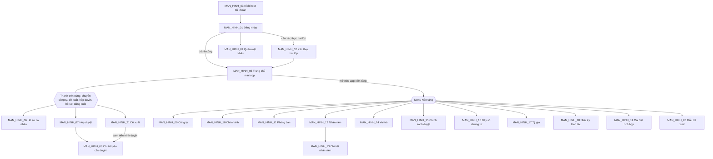

- Màn hình mở đầu của mọi vai trò: MAN_HINH_05.
- Menu Nền tảng chỉ hiện mục mà nhân viên có quyền; nhân viên thường chỉ thấy mục "Tỷ giá".
- Thanh trên cùng giống nhau ở mọi mini app.

## 2. Bảng vai trò – màn hình

| Màn hình | Quản trị tập đoàn | Quản trị công ty | Quản lý tỷ giá | Nhân viên |
|---|---|---|---|---|
| MAN_HINH_01 đến MAN_HINH_04 | Dùng | Dùng | Dùng | Dùng |
| MAN_HINH_05 Trang chủ | Xem | Xem | Xem | Xem |
| MAN_HINH_06 Hồ sơ cá nhân | Xem, Sửa (của mình) | Xem, Sửa (của mình) | Xem, Sửa (của mình) | Xem, Sửa (của mình) |
| MAN_HINH_07, MAN_HINH_08 Duyệt | Xem, Duyệt khi được chỉ định | Xem, Duyệt khi được chỉ định | Xem, Duyệt khi được chỉ định | Xem, Duyệt khi được chỉ định |
| MAN_HINH_09 Công ty | Xem, Thêm, Sửa, Ngừng | Không thấy | Không thấy | Không thấy |
| MAN_HINH_10 Chi nhánh | Xem, Thêm, Sửa, Ngừng | Trong công ty mình | Không thấy | Không thấy |
| MAN_HINH_11 Phòng ban | Xem, Thêm, Sửa, Ngừng | Trong công ty mình | Không thấy | Không thấy |
| MAN_HINH_12 Nhân viên | Xem, Mời, Nhập Excel | Trong công ty mình | Không thấy | Không thấy |
| MAN_HINH_13 Chi tiết nhân viên | Gán mọi phạm vi, Khóa, Vô hiệu hóa, Đặt lại xác thực hai lớp | Trong công ty mình, trừ chính mình | Không thấy | Không thấy |
| MAN_HINH_14 Vai trò | Xem, Thêm, Sửa (cả vai trò dùng chung) | Vai trò riêng công ty mình | Không thấy | Không thấy |
| MAN_HINH_15 Chính sách duyệt | Xem, Thêm, Sửa | Trong công ty mình | Không thấy | Không thấy |
| MAN_HINH_16 Dãy số chứng từ | Xem, Thêm, Sửa | Trong công ty mình | Không thấy | Không thấy |
| MAN_HINH_17 Tỷ giá | Xem, Thêm, Sửa | Xem | Xem, Thêm, Sửa | Xem |
| MAN_HINH_18 Nhật ký thao tác | Toàn tập đoàn | Trong công ty mình | Không thấy | Không thấy |
| MAN_HINH_19 Cài đặt tích hợp | Xem, Sửa | Không thấy | Không thấy | Không thấy |
| MAN_HINH_20 Mẫu đề xuất | Xem, Thêm, Sửa | Trong công ty mình | Không thấy | Không thấy |
| MAN_HINH_21 Đề xuất | Lập, xem đề xuất của mình; xem toàn công ty | Lập, xem đề xuất của mình; xem toàn công ty mình | Lập, xem đề xuất của mình | Lập, xem đề xuất của mình |

## 3. Đặc tả từng màn hình

Quy ước chung cho mọi màn hình sau đăng nhập:
- Bố cục: thanh trên cùng (logo, nút trang chủ, chọn công ty, hộp duyệt kèm số chờ, thông báo, ảnh đại diện mở hồ sơ cá nhân và đăng xuất); menu bên trái của mini app; vùng nội dung bên phải.
- Màn hình danh sách: tiêu đề, nút thao tác chính góc phải, ô tìm kiếm và bộ lọc, bảng có phân trang 20 dòng, nút "Lịch sử" mở MAN_HINH_18 lọc theo đối tượng.
- Thêm, sửa bằng ngăn kéo bên phải (màn hình rộng) hoặc trang riêng (điện thoại); lỗi kiểm tra dữ liệu hiện ngay dưới ô nhập.
- Trạng thái: đang tải = khung xám nhấp nháy theo bố cục; rỗng = hình minh họa, câu giải thích, nút thao tác chính; lỗi = thông báo kèm nút "Thử lại"; không có quyền = câu "Bạn không có quyền xem trang này" và nút về trang chủ.
- Thông báo thành công, thất bại hiện góc trên phải, tự ẩn sau 5 giây; thao tác ngừng hoạt động, khóa, vô hiệu hóa, thu hồi phiên có hộp thoại xác nhận.
- Điện thoại (dưới 768 điểm ảnh): menu trái thu thành nút mở; bảng chuyển thành danh sách thẻ.
- API: mã trong tài liệu `17`, ghi ở từng màn hình.
- Bản khung thang xám: `tai_lieu/ban_mau/KHUNG_GIAO_DIEN_MODULE_01.html`.

### MAN_HINH_01: Đăng nhập
- Mục đích: Vào hệ thống.
- Chức năng thực hiện: CHUC_NANG_06, CHUC_NANG_07, CHUC_NANG_08, CHUC_NANG_22, CHUC_NANG_24
- Bố cục: một cột giữa màn hình: logo; chọn ngôn ngữ; thẻ "Mật khẩu" và "Số điện thoại"; ô nhập; nút "Đăng nhập"; liên kết "Quên mật khẩu"; dải phân cách "hoặc"; ba nút Google, Microsoft, Zalo.
- Dữ liệu hiển thị: Không có.
- Thành phần: ONhap, Nut, NutDangNhapLienKet, KhoiCanhBao (tài liệu `15`).
- API: API_01, API_02, API_03, API_04, API_05 (tài liệu `17`).
- Thao tác: nhập, bấm Đăng nhập → MAN_HINH_02 nếu cần xác thực hai lớp, ngược lại MAN_HINH_05; thẻ Số điện thoại: nhập số → "Gửi mã" → ô nhập mã 6 chữ số; nút "Gửi lại mã" khóa 60 giây sau mỗi lần gửi, hiện "Gửi lại mã sau N giây".
- Trạng thái: đang xử lý (nút khóa, vòng quay); lỗi (thông báo trên ô nhập); bị khóa 15 phút (thông báo kèm thời gian còn lại).
- Thông báo: theo CHUC_NANG_06, CHUC_NANG_07, CHUC_NANG_08, CHUC_NANG_24.
- Quyền hiển thị: Không áp dụng.
- Responsive: thẻ chiếm toàn chiều ngang trên điện thoại.
- Trạng thái phê duyệt: Đã phê duyệt 2026-11-09

### MAN_HINH_02: Xác thực hai lớp
- Mục đích: Nhập mã xác thực hoặc đăng ký lần đầu.
- Chức năng thực hiện: CHUC_NANG_09
- Bố cục: một cột giữa: tiêu đề; nhập mã 6 chữ số; liên kết "Dùng mã dự phòng"; khi đăng ký lần đầu: mã QR, mã nhập tay, ô xác nhận, danh sách 10 mã dự phòng kèm nút tải về.
- Dữ liệu hiển thị: cách xác thực đã đăng ký (ứng dụng, SMS, email; che bớt số điện thoại, email).
- Thành phần: ONhap (mã OTP), Nut, KhoiCanhBao (tài liệu `15`).
- API: API_06, API_07, API_08 (tài liệu `17`).
- Thao tác: nhập mã → MAN_HINH_05.
- Trạng thái: đang xử lý; lỗi mã sai.
- Thông báo: "Mã xác thực không đúng."
- Quyền hiển thị: Không áp dụng.
- Responsive: như MAN_HINH_01.
- Trạng thái phê duyệt: Đã phê duyệt 2026-11-09

### MAN_HINH_03: Kích hoạt tài khoản
- Mục đích: Nhân viên được mời đặt mật khẩu lần đầu.
- Chức năng thực hiện: CHUC_NANG_04
- Bố cục: một cột giữa: lời chào kèm họ tên, tên công ty; ô mật khẩu, nhập lại mật khẩu, chỉ báo độ mạnh; nút "Kích hoạt"; hoặc nút Google, Microsoft.
- Dữ liệu hiển thị: họ tên, công ty mời.
- Thành phần: ONhap (mật khẩu), Nut, NutDangNhapLienKet, KhoiCanhBao (tài liệu `15`).
- API: API_11, API_04, API_05 (tài liệu `17`).
- Thao tác: kích hoạt → MAN_HINH_01 kèm thông báo thành công.
- Trạng thái: đường dẫn hết hạn hoặc đã dùng (thông báo, hướng dẫn liên hệ quản trị).
- Thông báo: theo CHUC_NANG_04.
- Quyền hiển thị: Không áp dụng.
- Responsive: như MAN_HINH_01.
- Trạng thái phê duyệt: Đã phê duyệt 2026-11-09

### MAN_HINH_04: Quên mật khẩu, đặt lại mật khẩu
- Mục đích: Lấy lại quyền truy cập.
- Chức năng thực hiện: CHUC_NANG_06
- Bố cục: bước 1: ô email hoặc số điện thoại, nút "Gửi đường dẫn"; bước 2 (mở từ đường dẫn): ô mật khẩu mới, nhập lại, nút "Đặt lại".
- Dữ liệu hiển thị: Không có.
- Thành phần: ONhap, Nut, KhoiCanhBao (tài liệu `15`).
- API: API_12, API_13 (tài liệu `17`).
- Thao tác: gửi → thông báo chung "Nếu tài khoản tồn tại, bạn sẽ nhận được đường dẫn"; đặt lại → MAN_HINH_01.
- Trạng thái: đường dẫn hết hạn.
- Thông báo: theo CHUC_NANG_06.
- Quyền hiển thị: Không áp dụng.
- Responsive: như MAN_HINH_01.
- Trạng thái phê duyệt: Đã phê duyệt 2026-11-09

### MAN_HINH_05: Trang chủ mini app
- Mục đích: Điểm vào mọi mini app.
- Chức năng thực hiện: CHUC_NANG_14, CHUC_NANG_11
- Bố cục: thanh trên cùng; lời chào; lưới ô mini app (biểu tượng, tên, số việc chờ); khối "Chờ tôi duyệt" tóm tắt 5 yêu cầu mới nhất.
- Dữ liệu hiển thị: mini app được dùng trong công ty đang chọn; số việc chờ; yêu cầu duyệt.
- Thành phần: ThanhTrenCung, OMiniApp, BangDuLieu, TrangThaiRong (tài liệu `15`).
- API: API_14, API_19, API_48 (tài liệu `17`).
- Thao tác: bấm ô → mở mini app; chọn công ty ở thanh trên → tải lại trang chủ theo công ty mới.
- Trạng thái: rỗng (chưa được cấp mini app nào, theo CHUC_NANG_14).
- Thông báo: Không có.
- Quyền hiển thị: ô mini app theo quyền `<app>.access`.
- Responsive: lưới 4 cột (rộng), 2 cột (điện thoại).
- Trạng thái phê duyệt: Đã phê duyệt 2026-11-09

### MAN_HINH_06: Hồ sơ cá nhân
- Mục đích: Tự quản lý tài khoản.
- Chức năng thực hiện: CHUC_NANG_10, CHUC_NANG_09, CHUC_NANG_22, CHUC_NANG_24
- Bố cục: các thẻ: "Thông tin" (họ tên, email, số điện thoại, công ty, ngôn ngữ); "Đăng nhập" (đổi mật khẩu; liên kết, hủy liên kết Google, Microsoft, Zalo); "Xác thực hai lớp" (bật, tắt, tạo lại mã dự phòng); "Phiên đăng nhập" (bảng thiết bị, địa chỉ IP, thời điểm, nút thu hồi).
- Dữ liệu hiển thị: như trên.
- Thành phần: ThanhTrenCung, ONhap, OChon, Nut, NutDangNhapLienKet, BangDuLieu, HopThoaiXacNhan, ThongBaoNoi (tài liệu `15`).
- API: API_04, API_05, API_07, API_08, API_15, API_16, API_17, API_18 (tài liệu `17`).
- Thao tác: lưu từng thẻ; thu hồi phiên có xác nhận.
- Trạng thái: nút tắt xác thực hai lớp bị vô hiệu kèm giải thích khi đang bắt buộc.
- Thông báo: theo CHUC_NANG_10, CHUC_NANG_24.
- Quyền hiển thị: chỉ của chính mình.
- Responsive: thẻ chuyển thành danh sách xổ xuống.
- Trạng thái phê duyệt: Đã phê duyệt 2026-11-09

### MAN_HINH_07: Hộp duyệt
- Mục đích: Xem, duyệt chứng từ đang chờ mình.
- Chức năng thực hiện: CHUC_NANG_17, CHUC_NANG_16
- Bố cục: tiêu đề kèm số chờ; bộ lọc công ty, mini app, loại chứng từ, chỉ quá hạn; danh sách: số chứng từ, loại, công ty, người lập, giá trị, cấp hiện tại, thời điểm gửi, nhãn "Quá hạn"; nút Đồng ý, Từ chối trên mỗi dòng.
- Dữ liệu hiển thị: yêu cầu đang chờ nhân viên ở mọi công ty.
- Thành phần: ThanhTrenCung, BoLoc, BangDuLieu, NhanTrangThai, Nut, HopThoaiXacNhan, TrangThaiRong, ThongBaoNoi (tài liệu `15`).
- API: API_39, API_41 (tài liệu `17`).
- Thao tác: bấm dòng → MAN_HINH_08; Từ chối → hộp thoại bắt buộc nhập lý do.
- Trạng thái: rỗng ("Không có chứng từ nào chờ bạn duyệt").
- Thông báo: duyệt thành công, thất bại.
- Quyền hiển thị: Không áp dụng.
- Responsive: thẻ chứng từ, nút Đồng ý, Từ chối cố định cuối thẻ.
- Trạng thái phê duyệt: Đã phê duyệt 2026-11-09

### MAN_HINH_08: Chi tiết yêu cầu duyệt
- Mục đích: Xem đầy đủ một yêu cầu và quyết định.
- Chức năng thực hiện: CHUC_NANG_16
- Bố cục: đầu trang: số chứng từ, trạng thái, giá trị (kèm quy đổi nếu ngoại tệ); dòng thời gian các cấp (người duyệt, người thay thế, quyết định, ý kiến, thời điểm); liên kết "Mở chứng từ" sang mini app sở hữu; nút Đồng ý, Từ chối (người duyệt cấp hiện tại); nút Rút lại (người lập, khi cấp 1 chưa quyết định).
- Dữ liệu hiển thị: yêu cầu duyệt và các bước.
- Thành phần: ThanhTrenCung, NhanTrangThai, DongThoiGian, Nut, HopThoaiXacNhan, ThongBaoNoi (tài liệu `15`).
- API: API_40, API_41, API_42 (tài liệu `17`).
- Thao tác: như trên.
- Trạng thái: không có quyền (không phải người lập hoặc người duyệt).
- Thông báo: theo CHUC_NANG_16.
- Quyền hiển thị: nút theo vai trò trong yêu cầu.
- Responsive: dòng thời gian dọc.
- Trạng thái phê duyệt: Đã phê duyệt 2026-11-09

### MAN_HINH_09: Công ty
- Mục đích: Quản lý cây công ty.
- Chức năng thực hiện: CHUC_NANG_01
- Bố cục: cây công ty bên trái; chi tiết công ty được chọn bên phải; nút "Thêm công ty".
- Dữ liệu hiển thị: mã, tên, mã số thuế, tiền tệ, chế độ kế toán, trạng thái, số chi nhánh.
- Thành phần: ThanhTrenCung, MenuMiniApp, CayDuLieu, NganKeo, Nut, HopThoaiXacNhan (tài liệu `15`).
- API: API_20, API_21 (tài liệu `17`).
- Thao tác: thêm, sửa, ngừng hoạt động (xác nhận).
- Trạng thái: chung.
- Thông báo: theo CHUC_NANG_01.
- Quyền hiển thị: chỉ quản trị tập đoàn.
- Responsive: cây và chi tiết xếp dọc.
- Trạng thái phê duyệt: Đã phê duyệt 2026-11-09

### MAN_HINH_10: Chi nhánh
- Mục đích: Quản lý chi nhánh.
- Chức năng thực hiện: CHUC_NANG_02
- Bố cục: danh sách chung; lọc loại, tỉnh thành, trạng thái.
- Dữ liệu hiển thị: mã, tên, loại, tỉnh thành, địa chỉ, trạng thái.
- Thành phần: ThanhTrenCung, MenuMiniApp, BoLoc, BangDuLieu, NhanTrangThai, NganKeo, HopThoaiXacNhan (tài liệu `15`).
- API: API_22 (tài liệu `17`).
- Thao tác: thêm, sửa, ngừng hoạt động.
- Trạng thái: chung.
- Thông báo: theo CHUC_NANG_02.
- Quyền hiển thị: theo bảng vai trò – màn hình.
- Responsive: chung.
- Trạng thái phê duyệt: Đã phê duyệt 2026-11-09

### MAN_HINH_11: Phòng ban
- Mục đích: Quản lý cây phòng ban.
- Chức năng thực hiện: CHUC_NANG_03
- Bố cục: như MAN_HINH_09 (cây bên trái, chi tiết bên phải).
- Dữ liệu hiển thị: mã, tên, phòng ban cha, trưởng phòng, số nhân viên.
- Thành phần: ThanhTrenCung, MenuMiniApp, CayDuLieu, NganKeo, OChon, HopThoaiXacNhan (tài liệu `15`).
- API: API_23 (tài liệu `17`).
- Thao tác: thêm, sửa, ngừng hoạt động.
- Trạng thái: chung.
- Thông báo: theo CHUC_NANG_03.
- Quyền hiển thị: theo bảng vai trò – màn hình.
- Responsive: như MAN_HINH_09.
- Trạng thái phê duyệt: Đã phê duyệt 2026-11-09

### MAN_HINH_12: Danh sách nhân viên
- Mục đích: Tìm, mời, nhập nhân viên.
- Chức năng thực hiện: CHUC_NANG_04, CHUC_NANG_05, CHUC_NANG_19
- Bố cục: danh sách chung; nút "Mời nhân viên" (ngăn kéo), "Nhập từ Excel" (hộp thoại: tải mẫu, chọn tệp, kết quả số dòng thành công, lỗi, tải tệp dòng lỗi); lọc chi nhánh, phòng ban, vai trò, trạng thái.
- Dữ liệu hiển thị: họ tên, email, số điện thoại, chi nhánh, phòng ban, vai trò, trạng thái, lần đăng nhập cuối.
- Thành phần: ThanhTrenCung, MenuMiniApp, BoLoc, BangDuLieu, NhanTrangThai, NganKeo, HopThoaiXacNhan (tài liệu `15`).
- API: API_24, API_25, API_26, API_27, API_28 (tài liệu `17`).
- Thao tác: bấm dòng → MAN_HINH_13; gửi lại đường dẫn kích hoạt với dòng "Đã mời".
- Trạng thái: chung.
- Thông báo: theo CHUC_NANG_04, CHUC_NANG_05.
- Quyền hiển thị: theo bảng vai trò – màn hình.
- Responsive: chung.
- Trạng thái phê duyệt: Đã phê duyệt 2026-11-09

### MAN_HINH_13: Chi tiết nhân viên
- Mục đích: Gán vai trò, khóa, vô hiệu hóa.
- Chức năng thực hiện: CHUC_NANG_13, CHUC_NANG_19, CHUC_NANG_09
- Bố cục: đầu trang: họ tên, trạng thái, nút Khóa, Mở khóa, Vô hiệu hóa, Đặt lại xác thực hai lớp; thẻ "Công ty" (các công ty thuộc về, chi nhánh, phòng ban, chức danh); thẻ "Vai trò" (bảng vai trò, phạm vi, ngày bắt đầu, ngày kết thúc; nút Gán vai trò, Gỡ); thẻ "Phiên đăng nhập" (thu hồi).
- Dữ liệu hiển thị: như trên.
- Thành phần: ThanhTrenCung, MenuMiniApp, NhanTrangThai, BangDuLieu, OChon, Nut, HopThoaiXacNhan (tài liệu `15`).
- API: API_29, API_30, API_31, API_32, API_33, API_34 (tài liệu `17`).
- Thao tác: Vô hiệu hóa → hộp thoại bàn giao: danh sách chứng từ chờ duyệt và phòng ban đang làm trưởng phòng, chọn người nhận cho từng mục, xác nhận.
- Trạng thái: chung.
- Thông báo: theo CHUC_NANG_13, CHUC_NANG_19.
- Quyền hiển thị: nút ẩn khi xem chính mình; phạm vi gán chỉ hiện phạm vi được phép.
- Responsive: thẻ xếp dọc.
- Trạng thái phê duyệt: Đã phê duyệt 2026-11-09

### MAN_HINH_14: Vai trò và ma trận quyền
- Mục đích: Quản lý vai trò.
- Chức năng thực hiện: CHUC_NANG_12
- Bố cục: danh sách vai trò bên trái (nhãn "Hệ thống", "Dùng chung", "Riêng công ty"); bên phải: thông tin vai trò và ma trận quyền nhóm theo mini app (dòng là đối tượng, cột là hành động, ô đánh dấu); quyền nhạy cảm có nhãn.
- Dữ liệu hiển thị: vai trò, quyền, số người đang có vai trò.
- Thành phần: ThanhTrenCung, MenuMiniApp, MaTranQuyen, NhanTrangThai, NganKeo (tài liệu `15`).
- API: API_35, API_36 (tài liệu `17`).
- Thao tác: thêm, sửa, ngừng dùng; lưu ma trận.
- Trạng thái: ô quyền người dùng không có bị vô hiệu.
- Thông báo: theo CHUC_NANG_12.
- Quyền hiển thị: vai trò hệ thống chỉ xem.
- Responsive: ma trận cuộn ngang trong khung riêng.
- Trạng thái phê duyệt: Đã phê duyệt 2026-11-09

### MAN_HINH_15: Chính sách duyệt
- Mục đích: Cấu hình cấp duyệt theo hạn mức.
- Chức năng thực hiện: CHUC_NANG_15
- Bố cục: danh sách loại chứng từ kèm chính sách đang hiệu lực; chi tiết: tiền tệ, ngày hiệu lực; bảng cấp duyệt (thứ tự, ngưỡng, người duyệt, người thay thế, thời hạn giờ); lịch sử chính sách.
- Dữ liệu hiển thị: như trên.
- Thành phần: ThanhTrenCung, MenuMiniApp, BangDuLieu, OChon, ONhap, NganKeo (tài liệu `15`).
- API: API_37 (tài liệu `17`).
- Thao tác: tạo chính sách mới từ ngày chọn; thêm, bớt cấp.
- Trạng thái: chung.
- Thông báo: theo CHUC_NANG_15.
- Quyền hiển thị: theo bảng vai trò – màn hình.
- Responsive: bảng cấp duyệt thành thẻ.
- Trạng thái phê duyệt: Đã phê duyệt 2026-11-09

### MAN_HINH_16: Dãy số chứng từ
- Mục đích: Cấu hình đánh số.
- Chức năng thực hiện: CHUC_NANG_20
- Bố cục: danh sách chung: loại chứng từ, tiền tố, kiểu đặt lại, số chữ số, số tiếp theo kỳ hiện tại, ví dụ số kế tiếp.
- Dữ liệu hiển thị: như trên.
- Thành phần: ThanhTrenCung, MenuMiniApp, BangDuLieu, NganKeo (tài liệu `15`).
- API: API_43 (tài liệu `17`).
- Thao tác: sửa (ngăn kéo).
- Trạng thái: chung.
- Thông báo: theo CHUC_NANG_20.
- Quyền hiển thị: theo bảng vai trò – màn hình.
- Responsive: chung.
- Trạng thái phê duyệt: Đã phê duyệt 2026-11-09

### MAN_HINH_17: Tiền tệ và tỷ giá
- Mục đích: Xem, nhập tỷ giá.
- Chức năng thực hiện: CHUC_NANG_21
- Bố cục: chọn ngày; bảng tỷ giá theo cặp tiền tệ, loại, nguồn; nút "Nhập tỷ giá"; nhãn cảnh báo khi hôm nay chưa có tỷ giá hạch toán.
- Dữ liệu hiển thị: như trên.
- Thành phần: ThanhTrenCung, MenuMiniApp, KhoiCanhBao, BangDuLieu, NganKeo (tài liệu `15`).
- API: API_45, API_46 (tài liệu `17`).
- Thao tác: nhập, sửa (quản lý tỷ giá).
- Trạng thái: chung.
- Thông báo: theo CHUC_NANG_21.
- Quyền hiển thị: nút nhập, sửa chỉ với quản trị tập đoàn, quản lý tỷ giá.
- Responsive: chung.
- Trạng thái phê duyệt: Đã phê duyệt 2026-11-09

### MAN_HINH_18: Nhật ký thao tác
- Mục đích: Tra cứu ai làm gì.
- Chức năng thực hiện: CHUC_NANG_23
- Bố cục: bộ lọc người làm, mini app, đối tượng, hành động, khoảng thời gian; bảng: thời điểm, người làm, công ty, hành động, đối tượng; bấm dòng mở ngăn kéo so sánh dữ liệu trước và sau.
- Dữ liệu hiển thị: như trên.
- Thành phần: ThanhTrenCung, MenuMiniApp, BoLoc, BangDuLieu, NganKeo (tài liệu `15`).
- API: API_47 (tài liệu `17`).
- Thao tác: lọc, xem chi tiết. Không có sửa, xóa.
- Trạng thái: chung.
- Thông báo: Không có.
- Quyền hiển thị: theo bảng vai trò – màn hình.
- Responsive: chung.
- Trạng thái phê duyệt: Đã phê duyệt 2026-11-09

### MAN_HINH_19: Cài đặt tích hợp
- Mục đích: Nhập mã ứng dụng đăng nhập và khóa nhà cung cấp gửi tin, có hiệu lực ngay.
- Chức năng thực hiện: CHUC_NANG_25, CHUC_NANG_26
- Đường dẫn: `/platform/integrations`
- Bố cục: tiêu đề kèm nút "Lịch sử"; câu giải thích; bốn thẻ nhóm: "Google", "Microsoft", "Zalo (đăng nhập)" (mỗi thẻ có đường dẫn chuyển hướng cần khai báo ở nhà cung cấp), "eSMS.vn (SMS, Zalo ZNS)" (API key, Secret key, Brandname SMS, mã Zalo OA, chế độ thử, mã mẫu ZNS cho mã OTP đăng nhập, có chứng từ chờ duyệt, nhắc quá hạn, kết quả duyệt; gợi ý tham số mẫu tin; nút "Kiểm tra kết nối eSMS" và khối kết quả liệt kê Zalo OA); nút "Lưu"; thẻ "Tin gửi gần đây" (thời điểm, kênh, mục đích, số điện thoại đã che, trạng thái, lỗi).
- Dữ liệu hiển thị: giá trị thường; khóa bí mật chỉ hiện "Đã lưu ••••<4 ký tự cuối>. Để trống để giữ." hoặc "Chưa nhập"; 50 tin gửi gần nhất.
- Thành phần: ThanhTrenCung, MenuMiniApp, ONhap (kiểu mật khẩu cho khóa bí mật), OChon (chế độ thử), Nut, KhoiCanhBao, BangDuLieu, NhanTrangThai, ThongBaoNoi (tài liệu `15`).
- API: API_49 (tài liệu `17`).
- Thao tác: nhập, "Lưu"; khóa bí mật đã lưu có nút "Xóa khóa" (bấm lại để hủy, xóa khi lưu); "Kiểm tra kết nối eSMS" dùng khóa đã lưu; "Gửi thử tin": nhập số điện thoại, gửi một tin theo mẫu mã OTP đã đăng ký (Zalo trước, SMS sau, có tính phí), kết quả hiện ngay và ghi vào nhật ký gửi tin.
- Trạng thái: chung; kiểm tra kết nối thành công (khối thông tin) hoặc thất bại (khối lỗi kèm lỗi nhà cung cấp).
- Thông báo: "Đã lưu cài đặt tích hợp."; theo CHUC_NANG_25.
- Quyền hiển thị: mục menu và màn hình chỉ với quyền `platform.integration.manage`; API kiểm tra quyền phạm vi tập đoàn.
- Responsive: chung; bảng tin gửi chuyển thành thẻ.
- Trạng thái phê duyệt: Chưa phê duyệt (người dùng bỏ dừng chờ ở điểm xem trước, CONG_VIEC_03 mục 14)

### MAN_HINH_20: Mẫu đề xuất
- Mục đích: Tạo, sửa mẫu đề xuất của công ty.
- Chức năng thực hiện: CHUC_NANG_27
- Đường dẫn: `/platform/proposal-templates`
- Bố cục: tiêu đề kèm nút "Lịch sử", "Thêm 3 mẫu có sẵn", "Thêm mẫu"; câu giải thích; bảng: mã mẫu, tên mẫu, số trường, tiền tệ, trạng thái, nhãn chính sách duyệt, nút "Sửa". Ngăn kéo tạo, sửa: mã mẫu (chỉ khi tạo), tên, tên tiếng Anh, mô tả, tiền tệ, trạng thái (khi sửa), giá trị duyệt (chọn trường tiền hoặc "Tổng thành tiền bảng chi tiết"), danh sách trường (mã, nhãn, kiểu, bắt buộc; lựa chọn mỗi dòng một lựa chọn; cột của bảng mỗi dòng `mã|nhãn|kiểu`), nút "Thêm trường", "Xóa trường".
- Dữ liệu hiển thị: mẫu đang dùng và ngừng dùng của công ty đang chọn.
- Thành phần: ThanhTrenCung, MenuMiniApp, BangDuLieu, NhanTrangThai, NganKeo, ONhap, OChon, Nut, ThongBaoNoi (tài liệu `15`).
- API: API_50 (tài liệu `17`).
- Thao tác: thêm, sửa mẫu; thêm 3 mẫu có sẵn (Phiếu đề nghị chi, Đề nghị tạm ứng, Đề nghị mua sắm).
- Trạng thái: rỗng ("Công ty chưa có mẫu đề xuất."); nhãn "Chưa có chính sách duyệt" khi loại chứng từ của mẫu chưa có chính sách ở MAN_HINH_15.
- Thông báo: "Đã lưu mẫu đề xuất."; theo CHUC_NANG_27.
- Quyền hiển thị: quyền `platform.proposal_template.manage`.
- Responsive: chung.
- Trạng thái phê duyệt: Chưa phê duyệt (người dùng bỏ dừng chờ ở điểm xem trước, CONG_VIEC_03 mục 14)

### MAN_HINH_21: Đề xuất
- Mục đích: Lập, gửi, theo dõi đề xuất; tải PDF.
- Chức năng thực hiện: CHUC_NANG_28, CHUC_NANG_29
- Đường dẫn: `/de-xuat` (danh sách); `/de-xuat/moi?mau=<id của mẫu>` (lập mới); `/de-xuat/{id}` (sửa nháp hoặc xem chi tiết).
- Bố cục:
  - Danh sách: tiêu đề, nút "Lập đề xuất"; thẻ "Đề xuất của tôi", "Toàn công ty" (chỉ người quản lý mẫu); lọc trạng thái; bảng số (nháp hiện "Nháp"), tiêu đề, mẫu, giá trị, trạng thái, người đề xuất, ngày lập; phân trang 20 dòng. "Lập đề xuất" mở ngăn kéo "Chọn mẫu đề xuất" (thẻ mẫu kèm mô tả, nhãn "Loại đề xuất này chưa có chính sách duyệt nên chưa gửi được.").
  - Lập mới, sửa nháp: tiêu đề; các trường theo mẫu (bảng chi tiết có "Thêm dòng", "Xóa dòng", "Tổng thành tiền"); nút "Lưu nháp", "Gửi duyệt" (hộp thoại xác nhận "Sau khi gửi, đề xuất nhận số và không sửa được nữa."); khối tệp đính kèm (sau khi lưu nháp).
  - Chi tiết: đầu trang số đề xuất (hoặc tên mẫu khi nháp) và nhãn trạng thái; nút "Xem tiến trình duyệt" (mở MAN_HINH_08), "Tải PDF", "Rút đề xuất" (khi rút được), "Xóa nháp" (khi Nháp); người đề xuất, ngày lập, tên mẫu; nội dung các trường và bảng chi tiết; khối tệp đính kèm (tải về; thêm, xóa khi Nháp; gợi ý "PDF, JPG, PNG, XLSX, DOCX; tối đa 10 tệp, mỗi tệp 10 MB.").
- Dữ liệu hiển thị: đề xuất theo bản chụp mẫu lúc lập; giá trị tiền định dạng Việt Nam (dấu chấm hàng nghìn, dấu phẩy thập phân).
- Thành phần: ThanhTrenCung, BoLoc, BangDuLieu, NhanTrangThai, NganKeo, ONhap, OChon, Nut, HopThoaiXacNhan, KhoiCanhBao, TrangThaiRong (tài liệu `15`).
- API: API_50 (đọc mẫu), API_51, API_52, API_53 (tài liệu `17`).
- Thao tác: như bố cục; lưu nháp lần đầu chuyển sang `/de-xuat/{id}`.
- Trạng thái: rỗng ("Chưa có đề xuất."); công ty chưa có mẫu ("Công ty chưa có mẫu đề xuất. Liên hệ quản trị công ty."); mẫu chưa có chính sách duyệt (khối cảnh báo, nút "Gửi duyệt" bị vô hiệu); không xem được đề xuất (thông báo "Không tìm thấy dữ liệu hoặc bạn không có quyền xem.").
- Thông báo: "Đã lưu nháp." · "Đã gửi đề xuất đi duyệt." · "Đã rút đề xuất."; lỗi theo CHUC_NANG_28, hiện dưới đúng ô nhập.
- Quyền hiển thị: lập với quyền `platform.proposal.create`; xem theo QUYTAC_NGHIEPVU_36; thẻ "Toàn công ty" với quyền `platform.proposal_template.manage`.
- Responsive: bảng chuyển thành thẻ; nút xếp dọc.
- Trạng thái phê duyệt: Chưa phê duyệt (người dùng bỏ dừng chờ ở điểm xem trước, CONG_VIEC_03 mục 14)

### Phần mở rộng MAN_HINH_01, MAN_HINH_03, MAN_HINH_06, MAN_HINH_08 (CONG_VIEC_03)
- MAN_HINH_01 Đăng nhập: gọi API_54 khi mở trang. Thẻ "Mật khẩu", "Số điện thoại" chỉ hiện khi đã cài eSMS; thẻ "Số điện thoại": ô số điện thoại, nút "Gửi mã", ô "Mã xác minh" 6 chữ số kèm câu "Đã gửi mã qua Zalo hoặc SMS nếu số này có tài khoản. Mã hiệu lực 5 phút.", liên kết "Đổi số điện thoại". Nút "Đăng nhập bằng Google", "Đăng nhập bằng Microsoft", "Đăng nhập bằng Zalo" (API_04 chế độ `login`) chỉ hiện với nhà cung cấp đã cài đủ ở MAN_HINH_19. Nhà cung cấp trả về lỗi thì trang nhận tham số `loi` và hiện thông báo theo ngôn ngữ đang chọn; kích hoạt bằng nhà cung cấp xong hiện "Đã kích hoạt tài khoản. Đăng nhập bằng <nhà cung cấp> để bắt đầu.".
- MAN_HINH_03 Kích hoạt tài khoản: nút Google, Microsoft (API_04 chế độ `activate`) chỉ hiện khi đã cài; email của tài khoản nhà cung cấp phải trùng email được mời.
- MAN_HINH_06 Hồ sơ cá nhân, thẻ "Đăng nhập": danh sách "Cách đăng nhập" (nhà cung cấp, định danh, nút "Hủy liên kết" trừ mật khẩu, có hộp thoại xác nhận); nút "Liên kết Google", "Liên kết Microsoft", "Liên kết Zalo" (API_04 chế độ `link`) cho nhà cung cấp đã cài mà chưa liên kết; câu "Liên kết tài khoản để đăng nhập nhanh. Zalo phải liên kết ở đây trước khi dùng để đăng nhập."; liên kết xong quay về kèm thông báo "Đã liên kết <nhà cung cấp>.", lỗi quay về kèm thông báo lỗi. API thêm: API_54.
- MAN_HINH_08 Chi tiết yêu cầu duyệt: khi chứng từ là đề xuất (loại chứng từ `platform.proposal_*`) hiện thêm khối đề xuất: tiêu đề, nút "Tải PDF", nội dung các trường và bảng chi tiết, tệp đính kèm (tải về). API thêm: API_51, API_52, API_53.
- Thanh trên cùng: thêm liên kết "Đề xuất" mở MAN_HINH_21.

## 4. Bản mẫu và kết quả rà soát giao diện – 2026-11-09

Bản mẫu: [ban_mau/index.html](ban_mau/index.html) (18 tệp `MAN_HINH_<số>_<TÊN>.html`, dùng chung `chung.css`, `chung.js`). Bảng điều khiển góc dưới trái đổi vai trò và trạng thái hiển thị.

| # | Mục rà soát | Kết quả |
|---|---|---|
| 1 | Khớp bản khung và đặc tả đã duyệt | Đạt |
| 2 | Chỉ dùng giá trị trong tài liệu `15` | Đạt; ngoại lệ: màu viền của KhoiCanhBao (#F1D38A, #F5B5B5, #BFD0FA) chưa có trong tài liệu `15`, đề xuất bổ sung |
| 3 | Đủ trạng thái có dữ liệu, rỗng, đang tải, lỗi, không có quyền | Đạt, 18 màn hình × 5 trạng thái |
| 4 | Thông báo rõ lỗi gì, cách xử lý | Đạt |
| 5 | Không tràn ngang ở 1440 và 375 điểm ảnh | Đạt (kiểm tra tự động 180 trường hợp) |
| 6 | Tiếng Việt có dấu, nội dung dài không tràn khung | Đạt |
| 7 | Tương phản tối thiểu 4,5:1 | Đạt theo tài liệu `15` mục 2 |
| 8 | Bàn phím, viền phần tử đang chọn, ô nhập có nhãn | Đạt; mọi ô nhập có nhãn (kiểm tra tự động); Esc đóng hộp thoại |
| 9 | Thành phần hiện theo vai trò | Đạt; nhân viên chỉ thấy mục Tỷ giá, mở MAN_HINH_09 bị chặn |
| 10 | Nút có trạng thái đang xử lý; thao tác không hoàn tác có xác nhận | Đạt |
| 11 | Lỗi hiện tại đúng ô nhập | Đạt |
| 12 | Màn hình cũ không bị ảnh hưởng | Không áp dụng (chưa có giao diện cũ) |

## MODULE_02 Sản phẩm và Nhà bán (phần Sản phẩm, CONG_VIEC_04)

Mini app `apps/web-catalog`, đường dẫn gốc `/catalog` (mini app Nền tảng chuyển tiếp `/catalog` sang ứng dụng này, cùng tên miền và cookie phiên). Khung trang, thanh trên cùng, thành phần dùng chung lấy từ `packages/ui`; quy ước chung như mục 3 của MODULE_01. Mở `/catalog` thì chuyển tới mục menu đầu tiên có quyền; không có mục nào thì hiện "Bạn không có quyền xem trang này".

## 5. Danh sách màn hình và điều hướng (MODULE_02)

| Mã | Tên màn hình | Chức năng (10) | Vai trò được truy cập (08) | Mở từ | Bản mẫu |
|---|---|---|---|---|---|
| MAN_HINH_22 | Ngành hàng và đơn vị tính | CHUC_NANG_30 | Quản trị tập đoàn (sửa); quản trị công ty, Quản lý sản phẩm (xem) | Menu Sản phẩm | Không lập (CONG_VIEC_04 mục 6) |
| MAN_HINH_23 | Danh sách sản phẩm (kèm ngăn kéo nhập Excel) | CHUC_NANG_31, CHUC_NANG_33 | Quản trị tập đoàn, quản trị công ty, Quản lý sản phẩm | Menu Sản phẩm | Không lập |
| MAN_HINH_24 | Chi tiết sản phẩm (thêm, sửa; phần Giá bán, Liên kết công ty khác) | CHUC_NANG_31, CHUC_NANG_32, CHUC_NANG_34, CHUC_NANG_36 | Quản trị tập đoàn, quản trị công ty, Quản lý sản phẩm | MAN_HINH_23 | Không lập |
| MAN_HINH_25 | Kênh bán và nhóm khách hàng | CHUC_NANG_35 | Quản trị tập đoàn, quản trị công ty | Menu Sản phẩm | Không lập |
| MAN_HINH_26 | Bảng giá (giá hiện hành, lịch sử giá) | CHUC_NANG_36 | Quản trị tập đoàn, quản trị công ty (sửa); Quản lý sản phẩm (xem) | Menu Sản phẩm | Không lập |
| MAN_HINH_27 | Phiếu điều chỉnh giá (danh sách, lập, sửa nháp, chi tiết) | CHUC_NANG_37 | Quản trị tập đoàn, quản trị công ty (lập); Quản lý sản phẩm (xem) | Menu Sản phẩm; MAN_HINH_24, MAN_HINH_26 | Không lập |

Sơ đồ điều hướng:

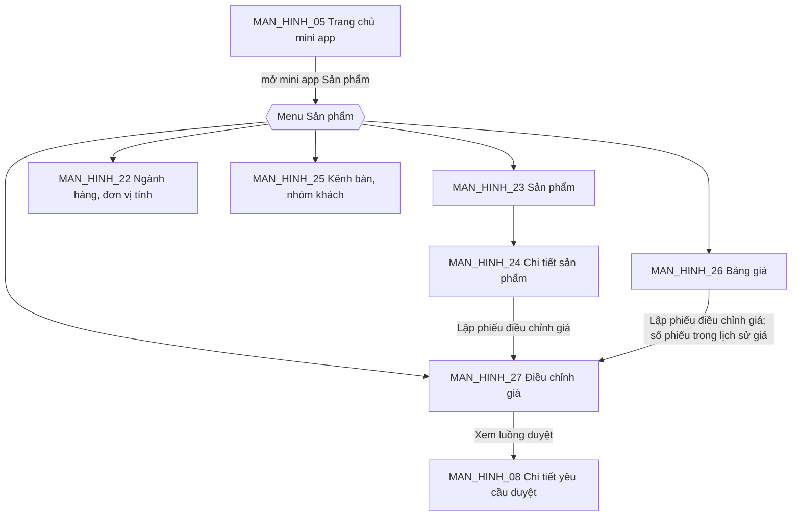

- Thứ tự menu và quyền hiện mục: Sản phẩm (`catalog.product.view`), Ngành hàng, đơn vị tính (`catalog.access`), Bảng giá (`catalog.price.view`), Điều chỉnh giá (`catalog.price.view`), Kênh bán, nhóm khách (`catalog.price.manage`).
- Mỗi màn hình có nút "Lịch sử" mở MAN_HINH_18 lọc theo đối tượng.

## 6. Bảng vai trò – màn hình (MODULE_02)

| Màn hình | Quản trị tập đoàn | Quản trị công ty | Quản lý sản phẩm | Nhân viên |
|---|---|---|---|---|
| MAN_HINH_22 Ngành hàng, đơn vị tính | Xem, Thêm, Sửa, Ngừng | Xem | Xem | Không thấy |
| MAN_HINH_23 Sản phẩm | Xem, Thêm, Nhập Excel | Trong công ty mình | Trong công ty mình | Không thấy |
| MAN_HINH_24 Chi tiết sản phẩm | Xem, Sửa, Ngừng bán, Ảnh; xem giá; liên kết, sao chép khi có quyền ở công ty kia | Trong công ty mình; xem giá; liên kết, sao chép chỉ khi có quyền quản lý sản phẩm ở công ty kia | Trong công ty mình; xem giá (không lập phiếu); liên kết, sao chép như quản trị công ty | Không thấy |
| MAN_HINH_25 Kênh bán, nhóm khách hàng | Xem, Thêm, Sửa, Ngừng | Trong công ty mình | Không thấy | Không thấy |
| MAN_HINH_26 Bảng giá | Xem, Thêm, Sửa, Ngừng | Trong công ty mình | Xem | Không thấy |
| MAN_HINH_27 Phiếu điều chỉnh giá | Xem, Lập, Gửi, Rút (phiếu của mình) | Trong công ty mình | Xem | Không thấy |

## 7. Đặc tả từng màn hình (MODULE_02)

### MAN_HINH_22: Ngành hàng và đơn vị tính
- Mục đích: Xem và quản lý cây ngành hàng, danh mục đơn vị tính dùng chung tập đoàn.
- Chức năng thực hiện: CHUC_NANG_30
- Đường dẫn: `/catalog/categories`
- Bố cục: tiêu đề kèm nút "Lịch sử"; câu giải thích "Dùng chung cho mọi công ty trong tập đoàn. Chỉ quản trị tập đoàn thêm, sửa. Mã ngành hàng là tiền tố mã hàng của sản phẩm."; hai thẻ "Ngành hàng", "Đơn vị tính". Thẻ Ngành hàng: cây bên trái (mã · tên, nhãn "Ngừng dùng"), nút "Thêm ngành hàng cấp 1"; khối chi tiết bên phải (mã, tên tiếng Anh, cấp, theo dõi, bảo hành, số sản phẩm, trạng thái; nút "Sửa", "Thêm ngành hàng con", "Ngừng dùng"/"Dùng lại"). Ngăn kéo: ngành hàng cha, mã, tên tiếng Việt, tên tiếng Anh, theo dõi (không, lô và hạn dùng, serial và IMEI), bảo hành (tháng). Thẻ Đơn vị tính: bảng mã, tên tiếng Việt, tên tiếng Anh, trạng thái, nút "Sửa", "Ngừng dùng"/"Dùng lại"; nút "Thêm đơn vị tính"; ngăn kéo mã (chỉ khi thêm), tên tiếng Việt, tên tiếng Anh.
- Dữ liệu hiển thị: mọi ngành hàng, đơn vị tính kể cả ngừng dùng.
- Thành phần: ThanhTrenCung, MenuMiniApp, NganKeo, ONhap, OChon, Nut, BangDuLieu, NhanTrangThai, HopThoaiXacNhan (tài liệu `15`).
- API: API_55 (tài liệu `17`).
- Thao tác: thêm, sửa, ngừng dùng, dùng lại (có hộp thoại xác nhận).
- Trạng thái: rỗng ("Chưa có ngành hàng."); chưa chọn ("Chọn một ngành hàng để xem chi tiết.").
- Thông báo: "Đã lưu."; lỗi theo CHUC_NANG_30 dưới đúng ô nhập.
- Quyền hiển thị: nút thêm, sửa, ngừng dùng chỉ với `catalog.category.manage`.
- Responsive: chung.
- Bổ sung CONG_VIEC_07: khối chi tiết thêm dòng "Kiểm tra chất lượng khi nhập mua" (Có, Không); ngăn kéo thêm ô đánh dấu "Cần kiểm tra chất lượng khi nhập mua (hàng chưa vào tồn đến khi kiểm xong)", ngành hàng con mặc định theo ngành hàng cha; sửa không gửi ô này thì giữ nguyên (CHUC_NANG_52, QUYTAC_NGHIEPVU_65).
- Trạng thái phê duyệt: Chưa phê duyệt (người dùng cho AI làm tiếp không dừng ở điểm xem trước, CONG_VIEC_04 mục 14)

### MAN_HINH_23: Danh sách sản phẩm
- Mục đích: Tìm, lọc sản phẩm của công ty; thêm; nhập Excel.
- Chức năng thực hiện: CHUC_NANG_31, CHUC_NANG_33
- Đường dẫn: `/catalog/products`
- Bố cục: tiêu đề, nút "Nhập Excel", "Thêm sản phẩm"; ô tìm "Tên (không cần dấu), mã hàng, mã vạch"; lọc ngành hàng, trạng thái (Đang bán, Ngừng bán); bảng ảnh đại diện, mã sản phẩm, tên, ngành hàng, đơn vị cơ sở, số biến thể, trạng thái, ngày cập nhật; phân trang. Ngăn kéo "Nhập sản phẩm từ Excel": hướng dẫn cách ghi cột, "Tải tệp mẫu", chọn tệp (".xlsx, tối đa 2.000 dòng, 5 MB"), kết quả số sản phẩm, biến thể, dòng lỗi, danh sách dòng lỗi, "Tải tệp dòng lỗi".
- Dữ liệu hiển thị: sản phẩm của công ty đang chọn, mới cập nhật trước.
- Thành phần: ThanhTrenCung, MenuMiniApp, BoLoc, BangDuLieu, NhanTrangThai, NganKeo, Nut, TrangThaiRong (tài liệu `15`).
- API: API_55 (đọc ngành hàng), API_56, API_57 (ảnh đại diện), API_58.
- Thao tác: bấm mã sản phẩm mở MAN_HINH_24; "Thêm sản phẩm" mở `/catalog/products/new`.
- Trạng thái: rỗng ("Chưa có sản phẩm."); không có kết quả lọc.
- Thông báo: theo CHUC_NANG_33.
- Quyền hiển thị: màn hình với `catalog.product.view`; nút "Nhập Excel", "Thêm sản phẩm" với `catalog.product.manage`.
- Responsive: bảng chuyển thành thẻ.
- Trạng thái phê duyệt: Chưa phê duyệt (CONG_VIEC_04 mục 14)

### MAN_HINH_24: Chi tiết sản phẩm
- Mục đích: Thêm, sửa sản phẩm; xem giá bán; liên kết, sao chép sang công ty khác.
- Chức năng thực hiện: CHUC_NANG_31, CHUC_NANG_32, CHUC_NANG_34, CHUC_NANG_36
- Đường dẫn: `/catalog/products/[id]` (`/catalog/products/new` khi thêm)
- Bố cục: đầu trang mã · tên và nhãn trạng thái, nút "Lịch sử", "Danh sách", "Ngừng bán"/"Bán lại". Một trang gồm các phần (không chia thẻ): "Thông tin chung" (ngành hàng, mã sản phẩm, tên, thuế suất, theo dõi, bảo hành, đơn vị cơ sở, thương hiệu, xuất xứ, trọng lượng, thể tích, mô tả); "Đơn vị quy đổi" (đơn vị, hệ số, "Thêm đơn vị quy đổi"); "Phân loại và biến thể" (thuộc tính phân loại và các giá trị, "Tạo biến thể theo phân loại"; bảng biến thể: phân loại, mã hàng, mã vạch kèm đơn vị, "+ Mã vạch", đang bán); "Thông số"; nút "Lưu". Sau khi lưu lần đầu có thêm: "Ảnh" (lưới ảnh, "Ảnh đại diện", "Đặt làm ảnh đại diện", "Xóa", "Thêm ảnh"; gợi ý "JPG, PNG, WEBP; tối đa 10 ảnh, mỗi ảnh 5 MB."); "Giá bán" (mỗi bảng giá đang dùng một bảng mã hàng, đơn vị, giá, hiệu lực từ; nút "Lập phiếu điều chỉnh giá"); "Liên kết công ty khác" (bảng mã hàng, công ty, sản phẩm tương ứng, hệ số, "Bỏ liên kết"; chọn công ty, "Sao chép sang công ty này", "Gợi ý theo mã vạch" kèm danh sách gợi ý và nút "Liên kết").
- Dữ liệu hiển thị: sản phẩm của công ty đang chọn; giá hiện hành hôm nay; liên kết đọc cả hai chiều.
- Thành phần: ThanhTrenCung, MenuMiniApp, ONhap, OChon, Nut, BangDuLieu, NhanTrangThai, HopThoaiXacNhan, KhoiCanhBao (tài liệu `15`).
- API: API_55 (đọc), API_56, API_57, API_59, API_61 (đọc giá).
- Thao tác: chọn ngành hàng thì điền sẵn theo dõi, bảo hành; lưu lần đầu chuyển sang `/catalog/products/{id}`; liên kết từ giao diện qua gợi ý theo mã vạch với hệ số 1 (hệ số khác chỉ qua API_59).
- Trạng thái: chung; sản phẩm công ty khác hoặc không tồn tại hiện "Không tìm thấy dữ liệu hoặc bạn không có quyền xem."; chưa có giá ("Sản phẩm chưa có giá trong bảng giá này."); chưa liên kết ("Chưa liên kết với công ty nào."); không có gợi ý ("Không có sản phẩm cùng mã vạch chưa liên kết.").
- Thông báo: "Đã lưu sản phẩm." · "Đã liên kết." · "Đã sao chép sang <công ty> và liên kết từng biến thể."; lỗi theo CHUC_NANG_31, 32, 34 dưới đúng ô, đúng dòng.
- Quyền hiển thị: sửa, ảnh, liên kết với `catalog.product.manage`; khu chọn công ty để sao chép, gợi ý chỉ hiện khi nhân viên thuộc công ty khác, kèm câu "Cần quyền quản lý sản phẩm ở cả công ty đích."; phần Giá bán với `catalog.price.view`, nút lập phiếu với `catalog.price.manage`.
- Responsive: bảng chuyển thành thẻ.
- Sửa theo THAY_DOI_18 (CONG_VIEC_43, 2026-11-11) (CHUC_NANG_157): phần "Thông tin chung" thêm ô "Loại" ("Hàng hóa" mặc định, "Dịch vụ"), gợi ý "Dịch vụ không theo dõi tồn kho, lô, số serial."; chọn Dịch vụ thì ẩn ô theo dõi lô, serial, trọng lượng, thể tích. Lỗi: "Dịch vụ không theo dõi lô, số serial.", "Sản phẩm đã phát sinh tồn kho, chứng từ kho; không đổi loại được.".
- Trạng thái phê duyệt: Chưa phê duyệt (CONG_VIEC_04 mục 14)

### MAN_HINH_25: Kênh bán và nhóm khách hàng
- Mục đích: Khai báo kênh bán, nhóm khách hàng của công ty.
- Chức năng thực hiện: CHUC_NANG_35
- Đường dẫn: `/catalog/channels`
- Bố cục: tiêu đề kèm "Lịch sử"; hai thẻ "Kênh bán", "Nhóm khách hàng"; nút "Thêm kênh bán" hoặc "Thêm nhóm khách hàng"; thẻ Kênh bán thêm nút "Thêm kênh có sẵn" và câu "Kênh có sẵn: Bán sỉ, Bán lẻ, Sàn VComm, Nội bộ. Kênh đã có thì không thêm lại."; bảng mã, tên, trạng thái, "Sửa", "Ngừng dùng"/"Dùng lại"; ngăn kéo mã (chỉ khi thêm), tên.
- Dữ liệu hiển thị: kênh, nhóm khách của công ty đang chọn.
- Thành phần: ThanhTrenCung, MenuMiniApp, BangDuLieu, NhanTrangThai, NganKeo, ONhap, Nut (tài liệu `15`).
- API: API_60.
- Thao tác: như bố cục.
- Trạng thái: rỗng ("Chưa có kênh bán.", "Chưa có nhóm khách hàng.").
- Thông báo: "Đã lưu."; "Mã đã có trong công ty.".
- Quyền hiển thị: mục menu với `catalog.price.manage`.
- Responsive: chung.
- Trạng thái phê duyệt: Chưa phê duyệt (CONG_VIEC_04 mục 14)

### MAN_HINH_26: Bảng giá
- Mục đích: Quản lý bảng giá; xem giá hiện hành tại một ngày, lịch sử giá.
- Chức năng thực hiện: CHUC_NANG_36
- Đường dẫn: `/catalog/price-lists`
- Bố cục: tiêu đề kèm "Lịch sử", nút "Lập phiếu điều chỉnh giá", "Thêm bảng giá"; câu giải thích thứ tự chọn bảng giá; bảng mã, tên, kênh bán ("Mọi kênh"), nhóm khách ("Mọi nhóm khách"), tiền tệ, thuế ("Đã gồm thuế"/"Chưa gồm thuế"), trạng thái, "Xem giá", "Sửa", "Ngừng dùng"/"Dùng lại". Khối "Giá hiện hành: <tên>": ô ngày "Tại ngày", ô tìm tên sản phẩm, mã hàng; bảng mã hàng, sản phẩm, đơn vị, giá, hiệu lực từ, nút "Lịch sử giá". Ngăn kéo "Lịch sử giá": giá, hiệu lực từ, số phiếu (mở MAN_HINH_27). Ngăn kéo bảng giá: mã, tên, kênh, nhóm khách, tiền tệ (ba ô này chỉ khi thêm, câu "Kênh, nhóm khách hàng, tiền tệ không đổi sau khi tạo."), "Giá đã gồm thuế giá trị gia tăng".
- Dữ liệu hiển thị: bảng giá của công ty đang chọn.
- Thành phần: ThanhTrenCung, MenuMiniApp, BangDuLieu, NhanTrangThai, NganKeo, ONhap, OChon, Nut (tài liệu `15`).
- API: API_60 (đọc kênh, nhóm khách), API_46, API_61.
- Thao tác: như bố cục.
- Trạng thái: rỗng ("Chưa có bảng giá."; "Bảng giá chưa có giá. Lập phiếu điều chỉnh giá để đặt giá.").
- Thông báo: "Đã lưu."; lỗi theo CHUC_NANG_36.
- Quyền hiển thị: màn hình với `catalog.price.view`; nút thêm, sửa, ngừng, lập phiếu với `catalog.price.manage`.
- Responsive: bảng chuyển thành thẻ.
- Trạng thái phê duyệt: Chưa phê duyệt (CONG_VIEC_04 mục 14)

### MAN_HINH_27: Phiếu điều chỉnh giá
- Mục đích: Lập, gửi duyệt, rút, theo dõi phiếu điều chỉnh giá.
- Chức năng thực hiện: CHUC_NANG_37
- Đường dẫn: `/catalog/price-changes` (danh sách); `/catalog/price-changes/new` (lập mới); `/catalog/price-changes/[id]` (sửa nháp hoặc xem chi tiết).
- Bố cục:
  - Danh sách: tiêu đề, nút "Lập phiếu"; câu "Giá chỉ thay đổi qua phiếu. Công ty có chính sách duyệt thì giá đổi sau khi duyệt xong; chưa có chính sách thì giá đổi ngay khi gửi."; lọc trạng thái; bảng số phiếu (nháp hiện "(Nháp)"), bảng giá, hiệu lực từ, số dòng, trạng thái, người lập, ngày lập; phân trang.
  - Lập, sửa nháp, chi tiết: đầu trang "Lập phiếu điều chỉnh giá" hoặc "Phiếu điều chỉnh giá <số>", nút "Danh sách phiếu", "Xem luồng duyệt" (khi đã gửi, mở MAN_HINH_08 `/hop-duyet/{id}`); bảng giá, hiệu lực từ ("Không trước ngày gửi."), ghi chú; phần "Mặt hàng điều chỉnh": ô "Tìm sản phẩm để thêm" (chọn sản phẩm rồi "Thêm <n> mã hàng"), "Nhập từ Excel", "Tải tệp mẫu", danh sách dòng không đọc được; bảng mã hàng, sản phẩm, đơn vị, giá hiện hành, giá mới, "Bỏ dòng"; nút "Lưu nháp", "Gửi duyệt" (hộp thoại "Sau khi gửi, phiếu nhận số và không sửa được nữa. Gửi phiếu này?"), "Xóa phiếu", "Rút phiếu".
- Dữ liệu hiển thị: phiếu của công ty đang chọn; nhãn trạng thái Nháp, Chờ duyệt, Đã duyệt, Bị từ chối, Đã rút.
- Thành phần: ThanhTrenCung, MenuMiniApp, BoLoc, BangDuLieu, NhanTrangThai, ONhap, OChon, Nut, HopThoaiXacNhan, KhoiCanhBao (tài liệu `15`).
- API: API_56 (tìm sản phẩm), API_61 (đọc bảng giá), API_62.
- Thao tác: như bố cục; lưu lần đầu chuyển sang `/catalog/price-changes/{id}`.
- Trạng thái: rỗng ("Chưa có phiếu điều chỉnh giá."; "Chưa có mặt hàng. Tìm sản phẩm để thêm hoặc nhập từ Excel.").
- Thông báo: "Đã lưu nháp." · "Đã gửi phiếu đi duyệt." · "Công ty chưa có chính sách duyệt cho phiếu điều chỉnh giá nên giá đã được áp dụng." · "Đã xóa phiếu nháp." · "Đã rút phiếu."; lỗi theo CHUC_NANG_37.
- Quyền hiển thị: màn hình với `catalog.price.view`; lập, sửa, gửi, xóa, rút với `catalog.price.manage` và chỉ người lập (theo `canEdit`, `canWithdraw` của API).
- Responsive: bảng chuyển thành thẻ; nút xếp dọc.
- Trạng thái phê duyệt: Chưa phê duyệt (CONG_VIEC_04 mục 14)

## MODULE_03 Kho (phần web, CONG_VIEC_05)

Mini app `apps/web-inventory`, đường dẫn gốc `/inventory` (mini app Nền tảng chuyển tiếp `/inventory` sang ứng dụng này, cùng tên miền và cookie phiên). Khung trang, thành phần dùng chung lấy từ `packages/ui`; quy ước chung như mục 3 của MODULE_01. Mở `/inventory` thì chuyển tới mục menu đầu tiên có quyền; không có mục nào thì hiện "Bạn không có quyền xem trang này". Mọi ô tìm mặt hàng nhận máy quét mã vạch gõ phím kèm Enter. Giá vốn, giá trị hiện trống với người không có quyền xem giá vốn.

## 8. Danh sách màn hình và điều hướng (MODULE_03)

| Mã | Tên màn hình | Chức năng (10) | Vai trò được truy cập (08) | Mở từ | Bản mẫu |
|---|---|---|---|---|---|
| MAN_HINH_28 | Kho và vị trí (kèm cài đặt giữ hàng, in tem vị trí) | CHUC_NANG_38, CHUC_NANG_45 | Quản trị tập đoàn, quản trị công ty, Quản lý kho (sửa); Thủ kho, nhân viên công ty chủ hàng (xem) | Menu Kho | Không lập (CONG_VIEC_05 mục 6) |
| MAN_HINH_29 | Tồn kho (kèm chi tiết lô, serial, vị trí, hàng giữ; in tem sản phẩm) | CHUC_NANG_39, CHUC_NANG_45 | Quản trị tập đoàn, quản trị công ty, Quản lý kho, Thủ kho; nhân viên công ty chủ hàng có quyền xem tồn | Menu Kho | Không lập |
| MAN_HINH_30 | Thẻ kho | CHUC_NANG_39 | Như MAN_HINH_29 | MAN_HINH_29 | Không lập |
| MAN_HINH_31 | Danh sách phiếu kho | CHUC_NANG_40, CHUC_NANG_41 | Như MAN_HINH_29 (lập phiếu: có quyền lập phiếu kho) | Menu Kho | Không lập |
| MAN_HINH_32 | Phiếu nhập khác, xuất khác, điều chỉnh | CHUC_NANG_40, CHUC_NANG_45 | Quản trị tập đoàn, quản trị công ty, Quản lý kho, Thủ kho (lập); nhân viên công ty chủ hàng (xem) | MAN_HINH_31, MAN_HINH_30, MAN_HINH_34 | Không lập |
| MAN_HINH_33 | Phiếu chuyển kho | CHUC_NANG_41 | Như MAN_HINH_32; xuất ở kho nguồn, nhận ở kho đích | MAN_HINH_31 | Không lập |
| MAN_HINH_34 | Kiểm kê (danh sách, lập; đếm và kết thúc) | CHUC_NANG_42 | Quản trị tập đoàn, quản trị công ty, Quản lý kho | Menu Kho | Không lập |
| MAN_HINH_35 | Giữ hàng và tồn an toàn | CHUC_NANG_43, CHUC_NANG_44 | Quản trị tập đoàn, quản trị công ty, Quản lý kho (sửa); Thủ kho (xem) | Menu Kho | Không lập |

Sơ đồ điều hướng:

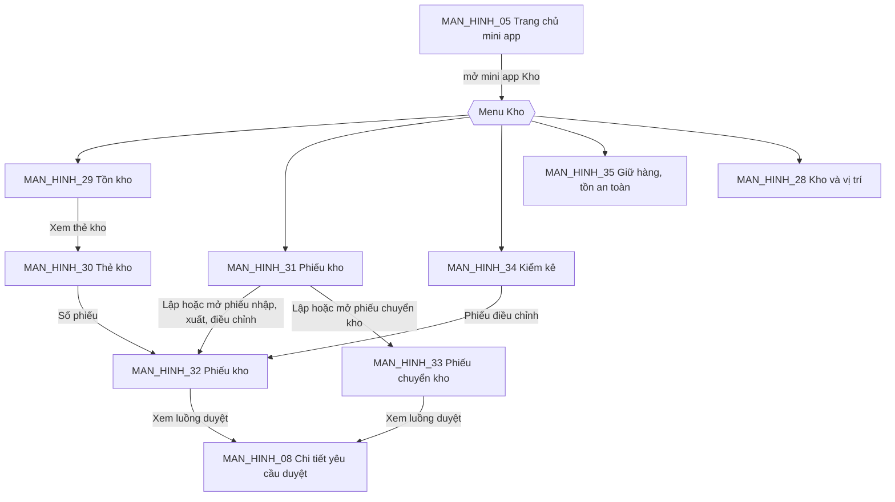

- Thứ tự menu và quyền hiện mục: Tồn kho (`inventory.stock.view`), Phiếu kho (`inventory.stock.view`), Kiểm kê (`inventory.stocktake.manage`), Giữ hàng, tồn an toàn (`inventory.access`), Kho và vị trí (`inventory.access`). Thẻ kho không có mục menu, mở từ MAN_HINH_29.
- MAN_HINH_32 và MAN_HINH_33 cùng một trang `/inventory/documents/[id]` (`/inventory/documents/new?type=<loại>` khi lập), hiện phần chuyển kho theo loại phiếu.
- Màn hình Kho và vị trí, Phiếu kho, Kiểm kê, Giữ hàng và tồn an toàn có nút "Lịch sử" mở MAN_HINH_18 lọc theo đối tượng.

## 9. Bảng vai trò – màn hình (MODULE_03)

| Màn hình | Quản trị tập đoàn, quản trị công ty | Quản lý kho | Thủ kho | Nhân viên công ty chủ hàng có quyền xem tồn |
|---|---|---|---|---|
| MAN_HINH_28 Kho và vị trí | Xem, Thêm kho, Sửa, Ngừng, Vị trí, Cài đặt, In tem vị trí | Xem, Sửa, Ngừng, Vị trí, In tem vị trí ở kho trong phạm vi; Thêm kho, Cài đặt khi gán ở phạm vi công ty | Xem, In tem vị trí | Xem kho nhận hàng của công ty mình (nhãn "Chỉ xem tồn") |
| MAN_HINH_29 Tồn kho | Xem mọi chủ hàng, giá vốn, In tem | Như bên trái, ở kho trong phạm vi | Xem mọi chủ hàng ở kho trong phạm vi, không giá vốn, In tem | Chỉ hàng của công ty mình, không thao tác |
| MAN_HINH_30 Thẻ kho | Xem | Xem | Xem, không giá vốn | Chỉ hàng của công ty mình |
| MAN_HINH_31, MAN_HINH_32 Phiếu kho | Xem, Lập, Gửi, Rút (phiếu của mình) | Như bên trái | Như bên trái, không thấy giá trị | Xem phiếu của công ty mình |
| MAN_HINH_33 Phiếu chuyển kho | Xem, Lập, Gửi, Rút, Xuất, Nhận | Như bên trái, theo kho nguồn, kho đích trong phạm vi | Như Quản lý kho | Xem |
| MAN_HINH_34 Kiểm kê | Xem, Lập, Bắt đầu, Đếm, Kết thúc, Hủy | Như bên trái | Không thấy mục menu | Không thấy |
| MAN_HINH_35 Giữ hàng, tồn an toàn | Xem, Giữ, Gia hạn, Nhả, Đặt tồn an toàn | Như bên trái | Xem | Không thấy |

## 10. Đặc tả từng màn hình (MODULE_03)

### MAN_HINH_28: Kho và vị trí
- Mục đích: Khai báo kho, công ty chủ hàng, vị trí kệ; cài đặt giữ hàng; in tem vị trí.
- Chức năng thực hiện: CHUC_NANG_38, CHUC_NANG_45
- Đường dẫn: `/inventory/warehouses`
- Bố cục: tiêu đề kèm "Lịch sử", nút "Thêm kho"; câu giải thích kho thuộc chi nhánh và quyền của công ty chủ hàng; bảng mã kho, tên kho (kèm tên công ty sở hữu khi chỉ xem), chi nhánh, công ty chủ hàng, vị trí kệ (số vị trí hoặc "Không dùng"), trạng thái, nhãn "Chỉ xem tồn", "Sửa", "Ngừng dùng"/"Dùng lại". Ngăn kéo kho: chi nhánh, mã kho ("Chữ in hoa, số, dấu gạch; không đổi sau khi tạo."), tên, địa chỉ, "Công ty khác được gửi hàng", "Quản lý tồn theo vị trí kệ". Khối "Vị trí kệ: <tên kho>": bảng mã, tên, trạng thái, nút "In tem vị trí", "Thêm vị trí" (ô nhiều dòng, mỗi dòng mã rồi tên). Khối "Cài đặt kho của công ty": "Thời hạn giữ hàng cho đơn bán (giờ)".
- Dữ liệu hiển thị: kho thao tác được và kho nhận hàng của công ty đang chọn.
- Thành phần: ThanhTrenCung, MenuMiniApp, BangDuLieu, NhanTrangThai, NganKeo, ONhap, OChon, Nut, HopThoaiXacNhan (tài liệu `15`).
- API: API_63, API_70.
- Thao tác: như bố cục; lỗi mã vị trí trùng chỉ ra "Dòng <n>".
- Trạng thái: rỗng ("Chưa có kho.", "Kho chưa có vị trí.").
- Thông báo: "Đã lưu."; lỗi theo CHUC_NANG_38.
- Quyền hiển thị: nút "Thêm kho", khối cài đặt với `inventory.warehouse.manage`; sửa, ngừng, thêm vị trí theo `canManage` của từng kho.
- Responsive: bảng chuyển thành thẻ.
- Trạng thái phê duyệt: Chưa phê duyệt (người dùng cho AI làm tiếp không dừng ở điểm xem trước, CONG_VIEC_05 mục 14)

### MAN_HINH_29: Tồn kho
- Mục đích: Xem tồn thực, đang giữ, khả dụng, đang chuyển đến, giá vốn theo kho và công ty chủ hàng.
- Chức năng thực hiện: CHUC_NANG_39, CHUC_NANG_45
- Đường dẫn: `/inventory/stock`
- Bố cục: tiêu đề; bộ lọc kho, ô tìm "Tìm theo tên, mã hàng, mã vạch", "Gồm mặt hàng hết tồn"; bảng kho, chủ hàng, mã hàng, sản phẩm, tồn thực, đang giữ, khả dụng, đang chuyển đến, giá vốn, giá trị, nhãn "Dưới tồn an toàn"; phân trang. Bấm một dòng mở khối chi tiết: "Theo lô, vị trí" (lô, hạn, vị trí, số lượng), "Serial trong kho (<số>)", "Hàng đang giữ"; nút "Xem thẻ kho", "In tem sản phẩm".
- Dữ liệu hiển thị: theo phạm vi quyền (QUYTAC_NGHIEPVU_46).
- Thành phần: ThanhTrenCung, MenuMiniApp, BoLoc, BangDuLieu, NhanTrangThai, Nut, TrangThaiRong (tài liệu `15`).
- API: API_63 (đọc kho), API_64, API_70.
- Thao tác: như bố cục.
- Trạng thái: rỗng ("Không có tồn."; "Không có hàng giữ.").
- Thông báo: lỗi tải tem hiện thông báo lỗi chung.
- Quyền hiển thị: màn hình với `inventory.stock.view`.
- Responsive: bảng chuyển thành thẻ.
- Trạng thái phê duyệt: Chưa phê duyệt (người dùng cho AI làm tiếp không dừng ở điểm xem trước, CONG_VIEC_05 mục 14)

### MAN_HINH_30: Thẻ kho
- Mục đích: Xem biến động của một mặt hàng tại một kho trong khoảng ngày.
- Chức năng thực hiện: CHUC_NANG_39
- Đường dẫn: `/inventory/stock-card?warehouseId=&companyId=&variantId=`
- Bố cục: tiêu đề mã hàng · tên, nút "Tồn kho"; ô "Từ ngày", "Đến ngày"; dòng "Tồn đầu kỳ"; bảng thời điểm, phiếu (số phiếu mở MAN_HINH_32 hoặc MAN_HINH_33), lô và vị trí, số lượng, đơn giá vốn, giá trị, tồn sau; dòng "Tồn cuối kỳ".
- Dữ liệu hiển thị: biến động theo ngày giờ Việt Nam, tối đa 5.000 dòng.
- Thành phần: ThanhTrenCung, MenuMiniApp, ONhap, BangDuLieu (tài liệu `15`).
- API: API_64.
- Thao tác: đổi khoảng ngày.
- Trạng thái: thiếu tham số ("Chọn mặt hàng từ màn hình Tồn kho."); rỗng ("Không có biến động trong kỳ.").
- Thông báo: không có.
- Quyền hiển thị: như MAN_HINH_29.
- Responsive: bảng cuộn ngang.
- Trạng thái phê duyệt: Chưa phê duyệt (người dùng cho AI làm tiếp không dừng ở điểm xem trước, CONG_VIEC_05 mục 14)

### MAN_HINH_31: Danh sách phiếu kho
- Mục đích: Tìm phiếu kho; lập phiếu mới.
- Chức năng thực hiện: CHUC_NANG_40, CHUC_NANG_41
- Đường dẫn: `/inventory/documents`
- Bố cục: tiêu đề kèm "Lịch sử", nút "Lập phiếu nhập khác", "Lập phiếu xuất khác", "Lập phiếu điều chỉnh kho", "Lập phiếu chuyển kho"; lọc loại phiếu, trạng thái, kho; bảng số phiếu (nháp hiện "(Nháp)"), loại, ngày, kho (kèm kho đích), công ty chủ hàng, diễn giải, trạng thái, giá trị, người lập; phân trang.
- Dữ liệu hiển thị: phiếu thấy được theo phạm vi quyền, mới lập trước. Lọc theo ngày chưa làm.
- Thành phần: ThanhTrenCung, MenuMiniApp, BoLoc, BangDuLieu, NhanTrangThai, Nut, TrangThaiRong (tài liệu `15`).
- API: API_63 (đọc kho), API_65.
- Thao tác: bấm số phiếu mở MAN_HINH_32 hoặc MAN_HINH_33.
- Trạng thái: rỗng ("Chưa có phiếu kho.").
- Thông báo: không có.
- Quyền hiển thị: màn hình với `inventory.stock.view`; nút lập phiếu với `inventory.document.manage`.
- Responsive: bảng chuyển thành thẻ.
- Bổ sung CONG_VIEC_07: nút "Nhập mua theo đơn" (mở `/inventory/purchase-receipts/new`) với `inventory.purchase.receive`; lọc, hiện thêm loại "Phiếu nhập mua", "Phiếu trả hàng nhà cung cấp", trạng thái "Chờ kiểm tra chất lượng". Phiếu nhập mua, trả hàng không lập bằng các nút lập phiếu thường.
- Bổ sung CONG_VIEC_08: nút "Giao hàng theo đơn bán" (mở `/inventory/sales-issues/new`) với `inventory.sales.issue`; lọc, hiện thêm loại "Phiếu xuất giao hàng", "Phiếu nhận hàng trả lại". Hai loại phiếu này không lập bằng các nút lập phiếu thường.
- Bổ sung CONG_VIEC_09: phiếu nhập mua nội bộ sinh từ phiếu xuất giao hàng của công ty bán hiện ở công ty mua với loại "Phiếu nhập mua", trạng thái "Đang vận chuyển" (chờ nhận; lọc được), chưa có số đến khi nhận.
- Trạng thái phê duyệt: Chưa phê duyệt (người dùng cho AI làm tiếp không dừng ở điểm xem trước, CONG_VIEC_05 mục 14)

### MAN_HINH_32: Phiếu nhập khác, xuất khác, điều chỉnh
- Mục đích: Lập, gửi duyệt, rút, xem phiếu kho không có chứng từ gốc.
- Chức năng thực hiện: CHUC_NANG_40, CHUC_NANG_45
- Đường dẫn: `/inventory/documents/new?type=receipt_other|issue_other|adjustment` (lập); `/inventory/documents/[id]` (sửa nháp, xem).
- Bố cục: đầu trang loại phiếu và số phiếu, nhãn trạng thái, nút "Danh sách phiếu", "Xem luồng duyệt" (mở MAN_HINH_08 `/hop-duyet/{id}`), "In tem". Phần chung: kho, công ty chủ hàng ("Phiếu đánh số, duyệt, hạch toán theo công ty chủ hàng."), ngày phiếu, lý do, diễn giải, ghi chú. Phần "Mặt hàng": ô "Quét mã vạch hoặc gõ mã hàng, tên rồi nhấn Enter"; mỗi dòng: mặt hàng, số lượng (phiếu điều chỉnh: "Số lượng dương là tăng, âm là giảm (ví dụ -5)."), đơn vị, đơn giá (nhập khác bắt buộc; điều chỉnh "để trống: giá vốn hiện hành"), vị trí (kho có vị trí), lô (dòng nhập: số lô, hạn dùng, ngày sản xuất; dòng xuất: chọn lô có nhãn "gợi ý", "hết hạn", "không hạn"), "Lý do chọn lô khác lô gợi ý", serial (mỗi dòng một serial), "Bỏ dòng". Nút "Lưu nháp", "Gửi duyệt" (hộp thoại xác nhận), "Xóa phiếu", "Rút phiếu".
- Dữ liệu hiển thị: chi tiết phiếu kèm giá trị đã ghi sổ từng dòng; phiếu điều chỉnh sinh từ kiểm kê chỉ xem, kèm người chịu trách nhiệm và tiền bồi thường.
- Thành phần: ThanhTrenCung, MenuMiniApp, ONhap, OChon, Nut, BangDuLieu, NhanTrangThai, HopThoaiXacNhan, KhoiCanhBao (tài liệu `15`).
- API: API_63 (đọc kho, vị trí), API_65, API_70.
- Thao tác: như bố cục; lưu lần đầu chuyển sang `/inventory/documents/{id}`.
- Trạng thái: rỗng ("Chưa có mặt hàng."); không tìm thấy ("Không tìm thấy mặt hàng của công ty chủ hàng.").
- Thông báo: "Đã lưu nháp." · "Đã gửi phiếu đi duyệt." · "Công ty chủ hàng chưa có chính sách duyệt cho loại phiếu này nên phiếu đã ghi sổ." · "Đã xóa phiếu nháp." · "Đã rút phiếu."; lỗi theo CHUC_NANG_40 dưới đúng ô, đúng dòng.
- Quyền hiển thị: sửa, gửi, xóa theo `canEdit`; rút theo `canWithdraw` của API.
- Responsive: dòng mặt hàng xếp dọc trên điện thoại.
- Sửa theo THAY_DOI_18 (CONG_VIEC_43, 2026-11-11) (CHUC_NANG_157): phiếu dịch vụ do hệ thống tự lập hiện nhãn "Phiếu dịch vụ" cạnh trạng thái; chỉ xem. Chọn mặt hàng dịch vụ trong phiếu kho báo "Mặt hàng dịch vụ không theo dõi tồn kho: không lập phiếu kho, giữ hàng, kiểm kê." dưới dòng.
- Bổ sung CONG_VIEC_07 (CHUC_NANG_52, CHUC_NANG_53; API_76):
  - Lập phiếu nhập mua `/inventory/purchase-receipts/new`: chọn "Đơn mua" ("Chọn đơn mua…"; đơn đã duyệt nhận vào kho người dùng có quyền; không có thì "Không có đơn mua đã duyệt cần nhận vào kho bạn quản lý."); ngày phiếu; câu "Nhập số thực nhận cho dòng có hàng về; dòng để trống không nhận lần này."; mỗi dòng đơn: mặt hàng, nhãn "Cần kiểm tra chất lượng", "Đặt <số> <đơn vị>, còn nhận được <số> <đơn vị>", ô "Thực nhận (<đơn vị>)", số lô, hạn dùng (hàng theo lô), vị trí (kho dùng vị trí), serial (hàng serial); nút "Lưu nháp".
  - Lập phiếu trả hàng `/inventory/purchase-returns/new?receiptId=<phiếu nhập>` (mở bằng nút "Trả hàng nhà cung cấp" ở phiếu nhập mua đã ghi sổ): tiêu đề "Trả hàng nhà cung cấp: <số phiếu nhập>", nhà cung cấp và câu "Hàng trả xuất theo giá trên phiếu nhập gốc."; ngày phiếu, lý do; mỗi dòng gốc "Đã nhập <số> <đơn vị cơ sở>", ô "Số trả (<đơn vị>)" hoặc chọn serial; nút "Lưu nháp".
  - Chi tiết phiếu nhập mua, trả hàng `/inventory/documents/[id]`: thêm "Nhà cung cấp", "Đơn mua" (liên kết sang MAN_HINH_41) hoặc "Phiếu nhập gốc"; dòng có phần không đạt hiện nhãn "không đạt <số> <đơn vị>: <lý do>". Phiếu nháp chỉ có nút "Xóa nháp", "Gửi" (không sửa; cần sửa thì xóa, lập lại); thông báo "Đã gửi phiếu.". Phiếu chờ kiểm tra hiện khối "Kiểm tra chất lượng" ("Nhập số không đạt từng dòng; phần đạt ghi sổ kho, phần không đạt ghi biên bản kèm lý do."): mỗi dòng "Số không đạt (<đơn vị>)" hoặc "Serial không đạt", "Lý do không đạt"; nút "Ghi kết quả kiểm tra"; thông báo "Đã ghi kết quả kiểm tra, phần đạt đã vào tồn.". Quyền hiển thị theo `canQualityCheck`, `canReturn` của API.
- Bổ sung CONG_VIEC_08 (CHUC_NANG_56, CHUC_NANG_57; API_79):
  - Lập phiếu xuất giao hàng `/inventory/sales-issues/new`: tiêu đề "Giao hàng theo đơn bán"; chọn "Đơn bán" (đơn đã xác nhận xuất từ kho người dùng có quyền, hiện số đơn, khách hoặc người mua, kho; không có thì "Không có đơn bán đã xác nhận cần giao từ kho bạn quản lý."); ngày phiếu; câu "Nhập số giao cho dòng có hàng xuất lần này; dòng để trống không giao lần này."; mỗi dòng đơn: mặt hàng, "Đặt <số> <đơn vị>, còn phải giao <số> <đơn vị>", ô "Giao (<đơn vị>)", "Lô" (hàng theo lô; gợi ý lô hết hạn trước, chọn sẵn lô đầu, "Chọn lô…"), "Vị trí" (kho dùng vị trí), "Serial" (hàng serial, mỗi dòng một serial); nút "Lưu nháp" (chỉ bật khi có ít nhất một dòng nhập số giao), lưu xong mở chi tiết phiếu.
  - Lập phiếu nhận hàng trả lại `/inventory/sales-returns/new?issueId=<phiếu xuất>` (mở bằng nút "Nhận hàng trả lại" ở phiếu xuất giao hàng đã ghi sổ; thiếu `issueId` thì "Chọn phiếu xuất giao hàng để nhận hàng trả lại."): tiêu đề "Nhận hàng trả lại: <số phiếu xuất>", tên khách và câu "Hàng trả nhập lại theo giá vốn trên phiếu xuất gốc."; ngày phiếu, lý do (bắt buộc); mỗi dòng gốc "Đã giao <số> <đơn vị cơ sở>", ô "Số trả (<đơn vị cơ sở>)" hoặc ô chọn từng serial đã giao (số trả bằng số serial chọn); nút "Lưu nháp".
  - Chi tiết phiếu xuất giao hàng, nhận hàng trả lại `/inventory/documents/[id]`: thêm "Khách hàng", "Đơn bán" (liên kết sang MAN_HINH_43) hoặc "Phiếu xuất gốc" (liên kết sang phiếu xuất). Phiếu nháp chỉ có nút "Xóa nháp", "Gửi" (không sửa; cần sửa thì xóa, lập lại). Phiếu xuất đã ghi sổ có nút "Nhận hàng trả lại" theo `canReturn` của API.
- Bổ sung CONG_VIEC_09 (CHUC_NANG_60; API_82):
  - Chi tiết phiếu nhập mua nội bộ `/inventory/documents/[id]`: thêm "Phiếu xuất của bên bán" (<tên công ty bán>: <số phiếu xuất>).
  - Phiếu "Đang vận chuyển" mà người dùng có quyền nhận tại kho nhận hiện khối "Nhận hàng nội bộ" ("Nhập số thực nhận theo đơn vị cơ sở; hàng serial chọn serial đã nhận. Nhận thiếu thì ghi lý do, công ty bán nhận biên bản chênh lệch để xử lý."): mỗi dòng mặt hàng (mã, tên), "Đã xuất <số> <đơn vị cơ sở>"; hàng không serial có ô "Số thực nhận (<đơn vị cơ sở>)" (mặc định bằng số xuất); hàng serial có ô chọn từng serial đã xuất (mặc định chọn hết, số nhận bằng số serial chọn); "Vị trí" (kho dùng vị trí); khi có dòng nhận thiếu hiện ô "Lý do nhận thiếu" (bắt buộc); nút "Xác nhận nhận hàng". Thông báo "Đã nhận hàng nội bộ."; lỗi dưới ô số nhận, serial, vị trí, lý do; lỗi lô, hạn dùng hiện kèm mã hàng. Quyền hiển thị theo `canReceiveInternal` của API.
- Trạng thái phê duyệt: Chưa phê duyệt (người dùng cho AI làm tiếp không dừng ở điểm xem trước, CONG_VIEC_05 mục 14)

### MAN_HINH_33: Phiếu chuyển kho
- Mục đích: Lập, gửi duyệt phiếu chuyển kho; kho nguồn xác nhận xuất; kho đích nhận theo số thực nhận.
- Chức năng thực hiện: CHUC_NANG_41
- Đường dẫn: `/inventory/documents/new?type=transfer` (lập); `/inventory/documents/[id]`.
- Bố cục: như MAN_HINH_32, thêm ô "Kho đích" (kho nhận hàng của công ty chủ hàng). Phiếu đã duyệt: nút "Xác nhận xuất" (kho nguồn). Phiếu đang vận chuyển: khối "Nhận hàng tại kho đích" ("Nhập số thực nhận theo đơn vị cơ sở. Nhận thiếu hoặc thừa sẽ lập biên bản chênh lệch."), mỗi dòng "Số thực nhận", vị trí đích, serial nhận; "Ghi chú biên bản"; nút "Xác nhận nhận". Khối "Biên bản chênh lệch": mã hàng, "xuất <số>, nhận <số>, chênh lệch <số>", giá trị.
- Dữ liệu hiển thị: chi tiết phiếu, biên bản chênh lệch.
- Thành phần: như MAN_HINH_32.
- API: API_63, API_65, API_66.
- Thao tác: như bố cục.
- Trạng thái: chung.
- Thông báo: "Công ty chủ hàng chưa có chính sách duyệt chuyển kho nên phiếu đã được duyệt; kho nguồn xác nhận xuất." · "Đã xuất, hàng đang vận chuyển." · "Đã nhận hàng."; lỗi theo CHUC_NANG_41.
- Quyền hiển thị: "Xác nhận xuất" theo `canShip`, khối nhận theo `canReceive` của API.
- Responsive: như MAN_HINH_32.
- Trạng thái phê duyệt: Chưa phê duyệt (người dùng cho AI làm tiếp không dừng ở điểm xem trước, CONG_VIEC_05 mục 14)

### MAN_HINH_34: Kiểm kê
- Mục đích: Lập phạm vi kiểm kê, đếm, kết thúc sinh phiếu điều chỉnh.
- Chức năng thực hiện: CHUC_NANG_42
- Đường dẫn: `/inventory/stocktakes` (danh sách, lập); `/inventory/stocktakes/[id]` (đếm, kết thúc).
- Bố cục:
  - Danh sách: tiêu đề kèm "Lịch sử", nút "Lập kiểm kê"; câu giải thích khóa mặt hàng; bảng số phiếu, kho, công ty chủ hàng, phạm vi, đã đếm ("<n>/<tổng> dòng"), trạng thái, ngày lập. Ngăn kéo lập: kho, công ty chủ hàng, phạm vi (Toàn kho, Theo ngành hàng, Theo vị trí, Theo danh sách sản phẩm), chọn ngành hàng hoặc vị trí, hoặc ô "Thêm sản phẩm (quét mã vạch hoặc gõ mã hàng rồi nhấn Enter)", ghi chú.
  - Chi tiết: đầu trang số phiếu, trạng thái, nút "Danh sách kiểm kê", "Phiếu điều chỉnh <số>"; nút "Bắt đầu kiểm kê", "Hủy kiểm kê" (Nháp); ô "Quét mã vạch để đếm (mỗi lần quét cộng 1)"; bảng mặt hàng, lô, vị trí, sổ sách, số đếm, chênh lệch, giá trị chênh lệch, người chịu trách nhiệm, serial đếm được; khối "Hàng có thực tế nhưng sổ sách không có"; nút "Lưu số đếm", "Kết thúc kiểm kê", "Hủy kiểm kê".
- Dữ liệu hiển thị: kiểm kê của kho thao tác được, tối đa 200 lần gần nhất.
- Thành phần: ThanhTrenCung, MenuMiniApp, BangDuLieu, NhanTrangThai, NganKeo, ONhap, OChon, Nut, HopThoaiXacNhan (tài liệu `15`).
- API: API_63 (đọc kho, vị trí), API_67, API_65 (tìm mặt hàng).
- Thao tác: bắt đầu, kết thúc, hủy có hộp thoại xác nhận.
- Trạng thái: rỗng ("Chưa có lần kiểm kê nào."); không tìm thấy ("Không tìm thấy mặt hàng.").
- Thông báo: "Đã bắt đầu kiểm kê." · "Đã lưu số đếm." · "Đã kết thúc kiểm kê." · "Đã hủy kiểm kê."; lỗi theo CHUC_NANG_42.
- Quyền hiển thị: mục menu, nút lập với `inventory.stocktake.manage`; thao tác theo `canManage` của API.
- Responsive: bảng chuyển thành thẻ.
- Trạng thái phê duyệt: Chưa phê duyệt (người dùng cho AI làm tiếp không dừng ở điểm xem trước, CONG_VIEC_05 mục 14)

### MAN_HINH_35: Giữ hàng và tồn an toàn
- Mục đích: Theo dõi, gia hạn, nhả hàng giữ; đặt tồn an toàn, xem cảnh báo và số gợi ý.
- Chức năng thực hiện: CHUC_NANG_43, CHUC_NANG_44
- Đường dẫn: `/inventory/reservations`
- Bố cục: tiêu đề kèm "Lịch sử"; hai thẻ "Giữ hàng", "Tồn an toàn". Thẻ Giữ hàng: lọc trạng thái (Đang giữ, Đã nhả, Đã xuất); khối giữ thủ công (kho, công ty chủ hàng, mặt hàng quét hoặc gõ rồi Enter, số lượng theo đơn vị cơ sở, lý do giữ, nút "Giữ hàng"); bảng mặt hàng, kho, chủ hàng, số lượng, nguồn (Giữ thủ công, Phiếu kho, Đơn bán), hạn giữ ("Đến khi phiếu kết thúc"), người giữ, trạng thái, nút "Gia hạn 24 giờ", "Nhả". Thẻ Tồn an toàn: ô "Chỉ hiện hàng dưới tồn an toàn"; khối đặt mức (kho, công ty chủ hàng, mặt hàng, tối thiểu, tối đa, "Lưu tồn an toàn"); bảng mặt hàng, kho, tối thiểu, tối đa, khả dụng, đang chuyển đến, nhãn "Dưới tối thiểu", gợi ý bổ sung, nút "Bỏ".
- Dữ liệu hiển thị: theo kho thao tác được.
- Thành phần: ThanhTrenCung, MenuMiniApp, BoLoc, BangDuLieu, NhanTrangThai, ONhap, OChon, Nut, TrangThaiRong (tài liệu `15`).
- API: API_63 (đọc kho), API_65 (tìm mặt hàng), API_68, API_69.
- Thao tác: như bố cục; "Nhả" không hiện với hàng giữ cho phiếu kho.
- Trạng thái: rỗng ("Không có hàng giữ.", "Chưa đặt tồn an toàn.", "Không có hàng dưới tồn an toàn.").
- Thông báo: "Đã giữ hàng." · "Đã gia hạn." · "Đã nhả hàng giữ." · "Đã lưu tồn an toàn."; lỗi theo CHUC_NANG_43, CHUC_NANG_44.
- Quyền hiển thị: khối giữ, đặt mức, nút gia hạn, nhả, bỏ với `inventory.reservation.manage`.
- Responsive: bảng chuyển thành thẻ.
- Trạng thái phê duyệt: Chưa phê duyệt (người dùng cho AI làm tiếp không dừng ở điểm xem trước, CONG_VIEC_05 mục 14)

## MODULE_07 Khách hàng và Đối tác (phần tối thiểu, CONG_VIEC_06)

Mini app `apps/web-crm`, tên "Khách hàng và Đối tác", đường dẫn gốc `/crm` (mini app Nền tảng chuyển tiếp `/crm` sang ứng dụng này, cùng tên miền và cookie phiên). Khung trang, thành phần dùng chung lấy từ `packages/ui`; quy ước chung như mục 3 của MODULE_01. Mở `/crm` thì chuyển tới mục menu đầu tiên có quyền; không có mục nào thì hiện "Bạn không có quyền xem trang này". Số Căn cước công dân luôn hiện dạng che `*********` + 3 số cuối, trừ khi người có quyền bấm "Xem đầy đủ".

## 11. Danh sách màn hình và điều hướng (MODULE_07)

| Mã | Tên màn hình | Chức năng (10) | Vai trò được truy cập (08) | Mở từ | Bản mẫu |
|---|---|---|---|---|---|
| MAN_HINH_36 | Danh sách đối tác (kèm ngăn kéo thêm đối tác) | CHUC_NANG_46, CHUC_NANG_47 | Quản trị tập đoàn, quản trị công ty, Quản lý đối tác (thêm); Thủ kho (xem) | Menu Khách hàng và Đối tác | Không lập (CONG_VIEC_06 mục 14) |
| MAN_HINH_37 | Chi tiết đối tác (kèm ngăn kéo sửa thông tin chung, sửa hồ sơ của công ty) | CHUC_NANG_46, CHUC_NANG_47, CHUC_NANG_48 | Như MAN_HINH_36; sửa hồ sơ: quản trị tập đoàn, quản trị công ty | MAN_HINH_36 | Không lập |

Sơ đồ điều hướng:

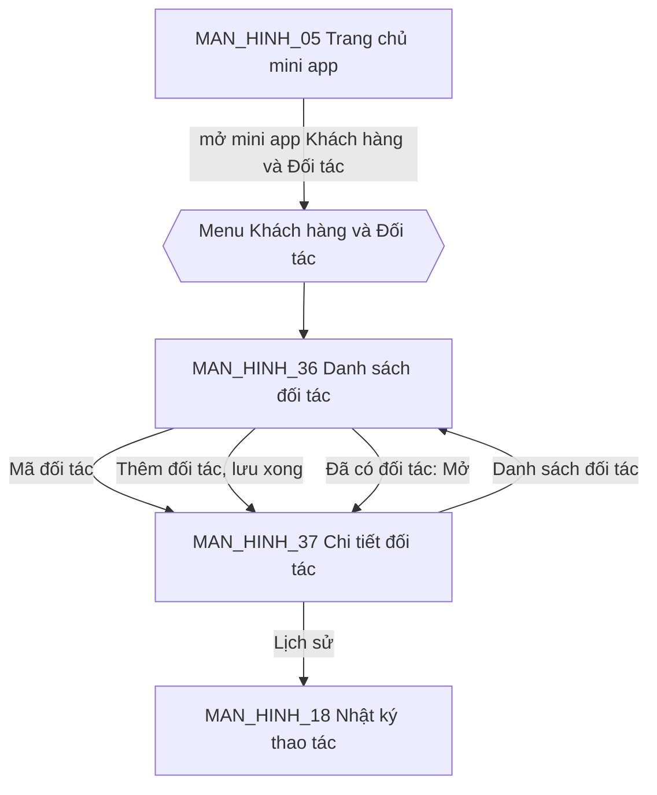

- Thứ tự menu và quyền hiện mục: Đối tác (`crm.partner.view`). Từ CONG_VIEC_21 thêm "Giao khách hàng" (`crm.partner.view`); sơ đồ điều hướng đầy đủ ở mục 50. Đã tắt theo THAY_DOI_18 (CONG_VIEC_43, 2026-11-11): bỏ mục "Giao khách hàng".
- Danh sách và chi tiết có nút "Lịch sử" mở MAN_HINH_18 lọc theo đối tượng.

## 12. Bảng vai trò – màn hình (MODULE_07)

| Màn hình | Quản trị tập đoàn, quản trị công ty | Quản lý đối tác | Thủ kho |
|---|---|---|---|
| MAN_HINH_36 Danh sách đối tác | Xem, Thêm | Xem, Thêm | Xem |
| MAN_HINH_37 Chi tiết đối tác | Xem, Sửa, Ngừng giao dịch, Giao dịch lại (trừ đối tác nội bộ), Xem đầy đủ số Căn cước công dân, Lập, sửa hồ sơ | Xem, Sửa, Ngừng giao dịch, Giao dịch lại (trừ đối tác nội bộ) | Xem |

## 13. Đặc tả từng màn hình (MODULE_07)

### MAN_HINH_36: Danh sách đối tác
- Mục đích: Tìm đối tác dùng chung tập đoàn, biết vai trò của đối tác với công ty đang chọn; thêm đối tác mới không trùng.
- Chức năng thực hiện: CHUC_NANG_46, CHUC_NANG_47
- Đường dẫn: `/crm/partners`
- Bố cục: tiêu đề "Đối tác" kèm "Lịch sử", nút "Thêm đối tác"; câu "Đối tác dùng chung toàn tập đoàn; hồ sơ khách hàng, nhà cung cấp riêng từng công ty."; bộ lọc: ô tìm "Tên, mã, mã số thuế, điện thoại", "Loại" (Tổ chức, Hộ kinh doanh, Cá nhân), "Vai trò với công ty" (Khách hàng, Nhà cung cấp, Nội bộ), "Trạng thái" (Đang giao dịch, Ngừng giao dịch); bảng mã (liên kết mở MAN_HINH_37), tên kèm tên viết tắt, loại, giấy tờ (mã số thuế hoặc số Căn cước công dân đã che), điện thoại, nhãn "Nội bộ", "Khách hàng", "Nhà cung cấp", trạng thái; phân trang 20 dòng. Ngăn kéo "Thêm đối tác": loại; cá nhân nhập "Số Căn cước công dân" (gợi ý "12 số. Khách không cung cấp thì không lập đối tác; bán hàng chọn người mua không lấy hóa đơn."), loại khác nhập "Mã số thuế" (gợi ý "10 số, hoặc 10 số kèm "-" và 3 số chi nhánh."); rời ô thì kiểm trùng, trùng hiện "Đã có đối tác <mã> · <tên>." kèm nút "Mở"; tên, tên viết tắt, địa chỉ, điện thoại, email; khối "Người liên hệ" (họ tên, chức vụ, điện thoại, email, "Liên hệ chính", "Bỏ", "Thêm người liên hệ"); khối "Tài khoản ngân hàng" (ngân hàng, số tài khoản, chủ tài khoản, chi nhánh ngân hàng, "Mặc định", "Bỏ", "Thêm tài khoản").
- Dữ liệu hiển thị: mọi đối tác của tập đoàn, đang giao dịch trước, theo tên; vai trò khách hàng, nhà cung cấp theo hồ sơ của công ty đang chọn.
- Thành phần: ThanhTrenCung, MenuMiniApp, BoLoc, BangDuLieu, NhanTrangThai, NganKeo, ONhap, OChon, Nut, TrangThaiRong (tài liệu `15`).
- API: API_71.
- Thao tác: gõ ô tìm thì tìm sau 300 mili giây; đổi bộ lọc về trang 1; lưu đối tác mới thì mở MAN_HINH_37 của đối tác đó.
- Trạng thái: rỗng ("Chưa có đối tác."; có lọc thì "Không có kết quả phù hợp.").
- Thông báo: "Đã lưu đối tác."; lỗi theo CHUC_NANG_46.
- Quyền hiển thị: màn hình với `crm.partner.view`; nút "Thêm đối tác" với `crm.partner.manage`.
- Responsive: bảng chuyển thành thẻ.
- Trạng thái phê duyệt: Chưa phê duyệt (người dùng cho AI làm tiếp không dừng ở điểm xem trước, CONG_VIEC_06 mục 14)
- Bổ sung CONG_VIEC_21 (CHUC_NANG_96, CHUC_NANG_98; API_71, API_111): bộ lọc thêm "Nhân viên phụ trách" với lựa chọn "Khách của tôi"; trưởng phòng, người có quyền giao khách chọn thêm được từng nhân viên trong phạm vi giao của mình; bảng thêm cột "Nhân viên phụ trách" (trước cột trạng thái; trống hiện "—"). Người không có quyền xem mọi khách chỉ thấy khách mình (và nhân viên phòng mình quản lý) phụ trách (QUYTAC_NGHIEPVU_129); thêm đối tác mới thì tự có hồ sơ khách hàng do mình phụ trách. Ngăn kéo "Thêm đối tác": kiểm trùng trả `canClaim` thì khối "Đã có đối tác <mã> · <tên>." hiện nút "Nhận làm khách của tôi" thay cho "Mở"; bấm thì nhận đối tác, mở MAN_HINH_37; lỗi hiện trong khối đó (QUYTAC_NGHIEPVU_135).
- Sửa theo THAY_DOI_18 (CONG_VIEC_43, 2026-11-11): bỏ bộ lọc "Nhân viên phụ trách", cột nhân viên phụ trách vẫn hiện; ngăn kéo thêm đối tác bỏ nút "Nhận làm khách của tôi"; mọi người có `crm.partner.view` xem mọi đối tác.

### MAN_HINH_37: Chi tiết đối tác
- Mục đích: Xem, sửa thông tin chung của đối tác; xem, lập hồ sơ đối tác của công ty đang chọn.
- Chức năng thực hiện: CHUC_NANG_46, CHUC_NANG_47, CHUC_NANG_48
- Đường dẫn: `/crm/partners/[id]`
- Bố cục: liên kết "Danh sách đối tác"; tiêu đề mã · tên, nhãn trạng thái, nhãn "Nội bộ", "Lịch sử", nút "Ngừng giao dịch"/"Giao dịch lại", "Sửa thông tin chung"; đối tác nội bộ hiện khối "Đối tác nội bộ lấy thông tin từ công ty con; sửa ở màn hình Công ty.". Thẻ "Thông tin chung": loại, số Căn cước công dân (đã che, nút "Xem đầy đủ" có chú thích "Mỗi lần xem số đầy đủ được ghi nhật ký.") hoặc mã số thuế, tên viết tắt, địa chỉ, điện thoại, email. Thẻ "Người liên hệ", "Tài khoản ngân hàng". Thẻ "Hồ sơ của công ty đang chọn": vai trò với công ty, số ngày được nợ, hạn mức công nợ ("Không giới hạn" khi trống), nhóm khách hàng, nhân viên phụ trách, ghi chú, trạng thái hồ sơ; nút "Lập hồ sơ"/"Sửa hồ sơ" mở ngăn kéo: "Là khách hàng", "Là nhà cung cấp", số ngày được nợ, hạn mức công nợ ("Theo tiền tệ công ty. Để trống: không giới hạn."), nhóm khách hàng, nhân viên phụ trách, ghi chú, trạng thái hồ sơ. Ngăn kéo sửa thông tin chung như ngăn kéo thêm của MAN_HINH_36; cá nhân để trống số Căn cước công dân thì giữ số đã lưu (gợi ý hiện số đã che).
- Dữ liệu hiển thị: đối tác dùng chung; hồ sơ chỉ của công ty đang chọn.
- Thành phần: ThanhTrenCung, MenuMiniApp, The, NhanTrangThai, NganKeo, ONhap, OChon, Nut, HopThoaiXacNhan (tài liệu `15`).
- API: API_71, API_72.
- Thao tác: "Ngừng giao dịch" hỏi xác nhận "Ngừng giao dịch với <tên>? Đối tác không chọn được trên chứng từ mới, dữ liệu cũ giữ nguyên."; "Giao dịch lại" không hỏi. "Xem đầy đủ" thay số đã che bằng số đầy đủ đến khi rời trang.
- Trạng thái: rỗng ("Chưa có người liên hệ.", "Chưa có tài khoản ngân hàng.", "Công ty đang chọn chưa giao dịch với đối tác này."); đối tác nội bộ của chính công ty đang chọn hiện "Đây là công ty đang chọn, không lập hồ sơ đối tác.".
- Thông báo: "Đã lưu đối tác." · "Đã lưu hồ sơ."; lỗi theo CHUC_NANG_46 đến CHUC_NANG_48.
- Quyền hiển thị: nút sửa, ngừng giao dịch theo `canManage` (có `crm.partner.manage`, không phải đối tác nội bộ); "Xem đầy đủ" theo `canViewIdentity`; nút hồ sơ theo `canManageProfile`.
- Responsive: thẻ xếp dọc; nhãn và giá trị xếp hai cột.
- Trạng thái phê duyệt: Chưa phê duyệt (người dùng cho AI làm tiếp không dừng ở điểm xem trước, CONG_VIEC_06 mục 14)
- Bổ sung CONG_VIEC_21 (CHUC_NANG_96, CHUC_NANG_98; API_72, API_111): đối tác ngoài phạm vi xem hiện "Không tìm thấy dữ liệu hoặc bạn không có quyền xem.". Ngăn kéo hồ sơ: ô "Nhân viên phụ trách" chỉ chọn được khi hồ sơ chưa có nhân viên phụ trách; đã có thì khóa, kèm gợi ý "Đổi nhân viên phụ trách bằng phiếu giao khách." (QUYTAC_NGHIEPVU_134). Hồ sơ là khách hàng: thêm thẻ "Lịch sử phụ trách" sau thẻ hồ sơ, mỗi dòng "<nhân viên> · <từ thời điểm> – <đến thời điểm hoặc "nay">" kèm số phiếu giao khách (liên kết mở MAN_HINH_65) khi có; trống: "Chưa có nhân viên phụ trách.".
- Sửa theo THAY_DOI_18 (CONG_VIEC_43, 2026-11-11): bỏ thẻ lịch sử phụ trách; ô "Nhân viên phụ trách" trong ngăn kéo hồ sơ luôn chọn được (đổi, bỏ bằng tay), bỏ gợi ý đổi bằng phiếu giao khách.

## MODULE_04 Mua hàng (phần 1: Mua hàng trong nước, CONG_VIEC_07)

Mini app `apps/web-purchasing`, tên "Mua hàng", đường dẫn gốc `/purchasing` (mini app Nền tảng chuyển tiếp `/purchasing` sang ứng dụng này, cùng tên miền và cookie phiên). Khung trang, thành phần dùng chung lấy từ `packages/ui`; quy ước chung như mục 3 của MODULE_01. Mở `/purchasing` thì chuyển tới mục menu đầu tiên có quyền; không có mục nào thì hiện "Bạn không có quyền xem trang này". Phiếu nhập mua, kiểm tra chất lượng, phiếu trả hàng nhà cung cấp làm ở mini app Kho (MAN_HINH_31, MAN_HINH_32); ô cần kiểm tra chất lượng ở MAN_HINH_22.

## 14. Danh sách màn hình và điều hướng (MODULE_04)

| Mã | Tên màn hình | Chức năng (10) | Vai trò được truy cập (08) | Mở từ | Bản mẫu |
|---|---|---|---|---|---|
| MAN_HINH_38 | Bảng giá mua (kèm ngăn kéo thêm, sửa giá) | CHUC_NANG_49 | Quản trị tập đoàn, quản trị công ty, Nhân viên mua hàng (thêm, sửa); Thủ kho (xem) | Menu Mua hàng | Không lập (CONG_VIEC_07 mục 14) |
| MAN_HINH_39 | Đề nghị mua: danh sách, chi tiết (kèm ngăn kéo lập, sửa) | CHUC_NANG_50 | Quản trị tập đoàn, quản trị công ty, Nhân viên mua hàng, Thủ kho | Menu Mua hàng | Không lập |
| MAN_HINH_40 | Đơn mua: danh sách, lập đơn (kèm ngăn kéo cài đặt dung sai) | CHUC_NANG_51 | Quản trị tập đoàn, quản trị công ty, Nhân viên mua hàng (lập); Thủ kho (xem) | Menu Mua hàng; nút "Lập đơn mua" ở MAN_HINH_39 | Không lập |
| MAN_HINH_41 | Chi tiết đơn mua (kèm sửa đơn, hộp thoại đóng đơn) | CHUC_NANG_51 | Như MAN_HINH_40 | MAN_HINH_40; liên kết "Đơn mua" ở MAN_HINH_32 | Không lập |

Sơ đồ điều hướng:

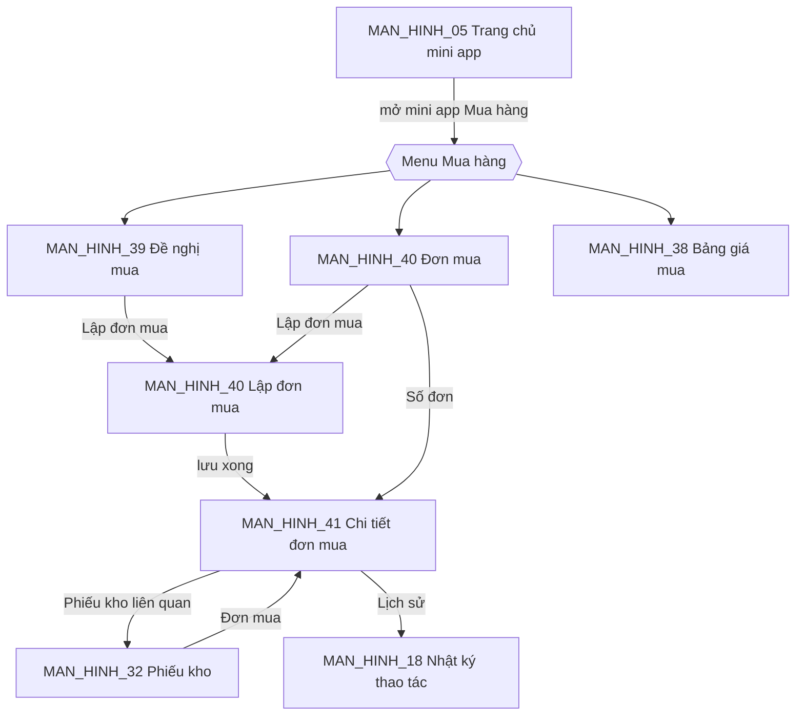

- Thứ tự menu và quyền hiện mục: Đơn mua (`purchasing.order.view`), Đề nghị mua (`purchasing.requisition.create`), Bảng giá mua (`purchasing.access`).
- Danh sách và chi tiết có nút "Lịch sử" mở MAN_HINH_18 lọc theo đối tượng.

## 15. Bảng vai trò – màn hình (MODULE_04)

| Màn hình | Quản trị tập đoàn, quản trị công ty | Nhân viên mua hàng | Thủ kho | Quản lý kho |
|---|---|---|---|---|
| MAN_HINH_38 Bảng giá mua | Xem, Thêm, Sửa, Ngừng dùng, Dùng lại | Xem, Thêm, Sửa, Ngừng dùng, Dùng lại | Xem | Không |
| MAN_HINH_39 Đề nghị mua | Xem, Lập, Sửa, Gửi duyệt, Rút (của mình), Đóng, Lập đơn mua | Xem, Lập, Sửa, Gửi duyệt, Rút (của mình), Đóng, Lập đơn mua | Xem, Lập, Sửa, Gửi duyệt, Rút (của mình) | Không |
| MAN_HINH_40 Đơn mua | Xem, Lập đơn, Cài đặt | Xem, Lập đơn | Xem | Không |
| MAN_HINH_41 Chi tiết đơn mua | Xem, Sửa, Gửi, Rút (của mình), Đóng đơn | Xem, Sửa, Gửi, Rút (của mình), Đóng đơn | Xem | Không |
| MAN_HINH_31, MAN_HINH_32 phần nhập mua, kiểm tra, trả hàng | Lập, Gửi, Xóa nháp, Kiểm tra chất lượng, Trả hàng (kho của công ty mình) | Không | Kho trong phạm vi gán | Kho trong phạm vi gán |

## 16. Đặc tả từng màn hình (MODULE_04)

### MAN_HINH_38: Bảng giá mua
- Mục đích: Xem, quản lý giá mua đã thỏa thuận với nhà cung cấp để đơn mua gợi ý đúng giá.
- Chức năng thực hiện: CHUC_NANG_49
- Đường dẫn: `/purchasing/supplier-prices`
- Bố cục: tiêu đề "Bảng giá mua" kèm "Lịch sử", nút "Thêm giá mua"; câu "Giá chưa gồm thuế giá trị gia tăng, theo tiền tệ công ty. Đơn mua gợi ý giá có hiệu lực tại ngày đơn với số lượng tối thiểu lớn nhất không vượt số lượng đặt."; bộ lọc: ô tìm "Mã hàng, tên, mã hàng nhà cung cấp", "Nhà cung cấp", "Trạng thái" (Đang dùng, Ngừng dùng); bảng nhà cung cấp, mặt hàng, đơn vị mua, số lượng tối thiểu, đơn giá, hiệu lực ("từ – đến" hoặc "không thời hạn"), trạng thái, nút "Sửa", "Ngừng dùng"/"Dùng lại"; phân trang 20 dòng. Ngăn kéo "Thêm giá mua"/"Sửa giá mua": "Nhà cung cấp" (gợi ý "Chỉ hiện đối tác có hồ sơ nhà cung cấp ở công ty."), "Mặt hàng" (ô tìm "Mã vạch, mã hàng hoặc tên rồi nhấn Enter", nút "Đổi mặt hàng"), "Đơn vị mua", "Số lượng tối thiểu" ("Mua từ số lượng này trở lên thì áp dụng giá. 0: mọi số lượng."), "Đơn giá" ("Chưa gồm thuế giá trị gia tăng."), "Mã hàng nhà cung cấp", "Hiệu lực từ", "Hiệu lực đến" ("Để trống: không có ngày kết thúc.").
- Dữ liệu hiển thị: giá mua của công ty đang chọn, đang dùng trước.
- Thành phần: ThanhTrenCung, MenuMiniApp, BoLoc, BangDuLieu, NhanTrangThai, NganKeo, ONhap, OChon, Nut, TrangThaiRong (tài liệu `15`).
- API: API_73.
- Thao tác: gõ ô tìm thì tìm sau 300 mili giây; đổi bộ lọc về trang 1; "Ngừng dùng", "Dùng lại" đổi trạng thái ngay.
- Trạng thái: rỗng ("Chưa có giá mua."; có lọc thì "Không có kết quả phù hợp.").
- Thông báo: "Đã lưu giá mua."; lỗi theo CHUC_NANG_49 dưới đúng ô.
- Quyền hiển thị: màn hình với `purchasing.access`; nút thêm, sửa, ngừng dùng với `purchasing.price.manage`.
- Responsive: bảng chuyển thành thẻ.
- Trạng thái phê duyệt: Chưa phê duyệt (người dùng cho AI làm tiếp không dừng ở điểm xem trước, CONG_VIEC_07 mục 14)

### MAN_HINH_39: Đề nghị mua
- Mục đích: Lập, gửi duyệt đề nghị mua; xem đã đặt bao nhiêu.
- Chức năng thực hiện: CHUC_NANG_50
- Đường dẫn: `/purchasing/requisitions` (danh sách); `/purchasing/requisitions/[id]` (chi tiết).
- Bố cục: danh sách: tiêu đề "Đề nghị mua" kèm "Lịch sử", nút "Lập đề nghị mua"; lọc "Trạng thái" (các trạng thái và "Còn đặt được"); bảng số (nháp hiện "(nháp)"), lý do, kho nhận, ngày cần, giá trị ước tính, người lập, trạng thái. Chi tiết: liên kết "Danh sách đề nghị mua"; số, nhãn trạng thái, "Lịch sử", nút "Sửa", "Gửi duyệt", "Rút", "Đóng đề nghị", "Lập đơn mua"; kho nhận, ngày cần, người lập, giá trị ước tính; bảng dòng: mặt hàng, đơn vị, số lượng, đơn giá ước tính, nhà cung cấp đề xuất, đã đặt ("<đã đặt> / <số lượng> đơn vị cơ sở"). Ngăn kéo "Lập đề nghị mua"/"Sửa đề nghị mua": "Kho nhận", "Ngày cần", "Lý do"; khối "Dòng hàng" mỗi dòng mặt hàng, đơn vị, số lượng, đơn giá ước tính, nhà cung cấp đề xuất, "Bỏ dòng"; ô "Thêm mặt hàng".
- Dữ liệu hiển thị: đề nghị của công ty đang chọn, mới lập trước.
- Thành phần: ThanhTrenCung, MenuMiniApp, BoLoc, BangDuLieu, NhanTrangThai, NganKeo, ONhap, OChon, Nut, TrangThaiRong (tài liệu `15`).
- API: API_73 (danh sách chọn, tìm mặt hàng), API_74.
- Thao tác: "Lập đơn mua" mở MAN_HINH_40 lập đơn với các dòng còn đặt được của đề nghị.
- Trạng thái: rỗng ("Chưa có đề nghị mua."; có lọc thì "Không có kết quả phù hợp.").
- Thông báo: "Đã lưu đề nghị mua."; lỗi theo CHUC_NANG_50.
- Quyền hiển thị: màn hình, nút lập với `purchasing.requisition.create`; sửa, rút theo `canEdit`, `canWithdraw`; "Đóng đề nghị", "Lập đơn mua" theo `canOrder` (có `purchasing.order.manage`, đề nghị đã duyệt còn đặt được).
- Responsive: bảng chuyển thành thẻ; dòng hàng trong ngăn kéo xếp dọc.
- Trạng thái phê duyệt: Chưa phê duyệt (người dùng cho AI làm tiếp không dừng ở điểm xem trước, CONG_VIEC_07 mục 14)

### MAN_HINH_40: Đơn mua
- Mục đích: Tìm đơn mua; lập đơn trực tiếp hoặc từ đề nghị; cài đặt dung sai nhận vượt.
- Chức năng thực hiện: CHUC_NANG_51
- Đường dẫn: `/purchasing/orders` (danh sách); `/purchasing/orders/new` (lập trực tiếp), `/purchasing/orders/new?requisitionId=<đề nghị>` (lập từ đề nghị).
- Bố cục: danh sách: tiêu đề "Đơn mua" kèm "Lịch sử", nút "Cài đặt", "Lập đơn mua"; bộ lọc ô tìm "Số đơn, nhà cung cấp", "Nhà cung cấp", "Trạng thái"; bảng số, nhà cung cấp, kho nhận, ngày đơn, ngày giao dự kiến, tổng chưa thuế, trạng thái; phân trang. Ngăn kéo "Cài đặt": "Dung sai nhận vượt (%)" ("Kho được nhận vượt số đặt tối đa theo phần trăm này. Mặc định 0."). Trang lập đơn: "Nhà cung cấp", "Kho nhận", "Ngày đơn", "Ngày giao dự kiến", "Ghi chú"; khối "Dòng hàng" mỗi dòng mặt hàng (nhãn "Từ đề nghị mua" nếu có), đơn vị, số lượng, "Đơn giá chưa thuế" (gợi ý theo bảng giá mua khi đổi nhà cung cấp, ngày đơn, đơn vị, số lượng; dòng đã có giá không ghi đè), "Thuế suất", "Bỏ dòng"; ô "Thêm mặt hàng"; tổng chưa thuế.
- Dữ liệu hiển thị: đơn mua của công ty đang chọn, mới lập trước.
- Thành phần: ThanhTrenCung, MenuMiniApp, BoLoc, BangDuLieu, NhanTrangThai, NganKeo, ONhap, OChon, Nut, TrangThaiRong (tài liệu `15`).
- API: API_73 (danh sách chọn, giá gợi ý, tìm mặt hàng), API_74 (đọc đề nghị), API_75.
- Thao tác: lưu đơn mới thì mở MAN_HINH_41.
- Trạng thái: rỗng ("Chưa có đơn mua."; có lọc thì "Không có kết quả phù hợp.").
- Thông báo: "Đã lưu đơn mua."; lỗi theo CHUC_NANG_51 dưới đúng ô, đúng dòng.
- Quyền hiển thị: màn hình với `purchasing.order.view`; "Lập đơn mua" với `purchasing.order.manage`; "Cài đặt" với `purchasing.settings.manage`.
- Responsive: bảng chuyển thành thẻ; dòng hàng xếp dọc.
- Bổ sung CONG_VIEC_09 (CHUC_NANG_59; API_73): bộ lọc "Trạng thái" thêm "Chờ xác nhận nội bộ"; đơn đối ứng chưa xác nhận có kho nhận trống. Trang lập đơn: chọn nhà cung cấp nội bộ thì đơn giá, thuế suất tự lấy theo bảng giá kênh Nội bộ của công ty bán, ô đơn giá chỉ đọc, ô thuế suất khóa, hiện khối "Nhà cung cấp nội bộ: giá theo bảng giá kênh Nội bộ của công ty bán, không sửa được.".
- Trạng thái phê duyệt: Chưa phê duyệt (người dùng cho AI làm tiếp không dừng ở điểm xem trước, CONG_VIEC_07 mục 14)

### MAN_HINH_41: Chi tiết đơn mua
- Mục đích: Theo dõi đơn mua: đã nhận, đã trả, còn nhận được, phiếu kho liên quan; sửa, gửi, rút, đóng đơn.
- Chức năng thực hiện: CHUC_NANG_51
- Đường dẫn: `/purchasing/orders/[id]`
- Bố cục: liên kết "Danh sách đơn mua"; tiêu đề số đơn (nháp: "(nháp)"), nhãn trạng thái, "Lịch sử", nút "Sửa", "Rút", "Đóng đơn", "Gửi"; thẻ nhà cung cấp, kho nhận, ngày đơn, ngày giao dự kiến, người lập, ghi chú, "Lý do đóng" (đơn đã đóng), "Tổng chưa thuế", "Thuế giá trị gia tăng"; bảng dòng: mặt hàng, đơn vị, số lượng, đơn giá chưa thuế, thuế suất, thành tiền, đã nhận (kèm "đã trả <số>"), còn nhận được; chú thích "Đã nhận, còn nhận được tính theo đơn vị cơ sở; còn nhận được đã cộng dung sai nhận vượt."; khối "Phiếu kho liên quan" (số phiếu liên kết sang MAN_HINH_32, loại, ngày, trạng thái; trống: "Chưa có phiếu nhập."). Sửa đơn dùng cùng biểu mẫu lập đơn; đơn đã duyệt hiện "Đơn đã duyệt: sửa làm tăng tổng giá trị hoặc đổi nhà cung cấp thì đơn được gửi duyệt lại.". "Đóng đơn" mở hộp thoại "Lý do đóng" kèm "Phần chưa nhận bị hủy, kho không nhận thêm theo đơn này.".
- Dữ liệu hiển thị: đơn của công ty đang chọn; số đã nhận, đã trả tính từ phiếu kho.
- Thành phần: ThanhTrenCung, MenuMiniApp, The, BangDuLieu, NhanTrangThai, NganKeo, ONhap, OChon, Nut, HopThoaiXacNhan (tài liệu `15`).
- API: API_73, API_75.
- Thao tác: như bố cục; lưu, gửi, rút, đóng xong tải lại đơn.
- Trạng thái: chưa có phiếu kho ("Chưa có phiếu nhập.").
- Thông báo: "Đã lưu đơn mua."; lỗi theo CHUC_NANG_51.
- Quyền hiển thị: theo `canEdit`, `canSubmit`, `canWithdraw`, `canClose` của API.
- Responsive: bảng chuyển thành thẻ.
- Bổ sung CONG_VIEC_09 (CHUC_NANG_58, CHUC_NANG_59; API_81): đơn nội bộ hiện thẻ có nhãn "Nội bộ" kèm "Đơn bán đối ứng của <công ty>: <số, chưa có thì "chưa có số"> (<trạng thái>)" (đơn khởi tạo) hoặc "Sinh từ đơn bán của <công ty>: <số>" (đơn đối ứng); bên kia đã từ chối thì khối cảnh báo "Đã từ chối: <lý do>". Đơn "Chờ xác nhận nội bộ" (theo `canConfirmCounterpart`) hiện câu "Công ty bán đã bán cho công ty này. Chọn kho nhận rồi xác nhận (đơn mua đi luồng duyệt như thường), hoặc từ chối kèm lý do.", ô "Kho nhận" (bắt buộc), nút "Xác nhận" (bật khi đã chọn kho), ô "Lý do từ chối", nút "Từ chối" (bật khi có lý do); lỗi không gắn ô hiện kèm "Dòng <số>". Đơn đối ứng, đơn nội bộ đã có đơn đối ứng không có nút "Sửa".
- Trạng thái phê duyệt: Chưa phê duyệt (người dùng cho AI làm tiếp không dừng ở điểm xem trước, CONG_VIEC_07 mục 14)

## MODULE_05 Bán hàng (phần 1, CONG_VIEC_08)

Mini app `apps/web-sales`, tên "Bán hàng", đường dẫn gốc `/sales` (mini app Nền tảng chuyển tiếp `/sales` sang ứng dụng này, cùng tên miền và cookie phiên). Khung trang, thành phần dùng chung lấy từ `packages/ui`; quy ước chung như mục 3 của MODULE_01. Mở `/sales` thì chuyển tới mục menu đầu tiên có quyền; không có mục nào thì hiện "Bạn không có quyền xem trang này". Phiếu xuất giao hàng, phiếu nhận hàng trả lại làm ở mini app Kho (MAN_HINH_31, MAN_HINH_32).

## 17. Danh sách màn hình và điều hướng (MODULE_05)

| Mã | Tên màn hình | Chức năng (10) | Vai trò được truy cập (08) | Mở từ | Bản mẫu |
|---|---|---|---|---|---|
| MAN_HINH_42 | Đơn bán: danh sách (kèm ngăn kéo cài đặt chiết khấu tay tối đa) | CHUC_NANG_54, CHUC_NANG_55 | Quản trị tập đoàn, quản trị công ty, Nhân viên bán hàng (lập); Thủ kho (xem) | Menu Bán hàng | Không lập (CONG_VIEC_08 mục 14) |
| MAN_HINH_43 | Chi tiết, soạn đơn bán (lập, sửa; kèm ngăn kéo đóng đơn) | CHUC_NANG_54 | Như MAN_HINH_42 | MAN_HINH_42; liên kết "Đơn bán" ở MAN_HINH_32 | Không lập |

Sơ đồ điều hướng:

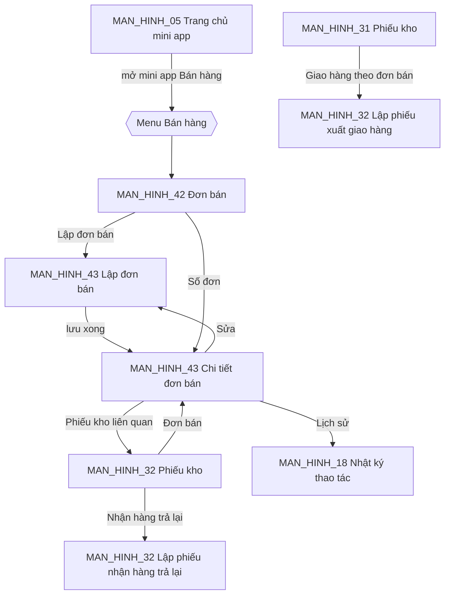

- Thứ tự menu và quyền hiện mục: Đơn bán (`sales.order.view`), Khuyến mãi (`sales.promotion.view`, thêm ở CONG_VIEC_12).
- Danh sách và chi tiết có nút "Lịch sử" mở MAN_HINH_18 lọc theo đối tượng.

## 18. Bảng vai trò – màn hình (MODULE_05)

| Màn hình | Quản trị tập đoàn, quản trị công ty | Nhân viên bán hàng | Thủ kho | Quản lý kho |
|---|---|---|---|---|
| MAN_HINH_42 Đơn bán | Xem, Lập đơn, Cài đặt | Xem, Lập đơn | Xem | Không |
| MAN_HINH_43 Chi tiết, soạn đơn bán | Xem, Sửa, Gửi, Rút (của mình), Hủy, Đóng đơn | Xem, Sửa, Gửi, Rút (của mình), Hủy, Đóng đơn | Xem | Không |
| MAN_HINH_31, MAN_HINH_32 phần giao hàng, nhận hàng trả lại | Lập, Gửi, Xóa nháp (kho của công ty mình) | Không | Kho trong phạm vi gán | Kho trong phạm vi gán |

## 19. Đặc tả từng màn hình (MODULE_05)

### MAN_HINH_42: Đơn bán
- Mục đích: Tìm đơn bán theo trạng thái, khách; lập đơn; cài đặt chiết khấu tay tối đa không cần duyệt.
- Chức năng thực hiện: CHUC_NANG_54, CHUC_NANG_55
- Đường dẫn: `/sales/orders`
- Bố cục: tiêu đề "Đơn bán" kèm "Lịch sử", nút "Cài đặt", "Lập đơn bán"; bộ lọc: ô tìm "Số đơn, khách, người mua", "Khách hàng" (khách có hồ sơ khách hàng ở công ty), "Trạng thái" (Nháp, Chờ duyệt, Đã xác nhận, Bị từ chối, Đã rút, Đã giao đủ, Đã hủy, Đã đóng); bảng số (nháp hiện "(nháp)"), khách hàng (trống: tên người mua hoặc "Người mua không lấy hóa đơn"), kênh bán, kho xuất, ngày đơn, tổng gồm thuế, trạng thái; phân trang 20 dòng. Ngăn kéo "Cài đặt": "Chiết khấu tay tối đa không cần duyệt (%)" ("Dòng có chiết khấu lớn hơn mức này thì đơn phải duyệt. Mặc định 0.").
- Dữ liệu hiển thị: đơn bán của công ty đang chọn, mới lập trước.
- Thành phần: ThanhTrenCung, MenuMiniApp, BoLoc, BangDuLieu, NhanTrangThai, NganKeo, ONhap, OChon, Nut, TrangThaiRong (tài liệu `15`).
- API: API_77 (danh sách, danh sách chọn), API_78.
- Thao tác: gõ ô tìm thì tìm sau 300 mili giây; đổi bộ lọc về trang 1; số đơn mở MAN_HINH_43; "Lập đơn bán" mở `/sales/orders/new`.
- Trạng thái: rỗng ("Chưa có đơn bán."; có lọc thì "Không có kết quả phù hợp.").
- Thông báo: "Đã lưu." (cài đặt); lỗi dưới ô chiết khấu.
- Quyền hiển thị: màn hình với `sales.order.view`; "Lập đơn bán" với `sales.order.manage`; "Cài đặt" với `sales.settings.manage`.
- Responsive: bảng chuyển thành thẻ.
- Sửa theo THAY_DOI_18 (CONG_VIEC_43, 2026-11-11) (CHUC_NANG_158): ngăn kéo "Cài đặt" thêm ô đánh dấu "Cho phép lập đơn bán tay có hàng hóa", gợi ý "Mặc định tắt: đơn bán lập tay chỉ gồm dịch vụ, hàng hóa bán qua sàn VComm.". Nút "Lập đơn bán" với `sales.order.manage` (Kế toán, Kế toán trưởng; Nhân viên bán hàng không thấy).
- Trạng thái phê duyệt: Chưa phê duyệt (người dùng cho AI làm tiếp không dừng ở điểm xem trước, CONG_VIEC_08 mục 14)

### MAN_HINH_43: Chi tiết, soạn đơn bán
- Mục đích: Lập, sửa đơn bán với giá tự lấy theo bảng giá; xem ngoại lệ cần duyệt, đã giao, đã trả, phiếu kho liên quan; gửi, rút, hủy, đóng đơn.
- Chức năng thực hiện: CHUC_NANG_54
- Đường dẫn: `/sales/orders/new` (lập); `/sales/orders/[id]` (chi tiết; "Sửa" mở biểu mẫu trên cùng trang).
- Bố cục: biểu mẫu soạn: "Khách hàng" (mặc định "Người mua không lấy hóa đơn"; gợi ý "Để trống: người mua không lấy hóa đơn."), "Tên người mua" (chỉ hiện khi không chọn khách), "Kênh bán" (mặc định kênh đầu), "Kho xuất" (mặc định kho đầu), "Ngày đơn" (mặc định hôm nay), "Địa chỉ giao", "Ghi chú"; khối "Dòng hàng" mỗi dòng: mặt hàng, câu "Giá <giá> theo bảng giá <mã> (gồm thuế | chưa thuế)" hoặc "Chưa có giá trong bảng giá cho kênh, nhóm khách này.", "Đơn vị", "Số lượng", "Chiết khấu (%)", "Thành tiền gồm thuế", "Bỏ dòng"; ô "Thêm mặt hàng" (tìm mã vạch, mã hàng, tên); "Tổng gồm thuế (tạm tính)"; nút "Lưu", "Hủy". Giá dòng tra lại khi đổi kênh, khách, ngày đơn, đơn vị. Chi tiết: liên kết "Danh sách đơn bán"; số đơn (nháp: "(nháp)"), nhãn trạng thái, "Lịch sử", nút "Sửa đơn bán", "Rút", "Hủy đơn", "Đóng đơn", "Gửi"; khối cảnh báo "Ngoại lệ cần duyệt" liệt kê "Chiết khấu vượt mức (dòng <số>)", "Dưới giá vốn (dòng <số>)", "Vượt hạn mức công nợ" kèm diễn giải số (người không có quyền xem hạn mức công nợ, giá vốn chỉ thấy loại ngoại lệ, không thấy số); thẻ khách hoặc người mua, kênh, kho xuất, ngày đơn, người lập, địa chỉ giao, ghi chú, "Lý do đóng" (đơn đã đóng), "Chưa thuế", "Thuế", "Tổng gồm thuế"; bảng dòng: mặt hàng, số lượng, giá bảng giá (kèm gồm thuế hay chưa thuế), chiết khấu, thuế suất, thành tiền gồm thuế, đã giao ("<đã giao> / <số lượng cơ sở>", kèm "đã trả <số>"); chú thích "Đã giao tính theo đơn vị cơ sở."; khối "Phiếu kho liên quan" (số phiếu liên kết sang MAN_HINH_32, loại, ngày; trống: "Chưa có phiếu xuất giao hàng."). "Đóng đơn" mở ngăn kéo "Lý do đóng" (bắt buộc) kèm "Phần chưa giao bị hủy, hàng đang giữ được nhả.".
- Dữ liệu hiển thị: đơn của công ty đang chọn; số đã giao, đã trả tính từ phiếu kho.
- Thành phần: ThanhTrenCung, MenuMiniApp, The, BangDuLieu, NhanTrangThai, NganKeo, ONhap, OChon, Nut, KhoiCanhBao (tài liệu `15`).
- API: API_77.
- Thao tác: lưu đơn mới thì mở chi tiết; gửi, rút, hủy, đóng xong tải lại đơn.
- Trạng thái: chưa có phiếu kho ("Chưa có phiếu xuất giao hàng.").
- Thông báo: "Đã lưu đơn bán."; lỗi theo CHUC_NANG_54 dưới đúng ô, đúng dòng khi soạn; ở chi tiết, lỗi theo dòng khi gửi (ví dụ thiếu hàng) hiện trong thông báo kèm "dòng <số> (<mã hàng>)".
- Quyền hiển thị: theo `canEdit`, `canSubmit`, `canWithdraw`, `canCancel`, `canClose` của API ("Đóng đơn" chỉ khi đơn đã xác nhận đã có giao hàng, không còn phiếu xuất nháp; "Hủy đơn" khi chưa có phiếu xuất).
- Responsive: bảng chuyển thành thẻ; dòng hàng xếp dọc.
- Bổ sung CONG_VIEC_09 (CHUC_NANG_58, CHUC_NANG_59; API_80): bộ lọc trạng thái ở MAN_HINH_42 thêm "Chờ xác nhận nội bộ". Chi tiết đơn nội bộ hiện thẻ có nhãn "Nội bộ" kèm "Đơn mua đối ứng của <công ty>: <số, chưa có thì "chưa có số"> (<trạng thái>)" (đơn khởi tạo) hoặc "Sinh từ đơn mua của <công ty>: <số>" (đơn đối ứng); bên kia đã từ chối thì khối cảnh báo "Đã từ chối: <lý do>". Đơn "Chờ xác nhận nội bộ" (theo `canConfirmCounterpart`) hiện câu "Công ty mua đã đặt hàng. Chọn kho xuất rồi xác nhận (kiểm ngoại lệ, giữ hàng như đơn thường), hoặc từ chối kèm lý do.", ô "Kho xuất" (bắt buộc), nút "Xác nhận" (bật khi đã chọn kho), ô "Lý do từ chối", nút "Từ chối" (bật khi có lý do); thông báo "Đã lưu đơn bán."; lỗi thiếu hàng, thiếu liên kết, hồ sơ đối tác hiện kèm "Dòng <số>". Đơn đối ứng không có nút "Sửa đơn bán"; khi "Chờ xác nhận nội bộ" không có nút "Hủy đơn".
- Bổ sung CONG_VIEC_12 (CHUC_NANG_63; API_77): bảng dòng ở chi tiết, cột mặt hàng thêm: dòng hàng tặng có nhãn "Hàng tặng" kèm " · <tên chương trình>"; dòng có giảm theo sản phẩm thêm " · <tên chương trình>: giảm <phần trăm>%"; dòng nhận phần giảm theo đơn (lớn hơn 0) thêm " · <tên chương trình>: giảm <số tiền>". Dòng hàng tặng có giá 0, giữ hàng, giao hàng như dòng thường. Biểu mẫu soạn không hiện dòng hàng tặng (tự tạo lại khi lưu); dưới "Tổng gồm thuế (tạm tính)" có chú thích "Khuyến mãi đang chạy tự áp khi lưu (giảm theo dòng, theo đơn, hàng tặng); tổng tạm tính chưa gồm khuyến mãi.". Gửi đơn khi chương trình hết ngân sách, hết suất thì thông báo lỗi "Chương trình khuyến mãi đã hết ngân sách hoặc hết suất. Lưu lại đơn để tính lại khuyến mãi rồi gửi.". Kho xuất không đủ hàng tặng lúc lưu: chi tiết đơn hiện khối cảnh báo (dưới khối chứng từ đối ứng, trên khối ngoại lệ) "<chương trình>: thiếu <số> suất tặng do kho xuất không đủ hàng tặng." cho từng chương trình.
- Sửa theo THAY_DOI_18 (CONG_VIEC_43, 2026-11-11) (CHUC_NANG_157, CHUC_NANG_158): bỏ "Nhân viên hưởng hoa hồng" ở đầu chi tiết; lưu, gửi đơn có hàng hóa khi cài đặt tắt báo "Đơn bán lập tay chỉ gồm mặt hàng dịch vụ. Hàng hóa bán qua sàn VComm."; đơn nội bộ có hàng hóa báo "Giao dịch nội bộ chỉ gồm mặt hàng dịch vụ." dưới dòng; đơn dịch vụ xác nhận thì phiếu xuất dịch vụ hiện trong danh sách phiếu kho của đơn.
- Trạng thái phê duyệt: Chưa phê duyệt (người dùng cho AI làm tiếp không dừng ở điểm xem trước, CONG_VIEC_08 mục 14)

## MODULE_05 Bán hàng (phần 2: Giao dịch nội bộ, CONG_VIEC_09)

Phần nội bộ của đơn bán, đơn mua nằm trên MAN_HINH_43, MAN_HINH_40, MAN_HINH_41 (khối chứng từ đối ứng); nhận hàng nội bộ trên MAN_HINH_32; biên bản chênh lệch là màn hình mới MAN_HINH_44 ở mini app Kho.

## 20. Danh sách màn hình và điều hướng (MODULE_05 phần 2)

| Mã | Tên màn hình | Chức năng (10) | Vai trò được truy cập (08) | Mở từ | Bản mẫu |
|---|---|---|---|---|---|
| MAN_HINH_44 | Biên bản chênh lệch giao nhận nội bộ | CHUC_NANG_61 | Quản trị tập đoàn, quản trị công ty, Quản lý kho, Thủ kho có `inventory.sales.issue` tại kho xuất | Menu Kho | Không lập (CONG_VIEC_09 mục 14) |
| MAN_HINH_43 (sửa) | Chi tiết đơn bán: khối chứng từ đối ứng, xác nhận, từ chối | CHUC_NANG_58, CHUC_NANG_59 | Như MAN_HINH_42; xác nhận, từ chối với `sales.order.manage` | MAN_HINH_42 | Không lập |
| MAN_HINH_40, MAN_HINH_41 (sửa) | Đơn mua: giá nội bộ; chi tiết: khối chứng từ đối ứng, xác nhận, từ chối | CHUC_NANG_58, CHUC_NANG_59 | Như MAN_HINH_40; xác nhận, từ chối với `purchasing.order.manage` | MAN_HINH_40 | Không lập |
| MAN_HINH_31, MAN_HINH_32 (sửa) | Phiếu kho: phiếu nhập nội bộ chờ nhận, nhận hàng | CHUC_NANG_60 | Như MAN_HINH_32; nhận với `inventory.purchase.receive` tại kho nhận | MAN_HINH_31 | Không lập |

Sơ đồ điều hướng:

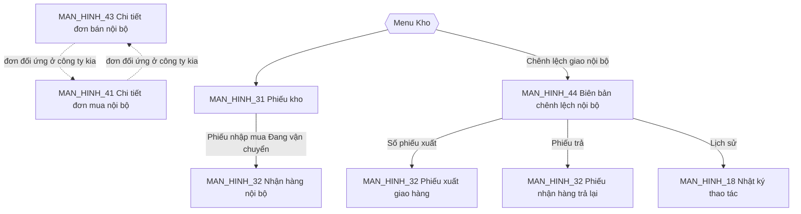

- Đường nét đứt: chứng từ đối ứng thuộc công ty khác, chỉ hiện tên công ty, số, trạng thái, không có liên kết; người dùng chuyển công ty rồi mở ở mini app tương ứng.
- Thứ tự menu Kho và quyền hiện mục: Tồn kho, Phiếu kho, Kiểm kê, Giữ hàng, tồn an toàn, Chênh lệch giao nội bộ (`inventory.sales.issue`), Kho và vị trí.

## 21. Bảng vai trò – màn hình (MODULE_05 phần 2)

| Màn hình | Quản trị tập đoàn, quản trị công ty | Nhân viên bán hàng | Nhân viên mua hàng | Thủ kho | Quản lý kho |
|---|---|---|---|---|---|
| MAN_HINH_43 khối đối ứng | Xem, Xác nhận, Từ chối (công ty bán) | Xem, Xác nhận, Từ chối | Không | Xem | Không |
| MAN_HINH_40, MAN_HINH_41 phần nội bộ | Xem, Lập đơn giá nội bộ, Xác nhận, Từ chối (công ty mua) | Không | Xem, Lập đơn giá nội bộ, Xác nhận, Từ chối | Xem | Không |
| MAN_HINH_32 Nhận hàng nội bộ | Nhận (kho của công ty mình) | Không | Không | Kho nhận trong phạm vi gán | Kho nhận trong phạm vi gán |
| MAN_HINH_44 Biên bản chênh lệch nội bộ | Xem, Nhập lại kho, Ghi tổn thất, xem giá trị | Không | Không | Xem, Nhập lại kho, Ghi tổn thất ở kho xuất trong phạm vi gán; không thấy giá trị | Như Thủ kho, thấy giá trị |

## 22. Đặc tả từng màn hình (MODULE_05 phần 2)

### MAN_HINH_44: Biên bản chênh lệch giao nhận nội bộ
- Mục đích: Công ty bán xem hàng giao nội bộ bị nhận thiếu và xử lý từng biên bản: nhập lại kho hoặc ghi tổn thất.
- Chức năng thực hiện: CHUC_NANG_61
- Đường dẫn: `/inventory/internal-discrepancies`
- Bố cục: tiêu đề "Biên bản chênh lệch giao nhận nội bộ" kèm "Lịch sử"; câu "Công ty mua nhận thiếu so với phiếu xuất. Nhập lại kho: lập và ghi sổ phiếu nhận hàng trả lại vào kho xuất theo giá vốn phiếu xuất. Ghi tổn thất: chỉ đóng biên bản, hạch toán làm cùng Tài chính – Kế toán."; lọc "Trạng thái" (Chờ xử lý, mặc định; Đã nhập lại kho; Đã ghi tổn thất); bảng: "Mặt hàng" (mã · tên · kho), "Số thiếu" (số, đơn vị cơ sở, serial chưa nhận), "Phiếu xuất → phiếu nhập" (số phiếu xuất liên kết sang MAN_HINH_32 → <công ty mua>: <số phiếu nhập>), "Lý do bên nhận" (kèm thời điểm), "Giá trị" ("—" khi không xem được giá vốn), "Trạng thái" (nhãn, người xử lý, ghi chú, liên kết "Phiếu trả"), cột thao tác: ô "Ghi chú xử lý", nút "Nhập lại kho", "Ghi tổn thất".
- Dữ liệu hiển thị: biên bản của công ty đang chọn tại các kho người dùng có `inventory.sales.issue`, mới trước, tối đa 500.
- Thành phần: ThanhTrenCung, MenuMiniApp, BoLoc, BangDuLieu, NhanTrangThai, ONhap, Nut, TrangThaiRong (tài liệu `15`).
- API: API_82.
- Thao tác: đổi lọc tải lại danh sách; bấm "Nhập lại kho" hoặc "Ghi tổn thất" gửi ngay kèm ghi chú (không bắt buộc), xong tải lại danh sách.
- Trạng thái: rỗng ("Không có biên bản.").
- Thông báo: "Đã nhập lại kho." · "Đã ghi tổn thất."; lỗi (đã xử lý, lỗi phiếu trả) hiện ở thông báo lỗi.
- Quyền hiển thị: mục menu với `inventory.sales.issue`; nút xử lý theo `canResolve` của API; giá trị theo quyền xem giá vốn.
- Responsive: bảng chuyển thành thẻ.
- Trạng thái phê duyệt: Chưa phê duyệt (người dùng cho AI làm tiếp không dừng ở điểm xem trước, CONG_VIEC_09 mục 14)

## MODULE_05 Bán hàng (phần 3: Khuyến mãi, CONG_VIEC_12)

Chương trình khuyến mãi là màn hình mới MAN_HINH_45 ở mini app Bán hàng; khuyến mãi trên đơn bán hiện ở MAN_HINH_43; menu Bán hàng (MAN_HINH_42) thêm mục "Khuyến mãi".

## 23. Danh sách màn hình và điều hướng (MODULE_05 phần 3)

| Mã | Tên màn hình | Chức năng (10) | Vai trò được truy cập (08) | Mở từ | Bản mẫu |
|---|---|---|---|---|---|
| MAN_HINH_45 | Khuyến mãi: danh sách, lập, chi tiết chương trình | CHUC_NANG_62, CHUC_NANG_64 | Quản trị tập đoàn, quản trị công ty (lập, sửa, gửi duyệt, rút, dừng); Nhân viên bán hàng (xem) | Menu Bán hàng | Không lập (CONG_VIEC_12 mục 14) |
| MAN_HINH_42 (sửa) | Menu Bán hàng thêm "Khuyến mãi"; danh sách đơn bán không đổi | CHUC_NANG_62 | Như MAN_HINH_42 | Menu Bán hàng | Không lập |
| MAN_HINH_43 (sửa) | Chi tiết, soạn đơn bán: khuyến mãi trên dòng, dòng hàng tặng, cảnh báo thiếu suất tặng | CHUC_NANG_63 | Như MAN_HINH_42 | MAN_HINH_42 | Không lập |

Sơ đồ điều hướng:

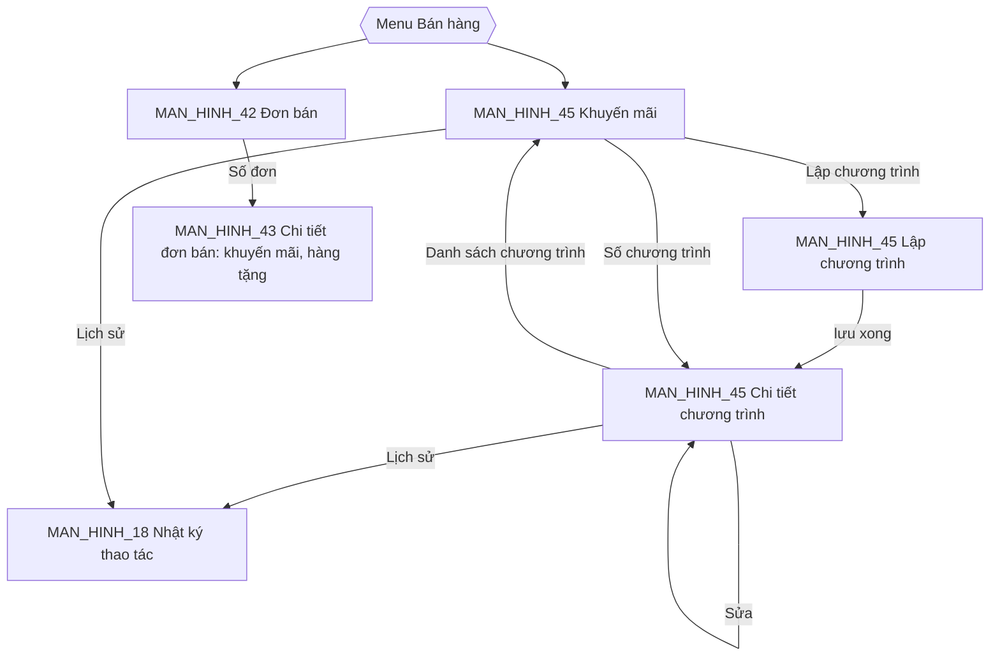

- Thứ tự menu Bán hàng và quyền hiện mục: Đơn bán (`sales.order.view`), Khuyến mãi (`sales.promotion.view`).
- Duyệt chương trình ở Hộp duyệt (MAN_HINH_07) như chứng từ khác, loại "Chương trình khuyến mãi".

## 24. Bảng vai trò – màn hình (MODULE_05 phần 3)

| Màn hình | Quản trị tập đoàn, quản trị công ty | Nhân viên bán hàng | Thủ kho | Quản lý kho |
|---|---|---|---|---|
| MAN_HINH_45 Khuyến mãi | Xem, Lập, Sửa, Gửi duyệt, Rút (của mình), Dừng | Xem | Không | Không |
| MAN_HINH_43 khuyến mãi trên dòng | Xem; khuyến mãi tự áp khi lưu đơn | Xem; khuyến mãi tự áp khi lưu đơn | Xem | Không |

## 25. Đặc tả từng màn hình (MODULE_05 phần 3)

### MAN_HINH_45: Khuyến mãi
- Mục đích: Lập chương trình khuyến mãi, gửi duyệt, theo dõi đã dùng, dừng chương trình.
- Chức năng thực hiện: CHUC_NANG_62, CHUC_NANG_64
- Đường dẫn: `/sales/promotions` (danh sách); `/sales/promotions/new` (lập); `/sales/promotions/[id]` (chi tiết; "Sửa" mở biểu mẫu trên cùng trang).
- Bố cục: danh sách: tiêu đề "Chương trình khuyến mãi" kèm "Lịch sử", nút "Lập chương trình"; lọc "Trạng thái: tất cả" (Nháp, Chờ duyệt, Đang chạy, Bị từ chối, Đã rút, Đã dừng); bảng "Số" (nháp: "(nháp)"; liên kết sang chi tiết), "Tên chương trình", "Loại" (Giảm theo sản phẩm, Giảm theo đơn, Mua X tặng Y), "Thời gian" (từ ngày – đến ngày), "Đã dùng" ("Đã giảm <tiền> / <ngân sách hoặc ∞>" hoặc "Đã tặng <số> / <số suất hoặc ∞> suất"), "Trạng thái". Biểu mẫu soạn: "Tên chương trình" *, "Loại" *, "Từ ngày" *, "Đến ngày" * (mặc định hôm nay), "Kênh bán áp dụng" (ô chọn nhiều; gợi ý "Không chọn: mọi kênh trừ kênh Nội bộ."), "Nhóm khách áp dụng" (gợi ý "Không chọn: mọi khách, kể cả người mua không lấy hóa đơn."); theo loại: "Mặt hàng giảm giá" (mỗi dòng mặt hàng, "Giảm (%)", "Bỏ"; ô "Thêm mặt hàng" tìm mã vạch, mã hàng, tên) hoặc "Tổng đơn từ (gồm thuế)" *, "Giảm (%)" *, "Giảm tối đa" hoặc "Mặt hàng mua" *, "Số lượng mua (đơn vị cơ sở)" *, "Mặt hàng tặng" *, "Số lượng tặng mỗi suất (đơn vị cơ sở)" *, "Số suất tối đa (để trống: không giới hạn)"; "Ngân sách giảm tối đa, gồm thuế (<tiền tệ>; để trống: không giới hạn)" (không hiện với mua X tặng Y); "Ghi chú"; nút "Lưu", "Hủy". Chi tiết: liên kết "Danh sách chương trình"; số (nháp: "(nháp)"), nhãn trạng thái, "Lịch sử", nút "Sửa", "Rút", "Gửi duyệt"; thẻ: tên, loại · thời gian · "Người lập", "Kênh bán áp dụng" (trống: "mọi kênh trừ Nội bộ"), "Nhóm khách áp dụng" (trống: "mọi khách"), nội dung theo loại ("<mã> · <tên>: giảm <phần trăm>%"; "Tổng đơn từ <ngưỡng> giảm <phần trăm>%, tối đa <trần hoặc "không giới hạn">"; "Mua <số> <đơn vị> <mặt hàng> tặng <số> <đơn vị> <mặt hàng>"), đã dùng, ghi chú, khối "Đã dừng: <lý do>"; chương trình đang chạy có thẻ "Lý do dừng" * và nút "Dừng chương trình" (bật khi có lý do).
- Dữ liệu hiển thị: chương trình của công ty đang chọn, mới lập trước, tối đa 500; đã dùng tính từ đơn bán chờ duyệt, đã xác nhận, đã giao đủ, đã đóng.
- Thành phần: ThanhTrenCung, MenuMiniApp, BoLoc, BangDuLieu, NhanTrangThai, The, ONhap, OChon, Nut, KhoiCanhBao, TrangThaiRong (tài liệu `15`).
- API: API_83; tìm mặt hàng API_77 (`/sales/items`).
- Thao tác: đổi lọc tải lại danh sách; lưu chương trình mới thì mở chi tiết; gửi duyệt, rút, dừng xong tải lại chương trình.
- Trạng thái: rỗng ("Chưa có chương trình.").
- Thông báo: "Đã lưu chương trình." (lưu, gửi duyệt, rút) · "Đã dừng chương trình."; lỗi dưới đúng ô khi soạn; lỗi gửi, rút hiện ở thông báo lỗi.
- Quyền hiển thị: mục menu, màn hình với `sales.promotion.view`; "Lập chương trình" với `sales.promotion.manage`; "Sửa", "Gửi duyệt", "Rút", "Dừng chương trình" theo `canEdit`, `canSubmit`, `canWithdraw`, `canStop` của API.
- Responsive: bảng chuyển thành thẻ; ô theo loại xếp lưới tự co, xếp dọc trên điện thoại.
- Trạng thái phê duyệt: Chưa phê duyệt (người dùng cho AI làm tiếp không dừng ở điểm xem trước, CONG_VIEC_12 mục 14)

## MODULE_06 Tài chính – Kế toán (phần 1: Công nợ phải thu, phải trả, CONG_VIEC_13)

Mini app `apps/web-finance`, tên "Tài chính – Kế toán", đường dẫn gốc `/finance` (mini app Nền tảng chuyển tiếp `/finance` sang ứng dụng này theo `FINANCE_ORIGIN`, cùng tên miền và cookie phiên). Khung trang, thành phần dùng chung lấy từ `packages/ui`; quy ước chung như mục 3 của MODULE_01. Mở `/finance` thì chuyển tới mục menu đầu tiên có quyền; không có mục nào thì hiện "Bạn không có quyền xem trang này". Công nợ tự phát sinh khi ghi sổ phiếu kho ở mini app Kho (MAN_HINH_32), không có thao tác mới ở đó.

## 26. Danh sách màn hình và điều hướng (MODULE_06 phần 1)

| Mã | Tên màn hình | Chức năng (10) | Vai trò được truy cập (08) | Mở từ | Bản mẫu |
|---|---|---|---|---|---|
| MAN_HINH_46 | Quỹ: danh sách, thêm, chi tiết, sửa, sổ quỹ | CHUC_NANG_65 | Quản trị tập đoàn, quản trị công ty, Kế toán | Menu Tài chính – Kế toán | Không lập (CONG_VIEC_13 mục 14) |
| MAN_HINH_47 | Công nợ: phải thu, phải trả theo đối tác, tuổi nợ | CHUC_NANG_66 | Như MAN_HINH_46 | Menu Tài chính – Kế toán | Không lập |
| MAN_HINH_48 | Chi tiết công nợ đối tác (kèm biểu mẫu số dư đầu kỳ) | CHUC_NANG_66 | Như MAN_HINH_46 | MAN_HINH_47; liên kết đối tác ở MAN_HINH_49 | Không lập |
| MAN_HINH_49 | Phiếu thu, phiếu chi: danh sách, lập, chi tiết, sửa | CHUC_NANG_67 | Như MAN_HINH_46; người duyệt phiếu chi xem qua Hộp duyệt | Menu Tài chính – Kế toán; nút "Lập phiếu thu", "Lập phiếu chi" ở MAN_HINH_48; số phiếu ở sổ quỹ MAN_HINH_46 | Không lập |

Sơ đồ điều hướng:

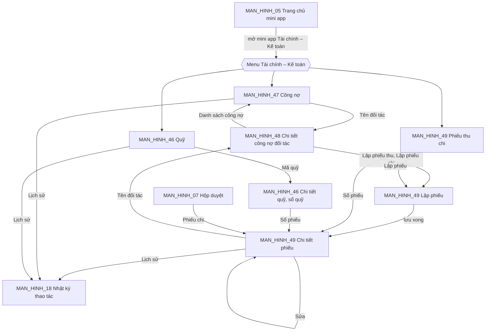

- Thứ tự menu và quyền hiện mục: Công nợ, Phiếu thu chi, Quỹ (cả ba với `finance.debt.view`).
- Duyệt phiếu chi ở Hộp duyệt (MAN_HINH_07) như chứng từ khác, loại "Phiếu chi".
- Danh sách và chi tiết phiếu có nút "Lịch sử" mở MAN_HINH_18 lọc theo đối tượng (`fund`, `debt_item`, `payment`).

## 27. Bảng vai trò – màn hình (MODULE_06 phần 1)

| Màn hình | Quản trị tập đoàn, quản trị công ty | Kế toán | Nhân viên bán hàng | Thủ kho |
|---|---|---|---|---|
| MAN_HINH_46 Quỹ | Xem, Thêm, Sửa, Ngừng dùng, Sổ quỹ | Xem, Thêm, Sửa, Ngừng dùng, Sổ quỹ | Không | Không |
| MAN_HINH_47 Công nợ | Xem | Xem | Không | Không |
| MAN_HINH_48 Chi tiết công nợ đối tác | Xem, Nhập, Xóa số dư đầu kỳ, Lập phiếu | Xem, Nhập, Xóa số dư đầu kỳ, Lập phiếu | Không | Không |
| MAN_HINH_49 Phiếu thu chi | Xem, Lập, Sửa, Gửi, Rút (của mình) | Xem, Lập, Sửa, Gửi, Rút (của mình) | Không | Không |

## 28. Đặc tả từng màn hình (MODULE_06 phần 1)

### MAN_HINH_46: Quỹ
- Mục đích: Quản lý quỹ tiền mặt, tài khoản ngân hàng; xem số dư, sổ quỹ.
- Chức năng thực hiện: CHUC_NANG_65
- Đường dẫn: `/finance/funds` (danh sách, biểu mẫu thêm trên cùng trang); `/finance/funds/[id]` (chi tiết, "Sửa" mở biểu mẫu trên cùng trang, sổ quỹ).
- Bố cục: danh sách: tiêu đề "Quỹ" kèm "Lịch sử", nút "Thêm quỹ"; bảng "Mã quỹ" (liên kết sang chi tiết), "Tên quỹ" (ngân hàng kèm tên ngân hàng, số tài khoản), "Loại" (Tiền mặt, Ngân hàng), "Số dư hiện tại", "Trạng thái" (Đang dùng, Ngừng dùng). Biểu mẫu: "Mã quỹ" *, "Tên quỹ" *, "Loại" *, "Số dư đầu" (khóa khi quỹ đã có phiếu ghi sổ); loại ngân hàng thêm "Tên ngân hàng" *, "Số tài khoản" *, "Chủ tài khoản"; khi sửa có ô chọn "Đang dùng"; nút "Lưu", "Hủy". Chi tiết: liên kết "Danh sách quỹ"; "<mã> · <tên>", nhãn trạng thái, nút "Sửa"; thẻ: loại, thông tin ngân hàng, "Số dư đầu", "Số dư hiện tại"; khối "Sổ quỹ": "Từ ngày" (mặc định đầu tháng), "Đến ngày" (mặc định hôm nay), "Số dư đầu kỳ", bảng "Ngày", "Số phiếu" (liên kết sang MAN_HINH_49), "Đối tác", "Thu", "Chi", "Số dư", "Số dư cuối kỳ".
- Dữ liệu hiển thị: quỹ của công ty đang chọn, đang dùng trước, theo mã; sổ quỹ chỉ phiếu đã ghi sổ.
- Thành phần: ThanhTrenCung, MenuMiniApp, BangDuLieu, NhanTrangThai, The, ONhap, OChon, Nut, TrangThaiRong (tài liệu `15`).
- API: API_84.
- Thao tác: lưu quỹ mới tải lại danh sách; sửa xong tải lại quỹ và sổ quỹ; đổi khoảng ngày tải lại sổ quỹ.
- Trạng thái: rỗng ("Chưa có quỹ.", "Không có phiếu trong khoảng ngày.").
- Thông báo: "Đã lưu quỹ."; lỗi dưới đúng ô (mã trùng, thiếu thông tin ngân hàng, số dư đầu khi đã có phiếu).
- Quyền hiển thị: mục menu với `finance.debt.view`; "Thêm quỹ" với `finance.fund.manage`; "Sửa" theo `canManage` của API.
- Responsive: bảng chuyển thành thẻ; ô biểu mẫu xếp lưới tự co, xếp dọc trên điện thoại.
- Trạng thái phê duyệt: Chưa phê duyệt (người dùng cho AI làm tiếp không dừng ở điểm xem trước, CONG_VIEC_13 mục 14)

### MAN_HINH_47: Công nợ
- Mục đích: Xem đối tác còn nợ, trả trước, quá hạn theo phải thu, phải trả.
- Chức năng thực hiện: CHUC_NANG_66
- Đường dẫn: `/finance/debts` (tham số `side=payable` mở thẻ Phải trả).
- Bố cục: tiêu đề "Công nợ" kèm "Lịch sử"; hai thẻ "Phải thu", "Phải trả"; lọc: ô "Tìm theo tên, mã đối tác", ô chọn "Chỉ đối tác quá hạn"; bảng "Đối tác" (mã · tên, liên kết sang MAN_HINH_48), "Số dư", "Trả trước", "Chưa đến hạn", "Quá hạn 1–30 ngày", "Quá hạn 31–60 ngày", "Quá hạn 61–90 ngày", "Quá hạn trên 90 ngày" (số quá hạn lớn hơn 0 tô màu lỗi); dòng "Tổng cộng".
- Dữ liệu hiển thị: đối tác của công ty đang chọn có khoản còn số còn lại ở phía đang chọn, số dư giảm dần, tối đa 1.000.
- Thành phần: ThanhTrenCung, MenuMiniApp, CacThe, BoLoc, BangDuLieu, ONhap, TrangThaiRong (tài liệu `15`).
- API: API_85.
- Thao tác: đổi thẻ, gõ tìm, đổi ô chọn thì tải lại danh sách.
- Trạng thái: rỗng ("Không có đối tác còn công nợ.").
- Thông báo: không có.
- Quyền hiển thị: mục menu, màn hình với `finance.debt.view`.
- Responsive: bảng chuyển thành thẻ; thẻ phía và lọc xuống dòng.
- Trạng thái phê duyệt: Chưa phê duyệt (CONG_VIEC_13 mục 14)

### MAN_HINH_48: Chi tiết công nợ đối tác
- Mục đích: Xem từng chứng từ còn nợ, các lần trừ nợ; nhập số dư đầu kỳ; mở lập phiếu thu, phiếu chi cho đối tác.
- Chức năng thực hiện: CHUC_NANG_66
- Đường dẫn: `/finance/debts/[partnerId]?side=receivable|payable`.
- Bố cục: liên kết "Danh sách công nợ"; "<mã> · <tên>", nhãn phía; nút "Lập phiếu thu" (phải thu) hoặc "Lập phiếu chi" (phải trả), nút "Nhập số dư đầu kỳ"; thẻ: "Số dư", "Trả trước", tuổi nợ (quá hạn lớn hơn 0 tô màu lỗi); biểu mẫu số dư đầu kỳ: "Loại số dư" (Còn nợ, Trả trước), "Số chứng từ" *, "Ngày" *, "Hạn thanh toán" * (chỉ với Còn nợ), "Số tiền" *, "Ghi chú", nút "Lưu", "Hủy"; bảng khoản: "Số chứng từ", "Loại" (Số dư đầu kỳ kèm Còn nợ hoặc Trả trước, Xuất giao hàng, Nhận hàng trả lại, Nhập mua, Trả hàng nhà cung cấp, loại phiếu thu chi), "Ngày", "Hạn thanh toán" (kèm "quá hạn <số> ngày"), "Số tiền" (khoản giảm có dấu trừ), "Còn lại", "Trừ nợ" ("<chứng từ>: <số tiền>"), nút "Xóa" (khoản số dư đầu kỳ xóa được).
- Dữ liệu hiển thị: khoản của đối tác ở phía đang chọn trong công ty đang chọn, mới trước, tối đa 1.000.
- Thành phần: ThanhTrenCung, MenuMiniApp, NhanTrangThai, The, BangDuLieu, ONhap, OChon, Nut, TrangThaiRong (tài liệu `15`).
- API: API_85.
- Thao tác: lưu số dư đầu kỳ, xóa xong tải lại chi tiết; "Lập phiếu thu", "Lập phiếu chi" mở MAN_HINH_49 lập phiếu với loại và đối tác chọn sẵn.
- Trạng thái: rỗng ("Chưa có khoản công nợ.").
- Thông báo: "Đã lưu số dư đầu kỳ." · "Đã xóa số dư đầu kỳ."; lỗi dưới đúng ô; lỗi xóa ("Khoản số dư đầu kỳ đã được trừ nợ hoặc đang được chọn trên phiếu thu chi, không xóa được.") hiện trên bảng.
- Quyền hiển thị: "Lập phiếu thu", "Lập phiếu chi" theo `canManagePayments`; "Nhập số dư đầu kỳ" theo `canManageOpening`; "Xóa" theo `canDelete` của từng khoản.
- Responsive: bảng chuyển thành thẻ; ô biểu mẫu xếp dọc trên điện thoại.
- Trạng thái phê duyệt: Chưa phê duyệt (CONG_VIEC_13 mục 14)

### MAN_HINH_49: Phiếu thu, phiếu chi
- Mục đích: Lập, gửi phiếu thu, phiếu chi, hoàn tiền; theo dõi trạng thái; sửa phiếu bị từ chối.
- Chức năng thực hiện: CHUC_NANG_67
- Đường dẫn: `/finance/payments` (danh sách); `/finance/payments/new?kind=&partnerId=` (lập); `/finance/payments/[id]` (chi tiết; "Sửa" mở biểu mẫu trên cùng trang).
- Bố cục: danh sách: tiêu đề "Phiếu thu chi" kèm "Lịch sử", nút "Lập phiếu"; lọc "Loại: tất cả" (Thu tiền khách hàng, Trả tiền nhà cung cấp, Hoàn tiền cho khách hàng, Nhà cung cấp hoàn tiền), "Trạng thái: tất cả" (Nháp, Chờ duyệt, Đã ghi sổ, Bị từ chối, Đã rút); bảng "Số phiếu" (nháp: "(nháp)"; liên kết sang chi tiết), "Loại phiếu", "Ngày", "Đối tác", "Quỹ", "Số tiền", "Trạng thái". Biểu mẫu: "Loại phiếu" *, "Quỹ" * (mã · tên kèm số dư; quỹ đã ngừng dùng của phiếu đang sửa hiện kèm "đã ngừng dùng"), "Ngày" *, "Số tiền" *, "Khách hàng" * hoặc "Nhà cung cấp" * (ô tìm "Gõ tên, mã đối tác rồi nhấn Enter"); khi đã chọn đối tác: "Trả trước đang còn"; thu tiền khách, trả tiền nhà cung cấp có bảng "Chứng từ còn nợ" ("Số chứng từ", "Ngày chứng từ", "Hạn thanh toán" kèm "quá hạn <số> ngày", "Còn nợ", ô "Số trừ"), nút "Chia lại từ cũ nhất", dòng "Tổng trừ: <tiền> · Trả trước: <tiền>" hoặc "Không chọn chứng từ: tự trừ cũ nhất trước khi ghi sổ"; đối tác không còn chứng từ nợ thì "Đối tác không còn chứng từ nợ; toàn bộ số tiền là trả trước."; hoàn tiền hiện gợi ý không vượt trả trước; "Nội dung"; nút "Lưu", "Hủy". Chi tiết: liên kết "Danh sách phiếu thu chi"; "<loại> <số hoặc (nháp)>", nhãn trạng thái, "Lịch sử", nút "Sửa", "Rút", "Gửi"; khối lỗi "Duyệt xong nhưng không ghi sổ được: <lý do> Sửa phiếu rồi gửi lại." khi phiếu bị từ chối do không ghi sổ được; thẻ: đối tác (liên kết sang MAN_HINH_48), quỹ, ngày, số tiền, nội dung, "Người lập", "Ghi sổ lúc"; bảng "Chứng từ sẽ trừ" (chưa ghi sổ) hoặc "Chứng từ đã trừ" (đã ghi sổ) kèm "Đã trừ", dòng "Trả trước".
- Dữ liệu hiển thị: phiếu của công ty đang chọn, ngày mới trước, tối đa 500.
- Thành phần: ThanhTrenCung, MenuMiniApp, BoLoc, BangDuLieu, NhanTrangThai, The, ONhap, OChon, Nut, KhoiCanhBao, TrangThaiRong (tài liệu `15`).
- API: API_86; chứng từ còn nợ, chọn đối tác API_85.
- Thao tác: đổi lọc tải lại danh sách; đổi loại sang phía khác thì bỏ đối tác, bỏ số trừ; lưu phiếu mới thì mở chi tiết; gửi, rút xong tải lại phiếu.
- Trạng thái: rỗng ("Chưa có phiếu thu chi."); chưa có quỹ đang dùng ("Chưa có quỹ đang dùng").
- Thông báo: "Đã lưu phiếu." · "Đã ghi sổ." · "Đã gửi duyệt." · "Đã rút phiếu."; lỗi dưới đúng ô, lỗi dòng chứng từ dưới bảng; lỗi gửi, rút hiện ở thông báo lỗi.
- Quyền hiển thị: mục menu, màn hình với `finance.debt.view`; "Lập phiếu" với `finance.payment.manage`; "Sửa", "Gửi", "Rút" theo `canEdit`, `canSubmit`, `canWithdraw` của API.
- Responsive: bảng chuyển thành thẻ; ô biểu mẫu xếp lưới tự co, xếp dọc trên điện thoại; ô số trừ nằm trong thẻ của từng chứng từ.
- Trạng thái phê duyệt: Chưa phê duyệt (CONG_VIEC_13 mục 14)

## MODULE_06 Tài chính – Kế toán (phần 2: Kế toán tổng hợp, CONG_VIEC_14)

Cùng mini app `apps/web-finance` (mục 26). Bút toán tự sinh khi ghi sổ phiếu kho (MAN_HINH_32), phiếu thu chi (MAN_HINH_49), ghi tổn thất biên bản nội bộ (MAN_HINH_44), không có thao tác mới ở đó. Chế độ kế toán của công ty đổi ở màn hình Công ty (MAN_HINH_09 của MODULE_01); đổi khi đã có bút toán thì lỗi hiện dưới ô "Chế độ kế toán".

## 29. Danh sách màn hình và điều hướng (MODULE_06 phần 2)

| Mã | Tên màn hình | Chức năng (10) | Vai trò được truy cập (08) | Mở từ | Bản mẫu |
|---|---|---|---|---|---|
| MAN_HINH_50 | Hệ thống tài khoản: khởi tạo kế toán, cây tài khoản, tài khoản chi tiết, định khoản mặc định | CHUC_NANG_69, CHUC_NANG_70 | Quản trị tập đoàn, quản trị công ty, Kế toán trưởng, Kế toán (xem) | Menu Tài chính – Kế toán | Không lập (CONG_VIEC_14 mục 14) |
| MAN_HINH_51 | Bút toán: danh sách, lập, chi tiết, sửa phiếu kế toán | CHUC_NANG_71, CHUC_NANG_72 | Quản trị tập đoàn, quản trị công ty, Kế toán trưởng, Kế toán; người duyệt phiếu kế toán xem qua Hộp duyệt | Menu Tài chính – Kế toán; số bút toán ở sổ cái MAN_HINH_52 | Không lập |
| MAN_HINH_52 | Sổ sách: bảng cân đối số phát sinh, sổ cái, khóa sổ | CHUC_NANG_73 | Như MAN_HINH_51 (khóa sổ, mở lại: Kế toán trưởng, quản trị) | Menu Tài chính – Kế toán | Không lập |

Sơ đồ điều hướng:

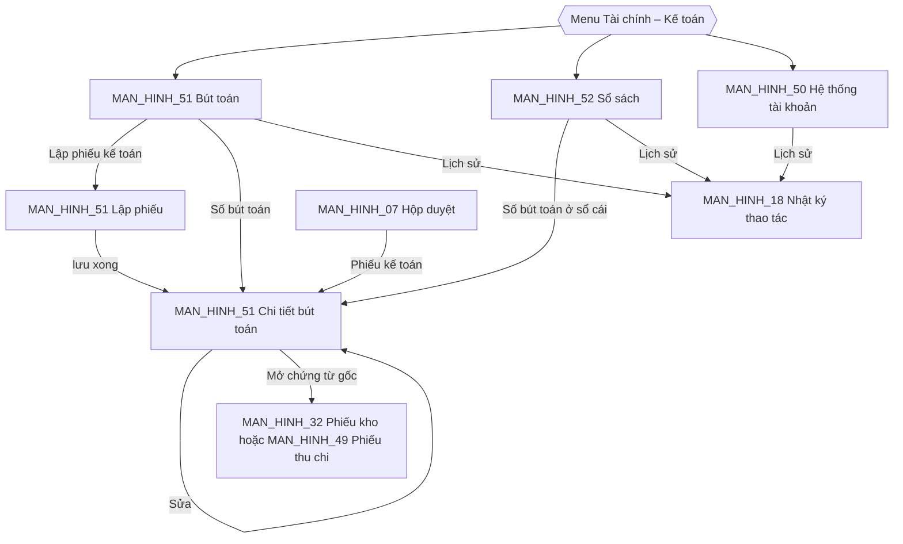

- Thứ tự menu và quyền hiện mục: Công nợ, Phiếu thu chi, Quỹ (`finance.debt.view`); Bút toán, Sổ sách, Hệ thống tài khoản (`finance.ledger.view`). Mở `/finance` thì chuyển tới mục đầu tiên có quyền.
- Duyệt phiếu kế toán ở Hộp duyệt (MAN_HINH_07) như chứng từ khác, loại "Phiếu kế toán".
- Nút "Lịch sử" mở MAN_HINH_18 lọc theo đối tượng `account` (MAN_HINH_50), `journal` (MAN_HINH_51), `ledger_period` (MAN_HINH_52).

## 30. Bảng vai trò – màn hình (MODULE_06 phần 2)

| Màn hình | Quản trị tập đoàn, quản trị công ty | Kế toán trưởng | Kế toán | Nhân viên bán hàng, Thủ kho |
|---|---|---|---|---|
| MAN_HINH_50 Hệ thống tài khoản | Xem, Khởi tạo, Thêm chi tiết, Sửa, Đổi định khoản | Xem, Khởi tạo, Thêm chi tiết, Sửa, Đổi định khoản | Xem | Không |
| MAN_HINH_51 Bút toán | Xem, Lập, Sửa, Gửi, Rút (của mình) | Xem, Lập, Sửa, Gửi, Rút (của mình) | Xem, Lập, Sửa, Gửi, Rút (của mình) | Không |
| MAN_HINH_52 Sổ sách | Xem, Khóa sổ, Mở lại | Xem, Khóa sổ, Mở lại | Xem | Không |

## 31. Đặc tả từng màn hình (MODULE_06 phần 2)

### MAN_HINH_50: Hệ thống tài khoản
- Mục đích: Khởi tạo kế toán của công ty; xem, mở tài khoản chi tiết; đổi định khoản mặc định.
- Chức năng thực hiện: CHUC_NANG_69, CHUC_NANG_70, CHUC_NANG_75 (đánh dấu dài hạn)
- Đường dẫn: `/finance/accounts`.
- Bố cục: tiêu đề "Hệ thống tài khoản" kèm "Lịch sử". Chưa khởi tạo: thẻ "Công ty chưa khởi tạo kế toán. Chế độ kế toán của công ty: <chế độ>.", chú thích "Khởi tạo sẽ nạp hệ thống tài khoản, định khoản mặc định và tạo bút toán cho các chứng từ đã ghi sổ. Đổi chế độ kế toán ở phần quản lý công ty trước khi khởi tạo.", nút "Khởi tạo kế toán". Đã khởi tạo: dòng "Chế độ kế toán: <chế độ>."; hai thẻ "Tài khoản", "Định khoản mặc định". Thẻ "Tài khoản": bảng "Số hiệu" (thụt lề theo cấp, cấp 1 in đậm), "Tên tài khoản" (tài khoản dài hạn kèm nhãn "Dài hạn"), "Tính chất" (Dư Nợ, Dư Có, Lưỡng tính), "Trạng thái" (Nhận bút toán, Tổng hợp, Ngừng dùng), nút "Thêm chi tiết", "Sửa" trên dòng đang dùng; biểu mẫu thêm "Thêm tài khoản chi tiết của <số hiệu> · <tên>": "Số hiệu" * (điền sẵn số hiệu cha, gợi ý "Bắt đầu bằng số hiệu tài khoản cha và dài hơn."), "Tên tài khoản" *; biểu mẫu sửa "Sửa tài khoản <số hiệu>": "Tên tài khoản" *, ô chọn "Đang dùng" (chỉ tài khoản chi tiết), ô chọn "Dài hạn" kèm chú thích "(số dư vào chỉ tiêu dài hạn trên báo cáo tình hình tài chính)" (chỉ tài khoản chi tiết do kế toán mở); nút "Lưu", "Hủy". Thẻ "Định khoản mặc định": chú thích "Tài khoản dùng khi hệ thống tự sinh bút toán; thay đổi áp dụng cho chứng từ ghi sổ sau đó."; bảng "Nghiệp vụ", "Tài khoản" (ô chọn các tài khoản nhận bút toán "<số hiệu> · <tên>").
- Dữ liệu hiển thị: tài khoản của công ty đang chọn theo số hiệu; định khoản theo thứ tự vai trò.
- Thành phần: ThanhTrenCung, MenuMiniApp, CacThe, BangDuLieu, NhanTrangThai, The, ONhap, OChon, Nut, TrangThaiRong (tài liệu `15`).
- API: API_87.
- Thao tác: khởi tạo xong tải lại trang; lưu tài khoản tải lại cây; đổi ô chọn tài khoản của vai trò thì lưu ngay.
- Trạng thái: chưa khởi tạo (như bố cục).
- Thông báo: "Đã khởi tạo kế toán." · "Đã lưu tài khoản." · "Đã đổi định khoản."; lỗi dưới đúng ô (số hiệu sai quy tắc, trùng; ngừng dùng tài khoản đang trong định khoản, còn tài khoản con).
- Quyền hiển thị: mục menu với `finance.ledger.view`; "Khởi tạo kế toán" theo `canSetup`; "Thêm chi tiết", "Sửa" theo `canEdit` của tài khoản; ô chọn định khoản theo `canEdit` của vai trò, không có quyền thì hiện chữ.
- Responsive: bảng chuyển thành thẻ; ô biểu mẫu xếp lưới tự co, xếp dọc trên điện thoại.
- Trạng thái phê duyệt: Chưa phê duyệt (CONG_VIEC_14 mục 14)

### MAN_HINH_51: Bút toán
- Mục đích: Xem mọi bút toán của công ty; lập, gửi phiếu kế toán; mở chứng từ gốc của bút toán tự sinh.
- Chức năng thực hiện: CHUC_NANG_71, CHUC_NANG_72
- Đường dẫn: `/finance/journals` (danh sách); `/finance/journals/new` (lập); `/finance/journals/[id]` (chi tiết; "Sửa" mở biểu mẫu trên cùng trang).
- Bố cục: danh sách: tiêu đề "Bút toán" kèm "Lịch sử", nút "Lập phiếu kế toán"; lọc "Nguồn: tất cả" (Phiếu kế toán, Phiếu kho, Phiếu thu chi, Ghi tổn thất hàng thiếu nội bộ, Kết chuyển cuối kỳ, Bảng hoa hồng, Bảng đối soát thu hộ; cột "Nguồn" và tiêu đề chi tiết dùng cùng nhãn, CONG_VIEC_19), "Trạng thái: tất cả" (Nháp, Chờ duyệt, Đã ghi sổ, Bị từ chối, Đã rút), "Từ ngày", "Đến ngày"; bảng "Số" (nháp: "(nháp)"; liên kết sang chi tiết), "Ngày", "Nguồn", "Diễn giải", "Số tiền", "Trạng thái". Biểu mẫu: "Ngày" *, "Diễn giải" *; bảng dòng "Tài khoản" (ô chọn tài khoản nhận bút toán), "Đối tác", "Diễn giải dòng", "Nợ", "Có", nút "Bỏ dòng"; nút "Thêm dòng"; dòng "Tổng Nợ <tiền> · Tổng Có <tiền>", "Chênh lệch <tiền>"; nút "Lưu", "Hủy". Chi tiết: liên kết "Danh sách bút toán"; "<nguồn> <số hoặc (nháp)>", nhãn trạng thái, "Lịch sử", nút "Sửa", "Rút", "Gửi", "Mở chứng từ gốc" (phiếu kho, phiếu thu chi); khối lỗi "Duyệt xong nhưng không ghi sổ được: <lý do> Sửa phiếu rồi gửi lại."; thẻ: ngày, số tiền, diễn giải, "Người lập"; bảng dòng "Tài khoản", "Đối tác", "Diễn giải dòng", "Nợ", "Có".
- Dữ liệu hiển thị: bút toán của công ty đang chọn, ngày mới trước, tối đa 500.
- Thành phần: ThanhTrenCung, MenuMiniApp, BoLoc, BangDuLieu, NhanTrangThai, The, ONhap, OChon, Nut, KhoiCanhBao, TrangThaiRong (tài liệu `15`).
- API: API_88; tài khoản API_87; chọn đối tác API_85.
- Thao tác: đổi lọc tải lại danh sách; lưu phiếu mới thì mở chi tiết; gửi, rút xong tải lại phiếu.
- Trạng thái: rỗng ("Chưa có bút toán.").
- Thông báo: "Đã lưu phiếu kế toán." · "Đã ghi sổ." · "Đã gửi duyệt." · "Đã rút phiếu."; lỗi dưới đúng ô, lỗi dòng dưới bảng.
- Quyền hiển thị: mục menu với `finance.ledger.view`; "Lập phiếu kế toán" với `finance.journal.manage`; "Sửa", "Gửi", "Rút" theo `canEdit`, `canSubmit`, `canWithdraw` của API.
- Responsive: bảng chuyển thành thẻ; mỗi dòng phiếu một thẻ, ô xếp dọc trên điện thoại.
- Sửa theo THAY_DOI_18 (CONG_VIEC_43, 2026-11-11): lọc nguồn "Bảng hoa hồng" giữ để đọc bút toán cũ của CONG_VIEC_17 (nếu có); không sinh bút toán mới nguồn này.
- Trạng thái phê duyệt: Chưa phê duyệt (CONG_VIEC_14 mục 14)

### MAN_HINH_52: Sổ sách
- Mục đích: Xem bảng cân đối số phát sinh, sổ cái; khóa sổ, mở lại sổ theo tháng.
- Chức năng thực hiện: CHUC_NANG_73
- Đường dẫn: `/finance/books`.
- Bố cục: tiêu đề "Sổ sách" kèm "Lịch sử"; ba thẻ "Bảng cân đối số phát sinh", "Sổ cái", "Khóa sổ". Hai thẻ đầu có "Từ ngày" (mặc định đầu tháng), "Đến ngày" (mặc định hôm nay). Bảng cân đối: "Số hiệu" (thụt lề theo cấp, cấp 1 in đậm), "Tên tài khoản", "Dư đầu Nợ", "Dư đầu Có", "Nợ", "Có", "Dư cuối Nợ", "Dư cuối Có", dòng "Tổng cộng". Sổ cái: ô chọn tài khoản "<số hiệu> · <tên>" (mặc định "Chọn tài khoản"); "Số dư đầu kỳ"; bảng "Ngày", "Số" (liên kết sang MAN_HINH_51), "Diễn giải", "Tài khoản đối ứng", "Nợ", "Có", "Số dư" (kèm "Nợ" hoặc "Có"); dòng "Phát sinh Nợ <tiền> · phát sinh Có <tiền>", "Số dư cuối kỳ". Khóa sổ: chú thích "Khóa lần lượt từng tháng đã kết thúc. …"; "Đã khóa sổ đến: <ngày hoặc chưa khóa>", "Tháng tiếp theo cần khóa: <tháng>"; nút "Khóa sổ tháng <tháng>", "Mở lại tháng <tháng>"; hộp xác nhận "Hệ thống tạo bút toán kết chuyển và chặn ghi sổ chứng từ trong tháng này." hoặc "Bút toán kết chuyển của tháng sẽ bị xóa; chứng từ trong tháng lại ghi sổ được.", nút "Khóa sổ", "Mở lại".
- Dữ liệu hiển thị: chỉ bút toán đã ghi sổ của công ty đang chọn; bảng cân đối chỉ tài khoản có số; sổ cái tối đa 10.000 dòng.
- Thành phần: ThanhTrenCung, MenuMiniApp, CacThe, BoLoc, BangDuLieu, The, ONhap, OChon, Nut, HopThoaiXacNhan, TrangThaiRong (tài liệu `15`).
- API: API_89; tài khoản API_87.
- Thao tác: đổi khoảng ngày, tài khoản tải lại bảng; khóa, mở lại xong tải lại thẻ "Khóa sổ".
- Trạng thái: chưa chọn tài khoản (chỉ ô chọn); công ty chưa khởi tạo ("Công ty chưa khởi tạo kế toán.").
- Thông báo: "Đã khóa sổ." · "Đã mở lại sổ."; lỗi khóa sổ hiện trong hộp xác nhận.
- Quyền hiển thị: mục menu với `finance.ledger.view`; "Khóa sổ tháng …" theo `canClose`, "Mở lại tháng …" theo `canReopen` của API.
- Responsive: bảng chuyển thành thẻ, nhãn cột hiện đủ; thẻ và bộ lọc xuống dòng; không cuộn ngang.
- Trạng thái phê duyệt: Chưa phê duyệt (CONG_VIEC_14 mục 14)

## MODULE_06 Tài chính – Kế toán (phần 3: Báo cáo tài chính, CONG_VIEC_15)

Cùng mini app `apps/web-finance` (mục 26). Đánh dấu tài khoản chi tiết dài hạn ở MAN_HINH_50 (biểu mẫu "Sửa tài khoản").

## 32. Danh sách màn hình và điều hướng (MODULE_06 phần 3)

| Mã | Tên màn hình | Chức năng (10) | Vai trò được truy cập (08) | Mở từ | Bản mẫu |
|---|---|---|---|---|---|
| MAN_HINH_53 | Báo cáo tài chính: tình hình tài chính, kết quả kinh doanh; xuất Excel, PDF | CHUC_NANG_74, CHUC_NANG_75 | Quản trị tập đoàn, quản trị công ty, Kế toán trưởng, Kế toán | Menu Tài chính – Kế toán | Không lập (CONG_VIEC_15 mục 14) |

Sơ đồ điều hướng:

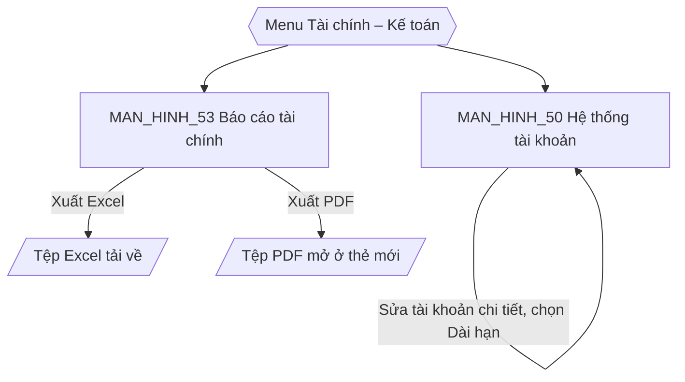

- Thứ tự menu và quyền hiện mục: Công nợ, Phiếu thu chi, Quỹ (`finance.debt.view`); Bút toán, Sổ sách, Báo cáo tài chính, Hệ thống tài khoản (`finance.ledger.view`).

## 33. Bảng vai trò – màn hình (MODULE_06 phần 3)

| Màn hình | Quản trị tập đoàn, quản trị công ty | Kế toán trưởng | Kế toán | Nhân viên bán hàng, Thủ kho |
|---|---|---|---|---|
| MAN_HINH_53 Báo cáo tài chính | Xem, Xuất Excel, Xuất PDF | Xem, Xuất Excel, Xuất PDF | Xem, Xuất Excel, Xuất PDF | Không |
| MAN_HINH_50 ô "Dài hạn" | Sửa | Sửa | Không (chỉ thấy nhãn) | Không |

## 34. Đặc tả từng màn hình (MODULE_06 phần 3)

### MAN_HINH_53: Báo cáo tài chính
- Mục đích: Xem báo cáo tình hình tài chính, báo cáo kết quả hoạt động kinh doanh theo mẫu của chế độ kế toán công ty; xuất Excel, PDF.
- Chức năng thực hiện: CHUC_NANG_74, CHUC_NANG_75
- Đường dẫn: `/finance/statements`.
- Bố cục: tiêu đề "Báo cáo tài chính"; hai thẻ "Tình hình tài chính" (mặc định), "Kết quả kinh doanh"; bộ lọc: thẻ tình hình tài chính có "Tại ngày" (mặc định hôm nay); thẻ kết quả kinh doanh có "Từ ngày" (mặc định ngày 1 tháng 1 năm hiện tại), "Đến ngày" (mặc định hôm nay); ô chọn "Mẫu" chỉ hiện khi chế độ có nhiều mẫu (Thông tư 133: B01a-DNN, B01b-DNN). Khối tiêu đề báo cáo: "<tên báo cáo> (<mẫu>)", chú thích "<tên công ty> · Đơn vị tính: <tiền tệ>", nút "Xuất Excel", "Xuất PDF". Bảng: "Mã số", "Chỉ tiêu" (thụt lề theo cấp, cấp 0 in đậm), "Ghi chú" (mục thu gọn "Cách lấy số liệu" khi chỉ tiêu có ghi chú), hai cột số: "Số cuối kỳ (<ngày>)", "Số đầu năm (<ngày>)" hoặc "Kỳ này (<từ ngày> – <đến ngày>)", "Cùng kỳ năm trước (<từ ngày> – <đến ngày>)". "Từ ngày" mặc định là ngày 1 tháng 1, không theo tháng bắt đầu năm tài chính của công ty.
- Dữ liệu hiển thị: chỉ tiêu theo thứ tự của mẫu; số định dạng theo tiếng Việt, số 0 để trống, số âm trong ngoặc đơn; dòng cấp 0 in đậm.
- Thành phần: ThanhTrenCung, MenuMiniApp, CacThe, BoLoc, BangDuLieu, ONhap, OChon, Nut, KhoiCanhBao (tài liệu `15`).
- API: API_90; đánh dấu dài hạn API_87.
- Thao tác: đổi thẻ (bỏ mẫu đã chọn), ngày, mẫu thì tải lại báo cáo; "Xuất Excel" tải tệp `<mẫu>-<đến ngày>.xlsx` (ví dụ `B01-DN-2026-11-10.xlsx`, trùng tên API đặt); "Xuất PDF" mở tệp ở thẻ mới; khi đang xuất, hai nút bị khóa, nút đang xuất hiện trạng thái đang xử lý.
- Trạng thái: đang tải; lỗi tải kèm "Thử lại" (ví dụ "Công ty chưa khởi tạo kế toán."); ngày không hợp lệ hoặc từ ngày sau đến ngày: "Chọn ngày hợp lệ; từ ngày không sau đến ngày." và không gọi API.
- Thông báo: lỗi xuất tệp hiện dưới nút xuất.
- Quyền hiển thị: mục menu, màn hình với `finance.ledger.view`.
- Responsive: bảng chuyển thành thẻ, nhãn cột hiện đủ; thẻ, bộ lọc, nút xuất xuống dòng; số không xuống dòng; không cuộn ngang.
- Trạng thái phê duyệt: Chưa phê duyệt (CONG_VIEC_15 mục 14)

## MODULE_06 Tài chính – Kế toán (phần 4: Hóa đơn điện tử, CONG_VIEC_16)

Cùng mini app `apps/web-finance` (mục 26).

## 35. Danh sách màn hình và điều hướng (MODULE_06 phần 4)

| Mã | Tên màn hình | Chức năng (10) | Vai trò được truy cập (08) | Mở từ | Bản mẫu |
|---|---|---|---|---|---|
| MAN_HINH_54 | Hóa đơn điện tử: danh sách, chờ xử lý trả hàng, chi tiết, hóa đơn thay thế | CHUC_NANG_77, CHUC_NANG_78, CHUC_NANG_79 | Quản trị tập đoàn, quản trị công ty, Kế toán trưởng, Kế toán | Menu Tài chính – Kế toán; thông báo hóa đơn quá hạn | Không lập (CONG_VIEC_16 mục 14) |
| MAN_HINH_55 | Cài đặt hóa đơn điện tử | CHUC_NANG_76 | Quản trị tập đoàn, quản trị công ty, Kế toán trưởng | Menu Tài chính – Kế toán | Không lập (CONG_VIEC_16 mục 14) |

Sơ đồ điều hướng:

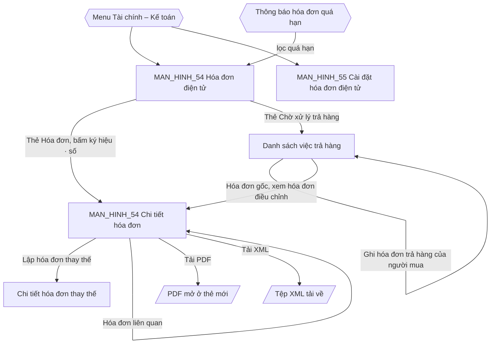

- Thứ tự menu và quyền hiện mục: Công nợ, Phiếu thu chi, Quỹ (`finance.debt.view`); Bút toán, Sổ sách, Báo cáo tài chính, Hệ thống tài khoản (`finance.ledger.view`); Hóa đơn điện tử (`finance.einvoice.view`); Cài đặt hóa đơn điện tử (`finance.einvoice.setup`).

## 36. Bảng vai trò – màn hình (MODULE_06 phần 4)

| Màn hình | Quản trị tập đoàn, quản trị công ty | Kế toán trưởng | Kế toán | Nhân viên bán hàng, Thủ kho |
|---|---|---|---|---|
| MAN_HINH_54 thẻ "Hóa đơn", chi tiết | Xem, Tải PDF, Tải XML, Gửi lại, Lập hóa đơn thay thế | Xem, Tải PDF, Tải XML, Gửi lại, Lập hóa đơn thay thế | Xem, Tải PDF, Tải XML, Gửi lại, Lập hóa đơn thay thế | Không |
| MAN_HINH_54 thẻ "Chờ xử lý trả hàng" | Xem, Lập hóa đơn điều chỉnh giảm, Ghi hóa đơn trả hàng của người mua | Như bên trái | Như bên trái | Không |
| MAN_HINH_55 Cài đặt hóa đơn điện tử | Xem, Lưu, Kiểm tra kết nối | Xem, Lưu, Kiểm tra kết nối | Không có mục menu; mở đường dẫn thì chỉ xem | Không |

## 37. Đặc tả từng màn hình (MODULE_06 phần 4)

### MAN_HINH_54: Hóa đơn điện tử
- Mục đích: Theo dõi hóa đơn điện tử lập khi giao hàng; gửi lại hóa đơn lỗi; tải PDF, XML; xử lý hóa đơn khi trả hàng; lập hóa đơn thay thế.
- Chức năng thực hiện: CHUC_NANG_77, CHUC_NANG_78, CHUC_NANG_79
- Đường dẫn: `/finance/einvoices` (thẻ "Chờ xử lý trả hàng" mở bằng `?tab=returns`; thông báo quá hạn mở `?overdue=true`), chi tiết `/finance/einvoices/<mã>`.
- Bố cục danh sách: tiêu đề "Hóa đơn điện tử"; hai thẻ "Hóa đơn" (mặc định), "Chờ xử lý trả hàng".
  - Thẻ "Hóa đơn": bộ lọc ô chọn trạng thái ("Mọi trạng thái", "Chờ gửi", "Chờ gửi lại", "Chờ cấp mã", "Đã phát hành", "Lỗi", "Bị từ chối", "Lỗi cài đặt"), "Từ ngày", "Đến ngày", ô tìm (gợi ý "Người mua, mã số thuế, số hóa đơn, số phiếu"), ô chọn "Chỉ hóa đơn quá hạn". Bảng: "Ngày hóa đơn", "Ký hiệu · số" (liên kết tới chi tiết; chưa có số thì "Chưa có số"), "Người mua" (trống thì "Người mua không cung cấp thông tin"), "Phiếu kho", "Tổng thanh toán" (kèm tiền tệ), "Loại" (Gốc, Điều chỉnh, Thay thế), "Trạng thái" (nhãn trạng thái, kèm nhãn "Quá hạn", "Đã bị thay thế"); phân trang 20 dòng, tổng số dòng, nút trang trước, trang sau.
  - Thẻ "Chờ xử lý trả hàng": ô chọn "Xử lý" ("Mọi trạng thái", "Chờ xử lý" mặc định, "Đã lập hóa đơn điều chỉnh", "Người mua lập hóa đơn trả hàng"). Bảng: "Phiếu nhận hàng trả lại" (số, ngày), "Người mua", "Tiền hàng trả", "Hóa đơn gốc" (liên kết; chưa phát hành thì kèm "chờ hóa đơn gốc phát hành"), "Xử lý" (trạng thái; kèm "xem hóa đơn điều chỉnh" hoặc "hóa đơn <ký hiệu> số <số> ngày <ngày>"), cột nút "Lập hóa đơn điều chỉnh giảm", "Ghi hóa đơn trả hàng của người mua" (khi xử lý được). Biểu mẫu "Hóa đơn trả hàng của <người mua> cho phiếu <số phiếu>": "Ký hiệu", "Số hóa đơn" *, "Ngày hóa đơn" *; nút "Lưu", "Hủy".
- Bố cục chi tiết: liên kết "‹ Hóa đơn điện tử"; tiêu đề "Hóa đơn <ký hiệu> số <số>" (chưa có số: "Hóa đơn chưa có số"); nút "Gửi lại" (hóa đơn Lỗi, Lỗi cài đặt, Chờ gửi lại), "Lập hóa đơn thay thế" (hóa đơn đã phát hành, không phải điều chỉnh, chưa bị thay thế, chưa có điều chỉnh), "Tải PDF", "Tải XML" (khi có tệp). Dòng "Ghi chú: …"; thẻ "Hóa đơn liên quan" ("Hóa đơn gốc", "Hóa đơn thay thế", "Hóa đơn điều chỉnh" kèm liên kết, ngày); khối lỗi "Lỗi gần nhất: …"; khối cảnh báo "Hóa đơn gửi qua bộ giả lập, không có giá trị pháp lý." với nhà cung cấp bộ giả lập. Thẻ thông tin: "Trạng thái", "Ngày hóa đơn", "Mẫu số · ký hiệu", "Mã của cơ quan thuế" (hóa đơn không mã: "Hóa đơn không có mã"), "Hạn gửi cơ quan thuế", "Phiếu kho". Thẻ "Người bán", "Người mua" (tên, "Mã số thuế", "Địa chỉ"; người mua không cung cấp thông tin ghi rõ). Bảng dòng: "STT", "Tên hàng" (kèm "hàng khuyến mại"), "Đơn vị tính", "Số lượng", "Đơn giá", "Thuế suất" (`0%`, `5%`, `8%`, `10%`, `KCT`, `KKKNT`), "Tiền chưa thuế", "Tiền thuế". Thẻ tổng: "Thuế suất <x>: chưa thuế <…>, thuế <…>" từng thuế suất, "Tiền chưa thuế", "Tiền thuế", "Tổng thanh toán". Thẻ "Các lần gửi": thời điểm, "Phát hành" hoặc "Tra trạng thái", kết quả ("đã phát hành", "chờ cấp mã", "bị từ chối", "lỗi tạm thời", "lỗi dữ liệu", "không rõ kết quả", "không tìm thấy", "đang gửi"), thông báo; chưa có: "Chưa gửi lần nào.".
- Biểu mẫu "Hóa đơn thay thế" (trên chi tiết): chú thích "Chỉ dùng khi sai tên, địa chỉ, mã số thuế người mua; dòng hàng, số tiền giữ nguyên. Hóa đơn này sẽ ghi "Đã bị thay thế"."; "Tên người mua" * (điền sẵn), "Mã số thuế", "Địa chỉ", "Lý do" *; nút "Lập hóa đơn thay thế", "Hủy".
- Dữ liệu hiển thị: hóa đơn của công ty đang chọn, ngày hóa đơn mới nhất trước; số định dạng theo tiếng Việt; việc trả hàng mới nhất trước.
- Thành phần: ThanhTrenCung, MenuMiniApp, CacThe, BoLoc, BangDuLieu, NhanTrangThai, The, ONhap, OChon, Nut, KhoiCanhBao, TrangThaiRong (tài liệu `15`).
- API: API_91.
- Thao tác: đổi bộ lọc về trang 1 và tải lại; "Gửi lại" gửi ngay, báo "Đã gửi lại hóa đơn.", tải lại chi tiết; "Tải PDF" mở thẻ mới, "Tải XML" tải tệp `<ký hiệu>-<số>.xml`; "Lập hóa đơn điều chỉnh giảm" báo "Đã lập hóa đơn điều chỉnh giảm (<trạng thái>)."; lưu hóa đơn của người mua báo "Đã ghi hóa đơn trả hàng của người mua."; lập hóa đơn thay thế báo "Đã lập hóa đơn thay thế." và mở chi tiết hóa đơn mới; hóa đơn cũ có nhãn "Đã bị thay thế" khi hóa đơn thay thế đã phát hành; đang có hóa đơn thay thế chưa phát hành thì báo "Hóa đơn đang có hóa đơn thay thế chưa phát hành."; "Gửi lại" khi đang gửi báo "Hóa đơn đang được gửi; thử lại sau ít phút.". Hóa đơn "Bị từ chối" chưa có nút "Gửi lại" (API cho phép).
- Trạng thái: đang tải; lỗi tải kèm "Thử lại"; danh sách rỗng "Chưa có hóa đơn.", "Không có phiếu trả hàng cần xử lý.".
- Thông báo: lỗi gửi lại, tải tệp hiện dưới tiêu đề; lỗi biểu mẫu hiện tại trường và cuối biểu mẫu; lỗi nhà cung cấp hiện bằng thông báo của hệ thống nếu có, không thì câu chữ của nhà cung cấp.
- Quyền hiển thị: mục menu, màn hình với `finance.einvoice.view`; "Gửi lại", "Lập hóa đơn thay thế", nút xử lý trả hàng theo `canManage`, `canResolve` của API.
- Responsive: bảng chuyển thành thẻ, nhãn cột hiện đủ; thẻ, bộ lọc, nút xuống dòng; số tiền không xuống dòng; mã của cơ quan thuế ngắt dòng; ô biểu mẫu xếp dọc; không cuộn ngang.
- Trạng thái phê duyệt: Chưa phê duyệt (CONG_VIEC_16 mục 14)

### MAN_HINH_55: Cài đặt hóa đơn điện tử
- Mục đích: Cài đặt nhà cung cấp, loại hóa đơn, ký hiệu, thông tin kết nối của công ty; kiểm tra kết nối.
- Chức năng thực hiện: CHUC_NANG_76
- Đường dẫn: `/finance/einvoice-settings`.
- Bố cục: tiêu đề "Cài đặt hóa đơn điện tử" kèm "Lịch sử"; người chỉ xem thấy "Bạn chỉ xem được cài đặt." và mọi ô bị khóa. Ô chọn "Lập hóa đơn điện tử khi phiếu xuất giao hàng ghi sổ"; "Ngày bắt đầu" (gợi ý "Phiếu có ngày từ ngày này mới lập hóa đơn"); "Nhà cung cấp" ("Bộ giả lập (thử nghiệm)" chỉ hiện khi được dùng hoặc đang chọn, "MISA meInvoice"); "Môi trường" ("Thử nghiệm", "Chính thức"); "Loại hóa đơn" ("Có mã của cơ quan thuế", "Không có mã"); "Ký hiệu mẫu số" ("1 – Hóa đơn giá trị gia tăng", "2 – Hóa đơn bán hàng"). Khi chọn MISA: "Mã ứng dụng" *, "Mã số thuế" *, "Tên đăng nhập" *, "Mật khẩu" * (đã lưu thì gợi ý "Để trống: giữ mật khẩu ••••<4 ký tự cuối>"). Khi chọn bộ giả lập: "Tình huống giả lập" (gợi ý "Dùng để thử các trường hợp lỗi"; "Bình thường", "Cơ quan thuế cấp mã chậm", "Lỗi tạm thời lần đầu", "Lỗi dữ liệu", "Hết thời gian chờ lần đầu", "Cơ quan thuế từ chối"). Khối "Ký hiệu hóa đơn theo năm" (chú thích "6 ký tự: C (có mã) hoặc K (không mã), 2 số cuối năm, T, 2 chữ cái. Ví dụ C26TAA."): mỗi dòng "Năm", "Ký hiệu", nút "Bỏ"; nút "Thêm năm". Nút "Lưu", "Kiểm tra kết nối" (chỉ khi đã lưu cài đặt; chú thích "Kiểm tra theo cài đặt đã lưu.").
- Dữ liệu hiển thị: cài đặt của công ty đang chọn; mật khẩu không hiện; 4 ký tự cuối trong gợi ý chỉ với người có `finance.einvoice.setup`.
- Thành phần: ThanhTrenCung, MenuMiniApp, The, ONhap, OChon, Nut, KhoiCanhBao (tài liệu `15`).
- API: API_92.
- Thao tác: "Lưu" gửi toàn bộ cài đặt kèm `version`, báo "Đã lưu cài đặt hóa đơn điện tử.", tải lại; "Kiểm tra kết nối" báo "Kết nối được với nhà cung cấp." hoặc "Không kết nối được: <lý do>".
- Trạng thái: đang tải; lỗi tải kèm "Thử lại".
- Thông báo: lỗi tại từng trường (ngày bắt đầu, nhà cung cấp, thông tin kết nối, năm, ký hiệu) và cuối biểu mẫu.
- Quyền hiển thị: mục menu với `finance.einvoice.setup`; người có `finance.einvoice.view` mở đường dẫn thì chỉ xem; nút theo `canSetup` của API.
- Responsive: ô biểu mẫu xếp dọc, dòng ký hiệu xuống dòng; không cuộn ngang.
- Trạng thái phê duyệt: Chưa phê duyệt (CONG_VIEC_16 mục 14)

## MODULE_06 Tài chính – Kế toán (phần 5: Hoa hồng đội kinh doanh, CONG_VIEC_17)

Đã bỏ theo THAY_DOI_18 (CONG_VIEC_43, 2026-11-11): trang `/finance/commissions`, `/finance/commission-settings`, mục menu "Hoa hồng", "Cài đặt hoa hồng" đã xóa. Mục 38 đến mục 40 giữ để tra cứu.

Cùng mini app `apps/web-finance` (mục 26).

## 38. Danh sách màn hình và điều hướng (MODULE_06 phần 5)

| Mã | Tên màn hình | Chức năng (10) | Vai trò được truy cập (08) | Mở từ | Bản mẫu |
|---|---|---|---|---|---|
| MAN_HINH_56 | Hoa hồng: bảng hoa hồng tháng, chi tiết bảng, phát sinh | CHUC_NANG_82, CHUC_NANG_83 | Quản trị tập đoàn, quản trị công ty, Kế toán trưởng, Kế toán | Menu Tài chính – Kế toán | Không lập (CONG_VIEC_17 mục 14) |
| MAN_HINH_57 | Cài đặt hoa hồng: cài đặt, chỉ tiêu | CHUC_NANG_80 | Quản trị tập đoàn, quản trị công ty, Kế toán trưởng | Menu Tài chính – Kế toán | Không lập (CONG_VIEC_17 mục 14) |

Sơ đồ điều hướng:

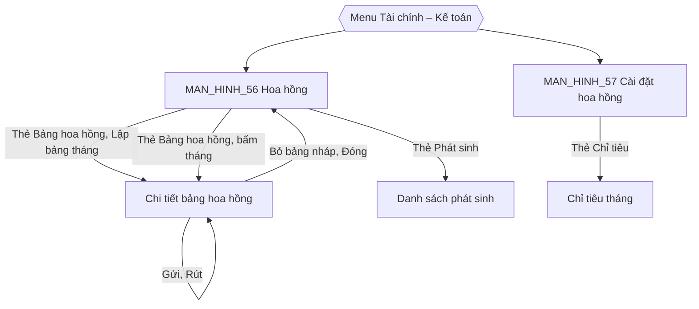

- Thứ tự menu và quyền hiện mục: Công nợ, Phiếu thu chi, Quỹ (`finance.debt.view`); Bút toán, Sổ sách, Báo cáo tài chính, Hệ thống tài khoản (`finance.ledger.view`); Hóa đơn điện tử (`finance.einvoice.view`); Cài đặt hóa đơn điện tử (`finance.einvoice.setup`); Hoa hồng (`finance.commission.view`); Cài đặt hoa hồng (`finance.commission.setup`).

## 39. Bảng vai trò – màn hình (MODULE_06 phần 5)

| Màn hình | Quản trị tập đoàn, quản trị công ty | Kế toán trưởng | Kế toán | Nhân viên bán hàng, Thủ kho |
|---|---|---|---|---|
| MAN_HINH_56 thẻ "Bảng hoa hồng", chi tiết | Xem, Lập bảng, Gửi, Bỏ bảng nháp, Rút (của mình) | Xem, Lập bảng, Gửi, Bỏ bảng nháp, Rút (của mình) | Xem, Lập bảng, Gửi, Bỏ bảng nháp, Rút (của mình) | Không |
| MAN_HINH_56 thẻ "Phát sinh" | Xem | Xem | Xem | Không |
| MAN_HINH_57 Cài đặt hoa hồng (cả hai thẻ) | Xem, Lưu | Xem, Lưu | Không có mục menu; mở đường dẫn thì chỉ xem | Không |

## 40. Đặc tả từng màn hình (MODULE_06 phần 5)

### MAN_HINH_56: Hoa hồng
- Trạng thái màn hình: Đã bỏ theo THAY_DOI_18 (CONG_VIEC_43, 2026-11-11); không còn trên giao diện.
- Mục đích: Xem phát sinh hoa hồng; lập, gửi, rút, bỏ bảng hoa hồng tháng.
- Chức năng thực hiện: CHUC_NANG_82, CHUC_NANG_83
- Đường dẫn: `/finance/commissions`.
- Bố cục: tiêu đề "Hoa hồng"; hai thẻ "Bảng hoa hồng" (mặc định), "Phát sinh".
  - Thẻ "Bảng hoa hồng": chú thích "Tháng tiếp theo cần chốt: <tháng/năm>" hoặc "Chưa có tháng nào cần chốt."; nút "Lập bảng tháng <tháng/năm>" (khi lập được). Bảng: "Tháng" (nút mở chi tiết), "Số", "Trạng thái" (nhãn "Nháp", "Chờ duyệt", "Đã ghi sổ", "Bị từ chối", "Đã rút"; kèm lý do không ghi sổ được), "Tổng hoa hồng" (kèm tiền tệ).
  - Chi tiết bảng (khối hiện trên danh sách trong cùng thẻ): tiêu đề "Bảng hoa hồng tháng <tháng/năm> (<số> phát sinh)"; nút "Gửi", "Bỏ bảng nháp" (bảng nháp), "Rút" (người lập, bảng chờ duyệt), "Đóng". Bảng: "Nhân viên", "Tiền chưa thuế", "Hoa hồng trước hệ số", "Chỉ tiêu" (không có: "Không có"), "Đạt" (phần trăm; không có chỉ tiêu: "—"), "Hệ số", "Hoa hồng". Dòng "Tổng hoa hồng: <số> <tiền tệ>".
  - Thẻ "Phát sinh": bộ lọc "Từ ngày", "Đến ngày". Bảng: "Ngày", "Nhân viên", "Nguồn" ("Thu tiền", "Hoàn tiền trả hàng", "Bán lẻ giao hàng", "Bán lẻ trả hàng", kèm số chứng từ), "Đơn bán", "Mặt hàng", "Tiền chưa thuế", "Mức" (phần trăm), "Hoa hồng", "Bảng hoa hồng" (số bảng hoặc "Chưa vào bảng"); phân trang 50 dòng, tổng số dòng, nút trang trước, trang sau.
- Dữ liệu hiển thị: bảng của công ty đang chọn, tháng mới nhất trước (tối đa 120 bảng); phát sinh ngày mới nhất trước; số âm với hoàn tiền, trả hàng; số định dạng theo tiếng Việt.
- Thành phần: ThanhTrenCung, MenuMiniApp, CacThe, BoLoc, BangDuLieu, NhanTrangThai, The, ONhap, Nut, TrangThaiRong (tài liệu `15`).
- API: API_94.
- Thao tác: "Lập bảng tháng" báo "Đã lập bảng hoa hồng tháng <tháng/năm>." và mở chi tiết; "Gửi" báo "Đã ghi sổ bảng hoa hồng." (chưa có chính sách duyệt) hoặc "Đã gửi duyệt bảng hoa hồng.", tải lại chi tiết và danh sách; "Bỏ bảng nháp" báo "Đã bỏ bảng nháp.", đóng chi tiết; "Rút" báo "Đã rút bảng hoa hồng."; đổi ngày lọc về trang 1.
- Trạng thái: đang tải; lỗi tải kèm "Thử lại"; danh sách rỗng "Chưa có bảng hoa hồng.", "Chưa có phát sinh hoa hồng.".
- Thông báo: lỗi lập bảng hiện dưới dòng tháng tiếp theo; lỗi gửi, rút, bỏ hiện trong khối chi tiết.
- Quyền hiển thị: mục menu, màn hình với `finance.commission.view`; nút theo `canCreate`, `canManage`, `canWithdraw` của API.
- Responsive: bảng chuyển thành thẻ, nhãn cột hiện đủ; nút, bộ lọc xuống dòng; số tiền không xuống dòng; không cuộn ngang.
- Ô lọc theo nhân viên (danh sách nhân viên của công ty, mặc định mọi nhân viên).
- Trạng thái phê duyệt: Chưa phê duyệt (CONG_VIEC_17 mục 14)

### MAN_HINH_57: Cài đặt hoa hồng
- Trạng thái màn hình: Đã bỏ theo THAY_DOI_18 (CONG_VIEC_43, 2026-11-11); không còn trên giao diện.
- Mục đích: Cài đặt chính sách hoa hồng đội kinh doanh của công ty; nhập chỉ tiêu tháng của nhân viên.
- Chức năng thực hiện: CHUC_NANG_80
- Đường dẫn: `/finance/commission-settings`.
- Bố cục: tiêu đề "Cài đặt hoa hồng" kèm "Lịch sử"; hai thẻ "Cài đặt" (mặc định), "Chỉ tiêu".
  - Thẻ "Cài đặt": người chỉ xem thấy "Bạn chỉ xem được cài đặt.", mọi ô bị khóa, không có nút thêm, bỏ, lưu. Ô chọn "Tính hoa hồng đội kinh doanh"; "Ngày bắt đầu"; "Đơn bán tính cho" ("Nhân viên phụ trách khách", "Người lập đơn"); "Kết hợp ngành hàng và kênh" ("Bảng ngành hàng và kênh", "Kênh nhân hệ số"); "Mức mặc định (%)". Khối "Mức theo ngành hàng" (chú thích theo cách kết hợp): mỗi dòng "Ngành hàng" ("Chọn ngành hàng"), "Kênh bán" (chỉ khi bảng ngành hàng và kênh; "Mọi kênh"), "Phần trăm", nút "Bỏ"; nút "Thêm mức". Khối "Hệ số kênh" (chỉ khi kênh nhân hệ số): mỗi dòng "Kênh bán" ("Chọn kênh"), "Hệ số", nút "Bỏ"; nút "Thêm hệ số kênh". Khối "Hệ số theo phần trăm đạt chỉ tiêu" (chú thích "Bậc đầu từ 0%. Nhân viên không có chỉ tiêu tháng thì hệ số 1."): mỗi dòng "Từ % đạt", "Hệ số", nút "Bỏ" (khi có hơn một bậc); nút "Thêm bậc". Nút "Lưu".
  - Thẻ "Chỉ tiêu": "Tháng" (mặc định tháng hiện tại); chú thích "Để trống: không có chỉ tiêu (hệ số 1)."; bảng "Nhân viên", "Chỉ tiêu tiền thu chưa thuế" (ô nhập); nút "Lưu" (người có quyền cài đặt).
- Dữ liệu hiển thị: cài đặt của công ty đang chọn; ngành hàng đang dùng của tập đoàn; kênh đang dùng của công ty; nhân viên đang làm việc của công ty theo họ tên.
- Thành phần: ThanhTrenCung, MenuMiniApp, CacThe, The, ONhap, OChon, BangDuLieu, Nut (tài liệu `15`).
- API: API_93.
- Thao tác: "Lưu" cài đặt gửi toàn bộ cài đặt kèm `version`, báo "Đã lưu cài đặt hoa hồng.", tải lại; "Lưu" chỉ tiêu báo "Đã lưu chỉ tiêu."; đổi tháng tải chỉ tiêu của tháng đó.
- Trạng thái: đang tải; lỗi tải kèm "Thử lại".
- Thông báo: lỗi tại từng trường (ngày bắt đầu, mức mặc định, ngành hàng, kênh, phần trăm, hệ số, bậc, chỉ tiêu) và cuối biểu mẫu.
- Quyền hiển thị: mục menu với `finance.commission.setup`; người có `finance.commission.view` mở đường dẫn thì chỉ xem; nút theo `canSetup` của API.
- Responsive: ô biểu mẫu xếp dọc, dòng mức, hệ số, bậc xuống dòng; bảng chỉ tiêu chuyển thành thẻ; không cuộn ngang.
- Trạng thái phê duyệt: Chưa phê duyệt (CONG_VIEC_17 mục 14)

## MODULE_06 Tài chính – Kế toán (phần 6: Đối soát ngân hàng, CONG_VIEC_18)

Cùng mini app `apps/web-finance` (mục 26).

## 41. Danh sách màn hình và điều hướng (MODULE_06 phần 6)

| Mã | Tên màn hình | Chức năng (10) | Vai trò được truy cập (08) | Mở từ | Bản mẫu |
|---|---|---|---|---|---|
| MAN_HINH_58 | Giao dịch ngân hàng: danh sách, xử lý giao dịch chưa ghép, ô đối chiếu | CHUC_NANG_85, CHUC_NANG_86, CHUC_NANG_87 | Quản trị tập đoàn, quản trị công ty, Kế toán trưởng, Kế toán | Menu Tài chính – Kế toán | Không lập (CONG_VIEC_18 mục 14) |
| MAN_HINH_59 | Kết nối ngân hàng: quỹ ngân hàng, kết nối, gửi giao dịch thử | CHUC_NANG_84 | Quản trị tập đoàn, quản trị công ty, Kế toán trưởng | Menu Tài chính – Kế toán | Không lập (CONG_VIEC_18 mục 14) |

Sơ đồ điều hướng:

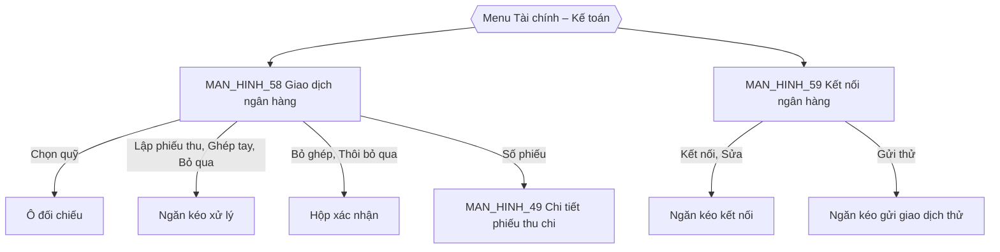

- Thứ tự menu và quyền hiện mục: Công nợ, Phiếu thu chi, Quỹ (`finance.debt.view`); Giao dịch ngân hàng (`finance.bank.view`); Kết nối ngân hàng (`finance.bank.setup`); Bút toán, Sổ sách, Báo cáo tài chính, Hệ thống tài khoản (`finance.ledger.view`); Hóa đơn điện tử (`finance.einvoice.view`); Cài đặt hóa đơn điện tử (`finance.einvoice.setup`); Hoa hồng (`finance.commission.view`); Cài đặt hoa hồng (`finance.commission.setup`).

## 42. Bảng vai trò – màn hình (MODULE_06 phần 6)

| Màn hình | Quản trị tập đoàn, quản trị công ty | Kế toán trưởng | Kế toán | Nhân viên bán hàng, Thủ kho |
|---|---|---|---|---|
| MAN_HINH_58 Giao dịch ngân hàng, ô đối chiếu | Xem, Lập phiếu thu, Ghép tay, Bỏ qua, Bỏ ghép, Thôi bỏ qua | Xem, Lập phiếu thu, Ghép tay, Bỏ qua, Bỏ ghép, Thôi bỏ qua | Xem, Lập phiếu thu, Ghép tay, Bỏ qua, Bỏ ghép, Thôi bỏ qua | Không |
| MAN_HINH_59 Kết nối ngân hàng | Xem, Kết nối, Sửa, Gửi thử | Xem, Kết nối, Sửa, Gửi thử | Không có mục menu; mở đường dẫn thì chỉ xem | Không |

## 43. Đặc tả từng màn hình (MODULE_06 phần 6)

### MAN_HINH_58: Giao dịch ngân hàng
- Mục đích: Xem giao dịch ngân hàng nhận qua webhook; xử lý giao dịch chưa ghép; đối chiếu số dư quỹ ngân hàng.
- Chức năng thực hiện: CHUC_NANG_85, CHUC_NANG_86, CHUC_NANG_87
- Đường dẫn: `/finance/bank-transactions`.
- Bố cục: tiêu đề "Giao dịch ngân hàng".
  - Bộ lọc: quỹ ("Mọi quỹ ngân hàng"), trạng thái ("Mọi trạng thái", "Chưa ghép" (mặc định), "Đã ghép", "Bỏ qua"), chiều ("Tiền vào và ra", "Tiền vào", "Tiền ra"), "Từ ngày", "Đến ngày", ô tìm "Nội dung, mã tham chiếu, số tiền".
  - Ô đối chiếu (chỉ khi chọn một quỹ): tiêu đề "Đối chiếu từ <ngày> đến <ngày>" (theo bộ lọc ngày; "Đến ngày" trống là hôm nay, "Từ ngày" trống là đầu tháng của ngày cuối); "Số dư sổ"; "Số dư ngân hàng" (hoặc "Dịch vụ chưa gửi số dư"; kèm "lúc <thời điểm>"); "Chênh lệch" (khác 0 thì tô màu lỗi; không có số dư ngân hàng: "—"); "Tiền vào chưa ghép", "Tiền ra chưa ghép" (số giao dịch · số tiền); "Phiếu chưa có giao dịch" (kèm "<số> giao dịch bỏ qua"); nút "Xem phiếu chưa có giao dịch" / "Ẩn danh sách phiếu" mở danh sách số phiếu (liên kết), ngày, loại, đối tác, số tiền.
  - Bảng: "Thời gian", "Quỹ", "Chiều" (nhãn "Tiền vào", "Tiền ra"), "Số tiền" (dấu + hoặc −), "Nội dung" (kèm mã tham chiếu), "Trạng thái" (nhãn "Chưa ghép", "Đã ghép", "Bỏ qua"; kèm "Tự ghép"), "Phiếu thu chi" (đã ghép: số phiếu liên kết, đối tác, ngày; bỏ qua: "Lý do: <lý do>"; có phiếu thu lập từ gợi ý: số phiếu hoặc "Phiếu nháp" kèm trạng thái phiếu; có gợi ý: "Gợi ý: <tên khách>" kèm căn cứ "số đơn bán", "mã khách hàng", "mã số thuế"), cột thao tác. Phân trang 20 dòng, tổng số dòng, nút trang trước, trang sau.
  - Thao tác theo trạng thái: chưa ghép: "Lập phiếu thu" (tiền vào, không có phiếu thu chờ duyệt), "Ghép tay", "Bỏ qua" (không có phiếu thu chờ duyệt); đã ghép: "Bỏ ghép"; bỏ qua: "Thôi bỏ qua".
  - Ngăn kéo "Lập phiếu thu": tóm tắt giao dịch (chiều, số tiền, ngày, nội dung); "Hệ thống gợi ý khách theo <căn cứ>."; "Khách hàng" (mặc định khách gợi ý, chọn lại bằng ô tìm khách); chú thích "Phiếu thu lập theo quỹ, ngày và số tiền của giao dịch, nội dung chuyển khoản làm ghi chú, rồi gửi theo luồng duyệt phiếu thu."; nút "Hủy", "Xác nhận lập phiếu thu".
  - Gửi "Xác nhận lập phiếu thu" lỗi thì tải lại danh sách để lần gửi sau dùng phiên bản mới của giao dịch.
  - Ngăn kéo "Ghép tay": tóm tắt giao dịch; danh sách phiếu đủ điều kiện (số, ngày, loại, đối tác, ghi chú), mỗi phiếu nút "Ghép".
  - Ngăn kéo "Bỏ qua": tóm tắt giao dịch; ô "Lý do bỏ qua" (tối đa 500 ký tự); nút "Hủy", "Bỏ qua".
  - Hộp xác nhận "Bỏ ghép" / "Thôi bỏ qua": "Giao dịch về trạng thái chưa ghép; phiếu thu chi không thay đổi.".
- Dữ liệu hiển thị: giao dịch của công ty đang chọn, thời điểm mới nhất trước; số định dạng theo tiếng Việt.
- Thành phần: ThanhTrenCung, MenuMiniApp, BoLoc, The, BangDuLieu, NhanTrangThai, NganKeo, HopThoaiXacNhan, ONhap, OChon, Nut, TrangThaiRong (tài liệu `15`).
- API: API_95 (danh sách quỹ cho bộ lọc), API_99, API_100, API_101.
- Thao tác: "Xác nhận lập phiếu thu" báo "Đã ghi sổ phiếu thu <số> và ghép giao dịch." hoặc "Phiếu thu <số> đang chờ duyệt; giao dịch tự ghép khi phiếu ghi sổ."; "Ghép" báo "Đã ghép với phiếu <số>."; "Bỏ qua" báo "Đã bỏ qua giao dịch."; "Bỏ ghép", "Thôi bỏ qua" báo "Giao dịch đã về trạng thái chưa ghép."; sau mỗi thao tác tải lại danh sách và ô đối chiếu; đổi bộ lọc về trang 1.
- Trạng thái: đang tải; lỗi tải kèm "Thử lại"; danh sách rỗng "Không có giao dịch."; ghép tay không có phiếu: "Không có phiếu đã ghi sổ cùng quỹ, cùng chiều, cùng số tiền chưa ghép.".
- Thông báo: lỗi lập phiếu thu, bỏ qua hiện tại trường và cuối ngăn kéo; lỗi ghép, bỏ ghép hiện trong ngăn kéo hoặc hộp xác nhận.
- Quyền hiển thị: mục menu, màn hình với `finance.bank.view`; cột thao tác theo `canManage` của API.
- Responsive: bảng chuyển thành thẻ, nhãn cột hiện đủ; bộ lọc, nút xuống dòng; ô đối chiếu xếp lưới tự co; số tiền, thời gian không xuống dòng; không cuộn ngang.
- Trạng thái phê duyệt: Chưa phê duyệt (CONG_VIEC_18 mục 14)

### MAN_HINH_59: Kết nối ngân hàng
- Mục đích: Kết nối quỹ ngân hàng với dịch vụ trung gian; lấy địa chỉ webhook, khóa; gửi giao dịch thử.
- Chức năng thực hiện: CHUC_NANG_84
- Đường dẫn: `/finance/bank-connections`.
- Bố cục: tiêu đề "Kết nối ngân hàng" kèm "Lịch sử"; người chỉ xem thấy "Bạn chỉ được xem kết nối ngân hàng.".
  - Khối khóa (sau khi tạo kết nối hoặc đổi khóa): "Khóa xác thực webhook chỉ hiện một lần. Sao chép và khai vào dịch vụ trung gian (tiêu đề Authorization có dạng "Apikey" cách một khoảng rồi đến khóa)."; khóa; nút "Sao chép", "Đã lưu khóa, ẩn đi".
  - Bảng: "Quỹ" (tên · mã), "Tài khoản" (ngân hàng · số tài khoản), "Dịch vụ trung gian" ("Bộ giả lập", "SePay"; nhãn "Đang bật", "Đang tắt"; chưa có: "Chưa kết nối"), "Địa chỉ webhook" (địa chỉ đầy đủ · "khóa …<bốn ký tự cuối>"), "Nhận lần cuối", cột thao tác "Kết nối" hoặc "Sửa", "Gửi thử" (kết nối bộ giả lập, ngoài môi trường thật).
  - Ngăn kéo "Kết nối ngân hàng: <quỹ>": "Dịch vụ trung gian" (bộ giả lập chỉ hiện ngoài môi trường thật hoặc khi kết nối đang dùng bộ giả lập), chú thích theo dịch vụ ("Chỉ dùng ngoài môi trường thật để thử; gửi giao dịch thử bằng nút Gửi thử.", "Khai địa chỉ webhook và khóa vào trang quản trị SePay, kiểu chứng thực API Key."); ô chọn "Đang bật"; "Đổi khóa xác thực (khóa cũ hết hiệu lực ngay)" (khi đã có kết nối); nút "Hủy", "Lưu".
  - Ngăn kéo "Gửi giao dịch thử: <quỹ>": "Chiều", "Số tiền", "Nội dung", "Ngày giao dịch" (gợi ý "Để trống là hôm nay."); nút "Hủy", "Gửi".
- Dữ liệu hiển thị: quỹ ngân hàng đang dùng của công ty đang chọn và quỹ ngừng dùng đã có kết nối, theo mã quỹ.
- Thành phần: ThanhTrenCung, MenuMiniApp, KhoiCanhBao, BangDuLieu, NhanTrangThai, NganKeo, ONhap, OChon, Nut, TrangThaiRong (tài liệu `15`).
- API: API_95, API_96, API_97.
- Thao tác: "Lưu" báo "Đã lưu kết nối ngân hàng.", hiện khối khóa khi có khóa mới, tải lại; "Gửi" báo "Đã nhận giao dịch thử, tự ghép với phiếu <số>." hoặc "Đã nhận giao dịch thử, chưa ghép được phiếu.".
- Trạng thái: đang tải; lỗi tải kèm "Thử lại"; rỗng "Chưa có quỹ ngân hàng. Thêm quỹ loại ngân hàng ở màn hình Quỹ.".
- Thông báo: lỗi tại trường và cuối ngăn kéo.
- Quyền hiển thị: mục menu với `finance.bank.setup`; người có `finance.bank.view` mở đường dẫn thì chỉ xem; nút theo `canSetup`, `simulatorAllowed` của API.
- Responsive: bảng chuyển thành thẻ; địa chỉ webhook, khóa xuống dòng theo ký tự; ô biểu mẫu xếp dọc; không cuộn ngang.
- Trạng thái phê duyệt: Chưa phê duyệt (CONG_VIEC_18 mục 14)

## MODULE_06 Tài chính – Kế toán (phần 7: Đối soát thu hộ COD, cổng thanh toán, CONG_VIEC_19)

Cùng mini app `apps/web-finance` (mục 26).

## 44. Danh sách màn hình và điều hướng (MODULE_06 phần 7)

| Mã | Tên màn hình | Chức năng (10) | Vai trò được truy cập (08) | Mở từ | Bản mẫu |
|---|---|---|---|---|---|
| MAN_HINH_60 | Đối soát thu hộ: danh sách bảng đối soát, nhập tệp; thẻ đơn vị thu hộ | CHUC_NANG_88, CHUC_NANG_89, CHUC_NANG_91 | Quản trị tập đoàn, quản trị công ty, Kế toán trưởng, Kế toán | Menu Tài chính – Kế toán | Không lập (CONG_VIEC_19 mục 14) |
| MAN_HINH_61 | Chi tiết bảng đối soát: tổng, các dòng, bỏ dòng, nhập lại, gửi, rút, bỏ bảng nháp | CHUC_NANG_89, CHUC_NANG_90, CHUC_NANG_91 | Quản trị tập đoàn, quản trị công ty, Kế toán trưởng, Kế toán | MAN_HINH_60 | Không lập (CONG_VIEC_19 mục 14) |

Sơ đồ điều hướng:

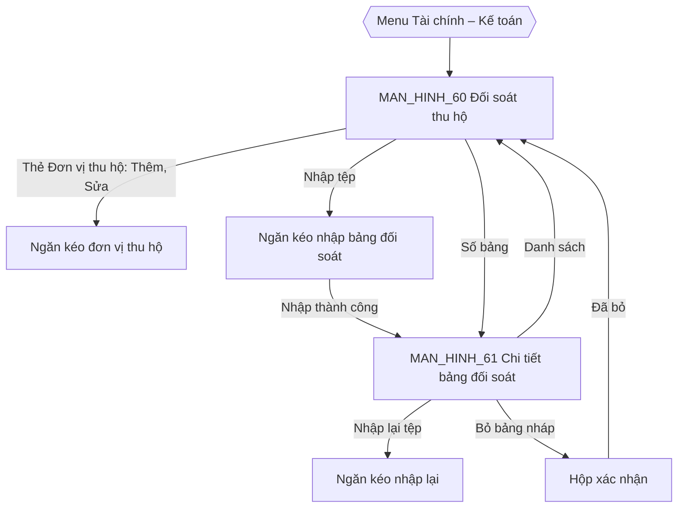

- Thứ tự menu và quyền hiện mục: Công nợ, Phiếu thu chi, Quỹ (`finance.debt.view`); Giao dịch ngân hàng (`finance.bank.view`); Kết nối ngân hàng (`finance.bank.setup`); Đối soát thu hộ (`finance.collection.view`); Bút toán, Sổ sách, Báo cáo tài chính, Hệ thống tài khoản (`finance.ledger.view`); Hóa đơn điện tử (`finance.einvoice.view`); Cài đặt hóa đơn điện tử (`finance.einvoice.setup`); Hoa hồng (`finance.commission.view`); Cài đặt hoa hồng (`finance.commission.setup`).

## 45. Bảng vai trò – màn hình (MODULE_06 phần 7)

| Màn hình | Quản trị tập đoàn, quản trị công ty | Kế toán trưởng | Kế toán | Nhân viên bán hàng, Thủ kho |
|---|---|---|---|---|
| MAN_HINH_60 thẻ "Bảng đối soát" | Xem, Nhập tệp | Xem, Nhập tệp | Xem, Nhập tệp | Không |
| MAN_HINH_60 thẻ "Đơn vị thu hộ" | Xem, Thêm, Sửa | Xem, Thêm, Sửa | Xem | Không |
| MAN_HINH_61 Chi tiết bảng đối soát | Xem, Bỏ dòng, Nhập lại tệp, Bỏ bảng nháp, Gửi, Rút (bảng mình gửi) | Xem, Bỏ dòng, Nhập lại tệp, Bỏ bảng nháp, Gửi, Rút (bảng mình gửi) | Xem, Bỏ dòng, Nhập lại tệp, Bỏ bảng nháp, Gửi, Rút (bảng mình gửi) | Không |

## 46. Đặc tả từng màn hình (MODULE_06 phần 7)

### MAN_HINH_60: Đối soát thu hộ
- Mục đích: Xem bảng đối soát của các đơn vị thu hộ; nhập bảng mới từ tệp Excel; khai đơn vị thu hộ.
- Chức năng thực hiện: CHUC_NANG_88, CHUC_NANG_89, CHUC_NANG_91
- Đường dẫn: `/finance/collection-statements`.
- Bố cục: tiêu đề "Đối soát thu hộ" kèm "Lịch sử" (theo thẻ đang chọn: bảng đối soát hoặc đơn vị thu hộ); hai thẻ "Bảng đối soát" (mặc định), "Đơn vị thu hộ".
  - Thẻ "Bảng đối soát": bộ lọc "Mọi đơn vị thu hộ", "Mọi trạng thái" ("Nháp", "Chờ duyệt", "Đã ghi sổ", "Bị từ chối", "Đã rút"), "Từ ngày", "Đến ngày"; nút "Nhập tệp" (khi có `canManage`; mờ khi chưa có đơn vị đang dùng); chưa có đơn vị: "Chưa có đơn vị thu hộ. Khai ở thẻ Đơn vị thu hộ trước khi nhập bảng đối soát.". Bảng: "Ngày bảng", "Đơn vị thu hộ" (tên · "Thu COD" hoặc "Cổng thanh toán"), "Số bảng của đơn vị" (liên kết sang MAN_HINH_61 · số nội bộ `DST…` khi có), "Tổng thu hộ", "Tổng phí", "Thực nhận", "Trạng thái" (nhãn trạng thái; kèm "<số> dòng lỗi" khi có). Phân trang 20 dòng, tổng số dòng, nút trang trước, trang sau.
  - Thẻ "Đơn vị thu hộ": nút "Thêm đơn vị thu hộ" (khi có `canSetup`); chú thích "Đơn vị thu hộ là đối tác có hồ sơ khách hàng của công ty; tiền đơn vị chuyển về ngân hàng lập phiếu thu khách hàng cho đối tác này."; bảng "Đối tác" (tên · mã), "Loại", "Trạng thái" (nhãn "Đang dùng", "Ngừng dùng"), cột nút "Sửa" (khi có `canSetup`).
  - Ngăn kéo "Thêm đơn vị thu hộ" / "Sửa đơn vị thu hộ": "Đối tác" (khi thêm: ô tìm đối tác có hồ sơ khách hàng, gợi ý "Tìm đối tác có hồ sơ khách hàng, gõ tên hoặc mã rồi nhấn Enter."; khi sửa: chỉ hiện tên · mã), "Loại" ("Thu COD", "Cổng thanh toán"), ô chọn "Đang dùng"; nút "Hủy", "Lưu".
  - Ngăn kéo "Nhập bảng đối soát": chú thích "Tệp Excel theo mẫu chung: mã vận đơn hoặc mã giao dịch, số đơn bán, tiền thu hộ, phí, ngày thu; tối đa 5.000 dòng, 5 MB. Nhập lại thay toàn bộ các dòng."; nút "Tải tệp mẫu" (tệp `mau-doi-soat-thu-ho.xlsx`); "Đơn vị thu hộ" (đơn vị đang dùng: tên · loại), "Số bảng của đơn vị", "Ngày bảng" (mặc định hôm nay), "Tệp Excel" (chỉ `.xlsx`); khối lỗi "Tệp có dòng sai, chưa nhập:" liệt kê tối đa 20 lỗi "Dòng <số>, cột <tên cột>: <lỗi>"; nút "Hủy", "Nhập tệp" (mờ khi chưa chọn tệp).
- Dữ liệu hiển thị: bảng của công ty đang chọn, ngày bảng mới nhất trước; số định dạng theo tiếng Việt.
- Thành phần: ThanhTrenCung, MenuMiniApp, CacThe, BoLoc, BangDuLieu, NhanTrangThai, NganKeo, ONhap, OChon, Nut, KhoiCanhBao, TrangThaiRong (tài liệu `15`).
- API: API_102, API_103, API_105.
- Thao tác: "Lưu" đơn vị báo "Đã lưu đơn vị thu hộ.", tải lại; "Nhập tệp" thành công mở MAN_HINH_61 của bảng vừa nhập; đổi bộ lọc về trang 1.
- Trạng thái: đang tải; lỗi tải kèm "Thử lại"; rỗng "Chưa có bảng đối soát.", "Chưa có đơn vị thu hộ.".
- Thông báo: lỗi tại trường, khối lỗi dòng, cuối ngăn kéo; lỗi tải tệp mẫu hiện dưới nút "Tải tệp mẫu".
- Quyền hiển thị: mục menu, màn hình với `finance.collection.view`; nút "Nhập tệp" theo `canManage`, "Thêm đơn vị thu hộ", "Sửa" theo `canSetup` của API_102.
- Responsive: bảng chuyển thành thẻ, nhãn cột hiện đủ; bộ lọc, nút xuống dòng; số tiền không xuống dòng; không cuộn ngang.
- Trạng thái phê duyệt: Chưa phê duyệt (CONG_VIEC_19 mục 14)

### MAN_HINH_61: Chi tiết bảng đối soát
- Mục đích: Xem các dòng đã ghép, sửa lỗi, gửi bảng đối soát.
- Chức năng thực hiện: CHUC_NANG_89, CHUC_NANG_90, CHUC_NANG_91
- Đường dẫn: `/finance/collection-statements/<mã>`.
- Bố cục: tiêu đề "Bảng đối soát <số bảng của đơn vị>", nút "Danh sách".
  - Thẻ thông tin: nhãn trạng thái, số nội bộ (khi có), "<đơn vị> · <loại> · <ngày bảng>"; ô "Tổng thu hộ", "Tổng phí", "Thực nhận" (kèm tiền tệ), "Số dòng"; khối lỗi "<số> dòng lỗi phải bỏ dòng hoặc sửa tệp rồi nhập lại trước khi gửi."; khối cảnh báo "<số> dòng có tiền thu hộ khác số khách còn nợ của đơn: thiếu thì đơn còn nợ, thừa thì thành tiền trả trước của khách."; khối lỗi "Không ghi sổ được: <lý do>" (câu đã dịch theo khóa lý do; khi có).
  - Nút theo trạng thái: nháp, bị từ chối, đã rút (có `canManage`): "Gửi" (mờ khi còn dòng lỗi), "Nhập lại tệp"; thêm "Bỏ bảng nháp" khi nháp chưa có số; chờ duyệt (`canWithdraw`: người gửi): "Rút".
  - Bảng dòng: "Dòng", "Mã vận đơn, giao dịch" (kèm ngày thu), "Đơn bán", "Khách hàng" (đơn không có khách: "Đơn không có khách"; không tìm thấy đơn: "—"), "Thu hộ", "Phí", "Khách còn nợ" (bảng đã ghi sổ hoặc dòng không có khách: "—"), "Kiểm tra" (lỗi: "Không tìm thấy đơn", "Đơn đã hủy", "Mã trùng trong bảng", "Mã đã có ở bảng khác"; cảnh báo: "Thừa so với còn nợ", "Thiếu so với còn nợ"; khác: "—"), cột nút "Bỏ dòng" (khi sửa được và bảng còn hơn một dòng).
  - Ngăn kéo "Nhập lại bảng đối soát": như ngăn kéo nhập của MAN_HINH_60, điền sẵn đơn vị, số bảng, ngày bảng.
  - Hộp xác nhận "Bỏ bảng nháp": "Bảng nháp và các dòng sẽ bị xóa."; nút "Bỏ bảng nháp".
- Dữ liệu hiển thị: các dòng theo thứ tự trong tệp; số định dạng theo tiếng Việt.
- Thành phần: ThanhTrenCung, MenuMiniApp, The, NhanTrangThai, KhoiCanhBao, BangDuLieu, NganKeo, HopThoaiXacNhan, ONhap, OChon, Nut (tài liệu `15`).
- API: API_102 (đơn vị cho ngăn kéo nhập lại), API_103 (nhập lại), API_104.
- Thao tác: "Gửi" báo "Đã gửi bảng đối soát." (chờ duyệt thì thêm "Bảng đối soát đang chờ duyệt."); "Rút" báo "Đã rút bảng đối soát."; "Bỏ dòng" báo "Đã bỏ dòng."; nhập lại báo "Đã nhập lại bảng đối soát."; "Bỏ bảng nháp" báo "Đã bỏ bảng nháp.", về MAN_HINH_60; sau mỗi thao tác tải lại bảng.
- Trạng thái: đang tải; lỗi tải kèm "Thử lại".
- Thông báo: lỗi thao tác hiện trong thẻ thông tin; lỗi bỏ bảng hiện trong hộp xác nhận.
- Quyền hiển thị: nút theo `canManage`, `canWithdraw` của API và trạng thái bảng.
- Responsive: bảng chuyển thành thẻ, nhãn cột hiện đủ; ô tổng xếp lưới tự co; nút xuống dòng; số tiền không xuống dòng; không cuộn ngang.
- Trạng thái phê duyệt: Chưa phê duyệt (CONG_VIEC_19 mục 14)

## MODULE_06 Tài chính – Kế toán (phần 8: Báo cáo tài chính hợp nhất, CONG_VIEC_20)

Cùng mini app `apps/web-finance` (mục 26).

## 47. Danh sách màn hình và điều hướng (MODULE_06 phần 8)

| Mã | Tên màn hình | Chức năng (10) | Vai trò được truy cập (08) | Mở từ | Bản mẫu |
|---|---|---|---|---|---|
| MAN_HINH_62 | Báo cáo tài chính hợp nhất: phạm vi thành viên; thẻ bảng hợp nhất (danh sách, lập bảng), thẻ xem nhanh cộng gộp | CHUC_NANG_92, CHUC_NANG_93 | Quản trị tập đoàn, Kế toán trưởng có phạm vi tập đoàn | Menu Tài chính – Kế toán | Không lập (xem trước trên ứng dụng, CONG_VIEC_20 mục 14) |
| MAN_HINH_63 | Chi tiết bảng hợp nhất: báo cáo, bút toán loại trừ, lãi chưa thực hiện; tính lại, gửi, rút, xuất, bỏ bảng nháp | CHUC_NANG_93, CHUC_NANG_94, CHUC_NANG_95 | Quản trị tập đoàn, Kế toán trưởng có phạm vi tập đoàn | MAN_HINH_62 | Không lập (xem trước trên ứng dụng, CONG_VIEC_20 mục 14) |

Sơ đồ điều hướng:

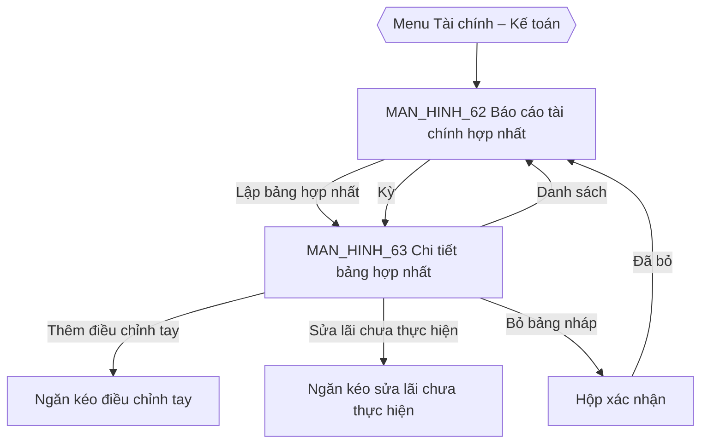

- Thứ tự menu và quyền hiện mục: Công nợ, Phiếu thu chi, Quỹ (`finance.debt.view`); Giao dịch ngân hàng (`finance.bank.view`); Kết nối ngân hàng (`finance.bank.setup`); Đối soát thu hộ (`finance.collection.view`); Bút toán, Sổ sách, Báo cáo tài chính (`finance.ledger.view`); Báo cáo hợp nhất (`finance.consolidation.view`); Hệ thống tài khoản (`finance.ledger.view`); Hóa đơn điện tử (`finance.einvoice.view`); Cài đặt hóa đơn điện tử (`finance.einvoice.setup`); Hoa hồng (`finance.commission.view`); Cài đặt hoa hồng (`finance.commission.setup`).
- Mục menu "Báo cáo hợp nhất" hiện theo quyền ở mọi phạm vi; người chỉ có quyền ở phạm vi công ty mở màn hình nhận lỗi không có quyền.

## 48. Bảng vai trò – màn hình (MODULE_06 phần 8)

| Màn hình | Quản trị tập đoàn | Kế toán trưởng (phạm vi tập đoàn) | Quản trị công ty, Kế toán trưởng (phạm vi công ty), Kế toán, Nhân viên bán hàng, Thủ kho |
|---|---|---|---|
| MAN_HINH_62 Báo cáo tài chính hợp nhất | Xem, Lập bảng | Xem, Lập bảng | Không |
| MAN_HINH_63 Chi tiết bảng hợp nhất | Xem, Xuất, Tính lại, Sửa lãi chưa thực hiện, Thêm, Xóa điều chỉnh tay, Bỏ bảng nháp, Gửi, Rút (bảng mình gửi) | Xem, Xuất, Tính lại, Sửa lãi chưa thực hiện, Thêm, Xóa điều chỉnh tay, Bỏ bảng nháp, Gửi, Rút (bảng mình gửi) | Không |

## 49. Đặc tả từng màn hình (MODULE_06 phần 8)

### MAN_HINH_62: Báo cáo tài chính hợp nhất
- Mục đích: Xem phạm vi hợp nhất, các bảng hợp nhất theo kỳ, lập bảng mới; xem nhanh số cộng gộp.
- Chức năng thực hiện: CHUC_NANG_92, CHUC_NANG_93
- Đường dẫn: `/finance/consolidation`.
- Bố cục: tiêu đề "Báo cáo tài chính hợp nhất".
  - Thẻ phạm vi: "Tập đoàn <tên> · đồng tiền <mã>"; danh sách thành viên: tên (đậm) · mã · "Thông tư 99" hoặc "Thông tư 133" · đồng tiền · "công ty gốc" (khi là công ty gốc); nhãn "Hợp nhất" hoặc "Không hợp nhất: khác đồng tiền", "Không hợp nhất: chưa khởi tạo kế toán".
  - Hai thẻ "Bảng hợp nhất" (mặc định), "Xem nhanh cộng gộp".
  - Thẻ "Bảng hợp nhất": ô "Từ ngày" (mặc định ngày 1 tháng 1 năm nay), "Đến ngày" (mặc định hôm nay), nút "Lập bảng hợp nhất" (khi có `canManage`); bảng "Kỳ" (liên kết sang MAN_HINH_63), "Số", "Trạng thái" (nhãn "Nháp", "Chờ duyệt", "Đã ghi sổ", "Bị từ chối", "Đã rút"), "Tính lại lúc".
  - Thẻ "Xem nhanh cộng gộp": hai thẻ "Tình hình tài chính" (mặc định), "Kết quả kinh doanh"; ô "Từ ngày", "Đến ngày"; dòng "<tên báo cáo> (<mẫu>) · số cộng gộp của <thành viên>, chưa loại trừ nội bộ"; bảng chỉ tiêu (bảng chỉ tiêu hợp nhất như MAN_HINH_63). Chỉ gọi API xem trước khi mở thẻ này.
- Dữ liệu hiển thị: bảng của tập đoàn, đến ngày mới nhất trước; số định dạng theo tiếng Việt, số âm trong ngoặc, số 0 để trống.
- Thành phần: ThanhTrenCung, MenuMiniApp, The, NhanTrangThai, CacThe, BoLoc, ONhap, BangDuLieu, Nut, TrangThaiRong (tài liệu `15`).
- API: API_106.
- Thao tác: "Lập bảng hợp nhất" thành công mở MAN_HINH_63 của bảng vừa lập; đổi ngày, đổi báo cáo ở thẻ xem nhanh tải lại số.
- Trạng thái: đang tải; lỗi tải kèm "Thử lại"; rỗng "Chưa có bảng hợp nhất."; khoảng ngày sai ở thẻ xem nhanh: "Chọn ngày hợp lệ; từ ngày không sau đến ngày.".
- Thông báo: lỗi lập bảng hiện dưới ô kỳ ("Kỳ này đã có bảng hợp nhất đang dùng.", "Ngày kết thúc phải sau ngày bắt đầu.").
- Quyền hiển thị: mục menu với `finance.consolidation.view`; nội dung khi có quyền ở phạm vi tập đoàn (không có thì thông báo lỗi không có quyền); ô lập bảng theo `canManage` của API_106.
- Responsive: bảng chuyển thành thẻ, nhãn cột hiện đủ; bộ lọc, nút xuống dòng; số tiền không xuống dòng; không cuộn ngang.
- Trạng thái phê duyệt: Chưa phê duyệt (CONG_VIEC_20 mục 14)

### MAN_HINH_63: Chi tiết bảng hợp nhất
- Mục đích: Xem báo cáo hợp nhất của kỳ, kiểm bút toán loại trừ, sửa lãi chưa thực hiện, thêm điều chỉnh tay, gửi duyệt, xuất tệp.
- Chức năng thực hiện: CHUC_NANG_93, CHUC_NANG_94, CHUC_NANG_95
- Đường dẫn: `/finance/consolidation/<mã>`.
- Bố cục: tiêu đề "Bảng hợp nhất <từ ngày> – <đến ngày>", nút "Danh sách".
  - Thẻ thông tin: nhãn trạng thái, số `HN…` (khi có), "Thành viên: <danh sách> · tính lại lúc <thời điểm>"; khối cảnh báo "Công nợ nội bộ hai bên chưa khớp (đã loại trừ phần nhỏ hơn; đối chiếu rồi điều chỉnh tay nếu cần):" kèm từng dòng "<công ty A> phải thu <công ty B>: <số>; <công ty B> phải trả: <số>; chênh lệch <số>"; khối lỗi lý do không chốt được (câu thông báo đã dịch theo khóa lý do; khi có).
  - Nút: "Gửi" (khi `canEdit`), "Rút" (khi `canWithdraw`), "Tình hình tài chính (Excel)", "Tình hình tài chính (PDF)", "Kết quả kinh doanh (Excel)", "Kết quả kinh doanh (PDF)" (mọi trạng thái); hàng thứ hai khi `canEdit`: "Tính lại", "Bỏ bảng nháp" (khi nháp chưa có số).
  - Bốn thẻ "Tình hình tài chính" (mặc định), "Kết quả kinh doanh", "Bút toán loại trừ", "Lãi chưa thực hiện".
  - Thẻ báo cáo: bảng "Mã số", "Chỉ tiêu" (thụt lề theo cấp, cấp 0 chữ đậm), "Cộng gộp", "Loại trừ", "Hợp nhất · Số cuối kỳ (<ngày>)" hoặc "Hợp nhất · Kỳ này (<từ ngày> – <đến ngày>)", "Cộng gộp · Số đầu năm (<ngày>)" hoặc "Cộng gộp · Cùng kỳ năm trước (<từ ngày> – <đến ngày>)".
  - Thẻ "Bút toán loại trừ": nút "Thêm điều chỉnh tay" (khi `canEdit`); bảng "Bút toán" (loại "Công nợ nội bộ", "Doanh thu, giá vốn nội bộ", "Lãi chưa thực hiện", "Điều chỉnh tay" · diễn giải; nút "Xóa" ở điều chỉnh tay khi `canEdit`), "Công ty" (bút toán lãi chưa thực hiện: "—"), "Tài khoản" (mã Thông tư 99), "Đối tác", "Nợ", "Có".
  - Thẻ "Lãi chưa thực hiện": chú thích "Lãi chưa thực hiện = số còn tồn cuối kỳ (tối đa số mua nội bộ trong kỳ) × lãi gộp mỗi đơn vị của bên bán; sửa được khi bảng còn nháp."; bảng "Công ty mua", "Công ty bán", "Mặt hàng" (tên · mã hàng), "Mua nội bộ", "Tồn cuối kỳ", "Lãi gộp mỗi đơn vị", "Ước tính", "Số dùng" (kèm "đã sửa: <lý do>"), cột nút "Sửa" (khi `canEdit`).
  - Ngăn kéo "Thêm điều chỉnh tay": chú thích "Ghi theo mã tài khoản Thông tư 99, tổng Nợ bằng tổng Có; ví dụ loại trừ khoản đầu tư vào công ty con (Có 221) với vốn chủ sở hữu của công ty con (Nợ 411)."; "Diễn giải"; mỗi dòng "Tài khoản" (gợi ý danh sách tài khoản Thông tư 99), "Nợ", "Công ty" (mặc định "Công ty gốc trước", hoặc chọn một thành viên), "Đối tác" (mặc định "Chọn đối tác (bắt buộc)" khi tài khoản lấy số dư theo đối tác, khác thì "Không chọn đối tác"; danh sách đối tác của các thành viên), "Có"; mặc định hai dòng; nút "Thêm dòng" (tối đa 20 dòng), "Hủy", "Lưu".
  - Ngăn kéo "Sửa" lãi chưa thực hiện: "<mặt hàng> · Ước tính: <số>"; "Số dùng" (điền sẵn số đang dùng), "Lý do"; nút "Hủy", "Dùng số ước tính" (khi đã sửa), "Lưu".
  - Hộp xác nhận "Bỏ bảng nháp": "Bảng hợp nhất nháp, bút toán điều chỉnh tay và số đã sửa sẽ bị xóa."; nút "Bỏ bảng nháp".
- Dữ liệu hiển thị: bảng chờ duyệt, đã chốt hiện số đã lưu lúc gửi; bảng khác tính khi mở; số định dạng theo tiếng Việt, số âm trong ngoặc.
- Thành phần: ThanhTrenCung, MenuMiniApp, The, NhanTrangThai, KhoiCanhBao, CacThe, BangDuLieu, NganKeo, HopThoaiXacNhan, ONhap, Nut, TrangThaiRong (tài liệu `15`).
- API: API_107, API_108, API_109.
- Thao tác: "Gửi" báo "Đã gửi bảng hợp nhất." (chờ duyệt thì thêm "Bảng hợp nhất đang chờ duyệt."); "Rút" báo "Đã rút bảng hợp nhất."; "Tính lại" báo "Đã tính lại bảng hợp nhất."; thêm, xóa điều chỉnh tay báo "Đã thêm bút toán điều chỉnh.", "Đã xóa bút toán điều chỉnh." (xóa không hỏi lại); sửa lãi báo "Đã lưu lãi chưa thực hiện."; xuất Excel tải tệp `HN-<loại báo cáo>-<đến ngày>.xlsx`, xuất PDF mở thẻ trình duyệt mới; "Bỏ bảng nháp" về MAN_HINH_62; sau mỗi thao tác tải lại bảng.
- Trạng thái: đang tải; lỗi tải kèm "Thử lại"; rỗng "Không có bút toán loại trừ.", "Không có hàng mua nội bộ trong kỳ.".
- Thông báo: lỗi thao tác, lỗi xuất hiện trong thẻ thông tin; lỗi xóa điều chỉnh tay hiện trên bảng bút toán; lỗi tại trường, cuối ngăn kéo; lỗi bỏ bảng hiện trong hộp xác nhận.
- Quyền hiển thị: nút theo `canEdit`, `canWithdraw` của API_107 và trạng thái bảng.
- Responsive: bảng chuyển thành thẻ, nhãn cột hiện đủ; dòng điều chỉnh tay xếp lưới tự co; nút xuống dòng; số tiền không xuống dòng; không cuộn ngang.
- Trạng thái phê duyệt: Chưa phê duyệt (CONG_VIEC_20 mục 14)

## MODULE_07 Khách hàng và Đối tác (phần 2: Gán khách hàng cho nhân viên kinh doanh, CONG_VIEC_21)

Đã tắt theo THAY_DOI_18 (CONG_VIEC_43, 2026-11-11): trang `/crm/customer-assignments` và mục menu "Giao khách hàng" đã xóa; phần sửa MAN_HINH_36, MAN_HINH_37 bỏ theo mục 64. Mục 50 đến mục 52 giữ để tra cứu.

Cùng mini app `apps/web-crm` (mục 11). Phạm vi xem đối tác theo nhân viên phụ trách (QUYTAC_NGHIEPVU_129) áp dụng cho MAN_HINH_36, MAN_HINH_37 và màn hình đơn bán MAN_HINH_42, MAN_HINH_43 (không đổi giao diện đơn bán; danh sách chọn khách chỉ gồm khách trong phạm vi).

## 50. Danh sách màn hình và điều hướng (MODULE_07 phần 2)

| Mã | Tên màn hình | Chức năng (10) | Vai trò được truy cập (08) | Mở từ | Bản mẫu |
|---|---|---|---|---|---|
| MAN_HINH_64 | Danh sách phiếu giao khách: lọc trạng thái; nút lập phiếu | CHUC_NANG_97 | Mọi người có `crm.partner.view`; lập phiếu: trưởng phòng, người có `crm.customer.assign` (Quản trị tập đoàn, quản trị công ty) | Menu Khách hàng và Đối tác | Không lập (xem trước trên ứng dụng, CONG_VIEC_21 mục 14) |
| MAN_HINH_65 | Phiếu giao khách: lập, sửa (chọn khách, nhân viên nhận, lý do); gửi, rút, bỏ phiếu nháp; trạng thái, lý do không áp dụng được | CHUC_NANG_97 | Như MAN_HINH_64 | MAN_HINH_64; liên kết số phiếu ở thẻ lịch sử phụ trách của MAN_HINH_37; thông báo áp dụng phiếu | Không lập (xem trước trên ứng dụng, CONG_VIEC_21 mục 14) |

Sơ đồ điều hướng (thay sơ đồ mục 11):

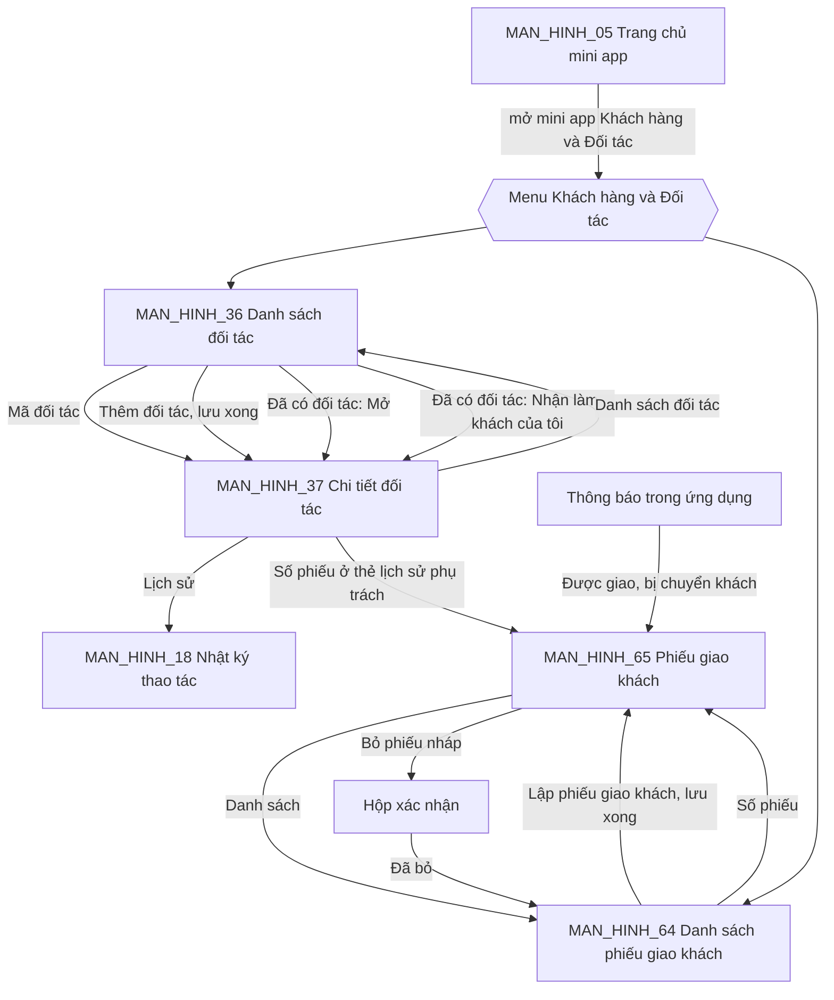

- Thứ tự menu và quyền hiện mục: Đối tác (`crm.partner.view`); Giao khách hàng (`crm.partner.view`).
- Nút "Lập phiếu giao khách" chỉ hiện khi người dùng là trưởng phòng hoặc có `crm.customer.assign` (API tùy chọn phiếu trả được).

## 51. Bảng vai trò – màn hình (MODULE_07 phần 2)

| Màn hình | Quản trị tập đoàn, quản trị công ty | Trưởng phòng | Nhân viên bán hàng | Kế toán, Kế toán trưởng, Thủ kho, Nhân viên mua hàng, Quản lý đối tác |
|---|---|---|---|---|
| MAN_HINH_36 Danh sách đối tác (phần sửa) | Xem mọi đối tác, lọc "Khách của tôi" | Xem khách của nhân viên phòng mình quản lý | Xem khách mình phụ trách, Thêm, Nhận làm khách của tôi | Xem mọi đối tác (Quản lý đối tác: Thêm) |
| MAN_HINH_37 Chi tiết đối tác (phần sửa) | Xem lịch sử phụ trách; đặt nhân viên phụ trách khi chưa có | Xem lịch sử phụ trách (khách trong phạm vi) | Xem lịch sử phụ trách (khách mình phụ trách) | Xem lịch sử phụ trách |
| MAN_HINH_64 Danh sách phiếu giao khách | Xem mọi phiếu, Lập phiếu | Xem phiếu mình lập, mình gửi, giao cho mình; Lập phiếu | Xem phiếu giao cho mình | Xem phiếu giao cho mình |
| MAN_HINH_65 Phiếu giao khách | Xem, Sửa, Gửi, Bỏ phiếu nháp, Rút (phiếu mình gửi) | Xem, Sửa, Gửi, Bỏ phiếu nháp (phiếu mình lập), Rút (phiếu mình gửi) | Xem | Xem |

## 52. Đặc tả từng màn hình (MODULE_07 phần 2)

### MAN_HINH_64: Danh sách phiếu giao khách
- Trạng thái màn hình: Đã tắt theo THAY_DOI_18 (CONG_VIEC_43, 2026-11-11); không còn trên giao diện.
- Mục đích: Theo dõi các phiếu giao, chuyển khách; lập phiếu mới.
- Chức năng thực hiện: CHUC_NANG_97
- Đường dẫn: `/crm/customer-assignments`.
- Bố cục: tiêu đề "Giao khách hàng", nút "Lập phiếu giao khách" (khi là trưởng phòng hoặc có quyền giao khách); câu "Giao, chuyển khách cho nhân viên kinh doanh; đi theo chính sách duyệt của công ty."; bộ lọc "Trạng thái: Tất cả" (Nháp, Chờ duyệt, Đã áp dụng, Bị từ chối, Đã rút); bảng "Số phiếu" (liên kết mở MAN_HINH_65; chưa có số hiện "(nháp)"), "Nhân viên nhận", "Số khách", "Lý do", "Người lập" (kèm thời điểm lập), "Trạng thái" (nhãn màu: Nháp, Đã rút trung tính; Chờ duyệt cảnh báo; Đã áp dụng thành công; Bị từ chối nguy hiểm); phân trang 20 dòng.
- Dữ liệu hiển thị: phiếu của công ty đang chọn trong phạm vi xem (QUYTAC_NGHIEPVU_132), mới lập trước.
- Thành phần: ThanhTrenCung, MenuMiniApp, BoLoc, OChon, BangDuLieu, NhanTrangThai, Nut, TrangThaiRong (tài liệu `15`).
- API: API_110.
- Thao tác: đổi trạng thái về trang 1; "Lập phiếu giao khách" mở `/crm/customer-assignments/new` (MAN_HINH_65 ở chế độ lập).
- Trạng thái: đang tải; lỗi tải kèm "Thử lại"; rỗng "Chưa có phiếu giao khách." (có lọc thì "Không có kết quả phù hợp.").
- Thông báo: không có.
- Quyền hiển thị: mục menu với `crm.partner.view`; nút lập phiếu khi API tùy chọn phiếu trả được (không phải trưởng phòng, không có quyền giao khách thì API trả 403, nút ẩn).
- Responsive: bảng chuyển thành thẻ, nhãn cột hiện đủ; không cuộn ngang.
- Trạng thái phê duyệt: Chưa phê duyệt (CONG_VIEC_21 mục 14)

### MAN_HINH_65: Phiếu giao khách
- Trạng thái màn hình: Đã tắt theo THAY_DOI_18 (CONG_VIEC_43, 2026-11-11); không còn trên giao diện.
- Mục đích: Lập, sửa phiếu giao khách; gửi duyệt; xem kết quả áp dụng.
- Chức năng thực hiện: CHUC_NANG_97
- Đường dẫn: `/crm/customer-assignments/new` (lập), `/crm/customer-assignments/<mã>` (chi tiết, sửa).
- Bố cục:
  - Chế độ lập (tiêu đề "Lập phiếu giao khách") và sửa (nút "Sửa" trên chi tiết): biểu mẫu "Nhân viên nhận *" (danh sách chọn "Chọn nhân viên": mọi thành viên đang hoạt động hoặc nhân viên phòng mình quản lý), "Lý do *" (tối đa 500 ký tự); khối "Khách đã chọn: <số>" liệt kê "<mã> · <tên> · <nhân viên phụ trách hoặc "chưa có người phụ trách">" kèm nút "Bỏ", lỗi từng khách hiện dưới khách đó (trống: "Chưa chọn khách nào."); ô "Tìm khách để thêm" (gợi ý "Tên, mã, mã số thuế, điện thoại"; tìm khách hàng đang giao dịch trong phạm vi xem, 20 kết quả, bỏ khách đã chọn) mỗi dòng "<mã> · <tên> · <nhân viên phụ trách>" kèm nút "Thêm" (tối đa 500 khách); nút "Lưu", "Hủy". Không phải trưởng phòng, không có quyền giao khách: khối cảnh báo "Bạn không phải trưởng phòng và không có quyền giao khách.".
  - Chế độ xem: tiêu đề "Phiếu giao khách <số hoặc "(nháp)">", nút "Danh sách"; thẻ thông tin: "Trạng thái" (nhãn), "Nhân viên nhận", "Lý do", "Người lập" (kèm thời điểm), "Áp dụng lúc" (khi đã áp dụng); khối lỗi lý do không áp dụng được (câu đã dịch theo khóa) kèm "Khách đã đổi: <tên các khách>"; nút "Gửi", "Sửa" (khi `canSubmit`, `canEdit`), "Rút" (khi `canWithdraw`), "Bỏ phiếu nháp" (khi `canDiscard`); bảng "Khách hàng" (mã · tên), "Đang phụ trách" (hoặc "chưa có người phụ trách"), "Phụ trách lúc gửi" (chưa gửi hiện "—").
  - Hộp xác nhận "Bỏ phiếu nháp": "Bỏ phiếu nháp này? Không khôi phục được."; nút "Bỏ phiếu nháp".
- Dữ liệu hiển thị: phiếu trong phạm vi xem; khách theo tên.
- Thành phần: ThanhTrenCung, MenuMiniApp, The, NhanTrangThai, KhoiCanhBao, ONhap, OChon, BangDuLieu, HopThoaiXacNhan, Nut, TrangThaiRong (tài liệu `15`).
- API: API_110, API_71 (tìm khách).
- Thao tác: lưu phiếu mới báo "Đã lưu phiếu giao khách." rồi mở chi tiết; "Gửi" báo "Đã gửi phiếu giao khách."; "Rút" báo "Đã rút phiếu."; "Bỏ phiếu nháp" báo "Đã bỏ phiếu nháp." rồi về MAN_HINH_64; gõ ô tìm thì tìm sau 300 mili giây; sau mỗi thao tác tải lại phiếu.
- Trạng thái: đang tải; lỗi tải kèm "Thử lại"; không tìm thấy phiếu: "Không tìm thấy dữ liệu hoặc bạn không có quyền xem.".
- Thông báo: lỗi gửi, rút hiện trong thẻ thông tin; lỗi tại trường, cuối biểu mẫu; lỗi bỏ phiếu hiện trong hộp xác nhận.
- Quyền hiển thị: nút theo `canEdit`, `canSubmit`, `canWithdraw`, `canDiscard` của API_110.
- Responsive: bảng chuyển thành thẻ; nút xuống dòng; không cuộn ngang.
- Trạng thái phê duyệt: Chưa phê duyệt (CONG_VIEC_21 mục 14)

## MODULE_09 Sàn thương mại điện tử (phần lõi 1: Tài khoản người mua, CONG_VIEC_23)

Ứng dụng VComm `apps/mobile-vcomm` (Expo; khổ điện thoại; xem trước bằng bản web) thay ứng dụng kinh doanh của CONG_VIEC_22: MAN_HINH_66 đến MAN_HINH_71 không dùng nữa (THAY_DOI_14). Web-crm thêm mục "Người mua VComm". Màu, khoảng cách lấy từ tài liệu `15` (tệp chủ đề của ứng dụng sao giá trị từ `packages/ui/src/styles.css`).

## 53. Danh sách màn hình và điều hướng (MODULE_09 phần lõi 1)

| Mã | Tên màn hình | Chức năng (10) | Vai trò được truy cập (08) | Mở từ | Bản mẫu |
|---|---|---|---|---|---|
| MAN_HINH_73 | Ứng dụng: Đăng nhập (số điện thoại và mật khẩu, hoặc mã OTP; mã xác thực hai lớp với tài khoản nhân viên bắt buộc) | CHUC_NANG_105 | Mọi người | Mở ứng dụng khi chưa đăng nhập; phiên bị từ chối | Không làm (xem trước từng lát) |
| MAN_HINH_74 | Ứng dụng: Đăng ký hai bước (số điện thoại, mã giới thiệu; mã OTP, họ tên, mật khẩu) | CHUC_NANG_104 | Mọi người | MAN_HINH_73; đường dẫn `/r/<số điện thoại>` | Không làm |
| MAN_HINH_75 | Ứng dụng: Quên mật khẩu (số điện thoại; mã OTP, mật khẩu mới) | CHUC_NANG_105 | Mọi người | MAN_HINH_73 | Không làm |
| MAN_HINH_76 | Ứng dụng: Tài khoản (họ tên, số điện thoại; mã, đường dẫn giới thiệu, Chia sẻ, Sao chép; người giới thiệu, nhập mã một lần; Đăng xuất) | CHUC_NANG_106 | Người mua | Thanh điều hướng dưới; đường dẫn giới thiệu khi đã đăng nhập | Không làm |
| MAN_HINH_77 | Ứng dụng: Người tôi giới thiệu (thẻ trong MAN_HINH_76) | CHUC_NANG_106 | Người mua | MAN_HINH_76 | Không làm |
| MAN_HINH_78 | Ứng dụng: Kinh doanh – khách tôi phụ trách (họ tên, số điện thoại, ngày đăng ký, nút Gọi) | CHUC_NANG_108 | Nhân viên kinh doanh | Thanh điều hướng dưới (chỉ hiện với nhân viên kinh doanh) | Không làm |
| MAN_HINH_79 | Web-crm: Tài khoản người mua (công ty vận hành sàn; tìm, lọc loại tài khoản, bảng, phân trang) | CHUC_NANG_107 | `marketplace.buyer.view` | Menu "Người mua VComm" | Không làm |
| MAN_HINH_80 | Web-crm: Chi tiết tài khoản người mua (thông tin; nhân viên kinh doanh; đổi người giới thiệu; lịch sử người giới thiệu, đánh dấu; người được giới thiệu) | CHUC_NANG_107, CHUC_NANG_108 | `marketplace.buyer.view`; thao tác cần `marketplace.buyer.manage` | MAN_HINH_79; liên kết người được giới thiệu | Không làm |

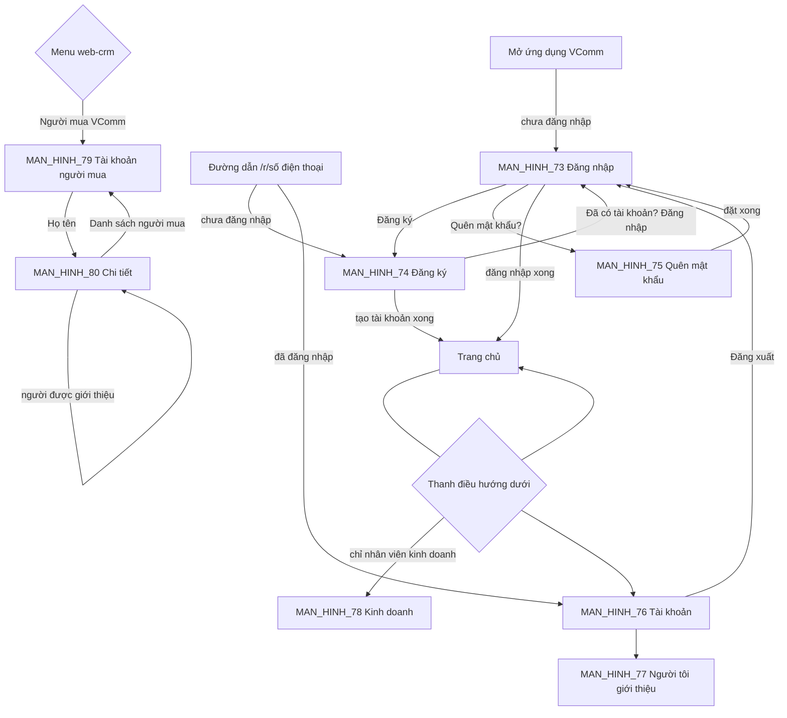

## 54. Bảng vai trò – màn hình (MODULE_09 phần lõi 1)

| Màn hình | Người mua | Nhân viên kinh doanh | Quản trị công ty vận hành sàn | Quản trị tập đoàn |
|---|---|---|---|---|
| MAN_HINH_73 đến MAN_HINH_77 | Dùng | Dùng | Dùng (nếu có số điện thoại) | Dùng (nếu có số điện thoại) |
| MAN_HINH_78 | Không | Xem, Gọi | Không | Không |
| MAN_HINH_79 | Không | Không | Xem | Xem, chọn công ty vận hành sàn |
| MAN_HINH_80 | Không | Không | Xem, Đổi người giới thiệu, Đánh dấu, Bỏ đánh dấu | Như quản trị công ty vận hành sàn |

## 55. Đặc tả từng màn hình (MODULE_09 phần lõi 1)

### MAN_HINH_73: Đăng nhập (ứng dụng)
- Mục đích: Người mua, nhân viên kinh doanh đăng nhập ứng dụng VComm.
- Chức năng thực hiện: CHUC_NANG_105
- Đường dẫn: `/dang-nhap`.
- Bố cục: chữ "VComm", tiêu đề "Đăng nhập"; thẻ: chọn "Mật khẩu" hoặc "Mã OTP"; ô Số điện thoại; Mật khẩu và nút Đăng nhập, hoặc nút Gửi mã, ô Mã OTP (6 số), nút Đăng nhập, nút Gửi lại (đếm ngược 60 giây); liên kết "Quên mật khẩu?"; "Chưa có tài khoản?" và nút Đăng ký. Tài khoản bắt buộc xác thực hai lớp: ô Mã xác thực hoặc Mã dự phòng, nút Xác nhận, Quay lại đăng nhập.
- API: API_117, API_112 (xác thực hai lớp dùng API_06).
- Trạng thái: đang gửi (nút xoay); lỗi chung hiện khối thông báo trong thẻ; lỗi theo ô hiện dưới ô; đặt lại mật khẩu xong hiện "Đã đặt mật khẩu mới. Hãy đăng nhập.".
- Responsive: khổ điện thoại; cuộn khi bàn phím mở.
- Trạng thái phê duyệt: Xem trước từng lát thay cho bản mẫu (quyết định của người dùng 2026-11-10).

### MAN_HINH_74: Đăng ký (ứng dụng)
- Mục đích: Khách tự tạo tài khoản, gắn người giới thiệu.
- Chức năng thực hiện: CHUC_NANG_104
- Đường dẫn: `/dang-ky?ma=<mã>`; `/r/<số điện thoại>` chuyển tới đây với mã điền sẵn.
- Bố cục: bước 1: Số điện thoại, "Số điện thoại của bạn sẽ là mã giới thiệu của bạn.", Mã giới thiệu (không bắt buộc), "Mã giới thiệu là số điện thoại của người giới thiệu bạn.", nút Gửi mã. Bước 2: "Mã đã gửi tới …", Mã OTP (6 số), Họ tên, Mật khẩu ("Ít nhất 10 ký tự."), Mã giới thiệu (sửa được), nút Tạo tài khoản, nút Gửi lại (đếm ngược 60 giây), liên kết Đổi số điện thoại; dưới thẻ: "Đã có tài khoản? Đăng nhập".
- API: API_116.
- Thông báo lỗi theo ô: "Số điện thoại đã có tài khoản. Hãy đăng nhập.", "Mã giới thiệu không đúng.", "Mã không đúng hoặc đã hết hạn.", mật khẩu quá ngắn.
- Trạng thái phê duyệt: Xem trước từng lát thay cho bản mẫu.

### MAN_HINH_75: Quên mật khẩu (ứng dụng)
- Chức năng thực hiện: CHUC_NANG_105. Đường dẫn `/quen-mat-khau`.
- Bố cục: Số điện thoại, nút Gửi mã; sau khi gửi: Mã OTP, Mật khẩu mới, nút Đặt lại mật khẩu, nút Gửi lại; liên kết Quay lại đăng nhập. Đặt xong về MAN_HINH_73 kèm thông báo thành công.
- API: API_117. Trạng thái phê duyệt: Xem trước từng lát thay cho bản mẫu.

### MAN_HINH_76, MAN_HINH_77: Tài khoản, người tôi giới thiệu (ứng dụng)
- Chức năng thực hiện: CHUC_NANG_106. Đường dẫn `/tai-khoan` (thẻ Tài khoản).
- Bố cục: thẻ họ tên, số điện thoại; thẻ "Mã giới thiệu của bạn" (số điện thoại cỡ lớn), "Đường dẫn giới thiệu" (chọn được để sao chép), nút Chia sẻ (hộp chia sẻ của máy; bản web: hộp chia sẻ của trình duyệt hoặc sao chép), nút Sao chép (bản web), thông báo "Đã sao chép."; thẻ "Người giới thiệu": tên và số che, hoặc "Chưa có người giới thiệu." kèm ô Mã người giới thiệu, "Bạn chỉ nhập được một lần.", nút Lưu người giới thiệu; thẻ "Người tôi giới thiệu (số lượng)": họ tên, số che, "Đăng ký dd/mm/yyyy", rỗng "Chưa có ai đăng ký bằng mã của bạn."; nút Đăng xuất.
- API: API_118. Tải lại danh sách khi quay lại thẻ.
- Trạng thái phê duyệt: Xem trước từng lát thay cho bản mẫu.

### MAN_HINH_78: Kinh doanh – khách tôi phụ trách (ứng dụng)
- Chức năng thực hiện: CHUC_NANG_108. Đường dẫn `/kinh-doanh`; thẻ chỉ hiện khi tài khoản đang được đánh dấu nhân viên kinh doanh.
- Bố cục: thẻ "Khách tôi phụ trách", "n khách"; mỗi khách: họ tên, số điện thoại, ngày đăng ký, nút Gọi (mở ứng dụng gọi điện); rỗng "Chưa có khách nào.".
- API: API_118. Trạng thái phê duyệt: Xem trước từng lát thay cho bản mẫu.

### MAN_HINH_79: Tài khoản người mua (web-crm)
- Chức năng thực hiện: CHUC_NANG_107. Đường dẫn `/crm/buyers`.
- Bố cục: tiêu đề "Tài khoản người mua", câu giải thích; dòng "Công ty vận hành sàn: …" (quản trị tập đoàn có nút Chọn công ty); chưa chọn công ty: khối cảnh báo và ô chọn công ty, nút Lưu công ty vận hành sàn (chỉ quản trị tập đoàn; người khác thấy "Nhờ quản trị tập đoàn chọn công ty vận hành sàn."); bộ lọc: ô tìm theo tên hoặc số điện thoại, Loại tài khoản (tất cả, nhân viên kinh doanh, người mua); bảng: Họ tên (liên kết), Số điện thoại, Loại (nhãn), Người giới thiệu (tên · số), Đã giới thiệu, Ngày đăng ký; phân trang 20.
- Thành phần: ThanhTrenCung, MenuMiniApp, BoLoc, OChon, BangDuLieu, Nhan, Nut, TrangThaiRong (tài liệu `15`).
- API: API_119. Trạng thái: đang tải; lỗi kèm "Thử lại"; rỗng "Chưa có tài khoản người mua." (có lọc: "Không có kết quả phù hợp.").
- Responsive: bảng chuyển thành thẻ; không cuộn ngang.
- Trạng thái phê duyệt: Xem trước từng lát thay cho bản mẫu.

### MAN_HINH_80: Chi tiết tài khoản người mua (web-crm)
- Chức năng thực hiện: CHUC_NANG_107, CHUC_NANG_108. Đường dẫn `/crm/buyers/{id}`.
- Bố cục: liên kết "‹ Danh sách người mua"; tiêu đề họ tên; thẻ thông tin (Số điện thoại, Trạng thái, Ngày đăng ký, Người giới thiệu); thẻ "Nhân viên kinh doanh": "Đang là nhân viên kinh doanh, phòng …" và nút Bỏ đánh dấu (hộp xác nhận nêu hậu quả), hoặc "Chưa được đánh dấu nhân viên kinh doanh." và ô Phòng ban, nút Đánh dấu nhân viên kinh doanh (công ty chưa có phòng ban thì khối cảnh báo); thẻ "Đổi người giới thiệu" (chỉ người có quyền quản lý): Mã người giới thiệu mới (để trống để bỏ), Lý do *, nút Đổi người giới thiệu; thẻ "Lịch sử người giới thiệu" (cũ → mới · nguồn, lý do, thời điểm · bởi ai); thẻ "Lịch sử đánh dấu"; thẻ "Người được giới thiệu (n)" (liên kết sang chi tiết).
- API: API_119. Thông báo: "Đã đổi người giới thiệu.", "Đã đánh dấu nhân viên kinh doanh.", "Đã bỏ đánh dấu."; lỗi phiên bản "Dữ liệu đã được người khác sửa…".
- Trạng thái phê duyệt: Xem trước từng lát thay cho bản mẫu.

## MODULE_09 Sàn thương mại điện tử (phần lõi 1b: Đội kinh doanh nhiều cấp, CONG_VIEC_27)

## 56. Danh sách màn hình và điều hướng (MODULE_09 phần lõi 1b)

| Mã | Tên màn hình | Chức năng (10) | Vai trò được truy cập (08) | Mở từ | Bản mẫu |
|---|---|---|---|---|---|
| MAN_HINH_81 | Web-crm: Đội kinh doanh (cây phòng ban, loại đơn vị, quản lý, thành viên, chức danh, số khách; gắn loại, bổ nhiệm, bỏ quản lý, chuyển đơn vị) | CHUC_NANG_109, CHUC_NANG_110 | `marketplace.buyer.view`; thao tác cần `marketplace.buyer.manage` | Menu "Đội kinh doanh" | Không làm (xem trước từng lát) |
| MAN_HINH_82 | Web-crm: Đề xuất đội kinh doanh (lọc trạng thái; duyệt, từ chối kèm ghi chú) | CHUC_NANG_112 | Như MAN_HINH_81 | Menu "Đề xuất đội kinh doanh" | Không làm |
| MAN_HINH_83 | Ứng dụng: Đội của tôi (thẻ trong MAN_HINH_78; cấp dưới, chức danh, đơn vị, số khách; nút Đề xuất thay đổi đội) | CHUC_NANG_111 | Người quản lý trong đội | Thẻ Kinh doanh | Không làm |
| MAN_HINH_84 | Ứng dụng: Khách của một cấp dưới | CHUC_NANG_111 | Người quản lý trong đội | MAN_HINH_83 | Không làm |
| MAN_HINH_85 | Ứng dụng: Đề xuất thay đổi đội (lập đề xuất; đề xuất của tôi, trạng thái, rút) | CHUC_NANG_112 | Người quản lý trong đội | MAN_HINH_83 | Không làm |

Sửa: MAN_HINH_78 thêm thẻ chức danh, đơn vị; MAN_HINH_80 thêm chức danh, chuỗi cấp trên, chỉ chọn đơn vị kinh doanh khi đánh dấu, lịch sử có chuyển đơn vị, bổ nhiệm, bỏ quản lý.

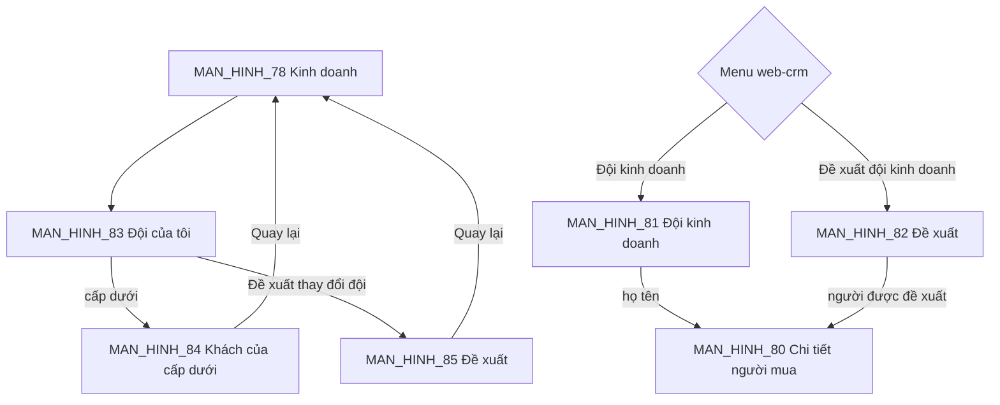

## 57. Đặc tả màn hình (MODULE_09 phần lõi 1b)

- MAN_HINH_81 (`/crm/sales-team`): mỗi phòng ban là một thẻ thụt theo cấp; ô chọn loại đơn vị (Không phải đơn vị kinh doanh, Khối kinh doanh, Vùng, Phòng kinh doanh); với đơn vị kinh doanh: dòng Quản lý (tên hoặc "Chưa có quản lý", nút Bỏ quản lý), "Thành viên (n)": họ tên (liên kết MAN_HINH_80), số điện thoại, nhãn chức danh, số khách, nút Bổ nhiệm quản lý, ô Chuyển sang và nút Chuyển. Lỗi hiện ở khối lỗi đầu trang; lưu xong thông báo "Đã lưu.". API_120.
- MAN_HINH_82 (`/crm/sales-proposals`): ô lọc trạng thái (mặc định Chờ duyệt); bảng Loại, Người được đề xuất (liên kết, số điện thoại), Đơn vị, Người đề xuất · thời điểm, Lý do, Trạng thái (nhãn; người duyệt, thời điểm, ghi chú), Xử lý (Duyệt; Từ chối mở ô ghi chú bắt buộc). Bảng chuyển thành thẻ trên điện thoại. API_121.
- MAN_HINH_83, MAN_HINH_84 (ứng dụng): thẻ chức danh, đơn vị; "Đội của tôi (n)": họ tên (bấm mở MAN_HINH_84), chức danh · đơn vị · số khách; MAN_HINH_84: "‹ Quay lại", "Khách của <tên>", danh sách khách như khách tôi phụ trách. API_122.
- MAN_HINH_85 (ứng dụng, `/de-xuat`): "Lập đề xuất": Loại đề xuất (Thêm người, Chuyển đơn vị, Bổ nhiệm quản lý, Đưa ra khỏi đội); Số điện thoại người được thêm hoặc chọn Thành viên; chọn Đơn vị (thêm người, chuyển đơn vị); Lý do; nút Gửi đề xuất; "Đã gửi đề xuất, chờ quản trị duyệt."; "Đề xuất của tôi": nhãn trạng thái, nội dung, lý do, ngày, ghi chú từ chối, nút Rút đề xuất khi chờ duyệt. API_121.
- Trạng thái phê duyệt: xem trước từng lát thay cho bản mẫu (quyết định của người dùng 2026-11-10).

## MODULE_09 Sàn thương mại điện tử (phần lõi 2: Đặt hàng trên VComm, CONG_VIEC_24)

## 58. Danh sách màn hình và điều hướng (MODULE_09 phần lõi 2)

| Mã | Tên màn hình | Chức năng (10) | Vai trò được truy cập (08) | Mở từ | Bản mẫu |
|---|---|---|---|---|---|
| MAN_HINH_86 | Web-crm: Cài đặt bán hàng VComm (kênh bán, kho xuất, phí giao hàng, mức miễn phí, gói hàng mặc định; đơn vị vận chuyển bật, tắt, trạng thái kết nối) | CHUC_NANG_113, CHUC_NANG_117 | `marketplace.order.view`; thay đổi cần `marketplace.order.manage` | Menu "Cài đặt bán hàng VComm" | Không làm |
| MAN_HINH_87 | Web-crm: Đăng bán (tìm, lọc đã đăng, chưa đăng; giá gồm thuế, số có thể bán, trạng thái, lý do chưa hiện; đăng bán, ngừng, mô tả) | CHUC_NANG_113 | Như MAN_HINH_86 | Menu "Đăng bán" | Không làm |
| MAN_HINH_88 | Web-crm: Đơn VComm (danh sách lọc trạng thái, tìm số đơn, số điện thoại; chi tiết: người mua, địa chỉ, tiền, dòng hàng, vận đơn, lịch sử; giao cho đơn vị vận chuyển, tra lại vận đơn, hủy) | CHUC_NANG_116, CHUC_NANG_117 | Như MAN_HINH_86 | Menu "Đơn VComm"; MAN_HINH_89 | Không làm |
| MAN_HINH_89 | Web-crm: Yêu cầu trả hàng (lọc trạng thái; lý do, mô tả, dòng, ảnh; duyệt, từ chối, đã nhận hàng trả, không nhận được hàng) | CHUC_NANG_118 | Như MAN_HINH_86 | Menu "Yêu cầu trả hàng" | Không làm |
| MAN_HINH_90 | Ứng dụng: Cửa hàng (thẻ; tìm kiếm, lưới sản phẩm: ảnh, tên, giá, hết hàng; nút Giỏ hàng có số dòng) | CHUC_NANG_115 | Người mua | Thẻ Cửa hàng | Không làm |
| MAN_HINH_91 | Ứng dụng: Chi tiết sản phẩm (ảnh, giá gồm thuế, phân loại, số lượng, còn hàng, mô tả, thêm vào giỏ) | CHUC_NANG_115 | Người mua | MAN_HINH_90 | Không làm |
| MAN_HINH_92 | Ứng dụng: Giỏ hàng (chọn dòng, số lượng, xóa, ngừng bán, không đủ hàng, tạm tính) | CHUC_NANG_115 | Người mua | MAN_HINH_90, MAN_HINH_91 | Không làm |
| MAN_HINH_93 | Ứng dụng: Đặt hàng (địa chỉ nhận, đổi địa chỉ, dòng hàng, tiền hàng, phí giao hàng, tổng thanh toán khi nhận hàng, Đặt hàng) | CHUC_NANG_116 | Người mua; đặt được khi là người mua thử | MAN_HINH_92 | Không làm |
| MAN_HINH_94 | Ứng dụng: Sổ địa chỉ (danh sách, thêm, sửa, xóa, đặt mặc định; chọn tỉnh, xã có tìm; chế độ chọn địa chỉ khi đặt hàng) | CHUC_NANG_114 | Người mua | MAN_HINH_76 (Tài khoản), MAN_HINH_93 | Không làm |
| MAN_HINH_95 | Ứng dụng: Đơn hàng (thẻ; lọc trạng thái; số đơn, trạng thái, sản phẩm đầu, số sản phẩm, ngày, tổng) | CHUC_NANG_116 | Người mua | Thẻ Đơn hàng | Không làm |
| MAN_HINH_96 | Ứng dụng: Chi tiết đơn (trạng thái, hạn trả hàng, địa chỉ, vận đơn, dòng, tiền, lịch sử, yêu cầu trả hàng, rút yêu cầu, hủy đơn kèm lý do) | CHUC_NANG_116, CHUC_NANG_118, CHUC_NANG_119 | Người mua (đơn của mình) | MAN_HINH_95, MAN_HINH_93 | Không làm |
| MAN_HINH_97 | Ứng dụng: Yêu cầu trả hàng (dòng, số lượng còn trả được, lý do, mô tả, ảnh trên bản web, gửi) | CHUC_NANG_118 | Người mua | MAN_HINH_96 | Không làm |

Sửa: MAN_HINH_80 thêm thẻ Người mua thử (đánh dấu, bỏ; cần `marketplace.order.manage`); MAN_HINH_76 thêm nút Sổ địa chỉ.

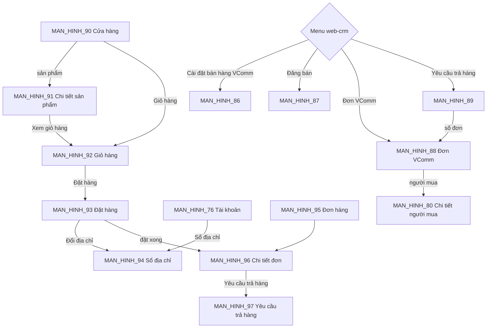

## 59. Đặc tả màn hình (MODULE_09 phần lõi 2)

- MAN_HINH_86 (`/crm/store-settings`): thẻ Bán hàng: Kênh bán, Kho xuất (chọn), Phí giao hàng mỗi đơn, Miễn phí giao hàng từ (để trống: không miễn), Dài, Rộng, Cao (cm), Khối lượng tối thiểu (g), "Lưu"; thẻ Đơn vị vận chuyển: tên, nhãn Đang bật hoặc Đang tắt, Đã có kết nối hoặc Chưa có kết nối, nút Bật, Tắt (Bật bị khóa khi chưa có kết nối). Người chỉ có quyền xem thấy các ô bị khóa, không có nút.
- MAN_HINH_87 (`/crm/listings`): ô tìm tên, mã; lọc Tất cả, Đã đăng bán, Chưa đăng bán; bảng Sản phẩm (ảnh, tên, ngành hàng), Giá gồm thuế ("Từ <giá>"), Có thể bán, Trạng thái (Đang hiện trên ứng dụng, Đã đăng bán chưa hiện, Chưa đăng bán; các lý do), Thao tác (Đăng bán hoặc Ngừng đăng bán; Mô tả: ô mô tả cho người mua tối đa 5.000 ký tự, để trống dùng mô tả sản phẩm); phân trang 20.
- MAN_HINH_88 (`/crm/orders`, `/crm/orders/<id>`): danh sách Số đơn (liên kết), Người mua · số điện thoại, Người nhận, Tổng thu, Trạng thái (nhãn; trạng thái vận chuyển), Đặt lúc; chi tiết: thông tin người mua, người nhận, địa chỉ, thanh toán, tiền hàng, phí giao hàng, tiền thu hộ, thời điểm; thẻ Xử lý đơn: chọn đơn vị vận chuyển đang bật, "Giao cho đơn vị vận chuyển" (xác nhận), "Tra lại vận đơn", "Hủy đơn" (ô lý do); bảng dòng hàng; thẻ Vận đơn (đơn vị, mã, trạng thái, phí, thời điểm cập nhật); Lịch sử đơn.
- MAN_HINH_89 (`/crm/return-requests`): lọc trạng thái (mặc định Chờ duyệt); mỗi yêu cầu là một thẻ: số đơn (liên kết), người mua, nhãn trạng thái, lý do, mô tả, dòng, ảnh thu nhỏ (bấm mở ảnh), thời điểm, ghi chú; Chờ duyệt: "Duyệt" (ghi chú không bắt buộc), "Từ chối" (ghi chú bắt buộc); Đã duyệt: "Đã nhận hàng trả" (xác nhận), "Không nhận được hàng" (ghi chú bắt buộc).
- MAN_HINH_90 đến MAN_HINH_92 (ứng dụng, `/cua-hang`, `/san-pham/<id>`, `/gio-hang`): lưới hai cột; sản phẩm không có ảnh hiện chữ cái đầu; chi tiết: "‹ Quay lại", ảnh trượt ngang, giá, "Giá một <đơn vị>, đã gồm thuế giá trị gia tăng.", nút chọn phân loại, nút −, +, "Còn n sản phẩm.", "Thêm vào giỏ hàng" rồi "Xem giỏ hàng"; giỏ: ô chọn từng dòng, giá hoặc nhãn "Ngừng bán", "Chỉ còn n", nút −, +, "Xóa", "Tạm tính (n sản phẩm)", "Đặt hàng".
- MAN_HINH_93 (`/dat-hang`): thẻ Giao đến (người nhận · số điện thoại, địa chỉ; "Đổi địa chỉ" mở MAN_HINH_94 chế độ chọn); dòng hàng (số lượng × giá, khuyến mãi, quà tặng); Tiền hàng, Phí giao hàng (hoặc Miễn phí), Tổng thanh toán, "Thanh toán khi nhận hàng."; chưa là người mua thử: thông báo chưa mở đặt hàng, nút Đặt hàng khóa; giá đổi: thông báo và tải lại tổng.
- MAN_HINH_94 (`/so-dia-chi`): danh sách địa chỉ (tên, số điện thoại, nhãn Mặc định, địa chỉ, xã, tỉnh; Sửa, Đặt mặc định, Xóa có xác nhận); biểu mẫu: Tên người nhận, Số điện thoại người nhận, Tỉnh, thành phố và Phường, xã (mở danh sách có ô tìm không dấu), Địa chỉ chi tiết, Đặt làm địa chỉ mặc định, Lưu, Hủy; sổ trống thì mở sẵn biểu mẫu.
- MAN_HINH_95, MAN_HINH_96 (`/don-hang`, `/don-hang/<id>`): nút lọc trạng thái cuộn ngang; thẻ đơn: số đơn, nhãn trạng thái, ảnh, sản phẩm đầu, "n sản phẩm · ngày", tổng; chi tiết: số đơn, nhãn, "Đặt lúc", lý do hủy, "Bạn có thể yêu cầu trả hàng đến <thời điểm>." khi Đã giao, Giao đến, vận đơn, dòng, tiền, Lịch sử đơn, Yêu cầu trả hàng (lý do, nhãn trạng thái, dòng, ghi chú, "Rút yêu cầu"), "Yêu cầu trả hàng", "Hủy đơn" (ô lý do, "Xác nhận hủy đơn", "Giữ đơn").
- MAN_HINH_97 (`/tra-hang`): dòng hàng với "Còn trả được n", nút "Không trả", −, +; Lý do (Hàng lỗi, Sai hàng, Không đúng mô tả, Khác); Mô tả; "Ảnh (n/5)", "Thêm ảnh" (chọn từ thư viện ảnh; điện thoại hỏi quyền truy cập ảnh, từ chối thì báo "Chưa có quyền truy cập ảnh…"); "Gửi yêu cầu".
- Trạng thái phê duyệt: xem trước từng lát thay cho bản mẫu (quyết định của người dùng 2026-11-11).

## MODULE_09 Sàn thương mại điện tử (phần lõi 3: Thanh toán đơn người mua, CONG_VIEC_25)

## 60. Danh sách màn hình và điều hướng (MODULE_09 phần lõi 3)

| Mã | Tên màn hình | Chức năng (10) | Vai trò được truy cập (08) | Mở từ | Bản mẫu |
|---|---|---|---|---|---|
| MAN_HINH_98 | Web-crm: Hoàn tiền (lọc Chờ hoàn, Đã hoàn; số đơn, người mua, lý do, số tiền, tài khoản nhận, lập lúc; ghi đã hoàn tiền: mã giao dịch ngân hàng, ngày chuyển, ghi chú) | CHUC_NANG_122 | `marketplace.payment.manage` (Quản trị tập đoàn, Quản trị công ty, Kế toán, Kế toán trưởng) | Menu "Hoàn tiền" | Không làm |
| MAN_HINH_99 | Ứng dụng: khối Thanh toán trong MAN_HINH_96 Chi tiết đơn (phương thức, hạn thanh toán; "Thanh toán", "Thanh toán lại", "Kiểm tra lại"; mở trang VNPAY) | CHUC_NANG_121 | Người mua (đơn của mình, đơn Chờ thanh toán còn hạn) | MAN_HINH_96, MAN_HINH_93 (đặt xong) | Không làm |
| MAN_HINH_100 | Ứng dụng: Tài khoản nhận hoàn tiền (ngân hàng, số tài khoản, tên chủ tài khoản, Lưu) | CHUC_NANG_122 | Người mua | MAN_HINH_76 (Tài khoản), MAN_HINH_96 | Không làm |

Sửa:
- MAN_HINH_86: thẻ Đặt hàng và thanh toán: nhãn Đang mở, Đang đóng, nút "Mở đặt hàng", "Đóng đặt hàng"; bảng phương thức (tên, cổng, Đang bật hoặc Đang tắt, Đã có kết nối hoặc Chưa có kết nối, Bật, Tắt). Thay đổi cần `marketplace.order.manage`.
- MAN_HINH_88: chi tiết đơn thêm thẻ Thanh toán (phương thức, trạng thái thanh toán, đã thu, đã hoàn, hạn thanh toán), bảng Các lần thanh toán, biểu mẫu Ghi đã thu tiền thu hộ (cần `marketplace.payment.manage`); danh sách lọc thêm Chờ thanh toán. Kế toán, Kế toán trưởng xem được (`marketplace.order.view`).
- MAN_HINH_93: chọn phương thức thanh toán đang bật.
- MAN_HINH_96: dòng "Thanh toán: <phương thức> · <trạng thái thanh toán>", đã thanh toán, đã hoàn; thẻ Hoàn tiền; khối Thanh toán (MAN_HINH_99).
- MAN_HINH_76: thêm nút Tài khoản nhận hoàn tiền.

| Màn hình | Quản trị tập đoàn, quản trị công ty vận hành sàn | Kế toán, Kế toán trưởng | Nhân viên có `marketplace.order.view` | Người mua |
|---|---|---|---|---|
| MAN_HINH_86 (thẻ Đặt hàng và thanh toán) | Xem, Sửa | Không thấy | Xem | Không thấy |
| MAN_HINH_88 (thanh toán) | Xem, Ghi đã thu | Xem, Ghi đã thu | Xem | Không thấy |
| MAN_HINH_98 Hoàn tiền | Xem, Ghi đã hoàn | Xem, Ghi đã hoàn | Không thấy | Không thấy |
| MAN_HINH_93, MAN_HINH_96, MAN_HINH_99, MAN_HINH_100 | Dùng (là người mua) | Dùng (là người mua) | Dùng (là người mua) | Dùng |

```mermaid
flowchart TD
    D[MAN_HINH_93 Đặt hàng] -->|đặt xong| C[MAN_HINH_96 Chi tiết đơn]
    C --> Q[MAN_HINH_99 Khối Thanh toán]
    Q -->|Thanh toán, Thanh toán lại| V[Trang VNPAY]
    V -->|trang kết quả, Mở đơn hàng| C
    C -->|Nhập tài khoản nhận hoàn tiền| H[MAN_HINH_100 Tài khoản nhận hoàn tiền]
    T[MAN_HINH_76 Tài khoản] -->|Tài khoản nhận hoàn tiền| H
    M{Menu web-crm} -->|Cài đặt bán hàng VComm| K[MAN_HINH_86]
    M -->|Đơn VComm| W[MAN_HINH_88 Đơn VComm]
    M -->|Hoàn tiền| R[MAN_HINH_98 Hoàn tiền]
    R -->|số đơn| W
```

## 61. Đặc tả màn hình (MODULE_09 phần lõi 3)

- MAN_HINH_86 (`/crm/store-settings`): thẻ "Đặt hàng và thanh toán": "Mở đặt hàng cho mọi người mua" với nhãn Đang mở hoặc Đang đóng, gợi ý ("Mọi người mua trên ứng dụng đặt được hàng." hoặc "Chỉ người mua thử đặt được hàng. Cần lưu cài đặt bán hàng và bật ít nhất một phương thức thanh toán để mở."), nút "Mở đặt hàng" hoặc "Đóng đặt hàng"; bảng phương thức: Thanh toán khi nhận hàng, Quét mã QR VNPAY, Thẻ ATM nội địa, Thẻ quốc tế Visa, Mastercard; cổng (Thu hộ khi giao, VNPAY), nhãn bật, nhãn kết nối, nút Bật (khóa khi chưa có kết nối), Tắt.
- MAN_HINH_88 (`/crm/orders/<id>`): thẻ Thanh toán: Phương thức, Trạng thái thanh toán (Chưa thu, Đã thu, Chờ hoàn tiền, Đã hoàn một phần, Đã hoàn tiền), Tổng thanh toán, Đã thu, Đã hoàn, Hạn thanh toán (đơn Chờ thanh toán); bảng Các lần thanh toán (Số tham chiếu, phương thức, số tiền, Đang chờ, Thành công, Không thành công, Mã giao dịch cổng, thời điểm); biểu mẫu "Ghi đã thu tiền thu hộ" (Ngày thu, Số phiên đối soát, "Ghi đã thu"; gợi ý đối chiếu bảng đối soát của đơn vị vận chuyển) hiện khi đơn COD đã lấy hàng, chưa ghi đã thu và người xem có `marketplace.payment.manage`.
- MAN_HINH_98 (`/crm/refunds`): tiêu đề "Hoàn tiền đơn VComm", gợi ý cách làm; nút lọc Chờ hoàn, Đã hoàn; bảng Đơn (liên kết MAN_HINH_88), Người mua (tên, số điện thoại), Lý do (Tiền về sau khi đơn đã hủy, Thanh toán trùng, Hủy đơn đã thanh toán, Nhận hàng trả), Số tiền, Tài khoản nhận (ngân hàng, số tài khoản, tên chủ tài khoản hoặc "Người mua chưa nhập tài khoản"), Lập lúc; việc chờ hoàn có "Ghi đã hoàn tiền" (Mã giao dịch ngân hàng, Ngày chuyển, Ghi chú); việc đã hoàn hiện mã giao dịch, ngày chuyển; phân trang 20.
- MAN_HINH_93 (`/dat-hang`): thẻ "Phương thức thanh toán" chọn một trong các phương thức đang bật (mặc định phương thức đầu); không còn phương thức thì nút "Đặt hàng" khóa.
- MAN_HINH_96, MAN_HINH_99 (`/don-hang/<id>`): dòng "Thanh toán: <phương thức> · <trạng thái>" (Chưa thanh toán, Đã thanh toán, Chờ hoàn tiền, Đã hoàn một phần, Đã hoàn tiền), "Đã thanh toán: <số tiền>", "Đã hoàn: <số tiền>"; thẻ Hoàn tiền: "<số tiền> · Chờ hoàn" hoặc "<số tiền> · Đã hoàn ngày <ngày>", chưa có tài khoản thì cảnh báo "VComm cần tài khoản ngân hàng của bạn để hoàn tiền." và nút "Nhập tài khoản nhận hoàn tiền"; khối Thanh toán (đơn Chờ thanh toán còn hạn): tên phương thức, "Thanh toán trước <thời điểm>, quá hạn đơn tự hủy.", nút "Thanh toán" mở trang VNPAY trên trình duyệt; sau khi mở: "Đã mở trang thanh toán VNPAY. Thanh toán xong, quay lại ứng dụng và bấm Kiểm tra lại.", nút "Thanh toán lại", "Kiểm tra lại" (tải lại đơn).
- Trang kết quả trả về (`/api/v1/public/payments/vnpay/return`, không phải màn hình ứng dụng): một câu kết quả (thành công, không thành công, đang chờ, không xác nhận được) và liên kết "Mở đơn hàng trên ứng dụng VComm".
- MAN_HINH_100 (`/tai-khoan-hoan-tien`): tiêu đề "Tài khoản nhận hoàn tiền", gợi ý "VComm chuyển khoản hoàn tiền vào tài khoản này. Tên chủ tài khoản viết không dấu như trên thẻ."; Ngân hàng, Số tài khoản, Tên chủ tài khoản; "Lưu"; lưu xong báo "Đã lưu tài khoản nhận hoàn tiền.".
- Trạng thái phê duyệt: xem trước từng lát thay cho bản mẫu (quyết định của người dùng 2026-11-11).

## MODULE_09 Sàn thương mại điện tử (phần lõi 4: Hoa hồng theo đơn và ví hoa hồng, CONG_VIEC_26)

## 62. Danh sách màn hình và điều hướng (MODULE_09 phần lõi 4)

| Mã | Tên màn hình | Chức năng (10) | Vai trò được truy cập (08) | Mở từ | Bản mẫu |
|---|---|---|---|---|---|
| MAN_HINH_101 | Web-crm: Thiết lập hoa hồng sản phẩm (biểu mẫu trong MAN_HINH_87: cách tính, năm mức, Lưu) | CHUC_NANG_134 | `marketplace.order.manage` | MAN_HINH_87, nút "Thiết lập hoa hồng" | Không làm |
| MAN_HINH_102 | Web-crm: Rút tiền hoa hồng (lọc trạng thái; người nhận, số tiền, thuế, phí, thực nhận, tài khoản nhận; duyệt, từ chối, ghi đã chi; bảng kê thuế theo tháng) | CHUC_NANG_137 | `marketplace.payment.manage` (Quản trị tập đoàn, Quản trị công ty, Kế toán, Kế toán trưởng) | Menu "Rút tiền hoa hồng" | Không làm |
| MAN_HINH_103 | Ứng dụng: Ví hoa hồng (số dư, đang chờ, yêu cầu đang chờ, lịch sử giao dịch ví, Rút tiền) | CHUC_NANG_136 | Người dùng ứng dụng VComm (ví của mình) | MAN_HINH_76 (Tài khoản), nút "Ví hoa hồng" | Không làm |
| MAN_HINH_104 | Ứng dụng: Yêu cầu rút tiền (số tiền, tài khoản nhận, thuế và phí dự kiến, gửi) | CHUC_NANG_137 | Người dùng ứng dụng VComm có số dư | MAN_HINH_103 | Không làm |

Sửa:
- MAN_HINH_86: thẻ "Hoa hồng và rút tiền": ngưỡng khấu trừ thuế, tỷ lệ khấu trừ, số tiền rút tối thiểu; bảng phí theo lần rút trong tháng, bảng phí theo số tiền (THAY_DOI_17). Sửa cần `marketplace.order.manage`; người chỉ có `marketplace.order.view` xem, ô bị khóa.
- MAN_HINH_87: cột Hoa hồng (tóm tắt tổng mức, mức giới thiệu, hoặc "Chưa thiết lập"); nút "Thiết lập hoa hồng" mở MAN_HINH_101.
- MAN_HINH_88: chi tiết đơn thêm thẻ Hoa hồng khi đơn có hoa hồng (phần, người hưởng, số điện thoại, số tiền, Đã cộng ví hoặc ước tính); đơn hủy không hiện.
- MAN_HINH_83: mỗi cấp dưới thêm dòng "Hoa hồng đã nhận <số tiền> · đang chờ <số tiền>".
- MAN_HINH_76: thêm nút "Ví hoa hồng".

| Màn hình | Quản trị tập đoàn, quản trị công ty vận hành sàn | Kế toán, Kế toán trưởng | Nhân viên có `marketplace.order.view` | Người dùng ứng dụng VComm |
|---|---|---|---|---|
| MAN_HINH_86 (thẻ Hoa hồng và rút tiền), MAN_HINH_101 | Xem, Sửa | Xem | Xem | Không thấy |
| MAN_HINH_88 (thẻ Hoa hồng) | Xem | Xem | Xem | Không thấy |
| MAN_HINH_102 Rút tiền hoa hồng | Xem, Duyệt, Từ chối, Ghi đã chi | Xem, Duyệt, Từ chối, Ghi đã chi | Không thấy | Không thấy |
| MAN_HINH_103, MAN_HINH_104 | Dùng (ví của mình) | Dùng (ví của mình) | Dùng (ví của mình) | Dùng (ví của mình) |
| MAN_HINH_83 (hoa hồng cấp dưới) | Theo đội kinh doanh | Theo đội kinh doanh | Theo đội kinh doanh | Người quản lý trong đội |

```mermaid
flowchart TD
    T[MAN_HINH_76 Tài khoản] -->|Ví hoa hồng| V[MAN_HINH_103 Ví hoa hồng]
    V -->|Rút tiền| R[MAN_HINH_104 Yêu cầu rút tiền]
    R -->|Nhập tài khoản| H[MAN_HINH_100 Tài khoản nhận hoàn tiền]
    R -->|gửi xong| V
    K[MAN_HINH_78 Kinh doanh] --> D[MAN_HINH_83 Đội của tôi]
    M{Menu web-crm} -->|Đăng bán| L[MAN_HINH_87 Đăng bán]
    L -->|Thiết lập hoa hồng| C[MAN_HINH_101 Thiết lập hoa hồng]
    M -->|Cài đặt bán hàng VComm| S[MAN_HINH_86]
    M -->|Đơn VComm| W[MAN_HINH_88 Đơn VComm]
    M -->|Rút tiền hoa hồng| X[MAN_HINH_102 Rút tiền hoa hồng]
```

## 63. Đặc tả màn hình (MODULE_09 phần lõi 4)

- MAN_HINH_101 (`/crm/listings`, biểu mẫu trên danh sách): tiêu đề "Hoa hồng: <tên sản phẩm>", gợi ý "Sản phẩm chưa thiết lập thì không có hoa hồng. Thay đổi chỉ áp dụng cho đơn đặt sau. Phần trăm tính trên tiền hàng chưa thuế sau khuyến mãi; số tiền tính trên mỗi đơn vị."; Cách tính (Phần trăm, Số tiền mỗi đơn vị); năm ô: Giới thiệu, Nhân viên kinh doanh, Trưởng phòng kinh doanh, Giám đốc Vùng, Giám đốc Kinh doanh; "Lưu", "Hủy"; lưu xong báo "Đã lưu thiết lập hoa hồng.". API_134.
- MAN_HINH_86 (`/crm/store-settings`): thẻ "Hoa hồng và rút tiền": "Khấu trừ thuế thu nhập cá nhân khi rút trên", "Tỷ lệ khấu trừ (%)", "Số tiền rút tối thiểu"; bảng phí theo lần rút trong tháng (từ lần thứ, phí cố định; thêm, bỏ dòng); bảng phí theo số tiền (từ số tiền, phí cố định, phần trăm, phí phần trăm tối thiểu, tối đa để trống là không giới hạn; thêm, bỏ dòng); bảng trống thì không thu phí; "Lưu"; lưu xong báo "Đã lưu cài đặt hoa hồng.". API_134.
- MAN_HINH_88 (`/crm/orders/<id>`): thẻ "Hoa hồng": mỗi dòng "<phần> · <người hưởng> · <số điện thoại>" và "<số tiền> · Đã cộng ví" hoặc "<số tiền> · Ước tính, cộng ví khi đơn hoàn tất"; phần: Giới thiệu, Nhân viên kinh doanh, Trưởng phòng kinh doanh, Giám đốc Vùng, Giám đốc Kinh doanh. API_127.
- MAN_HINH_102 (`/crm/withdrawals`): tiêu đề "Rút tiền hoa hồng", gợi ý "Duyệt yêu cầu thì chốt thuế thu nhập cá nhân và số thực nhận theo cài đặt hoa hồng lúc duyệt. Chuyển khoản số thực nhận rồi ghi mã giao dịch, ngày chi."; nút lọc Chờ duyệt, Đã duyệt, chờ chi, Từ chối, Người dùng rút lại, Đã chi; mỗi yêu cầu: người nhận (tên, số điện thoại), Số tiền, Gửi lúc, xử lý lúc, Tài khoản nhận, Thuế dự kiến (chờ duyệt) hoặc Thuế thu nhập cá nhân, phí rút tiền, Thực nhận; chờ duyệt có "Duyệt" và "Lý do từ chối" + "Từ chối"; đã duyệt có "Mã giao dịch ngân hàng", "Ngày chi", "Ghi đã chi"; bị từ chối hiện lý do; đã chi hiện mã giao dịch, ngày chi; phân trang 20. Thẻ "Bảng kê thuế thu nhập cá nhân đã khấu trừ": chọn "Tháng chi"; bảng Người nhận, Ngày chi, Mã giao dịch ngân hàng, Số tiền, Thuế, Phí, Thực nhận; dòng tổng "Tổng số tiền … · tổng thuế …"; không có thì "Tháng này không có khoản khấu trừ thuế.". API_136.
- MAN_HINH_103 (`/vi-hoa-hong`): "‹ Quay lại", tiêu đề "Ví hoa hồng"; thẻ số dư: "Số dư", số tiền lớn, "Đang chờ: <số tiền>", gợi ý "Hoa hồng của đơn chưa hoàn tất, ước tính theo hàng hiện tại; cộng vào số dư khi đơn hoàn tất.", nút "Rút tiền" (khóa khi số dư bằng 0; ẩn khi có yêu cầu đang chờ); thẻ yêu cầu đang chờ: trạng thái ("Yêu cầu rút tiền đang chờ duyệt", "Yêu cầu rút tiền đã duyệt, chờ chuyển khoản"), "Số tiền … · thuế … · thực nhận …", nút "Rút lại yêu cầu" (chỉ khi chờ duyệt); "Lịch sử": "Hoa hồng đơn <số đơn>", "Rút tiền", "Hoàn lại yêu cầu rút", số tiền có dấu, thời điểm, "Số dư <số tiền>"; "Xem thêm". API_135, API_136.
- MAN_HINH_104 (`/rut-tien`): tiêu đề "Rút tiền"; "Số dư có thể rút: <số tiền>"; ô "Số tiền rút (đồng)", "Tối thiểu <số tiền>."; quy tắc thuế "Trên <ngưỡng> thì khấu trừ thuế thu nhập cá nhân <tỷ lệ>% trên toàn bộ số tiền; số thuế chốt khi kế toán duyệt."; "Thuế dự kiến … · thực nhận …" và phí dự kiến theo bảng phí, lần rút thứ mấy trong tháng (THAY_DOI_17); "Chuyển vào: <tài khoản>"; chưa có tài khoản thì "Nhập tài khoản ngân hàng nhận tiền trước khi rút." và nút mở MAN_HINH_100; nút "Gửi yêu cầu rút tiền". API_135, API_136.
- MAN_HINH_83 (`/kinh-doanh`, thẻ Đội của tôi): mỗi cấp dưới thêm "Hoa hồng đã nhận <số tiền> · đang chờ <số tiền>". API_122.
- MAN_HINH_76 (`/tai-khoan`): nút "Ví hoa hồng" mở MAN_HINH_103.
- Trạng thái phê duyệt: xem trước từng lát thay cho bản mẫu (quyết định của người dùng 2026-11-11); ảnh xem trước ở `tam_thoi/CONG_VIEC_26/`.

## Sửa theo mô hình B2C (THAY_DOI_18, CONG_VIEC_43)

## 64. Màn hình sửa, bỏ (CONG_VIEC_43)

Không thêm màn hình. Không làm bản mẫu; xem trước từng lát thay cho bản mẫu (quyết định của người dùng 2026-11-11).

| Mã | Tên màn hình | Thay đổi | Chức năng (10) | Vai trò được truy cập (08) |
|---|---|---|---|---|
| MAN_HINH_24 | Chi tiết sản phẩm | Ô "Loại" (Hàng hóa, Dịch vụ); dịch vụ ẩn lô, serial, trọng lượng, thể tích | CHUC_NANG_157 | Như trước |
| MAN_HINH_42 | Đơn bán | Công tắc "Cho phép lập đơn bán tay có hàng hóa" trong ngăn kéo Cài đặt | CHUC_NANG_158 | Lập đơn: Kế toán, Kế toán trưởng, quản trị; xem: thêm Kế toán, Kế toán trưởng; Nhân viên bán hàng chỉ xem |
| MAN_HINH_43 | Chi tiết, soạn đơn bán | Bỏ người hưởng hoa hồng; lỗi đơn tay chỉ dịch vụ, giao dịch nội bộ chỉ dịch vụ | CHUC_NANG_157, CHUC_NANG_158 | Như MAN_HINH_42 |
| MAN_HINH_32 | Chi tiết phiếu kho | Nhãn "Phiếu dịch vụ"; lỗi mặt hàng dịch vụ | CHUC_NANG_157 | Như trước |
| MAN_HINH_36 | Danh sách đối tác | Bỏ lọc nhân viên phụ trách, nút nhận khách | CHUC_NANG_158 | Mọi người có `crm.partner.view`, xem mọi đối tác |
| MAN_HINH_37 | Chi tiết đối tác | Bỏ lịch sử phụ trách; nhân viên phụ trách sửa bằng tay | CHUC_NANG_158 | Như trước |
| MAN_HINH_56, MAN_HINH_57 | Hoa hồng, Cài đặt hoa hồng | Đã bỏ | CHUC_NANG_158 | – |
| MAN_HINH_64, MAN_HINH_65 | Phiếu giao khách | Đã tắt | CHUC_NANG_158 | – |

- Màn hình Ghé thăm khách của web-crm (`/crm/visits`): lọc "Nhân viên" lấy mọi nhân viên đang làm việc của công ty qua `GET /crm/visit-options` (thay danh sách nhân viên của phiếu giao khách); xem mọi lượt của công ty.
- Trạng thái phê duyệt: xem trước từng lát thay cho bản mẫu (quyết định của người dùng 2026-11-11).

## MODULE_08 Nhân sự phần 1 (CONG_VIEC_46)

Mini app Nhân sự `apps/web-hr`, đường dẫn `/hr`. Bản mẫu: `tai_lieu/ban_mau/MAN_HINH_114` đến `MAN_HINH_119` (tệp `nhan_su.js`). Đặc tả chi tiết: `tai_lieu/cong_viec/CONG_VIEC_46.md` mục 8.

| Mã | Tên màn hình | Đường dẫn | Chức năng (10) | Vai trò, quyền được truy cập |
|---|---|---|---|---|
| MAN_HINH_114 | Danh sách hồ sơ nhân sự | `/hr/employees` | CHUC_NANG_162 | `hr.employee.view`; lọc "Đã nghỉ" cần `hr.employee.manage` |
| MAN_HINH_115 | Biểu mẫu hồ sơ | `/hr/employees/new`, `/hr/employees/[id]/edit` | CHUC_NANG_162 | `hr.employee.manage` |
| MAN_HINH_116 | Chi tiết hồ sơ | `/hr/employees/[id]` | CHUC_NANG_162, CHUC_NANG_163 | `hr.employee.view`; nút "Hiện", tải tệp cần `hr.identity.view`; cột lương cần `hr.contract.manage` |
| MAN_HINH_117 | Hợp đồng lao động | `/hr/contracts` | CHUC_NANG_163, CHUC_NANG_164 | `hr.employee.view` (không có cột lương), `hr.contract.manage` |
| MAN_HINH_118 | Chi tiết, biểu mẫu hợp đồng, phụ lục | `/hr/contracts/[id]`, `/hr/contracts/new` | CHUC_NANG_163 | `hr.contract.manage` |
| MAN_HINH_119 | Hồ sơ của tôi | `/hr/me` | CHUC_NANG_162 | Người có tài khoản liên kết với hồ sơ của công ty đang chọn |

Điều hướng: trang chủ → Nhân sự → menu Hồ sơ nhân sự (114 → 116 → 115, 118), Hợp đồng (117 → 118), Hồ sơ của tôi (119). Thông báo nhắc hết hạn mở 118. Không dùng giá trị mới ngoài tài liệu `15`.

- Trạng thái phê duyệt: người dùng duyệt bản mẫu ngày 2026-11-11.

## MODULE_08 Nhân sự phần 2 (CONG_VIEC_47)

Bản mẫu: `tai_lieu/ban_mau/MAN_HINH_120` đến `MAN_HINH_125` (tệp `cham_cong.js`). Đặc tả chi tiết: `tai_lieu/cong_viec/CONG_VIEC_47.md` mục 8.

| Mã | Tên màn hình | Đường dẫn | Chức năng (10) | Vai trò, quyền được truy cập |
|---|---|---|---|---|
| MAN_HINH_120 | Ca làm và lịch làm việc | `/hr/work-schedules`, màn hình mã QR `/hr/work-schedules/qr/[id]` | CHUC_NANG_165 | `hr.attendance.view` xem; `hr.attendance.manage` sửa; trưởng phòng thẻ Xếp ca phòng mình |
| MAN_HINH_121 | Chấm công | `/hr/attendance` | CHUC_NANG_165 | `hr.attendance.view`; trưởng phòng phòng mình; ghi thủ công, nhập tệp cần `hr.attendance.manage` |
| MAN_HINH_122 | Chấm công của tôi | `/hr/my-attendance` (mở từ mã QR: `?l=&t=&c=`) | CHUC_NANG_165 đến CHUC_NANG_167 | Người có hồ sơ liên kết |
| MAN_HINH_123 | Nghỉ phép | `/hr/leave` | CHUC_NANG_166 | `hr.attendance.view`; ghi nhận, sổ phép, loại nghỉ cần `hr.leave.manage`; trưởng phòng phòng mình |
| MAN_HINH_124 | Tăng ca | `/hr/overtime` | CHUC_NANG_167 | `hr.attendance.view`; trưởng phòng phòng mình; văn bản đồng ý, hủy cần `hr.attendance.manage` |
| MAN_HINH_125 | Bảng công tháng | `/hr/timesheets` | CHUC_NANG_167 | `hr.attendance.view`; thao tác cần `hr.timesheet.manage` |

Điều hướng: menu Nhân sự thêm Chấm công (121), Ca và lịch (120), Nghỉ phép (123), Tăng ca (124), Bảng công (125), Chấm công của tôi (122). Trưởng phòng không có quyền nhân sự mở 121, 120, 124 qua nút trên 122. Thành phần mới ở tài liệu `15` mục 6.

- Trạng thái phê duyệt: người dùng duyệt bản mẫu ngày 2026-11-11; duyệt điểm xem trước từng lát L0 đến L3.
## MODULE_08 Nhân sự phần 3 – Lương (CONG_VIEC_48)

Bản mẫu: `tai_lieu/ban_mau/MAN_HINH_126` đến `MAN_HINH_131` (tệp `luong.js`); MAN_HINH_118 thêm cột loại phụ cấp. Đặc tả chi tiết: `tai_lieu/cong_viec/CONG_VIEC_48.md` mục 8.

| Mã | Tên màn hình | Đường dẫn | Chức năng (10) | Vai trò, quyền được truy cập |
|---|---|---|---|---|
| MAN_HINH_126 | Danh sách bảng lương | `/hr/payrolls` | CHUC_NANG_169 | `hr.payroll.view`; lập cần `hr.payroll.manage` |
| MAN_HINH_127 | Chi tiết bảng lương | `/hr/payrolls/[id]` | CHUC_NANG_169, CHUC_NANG_170 | `hr.payroll.view`; thao tác cần `hr.payroll.manage` |
| MAN_HINH_128 | Chi tiết dòng lương | Ngăn kéo trong `/hr/payrolls/[id]` | CHUC_NANG_169 | `hr.payroll.view`; khoản nhập tay cần `hr.payroll.manage` |
| MAN_HINH_129 | Hồ sơ lương nhân viên | Thẻ "Lương, thuế" của `/hr/employees/[id]` | CHUC_NANG_168 | `hr.payroll.manage` |
| MAN_HINH_130 | Phiếu lương của tôi | Thẻ "Phiếu lương" của `/hr/me` (`?tab=payslips`) | CHUC_NANG_170 | Người có hồ sơ liên kết |
| MAN_HINH_131 | Thiết lập lương | `/hr/payroll-settings` | CHUC_NANG_168 | `hr.payroll.setup`; tham số pháp luật chỉ sửa khi gán ở phạm vi tập đoàn |

Điều hướng: menu Nhân sự thêm "Bảng lương" (126 → 127 → 128) và "Thiết lập lương" (131); thông báo phiếu lương mở 130.

- Trạng thái phê duyệt: người dùng duyệt bản mẫu ngày 2026-11-11.
## MODULE_03 Kho (ứng dụng kho trên điện thoại, CONG_VIEC_44)

## 65. Danh sách màn hình và điều hướng (ứng dụng kho)

Ứng dụng `apps/mobile-warehouse` (Expo, khổ điện thoại; xem trước bằng bản web cổng 8084). Màu, khoảng cách lấy từ tài liệu `15` (tệp chủ đề chép giá trị từ `packages/ui/src/styles.css`). Câu chữ nhóm `warehouseApp` trong `packages/i18n`; nhãn trạng thái, lý do phiếu dùng nhóm `documents`. Bản mẫu: `ban_mau/MAN_HINH_105_DANG_NHAP_KHO.html` đến `MAN_HINH_109_DEM_KIEM_KE.html`.

| Mã | Tên màn hình | Chức năng (10) | Vai trò được truy cập (08) | Mở từ | Bản mẫu |
|---|---|---|---|---|---|
| MAN_HINH_105 | Ứng dụng kho: Đăng nhập (tài khoản, mật khẩu; mã xác thực hai lớp, mã dự phòng) | CHUC_NANG_159 | Nhân viên có `inventory.access` | Mở ứng dụng khi chưa đăng nhập | Có |
| MAN_HINH_106 | Ứng dụng kho: Trang kho (chọn công ty, kho; quét tra tồn; lưới thao tác theo quyền; đăng xuất) | CHUC_NANG_159 | Nhân viên có `inventory.access` | Sau đăng nhập | Có |
| MAN_HINH_107 | Ứng dụng kho: Việc cần làm theo thao tác | CHUC_NANG_159 | Theo quyền của thao tác | MAN_HINH_106, ô thao tác | Có |
| MAN_HINH_108 | Ứng dụng kho: Phiếu quét (nhận đơn mua, xuất giao hàng, nhập khác, xuất khác, chuyển kho) | CHUC_NANG_159 | `inventory.purchase.receive`, `inventory.sales.issue`, `inventory.document.manage` tại kho | MAN_HINH_107 | Có |
| MAN_HINH_109 | Ứng dụng kho: Đếm kiểm kê | CHUC_NANG_159 | `inventory.stocktake.count` hoặc `inventory.stocktake.manage` tại kho | MAN_HINH_107 (Kiểm kê) | Có |

```mermaid
flowchart TD
    L[MAN_HINH_105 Đăng nhập] --> H[MAN_HINH_106 Trang kho]
    H -->|Nhận hàng, Xuất giao hàng, Nhập khác, Xuất khác, Chuyển kho, Kiểm kê| V[MAN_HINH_107 Việc cần làm]
    V -->|chọn đơn, phiếu; Lập phiếu mới| P[MAN_HINH_108 Phiếu quét]
    V -->|chọn đợt kiểm kê| K[MAN_HINH_109 Đếm kiểm kê]
```

| Màn hình | Quản trị tập đoàn, quản trị công ty | Quản lý kho | Thủ kho | Nhân viên không có quyền kho |
|---|---|---|---|---|
| MAN_HINH_105, MAN_HINH_106 | Dùng | Dùng | Dùng | Bị từ chối khi đăng nhập |
| MAN_HINH_107, MAN_HINH_108 | Mọi thao tác | Mọi thao tác | Mọi thao tác trừ kiểm kê quản lý | Không thấy |
| MAN_HINH_109 | Đếm, thấy tồn sổ sách | Đếm, thấy tồn sổ sách | Đếm (đếm mù) | Không thấy |

## 66. Đặc tả màn hình (ứng dụng kho)

- MAN_HINH_105 (`/dang-nhap`): thanh đầu "VComm Kho"; tiêu đề "Đăng nhập"; ô "Email, tên đăng nhập hoặc số điện thoại", "Mật khẩu", nút "Đăng nhập" (API_137). Tài khoản bắt buộc xác thực hai lớp: "Mã xác thực hai lớp", "Nhập mã 6 số trong ứng dụng xác thực.", "Xác nhận", "Dùng mã dự phòng", "Quay lại đăng nhập"; chưa đăng ký: "Tài khoản của bạn bắt buộc xác thực hai lớp. Hãy đăng ký trên trang web VComm rồi đăng nhập lại.". Không có quyền kho: "Tài khoản không có quyền dùng ứng dụng kho.".
- MAN_HINH_106 (`/kho`): thanh đầu tên kho, "<công ty> · <họ tên>", nút "Đổi kho"; chưa chọn: thẻ "Công ty" (khi nhiều công ty), "Kho" (kho thao tác được, đang dùng); ô quét "Quét hoặc nhập mã hàng để tra tồn" và nút "Camera"; thẻ kết quả: tên hàng, "<mã hàng> · Chủ hàng <công ty> · Đơn vị cơ sở: <đơn vị>", "Tồn … · Giữ … · Khả dụng …", từng dòng lô, vị trí, số lượng, serial; không hiện giá vốn; lưới thao tác "Nhận hàng", "Xuất giao hàng", "Nhập khác", "Xuất khác", "Chuyển kho", "Kiểm kê" theo quyền; "Đăng xuất".
- MAN_HINH_107 (`/viec/<thao tác>`): thanh đầu tên thao tác, tên kho, "‹"; Chuyển kho có lựa chọn "Chờ nhận", "Chờ xuất", "Nháp, chờ duyệt, bị từ chối"; ô quét "Quét hoặc nhập số đơn, số phiếu" mở đúng đơn, phiếu; danh sách số đơn hoặc số phiếu, nhãn trạng thái, "<ngày> · <lý do hoặc kho> · <số dòng> dòng"; danh sách trống có câu riêng từng thao tác; nút cuối "Lập phiếu … mới" với Nhập khác, Xuất khác, Chuyển kho.
- MAN_HINH_108 (`/don?loai=&donId=`, `/phieu?loai=&phieuId=`): thanh vị trí "Vị trí hiện tại: <mã>" hoặc "Quét mã vị trí trước khi quét hàng." (kho dùng vị trí); ô quét "Quét mã hàng, vị trí, serial", nút "Camera"; thông báo "Đã thêm: …", "Không tìm thấy mã …", "Đã ghi serial …"; phiếu không theo đơn có "Công ty chủ hàng" (khi nhiều), "Loại lý do", "Lý do", "Kho đích" (chuyển kho); mỗi dòng: tên, mã hàng, vị trí, "Còn phải nhận/xuất …" (theo đơn), nút "Bỏ", tăng giảm số lượng và đơn vị; hàng serial: "Đã quét … (serial)", "Đang chờ quét serial", thẻ serial bỏ được; nhập: "Số lô", "Hạn dùng (năm-tháng-ngày)", "Đơn giá (mỗi <đơn vị>)" (nhập khác); xuất: chọn lô "<lô> · HSD … · còn …" có nhãn "gợi ý", chọn lô khác thì "Lý do chọn lô khác gợi ý". Nút cuối: theo đơn "Ghi nhận nhập kho", "Ghi nhận xuất kho" (lập phiếu rồi gửi; thành công "Đã ghi sổ phiếu …"); phiếu kho "Lưu nháp", "Gửi", "Rút phiếu", "Xác nhận xuất"; nhận chuyển kho: số thực nhận từng dòng (quét cộng dần), "Điền đủ theo số đã xuất", "Xác nhận nhận"; biên bản chênh lệch sau khi nhận. Rời màn hình khi còn dữ liệu chưa gửi: "Còn dữ liệu chưa gửi. Rời màn hình thì phần này sẽ mất." với "Ở lại", "Rời màn hình".
- MAN_HINH_109 (`/kiem-ke/<id>`): thanh đầu "Kiểm kê <số>", "<kho> · <chủ hàng>"; vị trí hiện tại, ô quét; thẻ "Chưa gửi (<n> dòng)" (số lượng theo đơn vị cơ sở, nhập số âm để trừ, chọn lô kể cả lô hết hạn, serial); "Số đếm được cộng vào số của mọi người cùng đếm. Đếm nhầm thì nhập số âm để trừ lại."; nút "Gửi số đếm" (API_138), thành công "Đã gửi <n> dòng số đếm."; thẻ "Đã gửi của tôi" (API_139: mặt hàng, số cộng có dấu, lô, vị trí, serial, giờ); thẻ "Tổng số đếm của đợt": "Đã đếm …", người quản lý thêm "Sổ sách … · chênh lệch …"; người đếm mù thấy "Bạn chỉ thấy số đã đếm; tồn sổ sách và chênh lệch chỉ người quản lý kiểm kê thấy.".
- MAN_HINH_34 (web, sửa): người không có `inventory.stocktake.manage` tại kho thấy cột tồn sổ sách "—", không thấy dòng chưa ai đếm (đếm mù, QUYTAC_NGHIEPVU_283).
- Trạng thái phê duyệt: bản mẫu được người dùng duyệt ngày 2026-11-11; ảnh xem trước ở `tam_thoi/CONG_VIEC_44/`.
## MODULE_15 Báo cáo quản trị (phần 1, CONG_VIEC_50)

Mini app `apps/web-analytics`, tên "Báo cáo quản trị", đường dẫn gốc `/analytics` (mini app Nền tảng chuyển tiếp `/analytics` sang ứng dụng này theo `ANALYTICS_ORIGIN`, cùng tên miền và cookie phiên; cổng phát triển 3009). Ô "Báo cáo quản trị" trên trang chủ mini app (MAN_HINH_05) hiện với người có `analytics.access`. Khung trang, thành phần dùng chung lấy từ `packages/ui` theo khung `web-finance`; quy ước chung như mục 3 của MODULE_01. Báo cáo chỉ đọc, không có thao tác ghi dữ liệu nghiệp vụ. MAN_HINH_145 chưa dùng (giữ trong dải, không cấp cho màn hình khác).

## 65. Danh sách màn hình và điều hướng (MODULE_15 phần 1)

| Mã | Tên màn hình | Chức năng (10) | Vai trò được truy cập (08) | Mở từ | Bản mẫu |
|---|---|---|---|---|---|
| MAN_HINH_140 | Tổng quan báo cáo quản trị: thẻ chỉ tiêu theo quyền (doanh số, lãi gộp, giá trị tồn cuối kỳ, phải thu trong đó quá hạn, phải trả, hoa hồng đã ghi có); bảng doanh số theo công ty; liên kết sang từng báo cáo | CHUC_NANG_175 | Người có `analytics.access` (Quản trị tập đoàn, Quản trị công ty, Kế toán trưởng, Kế toán, Quản lý kho) | MAN_HINH_05, ô "Báo cáo quản trị"; menu Báo cáo quản trị | [ban_mau/MAN_HINH_140_TONG_QUAN_BAO_CAO.html](ban_mau/MAN_HINH_140_TONG_QUAN_BAO_CAO.html) |
| MAN_HINH_141 | Báo cáo bán hàng: lọc công ty, khoảng ngày, kênh, chỉ đơn VComm; nhóm theo công ty, kênh, sản phẩm, ngày, tháng; doanh số, số lượng, giá vốn, lãi gộp, tỷ lệ, trong đó bán nội bộ; dòng tổng hai số; xuất Excel | CHUC_NANG_175, CHUC_NANG_176 | `analytics.sales.view` (Quản trị tập đoàn, Quản trị công ty, Kế toán trưởng) | Menu Báo cáo quản trị; thẻ doanh số ở MAN_HINH_140 | [ban_mau/MAN_HINH_141_BAO_CAO_BAN_HANG.html](ban_mau/MAN_HINH_141_BAO_CAO_BAN_HANG.html) |
| MAN_HINH_142 | Báo cáo tồn kho và luân chuyển: lọc công ty, kho, khoảng ngày; nhóm theo công ty, kho, sản phẩm; đầu kỳ, nhập, xuất, cuối kỳ (số lượng, giá trị), giá vốn hàng bán, vòng quay, số ngày tồn; xuất Excel | CHUC_NANG_175, CHUC_NANG_176 | `analytics.inventory.view` (Quản trị tập đoàn, Quản trị công ty, Kế toán trưởng, Quản lý kho) | Menu Báo cáo quản trị; thẻ tồn kho ở MAN_HINH_140 | [ban_mau/MAN_HINH_142_BAO_CAO_TON_KHO.html](ban_mau/MAN_HINH_142_BAO_CAO_TON_KHO.html) |
| MAN_HINH_143 | Báo cáo công nợ theo tuổi nợ: thẻ phải thu, phải trả; xem theo công ty hoặc đối tác; cột tuổi nợ, trả trước, trong đó nội bộ; xuất Excel | CHUC_NANG_175, CHUC_NANG_177 | `analytics.debt.view` (Quản trị tập đoàn, Quản trị công ty, Kế toán trưởng, Kế toán) | Menu Báo cáo quản trị; thẻ phải thu, phải trả ở MAN_HINH_140 | [ban_mau/MAN_HINH_143_BAO_CAO_CONG_NO.html](ban_mau/MAN_HINH_143_BAO_CAO_CONG_NO.html) |
| MAN_HINH_144 | Báo cáo hoa hồng và ví: thẻ chỉ tiêu; bảng theo loại phần hưởng, theo người hưởng; bảng rút tiền đã chi; xuất Excel | CHUC_NANG_175, CHUC_NANG_177 | `analytics.commission.view` (Quản trị tập đoàn, Quản trị công ty, Kế toán trưởng, Kế toán) | Menu Báo cáo quản trị; thẻ hoa hồng ở MAN_HINH_140 | [ban_mau/MAN_HINH_144_BAO_CAO_HOA_HONG.html](ban_mau/MAN_HINH_144_BAO_CAO_HOA_HONG.html) |

Sơ đồ điều hướng:

```mermaid
flowchart TD
    E[MAN_HINH_05 Trang chủ mini app] -->|mở mini app Báo cáo quản trị| M{{Menu Báo cáo quản trị}}
    M --> O[MAN_HINH_140 Tổng quan]
    M --> S[MAN_HINH_141 Bán hàng]
    M --> I[MAN_HINH_142 Tồn kho và luân chuyển]
    M --> D[MAN_HINH_143 Công nợ theo tuổi nợ]
    M --> C[MAN_HINH_144 Hoa hồng và ví]
    O -->|Thẻ doanh số| S
    O -->|Thẻ giá trị tồn cuối kỳ| I
    O -->|Thẻ phải thu, phải trả| D
    O -->|Thẻ hoa hồng đã ghi có| C
    S -->|Xuất Excel| X[Tệp .xlsx]
    I -->|Xuất Excel| X
    D -->|Xuất Excel| X
    C -->|Xuất Excel| X
```

- Thứ tự menu và quyền hiện mục: Tổng quan (`analytics.access`); Bán hàng (`analytics.sales.view`); Tồn kho và luân chuyển (`analytics.inventory.view`); Công nợ theo tuổi nợ (`analytics.debt.view`); Hoa hồng và ví (`analytics.commission.view`).
- Mở `/analytics` là MAN_HINH_140; không có `analytics.access` thì hiện "Bạn không có quyền xem trang này".
- Bộ lọc chung mọi báo cáo: "Công ty" chỉ liệt kê công ty được xem theo quyền của nhóm báo cáo (mã · tên), mặc định "Tất cả công ty được xem (<số>)"; "Từ ngày", "Đến ngày" (mặc định từ đầu tháng đến hôm nay; MAN_HINH_143 không có); nút "Xem". Không có công ty nào được xem: "Bạn chưa được xem công ty nào ở báo cáo này. Liên hệ quản trị công ty nếu cần quyền.".
- Lỗi khoảng ngày hiện dưới ô "Đến ngày", nút "Xem" bị khóa: "Vui lòng nhập thông tin này.", "Từ ngày không được sau đến ngày.", "Khoảng ngày tối đa 366 ngày. Hãy thu hẹp khoảng ngày.".

## 66. Bảng vai trò – màn hình (MODULE_15 phần 1)

"(tập đoàn)": quyền gán ở phạm vi tập đoàn, xem mọi công ty của tập đoàn; "(công ty)": gán ở phạm vi công ty, chỉ xem công ty đó. Quyền gán ở phạm vi chi nhánh không có hiệu lực.

| Màn hình | Quản trị tập đoàn | Quản trị công ty | Kế toán trưởng | Kế toán | Quản lý kho | Nhân viên bán hàng, Thủ kho |
|---|---|---|---|---|---|---|
| MAN_HINH_140 Tổng quan báo cáo quản trị | Xem (mọi thẻ) | Xem (mọi thẻ, công ty mình) | Xem (mọi thẻ) | Xem (thẻ công nợ, hoa hồng) | Xem (thẻ tồn kho) | Không |
| MAN_HINH_141 Báo cáo bán hàng | Xem, Xuất Excel | Xem, Xuất Excel (công ty mình) | Xem, Xuất Excel | Không | Không | Không |
| MAN_HINH_142 Báo cáo tồn kho và luân chuyển | Xem, Xuất Excel | Xem, Xuất Excel (công ty mình) | Xem, Xuất Excel | Không | Xem, Xuất Excel | Không |
| MAN_HINH_143 Báo cáo công nợ theo tuổi nợ | Xem, Xuất Excel | Xem, Xuất Excel (công ty mình) | Xem, Xuất Excel | Xem, Xuất Excel | Không | Không |
| MAN_HINH_144 Báo cáo hoa hồng và ví | Xem, Xuất Excel | Xem, Xuất Excel (công ty mình) | Xem, Xuất Excel | Xem, Xuất Excel | Không | Không |

## 67. Đặc tả từng màn hình (MODULE_15 phần 1)

### MAN_HINH_140: Tổng quan báo cáo quản trị
- Mục đích: Xem nhanh chỉ tiêu chính của các nhóm báo cáo được xem, đi sang từng báo cáo.
- Chức năng thực hiện: CHUC_NANG_175
- Đường dẫn: `/analytics`.
- Bố cục: tiêu đề "Tổng quan báo cáo quản trị".
  - Bộ lọc chung (công ty, từ ngày, đến ngày, "Xem"); chú thích "Đơn vị tiền: <đồng tiền>. Công ty khác đồng tiền hạch toán hiện dòng riêng, không cộng vào tổng.".
  - Lưới thẻ chỉ tiêu (mỗi thẻ là liên kết sang báo cáo): "Doanh số chưa thuế" kèm "Lãi gộp <số> (<tỷ lệ>)"; "Tồn cuối kỳ (giá trị)" kèm "Vòng quay <số> · <số> ngày tồn"; "Phải thu", "Phải trả" kèm "Trong đó quá hạn: <số>"; "Hoa hồng đã ghi có trong kỳ" kèm "Số dư ví <số>".
  - Bảng "Doanh số theo công ty": "Công ty", "Doanh số chưa thuế", "Lãi gộp", "Trong đó bán nội bộ".
- Dữ liệu hiển thị: chỉ thẻ của nhóm có quyền và có công ty đã chọn được xem; số định dạng theo tiếng Việt; chia cho 0 hiện "—"; công ty khác đồng tiền ghi "<tên> (<đồng tiền>, không cộng vào tổng)".
- Thành phần: ThanhTrenCung, MenuMiniApp, BoLoc, ONhap, The, BangDuLieu, Nut, TrangThaiRong (tài liệu `15`).
- API: API_170, API_175.
- Thao tác: đổi công ty áp dụng ngay; đổi ngày rồi "Xem" tải lại; bấm thẻ mở báo cáo tương ứng.
- Trạng thái: đang tải; lỗi tải kèm "Thử lại"; không có thẻ nào: "Bạn chưa được xem công ty nào ở báo cáo này. Liên hệ quản trị công ty nếu cần quyền.".
- Thông báo: lỗi khoảng ngày dưới ô "Đến ngày".
- Quyền hiển thị: trang với `analytics.access`; từng thẻ theo quyền nhóm báo cáo (API_175 trả trống nhóm không có quyền).
- Responsive: bảng chuyển thành thẻ, nhãn cột hiện đủ; bộ lọc, nút xuống dòng; số tiền không xuống dòng; không cuộn ngang.
- Trạng thái phê duyệt: Chưa phê duyệt (CONG_VIEC_50 mục 14)

### MAN_HINH_141: Báo cáo bán hàng
- Mục đích: Xem doanh số hàng đã giao, giá vốn, lãi gộp theo cách nhóm đã chọn; xuất Excel.
- Chức năng thực hiện: CHUC_NANG_175, CHUC_NANG_176
- Đường dẫn: `/analytics/sales`.
- Bố cục: tiêu đề "Báo cáo bán hàng".
  - Bộ lọc chung kèm "Kênh" (mặc định "Kênh: tất cả"), ô chọn "Chỉ đơn VComm".
  - Chú thích "Doanh số theo hàng đã giao: phiếu xuất giao hàng đã ghi sổ trừ hàng trả lại, theo ngày phiếu; chưa thuế giá trị gia tăng; không gồm phí giao hàng và đơn của người mua thử.".
  - Các thẻ "Nhóm theo": "Công ty" (mặc định), "Kênh", "Sản phẩm", "Ngày", "Tháng".
  - Nút "Xuất Excel"; khối thông tin khi có công ty khác đồng tiền: "Đơn vị tiền của dòng tổng: <đồng tiền>. Dòng có ghi chú khác đồng tiền không cộng vào tổng.".
  - Bảng: cột nhóm, "Số lượng", "Doanh số chưa thuế", "Giá vốn", "Lãi gộp", "Tỷ lệ lãi gộp", "Trong đó bán nội bộ"; hai dòng tổng "Cộng các công ty", "Tổng loại trừ nội bộ" (chỉ doanh số).
- Dữ liệu hiển thị: tối đa 500 dòng xếp theo doanh số giảm dần; bị cắt thì ghi chú "Hiện <số> trên <số> dòng, xếp theo số tiền giảm dần. Dòng tổng tính trên toàn bộ. Xuất Excel để có đủ dòng."; tỷ lệ lãi gộp khi doanh số bằng 0 hiện "—".
- Thành phần: ThanhTrenCung, MenuMiniApp, BoLoc, ONhap, CacThe, KhoiCanhBao, BangDuLieu, Nut, ThongBaoNoi, TrangThaiRong (tài liệu `15`).
- API: API_170, API_171.
- Thao tác: đổi cách nhóm, kênh, chỉ đơn VComm, công ty tải lại bảng; "Xuất Excel" tải tệp `bao-cao-ban-hang-<từ ngày>-<đến ngày>.xlsx` cùng bộ lọc, báo "Đã tải tệp <tên tệp>.".
- Trạng thái: đang tải; lỗi tải kèm "Thử lại"; rỗng "Không có số liệu trong khoảng đã chọn. Hãy chọn khoảng ngày hoặc công ty khác.".
- Thông báo: lỗi xuất hiện ở thông báo nổi ("Quá 20.000 dòng. Hãy thu hẹp bộ lọc rồi xuất lại."); lỗi khoảng ngày dưới ô "Đến ngày".
- Quyền hiển thị: mục menu và trang với `analytics.sales.view`; danh sách công ty theo phạm vi của quyền này.
- Responsive: bảng chuyển thành thẻ, nhãn cột hiện đủ; bộ lọc, nút xuống dòng; số tiền không xuống dòng; không cuộn ngang.
- Trạng thái phê duyệt: Chưa phê duyệt (CONG_VIEC_50 mục 14)

### MAN_HINH_142: Báo cáo tồn kho và luân chuyển
- Mục đích: Xem nhập xuất tồn, giá vốn hàng bán, vòng quay hàng tồn kho theo công ty, kho, sản phẩm; xuất Excel.
- Chức năng thực hiện: CHUC_NANG_175, CHUC_NANG_176
- Đường dẫn: `/analytics/inventory`.
- Bố cục: tiêu đề "Tồn kho và luân chuyển".
  - Bộ lọc chung kèm "Kho" (mặc định "Kho: tất cả"; kho của các công ty được xem).
  - Chú thích "Theo thẻ kho, ngày giờ Việt Nam. Vòng quay = giá vốn hàng bán ÷ giá trị tồn bình quân ((đầu kỳ + cuối kỳ) ÷ 2); số ngày tồn = số ngày của kỳ ÷ vòng quay. Chuyển kho là xuất của kho đi, nhập của kho đến.".
  - Các thẻ "Nhóm theo": "Công ty", "Kho" (mặc định), "Sản phẩm".
  - Nút "Xuất Excel"; khối thông tin khi có công ty khác đồng tiền.
  - Bảng: cột nhóm, "Tồn đầu kỳ" (số lượng, giá trị), "Nhập" (số lượng, giá trị), "Xuất" (số lượng, giá trị), "Tồn cuối kỳ" (số lượng, giá trị), "Giá vốn hàng bán", "Vòng quay", "Số ngày tồn"; dòng "Tổng" (chỉ giá trị, vòng quay, số ngày tồn; số lượng không cộng vì khác đơn vị).
- Dữ liệu hiển thị: tối đa 500 dòng xếp theo giá trị giảm dần, ghi chú khi bị cắt; vòng quay, số ngày tồn khi chia cho 0 hiện "—".
- Thành phần: ThanhTrenCung, MenuMiniApp, BoLoc, ONhap, CacThe, KhoiCanhBao, BangDuLieu, Nut, ThongBaoNoi, TrangThaiRong (tài liệu `15`).
- API: API_170, API_172.
- Thao tác: đổi cách nhóm, kho, công ty tải lại bảng; "Xuất Excel" tải tệp `bao-cao-ton-kho-<từ ngày>-<đến ngày>.xlsx`.
- Trạng thái: đang tải; lỗi tải kèm "Thử lại"; rỗng "Không có số liệu trong khoảng đã chọn. Hãy chọn khoảng ngày hoặc công ty khác.".
- Thông báo: lỗi xuất ở thông báo nổi; lỗi khoảng ngày dưới ô "Đến ngày".
- Quyền hiển thị: mục menu và trang với `analytics.inventory.view`; danh sách công ty, kho theo phạm vi của quyền này.
- Responsive: bảng chuyển thành thẻ, nhãn cột hiện đủ; bộ lọc, nút xuống dòng; số tiền không xuống dòng; không cuộn ngang.
- Trạng thái phê duyệt: Chưa phê duyệt (CONG_VIEC_50 mục 14)

### MAN_HINH_143: Báo cáo công nợ theo tuổi nợ
- Mục đích: Xem công nợ phải thu, phải trả theo tuổi nợ của các công ty, theo công ty hoặc đối tác; xuất Excel.
- Chức năng thực hiện: CHUC_NANG_175, CHUC_NANG_177
- Đường dẫn: `/analytics/debts`.
- Bố cục: tiêu đề "Công nợ theo tuổi nợ".
  - Bộ lọc công ty (không có khoảng ngày) kèm hai thẻ "Phải thu" (mặc định), "Phải trả".
  - Các thẻ "Theo công ty" (mặc định), "Theo đối tác".
  - Chú thích "Tính tại hôm nay <ngày>, cùng cách tính tuổi nợ của sổ công nợ (theo hạn thanh toán, trên số còn lại).".
  - Hai thẻ chỉ tiêu "Phải thu", "Phải trả" kèm "Trong đó quá hạn: <số>".
  - Nút "Xuất Excel"; khối thông tin khi có công ty khác đồng tiền.
  - Bảng: cột nhóm, "Số dư", "Chưa đến hạn", "Quá hạn 1–30 ngày", "31–60 ngày", "61–90 ngày", "Trên 90 ngày", "Trả trước", "Trong đó nội bộ"; hai dòng tổng "Cộng các công ty", "Tổng loại trừ nội bộ" (chỉ số dư).
- Dữ liệu hiển thị: tối đa 500 dòng xếp theo số dư giảm dần, ghi chú khi bị cắt; số định dạng theo tiếng Việt.
- Thành phần: ThanhTrenCung, MenuMiniApp, BoLoc, ONhap, CacThe, The, KhoiCanhBao, BangDuLieu, Nut, ThongBaoNoi, TrangThaiRong (tài liệu `15`).
- API: API_170, API_173.
- Thao tác: đổi phía, cách nhóm, công ty tải lại; "Xuất Excel" tải tệp `bao-cao-cong-no-phai-thu-<ngày>.xlsx` hoặc `bao-cao-cong-no-phai-tra-<ngày>.xlsx`.
- Trạng thái: đang tải; lỗi tải kèm "Thử lại"; rỗng "Không có công nợ còn lại ở các công ty đã chọn.".
- Thông báo: lỗi xuất ở thông báo nổi.
- Quyền hiển thị: mục menu và trang với `analytics.debt.view`; danh sách công ty theo phạm vi của quyền này.
- Responsive: bảng chuyển thành thẻ, nhãn cột hiện đủ; bộ lọc, nút xuống dòng; số tiền không xuống dòng; không cuộn ngang.
- Trạng thái phê duyệt: Chưa phê duyệt (CONG_VIEC_50 mục 14)

### MAN_HINH_144: Báo cáo hoa hồng và ví
- Mục đích: Xem hoa hồng đã ghi có, đang chờ, rút tiền đã chi, số dư ví; xuất Excel.
- Chức năng thực hiện: CHUC_NANG_175, CHUC_NANG_177
- Đường dẫn: `/analytics/commissions`.
- Bố cục: tiêu đề "Hoa hồng và ví".
  - Bộ lọc chung; chú thích "Hoa hồng của đơn VComm thuộc công ty vận hành VComm. Đã ghi có, đã chi theo kỳ; đang chờ và số dư ví tính tại hôm nay.".
  - Bốn thẻ chỉ tiêu: "Hoa hồng đã ghi có trong kỳ" kèm "<số> dòng hoa hồng"; "Hoa hồng đang chờ" kèm "Ước tính của đơn chưa hoàn tất"; "Rút tiền đã chi trong kỳ" kèm "Thuế <số> · Phí <số> · Thực nhận <số>"; "Tổng số dư ví" kèm "Rút đang chờ duyệt: <số> yêu cầu, <số>".
  - Các thẻ "Theo loại phần hưởng" (mặc định), "Theo người hưởng"; nút "Xuất Excel".
  - Bảng: cột nhóm, "Số dòng hoa hồng", "Hoa hồng đã ghi có"; dòng "Tổng".
  - Bảng "Rút tiền đã chi trong kỳ": "Người hưởng", "Ngày chi", "Số tiền", "Thuế thu nhập cá nhân", "Phí", "Thực nhận"; dòng "Tổng".
- Dữ liệu hiển thị: người hưởng hiện họ tên, không hiện số điện thoại, tài khoản ngân hàng; số dư ví hiện "—" khi công ty vận hành VComm không nằm trong các công ty đã chọn; tối đa 500 dòng, ghi chú khi bị cắt.
- Thành phần: ThanhTrenCung, MenuMiniApp, BoLoc, ONhap, The, CacThe, BangDuLieu, Nut, ThongBaoNoi, TrangThaiRong (tài liệu `15`).
- API: API_170, API_174.
- Thao tác: đổi cách nhóm, công ty tải lại; đổi ngày rồi "Xem"; "Xuất Excel" tải tệp `bao-cao-hoa-hong-<từ ngày>-<đến ngày>.xlsx` (bảng hoa hồng và bảng rút tiền đã chi).
- Trạng thái: đang tải; lỗi tải kèm "Thử lại"; rỗng "Chưa có hoa hồng ghi có trong khoảng đã chọn.", "Không có yêu cầu rút tiền đã chi trong khoảng đã chọn.".
- Thông báo: lỗi xuất ở thông báo nổi; lỗi khoảng ngày dưới ô "Đến ngày".
- Quyền hiển thị: mục menu và trang với `analytics.commission.view`; danh sách công ty theo phạm vi của quyền này.
- Responsive: bảng chuyển thành thẻ, nhãn cột hiện đủ; bộ lọc, nút xuống dòng; số tiền không xuống dòng; không cuộn ngang.
- Trạng thái phê duyệt: Chưa phê duyệt (CONG_VIEC_50 mục 14)
