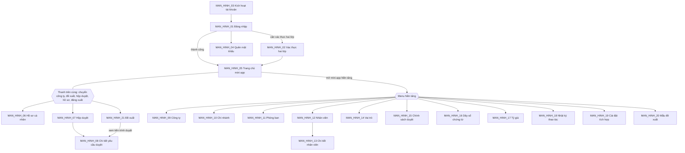

# 14. ĐẶC TẢ GIAO DIỆN

- Mô tả: Danh sách màn hình, sơ đồ điều hướng, bảng vai trò – màn hình, đặc tả từng màn hình.
- Phiên bản: 1.2
- Ngày cập nhật: 2026-11-09
- Trạng thái: Đã phê duyệt 2026-11-09 (bước 06.1, 06.2, 06.4; gồm THAY_DOI_01)
- Cập nhật giai đoạn 07: bổ sung mã API cho từng màn hình
- Cập nhật CONG_VIEC_03 (2026-11-09): thêm MAN_HINH_19, MAN_HINH_20, MAN_HINH_21; mở rộng MAN_HINH_01, MAN_HINH_06, MAN_HINH_08 (THAY_DOI_04, THAY_DOI_08)

## MODULE_01 Nền tảng

## 1. Danh sách màn hình và điều hướng

| Mã | Tên màn hình | Chức năng (10) | Vai trò được truy cập (08) | Mở từ | Bản mẫu |
|---|---|---|---|---|---|
| MAN_HINH_01 | Đăng nhập | CHUC_NANG_06, CHUC_NANG_07, CHUC_NANG_08, CHUC_NANG_22, CHUC_NANG_24 | Mọi người | Địa chỉ trang web; đăng xuất | Chưa có |
| MAN_HINH_02 | Xác thực hai lớp (nhập mã, đăng ký lần đầu) | CHUC_NANG_09 | Mọi người | MAN_HINH_01 | Chưa có |
| MAN_HINH_03 | Kích hoạt tài khoản | CHUC_NANG_04 | Nhân viên được mời | Đường dẫn trong email, SMS | Chưa có |
| MAN_HINH_04 | Quên mật khẩu, đặt lại mật khẩu | CHUC_NANG_06 | Mọi người | MAN_HINH_01; đường dẫn trong email, SMS | Chưa có |
| MAN_HINH_05 | Trang chủ mini app | CHUC_NANG_14, CHUC_NANG_11 | Mọi nhân viên | Sau đăng nhập; biểu tượng trang chủ ở thanh trên cùng | Chưa có |
| MAN_HINH_06 | Hồ sơ cá nhân | CHUC_NANG_10, CHUC_NANG_09, CHUC_NANG_22, CHUC_NANG_24 | Mọi nhân viên | Thanh trên cùng | Chưa có |
| MAN_HINH_07 | Hộp duyệt | CHUC_NANG_17, CHUC_NANG_16 | Mọi nhân viên | Thanh trên cùng; MAN_HINH_05 | Chưa có |
| MAN_HINH_08 | Chi tiết yêu cầu duyệt | CHUC_NANG_16, CHUC_NANG_28, CHUC_NANG_29 | Người lập, người duyệt | MAN_HINH_07; mini app sở hữu chứng từ; MAN_HINH_21 | Chưa có |
| MAN_HINH_09 | Công ty | CHUC_NANG_01 | Quản trị tập đoàn | Menu Nền tảng | Chưa có |
| MAN_HINH_10 | Chi nhánh | CHUC_NANG_02 | Quản trị tập đoàn, quản trị công ty | Menu Nền tảng | Chưa có |
| MAN_HINH_11 | Phòng ban | CHUC_NANG_03 | Quản trị tập đoàn, quản trị công ty | Menu Nền tảng | Chưa có |
| MAN_HINH_12 | Danh sách nhân viên (kèm hộp thoại mời, nhập Excel) | CHUC_NANG_04, CHUC_NANG_05, CHUC_NANG_19 | Quản trị tập đoàn, quản trị công ty | Menu Nền tảng | Chưa có |
| MAN_HINH_13 | Chi tiết nhân viên (công ty, vai trò, phiên, khóa, vô hiệu hóa) | CHUC_NANG_13, CHUC_NANG_19, CHUC_NANG_09 | Quản trị tập đoàn, quản trị công ty | MAN_HINH_12 | Chưa có |
| MAN_HINH_14 | Vai trò và ma trận quyền | CHUC_NANG_12 | Quản trị tập đoàn, quản trị công ty | Menu Nền tảng | Chưa có |
| MAN_HINH_15 | Chính sách duyệt | CHUC_NANG_15 | Quản trị tập đoàn, quản trị công ty | Menu Nền tảng | Chưa có |
| MAN_HINH_16 | Dãy số chứng từ | CHUC_NANG_20 | Quản trị tập đoàn, quản trị công ty | Menu Nền tảng | Chưa có |
| MAN_HINH_17 | Tiền tệ và tỷ giá | CHUC_NANG_21 | Mọi nhân viên (xem); quản trị tập đoàn, quản lý tỷ giá (sửa) | Menu Nền tảng | Chưa có |
| MAN_HINH_18 | Nhật ký thao tác | CHUC_NANG_23 | Quản trị tập đoàn, quản trị công ty | Menu Nền tảng; nút "Lịch sử" ở MAN_HINH_09 đến MAN_HINH_16 | Chưa có |
| MAN_HINH_19 | Cài đặt tích hợp | CHUC_NANG_25, CHUC_NANG_26 | Quản trị tập đoàn | Menu Nền tảng | Không lập (CONG_VIEC_03 mục 6) |
| MAN_HINH_20 | Mẫu đề xuất | CHUC_NANG_27 | Quản trị tập đoàn, quản trị công ty | Menu Nền tảng | Không lập (CONG_VIEC_03 mục 6) |
| MAN_HINH_21 | Đề xuất (danh sách, lập, sửa nháp, chi tiết) | CHUC_NANG_28, CHUC_NANG_29 | Mọi nhân viên | Thanh trên cùng ("Đề xuất") | Không lập (CONG_VIEC_03 mục 6) |

CHUC_NANG_18 (nhắc, chuyển duyệt quá hạn) chạy nền, không có màn hình; kết quả hiện ở MAN_HINH_07 (đánh dấu quá hạn) và thông báo.

CHUC_NANG_26 (thông báo Zalo ZNS) chạy nền, không có màn hình riêng; cài mẫu tin và xem tin gửi gần đây ở MAN_HINH_19.

Sơ đồ điều hướng:

- Màn hình mở đầu của mọi vai trò: MAN_HINH_05.
- Menu Nền tảng chỉ hiện mục mà nhân viên có quyền; nhân viên thường chỉ thấy mục "Tỷ giá".
- Thanh trên cùng giống nhau ở mọi mini app.

## 2. Bảng vai trò – màn hình

| Màn hình | Quản trị tập đoàn | Quản trị công ty | Quản lý tỷ giá | Nhân viên |
|---|---|---|---|---|
| MAN_HINH_01 đến MAN_HINH_04 | Dùng | Dùng | Dùng | Dùng |
| MAN_HINH_05 Trang chủ | Xem | Xem | Xem | Xem |
| MAN_HINH_06 Hồ sơ cá nhân | Xem, Sửa (của mình) | Xem, Sửa (của mình) | Xem, Sửa (của mình) | Xem, Sửa (của mình) |
| MAN_HINH_07, MAN_HINH_08 Duyệt | Xem, Duyệt khi được chỉ định | Xem, Duyệt khi được chỉ định | Xem, Duyệt khi được chỉ định | Xem, Duyệt khi được chỉ định |
| MAN_HINH_09 Công ty | Xem, Thêm, Sửa, Ngừng | Không thấy | Không thấy | Không thấy |
| MAN_HINH_10 Chi nhánh | Xem, Thêm, Sửa, Ngừng | Trong công ty mình | Không thấy | Không thấy |
| MAN_HINH_11 Phòng ban | Xem, Thêm, Sửa, Ngừng | Trong công ty mình | Không thấy | Không thấy |
| MAN_HINH_12 Nhân viên | Xem, Mời, Nhập Excel | Trong công ty mình | Không thấy | Không thấy |
| MAN_HINH_13 Chi tiết nhân viên | Gán mọi phạm vi, Khóa, Vô hiệu hóa, Đặt lại xác thực hai lớp | Trong công ty mình, trừ chính mình | Không thấy | Không thấy |
| MAN_HINH_14 Vai trò | Xem, Thêm, Sửa (cả vai trò dùng chung) | Vai trò riêng công ty mình | Không thấy | Không thấy |
| MAN_HINH_15 Chính sách duyệt | Xem, Thêm, Sửa | Trong công ty mình | Không thấy | Không thấy |
| MAN_HINH_16 Dãy số chứng từ | Xem, Thêm, Sửa | Trong công ty mình | Không thấy | Không thấy |
| MAN_HINH_17 Tỷ giá | Xem, Thêm, Sửa | Xem | Xem, Thêm, Sửa | Xem |
| MAN_HINH_18 Nhật ký thao tác | Toàn tập đoàn | Trong công ty mình | Không thấy | Không thấy |
| MAN_HINH_19 Cài đặt tích hợp | Xem, Sửa | Không thấy | Không thấy | Không thấy |
| MAN_HINH_20 Mẫu đề xuất | Xem, Thêm, Sửa | Trong công ty mình | Không thấy | Không thấy |
| MAN_HINH_21 Đề xuất | Lập, xem đề xuất của mình; xem toàn công ty | Lập, xem đề xuất của mình; xem toàn công ty mình | Lập, xem đề xuất của mình | Lập, xem đề xuất của mình |

## 3. Đặc tả từng màn hình

Quy ước chung cho mọi màn hình sau đăng nhập:
- Bố cục: thanh trên cùng (logo, nút trang chủ, chọn công ty, hộp duyệt kèm số chờ, thông báo, ảnh đại diện mở hồ sơ cá nhân và đăng xuất); menu bên trái của mini app; vùng nội dung bên phải.
- Màn hình danh sách: tiêu đề, nút thao tác chính góc phải, ô tìm kiếm và bộ lọc, bảng có phân trang 20 dòng, nút "Lịch sử" mở MAN_HINH_18 lọc theo đối tượng.
- Thêm, sửa bằng ngăn kéo bên phải (màn hình rộng) hoặc trang riêng (điện thoại); lỗi kiểm tra dữ liệu hiện ngay dưới ô nhập.
- Trạng thái: đang tải = khung xám nhấp nháy theo bố cục; rỗng = hình minh họa, câu giải thích, nút thao tác chính; lỗi = thông báo kèm nút "Thử lại"; không có quyền = câu "Bạn không có quyền xem trang này" và nút về trang chủ.
- Thông báo thành công, thất bại hiện góc trên phải, tự ẩn sau 5 giây; thao tác ngừng hoạt động, khóa, vô hiệu hóa, thu hồi phiên có hộp thoại xác nhận.
- Điện thoại (dưới 768 điểm ảnh): menu trái thu thành nút mở; bảng chuyển thành danh sách thẻ.
- API: mã trong tài liệu `17`, ghi ở từng màn hình.
- Bản khung thang xám: `tai_lieu/ban_mau/KHUNG_GIAO_DIEN_MODULE_01.html`.

### MAN_HINH_01: Đăng nhập
- Mục đích: Vào hệ thống.
- Chức năng thực hiện: CHUC_NANG_06, CHUC_NANG_07, CHUC_NANG_08, CHUC_NANG_22, CHUC_NANG_24
- Bố cục: một cột giữa màn hình: logo; chọn ngôn ngữ; thẻ "Mật khẩu" và "Số điện thoại"; ô nhập; nút "Đăng nhập"; liên kết "Quên mật khẩu"; dải phân cách "hoặc"; ba nút Google, Microsoft, Zalo.
- Dữ liệu hiển thị: Không có.
- Thành phần: ONhap, Nut, NutDangNhapLienKet, KhoiCanhBao (tài liệu `15`).
- API: API_01, API_02, API_03, API_04, API_05 (tài liệu `17`).
- Thao tác: nhập, bấm Đăng nhập → MAN_HINH_02 nếu cần xác thực hai lớp, ngược lại MAN_HINH_05; thẻ Số điện thoại: nhập số → "Gửi mã" → ô nhập mã 6 chữ số; nút "Gửi lại mã" khóa 60 giây sau mỗi lần gửi, hiện "Gửi lại mã sau N giây".
- Trạng thái: đang xử lý (nút khóa, vòng quay); lỗi (thông báo trên ô nhập); bị khóa 15 phút (thông báo kèm thời gian còn lại).
- Thông báo: theo CHUC_NANG_06, CHUC_NANG_07, CHUC_NANG_08, CHUC_NANG_24.
- Quyền hiển thị: Không áp dụng.
- Responsive: thẻ chiếm toàn chiều ngang trên điện thoại.
- Trạng thái phê duyệt: Đã phê duyệt 2026-11-09

### MAN_HINH_02: Xác thực hai lớp
- Mục đích: Nhập mã xác thực hoặc đăng ký lần đầu.
- Chức năng thực hiện: CHUC_NANG_09
- Bố cục: một cột giữa: tiêu đề; nhập mã 6 chữ số; liên kết "Dùng mã dự phòng"; khi đăng ký lần đầu: mã QR, mã nhập tay, ô xác nhận, danh sách 10 mã dự phòng kèm nút tải về.
- Dữ liệu hiển thị: cách xác thực đã đăng ký (ứng dụng, SMS, email; che bớt số điện thoại, email).
- Thành phần: ONhap (mã OTP), Nut, KhoiCanhBao (tài liệu `15`).
- API: API_06, API_07, API_08 (tài liệu `17`).
- Thao tác: nhập mã → MAN_HINH_05.
- Trạng thái: đang xử lý; lỗi mã sai.
- Thông báo: "Mã xác thực không đúng."
- Quyền hiển thị: Không áp dụng.
- Responsive: như MAN_HINH_01.
- Trạng thái phê duyệt: Đã phê duyệt 2026-11-09

### MAN_HINH_03: Kích hoạt tài khoản
- Mục đích: Nhân viên được mời đặt mật khẩu lần đầu.
- Chức năng thực hiện: CHUC_NANG_04
- Bố cục: một cột giữa: lời chào kèm họ tên, tên công ty; ô mật khẩu, nhập lại mật khẩu, chỉ báo độ mạnh; nút "Kích hoạt"; hoặc nút Google, Microsoft.
- Dữ liệu hiển thị: họ tên, công ty mời.
- Thành phần: ONhap (mật khẩu), Nut, NutDangNhapLienKet, KhoiCanhBao (tài liệu `15`).
- API: API_11, API_04, API_05 (tài liệu `17`).
- Thao tác: kích hoạt → MAN_HINH_01 kèm thông báo thành công.
- Trạng thái: đường dẫn hết hạn hoặc đã dùng (thông báo, hướng dẫn liên hệ quản trị).
- Thông báo: theo CHUC_NANG_04.
- Quyền hiển thị: Không áp dụng.
- Responsive: như MAN_HINH_01.
- Trạng thái phê duyệt: Đã phê duyệt 2026-11-09

### MAN_HINH_04: Quên mật khẩu, đặt lại mật khẩu
- Mục đích: Lấy lại quyền truy cập.
- Chức năng thực hiện: CHUC_NANG_06
- Bố cục: bước 1: ô email hoặc số điện thoại, nút "Gửi đường dẫn"; bước 2 (mở từ đường dẫn): ô mật khẩu mới, nhập lại, nút "Đặt lại".
- Dữ liệu hiển thị: Không có.
- Thành phần: ONhap, Nut, KhoiCanhBao (tài liệu `15`).
- API: API_12, API_13 (tài liệu `17`).
- Thao tác: gửi → thông báo chung "Nếu tài khoản tồn tại, bạn sẽ nhận được đường dẫn"; đặt lại → MAN_HINH_01.
- Trạng thái: đường dẫn hết hạn.
- Thông báo: theo CHUC_NANG_06.
- Quyền hiển thị: Không áp dụng.
- Responsive: như MAN_HINH_01.
- Trạng thái phê duyệt: Đã phê duyệt 2026-11-09

### MAN_HINH_05: Trang chủ mini app
- Mục đích: Điểm vào mọi mini app.
- Chức năng thực hiện: CHUC_NANG_14, CHUC_NANG_11
- Bố cục: thanh trên cùng; lời chào; lưới ô mini app (biểu tượng, tên, số việc chờ); khối "Chờ tôi duyệt" tóm tắt 5 yêu cầu mới nhất.
- Dữ liệu hiển thị: mini app được dùng trong công ty đang chọn; số việc chờ; yêu cầu duyệt.
- Thành phần: ThanhTrenCung, OMiniApp, BangDuLieu, TrangThaiRong (tài liệu `15`).
- API: API_14, API_19, API_48 (tài liệu `17`).
- Thao tác: bấm ô → mở mini app; chọn công ty ở thanh trên → tải lại trang chủ theo công ty mới.
- Trạng thái: rỗng (chưa được cấp mini app nào, theo CHUC_NANG_14).
- Thông báo: Không có.
- Quyền hiển thị: ô mini app theo quyền `<app>.access`.
- Responsive: lưới 4 cột (rộng), 2 cột (điện thoại).
- Trạng thái phê duyệt: Đã phê duyệt 2026-11-09

### MAN_HINH_06: Hồ sơ cá nhân
- Mục đích: Tự quản lý tài khoản.
- Chức năng thực hiện: CHUC_NANG_10, CHUC_NANG_09, CHUC_NANG_22, CHUC_NANG_24
- Bố cục: các thẻ: "Thông tin" (họ tên, email, số điện thoại, công ty, ngôn ngữ); "Đăng nhập" (đổi mật khẩu; liên kết, hủy liên kết Google, Microsoft, Zalo); "Xác thực hai lớp" (bật, tắt, tạo lại mã dự phòng); "Phiên đăng nhập" (bảng thiết bị, địa chỉ IP, thời điểm, nút thu hồi).
- Dữ liệu hiển thị: như trên.
- Thành phần: ThanhTrenCung, ONhap, OChon, Nut, NutDangNhapLienKet, BangDuLieu, HopThoaiXacNhan, ThongBaoNoi (tài liệu `15`).
- API: API_04, API_05, API_07, API_08, API_15, API_16, API_17, API_18 (tài liệu `17`).
- Thao tác: lưu từng thẻ; thu hồi phiên có xác nhận.
- Trạng thái: nút tắt xác thực hai lớp bị vô hiệu kèm giải thích khi đang bắt buộc.
- Thông báo: theo CHUC_NANG_10, CHUC_NANG_24.
- Quyền hiển thị: chỉ của chính mình.
- Responsive: thẻ chuyển thành danh sách xổ xuống.
- Trạng thái phê duyệt: Đã phê duyệt 2026-11-09

### MAN_HINH_07: Hộp duyệt
- Mục đích: Xem, duyệt chứng từ đang chờ mình.
- Chức năng thực hiện: CHUC_NANG_17, CHUC_NANG_16
- Bố cục: tiêu đề kèm số chờ; bộ lọc công ty, mini app, loại chứng từ, chỉ quá hạn; danh sách: số chứng từ, loại, công ty, người lập, giá trị, cấp hiện tại, thời điểm gửi, nhãn "Quá hạn"; nút Đồng ý, Từ chối trên mỗi dòng.
- Dữ liệu hiển thị: yêu cầu đang chờ nhân viên ở mọi công ty.
- Thành phần: ThanhTrenCung, BoLoc, BangDuLieu, NhanTrangThai, Nut, HopThoaiXacNhan, TrangThaiRong, ThongBaoNoi (tài liệu `15`).
- API: API_39, API_41 (tài liệu `17`).
- Thao tác: bấm dòng → MAN_HINH_08; Từ chối → hộp thoại bắt buộc nhập lý do.
- Trạng thái: rỗng ("Không có chứng từ nào chờ bạn duyệt").
- Thông báo: duyệt thành công, thất bại.
- Quyền hiển thị: Không áp dụng.
- Responsive: thẻ chứng từ, nút Đồng ý, Từ chối cố định cuối thẻ.
- Trạng thái phê duyệt: Đã phê duyệt 2026-11-09

### MAN_HINH_08: Chi tiết yêu cầu duyệt
- Mục đích: Xem đầy đủ một yêu cầu và quyết định.
- Chức năng thực hiện: CHUC_NANG_16
- Bố cục: đầu trang: số chứng từ, trạng thái, giá trị (kèm quy đổi nếu ngoại tệ); dòng thời gian các cấp (người duyệt, người thay thế, quyết định, ý kiến, thời điểm); liên kết "Mở chứng từ" sang mini app sở hữu; nút Đồng ý, Từ chối (người duyệt cấp hiện tại); nút Rút lại (người lập, khi cấp 1 chưa quyết định).
- Dữ liệu hiển thị: yêu cầu duyệt và các bước.
- Thành phần: ThanhTrenCung, NhanTrangThai, DongThoiGian, Nut, HopThoaiXacNhan, ThongBaoNoi (tài liệu `15`).
- API: API_40, API_41, API_42 (tài liệu `17`).
- Thao tác: như trên.
- Trạng thái: không có quyền (không phải người lập hoặc người duyệt).
- Thông báo: theo CHUC_NANG_16.
- Quyền hiển thị: nút theo vai trò trong yêu cầu.
- Responsive: dòng thời gian dọc.
- Trạng thái phê duyệt: Đã phê duyệt 2026-11-09

### MAN_HINH_09: Công ty
- Mục đích: Quản lý cây công ty.
- Chức năng thực hiện: CHUC_NANG_01
- Bố cục: cây công ty bên trái; chi tiết công ty được chọn bên phải; nút "Thêm công ty".
- Dữ liệu hiển thị: mã, tên, mã số thuế, tiền tệ, chế độ kế toán, trạng thái, số chi nhánh.
- Thành phần: ThanhTrenCung, MenuMiniApp, CayDuLieu, NganKeo, Nut, HopThoaiXacNhan (tài liệu `15`).
- API: API_20, API_21 (tài liệu `17`).
- Thao tác: thêm, sửa, ngừng hoạt động (xác nhận).
- Trạng thái: chung.
- Thông báo: theo CHUC_NANG_01.
- Quyền hiển thị: chỉ quản trị tập đoàn.
- Responsive: cây và chi tiết xếp dọc.
- Trạng thái phê duyệt: Đã phê duyệt 2026-11-09

### MAN_HINH_10: Chi nhánh
- Mục đích: Quản lý chi nhánh.
- Chức năng thực hiện: CHUC_NANG_02
- Bố cục: danh sách chung; lọc loại, tỉnh thành, trạng thái.
- Dữ liệu hiển thị: mã, tên, loại, tỉnh thành, địa chỉ, trạng thái.
- Thành phần: ThanhTrenCung, MenuMiniApp, BoLoc, BangDuLieu, NhanTrangThai, NganKeo, HopThoaiXacNhan (tài liệu `15`).
- API: API_22 (tài liệu `17`).
- Thao tác: thêm, sửa, ngừng hoạt động.
- Trạng thái: chung.
- Thông báo: theo CHUC_NANG_02.
- Quyền hiển thị: theo bảng vai trò – màn hình.
- Responsive: chung.
- Trạng thái phê duyệt: Đã phê duyệt 2026-11-09

### MAN_HINH_11: Phòng ban
- Mục đích: Quản lý cây phòng ban.
- Chức năng thực hiện: CHUC_NANG_03
- Bố cục: như MAN_HINH_09 (cây bên trái, chi tiết bên phải).
- Dữ liệu hiển thị: mã, tên, phòng ban cha, trưởng phòng, số nhân viên.
- Thành phần: ThanhTrenCung, MenuMiniApp, CayDuLieu, NganKeo, OChon, HopThoaiXacNhan (tài liệu `15`).
- API: API_23 (tài liệu `17`).
- Thao tác: thêm, sửa, ngừng hoạt động.
- Trạng thái: chung.
- Thông báo: theo CHUC_NANG_03.
- Quyền hiển thị: theo bảng vai trò – màn hình.
- Responsive: như MAN_HINH_09.
- Trạng thái phê duyệt: Đã phê duyệt 2026-11-09

### MAN_HINH_12: Danh sách nhân viên
- Mục đích: Tìm, mời, nhập nhân viên.
- Chức năng thực hiện: CHUC_NANG_04, CHUC_NANG_05, CHUC_NANG_19
- Bố cục: danh sách chung; nút "Mời nhân viên" (ngăn kéo), "Nhập từ Excel" (hộp thoại: tải mẫu, chọn tệp, kết quả số dòng thành công, lỗi, tải tệp dòng lỗi); lọc chi nhánh, phòng ban, vai trò, trạng thái.
- Dữ liệu hiển thị: họ tên, email, số điện thoại, chi nhánh, phòng ban, vai trò, trạng thái, lần đăng nhập cuối.
- Thành phần: ThanhTrenCung, MenuMiniApp, BoLoc, BangDuLieu, NhanTrangThai, NganKeo, HopThoaiXacNhan (tài liệu `15`).
- API: API_24, API_25, API_26, API_27, API_28 (tài liệu `17`).
- Thao tác: bấm dòng → MAN_HINH_13; gửi lại đường dẫn kích hoạt với dòng "Đã mời".
- Trạng thái: chung.
- Thông báo: theo CHUC_NANG_04, CHUC_NANG_05.
- Quyền hiển thị: theo bảng vai trò – màn hình.
- Responsive: chung.
- Trạng thái phê duyệt: Đã phê duyệt 2026-11-09

### MAN_HINH_13: Chi tiết nhân viên
- Mục đích: Gán vai trò, khóa, vô hiệu hóa.
- Chức năng thực hiện: CHUC_NANG_13, CHUC_NANG_19, CHUC_NANG_09
- Bố cục: đầu trang: họ tên, trạng thái, nút Khóa, Mở khóa, Vô hiệu hóa, Đặt lại xác thực hai lớp; thẻ "Công ty" (các công ty thuộc về, chi nhánh, phòng ban, chức danh); thẻ "Vai trò" (bảng vai trò, phạm vi, ngày bắt đầu, ngày kết thúc; nút Gán vai trò, Gỡ); thẻ "Phiên đăng nhập" (thu hồi).
- Dữ liệu hiển thị: như trên.
- Thành phần: ThanhTrenCung, MenuMiniApp, NhanTrangThai, BangDuLieu, OChon, Nut, HopThoaiXacNhan (tài liệu `15`).
- API: API_29, API_30, API_31, API_32, API_33, API_34 (tài liệu `17`).
- Thao tác: Vô hiệu hóa → hộp thoại bàn giao: danh sách chứng từ chờ duyệt và phòng ban đang làm trưởng phòng, chọn người nhận cho từng mục, xác nhận.
- Trạng thái: chung.
- Thông báo: theo CHUC_NANG_13, CHUC_NANG_19.
- Quyền hiển thị: nút ẩn khi xem chính mình; phạm vi gán chỉ hiện phạm vi được phép.
- Responsive: thẻ xếp dọc.
- Trạng thái phê duyệt: Đã phê duyệt 2026-11-09

### MAN_HINH_14: Vai trò và ma trận quyền
- Mục đích: Quản lý vai trò.
- Chức năng thực hiện: CHUC_NANG_12
- Bố cục: danh sách vai trò bên trái (nhãn "Hệ thống", "Dùng chung", "Riêng công ty"); bên phải: thông tin vai trò và ma trận quyền nhóm theo mini app (dòng là đối tượng, cột là hành động, ô đánh dấu); quyền nhạy cảm có nhãn.
- Dữ liệu hiển thị: vai trò, quyền, số người đang có vai trò.
- Thành phần: ThanhTrenCung, MenuMiniApp, MaTranQuyen, NhanTrangThai, NganKeo (tài liệu `15`).
- API: API_35, API_36 (tài liệu `17`).
- Thao tác: thêm, sửa, ngừng dùng; lưu ma trận.
- Trạng thái: ô quyền người dùng không có bị vô hiệu.
- Thông báo: theo CHUC_NANG_12.
- Quyền hiển thị: vai trò hệ thống chỉ xem.
- Responsive: ma trận cuộn ngang trong khung riêng.
- Trạng thái phê duyệt: Đã phê duyệt 2026-11-09

### MAN_HINH_15: Chính sách duyệt
- Mục đích: Cấu hình cấp duyệt theo hạn mức.
- Chức năng thực hiện: CHUC_NANG_15
- Bố cục: danh sách loại chứng từ kèm chính sách đang hiệu lực; chi tiết: tiền tệ, ngày hiệu lực; bảng cấp duyệt (thứ tự, ngưỡng, người duyệt, người thay thế, thời hạn giờ); lịch sử chính sách.
- Dữ liệu hiển thị: như trên.
- Thành phần: ThanhTrenCung, MenuMiniApp, BangDuLieu, OChon, ONhap, NganKeo (tài liệu `15`).
- API: API_37 (tài liệu `17`).
- Thao tác: tạo chính sách mới từ ngày chọn; thêm, bớt cấp.
- Trạng thái: chung.
- Thông báo: theo CHUC_NANG_15.
- Quyền hiển thị: theo bảng vai trò – màn hình.
- Responsive: bảng cấp duyệt thành thẻ.
- Trạng thái phê duyệt: Đã phê duyệt 2026-11-09

### MAN_HINH_16: Dãy số chứng từ
- Mục đích: Cấu hình đánh số.
- Chức năng thực hiện: CHUC_NANG_20
- Bố cục: danh sách chung: loại chứng từ, tiền tố, kiểu đặt lại, số chữ số, số tiếp theo kỳ hiện tại, ví dụ số kế tiếp.
- Dữ liệu hiển thị: như trên.
- Thành phần: ThanhTrenCung, MenuMiniApp, BangDuLieu, NganKeo (tài liệu `15`).
- API: API_43 (tài liệu `17`).
- Thao tác: sửa (ngăn kéo).
- Trạng thái: chung.
- Thông báo: theo CHUC_NANG_20.
- Quyền hiển thị: theo bảng vai trò – màn hình.
- Responsive: chung.
- Trạng thái phê duyệt: Đã phê duyệt 2026-11-09

### MAN_HINH_17: Tiền tệ và tỷ giá
- Mục đích: Xem, nhập tỷ giá.
- Chức năng thực hiện: CHUC_NANG_21
- Bố cục: chọn ngày; bảng tỷ giá theo cặp tiền tệ, loại, nguồn; nút "Nhập tỷ giá"; nhãn cảnh báo khi hôm nay chưa có tỷ giá hạch toán.
- Dữ liệu hiển thị: như trên.
- Thành phần: ThanhTrenCung, MenuMiniApp, KhoiCanhBao, BangDuLieu, NganKeo (tài liệu `15`).
- API: API_45, API_46 (tài liệu `17`).
- Thao tác: nhập, sửa (quản lý tỷ giá).
- Trạng thái: chung.
- Thông báo: theo CHUC_NANG_21.
- Quyền hiển thị: nút nhập, sửa chỉ với quản trị tập đoàn, quản lý tỷ giá.
- Responsive: chung.
- Trạng thái phê duyệt: Đã phê duyệt 2026-11-09

### MAN_HINH_18: Nhật ký thao tác
- Mục đích: Tra cứu ai làm gì.
- Chức năng thực hiện: CHUC_NANG_23
- Bố cục: bộ lọc người làm, mini app, đối tượng, hành động, khoảng thời gian; bảng: thời điểm, người làm, công ty, hành động, đối tượng; bấm dòng mở ngăn kéo so sánh dữ liệu trước và sau.
- Dữ liệu hiển thị: như trên.
- Thành phần: ThanhTrenCung, MenuMiniApp, BoLoc, BangDuLieu, NganKeo (tài liệu `15`).
- API: API_47 (tài liệu `17`).
- Thao tác: lọc, xem chi tiết. Không có sửa, xóa.
- Trạng thái: chung.
- Thông báo: Không có.
- Quyền hiển thị: theo bảng vai trò – màn hình.
- Responsive: chung.
- Trạng thái phê duyệt: Đã phê duyệt 2026-11-09

### MAN_HINH_19: Cài đặt tích hợp
- Mục đích: Nhập mã ứng dụng đăng nhập và khóa nhà cung cấp gửi tin, có hiệu lực ngay.
- Chức năng thực hiện: CHUC_NANG_25, CHUC_NANG_26
- Đường dẫn: `/platform/integrations`
- Bố cục: tiêu đề kèm nút "Lịch sử"; câu giải thích; bốn thẻ nhóm: "Google", "Microsoft", "Zalo (đăng nhập)" (mỗi thẻ có đường dẫn chuyển hướng cần khai báo ở nhà cung cấp), "eSMS.vn (SMS, Zalo ZNS)" (API key, Secret key, Brandname SMS, mã Zalo OA, chế độ thử, mã mẫu ZNS cho mã OTP đăng nhập, có chứng từ chờ duyệt, nhắc quá hạn, kết quả duyệt; gợi ý tham số mẫu tin; nút "Kiểm tra kết nối eSMS" và khối kết quả liệt kê Zalo OA); nút "Lưu"; thẻ "Tin gửi gần đây" (thời điểm, kênh, mục đích, số điện thoại đã che, trạng thái, lỗi).
- Dữ liệu hiển thị: giá trị thường; khóa bí mật chỉ hiện "Đã lưu ••••<4 ký tự cuối>. Để trống để giữ." hoặc "Chưa nhập"; 50 tin gửi gần nhất.
- Thành phần: ThanhTrenCung, MenuMiniApp, ONhap (kiểu mật khẩu cho khóa bí mật), OChon (chế độ thử), Nut, KhoiCanhBao, BangDuLieu, NhanTrangThai, ThongBaoNoi (tài liệu `15`).
- API: API_49 (tài liệu `17`).
- Thao tác: nhập, "Lưu"; khóa bí mật đã lưu có nút "Xóa khóa" (bấm lại để hủy, xóa khi lưu); "Kiểm tra kết nối eSMS" dùng khóa đã lưu; "Gửi thử tin": nhập số điện thoại, gửi một tin theo mẫu mã OTP đã đăng ký (Zalo trước, SMS sau, có tính phí), kết quả hiện ngay và ghi vào nhật ký gửi tin.
- Trạng thái: chung; kiểm tra kết nối thành công (khối thông tin) hoặc thất bại (khối lỗi kèm lỗi nhà cung cấp).
- Thông báo: "Đã lưu cài đặt tích hợp."; theo CHUC_NANG_25.
- Quyền hiển thị: mục menu và màn hình chỉ với quyền `platform.integration.manage`; API kiểm tra quyền phạm vi tập đoàn.
- Responsive: chung; bảng tin gửi chuyển thành thẻ.
- Trạng thái phê duyệt: Chưa phê duyệt (người dùng bỏ dừng chờ ở điểm xem trước, CONG_VIEC_03 mục 14)

### MAN_HINH_20: Mẫu đề xuất
- Mục đích: Tạo, sửa mẫu đề xuất của công ty.
- Chức năng thực hiện: CHUC_NANG_27
- Đường dẫn: `/platform/proposal-templates`
- Bố cục: tiêu đề kèm nút "Lịch sử", "Thêm 3 mẫu có sẵn", "Thêm mẫu"; câu giải thích; bảng: mã mẫu, tên mẫu, số trường, tiền tệ, trạng thái, nhãn chính sách duyệt, nút "Sửa". Ngăn kéo tạo, sửa: mã mẫu (chỉ khi tạo), tên, tên tiếng Anh, mô tả, tiền tệ, trạng thái (khi sửa), giá trị duyệt (chọn trường tiền hoặc "Tổng thành tiền bảng chi tiết"), danh sách trường (mã, nhãn, kiểu, bắt buộc; lựa chọn mỗi dòng một lựa chọn; cột của bảng mỗi dòng `mã|nhãn|kiểu`), nút "Thêm trường", "Xóa trường".
- Dữ liệu hiển thị: mẫu đang dùng và ngừng dùng của công ty đang chọn.
- Thành phần: ThanhTrenCung, MenuMiniApp, BangDuLieu, NhanTrangThai, NganKeo, ONhap, OChon, Nut, ThongBaoNoi (tài liệu `15`).
- API: API_50 (tài liệu `17`).
- Thao tác: thêm, sửa mẫu; thêm 3 mẫu có sẵn (Phiếu đề nghị chi, Đề nghị tạm ứng, Đề nghị mua sắm).
- Trạng thái: rỗng ("Công ty chưa có mẫu đề xuất."); nhãn "Chưa có chính sách duyệt" khi loại chứng từ của mẫu chưa có chính sách ở MAN_HINH_15.
- Thông báo: "Đã lưu mẫu đề xuất."; theo CHUC_NANG_27.
- Quyền hiển thị: quyền `platform.proposal_template.manage`.
- Responsive: chung.
- Trạng thái phê duyệt: Chưa phê duyệt (người dùng bỏ dừng chờ ở điểm xem trước, CONG_VIEC_03 mục 14)

### MAN_HINH_21: Đề xuất
- Mục đích: Lập, gửi, theo dõi đề xuất; tải PDF.
- Chức năng thực hiện: CHUC_NANG_28, CHUC_NANG_29
- Đường dẫn: `/de-xuat` (danh sách); `/de-xuat/moi?mau=<id của mẫu>` (lập mới); `/de-xuat/{id}` (sửa nháp hoặc xem chi tiết).
- Bố cục:
  - Danh sách: tiêu đề, nút "Lập đề xuất"; thẻ "Đề xuất của tôi", "Toàn công ty" (chỉ người quản lý mẫu); lọc trạng thái; bảng số (nháp hiện "Nháp"), tiêu đề, mẫu, giá trị, trạng thái, người đề xuất, ngày lập; phân trang 20 dòng. "Lập đề xuất" mở ngăn kéo "Chọn mẫu đề xuất" (thẻ mẫu kèm mô tả, nhãn "Loại đề xuất này chưa có chính sách duyệt nên chưa gửi được.").
  - Lập mới, sửa nháp: tiêu đề; các trường theo mẫu (bảng chi tiết có "Thêm dòng", "Xóa dòng", "Tổng thành tiền"); nút "Lưu nháp", "Gửi duyệt" (hộp thoại xác nhận "Sau khi gửi, đề xuất nhận số và không sửa được nữa."); khối tệp đính kèm (sau khi lưu nháp).
  - Chi tiết: đầu trang số đề xuất (hoặc tên mẫu khi nháp) và nhãn trạng thái; nút "Xem tiến trình duyệt" (mở MAN_HINH_08), "Tải PDF", "Rút đề xuất" (khi rút được), "Xóa nháp" (khi Nháp); người đề xuất, ngày lập, tên mẫu; nội dung các trường và bảng chi tiết; khối tệp đính kèm (tải về; thêm, xóa khi Nháp; gợi ý "PDF, JPG, PNG, XLSX, DOCX; tối đa 10 tệp, mỗi tệp 10 MB.").
- Dữ liệu hiển thị: đề xuất theo bản chụp mẫu lúc lập; giá trị tiền định dạng Việt Nam (dấu chấm hàng nghìn, dấu phẩy thập phân).
- Thành phần: ThanhTrenCung, BoLoc, BangDuLieu, NhanTrangThai, NganKeo, ONhap, OChon, Nut, HopThoaiXacNhan, KhoiCanhBao, TrangThaiRong (tài liệu `15`).
- API: API_50 (đọc mẫu), API_51, API_52, API_53 (tài liệu `17`).
- Thao tác: như bố cục; lưu nháp lần đầu chuyển sang `/de-xuat/{id}`.
- Trạng thái: rỗng ("Chưa có đề xuất."); công ty chưa có mẫu ("Công ty chưa có mẫu đề xuất. Liên hệ quản trị công ty."); mẫu chưa có chính sách duyệt (khối cảnh báo, nút "Gửi duyệt" bị vô hiệu); không xem được đề xuất (thông báo "Không tìm thấy dữ liệu hoặc bạn không có quyền xem.").
- Thông báo: "Đã lưu nháp." · "Đã gửi đề xuất đi duyệt." · "Đã rút đề xuất."; lỗi theo CHUC_NANG_28, hiện dưới đúng ô nhập.
- Quyền hiển thị: lập với quyền `platform.proposal.create`; xem theo QUYTAC_NGHIEPVU_36; thẻ "Toàn công ty" với quyền `platform.proposal_template.manage`.
- Responsive: bảng chuyển thành thẻ; nút xếp dọc.
- Trạng thái phê duyệt: Chưa phê duyệt (người dùng bỏ dừng chờ ở điểm xem trước, CONG_VIEC_03 mục 14)

### Phần mở rộng MAN_HINH_01, MAN_HINH_03, MAN_HINH_06, MAN_HINH_08 (CONG_VIEC_03)
- MAN_HINH_01 Đăng nhập: gọi API_54 khi mở trang. Thẻ "Mật khẩu", "Số điện thoại" chỉ hiện khi đã cài eSMS; thẻ "Số điện thoại": ô số điện thoại, nút "Gửi mã", ô "Mã xác minh" 6 chữ số kèm câu "Đã gửi mã qua Zalo hoặc SMS nếu số này có tài khoản. Mã hiệu lực 5 phút.", liên kết "Đổi số điện thoại". Nút "Đăng nhập bằng Google", "Đăng nhập bằng Microsoft", "Đăng nhập bằng Zalo" (API_04 chế độ `login`) chỉ hiện với nhà cung cấp đã cài đủ ở MAN_HINH_19. Nhà cung cấp trả về lỗi thì trang nhận tham số `loi` và hiện thông báo theo ngôn ngữ đang chọn; kích hoạt bằng nhà cung cấp xong hiện "Đã kích hoạt tài khoản. Đăng nhập bằng <nhà cung cấp> để bắt đầu.".
- MAN_HINH_03 Kích hoạt tài khoản: nút Google, Microsoft (API_04 chế độ `activate`) chỉ hiện khi đã cài; email của tài khoản nhà cung cấp phải trùng email được mời.
- MAN_HINH_06 Hồ sơ cá nhân, thẻ "Đăng nhập": danh sách "Cách đăng nhập" (nhà cung cấp, định danh, nút "Hủy liên kết" trừ mật khẩu, có hộp thoại xác nhận); nút "Liên kết Google", "Liên kết Microsoft", "Liên kết Zalo" (API_04 chế độ `link`) cho nhà cung cấp đã cài mà chưa liên kết; câu "Liên kết tài khoản để đăng nhập nhanh. Zalo phải liên kết ở đây trước khi dùng để đăng nhập."; liên kết xong quay về kèm thông báo "Đã liên kết <nhà cung cấp>.", lỗi quay về kèm thông báo lỗi. API thêm: API_54.
- MAN_HINH_08 Chi tiết yêu cầu duyệt: khi chứng từ là đề xuất (loại chứng từ `platform.proposal_*`) hiện thêm khối đề xuất: tiêu đề, nút "Tải PDF", nội dung các trường và bảng chi tiết, tệp đính kèm (tải về). API thêm: API_51, API_52, API_53.
- Thanh trên cùng: thêm liên kết "Đề xuất" mở MAN_HINH_21.

## 4. Bản mẫu và kết quả rà soát giao diện – 2026-11-09

Bản mẫu: [ban_mau/index.html](ban_mau/index.html) (18 tệp `MAN_HINH_<số>_<TÊN>.html`, dùng chung `chung.css`, `chung.js`). Bảng điều khiển góc dưới trái đổi vai trò và trạng thái hiển thị.

| # | Mục rà soát | Kết quả |
|---|---|---|
| 1 | Khớp bản khung và đặc tả đã duyệt | Đạt |
| 2 | Chỉ dùng giá trị trong tài liệu `15` | Đạt; ngoại lệ: màu viền của KhoiCanhBao (#F1D38A, #F5B5B5, #BFD0FA) chưa có trong tài liệu `15`, đề xuất bổ sung |
| 3 | Đủ trạng thái có dữ liệu, rỗng, đang tải, lỗi, không có quyền | Đạt, 18 màn hình × 5 trạng thái |
| 4 | Thông báo rõ lỗi gì, cách xử lý | Đạt |
| 5 | Không tràn ngang ở 1440 và 375 điểm ảnh | Đạt (kiểm tra tự động 180 trường hợp) |
| 6 | Tiếng Việt có dấu, nội dung dài không tràn khung | Đạt |
| 7 | Tương phản tối thiểu 4,5:1 | Đạt theo tài liệu `15` mục 2 |
| 8 | Bàn phím, viền phần tử đang chọn, ô nhập có nhãn | Đạt; mọi ô nhập có nhãn (kiểm tra tự động); Esc đóng hộp thoại |
| 9 | Thành phần hiện theo vai trò | Đạt; nhân viên chỉ thấy mục Tỷ giá, mở MAN_HINH_09 bị chặn |
| 10 | Nút có trạng thái đang xử lý; thao tác không hoàn tác có xác nhận | Đạt |
| 11 | Lỗi hiện tại đúng ô nhập | Đạt |
| 12 | Màn hình cũ không bị ảnh hưởng | Không áp dụng (chưa có giao diện cũ) |
