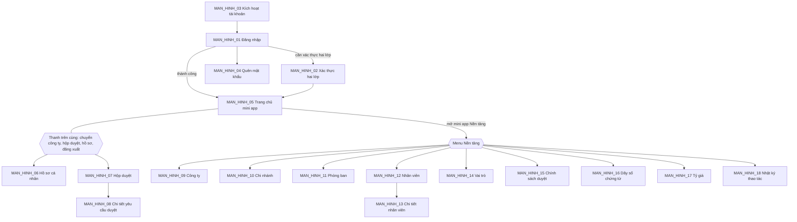

# 14. ĐẶC TẢ GIAO DIỆN

- Mô tả: Danh sách màn hình, sơ đồ điều hướng, bảng vai trò – màn hình, đặc tả từng màn hình.
- Phiên bản: 0.1
- Ngày cập nhật: 2026-11-09
- Trạng thái: Bước 06.1 đã phê duyệt 2026-11-09 (gồm THAY_DOI_01); bước 06.2 đang thực hiện

## MODULE_01 Nền tảng

## 1. Danh sách màn hình và điều hướng

| Mã | Tên màn hình | Chức năng (10) | Vai trò được truy cập (08) | Mở từ | Bản mẫu |
|---|---|---|---|---|---|
| MAN_HINH_01 | Đăng nhập | CHUC_NANG_06, CHUC_NANG_07, CHUC_NANG_08, CHUC_NANG_22, CHUC_NANG_24 | Mọi người | Địa chỉ trang web; đăng xuất | Chưa có |
| MAN_HINH_02 | Xác thực hai lớp (nhập mã, đăng ký lần đầu) | CHUC_NANG_09 | Mọi người | MAN_HINH_01 | Chưa có |
| MAN_HINH_03 | Kích hoạt tài khoản | CHUC_NANG_04 | Nhân viên được mời | Đường dẫn trong email, SMS | Chưa có |
| MAN_HINH_04 | Quên mật khẩu, đặt lại mật khẩu | CHUC_NANG_06 | Mọi người | MAN_HINH_01; đường dẫn trong email, SMS | Chưa có |
| MAN_HINH_05 | Trang chủ mini app | CHUC_NANG_14, CHUC_NANG_11 | Mọi nhân viên | Sau đăng nhập; biểu tượng trang chủ ở thanh trên cùng | Chưa có |
| MAN_HINH_06 | Hồ sơ cá nhân | CHUC_NANG_10, CHUC_NANG_09, CHUC_NANG_22, CHUC_NANG_24 | Mọi nhân viên | Thanh trên cùng | Chưa có |
| MAN_HINH_07 | Hộp duyệt | CHUC_NANG_17, CHUC_NANG_16 | Mọi nhân viên | Thanh trên cùng; MAN_HINH_05 | Chưa có |
| MAN_HINH_08 | Chi tiết yêu cầu duyệt | CHUC_NANG_16 | Người lập, người duyệt | MAN_HINH_07; mini app sở hữu chứng từ | Chưa có |
| MAN_HINH_09 | Công ty | CHUC_NANG_01 | Quản trị tập đoàn | Menu Nền tảng | Chưa có |
| MAN_HINH_10 | Chi nhánh | CHUC_NANG_02 | Quản trị tập đoàn, quản trị công ty | Menu Nền tảng | Chưa có |
| MAN_HINH_11 | Phòng ban | CHUC_NANG_03 | Quản trị tập đoàn, quản trị công ty | Menu Nền tảng | Chưa có |
| MAN_HINH_12 | Danh sách nhân viên (kèm hộp thoại mời, nhập Excel) | CHUC_NANG_04, CHUC_NANG_05, CHUC_NANG_19 | Quản trị tập đoàn, quản trị công ty | Menu Nền tảng | Chưa có |
| MAN_HINH_13 | Chi tiết nhân viên (công ty, vai trò, phiên, khóa, vô hiệu hóa) | CHUC_NANG_13, CHUC_NANG_19, CHUC_NANG_09 | Quản trị tập đoàn, quản trị công ty | MAN_HINH_12 | Chưa có |
| MAN_HINH_14 | Vai trò và ma trận quyền | CHUC_NANG_12 | Quản trị tập đoàn, quản trị công ty | Menu Nền tảng | Chưa có |
| MAN_HINH_15 | Chính sách duyệt | CHUC_NANG_15 | Quản trị tập đoàn, quản trị công ty | Menu Nền tảng | Chưa có |
| MAN_HINH_16 | Dãy số chứng từ | CHUC_NANG_20 | Quản trị tập đoàn, quản trị công ty | Menu Nền tảng | Chưa có |
| MAN_HINH_17 | Tiền tệ và tỷ giá | CHUC_NANG_21 | Mọi nhân viên (xem); quản trị tập đoàn, quản lý tỷ giá (sửa) | Menu Nền tảng | Chưa có |
| MAN_HINH_18 | Nhật ký thao tác | CHUC_NANG_23 | Quản trị tập đoàn, quản trị công ty | Menu Nền tảng; nút "Lịch sử" ở MAN_HINH_09 đến MAN_HINH_16 | Chưa có |

CHUC_NANG_18 (nhắc, chuyển duyệt quá hạn) chạy nền, không có màn hình; kết quả hiện ở MAN_HINH_07 (đánh dấu quá hạn) và thông báo.

Sơ đồ điều hướng:

- Màn hình mở đầu của mọi vai trò: MAN_HINH_05.
- Menu Nền tảng chỉ hiện mục mà nhân viên có quyền; nhân viên thường chỉ thấy mục "Tỷ giá".
- Thanh trên cùng giống nhau ở mọi mini app.

## 2. Bảng vai trò – màn hình

| Màn hình | Quản trị tập đoàn | Quản trị công ty | Quản lý tỷ giá | Nhân viên |
|---|---|---|---|---|
| MAN_HINH_01 đến MAN_HINH_04 | Dùng | Dùng | Dùng | Dùng |
| MAN_HINH_05 Trang chủ | Xem | Xem | Xem | Xem |
| MAN_HINH_06 Hồ sơ cá nhân | Xem, Sửa (của mình) | Xem, Sửa (của mình) | Xem, Sửa (của mình) | Xem, Sửa (của mình) |
| MAN_HINH_07, MAN_HINH_08 Duyệt | Xem, Duyệt khi được chỉ định | Xem, Duyệt khi được chỉ định | Xem, Duyệt khi được chỉ định | Xem, Duyệt khi được chỉ định |
| MAN_HINH_09 Công ty | Xem, Thêm, Sửa, Ngừng | Không thấy | Không thấy | Không thấy |
| MAN_HINH_10 Chi nhánh | Xem, Thêm, Sửa, Ngừng | Trong công ty mình | Không thấy | Không thấy |
| MAN_HINH_11 Phòng ban | Xem, Thêm, Sửa, Ngừng | Trong công ty mình | Không thấy | Không thấy |
| MAN_HINH_12 Nhân viên | Xem, Mời, Nhập Excel | Trong công ty mình | Không thấy | Không thấy |
| MAN_HINH_13 Chi tiết nhân viên | Gán mọi phạm vi, Khóa, Vô hiệu hóa, Đặt lại xác thực hai lớp | Trong công ty mình, trừ chính mình | Không thấy | Không thấy |
| MAN_HINH_14 Vai trò | Xem, Thêm, Sửa (cả vai trò dùng chung) | Vai trò riêng công ty mình | Không thấy | Không thấy |
| MAN_HINH_15 Chính sách duyệt | Xem, Thêm, Sửa | Trong công ty mình | Không thấy | Không thấy |
| MAN_HINH_16 Dãy số chứng từ | Xem, Thêm, Sửa | Trong công ty mình | Không thấy | Không thấy |
| MAN_HINH_17 Tỷ giá | Xem, Thêm, Sửa | Xem | Xem, Thêm, Sửa | Xem |
| MAN_HINH_18 Nhật ký thao tác | Toàn tập đoàn | Trong công ty mình | Không thấy | Không thấy |

## 3. Đặc tả từng màn hình

Lập ở bước 06.2 sau khi danh sách màn hình được duyệt.
