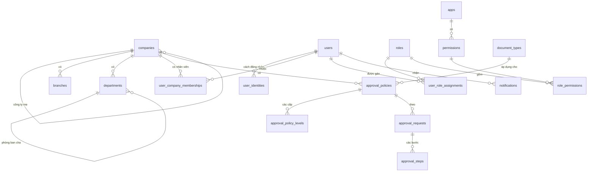
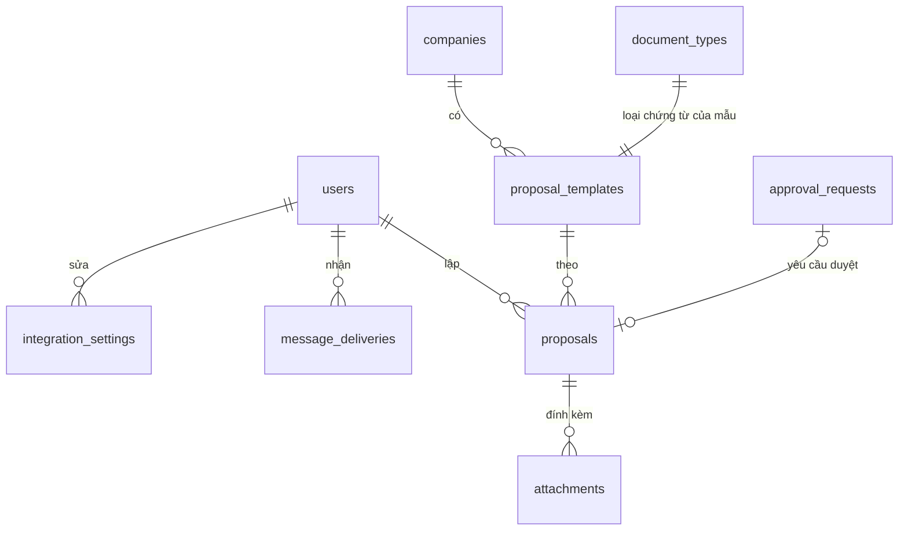

# 16. CƠ SỞ DỮ LIỆU

- Mô tả: Thiết kế cơ sở dữ liệu: schema, bảng, quan hệ, ràng buộc, chỉ mục, chính sách xóa dữ liệu.
- Phiên bản: 1.2
- Ngày cập nhật: 2026-11-09
- Trạng thái: Đã phê duyệt
- Thay đổi theo: THAY_DOI_03 (2026-11-09); THAY_DOI_04, THAY_DOI_08 qua CONG_VIEC_03 (2026-11-09)

Hiện có schema `core` của MODULE_01 Nền tảng. Đã thêm giá trị `zalo` theo THAY_DOI_01. Đã rà soát theo tài liệu `10` ở giai đoạn 07 ngày 2026-11-09. Bản nháp được lập trước giai đoạn 03, 04; phải rà soát lại theo tài liệu `10` của MODULE_01 trước khi trình phê duyệt giai đoạn 07.

## 1. Quy ước chung

- Một cơ sở dữ liệu PostgreSQL 16, mỗi module một schema (tài liệu `12` mục 2).
- Khóa chính UUID; ứng dụng sinh UUIDv7 (tăng dần theo thời gian).
- Bảng nghiệp vụ có `created_at`, `created_by`, `updated_at`, `updated_by`, `version` (khóa lạc quan).
- Không xóa cứng dữ liệu nghiệp vụ: dùng `status` hoặc `archived_at`.
- Tiền tệ `numeric(20,4)`; tỷ giá `numeric(20,8)`.
- Tên bảng, tên cột: chữ thường, nối bằng dấu gạch dưới, tiếng Anh (từ chuyên môn).

## 2. Schema `core` – nhóm bảng

| Nhóm | Bảng | Mục đích |
|---|---|---|
| Tiền tệ | `currencies`, `exchange_rates` | Danh mục tiền tệ; tỷ giá theo ngày, loại, nguồn |
| Tổ chức | `companies`, `branches`, `departments` | Cây công ty (tập đoàn → công ty con), chi nhánh, phòng ban |
| Người dùng | `users`, `user_identities`, `mfa_factors`, `sessions`, `login_attempts`, `user_company_memberships` | Tài khoản, nhiều cách đăng nhập, xác thực hai lớp, phiên, nhật ký đăng nhập, thuộc công ty nào |
| Phân quyền | `apps`, `permissions`, `roles`, `role_permissions`, `user_role_assignments` | Mini app; quyền `<app>.<đối tượng>.<hành động>`; vai trò; gán vai trò theo phạm vi tập đoàn, công ty, chi nhánh |
| Duyệt chứng từ | `document_types`, `approval_policies`, `approval_policy_levels`, `approval_requests`, `approval_steps` | Loại chứng từ, chính sách duyệt theo hạn mức, yêu cầu và từng bước duyệt |
| Đánh số | `number_sequences` | Dãy số chứng từ theo công ty, loại, kỳ |
| Nhật ký, sự kiện | `audit_events` (chia partition theo tháng), `outbox_events` | Nhật ký thao tác chỉ thêm; sự kiện gửi sang module khác |
| Thông báo | `notifications` | Chuông thông báo: được giao duyệt, nhắc, chuyển duyệt, kết quả |
| Mã dùng một lần | `mfa_backup_codes`, `user_tokens` | Mã dự phòng xác thực hai lớp; đường dẫn kích hoạt, đặt lại mật khẩu |
| Tích hợp, gửi tin (CONG_VIEC_03) | `integration_settings`, `otp_codes`, `message_deliveries` | Cài đặt tích hợp; mã OTP đăng nhập bằng số điện thoại; nhật ký gửi tin Zalo ZNS, SMS |
| Đề xuất (CONG_VIEC_03) | `proposal_templates`, `proposals`, `attachments` | Mẫu đề xuất; đề xuất theo mẫu; tệp đính kèm |

## 3. Ràng buộc chính đã kiểm tra

Đã chạy trên PostgreSQL 16.15 ngày 2026-11-09. Lược đồ tạo được không lỗi; các trường hợp sau bị chặn đúng:

| Trường hợp | Kết quả |
|---|---|
| Gán vai trò phạm vi chi nhánh nhưng thiếu chi nhánh | Bị chặn bởi ràng buộc kiểm tra |
| Cách đăng nhập bằng mật khẩu nhưng không có mật khẩu đã băm | Bị chặn |
| Hai vai trò dùng chung tập đoàn trùng mã | Bị chặn bởi chỉ mục duy nhất |
| Cấp duyệt loại "vai trò" nhưng không chỉ định vai trò | Bị chặn |
| Cấp duyệt thiếu người duyệt thay thế | Bị chặn (kiểm tra ngày 2026-11-09, giai đoạn 07) |
| Bước duyệt bị từ chối không có ý kiến | Bị chặn |
| Bước duyệt không có người được giao | Bị chặn |

## 3a. Sơ đồ quan hệ chính



## 3b. Quy tắc kiểm tra dữ liệu, xóa và lưu giữ

- Kiểm tra dữ liệu đầu vào ở hai lớp: lược đồ zod tại API (kiểu, độ dài, định dạng; tài liệu `17`) và ràng buộc trong cơ sở dữ liệu (khóa, duy nhất, kiểm tra).
- Không xóa cứng: công ty, chi nhánh, phòng ban, người dùng, vai trò, chính sách duyệt, yêu cầu duyệt, tỷ giá (QUYTAC_NGHIEPVU_03). Dùng trạng thái hoặc ngày hết hiệu lực.
- Được xóa cứng: phiên hết hạn quá 90 ngày; mã dùng một lần đã dùng hoặc hết hạn quá 30 ngày; mã OTP đăng nhập lưu bảng `otp_codes` (CONG_VIEC_03), chưa có tác vụ xóa định kỳ; thông báo đã đọc quá 180 ngày.
- Lưu giữ: nhật ký thao tác tối thiểu 10 năm (QUYTAC_NGHIEPVU_30); nhật ký đăng nhập 2 năm; partition nhật ký thao tác tạo trước mỗi tháng bằng tác vụ nền.
- Lịch sử thay đổi: mọi thay đổi bảng nghiệp vụ ghi `audit_events` (dữ liệu trước và sau); cột `version` chống ghi đè đồng thời.

## 4. Lược đồ schema `core`

```sql
-- =============================================================================
-- VComm - Mo hinh du lieu mini app Nen tang (schema `core`)
-- PostgreSQL 16+
--
-- Quy uoc:
--   * Khoa chinh UUID. Ung dung sinh UUIDv7 (tang dan theo thoi gian);
--     DEFAULT gen_random_uuid() chi de du phong khi chen tay.
--   * Moi bang nghiep vu co created_at/created_by/updated_at/updated_by
--     va version (khoa lac quan - optimistic locking).
--   * Khong xoa cung du lieu nghiep vu: dung status hoac archived_at.
--   * Tien te luu numeric(20,4); ty gia numeric(20,8).
--   * Ten bang/cot: snake_case, so nhieu cho bang.
-- =============================================================================

CREATE SCHEMA IF NOT EXISTS core;
CREATE EXTENSION IF NOT EXISTS citext;

-- -----------------------------------------------------------------------------
-- 1. Tien te & ty gia
-- -----------------------------------------------------------------------------
CREATE TABLE core.currencies (
    code            char(3)      PRIMARY KEY,           -- ISO 4217: VND, USD, CNY...
    name_vi         text         NOT NULL,
    name_en         text         NOT NULL,
    minor_units     smallint     NOT NULL DEFAULT 0,    -- VND = 0, USD = 2
    is_active       boolean      NOT NULL DEFAULT true
);

CREATE TABLE core.exchange_rates (
    id              uuid         PRIMARY KEY DEFAULT gen_random_uuid(),
    rate_date       date         NOT NULL,
    from_currency   char(3)      NOT NULL REFERENCES core.currencies(code),
    to_currency     char(3)      NOT NULL REFERENCES core.currencies(code),
    rate_type       text         NOT NULL CHECK (rate_type IN ('buy', 'sell', 'transfer', 'accounting')),
    rate            numeric(20,8) NOT NULL CHECK (rate > 0),
    source          text         NOT NULL,              -- 'vietcombank', 'manual', ...
    created_at      timestamptz  NOT NULL DEFAULT now(),
    created_by      uuid,
    UNIQUE (rate_date, from_currency, to_currency, rate_type, source),
    CHECK (from_currency <> to_currency)
);

-- -----------------------------------------------------------------------------
-- 2. To chuc: tap doan -> cong ty (phap nhan) -> chi nhanh -> phong ban
-- -----------------------------------------------------------------------------
CREATE TABLE core.companies (
    id                  uuid        PRIMARY KEY DEFAULT gen_random_uuid(),
    parent_id           uuid        REFERENCES core.companies(id),   -- NULL = cong ty me/tap doan
    code                text        NOT NULL UNIQUE,                 -- 'VCG', 'VCR'...
    legal_name          text        NOT NULL,
    short_name          text        NOT NULL,
    tax_code            text        UNIQUE,                          -- ma so thue
    address             text,
    phone               text,
    email               citext,
    base_currency       char(3)     NOT NULL DEFAULT 'VND' REFERENCES core.currencies(code),
    accounting_regime   text        NOT NULL DEFAULT 'TT99_2025' CHECK (accounting_regime IN ('TT99_2025', 'TT133')),
    fiscal_year_start   smallint    NOT NULL DEFAULT 1 CHECK (fiscal_year_start BETWEEN 1 AND 12),
    status              text        NOT NULL DEFAULT 'active' CHECK (status IN ('active', 'inactive')),
    created_at          timestamptz NOT NULL DEFAULT now(),
    created_by          uuid,
    updated_at          timestamptz NOT NULL DEFAULT now(),
    updated_by          uuid,
    version             integer     NOT NULL DEFAULT 1,
    CHECK (parent_id IS NULL OR parent_id <> id)
);

CREATE TABLE core.branches (
    id              uuid        PRIMARY KEY DEFAULT gen_random_uuid(),
    company_id      uuid        NOT NULL REFERENCES core.companies(id),
    code            text        NOT NULL,
    name            text        NOT NULL,
    branch_type     text        NOT NULL CHECK (branch_type IN ('head_office', 'office', 'warehouse', 'store', 'other')),
    province_code   text,                               -- ma tinh/thanh theo danh muc hanh chinh
    address         text,
    phone           text,
    status          text        NOT NULL DEFAULT 'active' CHECK (status IN ('active', 'inactive')),
    created_at      timestamptz NOT NULL DEFAULT now(),
    created_by      uuid,
    updated_at      timestamptz NOT NULL DEFAULT now(),
    updated_by      uuid,
    version         integer     NOT NULL DEFAULT 1,
    UNIQUE (company_id, code)
);

CREATE TABLE core.departments (
    id              uuid        PRIMARY KEY DEFAULT gen_random_uuid(),
    company_id      uuid        NOT NULL REFERENCES core.companies(id),
    parent_id       uuid        REFERENCES core.departments(id),
    code            text        NOT NULL,
    name            text        NOT NULL,
    manager_user_id uuid,                               -- FK them sau khi tao core.users
    status          text        NOT NULL DEFAULT 'active' CHECK (status IN ('active', 'inactive')),
    created_at      timestamptz NOT NULL DEFAULT now(),
    created_by      uuid,
    updated_at      timestamptz NOT NULL DEFAULT now(),
    updated_by      uuid,
    version         integer     NOT NULL DEFAULT 1,
    UNIQUE (company_id, code)
);

-- -----------------------------------------------------------------------------
-- 3. Nguoi dung & dang nhap
-- -----------------------------------------------------------------------------
CREATE TABLE core.users (
    id                  uuid        PRIMARY KEY DEFAULT gen_random_uuid(),
    username            citext      UNIQUE,
    email               citext      UNIQUE,
    phone               text        UNIQUE,             -- dinh dang E.164: +84...
    full_name           text        NOT NULL,
    avatar_url          text,
    locale              text        NOT NULL DEFAULT 'vi' CHECK (locale IN ('vi', 'en')),
    timezone            text        NOT NULL DEFAULT 'Asia/Ho_Chi_Minh',
    mfa_required        boolean     NOT NULL DEFAULT false, -- bat buoc OTP (tu dong true neu co vai tro nhay cam)
    is_super_admin      boolean     NOT NULL DEFAULT false,
    status              text        NOT NULL DEFAULT 'invited'
                        CHECK (status IN ('invited', 'active', 'locked', 'disabled')),
    last_login_at       timestamptz,
    login_locked_until  timestamptz,                    -- QUYTAC_NGHIEPVU_07: khoa 15 phut sau 5 lan sai
    created_at          timestamptz NOT NULL DEFAULT now(),
    created_by          uuid,
    updated_at          timestamptz NOT NULL DEFAULT now(),
    updated_by          uuid,
    version             integer     NOT NULL DEFAULT 1,
    CHECK (username IS NOT NULL OR email IS NOT NULL OR phone IS NOT NULL)
);

ALTER TABLE core.departments
    ADD CONSTRAINT departments_manager_fk FOREIGN KEY (manager_user_id) REFERENCES core.users(id);

-- Mot nguoi dung co the dang nhap bang nhieu cach.
CREATE TABLE core.user_identities (
    id                  uuid        PRIMARY KEY DEFAULT gen_random_uuid(),
    user_id             uuid        NOT NULL REFERENCES core.users(id) ON DELETE CASCADE,
    provider            text        NOT NULL CHECK (provider IN ('password', 'google', 'microsoft', 'zalo', 'phone_otp')),
    provider_subject    text        NOT NULL,           -- username/email; 'sub' cua Google/Microsoft; id Zalo; so dien thoai
    password_hash       text,                           -- argon2id, chi voi provider = 'password'
    password_changed_at timestamptz,
    created_at          timestamptz NOT NULL DEFAULT now(),
    last_used_at        timestamptz,
    UNIQUE (provider, provider_subject),
    CHECK ((provider = 'password') = (password_hash IS NOT NULL))
);

-- Yeu to xac thuc thu 2.
CREATE TABLE core.mfa_factors (
    id                  uuid        PRIMARY KEY DEFAULT gen_random_uuid(),
    user_id             uuid        NOT NULL REFERENCES core.users(id) ON DELETE CASCADE,
    factor_type         text        NOT NULL CHECK (factor_type IN ('totp', 'sms', 'email')),
    secret_encrypted    bytea,                          -- ma hoa bang KMS, chi voi totp
    target              text,                           -- so dien thoai/email nhan OTP
    confirmed_at        timestamptz,
    created_at          timestamptz NOT NULL DEFAULT now()
);

-- Ma du phong xac thuc hai lop (CHUC_NANG_09): 10 ma, dung mot lan.
CREATE TABLE core.mfa_backup_codes (
    id                  uuid        PRIMARY KEY DEFAULT gen_random_uuid(),
    user_id             uuid        NOT NULL REFERENCES core.users(id) ON DELETE CASCADE,
    code_hash           text        NOT NULL,           -- argon2id
    used_at             timestamptz,
    created_at          timestamptz NOT NULL DEFAULT now()
);
CREATE INDEX mfa_backup_codes_user_idx ON core.mfa_backup_codes (user_id) WHERE used_at IS NULL;

-- Ma dung mot lan: kich hoat tai khoan (72 gio), dat lai mat khau (1 gio).
CREATE TABLE core.user_tokens (
    id                  uuid        PRIMARY KEY DEFAULT gen_random_uuid(),
    user_id             uuid        NOT NULL REFERENCES core.users(id) ON DELETE CASCADE,
    purpose             text        NOT NULL CHECK (purpose IN ('activation', 'password_reset')),
    token_hash          bytea       NOT NULL UNIQUE,    -- SHA-256 cua token gui qua email, SMS
    expires_at          timestamptz NOT NULL,
    used_at             timestamptz,
    created_at          timestamptz NOT NULL DEFAULT now(),
    created_by          uuid
);

-- Phien dang nhap; luu bam (hash) cua refresh token, khong luu token goc.
CREATE TABLE core.sessions (
    id                  uuid        PRIMARY KEY DEFAULT gen_random_uuid(),
    user_id             uuid        NOT NULL REFERENCES core.users(id) ON DELETE CASCADE,
    refresh_token_hash  bytea       NOT NULL UNIQUE,
    family_id           uuid        NOT NULL,           -- chuoi phien; phat hien dung lai token cu thi thu hoi ca chuoi
    client_type         text        NOT NULL CHECK (client_type IN ('web', 'warehouse_app', 'sales_app')),
    ip                  inet,
    user_agent          text,
    mfa_verified        boolean     NOT NULL DEFAULT false,
    created_at          timestamptz NOT NULL DEFAULT now(),
    expires_at          timestamptz NOT NULL,
    revoked_at          timestamptz
);
CREATE INDEX sessions_user_idx ON core.sessions (user_id) WHERE revoked_at IS NULL;

-- Nhat ky dang nhap (thanh cong/that bai) de khoa tai khoan va dieu tra.
CREATE TABLE core.login_attempts (
    id                  bigint      GENERATED ALWAYS AS IDENTITY PRIMARY KEY,
    attempted_at        timestamptz NOT NULL DEFAULT now(),
    provider            text        NOT NULL,
    identifier          text        NOT NULL,           -- username/email/phone da nhap
    user_id             uuid        REFERENCES core.users(id),
    success             boolean     NOT NULL,
    failure_reason      text,
    ip                  inet,
    user_agent          text
);
CREATE INDEX login_attempts_identifier_idx ON core.login_attempts (identifier, attempted_at DESC);

-- Nguoi dung thuoc cong ty nao, lam o dau. Mot nguoi co the thuoc nhieu cong ty.
CREATE TABLE core.user_company_memberships (
    id                  uuid        PRIMARY KEY DEFAULT gen_random_uuid(),
    user_id             uuid        NOT NULL REFERENCES core.users(id),
    company_id          uuid        NOT NULL REFERENCES core.companies(id),
    default_branch_id   uuid        REFERENCES core.branches(id),
    department_id       uuid        REFERENCES core.departments(id),
    job_title           text,
    is_default          boolean     NOT NULL DEFAULT false, -- cong ty mo san khi dang nhap
    status              text        NOT NULL DEFAULT 'active' CHECK (status IN ('active', 'inactive')),
    created_at          timestamptz NOT NULL DEFAULT now(),
    created_by          uuid,
    updated_at          timestamptz NOT NULL DEFAULT now(),
    updated_by          uuid,
    UNIQUE (user_id, company_id)
);
CREATE UNIQUE INDEX user_company_one_default_idx
    ON core.user_company_memberships (user_id) WHERE is_default;

-- -----------------------------------------------------------------------------
-- 4. Mini app & phan quyen
-- -----------------------------------------------------------------------------
-- Danh sach mini app hien tren trang chu.
CREATE TABLE core.apps (
    code            text        PRIMARY KEY,            -- 'platform', 'catalog', 'inventory', ...
    name_vi         text        NOT NULL,
    name_en         text        NOT NULL,
    description_vi  text,
    description_en  text,
    base_url        text        NOT NULL,               -- '/inventory' hoac domain rieng
    icon            text        NOT NULL,
    sort_order      integer     NOT NULL DEFAULT 0,
    is_active       boolean     NOT NULL DEFAULT true
);

-- Quyen = <app>.<doi tuong>.<hanh dong>, vd 'inventory.stock_receipt.approve'.
-- Do code khai bao va dong bo vao bang khi trien khai; admin khong tao tay.
CREATE TABLE core.permissions (
    code            text        PRIMARY KEY,
    app_code        text        NOT NULL REFERENCES core.apps(code),
    name_vi         text        NOT NULL,
    name_en         text        NOT NULL,
    is_sensitive    boolean     NOT NULL DEFAULT false  -- vai tro co quyen nay => bat buoc OTP
);

-- Vai tro: nhom quyen do admin dinh nghia.
-- company_id NULL = vai tro dung chung toan tap doan.
CREATE TABLE core.roles (
    id              uuid        PRIMARY KEY DEFAULT gen_random_uuid(),
    company_id      uuid        REFERENCES core.companies(id),
    code            text        NOT NULL,
    name_vi         text        NOT NULL,
    name_en         text        NOT NULL,
    description     text,
    is_system       boolean     NOT NULL DEFAULT false, -- vai tro mac dinh, khong xoa duoc
    status          text        NOT NULL DEFAULT 'active' CHECK (status IN ('active', 'inactive')),
    created_at      timestamptz NOT NULL DEFAULT now(),
    created_by      uuid,
    updated_at      timestamptz NOT NULL DEFAULT now(),
    updated_by      uuid,
    version         integer     NOT NULL DEFAULT 1
);
CREATE UNIQUE INDEX roles_code_uq ON core.roles (COALESCE(company_id, '00000000-0000-0000-0000-000000000000'::uuid), code);

CREATE TABLE core.role_permissions (
    role_id         uuid        NOT NULL REFERENCES core.roles(id) ON DELETE CASCADE,
    permission_code text        NOT NULL REFERENCES core.permissions(code),
    PRIMARY KEY (role_id, permission_code)
);

-- Gan vai tro cho nguoi dung TRONG MOT PHAM VI:
--   group   = toan tap doan (scope_id NULL)
--   company = mot cong ty (scope_id = companies.id)
--   branch  = mot chi nhanh (scope_id = branches.id)
CREATE TABLE core.user_role_assignments (
    id              uuid        PRIMARY KEY DEFAULT gen_random_uuid(),
    user_id         uuid        NOT NULL REFERENCES core.users(id),
    role_id         uuid        NOT NULL REFERENCES core.roles(id),
    scope_type      text        NOT NULL CHECK (scope_type IN ('group', 'company', 'branch')),
    company_id      uuid        REFERENCES core.companies(id),
    branch_id       uuid        REFERENCES core.branches(id),
    valid_from      date        NOT NULL DEFAULT current_date,
    valid_to        date,
    created_at      timestamptz NOT NULL DEFAULT now(),
    created_by      uuid,
    CHECK (
        (scope_type = 'group'   AND company_id IS NULL     AND branch_id IS NULL) OR
        (scope_type = 'company' AND company_id IS NOT NULL AND branch_id IS NULL) OR
        (scope_type = 'branch'  AND company_id IS NOT NULL AND branch_id IS NOT NULL)
    ),
    CHECK (valid_to IS NULL OR valid_to >= valid_from)
);
CREATE INDEX user_role_assignments_user_idx ON core.user_role_assignments (user_id);

-- -----------------------------------------------------------------------------
-- 5. Duyet chung tu theo han muc
-- -----------------------------------------------------------------------------
-- Loai chung tu can duyet, do cac mini app dang ky: 'purchasing.purchase_order', 'finance.payment'...
CREATE TABLE core.document_types (
    code            text        PRIMARY KEY,
    app_code        text        NOT NULL REFERENCES core.apps(code),
    name_vi         text        NOT NULL,
    name_en         text        NOT NULL,
    requires_approval boolean   NOT NULL DEFAULT false
);

-- Chinh sach duyet: moi cong ty x loai chung tu co mot chinh sach dang hieu luc.
CREATE TABLE core.approval_policies (
    id                  uuid        PRIMARY KEY DEFAULT gen_random_uuid(),
    company_id          uuid        NOT NULL REFERENCES core.companies(id),
    document_type_code  text        NOT NULL REFERENCES core.document_types(code),
    currency            char(3)     NOT NULL DEFAULT 'VND' REFERENCES core.currencies(code),
    effective_from      date        NOT NULL,
    effective_to        date,
    created_at          timestamptz NOT NULL DEFAULT now(),
    created_by          uuid,
    CHECK (effective_to IS NULL OR effective_to >= effective_from)
);

-- Cac cap duyet. Chung tu co gia tri >= min_amount phai qua cap nay.
-- Vi du don mua: cap 1 >= 0 (truong bo phan), cap 2 >= 50 trieu (giam doc), cap 3 >= 500 trieu (TGD).
CREATE TABLE core.approval_policy_levels (
    id                  uuid        PRIMARY KEY DEFAULT gen_random_uuid(),
    policy_id           uuid        NOT NULL REFERENCES core.approval_policies(id) ON DELETE CASCADE,
    level_no            smallint    NOT NULL CHECK (level_no >= 1),
    min_amount          numeric(20,4) NOT NULL DEFAULT 0 CHECK (min_amount >= 0),
    approver_type       text        NOT NULL CHECK (approver_type IN ('role', 'user', 'department_manager')),
    approver_role_id    uuid        REFERENCES core.roles(id),
    approver_user_id    uuid        REFERENCES core.users(id),
    substitute_type     text        NOT NULL CHECK (substitute_type IN ('role', 'user')),
    substitute_role_id  uuid        REFERENCES core.roles(id),
    substitute_user_id  uuid        REFERENCES core.users(id),
    due_hours           integer     NOT NULL CHECK (due_hours > 0),   -- QUYTAC_NGHIEPVU_21
    UNIQUE (policy_id, level_no),
    CHECK (
        (substitute_type = 'role' AND substitute_role_id IS NOT NULL AND substitute_user_id IS NULL) OR
        (substitute_type = 'user' AND substitute_user_id IS NOT NULL AND substitute_role_id IS NULL)
    ),
    CHECK (
        (approver_type = 'role'               AND approver_role_id IS NOT NULL AND approver_user_id IS NULL) OR
        (approver_type = 'user'               AND approver_user_id IS NOT NULL AND approver_role_id IS NULL) OR
        (approver_type = 'department_manager' AND approver_role_id IS NULL     AND approver_user_id IS NULL)
    )
);

-- Mot yeu cau duyet cho mot chung tu cu the.
CREATE TABLE core.approval_requests (
    id                  uuid        PRIMARY KEY DEFAULT gen_random_uuid(),
    company_id          uuid        NOT NULL REFERENCES core.companies(id),
    document_type_code  text        NOT NULL REFERENCES core.document_types(code),
    document_id         uuid        NOT NULL,
    document_no         text        NOT NULL,
    amount              numeric(20,4) NOT NULL,
    currency            char(3)     NOT NULL REFERENCES core.currencies(code),
    document_date       date        NOT NULL,
    exchange_rate       numeric(20,8),                  -- ty gia hach toan ngay lap; NULL khi cung tien te chinh sach
    amount_in_policy_currency numeric(20,4) NOT NULL,   -- QUYTAC_NGHIEPVU_19
    policy_id           uuid        NOT NULL REFERENCES core.approval_policies(id),
    status              text        NOT NULL DEFAULT 'pending'
                        CHECK (status IN ('pending', 'approved', 'rejected', 'withdrawn')),
    current_level_no    smallint,
    requested_by        uuid        NOT NULL REFERENCES core.users(id),
    requested_at        timestamptz NOT NULL DEFAULT now(),
    completed_at        timestamptz
);
CREATE UNIQUE INDEX approval_requests_open_uq
    ON core.approval_requests (document_type_code, document_id) WHERE status = 'pending';

CREATE TABLE core.approval_steps (
    id                  uuid        PRIMARY KEY DEFAULT gen_random_uuid(),
    request_id          uuid        NOT NULL REFERENCES core.approval_requests(id) ON DELETE CASCADE,
    level_no            smallint    NOT NULL,
    assigned_role_id    uuid        REFERENCES core.roles(id),   -- nguoi duyet theo vai tro
    assigned_user_id    uuid        REFERENCES core.users(id),   -- nguoi duyet cu the
    is_substitute       boolean     NOT NULL DEFAULT false,      -- da chuyen cho nguoi thay the (QUYTAC_NGHIEPVU_20, 21)
    started_at          timestamptz,                             -- thoi diem cap nay bat dau cho
    reminded_at         timestamptz,
    escalated_at        timestamptz,
    decision            text        CHECK (decision IN ('approved', 'rejected')),
    decided_by          uuid        REFERENCES core.users(id),
    decided_at          timestamptz,
    comment             text,
    UNIQUE (request_id, level_no),
    CHECK (assigned_role_id IS NOT NULL OR assigned_user_id IS NOT NULL),
    CHECK (decision <> 'rejected' OR comment IS NOT NULL)
);
CREATE INDEX approval_steps_waiting_idx ON core.approval_steps (assigned_user_id) WHERE decision IS NULL;

-- -----------------------------------------------------------------------------
-- 6. Danh so chung tu
-- -----------------------------------------------------------------------------
-- Vi du: PN-VCR-2026-000123. Lay so bang UPDATE ... RETURNING trong cung giao dich.
CREATE TABLE core.number_sequences (
    company_id          uuid        NOT NULL REFERENCES core.companies(id),
    document_type_code  text        NOT NULL REFERENCES core.document_types(code),
    period_key          text        NOT NULL,           -- '2026' hoac '2026-11' tuy reset_period
    prefix              text        NOT NULL,
    reset_period        text        NOT NULL DEFAULT 'year' CHECK (reset_period IN ('never', 'year', 'month')),
    padding             smallint    NOT NULL DEFAULT 6,
    next_value          bigint      NOT NULL DEFAULT 1,
    PRIMARY KEY (company_id, document_type_code, period_key)
);

-- Thong bao trong ung dung (chuong o thanh tren cung).
CREATE TABLE core.notifications (
    id              uuid        PRIMARY KEY DEFAULT gen_random_uuid(),
    user_id         uuid        NOT NULL REFERENCES core.users(id) ON DELETE CASCADE,
    company_id      uuid        REFERENCES core.companies(id),
    kind            text        NOT NULL,               -- 'approval.assigned', 'approval.reminder', 'approval.escalated', 'approval.completed'...
    title           text        NOT NULL,
    link            text,
    payload         jsonb       NOT NULL DEFAULT '{}'::jsonb,
    read_at         timestamptz,
    created_at      timestamptz NOT NULL DEFAULT now()
);
CREATE INDEX notifications_unread_idx ON core.notifications (user_id, created_at DESC) WHERE read_at IS NULL;

-- -----------------------------------------------------------------------------
-- 7. Nhat ky thao tac (audit) & su kien (outbox)
-- -----------------------------------------------------------------------------
-- Chi INSERT, khong UPDATE/DELETE. Chia partition theo thang.
CREATE TABLE core.audit_events (
    id              uuid        NOT NULL DEFAULT gen_random_uuid(),
    occurred_at     timestamptz NOT NULL DEFAULT now(),
    actor_user_id   uuid,
    company_id      uuid,
    app_code        text        NOT NULL,
    action          text        NOT NULL,               -- 'create', 'update', 'approve', 'login', ...
    entity_type     text        NOT NULL,               -- 'core.users', 'inventory.stock_receipts'...
    entity_id       uuid,
    before_data     jsonb,
    after_data      jsonb,
    ip              inet,
    user_agent      text,
    request_id      text,
    PRIMARY KEY (id, occurred_at)
) PARTITION BY RANGE (occurred_at);

CREATE TABLE core.audit_events_2026_11 PARTITION OF core.audit_events
    FOR VALUES FROM ('2026-11-01') TO ('2026-12-01');
CREATE TABLE core.audit_events_2026_12 PARTITION OF core.audit_events
    FOR VALUES FROM ('2026-12-01') TO ('2027-01-01');
CREATE INDEX audit_events_entity_idx ON core.audit_events (entity_type, entity_id, occurred_at DESC);
CREATE INDEX audit_events_actor_idx  ON core.audit_events (actor_user_id, occurred_at DESC);

-- Outbox: ghi su kien trong cung giao dich voi du lieu, worker day sang SQS/SNS.
CREATE TABLE core.outbox_events (
    id              bigint      GENERATED ALWAYS AS IDENTITY PRIMARY KEY,
    occurred_at     timestamptz NOT NULL DEFAULT now(),
    event_type      text        NOT NULL,               -- 'core.user.created', 'inventory.stock.changed'...
    aggregate_type  text        NOT NULL,
    aggregate_id    uuid        NOT NULL,
    company_id      uuid,
    payload         jsonb       NOT NULL,
    published_at    timestamptz,
    attempts        integer     NOT NULL DEFAULT 0,
    last_error      text
);
CREATE INDEX outbox_unpublished_idx ON core.outbox_events (id) WHERE published_at IS NULL;

-- -----------------------------------------------------------------------------
-- 8. Du lieu khoi tao
-- -----------------------------------------------------------------------------
INSERT INTO core.currencies (code, name_vi, name_en, minor_units) VALUES
    ('VND', 'Đồng Việt Nam', 'Vietnamese dong', 0),
    ('USD', 'Đô la Mỹ', 'US dollar', 2),
    ('CNY', 'Nhân dân tệ', 'Chinese yuan', 2),
    ('EUR', 'Euro', 'Euro', 2);

INSERT INTO core.apps (code, name_vi, name_en, base_url, icon, sort_order) VALUES
    ('platform',   'Quản trị hệ thống', 'Administration',     '/platform',   'settings',  10),
    ('catalog',    'Sản phẩm & Nhà bán', 'Products & Sellers', '/catalog',    'package',   20),
    ('inventory',  'Kho',               'Inventory',          '/inventory',  'warehouse', 30),
    ('purchasing', 'Mua hàng',          'Purchasing',         '/purchasing', 'cart',      40),
    ('sales',      'Bán hàng',          'Sales',              '/sales',      'receipt',   50),
    ('finance',    'Tài chính - Kế toán', 'Finance & Accounting', '/finance', 'calculator', 60),
    ('crm',        'Khách hàng & Đối tác', 'Customers & Partners', '/crm',    'users',     70),
    ('hr',         'Nhân sự',           'Human Resources',    '/hr',         'id-card',   80);
```

## 5. Database migration 0002 – CONG_VIEC_03

Tệp `database/migrations/0002_cong_viec_03.sql` thêm 6 bảng vào schema `core`, không đổi bảng đã có (THAY_DOI_04, THAY_DOI_08). `core.user_identities` dùng lại: với `provider = 'phone_otp'`, `provider_subject` là số điện thoại dạng `+84...`, gắn khi đăng nhập bằng mã OTP lần đầu.

| Bảng | Mục đích | Cột chính | Ràng buộc, chỉ mục |
|---|---|---|---|
| `integration_settings` | Cài đặt tích hợp (CHUC_NANG_25; QUYTAC_NGHIEPVU_31) | `setting_key` (khóa chính: `google.client_id`, `esms.secret_key`...), `plain_value` (giá trị thường), `secret_value` (giá trị bí mật mã hóa AES-256-GCM), `updated_at`, `updated_by` | Chỉ một trong hai cột giá trị có dữ liệu; khóa cài đặt hợp lệ do `packages/contracts` khai báo |
| `otp_codes` | Mã OTP đăng nhập bằng số điện thoại (CHUC_NANG_08; QUYTAC_NGHIEPVU_10) | `phone` (`+84...`), `code_hash` (SHA-256 của mã), `expires_at` (5 phút), `wrong_attempts`, `consumed_at`, `created_at` | Chỉ mục `(phone, created_at DESC)` để đếm số lần gửi trong một giờ; sai 5 lần thì đặt `consumed_at` |
| `message_deliveries` | Nhật ký gửi tin qua eSMS.vn (QUYTAC_NGHIEPVU_32) | `channel` (`zns`, `zns_sms` = Zalo rồi SMS, `sms`), `purpose` (`login_otp`, `approval.assigned`, `approval.reminder`, `approval.completed`), `user_id`, `phone_masked` (`+8490***4567`), `template_id`, `status` (`sent`, `failed`, `skipped`), `provider_message_id` (mã tin eSMS), `error`, `created_at` | Kiểm tra giá trị `channel`, `status`; chỉ mục `created_at DESC`. Không lưu nội dung mã OTP |
| `proposal_templates` | Mẫu đề xuất (CHUC_NANG_27; QUYTAC_NGHIEPVU_33) | `company_id`, `code`, `name`, `description`, `document_type_code`, `fields` (JSON: `key`, `label`, `type`, `required`, `options`, `columns`), `amount_field` (trống = tổng thành tiền bảng chi tiết), `currency`, `status` (`active`, `inactive`), cột người tạo, người sửa, `version` | Duy nhất `(company_id, code)`; `document_type_code` duy nhất, tham chiếu `document_types`; `currency` tham chiếu `currencies` |
| `proposals` | Đề xuất (CHUC_NANG_28; QUYTAC_NGHIEPVU_33, QUYTAC_NGHIEPVU_34) | `company_id`, `template_id`, `template_snapshot` (JSON, bản chụp mẫu lúc lập), `document_type_code`, `proposal_no` (cấp khi gửi), `title`, `field_values` (JSON), `amount` (giá trị duyệt, `numeric(20,4)` không âm), `currency`, `status` (`draft`, `pending`, `approved`, `rejected`, `withdrawn`), `approval_request_id`, `requested_by`, `created_at`, `updated_at`, `submitted_at`, `completed_at`, `version` | Duy nhất `(company_id, proposal_no)`; chỉ mục `(requested_by, created_at DESC)`, `(company_id, created_at DESC)` |
| `attachments` | Tệp đính kèm (QUYTAC_NGHIEPVU_35) | `company_id`, `owner_type` (hiện chỉ `proposal`), `owner_id`, `file_name`, `content_type`, `size_bytes` (lớn hơn 0), `storage_key` (khóa lưu trữ do hệ thống sinh, không chứa tên tệp người dùng), `uploaded_by`, `created_at` | `storage_key` duy nhất; chỉ mục `(owner_type, owner_id)`. Nội dung tệp lưu S3 khi `STORAGE_DRIVER=s3`, thư mục cục bộ khi phát triển, kiểm thử |

Quy tắc xóa và lưu giữ bổ sung:
- Đề xuất nháp được xóa cứng cùng tệp đính kèm (QUYTAC_NGHIEPVU_34); đề xuất đã gửi không xóa. Tệp đính kèm được xóa cứng khi đề xuất còn Nháp.
- `integration_settings`: xóa dòng khi quản trị xóa giá trị; mọi lần lưu ghi `audit_events` (khóa bí mật chỉ ghi 4 ký tự cuối).
- `otp_codes`, `message_deliveries`: chưa có tác vụ dọn định kỳ.



Lược đồ (chép từ tệp `database/migrations/0002_cong_viec_03.sql`):

```sql
-- CONG_VIEC_03: Cài đặt tích hợp, mã OTP qua số điện thoại, nhật ký gửi tin, mẫu đề xuất, đề xuất, tệp đính kèm (tài liệu 16).

-- Cài đặt tích hợp (CHUC_NANG_25; QUYTAC_NGHIEPVU_31): giá trị thường hoặc giá trị bí mật đã mã hóa AES-256-GCM.
CREATE TABLE core.integration_settings (
    setting_key     text        PRIMARY KEY,                -- 'google.client_id', 'esms.secret_key'...
    plain_value     text,
    secret_value    bytea,
    updated_at      timestamptz NOT NULL DEFAULT now(),
    updated_by      uuid        REFERENCES core.users(id),
    CHECK (plain_value IS NULL OR secret_value IS NULL)
);

-- Mã OTP đăng nhập bằng số điện thoại (CHUC_NANG_08; QUYTAC_NGHIEPVU_10): hiệu lực 5 phút, tối đa 5 lần nhập sai.
CREATE TABLE core.otp_codes (
    id              uuid        PRIMARY KEY DEFAULT gen_random_uuid(),
    phone           text        NOT NULL,                   -- dạng +84...
    code_hash       text        NOT NULL,                   -- SHA-256 của mã
    expires_at      timestamptz NOT NULL,
    wrong_attempts  smallint    NOT NULL DEFAULT 0,
    consumed_at     timestamptz,
    created_at      timestamptz NOT NULL DEFAULT now()
);
CREATE INDEX otp_codes_phone_idx ON core.otp_codes (phone, created_at DESC);

-- Nhật ký gửi tin Zalo ZNS, SMS qua eSMS.vn (QUYTAC_NGHIEPVU_32). Không lưu nội dung mã OTP.
CREATE TABLE core.message_deliveries (
    id                  uuid        PRIMARY KEY DEFAULT gen_random_uuid(),
    channel             text        NOT NULL CHECK (channel IN ('zns', 'zns_sms', 'sms')),
    purpose             text        NOT NULL,               -- 'login_otp', 'approval.assigned'...
    user_id             uuid        REFERENCES core.users(id),
    phone_masked        text        NOT NULL,               -- +8490***4567
    template_id         text,
    status              text        NOT NULL CHECK (status IN ('sent', 'failed', 'skipped')),
    provider_message_id text,
    error               text,
    created_at          timestamptz NOT NULL DEFAULT now()
);
CREATE INDEX message_deliveries_created_idx ON core.message_deliveries (created_at DESC);

-- Mẫu đề xuất (CHUC_NANG_27; QUYTAC_NGHIEPVU_33): mỗi mẫu là một loại chứng từ cần duyệt của công ty.
CREATE TABLE core.proposal_templates (
    id                  uuid        PRIMARY KEY DEFAULT gen_random_uuid(),
    company_id          uuid        NOT NULL REFERENCES core.companies(id),
    code                text        NOT NULL,               -- 'PC', 'TU', 'MS'...
    name                text        NOT NULL,
    description         text,
    document_type_code  text        NOT NULL UNIQUE REFERENCES core.document_types(code),
    fields              jsonb       NOT NULL,               -- danh sách trường: key, label, type, required, options, columns
    amount_field        text,                               -- khóa trường tiền dùng làm giá trị duyệt; NULL = tổng thành tiền bảng chi tiết
    currency            char(3)     NOT NULL DEFAULT 'VND' REFERENCES core.currencies(code),
    status              text        NOT NULL DEFAULT 'active' CHECK (status IN ('active', 'inactive')),
    created_at          timestamptz NOT NULL DEFAULT now(),
    created_by          uuid,
    updated_at          timestamptz NOT NULL DEFAULT now(),
    updated_by          uuid,
    version             integer     NOT NULL DEFAULT 1,
    UNIQUE (company_id, code)
);

-- Đề xuất (CHUC_NANG_28; QUYTAC_NGHIEPVU_33, 34).
CREATE TABLE core.proposals (
    id                  uuid        PRIMARY KEY DEFAULT gen_random_uuid(),
    company_id          uuid        NOT NULL REFERENCES core.companies(id),
    template_id         uuid        NOT NULL REFERENCES core.proposal_templates(id),
    template_snapshot   jsonb       NOT NULL,               -- bản chụp mẫu lúc lập, không đổi khi mẫu bị sửa
    document_type_code  text        NOT NULL REFERENCES core.document_types(code),
    proposal_no         text,                               -- cấp khi gửi
    title               text        NOT NULL,
    field_values        jsonb       NOT NULL DEFAULT '{}'::jsonb,
    amount              numeric(20,4) NOT NULL DEFAULT 0 CHECK (amount >= 0),
    currency            char(3)     NOT NULL REFERENCES core.currencies(code),
    status              text        NOT NULL DEFAULT 'draft' CHECK (status IN ('draft', 'pending', 'approved', 'rejected', 'withdrawn')),
    approval_request_id uuid        REFERENCES core.approval_requests(id),
    requested_by        uuid        NOT NULL REFERENCES core.users(id),
    created_at          timestamptz NOT NULL DEFAULT now(),
    updated_at          timestamptz NOT NULL DEFAULT now(),
    submitted_at        timestamptz,
    completed_at        timestamptz,
    version             integer     NOT NULL DEFAULT 1,
    UNIQUE (company_id, proposal_no)
);
CREATE INDEX proposals_requester_idx ON core.proposals (requested_by, created_at DESC);
CREATE INDEX proposals_company_idx ON core.proposals (company_id, created_at DESC);

-- Tệp đính kèm (QUYTAC_NGHIEPVU_35): nội dung lưu S3 hoặc thư mục cục bộ theo khóa lưu trữ.
CREATE TABLE core.attachments (
    id              uuid        PRIMARY KEY DEFAULT gen_random_uuid(),
    company_id      uuid        NOT NULL REFERENCES core.companies(id),
    owner_type      text        NOT NULL CHECK (owner_type IN ('proposal')),
    owner_id        uuid        NOT NULL,
    file_name       text        NOT NULL,
    content_type    text        NOT NULL,
    size_bytes      integer     NOT NULL CHECK (size_bytes > 0),
    storage_key     text        NOT NULL UNIQUE,
    uploaded_by     uuid        NOT NULL REFERENCES core.users(id),
    created_at      timestamptz NOT NULL DEFAULT now()
);
CREATE INDEX attachments_owner_idx ON core.attachments (owner_type, owner_id);
```
