# 16. CƠ SỞ DỮ LIỆU

- Mô tả: Thiết kế cơ sở dữ liệu: schema, bảng, quan hệ, ràng buộc, chỉ mục, chính sách xóa dữ liệu.
- Phiên bản: 2.15
- Ngày cập nhật: 2026-11-11
- Trạng thái: Đã phê duyệt
- Thay đổi theo: THAY_DOI_03 (2026-11-09); THAY_DOI_04, THAY_DOI_08 qua CONG_VIEC_03 (2026-11-09); CONG_VIEC_04 (2026-11-09): thêm schema `catalog` (mục 6); CONG_VIEC_05 (2026-11-10): thêm schema `inventory` (mục 7); CONG_VIEC_06 (2026-11-10): thêm schema `crm` (mục 8); CONG_VIEC_07 (2026-11-10): thêm schema `purchasing`, cột mới của `inventory.documents`, `inventory.document_lines`, `catalog.categories` (mục 9); CONG_VIEC_08 (2026-11-10): thêm schema `sales`, loại phiếu, lý do mới của `inventory.documents` (mục 10); CONG_VIEC_09 (2026-11-10): cột giao dịch nội bộ của `sales.orders`, `purchasing.orders`, `inventory.documents`, `inventory.document_lines`, bảng `inventory.internal_discrepancies` (mục 11); CONG_VIEC_12 (2026-11-10): bảng khuyến mãi `sales.promotions`, `sales.promotion_items`, `sales.promotion_channels`, `sales.promotion_customer_groups`, cột khuyến mãi của `sales.order_lines`, `sales.orders.gift_shortages` (mục 12); CONG_VIEC_13 (2026-11-10): thêm schema `finance` (`funds`, `debt_items`, `debt_allocations`, `payments`, `payment_lines`), hàm `finance.inventory_debt_amount`, tính lại công nợ phiếu kho cũ (mục 13); CONG_VIEC_14 (2026-11-10): thêm schema `accounting` (`settings`, `accounts`, `posting_rules`, `journals`, `journal_lines`), hàm làm tròn `finance.company_minor_units`, `finance.line_share`, `finance.inventory_amounts`; `finance.inventory_debt_amount` làm tròn theo đơn vị tiền tệ (THAY_DOI_10) (mục 14); CONG_VIEC_15 (2026-11-10): thêm cột `accounting.accounts.is_long_term` (mục 15); CONG_VIEC_16 (2026-11-10): thêm bảng hóa đơn điện tử `finance.einvoice_settings`, `finance.einvoice_series`, `finance.einvoices`, `finance.einvoice_lines`, `finance.einvoice_attempts` (database migration 0013), `finance.einvoice_return_tasks` (database migration 0014) (mục 16); CONG_VIEC_17 (2026-11-10): thêm cột `sales.orders.commission_user_id`, bảng hoa hồng `finance.commission_settings`, `finance.commission_rates`, `finance.commission_channel_factors`, `finance.commission_targets`, `finance.commission_statements`, `finance.commission_statement_lines`, `finance.commission_events` (database migration 0015), nguồn bút toán `commission`, vai trò định khoản `commission_expense`, `staff_payable` (database migration 0016), cột `finance.commission_events.gross_amount` (database migration 0017) (mục 17); CONG_VIEC_18 (2026-11-10): thêm bảng `finance.bank_connections`, `finance.bank_transactions` (database migration 0018) (mục 18); CONG_VIEC_19 (2026-11-10): thêm bảng `finance.collectors`, `finance.collection_statements`, `finance.collection_statement_lines`, nguồn công nợ, nguồn bút toán `collection_statement`, vai trò định khoản `collector_receivable`, `collection_fee` (database migration 0019) (mục 19); CONG_VIEC_20 (2026-11-10): thêm bảng `finance.consolidations`, `finance.consolidation_entries`, `finance.consolidation_profit_lines` (database migration 0020) (mục 20); sửa sau rà soát: chỉ mục `inventory.movements_company_variant_idx`, `report` lưu lúc gửi, đối tác của dòng điều chỉnh tay; CONG_VIEC_21 (2026-11-10), THAY_DOI_12: thêm bảng `crm.customer_assignments`, `crm.customer_assignment_lines`, `crm.partner_owner_history`, chỉ mục `crm.partner_profiles_owner_idx`, quyền `crm.customer.view_all`, `crm.customer.assign` (database migration 0021) (mục 21); CONG_VIEC_23 (2026-11-10): thêm database migration 0023 (schema `marketplace`: tài khoản người mua, lịch sử người giới thiệu, lịch sử đánh dấu nhân viên kinh doanh; cột công ty vận hành sàn; phiên `vcomm_app`; mục đích mã OTP); CONG_VIEC_27 (2026-11-10): thêm database migration 0024 (loại đơn vị kinh doanh, đề xuất thay đổi đội, lịch sử đội kinh doanh); CONG_VIEC_24 (2026-11-11): thêm database migration 0025 (danh mục tỉnh xã, cài đặt bán hàng, đăng bán, sổ địa chỉ, giỏ hàng, đơn VComm, vận chuyển, trả hàng; mục 24); CONG_VIEC_25 (2026-11-11): thêm database migration 0027 đến 0031 (phương thức thanh toán, mở đặt hàng, đơn chờ thanh toán, lần thanh toán, kết quả cổng gửi về, việc hoàn tiền, tài khoản nhận hoàn tiền, nguồn bút toán, vai trò định khoản doanh thu cung cấp dịch vụ, phiếu xuất mang phí giao hàng; mục 25); CONG_VIEC_26 (2026-11-11): thêm database migration 0044 đến 0048 (thiết lập hoa hồng sản phẩm, cài đặt hoa hồng chung, hoa hồng của đơn, ví, giao dịch ví, yêu cầu rút tiền, nguồn bút toán, vai trò định khoản phải trả hoa hồng, thuế thu nhập cá nhân, thu nhập khác; phí rút tiền theo THAY_DOI_17; mục 26); CONG_VIEC_43 (2026-11-11), THAY_DOI_18: thêm database migration 0061 đến 0063 (xóa bảng hoa hồng đội kinh doanh cũ, cột `sales.orders.commission_user_id`, vai trò định khoản `staff_payable`; xóa quyền, loại chứng từ giao khách, giữ bảng; cột `catalog.products.kind`, `sales.settings.allow_manual_goods_orders`, `inventory.documents.is_service`; vai trò định khoản `service_expense`; mục 27); mục 17 (CONG_VIEC_17) đã bỏ, mục 21 (CONG_VIEC_21) đã tắt; CONG_VIEC_50 (2026-11-11): database migration 0083 (dòng `core.apps` của mini app `analytics`, ba chỉ mục phục vụ báo cáo), không thêm bảng nghiệp vụ (mục 28); CONG_VIEC_49 (2026-11-11), THAY_DOI_22: database migration 0079 đến 0082 (cộng tác viên, lượt bấm, thưởng giới thiệu; ví mua sắm, khóa và chặn ví; mua chung; bảng tin, báo cáo, khóa tài khoản, cài đặt cộng đồng; quyền `marketplace.community.manage`; mục 31)

Hiện có schema `core` của MODULE_01 Nền tảng, schema `catalog` của MODULE_02 phần Sản phẩm (CONG_VIEC_04, mục 6) schema `inventory` của MODULE_03 Kho (CONG_VIEC_05, mục 7) schema `crm` của MODULE_07 phần tối thiểu (CONG_VIEC_06, mục 8) schema `purchasing` của MODULE_04 phần 1 (CONG_VIEC_07, mục 9) và schema `sales` của MODULE_05 phần 1 (CONG_VIEC_08, mục 10); giao dịch nội bộ MODULE_05 phần 2 (CONG_VIEC_09, mục 11); khuyến mãi MODULE_05 phần 3 (CONG_VIEC_12, mục 12); schema `finance` của MODULE_06 phần 1 (CONG_VIEC_13, mục 13); schema `accounting` của MODULE_06 phần 2 (CONG_VIEC_14, mục 14); cột tài khoản dài hạn của MODULE_06 phần 3 (CONG_VIEC_15, mục 15); bảng hóa đơn điện tử của MODULE_06 phần 4 trong schema `finance` (CONG_VIEC_16, mục 16); bảng hoa hồng đội kinh doanh của MODULE_06 phần 5 trong schema `finance` (CONG_VIEC_17, mục 17); bảng đối soát ngân hàng của MODULE_06 phần 6 trong schema `finance` (CONG_VIEC_18, mục 18); bảng đối soát thu hộ của MODULE_06 phần 7 trong schema `finance` (CONG_VIEC_19, mục 19); bảng hợp nhất của MODULE_06 phần 8 trong schema `finance` (CONG_VIEC_20, mục 20); phiếu giao khách, lịch sử phụ trách của MODULE_07 phần 2 trong schema `crm` (CONG_VIEC_21, mục 21). Đã thêm giá trị `zalo` theo THAY_DOI_01. Đã rà soát theo tài liệu `10` ở giai đoạn 07 ngày 2026-11-09. Bản nháp được lập trước giai đoạn 03, 04; phải rà soát lại theo tài liệu `10` của MODULE_01 trước khi trình phê duyệt giai đoạn 07. Từ CONG_VIEC_43 (THAY_DOI_18): bảng hoa hồng đội kinh doanh của CONG_VIEC_17 đã xóa; bảng giao khách của CONG_VIEC_21 giữ nhưng không còn dùng (mục 27). Báo cáo quản trị (CONG_VIEC_50) không thêm bảng nghiệp vụ, chỉ thêm dòng `core.apps` và chỉ mục (mục 28).

## 1. Quy ước chung

- Một cơ sở dữ liệu PostgreSQL 16, mỗi module một schema (tài liệu `12` mục 2).
- Khóa chính UUID; ứng dụng sinh UUIDv7 (tăng dần theo thời gian).
- Bảng nghiệp vụ có `created_at`, `created_by`, `updated_at`, `updated_by`, `version` (khóa lạc quan).
- Không xóa cứng dữ liệu nghiệp vụ: dùng `status` hoặc `archived_at`.
- Tiền tệ `numeric(20,4)`; tỷ giá `numeric(20,8)`.
- Tên bảng, tên cột: chữ thường, nối bằng dấu gạch dưới, tiếng Anh (từ chuyên môn).

## 2. Schema `core` – nhóm bảng

| Nhóm | Bảng | Mục đích |
|---|---|---|
| Tiền tệ | `currencies`, `exchange_rates` | Danh mục tiền tệ; tỷ giá theo ngày, loại, nguồn |
| Tổ chức | `companies`, `branches`, `departments` | Cây công ty (tập đoàn → công ty con), chi nhánh, phòng ban |
| Người dùng | `users`, `user_identities`, `mfa_factors`, `sessions`, `login_attempts`, `user_company_memberships` | Tài khoản, nhiều cách đăng nhập, xác thực hai lớp, phiên, nhật ký đăng nhập, thuộc công ty nào |
| Phân quyền | `apps`, `permissions`, `roles`, `role_permissions`, `user_role_assignments` | Mini app; quyền `<app>.<đối tượng>.<hành động>`; vai trò; gán vai trò theo phạm vi tập đoàn, công ty, chi nhánh |
| Duyệt chứng từ | `document_types`, `approval_policies`, `approval_policy_levels`, `approval_requests`, `approval_steps` | Loại chứng từ, chính sách duyệt theo hạn mức, yêu cầu và từng bước duyệt |
| Đánh số | `number_sequences` | Dãy số chứng từ theo công ty, loại, kỳ |
| Nhật ký, sự kiện | `audit_events` (chia partition theo tháng), `outbox_events` | Nhật ký thao tác chỉ thêm; sự kiện gửi sang module khác |
| Thông báo | `notifications` | Chuông thông báo: được giao duyệt, nhắc, chuyển duyệt, kết quả |
| Mã dùng một lần | `mfa_backup_codes`, `user_tokens` | Mã dự phòng xác thực hai lớp; đường dẫn kích hoạt, đặt lại mật khẩu |
| Tích hợp, gửi tin (CONG_VIEC_03) | `integration_settings`, `otp_codes`, `message_deliveries` | Cài đặt tích hợp; mã OTP đăng nhập bằng số điện thoại; nhật ký gửi tin Zalo ZNS, SMS |
| Đề xuất (CONG_VIEC_03) | `proposal_templates`, `proposals`, `attachments` | Mẫu đề xuất; đề xuất theo mẫu; tệp đính kèm |

## 3. Ràng buộc chính đã kiểm tra

Đã chạy trên PostgreSQL 16.15 ngày 2026-11-09. Lược đồ tạo được không lỗi; các trường hợp sau bị chặn đúng:

| Trường hợp | Kết quả |
|---|---|
| Gán vai trò phạm vi chi nhánh nhưng thiếu chi nhánh | Bị chặn bởi ràng buộc kiểm tra |
| Cách đăng nhập bằng mật khẩu nhưng không có mật khẩu đã băm | Bị chặn |
| Hai vai trò dùng chung tập đoàn trùng mã | Bị chặn bởi chỉ mục duy nhất |
| Cấp duyệt loại "vai trò" nhưng không chỉ định vai trò | Bị chặn |
| Cấp duyệt thiếu người duyệt thay thế | Bị chặn (kiểm tra ngày 2026-11-09, giai đoạn 07) |
| Bước duyệt bị từ chối không có ý kiến | Bị chặn |
| Bước duyệt không có người được giao | Bị chặn |

## 3a. Sơ đồ quan hệ chính

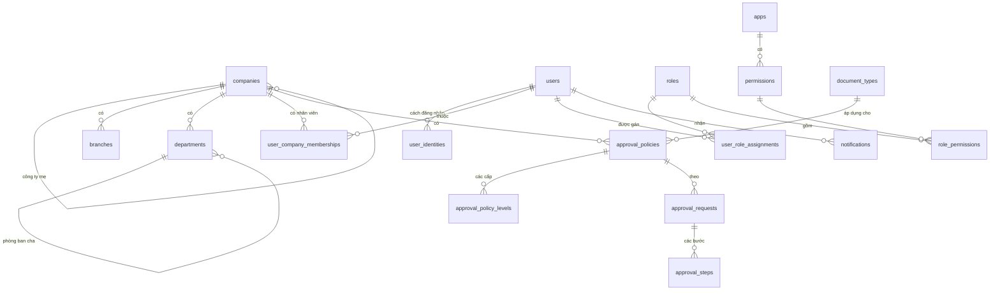

## 3b. Quy tắc kiểm tra dữ liệu, xóa và lưu giữ

- Kiểm tra dữ liệu đầu vào ở hai lớp: lược đồ zod tại API (kiểu, độ dài, định dạng; tài liệu `17`) và ràng buộc trong cơ sở dữ liệu (khóa, duy nhất, kiểm tra).
- Không xóa cứng: công ty, chi nhánh, phòng ban, người dùng, vai trò, chính sách duyệt, yêu cầu duyệt, tỷ giá (QUYTAC_NGHIEPVU_03). Dùng trạng thái hoặc ngày hết hiệu lực.
- Được xóa cứng: phiên hết hạn quá 90 ngày; mã dùng một lần đã dùng hoặc hết hạn quá 30 ngày; mã OTP đăng nhập lưu bảng `otp_codes` (CONG_VIEC_03), chưa có tác vụ xóa định kỳ; thông báo đã đọc quá 180 ngày.
- Lưu giữ: nhật ký thao tác tối thiểu 10 năm (QUYTAC_NGHIEPVU_30); nhật ký đăng nhập 2 năm; partition nhật ký thao tác tạo trước mỗi tháng bằng tác vụ nền.
- Lịch sử thay đổi: mọi thay đổi bảng nghiệp vụ ghi `audit_events` (dữ liệu trước và sau); cột `version` chống ghi đè đồng thời.

## 4. Lược đồ schema `core`

```sql
-- =============================================================================
-- VComm - Mo hinh du lieu mini app Nen tang (schema `core`)
-- PostgreSQL 16+
--
-- Quy uoc:
--   * Khoa chinh UUID. Ung dung sinh UUIDv7 (tang dan theo thoi gian);
--     DEFAULT gen_random_uuid() chi de du phong khi chen tay.
--   * Moi bang nghiep vu co created_at/created_by/updated_at/updated_by
--     va version (khoa lac quan - optimistic locking).
--   * Khong xoa cung du lieu nghiep vu: dung status hoac archived_at.
--   * Tien te luu numeric(20,4); ty gia numeric(20,8).
--   * Ten bang/cot: snake_case, so nhieu cho bang.
-- =============================================================================

CREATE SCHEMA IF NOT EXISTS core;
CREATE EXTENSION IF NOT EXISTS citext;

-- -----------------------------------------------------------------------------
-- 1. Tien te & ty gia
-- -----------------------------------------------------------------------------
CREATE TABLE core.currencies (
    code            char(3)      PRIMARY KEY,           -- ISO 4217: VND, USD, CNY...
    name_vi         text         NOT NULL,
    name_en         text         NOT NULL,
    minor_units     smallint     NOT NULL DEFAULT 0,    -- VND = 0, USD = 2
    is_active       boolean      NOT NULL DEFAULT true
);

CREATE TABLE core.exchange_rates (
    id              uuid         PRIMARY KEY DEFAULT gen_random_uuid(),
    rate_date       date         NOT NULL,
    from_currency   char(3)      NOT NULL REFERENCES core.currencies(code),
    to_currency     char(3)      NOT NULL REFERENCES core.currencies(code),
    rate_type       text         NOT NULL CHECK (rate_type IN ('buy', 'sell', 'transfer', 'accounting')),
    rate            numeric(20,8) NOT NULL CHECK (rate > 0),
    source          text         NOT NULL,              -- 'vietcombank', 'manual', ...
    created_at      timestamptz  NOT NULL DEFAULT now(),
    created_by      uuid,
    UNIQUE (rate_date, from_currency, to_currency, rate_type, source),
    CHECK (from_currency <> to_currency)
);

-- -----------------------------------------------------------------------------
-- 2. To chuc: tap doan -> cong ty (phap nhan) -> chi nhanh -> phong ban
-- -----------------------------------------------------------------------------
CREATE TABLE core.companies (
    id                  uuid        PRIMARY KEY DEFAULT gen_random_uuid(),
    parent_id           uuid        REFERENCES core.companies(id),   -- NULL = cong ty me/tap doan
    code                text        NOT NULL UNIQUE,                 -- 'VCG', 'VCR'...
    legal_name          text        NOT NULL,
    short_name          text        NOT NULL,
    tax_code            text        UNIQUE,                          -- ma so thue
    address             text,
    phone               text,
    email               citext,
    base_currency       char(3)     NOT NULL DEFAULT 'VND' REFERENCES core.currencies(code),
    accounting_regime   text        NOT NULL DEFAULT 'TT99_2025' CHECK (accounting_regime IN ('TT99_2025', 'TT133')),
    fiscal_year_start   smallint    NOT NULL DEFAULT 1 CHECK (fiscal_year_start BETWEEN 1 AND 12),
    status              text        NOT NULL DEFAULT 'active' CHECK (status IN ('active', 'inactive')),
    created_at          timestamptz NOT NULL DEFAULT now(),
    created_by          uuid,
    updated_at          timestamptz NOT NULL DEFAULT now(),
    updated_by          uuid,
    version             integer     NOT NULL DEFAULT 1,
    CHECK (parent_id IS NULL OR parent_id <> id)
);

CREATE TABLE core.branches (
    id              uuid        PRIMARY KEY DEFAULT gen_random_uuid(),
    company_id      uuid        NOT NULL REFERENCES core.companies(id),
    code            text        NOT NULL,
    name            text        NOT NULL,
    branch_type     text        NOT NULL CHECK (branch_type IN ('head_office', 'office', 'warehouse', 'store', 'other')),
    province_code   text,                               -- ma tinh/thanh theo danh muc hanh chinh
    address         text,
    phone           text,
    status          text        NOT NULL DEFAULT 'active' CHECK (status IN ('active', 'inactive')),
    created_at      timestamptz NOT NULL DEFAULT now(),
    created_by      uuid,
    updated_at      timestamptz NOT NULL DEFAULT now(),
    updated_by      uuid,
    version         integer     NOT NULL DEFAULT 1,
    UNIQUE (company_id, code)
);

CREATE TABLE core.departments (
    id              uuid        PRIMARY KEY DEFAULT gen_random_uuid(),
    company_id      uuid        NOT NULL REFERENCES core.companies(id),
    parent_id       uuid        REFERENCES core.departments(id),
    code            text        NOT NULL,
    name            text        NOT NULL,
    manager_user_id uuid,                               -- FK them sau khi tao core.users
    status          text        NOT NULL DEFAULT 'active' CHECK (status IN ('active', 'inactive')),
    created_at      timestamptz NOT NULL DEFAULT now(),
    created_by      uuid,
    updated_at      timestamptz NOT NULL DEFAULT now(),
    updated_by      uuid,
    version         integer     NOT NULL DEFAULT 1,
    UNIQUE (company_id, code)
);

-- -----------------------------------------------------------------------------
-- 3. Nguoi dung & dang nhap
-- -----------------------------------------------------------------------------
CREATE TABLE core.users (
    id                  uuid        PRIMARY KEY DEFAULT gen_random_uuid(),
    username            citext      UNIQUE,
    email               citext      UNIQUE,
    phone               text        UNIQUE,             -- dinh dang E.164: +84...
    full_name           text        NOT NULL,
    avatar_url          text,
    locale              text        NOT NULL DEFAULT 'vi' CHECK (locale IN ('vi', 'en')),
    timezone            text        NOT NULL DEFAULT 'Asia/Ho_Chi_Minh',
    mfa_required        boolean     NOT NULL DEFAULT false, -- bat buoc OTP (tu dong true neu co vai tro nhay cam)
    is_super_admin      boolean     NOT NULL DEFAULT false,
    status              text        NOT NULL DEFAULT 'invited'
                        CHECK (status IN ('invited', 'active', 'locked', 'disabled')),
    last_login_at       timestamptz,
    login_locked_until  timestamptz,                    -- QUYTAC_NGHIEPVU_07: khoa 15 phut sau 5 lan sai
    created_at          timestamptz NOT NULL DEFAULT now(),
    created_by          uuid,
    updated_at          timestamptz NOT NULL DEFAULT now(),
    updated_by          uuid,
    version             integer     NOT NULL DEFAULT 1,
    CHECK (username IS NOT NULL OR email IS NOT NULL OR phone IS NOT NULL)
);

ALTER TABLE core.departments
    ADD CONSTRAINT departments_manager_fk FOREIGN KEY (manager_user_id) REFERENCES core.users(id);

-- Mot nguoi dung co the dang nhap bang nhieu cach.
CREATE TABLE core.user_identities (
    id                  uuid        PRIMARY KEY DEFAULT gen_random_uuid(),
    user_id             uuid        NOT NULL REFERENCES core.users(id) ON DELETE CASCADE,
    provider            text        NOT NULL CHECK (provider IN ('password', 'google', 'microsoft', 'zalo', 'phone_otp')),
    provider_subject    text        NOT NULL,           -- username/email; 'sub' cua Google/Microsoft; id Zalo; so dien thoai
    password_hash       text,                           -- argon2id, chi voi provider = 'password'
    password_changed_at timestamptz,
    created_at          timestamptz NOT NULL DEFAULT now(),
    last_used_at        timestamptz,
    UNIQUE (provider, provider_subject),
    CHECK ((provider = 'password') = (password_hash IS NOT NULL))
);

-- Yeu to xac thuc thu 2.
CREATE TABLE core.mfa_factors (
    id                  uuid        PRIMARY KEY DEFAULT gen_random_uuid(),
    user_id             uuid        NOT NULL REFERENCES core.users(id) ON DELETE CASCADE,
    factor_type         text        NOT NULL CHECK (factor_type IN ('totp', 'sms', 'email')),
    secret_encrypted    bytea,                          -- ma hoa bang KMS, chi voi totp
    target              text,                           -- so dien thoai/email nhan OTP
    confirmed_at        timestamptz,
    created_at          timestamptz NOT NULL DEFAULT now()
);

-- Ma du phong xac thuc hai lop (CHUC_NANG_09): 10 ma, dung mot lan.
CREATE TABLE core.mfa_backup_codes (
    id                  uuid        PRIMARY KEY DEFAULT gen_random_uuid(),
    user_id             uuid        NOT NULL REFERENCES core.users(id) ON DELETE CASCADE,
    code_hash           text        NOT NULL,           -- argon2id
    used_at             timestamptz,
    created_at          timestamptz NOT NULL DEFAULT now()
);
CREATE INDEX mfa_backup_codes_user_idx ON core.mfa_backup_codes (user_id) WHERE used_at IS NULL;

-- Ma dung mot lan: kich hoat tai khoan (72 gio), dat lai mat khau (1 gio).
CREATE TABLE core.user_tokens (
    id                  uuid        PRIMARY KEY DEFAULT gen_random_uuid(),
    user_id             uuid        NOT NULL REFERENCES core.users(id) ON DELETE CASCADE,
    purpose             text        NOT NULL CHECK (purpose IN ('activation', 'password_reset')),
    token_hash          bytea       NOT NULL UNIQUE,    -- SHA-256 cua token gui qua email, SMS
    expires_at          timestamptz NOT NULL,
    used_at             timestamptz,
    created_at          timestamptz NOT NULL DEFAULT now(),
    created_by          uuid
);

-- Phien dang nhap; luu bam (hash) cua refresh token, khong luu token goc.
CREATE TABLE core.sessions (
    id                  uuid        PRIMARY KEY DEFAULT gen_random_uuid(),
    user_id             uuid        NOT NULL REFERENCES core.users(id) ON DELETE CASCADE,
    refresh_token_hash  bytea       NOT NULL UNIQUE,
    family_id           uuid        NOT NULL,           -- chuoi phien; phat hien dung lai token cu thi thu hoi ca chuoi
    client_type         text        NOT NULL CHECK (client_type IN ('web', 'warehouse_app', 'sales_app')),
    ip                  inet,
    user_agent          text,
    mfa_verified        boolean     NOT NULL DEFAULT false,
    created_at          timestamptz NOT NULL DEFAULT now(),
    expires_at          timestamptz NOT NULL,
    revoked_at          timestamptz
);
CREATE INDEX sessions_user_idx ON core.sessions (user_id) WHERE revoked_at IS NULL;

-- Nhat ky dang nhap (thanh cong/that bai) de khoa tai khoan va dieu tra.
CREATE TABLE core.login_attempts (
    id                  bigint      GENERATED ALWAYS AS IDENTITY PRIMARY KEY,
    attempted_at        timestamptz NOT NULL DEFAULT now(),
    provider            text        NOT NULL,
    identifier          text        NOT NULL,           -- username/email/phone da nhap
    user_id             uuid        REFERENCES core.users(id),
    success             boolean     NOT NULL,
    failure_reason      text,
    ip                  inet,
    user_agent          text
);
CREATE INDEX login_attempts_identifier_idx ON core.login_attempts (identifier, attempted_at DESC);

-- Nguoi dung thuoc cong ty nao, lam o dau. Mot nguoi co the thuoc nhieu cong ty.
CREATE TABLE core.user_company_memberships (
    id                  uuid        PRIMARY KEY DEFAULT gen_random_uuid(),
    user_id             uuid        NOT NULL REFERENCES core.users(id),
    company_id          uuid        NOT NULL REFERENCES core.companies(id),
    default_branch_id   uuid        REFERENCES core.branches(id),
    department_id       uuid        REFERENCES core.departments(id),
    job_title           text,
    is_default          boolean     NOT NULL DEFAULT false, -- cong ty mo san khi dang nhap
    status              text        NOT NULL DEFAULT 'active' CHECK (status IN ('active', 'inactive')),
    created_at          timestamptz NOT NULL DEFAULT now(),
    created_by          uuid,
    updated_at          timestamptz NOT NULL DEFAULT now(),
    updated_by          uuid,
    UNIQUE (user_id, company_id)
);
CREATE UNIQUE INDEX user_company_one_default_idx
    ON core.user_company_memberships (user_id) WHERE is_default;

-- -----------------------------------------------------------------------------
-- 4. Mini app & phan quyen
-- -----------------------------------------------------------------------------
-- Danh sach mini app hien tren trang chu.
CREATE TABLE core.apps (
    code            text        PRIMARY KEY,            -- 'platform', 'catalog', 'inventory', ...
    name_vi         text        NOT NULL,
    name_en         text        NOT NULL,
    description_vi  text,
    description_en  text,
    base_url        text        NOT NULL,               -- '/inventory' hoac domain rieng
    icon            text        NOT NULL,
    sort_order      integer     NOT NULL DEFAULT 0,
    is_active       boolean     NOT NULL DEFAULT true
);

-- Quyen = <app>.<doi tuong>.<hanh dong>, vd 'inventory.stock_receipt.approve'.
-- Do code khai bao va dong bo vao bang khi trien khai; admin khong tao tay.
CREATE TABLE core.permissions (
    code            text        PRIMARY KEY,
    app_code        text        NOT NULL REFERENCES core.apps(code),
    name_vi         text        NOT NULL,
    name_en         text        NOT NULL,
    is_sensitive    boolean     NOT NULL DEFAULT false  -- vai tro co quyen nay => bat buoc OTP
);

-- Vai tro: nhom quyen do admin dinh nghia.
-- company_id NULL = vai tro dung chung toan tap doan.
CREATE TABLE core.roles (
    id              uuid        PRIMARY KEY DEFAULT gen_random_uuid(),
    company_id      uuid        REFERENCES core.companies(id),
    code            text        NOT NULL,
    name_vi         text        NOT NULL,
    name_en         text        NOT NULL,
    description     text,
    is_system       boolean     NOT NULL DEFAULT false, -- vai tro mac dinh, khong xoa duoc
    status          text        NOT NULL DEFAULT 'active' CHECK (status IN ('active', 'inactive')),
    created_at      timestamptz NOT NULL DEFAULT now(),
    created_by      uuid,
    updated_at      timestamptz NOT NULL DEFAULT now(),
    updated_by      uuid,
    version         integer     NOT NULL DEFAULT 1
);
CREATE UNIQUE INDEX roles_code_uq ON core.roles (COALESCE(company_id, '00000000-0000-0000-0000-000000000000'::uuid), code);

CREATE TABLE core.role_permissions (
    role_id         uuid        NOT NULL REFERENCES core.roles(id) ON DELETE CASCADE,
    permission_code text        NOT NULL REFERENCES core.permissions(code),
    PRIMARY KEY (role_id, permission_code)
);

-- Gan vai tro cho nguoi dung TRONG MOT PHAM VI:
--   group   = toan tap doan (scope_id NULL)
--   company = mot cong ty (scope_id = companies.id)
--   branch  = mot chi nhanh (scope_id = branches.id)
CREATE TABLE core.user_role_assignments (
    id              uuid        PRIMARY KEY DEFAULT gen_random_uuid(),
    user_id         uuid        NOT NULL REFERENCES core.users(id),
    role_id         uuid        NOT NULL REFERENCES core.roles(id),
    scope_type      text        NOT NULL CHECK (scope_type IN ('group', 'company', 'branch')),
    company_id      uuid        REFERENCES core.companies(id),
    branch_id       uuid        REFERENCES core.branches(id),
    valid_from      date        NOT NULL DEFAULT current_date,
    valid_to        date,
    created_at      timestamptz NOT NULL DEFAULT now(),
    created_by      uuid,
    CHECK (
        (scope_type = 'group'   AND company_id IS NULL     AND branch_id IS NULL) OR
        (scope_type = 'company' AND company_id IS NOT NULL AND branch_id IS NULL) OR
        (scope_type = 'branch'  AND company_id IS NOT NULL AND branch_id IS NOT NULL)
    ),
    CHECK (valid_to IS NULL OR valid_to >= valid_from)
);
CREATE INDEX user_role_assignments_user_idx ON core.user_role_assignments (user_id);

-- -----------------------------------------------------------------------------
-- 5. Duyet chung tu theo han muc
-- -----------------------------------------------------------------------------
-- Loai chung tu can duyet, do cac mini app dang ky: 'purchasing.purchase_order', 'finance.payment'...
CREATE TABLE core.document_types (
    code            text        PRIMARY KEY,
    app_code        text        NOT NULL REFERENCES core.apps(code),
    name_vi         text        NOT NULL,
    name_en         text        NOT NULL,
    requires_approval boolean   NOT NULL DEFAULT false
);

-- Chinh sach duyet: moi cong ty x loai chung tu co mot chinh sach dang hieu luc.
CREATE TABLE core.approval_policies (
    id                  uuid        PRIMARY KEY DEFAULT gen_random_uuid(),
    company_id          uuid        NOT NULL REFERENCES core.companies(id),
    document_type_code  text        NOT NULL REFERENCES core.document_types(code),
    currency            char(3)     NOT NULL DEFAULT 'VND' REFERENCES core.currencies(code),
    effective_from      date        NOT NULL,
    effective_to        date,
    created_at          timestamptz NOT NULL DEFAULT now(),
    created_by          uuid,
    CHECK (effective_to IS NULL OR effective_to >= effective_from)
);

-- Cac cap duyet. Chung tu co gia tri >= min_amount phai qua cap nay.
-- Vi du don mua: cap 1 >= 0 (truong bo phan), cap 2 >= 50 trieu (giam doc), cap 3 >= 500 trieu (TGD).
CREATE TABLE core.approval_policy_levels (
    id                  uuid        PRIMARY KEY DEFAULT gen_random_uuid(),
    policy_id           uuid        NOT NULL REFERENCES core.approval_policies(id) ON DELETE CASCADE,
    level_no            smallint    NOT NULL CHECK (level_no >= 1),
    min_amount          numeric(20,4) NOT NULL DEFAULT 0 CHECK (min_amount >= 0),
    approver_type       text        NOT NULL CHECK (approver_type IN ('role', 'user', 'department_manager')),
    approver_role_id    uuid        REFERENCES core.roles(id),
    approver_user_id    uuid        REFERENCES core.users(id),
    substitute_type     text        NOT NULL CHECK (substitute_type IN ('role', 'user')),
    substitute_role_id  uuid        REFERENCES core.roles(id),
    substitute_user_id  uuid        REFERENCES core.users(id),
    due_hours           integer     NOT NULL CHECK (due_hours > 0),   -- QUYTAC_NGHIEPVU_21
    UNIQUE (policy_id, level_no),
    CHECK (
        (substitute_type = 'role' AND substitute_role_id IS NOT NULL AND substitute_user_id IS NULL) OR
        (substitute_type = 'user' AND substitute_user_id IS NOT NULL AND substitute_role_id IS NULL)
    ),
    CHECK (
        (approver_type = 'role'               AND approver_role_id IS NOT NULL AND approver_user_id IS NULL) OR
        (approver_type = 'user'               AND approver_user_id IS NOT NULL AND approver_role_id IS NULL) OR
        (approver_type = 'department_manager' AND approver_role_id IS NULL     AND approver_user_id IS NULL)
    )
);

-- Mot yeu cau duyet cho mot chung tu cu the.
CREATE TABLE core.approval_requests (
    id                  uuid        PRIMARY KEY DEFAULT gen_random_uuid(),
    company_id          uuid        NOT NULL REFERENCES core.companies(id),
    document_type_code  text        NOT NULL REFERENCES core.document_types(code),
    document_id         uuid        NOT NULL,
    document_no         text        NOT NULL,
    amount              numeric(20,4) NOT NULL,
    currency            char(3)     NOT NULL REFERENCES core.currencies(code),
    document_date       date        NOT NULL,
    exchange_rate       numeric(20,8),                  -- ty gia hach toan ngay lap; NULL khi cung tien te chinh sach
    amount_in_policy_currency numeric(20,4) NOT NULL,   -- QUYTAC_NGHIEPVU_19
    policy_id           uuid        NOT NULL REFERENCES core.approval_policies(id),
    status              text        NOT NULL DEFAULT 'pending'
                        CHECK (status IN ('pending', 'approved', 'rejected', 'withdrawn')),
    current_level_no    smallint,
    requested_by        uuid        NOT NULL REFERENCES core.users(id),
    requested_at        timestamptz NOT NULL DEFAULT now(),
    completed_at        timestamptz
);
CREATE UNIQUE INDEX approval_requests_open_uq
    ON core.approval_requests (document_type_code, document_id) WHERE status = 'pending';

CREATE TABLE core.approval_steps (
    id                  uuid        PRIMARY KEY DEFAULT gen_random_uuid(),
    request_id          uuid        NOT NULL REFERENCES core.approval_requests(id) ON DELETE CASCADE,
    level_no            smallint    NOT NULL,
    assigned_role_id    uuid        REFERENCES core.roles(id),   -- nguoi duyet theo vai tro
    assigned_user_id    uuid        REFERENCES core.users(id),   -- nguoi duyet cu the
    is_substitute       boolean     NOT NULL DEFAULT false,      -- da chuyen cho nguoi thay the (QUYTAC_NGHIEPVU_20, 21)
    started_at          timestamptz,                             -- thoi diem cap nay bat dau cho
    reminded_at         timestamptz,
    escalated_at        timestamptz,
    decision            text        CHECK (decision IN ('approved', 'rejected')),
    decided_by          uuid        REFERENCES core.users(id),
    decided_at          timestamptz,
    comment             text,
    UNIQUE (request_id, level_no),
    CHECK (assigned_role_id IS NOT NULL OR assigned_user_id IS NOT NULL),
    CHECK (decision <> 'rejected' OR comment IS NOT NULL)
);
CREATE INDEX approval_steps_waiting_idx ON core.approval_steps (assigned_user_id) WHERE decision IS NULL;

-- -----------------------------------------------------------------------------
-- 6. Danh so chung tu
-- -----------------------------------------------------------------------------
-- Vi du: PN-VCR-2026-000123. Lay so bang UPDATE ... RETURNING trong cung giao dich.
CREATE TABLE core.number_sequences (
    company_id          uuid        NOT NULL REFERENCES core.companies(id),
    document_type_code  text        NOT NULL REFERENCES core.document_types(code),
    period_key          text        NOT NULL,           -- '2026' hoac '2026-11' tuy reset_period
    prefix              text        NOT NULL,
    reset_period        text        NOT NULL DEFAULT 'year' CHECK (reset_period IN ('never', 'year', 'month')),
    padding             smallint    NOT NULL DEFAULT 6,
    next_value          bigint      NOT NULL DEFAULT 1,
    PRIMARY KEY (company_id, document_type_code, period_key)
);

-- Thong bao trong ung dung (chuong o thanh tren cung).
CREATE TABLE core.notifications (
    id              uuid        PRIMARY KEY DEFAULT gen_random_uuid(),
    user_id         uuid        NOT NULL REFERENCES core.users(id) ON DELETE CASCADE,
    company_id      uuid        REFERENCES core.companies(id),
    kind            text        NOT NULL,               -- 'approval.assigned', 'approval.reminder', 'approval.escalated', 'approval.completed'...
    title           text        NOT NULL,
    link            text,
    payload         jsonb       NOT NULL DEFAULT '{}'::jsonb,
    read_at         timestamptz,
    created_at      timestamptz NOT NULL DEFAULT now()
);
CREATE INDEX notifications_unread_idx ON core.notifications (user_id, created_at DESC) WHERE read_at IS NULL;

-- -----------------------------------------------------------------------------
-- 7. Nhat ky thao tac (audit) & su kien (outbox)
-- -----------------------------------------------------------------------------
-- Chi INSERT, khong UPDATE/DELETE. Chia partition theo thang.
CREATE TABLE core.audit_events (
    id              uuid        NOT NULL DEFAULT gen_random_uuid(),
    occurred_at     timestamptz NOT NULL DEFAULT now(),
    actor_user_id   uuid,
    company_id      uuid,
    app_code        text        NOT NULL,
    action          text        NOT NULL,               -- 'create', 'update', 'approve', 'login', ...
    entity_type     text        NOT NULL,               -- 'core.users', 'inventory.stock_receipts'...
    entity_id       uuid,
    before_data     jsonb,
    after_data      jsonb,
    ip              inet,
    user_agent      text,
    request_id      text,
    PRIMARY KEY (id, occurred_at)
) PARTITION BY RANGE (occurred_at);

CREATE TABLE core.audit_events_2026_11 PARTITION OF core.audit_events
    FOR VALUES FROM ('2026-11-01') TO ('2026-12-01');
CREATE TABLE core.audit_events_2026_12 PARTITION OF core.audit_events
    FOR VALUES FROM ('2026-12-01') TO ('2027-01-01');
CREATE INDEX audit_events_entity_idx ON core.audit_events (entity_type, entity_id, occurred_at DESC);
CREATE INDEX audit_events_actor_idx  ON core.audit_events (actor_user_id, occurred_at DESC);

-- Outbox: ghi su kien trong cung giao dich voi du lieu, worker day sang SQS/SNS.
CREATE TABLE core.outbox_events (
    id              bigint      GENERATED ALWAYS AS IDENTITY PRIMARY KEY,
    occurred_at     timestamptz NOT NULL DEFAULT now(),
    event_type      text        NOT NULL,               -- 'core.user.created', 'inventory.stock.changed'...
    aggregate_type  text        NOT NULL,
    aggregate_id    uuid        NOT NULL,
    company_id      uuid,
    payload         jsonb       NOT NULL,
    published_at    timestamptz,
    attempts        integer     NOT NULL DEFAULT 0,
    last_error      text
);
CREATE INDEX outbox_unpublished_idx ON core.outbox_events (id) WHERE published_at IS NULL;

-- -----------------------------------------------------------------------------
-- 8. Du lieu khoi tao
-- -----------------------------------------------------------------------------
INSERT INTO core.currencies (code, name_vi, name_en, minor_units) VALUES
    ('VND', 'Đồng Việt Nam', 'Vietnamese dong', 0),
    ('USD', 'Đô la Mỹ', 'US dollar', 2),
    ('CNY', 'Nhân dân tệ', 'Chinese yuan', 2),
    ('EUR', 'Euro', 'Euro', 2);

INSERT INTO core.apps (code, name_vi, name_en, base_url, icon, sort_order) VALUES
    ('platform',   'Quản trị hệ thống', 'Administration',     '/platform',   'settings',  10),
    ('catalog',    'Sản phẩm & Nhà bán', 'Products & Sellers', '/catalog',    'package',   20),
    ('inventory',  'Kho',               'Inventory',          '/inventory',  'warehouse', 30),
    ('purchasing', 'Mua hàng',          'Purchasing',         '/purchasing', 'cart',      40),
    ('sales',      'Bán hàng',          'Sales',              '/sales',      'receipt',   50),
    ('finance',    'Tài chính - Kế toán', 'Finance & Accounting', '/finance', 'calculator', 60),
    ('crm',        'Khách hàng & Đối tác', 'Customers & Partners', '/crm',    'users',     70),
    ('hr',         'Nhân sự',           'Human Resources',    '/hr',         'id-card',   80);
```

## 5. Database migration 0002 – CONG_VIEC_03

Tệp `database/migrations/0002_cong_viec_03.sql` thêm 6 bảng vào schema `core`, không đổi bảng đã có (THAY_DOI_04, THAY_DOI_08). `core.user_identities` dùng lại: với `provider = 'phone_otp'`, `provider_subject` là số điện thoại dạng `+84...`, gắn khi đăng nhập bằng mã OTP lần đầu.

| Bảng | Mục đích | Cột chính | Ràng buộc, chỉ mục |
|---|---|---|---|
| `integration_settings` | Cài đặt tích hợp (CHUC_NANG_25; QUYTAC_NGHIEPVU_31) | `setting_key` (khóa chính: `google.client_id`, `esms.secret_key`...), `plain_value` (giá trị thường), `secret_value` (giá trị bí mật mã hóa AES-256-GCM), `updated_at`, `updated_by` | Chỉ một trong hai cột giá trị có dữ liệu; khóa cài đặt hợp lệ do `packages/contracts` khai báo |
| `otp_codes` | Mã OTP đăng nhập bằng số điện thoại (CHUC_NANG_08; QUYTAC_NGHIEPVU_10) | `phone` (`+84...`), `code_hash` (SHA-256 của mã), `expires_at` (5 phút), `wrong_attempts`, `consumed_at`, `created_at` | Chỉ mục `(phone, created_at DESC)` để đếm số lần gửi trong một giờ; sai 5 lần thì đặt `consumed_at` |
| `message_deliveries` | Nhật ký gửi tin qua eSMS.vn (QUYTAC_NGHIEPVU_32) | `channel` (`zns`, `zns_sms` = Zalo rồi SMS, `sms`), `purpose` (`login_otp`, `approval.assigned`, `approval.reminder`, `approval.completed`), `user_id`, `phone_masked` (`+8490***4567`), `template_id`, `status` (`sent`, `failed`, `skipped`), `provider_message_id` (mã tin eSMS), `error`, `created_at` | Kiểm tra giá trị `channel`, `status`; chỉ mục `created_at DESC`. Không lưu nội dung mã OTP |
| `proposal_templates` | Mẫu đề xuất (CHUC_NANG_27; QUYTAC_NGHIEPVU_33) | `company_id`, `code`, `name`, `description`, `document_type_code`, `fields` (JSON: `key`, `label`, `type`, `required`, `options`, `columns`), `amount_field` (trống = tổng thành tiền bảng chi tiết), `currency`, `status` (`active`, `inactive`), cột người tạo, người sửa, `version` | Duy nhất `(company_id, code)`; `document_type_code` duy nhất, tham chiếu `document_types`; `currency` tham chiếu `currencies` |
| `proposals` | Đề xuất (CHUC_NANG_28; QUYTAC_NGHIEPVU_33, QUYTAC_NGHIEPVU_34) | `company_id`, `template_id`, `template_snapshot` (JSON, bản chụp mẫu lúc lập), `document_type_code`, `proposal_no` (cấp khi gửi), `title`, `field_values` (JSON), `amount` (giá trị duyệt, `numeric(20,4)` không âm), `currency`, `status` (`draft`, `pending`, `approved`, `rejected`, `withdrawn`), `approval_request_id`, `requested_by`, `created_at`, `updated_at`, `submitted_at`, `completed_at`, `version` | Duy nhất `(company_id, proposal_no)`; chỉ mục `(requested_by, created_at DESC)`, `(company_id, created_at DESC)` |
| `attachments` | Tệp đính kèm (QUYTAC_NGHIEPVU_35) | `company_id`, `owner_type` (hiện chỉ `proposal`), `owner_id`, `file_name`, `content_type`, `size_bytes` (lớn hơn 0), `storage_key` (khóa lưu trữ do hệ thống sinh, không chứa tên tệp người dùng), `uploaded_by`, `created_at` | `storage_key` duy nhất; chỉ mục `(owner_type, owner_id)`. Nội dung tệp lưu S3 khi `STORAGE_DRIVER=s3`, thư mục cục bộ khi phát triển, kiểm thử |

Quy tắc xóa và lưu giữ bổ sung:
- Đề xuất nháp được xóa cứng cùng tệp đính kèm (QUYTAC_NGHIEPVU_34); đề xuất đã gửi không xóa. Tệp đính kèm được xóa cứng khi đề xuất còn Nháp.
- `integration_settings`: xóa dòng khi quản trị xóa giá trị; mọi lần lưu ghi `audit_events` (khóa bí mật chỉ ghi 4 ký tự cuối).
- `otp_codes`, `message_deliveries`: chưa có tác vụ dọn định kỳ.

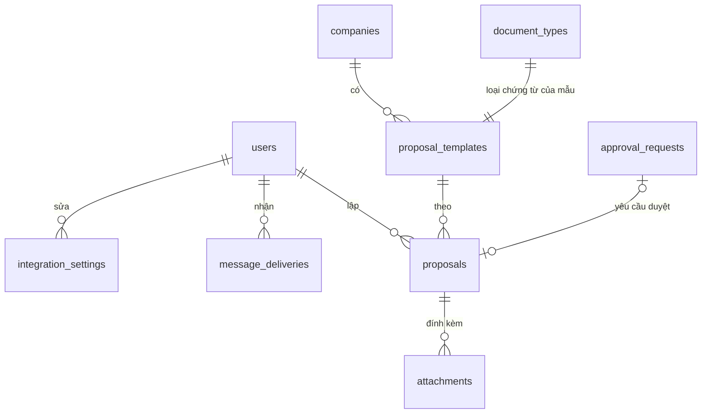

Lược đồ (chép từ tệp `database/migrations/0002_cong_viec_03.sql`):

```sql
-- CONG_VIEC_03: Cài đặt tích hợp, mã OTP qua số điện thoại, nhật ký gửi tin, mẫu đề xuất, đề xuất, tệp đính kèm (tài liệu 16).

-- Cài đặt tích hợp (CHUC_NANG_25; QUYTAC_NGHIEPVU_31): giá trị thường hoặc giá trị bí mật đã mã hóa AES-256-GCM.
CREATE TABLE core.integration_settings (
    setting_key     text        PRIMARY KEY,                -- 'google.client_id', 'esms.secret_key'...
    plain_value     text,
    secret_value    bytea,
    updated_at      timestamptz NOT NULL DEFAULT now(),
    updated_by      uuid        REFERENCES core.users(id),
    CHECK (plain_value IS NULL OR secret_value IS NULL)
);

-- Mã OTP đăng nhập bằng số điện thoại (CHUC_NANG_08; QUYTAC_NGHIEPVU_10): hiệu lực 5 phút, tối đa 5 lần nhập sai.
CREATE TABLE core.otp_codes (
    id              uuid        PRIMARY KEY DEFAULT gen_random_uuid(),
    phone           text        NOT NULL,                   -- dạng +84...
    code_hash       text        NOT NULL,                   -- SHA-256 của mã
    expires_at      timestamptz NOT NULL,
    wrong_attempts  smallint    NOT NULL DEFAULT 0,
    consumed_at     timestamptz,
    created_at      timestamptz NOT NULL DEFAULT now()
);
CREATE INDEX otp_codes_phone_idx ON core.otp_codes (phone, created_at DESC);

-- Nhật ký gửi tin Zalo ZNS, SMS qua eSMS.vn (QUYTAC_NGHIEPVU_32). Không lưu nội dung mã OTP.
CREATE TABLE core.message_deliveries (
    id                  uuid        PRIMARY KEY DEFAULT gen_random_uuid(),
    channel             text        NOT NULL CHECK (channel IN ('zns', 'zns_sms', 'sms')),
    purpose             text        NOT NULL,               -- 'login_otp', 'approval.assigned'...
    user_id             uuid        REFERENCES core.users(id),
    phone_masked        text        NOT NULL,               -- +8490***4567
    template_id         text,
    status              text        NOT NULL CHECK (status IN ('sent', 'failed', 'skipped')),
    provider_message_id text,
    error               text,
    created_at          timestamptz NOT NULL DEFAULT now()
);
CREATE INDEX message_deliveries_created_idx ON core.message_deliveries (created_at DESC);

-- Mẫu đề xuất (CHUC_NANG_27; QUYTAC_NGHIEPVU_33): mỗi mẫu là một loại chứng từ cần duyệt của công ty.
CREATE TABLE core.proposal_templates (
    id                  uuid        PRIMARY KEY DEFAULT gen_random_uuid(),
    company_id          uuid        NOT NULL REFERENCES core.companies(id),
    code                text        NOT NULL,               -- 'PC', 'TU', 'MS'...
    name                text        NOT NULL,
    description         text,
    document_type_code  text        NOT NULL UNIQUE REFERENCES core.document_types(code),
    fields              jsonb       NOT NULL,               -- danh sách trường: key, label, type, required, options, columns
    amount_field        text,                               -- khóa trường tiền dùng làm giá trị duyệt; NULL = tổng thành tiền bảng chi tiết
    currency            char(3)     NOT NULL DEFAULT 'VND' REFERENCES core.currencies(code),
    status              text        NOT NULL DEFAULT 'active' CHECK (status IN ('active', 'inactive')),
    created_at          timestamptz NOT NULL DEFAULT now(),
    created_by          uuid,
    updated_at          timestamptz NOT NULL DEFAULT now(),
    updated_by          uuid,
    version             integer     NOT NULL DEFAULT 1,
    UNIQUE (company_id, code)
);

-- Đề xuất (CHUC_NANG_28; QUYTAC_NGHIEPVU_33, 34).
CREATE TABLE core.proposals (
    id                  uuid        PRIMARY KEY DEFAULT gen_random_uuid(),
    company_id          uuid        NOT NULL REFERENCES core.companies(id),
    template_id         uuid        NOT NULL REFERENCES core.proposal_templates(id),
    template_snapshot   jsonb       NOT NULL,               -- bản chụp mẫu lúc lập, không đổi khi mẫu bị sửa
    document_type_code  text        NOT NULL REFERENCES core.document_types(code),
    proposal_no         text,                               -- cấp khi gửi
    title               text        NOT NULL,
    field_values        jsonb       NOT NULL DEFAULT '{}'::jsonb,
    amount              numeric(20,4) NOT NULL DEFAULT 0 CHECK (amount >= 0),
    currency            char(3)     NOT NULL REFERENCES core.currencies(code),
    status              text        NOT NULL DEFAULT 'draft' CHECK (status IN ('draft', 'pending', 'approved', 'rejected', 'withdrawn')),
    approval_request_id uuid        REFERENCES core.approval_requests(id),
    requested_by        uuid        NOT NULL REFERENCES core.users(id),
    created_at          timestamptz NOT NULL DEFAULT now(),
    updated_at          timestamptz NOT NULL DEFAULT now(),
    submitted_at        timestamptz,
    completed_at        timestamptz,
    version             integer     NOT NULL DEFAULT 1,
    UNIQUE (company_id, proposal_no)
);
CREATE INDEX proposals_requester_idx ON core.proposals (requested_by, created_at DESC);
CREATE INDEX proposals_company_idx ON core.proposals (company_id, created_at DESC);

-- Tệp đính kèm (QUYTAC_NGHIEPVU_35): nội dung lưu S3 hoặc thư mục cục bộ theo khóa lưu trữ.
CREATE TABLE core.attachments (
    id              uuid        PRIMARY KEY DEFAULT gen_random_uuid(),
    company_id      uuid        NOT NULL REFERENCES core.companies(id),
    owner_type      text        NOT NULL CHECK (owner_type IN ('proposal')),
    owner_id        uuid        NOT NULL,
    file_name       text        NOT NULL,
    content_type    text        NOT NULL,
    size_bytes      integer     NOT NULL CHECK (size_bytes > 0),
    storage_key     text        NOT NULL UNIQUE,
    uploaded_by     uuid        NOT NULL REFERENCES core.users(id),
    created_at      timestamptz NOT NULL DEFAULT now()
);
CREATE INDEX attachments_owner_idx ON core.attachments (owner_type, owner_id);
```

## 6. Database migration 0003 – CONG_VIEC_04 (schema `catalog`)

Tệp `database/migrations/0003_catalog.sql` tạo schema `catalog` của MODULE_02 phần Sản phẩm, 15 bảng; không đổi schema `core`. Khóa ngoại từ `catalog` chỉ trỏ vào `catalog` và `core` (`core.companies`, `core.users`, `core.currencies`, `core.approval_requests`). Quyền, vai trò `catalog_manager`, loại chứng từ `catalog.price_change` "Phiếu điều chỉnh giá" ghi vào bảng của `core` bằng hàm đồng bộ danh mục quyền (`apps/api/src/permissions/permission-catalog.ts`), không nằm trong tệp database migration. Nội dung ảnh lưu bằng lưu trữ tệp của CONG_VIEC_03 (S3 hoặc thư mục cục bộ), khóa `products/<công ty>/<sản phẩm>/<mã ngẫu nhiên>`.

| Bảng | Mục đích | Cột chính | Ràng buộc, chỉ mục |
|---|---|---|---|
| `categories` | Ngành hàng dùng chung tập đoàn (CHUC_NANG_30; QUYTAC_NGHIEPVU_37) | `parent_id`, `code`, `name_vi`, `name_en`, `level`, `tracks_lots`, `tracks_serials`, `warranty_months`, `requires_quality_check` (CONG_VIEC_07, mục 9), `status`, cột người tạo, người sửa, `version` | `code` duy nhất, dạng `^[A-Z0-9]{2,6}$`; `level` 1 đến 4; `warranty_months` 0 đến 120; không bật cùng lúc lô và serial; chỉ mục `parent_id` |
| `units` | Đơn vị tính dùng chung tập đoàn | `code`, `name_vi`, `name_en`, `status`, `version` | `code` duy nhất, dạng `^[A-Z0-9_]{1,10}$`; nạp sẵn 14 đơn vị (`CAI`, `CHIEC`, `HOP`, `THUNG`, `GOI`, `CHAI`, `LON`, `BO`, `KG`, `G`, `L`, `ML`, `M`, `M2`) |
| `code_counters` | Bộ đếm sinh mã sản phẩm (QUYTAC_NGHIEPVU_39) | `company_id`, `prefix`, `next_value` | Khóa chính `(company_id, prefix)` |
| `products` | Sản phẩm của công ty (CHUC_NANG_31; QUYTAC_NGHIEPVU_38) | `company_id`, `seller_id` (nhà bán sở hữu; trống là hàng của công ty; dùng ở phần Nhà bán), `review_status` (`draft`, `pending`, `approved`, `rejected`; mặc định `approved`), `category_id`, `code`, `name`, `search_text` (tên, mã, thương hiệu bỏ dấu, chữ thường), `description`, `brand`, `origin`, `vat_rate` (`0`, `5`, `8`, `10`, `exempt`, `not_declared`), `tracks_lots`, `tracks_serials`, `warranty_months`, `base_unit_id`, `weight_kg`, `volume_m3`, `options` (JSON thuộc tính phân loại), `specifications` (JSON thông số), `status`, cột người tạo, người sửa, `version` | Duy nhất `(company_id, code)`; không bật cùng lúc lô và serial; chỉ mục `(company_id, category_id)`, `(company_id, updated_at DESC)`; CONG_VIEC_43 thêm `kind` (`goods`, `service`; mặc định `goods`), dịch vụ không theo dõi lô, serial (mục 27) |
| `product_units` | Đơn vị quy đổi (QUYTAC_NGHIEPVU_40) | `product_id`, `unit_id`, `factor` (`numeric(18,4)`, lớn hơn 0) | Khóa chính `(product_id, unit_id)`; xóa theo sản phẩm |
| `variants` | Biến thể, mỗi biến thể một mã hàng (QUYTAC_NGHIEPVU_39) | `company_id`, `product_id`, `sku`, `option_values` (JSON), `status`, `created_at` | Duy nhất `(company_id, sku)`; chỉ mục `product_id` |
| `barcodes` | Mã vạch theo biến thể và đơn vị (QUYTAC_NGHIEPVU_40) | `company_id`, `variant_id`, `unit_id`, `barcode` | Duy nhất `(company_id, barcode)`; dạng `^[0-9A-Za-z\-\.]{4,40}$`; chỉ mục `variant_id` |
| `product_images` | Ảnh sản phẩm | `product_id`, `file_name`, `content_type`, `size_bytes`, `storage_key`, `sort_order` (0 là ảnh đại diện), `uploaded_by`, `created_at` | `storage_key` duy nhất; chỉ mục `(product_id, sort_order)` |
| `variant_links` | Liên kết biến thể giữa hai công ty (QUYTAC_NGHIEPVU_41); lưu một chiều, đọc cả hai chiều | `variant_id`, `company_id`, `linked_variant_id`, `linked_company_id`, `factor` (mặc định 1, lớn hơn 0), `created_at`, `created_by` | Hai công ty khác nhau; duy nhất `(variant_id, linked_company_id)`, `(linked_variant_id, company_id)` |
| `sales_channels`, `customer_groups` | Kênh bán, nhóm khách hàng của công ty (CHUC_NANG_35) | `company_id`, `code`, `name`, `status`, `version` | Duy nhất `(company_id, code)`; mã dạng `^[A-Z0-9_]{1,20}$` |
| `price_lists` | Bảng giá (CHUC_NANG_36; QUYTAC_NGHIEPVU_42) | `company_id`, `code`, `name`, `channel_id`, `customer_group_id`, `currency`, `includes_vat`, `status`, cột người tạo, người sửa, `version` | Duy nhất `(company_id, code)`; chỉ mục duy nhất một phần `(company_id, kênh, nhóm khách, currency) WHERE status = 'active'` (trống thay bằng UUID toàn số 0) |
| `price_changes` | Phiếu điều chỉnh giá (CHUC_NANG_37; QUYTAC_NGHIEPVU_44) | `company_id`, `price_list_id`, `change_no` (cấp khi gửi), `effective_from`, `note`, `status` (`draft`, `pending`, `approved`, `rejected`, `withdrawn`), `approval_request_id`, `requested_by`, `created_at`, `updated_at`, `submitted_at`, `completed_at`, `version` | Duy nhất `(company_id, change_no)`; chỉ mục `(company_id, created_at DESC)` |
| `price_change_lines` | Dòng phiếu | `price_change_id`, `variant_id`, `unit_id`, `price` (`numeric(20,4)` không âm), `current_price` (giá hiện hành tại ngày hiệu lực lúc lưu, để so sánh) | Duy nhất `(price_change_id, variant_id, unit_id)`; xóa theo phiếu |
| `prices` | Lịch sử giá (QUYTAC_NGHIEPVU_43) | `price_list_id`, `variant_id`, `unit_id`, `price` (`numeric(20,4)` không âm), `effective_from`, `price_change_id`, `created_at` | Chỉ mục `(price_list_id, variant_id, unit_id, effective_from DESC, created_at DESC)` |

Quy tắc xóa và lưu giữ bổ sung:
- Không xóa ngành hàng, đơn vị tính, sản phẩm, biến thể, kênh bán, nhóm khách hàng, bảng giá: dùng `status`.
- Được xóa cứng: phiếu điều chỉnh giá còn Nháp (cùng các dòng); ảnh sản phẩm (cùng tệp); liên kết biến thể; đơn vị quy đổi, mã vạch được ghi lại toàn bộ mỗi lần lưu sản phẩm.
- `prices` chỉ thêm, không sửa, không xóa; quy tắc giữ ở tầng ứng dụng (API không có thao tác sửa, xóa giá), cơ sở dữ liệu chưa có trigger chặn.
- Tiền lưu `numeric(20,4)`; hệ số `numeric(18,4)`; trọng lượng `numeric(14,4)`, thể tích `numeric(14,6)`.

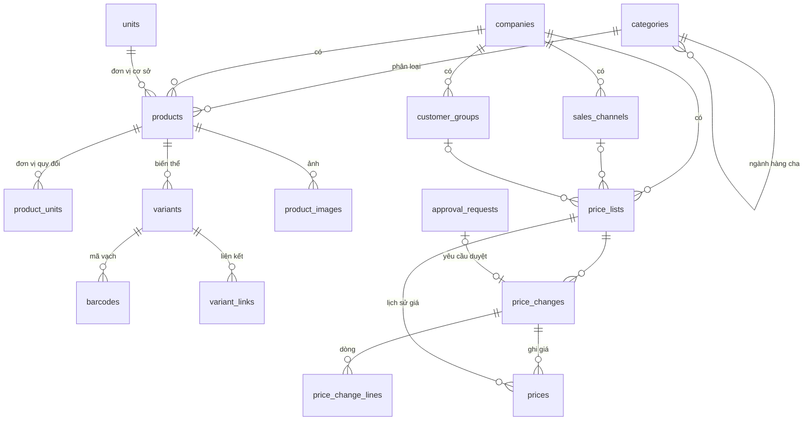

Lược đồ (chép từ tệp `database/migrations/0003_catalog.sql`):

```sql
-- CONG_VIEC_04: mini app Sản phẩm (MODULE_02, phần Sản phẩm), schema `catalog` (tài liệu 12 mục 2, tài liệu 16).
-- Khóa ngoại chỉ trỏ vào `catalog` và `core`.

CREATE SCHEMA IF NOT EXISTS catalog;

-- Ngành hàng dùng chung tập đoàn, tối đa 4 cấp (CHUC_NANG_30; QUYTAC_NGHIEPVU_37).
CREATE TABLE catalog.categories (
    id              uuid        PRIMARY KEY DEFAULT gen_random_uuid(),
    parent_id       uuid        REFERENCES catalog.categories(id),
    code            text        NOT NULL UNIQUE CHECK (code ~ '^[A-Z0-9]{2,6}$'),   -- tiền tố mã hàng
    name_vi         text        NOT NULL,
    name_en         text        NOT NULL,
    level           smallint    NOT NULL CHECK (level BETWEEN 1 AND 4),
    tracks_lots     boolean     NOT NULL DEFAULT false,     -- lô và hạn dùng
    tracks_serials  boolean     NOT NULL DEFAULT false,     -- serial, IMEI
    warranty_months smallint    NOT NULL DEFAULT 0 CHECK (warranty_months BETWEEN 0 AND 120),
    status          text        NOT NULL DEFAULT 'active' CHECK (status IN ('active', 'inactive')),
    created_at      timestamptz NOT NULL DEFAULT now(),
    created_by      uuid        REFERENCES core.users(id),
    updated_at      timestamptz NOT NULL DEFAULT now(),
    updated_by      uuid        REFERENCES core.users(id),
    version         integer     NOT NULL DEFAULT 1,
    CHECK (NOT (tracks_lots AND tracks_serials))
);
CREATE INDEX categories_parent_idx ON catalog.categories (parent_id);

-- Đơn vị tính dùng chung tập đoàn (cái, hộp, thùng, kg...).
CREATE TABLE catalog.units (
    id              uuid        PRIMARY KEY DEFAULT gen_random_uuid(),
    code            text        NOT NULL UNIQUE CHECK (code ~ '^[A-Z0-9_]{1,10}$'),
    name_vi         text        NOT NULL,
    name_en         text        NOT NULL,
    status          text        NOT NULL DEFAULT 'active' CHECK (status IN ('active', 'inactive')),
    created_at      timestamptz NOT NULL DEFAULT now(),
    updated_at      timestamptz NOT NULL DEFAULT now(),
    version         integer     NOT NULL DEFAULT 1
);

-- Bộ đếm sinh mã hàng theo công ty và tiền tố (QUYTAC_NGHIEPVU_39).
CREATE TABLE catalog.code_counters (
    company_id      uuid        NOT NULL REFERENCES core.companies(id),
    prefix          text        NOT NULL,
    next_value      integer     NOT NULL DEFAULT 1,
    PRIMARY KEY (company_id, prefix)
);

-- Sản phẩm của một công ty (CHUC_NANG_31; QUYTAC_NGHIEPVU_38). Cột nhà bán, trạng thái duyệt dùng ở phần Nhà bán.
CREATE TABLE catalog.products (
    id                  uuid        PRIMARY KEY DEFAULT gen_random_uuid(),
    company_id          uuid        NOT NULL REFERENCES core.companies(id),
    seller_id           uuid,                               -- nhà bán sở hữu; NULL: hàng của công ty
    review_status       text        NOT NULL DEFAULT 'approved' CHECK (review_status IN ('draft', 'pending', 'approved', 'rejected')),
    category_id         uuid        NOT NULL REFERENCES catalog.categories(id),
    code                text        NOT NULL,
    name                text        NOT NULL,
    search_text         text        NOT NULL,               -- tên, mã đã bỏ dấu, chữ thường (tìm không dấu)
    description         text,
    brand               text,
    origin              text,
    vat_rate            text        NOT NULL DEFAULT '10' CHECK (vat_rate IN ('0', '5', '8', '10', 'exempt', 'not_declared')),
    tracks_lots         boolean     NOT NULL DEFAULT false,
    tracks_serials      boolean     NOT NULL DEFAULT false,
    warranty_months     smallint    NOT NULL DEFAULT 0 CHECK (warranty_months BETWEEN 0 AND 120),
    base_unit_id        uuid        NOT NULL REFERENCES catalog.units(id),
    weight_kg           numeric(14,4) CHECK (weight_kg >= 0),
    volume_m3           numeric(14,6) CHECK (volume_m3 >= 0),
    options             jsonb       NOT NULL DEFAULT '[]'::jsonb,   -- thuộc tính phân loại: [{name, values[]}], tối đa 3
    specifications      jsonb       NOT NULL DEFAULT '[]'::jsonb,   -- thông số: [{name, value}]
    status              text        NOT NULL DEFAULT 'active' CHECK (status IN ('active', 'inactive')),
    created_at          timestamptz NOT NULL DEFAULT now(),
    created_by          uuid        REFERENCES core.users(id),
    updated_at          timestamptz NOT NULL DEFAULT now(),
    updated_by          uuid        REFERENCES core.users(id),
    version             integer     NOT NULL DEFAULT 1,
    UNIQUE (company_id, code),
    CHECK (NOT (tracks_lots AND tracks_serials))
);
CREATE INDEX products_company_category_idx ON catalog.products (company_id, category_id);
CREATE INDEX products_company_updated_idx ON catalog.products (company_id, updated_at DESC);

-- Đơn vị quy đổi của sản phẩm so với đơn vị cơ sở (QUYTAC_NGHIEPVU_40).
CREATE TABLE catalog.product_units (
    product_id      uuid        NOT NULL REFERENCES catalog.products(id) ON DELETE CASCADE,
    unit_id         uuid        NOT NULL REFERENCES catalog.units(id),
    factor          numeric(18,4) NOT NULL CHECK (factor > 0),
    PRIMARY KEY (product_id, unit_id)
);

-- Biến thể, mỗi biến thể một mã hàng (QUYTAC_NGHIEPVU_39).
CREATE TABLE catalog.variants (
    id              uuid        PRIMARY KEY DEFAULT gen_random_uuid(),
    company_id      uuid        NOT NULL REFERENCES core.companies(id),
    product_id      uuid        NOT NULL REFERENCES catalog.products(id),
    sku             text        NOT NULL,
    option_values   jsonb       NOT NULL DEFAULT '[]'::jsonb,       -- giá trị theo thứ tự thuộc tính phân loại
    status          text        NOT NULL DEFAULT 'active' CHECK (status IN ('active', 'inactive')),
    created_at      timestamptz NOT NULL DEFAULT now(),
    UNIQUE (company_id, sku)
);
CREATE INDEX variants_product_idx ON catalog.variants (product_id);

-- Mã vạch theo biến thể và đơn vị, duy nhất trong công ty (QUYTAC_NGHIEPVU_40).
CREATE TABLE catalog.barcodes (
    id              uuid        PRIMARY KEY DEFAULT gen_random_uuid(),
    company_id      uuid        NOT NULL REFERENCES core.companies(id),
    variant_id      uuid        NOT NULL REFERENCES catalog.variants(id) ON DELETE CASCADE,
    unit_id         uuid        NOT NULL REFERENCES catalog.units(id),
    barcode         text        NOT NULL CHECK (barcode ~ '^[0-9A-Za-z\-\.]{4,40}$'),
    UNIQUE (company_id, barcode)
);
CREATE INDEX barcodes_variant_idx ON catalog.barcodes (variant_id);

-- Ảnh sản phẩm; nội dung lưu S3 hoặc thư mục cục bộ theo khóa lưu trữ.
CREATE TABLE catalog.product_images (
    id              uuid        PRIMARY KEY DEFAULT gen_random_uuid(),
    product_id      uuid        NOT NULL REFERENCES catalog.products(id) ON DELETE CASCADE,
    file_name       text        NOT NULL,
    content_type    text        NOT NULL,
    size_bytes      integer     NOT NULL CHECK (size_bytes > 0),
    storage_key     text        NOT NULL UNIQUE,
    sort_order      smallint    NOT NULL DEFAULT 0,
    uploaded_by     uuid        NOT NULL REFERENCES core.users(id),
    created_at      timestamptz NOT NULL DEFAULT now()
);
CREATE INDEX product_images_product_idx ON catalog.product_images (product_id, sort_order);

-- Liên kết biến thể tương ứng giữa hai công ty (QUYTAC_NGHIEPVU_41); lưu một chiều, đọc cả hai chiều.
CREATE TABLE catalog.variant_links (
    id                  uuid        PRIMARY KEY DEFAULT gen_random_uuid(),
    variant_id          uuid        NOT NULL REFERENCES catalog.variants(id),
    company_id          uuid        NOT NULL REFERENCES core.companies(id),
    linked_variant_id   uuid        NOT NULL REFERENCES catalog.variants(id),
    linked_company_id   uuid        NOT NULL REFERENCES core.companies(id),
    factor              numeric(18,4) NOT NULL DEFAULT 1 CHECK (factor > 0),   -- đơn vị cơ sở bên kia trên một đơn vị cơ sở bên này
    created_at          timestamptz NOT NULL DEFAULT now(),
    created_by          uuid        REFERENCES core.users(id),
    CHECK (company_id <> linked_company_id),
    UNIQUE (variant_id, linked_company_id),
    UNIQUE (linked_variant_id, company_id)
);

-- Kênh bán, nhóm khách hàng của công ty (CHUC_NANG_35).
CREATE TABLE catalog.sales_channels (
    id              uuid        PRIMARY KEY DEFAULT gen_random_uuid(),
    company_id      uuid        NOT NULL REFERENCES core.companies(id),
    code            text        NOT NULL CHECK (code ~ '^[A-Z0-9_]{1,20}$'),
    name            text        NOT NULL,
    status          text        NOT NULL DEFAULT 'active' CHECK (status IN ('active', 'inactive')),
    created_at      timestamptz NOT NULL DEFAULT now(),
    updated_at      timestamptz NOT NULL DEFAULT now(),
    version         integer     NOT NULL DEFAULT 1,
    UNIQUE (company_id, code)
);

CREATE TABLE catalog.customer_groups (
    id              uuid        PRIMARY KEY DEFAULT gen_random_uuid(),
    company_id      uuid        NOT NULL REFERENCES core.companies(id),
    code            text        NOT NULL CHECK (code ~ '^[A-Z0-9_]{1,20}$'),
    name            text        NOT NULL,
    status          text        NOT NULL DEFAULT 'active' CHECK (status IN ('active', 'inactive')),
    created_at      timestamptz NOT NULL DEFAULT now(),
    updated_at      timestamptz NOT NULL DEFAULT now(),
    version         integer     NOT NULL DEFAULT 1,
    UNIQUE (company_id, code)
);

-- Bảng giá (CHUC_NANG_36; QUYTAC_NGHIEPVU_42): không có hai bảng giá đang dùng trùng công ty, kênh, nhóm khách, tiền tệ.
CREATE TABLE catalog.price_lists (
    id                  uuid        PRIMARY KEY DEFAULT gen_random_uuid(),
    company_id          uuid        NOT NULL REFERENCES core.companies(id),
    code                text        NOT NULL CHECK (code ~ '^[A-Z0-9_]{1,20}$'),
    name                text        NOT NULL,
    channel_id          uuid        REFERENCES catalog.sales_channels(id),
    customer_group_id   uuid        REFERENCES catalog.customer_groups(id),
    currency            char(3)     NOT NULL REFERENCES core.currencies(code),
    includes_vat        boolean     NOT NULL,
    status              text        NOT NULL DEFAULT 'active' CHECK (status IN ('active', 'inactive')),
    created_at          timestamptz NOT NULL DEFAULT now(),
    created_by          uuid        REFERENCES core.users(id),
    updated_at          timestamptz NOT NULL DEFAULT now(),
    updated_by          uuid        REFERENCES core.users(id),
    version             integer     NOT NULL DEFAULT 1,
    UNIQUE (company_id, code)
);
CREATE UNIQUE INDEX price_lists_active_unique ON catalog.price_lists (company_id, coalesce(channel_id, '00000000-0000-0000-0000-000000000000'), coalesce(customer_group_id, '00000000-0000-0000-0000-000000000000'), currency) WHERE status = 'active';

-- Phiếu điều chỉnh giá (CHUC_NANG_37; QUYTAC_NGHIEPVU_44).
CREATE TABLE catalog.price_changes (
    id                  uuid        PRIMARY KEY DEFAULT gen_random_uuid(),
    company_id          uuid        NOT NULL REFERENCES core.companies(id),
    price_list_id       uuid        NOT NULL REFERENCES catalog.price_lists(id),
    change_no           text,                               -- cấp khi gửi
    effective_from      date        NOT NULL,
    note                text,
    status              text        NOT NULL DEFAULT 'draft' CHECK (status IN ('draft', 'pending', 'approved', 'rejected', 'withdrawn')),
    approval_request_id uuid        REFERENCES core.approval_requests(id),
    requested_by        uuid        NOT NULL REFERENCES core.users(id),
    created_at          timestamptz NOT NULL DEFAULT now(),
    updated_at          timestamptz NOT NULL DEFAULT now(),
    submitted_at        timestamptz,
    completed_at        timestamptz,
    version             integer     NOT NULL DEFAULT 1,
    UNIQUE (company_id, change_no)
);
CREATE INDEX price_changes_company_idx ON catalog.price_changes (company_id, created_at DESC);

CREATE TABLE catalog.price_change_lines (
    id              uuid        PRIMARY KEY DEFAULT gen_random_uuid(),
    price_change_id uuid        NOT NULL REFERENCES catalog.price_changes(id) ON DELETE CASCADE,
    variant_id      uuid        NOT NULL REFERENCES catalog.variants(id),
    unit_id         uuid        NOT NULL REFERENCES catalog.units(id),
    price           numeric(20,4) NOT NULL CHECK (price >= 0),
    current_price   numeric(20,4),                          -- giá hiện hành lúc lập, để so sánh
    UNIQUE (price_change_id, variant_id, unit_id)
);

-- Lịch sử giá (QUYTAC_NGHIEPVU_43): chỉ thêm, không sửa, không xóa.
CREATE TABLE catalog.prices (
    id              uuid        PRIMARY KEY DEFAULT gen_random_uuid(),
    price_list_id   uuid        NOT NULL REFERENCES catalog.price_lists(id),
    variant_id      uuid        NOT NULL REFERENCES catalog.variants(id),
    unit_id         uuid        NOT NULL REFERENCES catalog.units(id),
    price           numeric(20,4) NOT NULL CHECK (price >= 0),
    effective_from  date        NOT NULL,
    price_change_id uuid        NOT NULL REFERENCES catalog.price_changes(id),
    created_at      timestamptz NOT NULL DEFAULT now()
);
CREATE INDEX prices_lookup_idx ON catalog.prices (price_list_id, variant_id, unit_id, effective_from DESC, created_at DESC);

-- Đơn vị tính có sẵn.
INSERT INTO catalog.units (code, name_vi, name_en) VALUES
    ('CAI', 'Cái', 'Piece'),
    ('CHIEC', 'Chiếc', 'Unit'),
    ('HOP', 'Hộp', 'Box'),
    ('THUNG', 'Thùng', 'Carton'),
    ('GOI', 'Gói', 'Pack'),
    ('CHAI', 'Chai', 'Bottle'),
    ('LON', 'Lon', 'Can'),
    ('BO', 'Bộ', 'Set'),
    ('KG', 'Kilôgam', 'Kilogram'),
    ('G', 'Gam', 'Gram'),
    ('L', 'Lít', 'Litre'),
    ('ML', 'Mililít', 'Millilitre'),
    ('M', 'Mét', 'Metre'),
    ('M2', 'Mét vuông', 'Square metre');
```

## 7. Database migration 0004 – CONG_VIEC_05 (schema `inventory`)

Tệp `database/migrations/0004_inventory.sql` tạo schema `inventory` của MODULE_03 Kho, 17 bảng, một hàm và một trigger; không đổi schema `core`, `catalog`. Khóa ngoại từ `inventory` chỉ trỏ vào `inventory`, `catalog` (`catalog.variants`, `catalog.units`) và `core` (`core.companies`, `core.branches`, `core.users`, `core.approval_requests`). Quyền `inventory.*`, vai trò `warehouse_keeper`, `warehouse_manager`, loại chứng từ `inventory.receipt_other`, `inventory.issue_other`, `inventory.adjustment`, `inventory.transfer` (cần duyệt), `inventory.stocktake` (không duyệt) ghi vào bảng của `core` bằng hàm đồng bộ danh mục quyền (`apps/api/src/permissions/permission-catalog.ts`). Dãy số chứng từ (`NK`, `XK`, `DCK`, `CK`, `KK`; đặt lại theo năm, 6 chữ số) tạo trong `core.number_sequences` khi gửi phiếu hoặc bắt đầu kiểm kê lần đầu, nếu công ty chủ hàng chưa cài.

| Bảng | Mục đích | Cột chính | Ràng buộc, chỉ mục |
|---|---|---|---|
| `settings` | Cài đặt kho theo công ty (QUYTAC_NGHIEPVU_54) | `company_id`, `reservation_hours` (mặc định 72), `updated_at`, `updated_by`, `version` | Khóa chính `company_id`; `reservation_hours` 1 đến 720 |
| `warehouses` | Kho thuộc chi nhánh của công ty sở hữu kho (CHUC_NANG_38; QUYTAC_NGHIEPVU_45) | `company_id`, `branch_id`, `code`, `name`, `address`, `uses_locations`, `status`, cột người tạo, người sửa, `version` | Duy nhất `(company_id, code)`; mã dạng `^[A-Z0-9_-]{1,20}$`; chỉ mục `branch_id` |
| `warehouse_owners` | Công ty chủ hàng được gửi hàng vào kho (QUYTAC_NGHIEPVU_45, QUYTAC_NGHIEPVU_46) | `warehouse_id`, `company_id` | Khóa chính `(warehouse_id, company_id)`; chỉ mục `company_id` |
| `locations` | Vị trí kệ | `warehouse_id`, `code`, `name`, `status`, `version` | Duy nhất `(warehouse_id, code)`; mã dạng `^[A-Z0-9_.-]{1,30}$` |
| `lots` | Lô của công ty chủ hàng (QUYTAC_NGHIEPVU_47) | `company_id`, `variant_id`, `lot_no`, `manufactured_on`, `expires_on` | Duy nhất `(company_id, variant_id, lot_no)` |
| `serials` | Serial, giá vốn đích danh (QUYTAC_NGHIEPVU_47, QUYTAC_NGHIEPVU_48) | `company_id`, `variant_id`, `serial_no`, `warehouse_id`, `location_id`, `status` (`in_stock`, `in_transit`, `issued`), `unit_cost` | Duy nhất `(company_id, serial_no)`; chỉ mục một phần `(warehouse_id, company_id, variant_id) WHERE status = 'in_stock'` |
| `balances` | Tồn theo kho, chủ hàng, biến thể, lô, vị trí (đơn vị cơ sở) | `warehouse_id`, `company_id`, `variant_id`, `lot_id`, `location_id`, `quantity` | `quantity >= 0` (tồn không âm); chỉ mục duy nhất `(warehouse_id, company_id, variant_id, lô, vị trí)` (trống thay bằng UUID toàn số 0); chỉ mục `(company_id, variant_id)` |
| `costs` | Giá vốn bình quân theo kho, chủ hàng, biến thể (QUYTAC_NGHIEPVU_48); dòng khóa khi ghi sổ, giữ hàng | `warehouse_id`, `company_id`, `variant_id`, `quantity`, `value`, `average_cost`, `method` (mặc định `moving_average`, chừa chỗ phương pháp khác) | Khóa chính `(warehouse_id, company_id, variant_id)`; `quantity >= 0` |
| `documents` | Phiếu kho thuộc công ty chủ hàng (QUYTAC_NGHIEPVU_46, QUYTAC_NGHIEPVU_50, QUYTAC_NGHIEPVU_52) | `company_id`, `warehouse_id`, `destination_warehouse_id`, `type` (`receipt_other`, `issue_other`, `adjustment`, `transfer`; CONG_VIEC_07 thêm `purchase_receipt`, `purchase_return`; CONG_VIEC_08 thêm `sales_issue`, `sales_return`), `document_no` (cấp khi gửi), `document_date`, `reason_code`, `reason`, `note`, `status` (`draft`, `pending`, `posted`, `in_transit`, `received`, `rejected`, `withdrawn`; CONG_VIEC_07 thêm `quality_check`), `approval_request_id`, `source_type`, `source_id` (trống: không có chứng từ gốc), `stocktake_id`, `partner_id`, `quality_checked_at`, `quality_checked_by` (CONG_VIEC_07, mục 9), `created_by`, thời điểm gửi, ghi sổ, xuất (kèm người), nhận (kèm người), `version` | Duy nhất `(company_id, document_no)`; có kho đích khi và chỉ khi là phiếu chuyển kho; chỉ mục `(company_id, created_at DESC)`, `(warehouse_id, created_at DESC)`, `approval_request_id`; CONG_VIEC_43 thêm `is_service` (phiếu dịch vụ tự lập, không ghi thẻ kho; mục 27) |
| `document_lines` | Dòng phiếu | `document_id`, `line_no`, `variant_id`, `unit_id`, `quantity` (khác 0, âm chỉ ở phiếu điều chỉnh), `base_quantity`, `unit_cost` (đơn giá theo đơn vị của dòng), `cost_value` (giá trị đã ghi sổ), `lot_id`, `lot_no`, `manufactured_on`, `expires_on`, `lot_override_reason`, `location_id`, `destination_location_id`, `received_base_quantity`, `responsible_user_id`, `compensation_amount`, `source_line_id`, `rejected_base_quantity`, `rejection_reason` (CONG_VIEC_07, mục 9) | Duy nhất `(document_id, line_no)`; xóa theo phiếu |
| `document_line_serials` | Serial của dòng phiếu | `line_id`, `serial_no`, `serial_id` (gán khi ghi sổ) | Khóa chính `(line_id, serial_no)`; xóa theo dòng |
| `movements` | Thẻ kho (QUYTAC_NGHIEPVU_49) | `id` (`bigserial`), `warehouse_id`, `company_id`, `variant_id`, `lot_id`, `location_id`, `serial_id`, `quantity` (có dấu), `unit_cost`, `value`, `balance_after` (tồn của biến thể tại kho cho chủ hàng), `document_id`, `line_id`, `moved_at` | Trigger `movements_append_only` gọi hàm `inventory.reject_movement_change()` chặn mọi `UPDATE`, `DELETE`; chỉ mục `(warehouse_id, company_id, variant_id, id)`, `document_id` |
| `transfer_discrepancies` | Biên bản chênh lệch chuyển kho (QUYTAC_NGHIEPVU_52) | `document_id`, `line_id`, `shipped_quantity`, `received_quantity`, `difference`, `value`, `note`, `created_by`, `created_at` | |
| `stocktakes` | Kiểm kê (QUYTAC_NGHIEPVU_53) | `company_id`, `warehouse_id`, `stocktake_no`, `scope_type` (`full`, `categories`, `locations`, `variants`), `scope_ids` (`uuid[]`), `note`, `status` (`draft`, `counting`, `finished`, `cancelled`), `adjustment_document_id`, `created_by`, `started_at`, `finished_at`, `version` | Duy nhất `(company_id, stocktake_no)`; `documents.stocktake_id` trỏ vào bảng này |
| `stocktake_lines` | Dòng kiểm kê | `stocktake_id`, `variant_id`, `lot_id`, `location_id`, `system_quantity` (tồn sổ sách lúc bắt đầu), `counted_quantity`, `counted_serials` (`text[]`), `unit_cost`, `responsible_user_id`, `compensation_amount` | `counted_quantity >= 0`; xóa theo kiểm kê; chỉ mục `(variant_id, location_id)` dùng kiểm khóa |
| `reservations` | Hàng giữ (QUYTAC_NGHIEPVU_54) | `warehouse_id`, `company_id`, `variant_id`, `quantity`, `source_type` (`inventory.document`, `inventory.manual`; CONG_VIEC_08 thêm `sales.order`), `source_id`, `source_no`, `expires_at` (trống: giữ đến khi nguồn kết thúc), `status` (`active`, `released`, `consumed`), `created_by`, `created_at`, `released_at`, `version` | `quantity > 0`; chỉ mục một phần `(warehouse_id, company_id, variant_id) WHERE status = 'active'`, `expires_at WHERE status = 'active'`; chỉ mục `(source_type, source_id)` |
| `stock_levels` | Tồn an toàn (QUYTAC_NGHIEPVU_55) | `warehouse_id`, `company_id`, `variant_id`, `minimum`, `maximum`, `updated_at`, `updated_by` | Khóa chính `(warehouse_id, company_id, variant_id)`; `minimum >= 0`, `maximum >= minimum` |

Quy tắc xóa và lưu giữ bổ sung:
- Không xóa kho, vị trí: dùng `status`. Không xóa phiếu đã gửi, kiểm kê đã bắt đầu: dùng trạng thái.
- Được xóa cứng: phiếu kho còn Nháp do người lập xóa (cùng dòng, serial của dòng); phiếu điều chỉnh vừa sinh từ kiểm kê khi gửi không được (kiểm kê trở lại Đang đếm); mức tồn an toàn; danh sách công ty chủ hàng, dòng phiếu nháp được ghi lại toàn bộ mỗi lần lưu.
- `movements` chỉ thêm: trigger cơ sở dữ liệu chặn sửa, xóa. `balances`, `costs`, `serials` chỉ đổi qua sổ kho (`apps/api/src/inventory/stock-ledger.service.ts`).
- Số lượng, tiền `numeric(20,4)`; giá vốn bình quân tính trong câu lệnh SQL, làm tròn 4 chữ số lẻ.

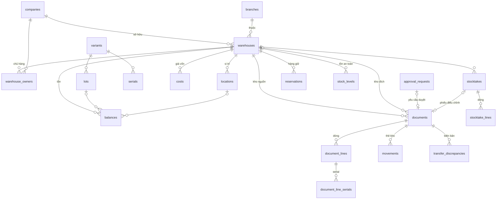

Lược đồ (chép từ tệp `database/migrations/0004_inventory.sql`):

```sql
-- CONG_VIEC_05: mini app Kho (MODULE_03), schema `inventory` (tài liệu 12 mục 2, tài liệu 16).
-- Khóa ngoại chỉ trỏ vào `inventory`, `catalog` và `core`. Số lượng theo đơn vị cơ sở của sản phẩm.

CREATE SCHEMA IF NOT EXISTS inventory;

-- Cài đặt kho theo công ty (QUYTAC_NGHIEPVU_54).
CREATE TABLE inventory.settings (
    company_id          uuid        PRIMARY KEY REFERENCES core.companies(id),
    reservation_hours   integer     NOT NULL DEFAULT 72 CHECK (reservation_hours BETWEEN 1 AND 720),
    updated_at          timestamptz NOT NULL DEFAULT now(),
    updated_by          uuid        REFERENCES core.users(id),
    version             integer     NOT NULL DEFAULT 1
);

-- Kho thuộc chi nhánh của công ty sở hữu kho (CHUC_NANG_38; QUYTAC_NGHIEPVU_45).
CREATE TABLE inventory.warehouses (
    id              uuid        PRIMARY KEY DEFAULT gen_random_uuid(),
    company_id      uuid        NOT NULL REFERENCES core.companies(id),
    branch_id       uuid        NOT NULL REFERENCES core.branches(id),
    code            text        NOT NULL CHECK (code ~ '^[A-Z0-9_-]{1,20}$'),
    name            text        NOT NULL,
    address         text,
    uses_locations  boolean     NOT NULL DEFAULT false,
    status          text        NOT NULL DEFAULT 'active' CHECK (status IN ('active', 'inactive')),
    created_at      timestamptz NOT NULL DEFAULT now(),
    created_by      uuid        REFERENCES core.users(id),
    updated_at      timestamptz NOT NULL DEFAULT now(),
    updated_by      uuid        REFERENCES core.users(id),
    version         integer     NOT NULL DEFAULT 1,
    UNIQUE (company_id, code)
);
CREATE INDEX warehouses_branch_idx ON inventory.warehouses (branch_id);

-- Công ty chủ hàng được gửi hàng vào kho (QUYTAC_NGHIEPVU_45, 46).
CREATE TABLE inventory.warehouse_owners (
    warehouse_id    uuid        NOT NULL REFERENCES inventory.warehouses(id),
    company_id      uuid        NOT NULL REFERENCES core.companies(id),
    PRIMARY KEY (warehouse_id, company_id)
);
CREATE INDEX warehouse_owners_company_idx ON inventory.warehouse_owners (company_id);

CREATE TABLE inventory.locations (
    id              uuid        PRIMARY KEY DEFAULT gen_random_uuid(),
    warehouse_id    uuid        NOT NULL REFERENCES inventory.warehouses(id),
    code            text        NOT NULL CHECK (code ~ '^[A-Z0-9_.-]{1,30}$'),
    name            text,
    status          text        NOT NULL DEFAULT 'active' CHECK (status IN ('active', 'inactive')),
    created_at      timestamptz NOT NULL DEFAULT now(),
    updated_at      timestamptz NOT NULL DEFAULT now(),
    version         integer     NOT NULL DEFAULT 1,
    UNIQUE (warehouse_id, code)
);

-- Lô của công ty chủ hàng (QUYTAC_NGHIEPVU_47).
CREATE TABLE inventory.lots (
    id              uuid        PRIMARY KEY DEFAULT gen_random_uuid(),
    company_id      uuid        NOT NULL REFERENCES core.companies(id),
    variant_id      uuid        NOT NULL REFERENCES catalog.variants(id),
    lot_no          text        NOT NULL,
    manufactured_on date,
    expires_on      date,
    created_at      timestamptz NOT NULL DEFAULT now(),
    UNIQUE (company_id, variant_id, lot_no)
);

-- Serial: duy nhất trong công ty chủ hàng, ở một nơi tại một thời điểm.
CREATE TABLE inventory.serials (
    id              uuid        PRIMARY KEY DEFAULT gen_random_uuid(),
    company_id      uuid        NOT NULL REFERENCES core.companies(id),
    variant_id      uuid        NOT NULL REFERENCES catalog.variants(id),
    serial_no       text        NOT NULL,
    warehouse_id    uuid        REFERENCES inventory.warehouses(id),
    location_id     uuid        REFERENCES inventory.locations(id),
    status          text        NOT NULL CHECK (status IN ('in_stock', 'in_transit', 'issued')),
    unit_cost       numeric(20,4) NOT NULL DEFAULT 0,
    updated_at      timestamptz NOT NULL DEFAULT now(),
    UNIQUE (company_id, serial_no)
);
CREATE INDEX serials_stock_idx ON inventory.serials (warehouse_id, company_id, variant_id) WHERE status = 'in_stock';

-- Tồn theo kho, chủ hàng, biến thể, lô, vị trí; không âm (QUYTAC_NGHIEPVU_47).
CREATE TABLE inventory.balances (
    id              uuid        PRIMARY KEY DEFAULT gen_random_uuid(),
    warehouse_id    uuid        NOT NULL REFERENCES inventory.warehouses(id),
    company_id      uuid        NOT NULL REFERENCES core.companies(id),
    variant_id      uuid        NOT NULL REFERENCES catalog.variants(id),
    lot_id          uuid        REFERENCES inventory.lots(id),
    location_id     uuid        REFERENCES inventory.locations(id),
    quantity        numeric(20,4) NOT NULL DEFAULT 0 CHECK (quantity >= 0),
    updated_at      timestamptz NOT NULL DEFAULT now()
);
CREATE UNIQUE INDEX balances_key ON inventory.balances (warehouse_id, company_id, variant_id, coalesce(lot_id, '00000000-0000-0000-0000-000000000000'), coalesce(location_id, '00000000-0000-0000-0000-000000000000'));
CREATE INDEX balances_company_idx ON inventory.balances (company_id, variant_id);

-- Giá vốn bình quân gia quyền di động theo kho, chủ hàng, biến thể (QUYTAC_NGHIEPVU_48).
CREATE TABLE inventory.costs (
    warehouse_id    uuid        NOT NULL REFERENCES inventory.warehouses(id),
    company_id      uuid        NOT NULL REFERENCES core.companies(id),
    variant_id      uuid        NOT NULL REFERENCES catalog.variants(id),
    quantity        numeric(20,4) NOT NULL DEFAULT 0 CHECK (quantity >= 0),
    value           numeric(20,4) NOT NULL DEFAULT 0,
    average_cost    numeric(20,4) NOT NULL DEFAULT 0,
    method          text        NOT NULL DEFAULT 'moving_average',     -- chừa chỗ cho phương pháp khác
    updated_at      timestamptz NOT NULL DEFAULT now(),
    PRIMARY KEY (warehouse_id, company_id, variant_id)
);

-- Phiếu kho thuộc công ty chủ hàng (QUYTAC_NGHIEPVU_46, 50, 52).
CREATE TABLE inventory.documents (
    id                      uuid        PRIMARY KEY DEFAULT gen_random_uuid(),
    company_id              uuid        NOT NULL REFERENCES core.companies(id),   -- công ty chủ hàng
    warehouse_id            uuid        NOT NULL REFERENCES inventory.warehouses(id),
    destination_warehouse_id uuid       REFERENCES inventory.warehouses(id),      -- kho đích (chuyển kho)
    type                    text        NOT NULL CHECK (type IN ('receipt_other', 'issue_other', 'adjustment', 'transfer')),
    document_no             text,                                                 -- cấp khi gửi
    document_date           date        NOT NULL,
    reason_code             text        NOT NULL DEFAULT 'other' CHECK (reason_code IN ('internal_use', 'gift', 'damaged', 'expired_disposal', 'opening_balance', 'found', 'stocktake', 'transfer', 'other')),
    reason                  text        NOT NULL,
    note                    text,
    status                  text        NOT NULL DEFAULT 'draft' CHECK (status IN ('draft', 'pending', 'posted', 'in_transit', 'received', 'rejected', 'withdrawn')),
    approval_request_id     uuid        REFERENCES core.approval_requests(id),
    source_type             text,                                                 -- NULL: không có chứng từ gốc
    source_id               uuid,
    stocktake_id            uuid,
    created_by              uuid        NOT NULL REFERENCES core.users(id),
    created_at              timestamptz NOT NULL DEFAULT now(),
    updated_at              timestamptz NOT NULL DEFAULT now(),
    submitted_at            timestamptz,
    posted_at               timestamptz,
    shipped_at              timestamptz,
    shipped_by              uuid        REFERENCES core.users(id),
    received_at             timestamptz,
    received_by             uuid        REFERENCES core.users(id),
    version                 integer     NOT NULL DEFAULT 1,
    UNIQUE (company_id, document_no),
    CHECK ((type = 'transfer') = (destination_warehouse_id IS NOT NULL))
);
CREATE INDEX documents_company_idx ON inventory.documents (company_id, created_at DESC);
CREATE INDEX documents_warehouse_idx ON inventory.documents (warehouse_id, created_at DESC);
CREATE INDEX documents_approval_idx ON inventory.documents (approval_request_id);

CREATE TABLE inventory.document_lines (
    id                      uuid        PRIMARY KEY DEFAULT gen_random_uuid(),
    document_id             uuid        NOT NULL REFERENCES inventory.documents(id) ON DELETE CASCADE,
    line_no                 integer     NOT NULL,
    variant_id              uuid        NOT NULL REFERENCES catalog.variants(id),
    unit_id                 uuid        NOT NULL REFERENCES catalog.units(id),
    quantity                numeric(20,4) NOT NULL CHECK (quantity <> 0),       -- âm chỉ ở phiếu điều chỉnh
    base_quantity           numeric(20,4) NOT NULL,
    unit_cost               numeric(20,4),                                       -- đơn giá nhập (theo đơn vị cơ sở)
    cost_value              numeric(20,4),                                       -- giá trị đã ghi sổ
    lot_id                  uuid        REFERENCES inventory.lots(id),
    lot_no                  text,
    manufactured_on         date,
    expires_on              date,
    lot_override_reason     text,
    location_id             uuid        REFERENCES inventory.locations(id),
    destination_location_id uuid        REFERENCES inventory.locations(id),
    received_base_quantity  numeric(20,4),
    responsible_user_id     uuid        REFERENCES core.users(id),
    compensation_amount     numeric(20,4),
    UNIQUE (document_id, line_no)
);

CREATE TABLE inventory.document_line_serials (
    line_id         uuid        NOT NULL REFERENCES inventory.document_lines(id) ON DELETE CASCADE,
    serial_no       text        NOT NULL,
    serial_id       uuid        REFERENCES inventory.serials(id),
    PRIMARY KEY (line_id, serial_no)
);

-- Thẻ kho: chỉ thêm, không sửa, không xóa (QUYTAC_NGHIEPVU_49).
CREATE TABLE inventory.movements (
    id              bigserial   PRIMARY KEY,
    warehouse_id    uuid        NOT NULL REFERENCES inventory.warehouses(id),
    company_id      uuid        NOT NULL REFERENCES core.companies(id),
    variant_id      uuid        NOT NULL REFERENCES catalog.variants(id),
    lot_id          uuid        REFERENCES inventory.lots(id),
    location_id     uuid        REFERENCES inventory.locations(id),
    serial_id       uuid        REFERENCES inventory.serials(id),
    quantity        numeric(20,4) NOT NULL,
    unit_cost       numeric(20,4) NOT NULL,
    value           numeric(20,4) NOT NULL,
    balance_after   numeric(20,4) NOT NULL,           -- tồn của biến thể tại kho cho chủ hàng sau biến động
    document_id     uuid        NOT NULL REFERENCES inventory.documents(id),
    line_id         uuid        REFERENCES inventory.document_lines(id),
    moved_at        timestamptz NOT NULL DEFAULT now()
);
CREATE INDEX movements_card_idx ON inventory.movements (warehouse_id, company_id, variant_id, id);
CREATE INDEX movements_document_idx ON inventory.movements (document_id);

CREATE FUNCTION inventory.reject_movement_change() RETURNS trigger LANGUAGE plpgsql AS $$
BEGIN
    RAISE EXCEPTION 'inventory.movements chỉ thêm, không sửa, không xóa';
END $$;
CREATE TRIGGER movements_append_only BEFORE UPDATE OR DELETE ON inventory.movements FOR EACH ROW EXECUTE FUNCTION inventory.reject_movement_change();

-- Biên bản chênh lệch chuyển kho (QUYTAC_NGHIEPVU_52).
CREATE TABLE inventory.transfer_discrepancies (
    id              uuid        PRIMARY KEY DEFAULT gen_random_uuid(),
    document_id     uuid        NOT NULL REFERENCES inventory.documents(id),
    line_id         uuid        NOT NULL REFERENCES inventory.document_lines(id),
    shipped_quantity  numeric(20,4) NOT NULL,
    received_quantity numeric(20,4) NOT NULL,
    difference      numeric(20,4) NOT NULL,
    value           numeric(20,4) NOT NULL,
    note            text,
    created_by      uuid        NOT NULL REFERENCES core.users(id),
    created_at      timestamptz NOT NULL DEFAULT now()
);

-- Kiểm kê (QUYTAC_NGHIEPVU_53).
CREATE TABLE inventory.stocktakes (
    id                      uuid        PRIMARY KEY DEFAULT gen_random_uuid(),
    company_id              uuid        NOT NULL REFERENCES core.companies(id),
    warehouse_id            uuid        NOT NULL REFERENCES inventory.warehouses(id),
    stocktake_no            text,
    scope_type              text        NOT NULL CHECK (scope_type IN ('full', 'categories', 'locations', 'variants')),
    scope_ids               uuid[]      NOT NULL DEFAULT '{}',
    note                    text,
    status                  text        NOT NULL DEFAULT 'draft' CHECK (status IN ('draft', 'counting', 'finished', 'cancelled')),
    adjustment_document_id  uuid        REFERENCES inventory.documents(id),
    created_by              uuid        NOT NULL REFERENCES core.users(id),
    created_at              timestamptz NOT NULL DEFAULT now(),
    started_at              timestamptz,
    finished_at             timestamptz,
    version                 integer     NOT NULL DEFAULT 1,
    UNIQUE (company_id, stocktake_no)
);
ALTER TABLE inventory.documents ADD FOREIGN KEY (stocktake_id) REFERENCES inventory.stocktakes(id);

CREATE TABLE inventory.stocktake_lines (
    id                  uuid        PRIMARY KEY DEFAULT gen_random_uuid(),
    stocktake_id        uuid        NOT NULL REFERENCES inventory.stocktakes(id) ON DELETE CASCADE,
    variant_id          uuid        NOT NULL REFERENCES catalog.variants(id),
    lot_id              uuid        REFERENCES inventory.lots(id),
    location_id         uuid        REFERENCES inventory.locations(id),
    system_quantity     numeric(20,4) NOT NULL,
    counted_quantity    numeric(20,4) CHECK (counted_quantity >= 0),
    counted_serials     text[],                             -- hàng theo dõi serial: serial đếm được
    unit_cost           numeric(20,4) NOT NULL DEFAULT 0,
    responsible_user_id uuid        REFERENCES core.users(id),
    compensation_amount numeric(20,4)
);
CREATE INDEX stocktake_lines_lock_idx ON inventory.stocktake_lines (variant_id, location_id);

-- Giữ hàng (QUYTAC_NGHIEPVU_54).
CREATE TABLE inventory.reservations (
    id              uuid        PRIMARY KEY DEFAULT gen_random_uuid(),
    warehouse_id    uuid        NOT NULL REFERENCES inventory.warehouses(id),
    company_id      uuid        NOT NULL REFERENCES core.companies(id),
    variant_id      uuid        NOT NULL REFERENCES catalog.variants(id),
    quantity        numeric(20,4) NOT NULL CHECK (quantity > 0),
    source_type     text        NOT NULL,           -- 'inventory.document', 'sales.order'...
    source_id       uuid        NOT NULL,
    source_no       text,
    expires_at      timestamptz,                    -- NULL: giữ đến khi nguồn kết thúc
    status          text        NOT NULL DEFAULT 'active' CHECK (status IN ('active', 'released', 'consumed')),
    created_by      uuid        REFERENCES core.users(id),
    created_at      timestamptz NOT NULL DEFAULT now(),
    released_at     timestamptz,
    version         integer     NOT NULL DEFAULT 1
);
CREATE INDEX reservations_active_idx ON inventory.reservations (warehouse_id, company_id, variant_id) WHERE status = 'active';
CREATE INDEX reservations_source_idx ON inventory.reservations (source_type, source_id);
CREATE INDEX reservations_expiry_idx ON inventory.reservations (expires_at) WHERE status = 'active';

-- Tồn an toàn (QUYTAC_NGHIEPVU_55).
CREATE TABLE inventory.stock_levels (
    warehouse_id    uuid        NOT NULL REFERENCES inventory.warehouses(id),
    company_id      uuid        NOT NULL REFERENCES core.companies(id),
    variant_id      uuid        NOT NULL REFERENCES catalog.variants(id),
    minimum         numeric(20,4) NOT NULL CHECK (minimum >= 0),
    maximum         numeric(20,4) NOT NULL,
    updated_at      timestamptz NOT NULL DEFAULT now(),
    updated_by      uuid        REFERENCES core.users(id),
    PRIMARY KEY (warehouse_id, company_id, variant_id),
    CHECK (maximum >= minimum)
);
```

## 8. Database migration 0005 – CONG_VIEC_06 (schema `crm`)

Tệp `database/migrations/0005_crm.sql` tạo schema `crm` của MODULE_07 Khách hàng và Đối tác (phần tối thiểu), 4 bảng và một sequence; không đổi schema `core`, `catalog`, `inventory`. Khóa ngoại từ `crm` chỉ trỏ vào `crm` và `core` (`core.companies`, `core.users`). Nhóm khách hàng (`catalog.customer_groups`) kiểm bằng truy vấn đọc, không đặt khóa ngoại. Quyền `crm.partner.view`, `crm.partner.manage`, `crm.partner.identity.view`, `crm.profile.manage`, vai trò `partner_manager` ghi vào bảng của `core` bằng hàm đồng bộ danh mục quyền (`apps/api/src/permissions/permission-catalog.ts`).

| Bảng | Mục đích | Cột chính | Ràng buộc, chỉ mục |
|---|---|---|---|
| `partners` | Đối tác dùng chung tập đoàn (CHUC_NANG_46, CHUC_NANG_47; QUYTAC_NGHIEPVU_56 đến QUYTAC_NGHIEPVU_59) | `code` (mặc định `DT` + 6 số từ sequence `crm.partner_code_seq`), `kind` (`organization`, `household`, `individual`), `name`, `short_name`, `tax_code`, `citizen_id` (dữ liệu cá nhân, lưu nguyên văn, không trả trong danh sách), `address`, `phone`, `email`, `company_id` (đối tác nội bộ; trống: đối tác bên ngoài), `search_text` (chuỗi tìm không dấu), `status` (`active`, `inactive`), cột người tạo, người sửa, `version` | Duy nhất `code`, `tax_code`, `citizen_id`, `company_id`; `tax_code` dạng `^[0-9]{10}(-[0-9]{3})?$`; `citizen_id` dạng `^[0-9]{12}$`; cá nhân bắt buộc `citizen_id`; tổ chức, hộ kinh doanh bắt buộc `tax_code` hoặc là đối tác nội bộ (công ty con chưa khai mã số thuế); chỉ mục `search_text`, `phone` |
| `partner_contacts` | Người liên hệ | `partner_id`, `full_name`, `position`, `phone`, `email`, `is_primary`, `sort_order` | Xóa theo đối tác; chỉ mục `partner_id` |
| `partner_bank_accounts` | Tài khoản ngân hàng | `partner_id`, `bank_name`, `account_no`, `account_holder`, `branch`, `is_default`, `sort_order` | Xóa theo đối tác; chỉ mục `partner_id` |
| `partner_profiles` | Hồ sơ đối tác của từng công ty (CHUC_NANG_48; QUYTAC_NGHIEPVU_60) | `company_id`, `partner_id`, `is_customer`, `is_supplier`, `payment_term_days` (mặc định 0), `credit_limit` (`numeric(20,4)`; trống: không giới hạn), `customer_group_id` (không khóa ngoại), `owner_user_id`, `note`, `status`, `updated_at`, `updated_by`, `version` | Khóa chính `(company_id, partner_id)`; ít nhất một trong `is_customer`, `is_supplier`; `payment_term_days` 0 đến 365; `credit_limit >= 0`; chỉ mục `partner_id` |

Quy tắc xóa và lưu giữ bổ sung:
- Không xóa đối tác, hồ sơ đối tác: dùng `status`. Hệ thống không có thao tác xóa đối tác; `ON DELETE CASCADE` của người liên hệ, tài khoản ngân hàng chỉ để dọn dữ liệu thử.
- Người liên hệ, tài khoản ngân hàng được ghi lại toàn bộ mỗi lần sửa đối tác.
- Đối tác nội bộ do hệ thống đồng bộ từ `core.companies` (CHUC_NANG_47), không sửa qua API đối tác.
- `citizen_id` lưu nguyên văn; mã hóa cột làm sau cùng giải pháp khóa của tài liệu `22` mục 5.

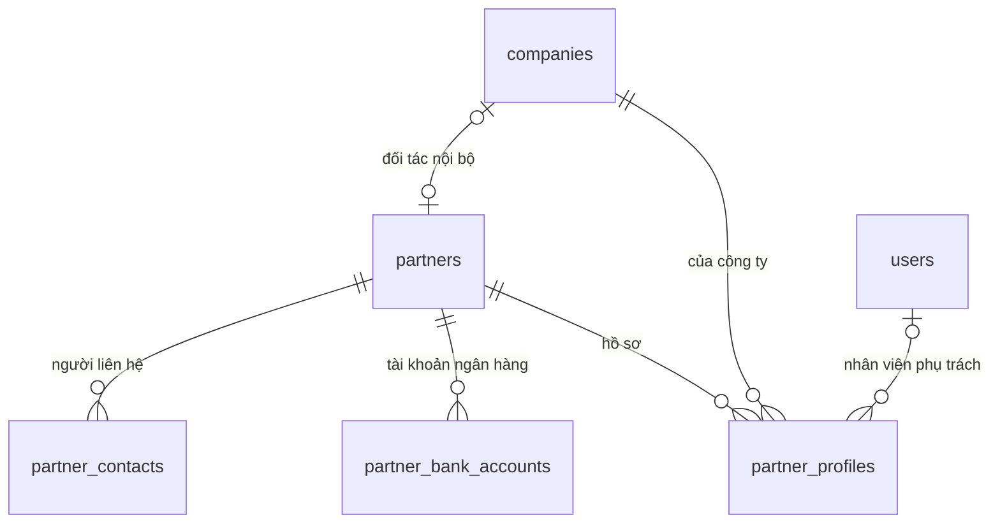

Lược đồ (chép từ tệp `database/migrations/0005_crm.sql`):

```sql
-- CONG_VIEC_06: danh mục đối tác dùng chung tập đoàn (MODULE_07, phần tối thiểu), schema `crm` (tài liệu 12 mục 2, tài liệu 16).
-- Khóa ngoại chỉ trỏ vào `crm` và `core`.

CREATE SCHEMA IF NOT EXISTS crm;

CREATE SEQUENCE crm.partner_code_seq;

-- Đối tác dùng chung tập đoàn (CHUC_NANG_46, 47; QUYTAC_NGHIEPVU_56 đến 59).
CREATE TABLE crm.partners (
    id              uuid        PRIMARY KEY DEFAULT gen_random_uuid(),
    code            text        NOT NULL UNIQUE DEFAULT 'DT' || lpad(nextval('crm.partner_code_seq')::text, 6, '0'),
    kind            text        NOT NULL CHECK (kind IN ('organization', 'household', 'individual')),
    name            text        NOT NULL,
    short_name      text,
    tax_code        text        UNIQUE CHECK (tax_code ~ '^[0-9]{10}(-[0-9]{3})?$'),
    citizen_id      text        UNIQUE CHECK (citizen_id ~ '^[0-9]{12}$'),          -- dữ liệu cá nhân, không trả về trong danh sách
    address         text,
    phone           text,
    email           text,
    company_id      uuid        UNIQUE REFERENCES core.companies(id),               -- đối tác nội bộ: công ty con trong tập đoàn
    search_text     text        NOT NULL,
    status          text        NOT NULL DEFAULT 'active' CHECK (status IN ('active', 'inactive')),
    created_at      timestamptz NOT NULL DEFAULT now(),
    created_by      uuid        REFERENCES core.users(id),
    updated_at      timestamptz NOT NULL DEFAULT now(),
    updated_by      uuid        REFERENCES core.users(id),
    version         integer     NOT NULL DEFAULT 1,
    CHECK (kind = 'individual' OR tax_code IS NOT NULL OR company_id IS NOT NULL),   -- công ty con chưa khai mã số thuế vẫn là đối tác nội bộ
    CHECK (kind <> 'individual' OR citizen_id IS NOT NULL)
);
CREATE INDEX partners_search_idx ON crm.partners (search_text);
CREATE INDEX partners_phone_idx ON crm.partners (phone);

CREATE TABLE crm.partner_contacts (
    id              uuid        PRIMARY KEY DEFAULT gen_random_uuid(),
    partner_id      uuid        NOT NULL REFERENCES crm.partners(id) ON DELETE CASCADE,
    full_name       text        NOT NULL,
    position        text,
    phone           text,
    email           text,
    is_primary      boolean     NOT NULL DEFAULT false,
    sort_order      integer     NOT NULL DEFAULT 0
);
CREATE INDEX partner_contacts_partner_idx ON crm.partner_contacts (partner_id);

CREATE TABLE crm.partner_bank_accounts (
    id              uuid        PRIMARY KEY DEFAULT gen_random_uuid(),
    partner_id      uuid        NOT NULL REFERENCES crm.partners(id) ON DELETE CASCADE,
    bank_name       text        NOT NULL,
    account_no      text        NOT NULL,
    account_holder  text        NOT NULL,
    branch          text,
    is_default      boolean     NOT NULL DEFAULT false,
    sort_order      integer     NOT NULL DEFAULT 0
);
CREATE INDEX partner_bank_accounts_partner_idx ON crm.partner_bank_accounts (partner_id);

-- Hồ sơ đối tác của từng công ty (CHUC_NANG_48; QUYTAC_NGHIEPVU_60). Nhóm khách hàng thuộc schema catalog nên không đặt khóa ngoại.
CREATE TABLE crm.partner_profiles (
    company_id          uuid        NOT NULL REFERENCES core.companies(id),
    partner_id          uuid        NOT NULL REFERENCES crm.partners(id),
    is_customer         boolean     NOT NULL DEFAULT false,
    is_supplier         boolean     NOT NULL DEFAULT false,
    payment_term_days   integer     NOT NULL DEFAULT 0 CHECK (payment_term_days BETWEEN 0 AND 365),
    credit_limit        numeric(20,4) CHECK (credit_limit >= 0),                 -- để trống: không giới hạn
    customer_group_id   uuid,
    owner_user_id       uuid        REFERENCES core.users(id),                   -- nhân viên phụ trách
    note                text,
    status              text        NOT NULL DEFAULT 'active' CHECK (status IN ('active', 'inactive')),
    created_at          timestamptz NOT NULL DEFAULT now(),
    updated_at          timestamptz NOT NULL DEFAULT now(),
    updated_by          uuid        REFERENCES core.users(id),
    version             integer     NOT NULL DEFAULT 1,
    PRIMARY KEY (company_id, partner_id),
    CHECK (is_customer OR is_supplier)
);
CREATE INDEX partner_profiles_partner_idx ON crm.partner_profiles (partner_id);
```

## 9. Database migration 0006 – CONG_VIEC_07 (schema `purchasing`)

Tệp `database/migrations/0006_purchasing.sql` tạo schema `purchasing` của MODULE_04 Mua hàng (phần 1: Mua hàng trong nước), 6 bảng; thêm cột vào `catalog.categories`, `inventory.documents`, `inventory.document_lines`. Khóa ngoại từ `purchasing` chỉ trỏ vào `purchasing`, `core`, `catalog`, `crm`; kho nhận (`inventory.warehouses`) kiểm trong service, không đặt khóa ngoại. Số đã nhận, đã trả của dòng đơn mua tính từ phiếu kho (`inventory.document_lines.source_line_id`), không lưu trùng. Quyền `purchasing.price.manage`, `purchasing.requisition.create`, `purchasing.order.view`, `purchasing.order.manage`, `purchasing.settings.manage`, `inventory.purchase.receive`, vai trò `purchaser`, loại chứng từ `purchasing.requisition`, `purchasing.order` (cần duyệt), `inventory.purchase_receipt`, `inventory.purchase_return` (không cần duyệt) ghi vào bảng của `core` bằng hàm đồng bộ danh mục quyền (`apps/api/src/permissions/permission-catalog.ts`).

| Bảng | Mục đích | Cột chính | Ràng buộc, chỉ mục |
|---|---|---|---|
| `settings` | Cài đặt mua hàng theo công ty (QUYTAC_NGHIEPVU_64) | `company_id` (khóa chính), `over_receipt_tolerance_percent` (`numeric(5,2)`, mặc định 0), `updated_by`, `updated_at`, `version` | Dung sai 0 đến 100; chưa có dòng thì dung sai 0, phiên bản 0 |
| `supplier_prices` | Bảng giá mua (CHUC_NANG_49; QUYTAC_NGHIEPVU_61) | `company_id`, `supplier_id` (`crm.partners`), `variant_id`, `unit_id`, `min_quantity` (mặc định 0), `unit_price` (chưa thuế), `supplier_sku`, `valid_from`, `valid_to` (trống: không thời hạn), `status`, `created_by`, `version` | `min_quantity >= 0`, `unit_price >= 0`, `valid_to >= valid_from`; chồng hiệu lực kiểm trong service khi giữ khóa tư vấn theo (công ty, nhà cung cấp, mặt hàng, đơn vị); chỉ mục `(company_id, supplier_id, variant_id, unit_id)`, `(company_id, variant_id)` |
| `requisitions` | Đề nghị mua (CHUC_NANG_50; QUYTAC_NGHIEPVU_62) | `company_id`, `document_no` (cấp khi gửi), `warehouse_id`, `needed_by`, `reason`, `status` (`draft`, `pending`, `approved`, `rejected`, `withdrawn`, `closed`), `approval_request_id`, `created_by`, `submitted_at`, `version` | Duy nhất `(company_id, document_no)`; chỉ mục `(company_id, created_at DESC)`, `approval_request_id` |
| `requisition_lines` | Dòng đề nghị mua | `requisition_id`, `line_no`, `variant_id`, `unit_id`, `quantity`, `base_quantity`, `estimated_unit_price` (mặc định 0), `suggested_supplier_id`, `note` | Số lượng lớn hơn 0; duy nhất `(requisition_id, line_no)`; xóa theo đề nghị |
| `orders` | Đơn mua (CHUC_NANG_51; QUYTAC_NGHIEPVU_63, QUYTAC_NGHIEPVU_64) | `company_id`, `document_no` (cấp khi gửi lần đầu), `supplier_id`, `warehouse_id`, `order_date`, `expected_date`, `currency` (tiền tệ của công ty), `note`, `status` (`draft`, `pending`, `approved`, `rejected`, `withdrawn`, `received`, `closed`), `approval_request_id`, `approved_total`, `approved_supplier_id` (lần duyệt gần nhất, so khi sửa), `total_amount` (chưa thuế), `tax_amount`, `closed_reason`, `closed_at`, `closed_by`, `created_by`, `submitted_at`, `version` | Duy nhất `(company_id, document_no)`; chỉ mục `(company_id, created_at DESC)`, `(company_id, supplier_id)`, `approval_request_id` |
| `order_lines` | Dòng đơn mua | `order_id`, `line_no`, `variant_id`, `unit_id`, `quantity`, `base_quantity`, `unit_price` (chưa thuế, theo đơn vị của dòng), `vat_rate` (`0`, `5`, `8`, `10`, `exempt`, `not_declared`), `amount`, `requisition_line_id` | Số lượng lớn hơn 0, đơn giá không âm; duy nhất `(order_id, line_no)`; xóa theo đơn; chỉ mục `requisition_line_id` |

Cột, ràng buộc thêm vào bảng của schema khác:

| Bảng | Cột, ràng buộc | Mục đích |
|---|---|---|
| `catalog.categories` | `requires_quality_check` (`boolean`, mặc định `false`) | Hàng thuộc ngành cần kiểm tra chất lượng khi nhập mua (QUYTAC_NGHIEPVU_65); sửa ngành hàng không gửi giá trị thì giữ nguyên |
| `inventory.documents` | `type` thêm `purchase_receipt`, `purchase_return`; `status` thêm `quality_check`; `reason_code` thêm `purchase`, `purchase_return`; `partner_id` (nhà cung cấp, không khóa ngoại); `quality_checked_at`, `quality_checked_by`; ràng buộc phiếu nhập mua, trả hàng phải có `source_id`, `partner_id`; chỉ mục `(source_type, source_id)` | Phiếu nhập mua (`source_type` `purchasing.order`, `source_id` là đơn mua), phiếu trả hàng (`source_type` `inventory.document`, `source_id` là phiếu nhập gốc) do module Kho ghi |
| `inventory.document_lines` | `source_line_id` (dòng đơn mua hoặc dòng phiếu nhập gốc, không khóa ngoại); `rejected_base_quantity` (không âm); `rejection_reason`; chỉ mục `source_line_id` | Số không đạt kiểm tra chất lượng và lý do; tính số đã nhận, đã trả |

Quy tắc xóa và lưu giữ bổ sung:
- Không xóa giá mua, đề nghị mua, đơn mua đã gửi: dùng `status`. Dòng đề nghị, dòng đơn ghi lại khi sửa; dòng đơn đã có phiếu nhập giữ nguyên mã dòng.
- Phiếu nhập mua, trả hàng nháp xóa được như phiếu kho nháp; phiếu đã gửi không xóa.
- Phần không đạt kiểm tra chất lượng không vào sổ kho, chỉ ghi trên dòng phiếu; serial không đạt bỏ khỏi dòng, ghi vào lý do.

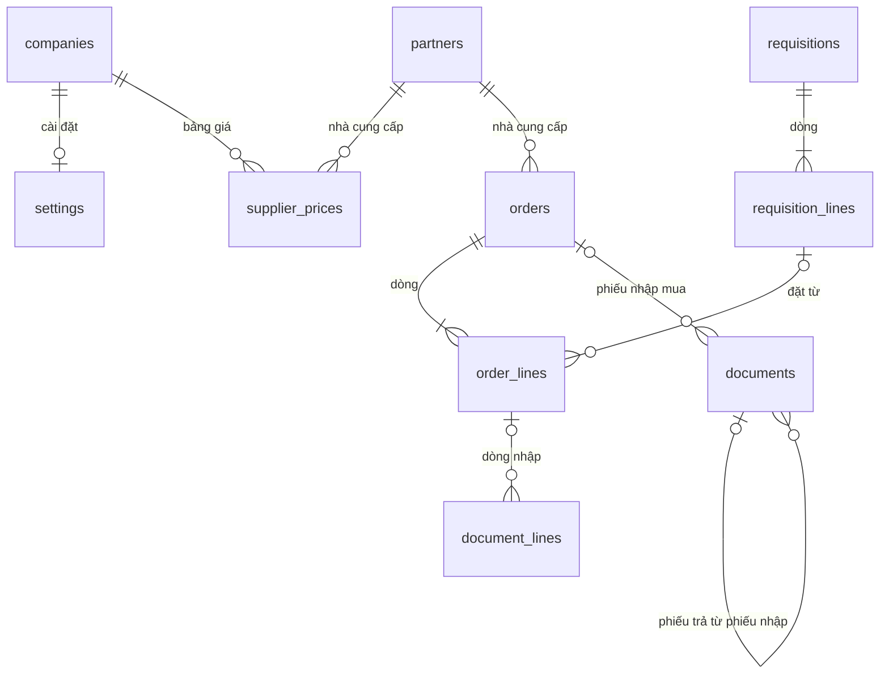

Lược đồ (chép từ tệp `database/migrations/0006_purchasing.sql`):

```sql
-- CONG_VIEC_07: Mua hàng trong nước (MODULE_04, phần 1), schema `purchasing` (tài liệu 12 mục 2, tài liệu 16).
-- Khóa ngoại từ `purchasing` chỉ trỏ vào `purchasing`, `core`, `catalog`, `crm`.
-- Số đã nhận, đã trả của dòng đơn mua tính từ phiếu kho, không lưu trùng.

CREATE SCHEMA IF NOT EXISTS purchasing;

-- Cài đặt mua hàng theo công ty: dung sai nhận vượt (QUYTAC_NGHIEPVU_64).
CREATE TABLE purchasing.settings (
    company_id                      uuid        PRIMARY KEY REFERENCES core.companies(id),
    over_receipt_tolerance_percent  numeric(5,2) NOT NULL DEFAULT 0 CHECK (over_receipt_tolerance_percent BETWEEN 0 AND 100),
    updated_by                      uuid        REFERENCES core.users(id),
    updated_at                      timestamptz NOT NULL DEFAULT now(),
    version                         integer     NOT NULL DEFAULT 1
);

-- Bảng giá mua theo nhà cung cấp (CHUC_NANG_49; QUYTAC_NGHIEPVU_61). Chồng hiệu lực kiểm trong service khi khóa dòng nhà cung cấp.
CREATE TABLE purchasing.supplier_prices (
    id              uuid        PRIMARY KEY DEFAULT gen_random_uuid(),
    company_id      uuid        NOT NULL REFERENCES core.companies(id),
    supplier_id     uuid        NOT NULL REFERENCES crm.partners(id),
    variant_id      uuid        NOT NULL REFERENCES catalog.variants(id),
    unit_id         uuid        NOT NULL REFERENCES catalog.units(id),
    min_quantity    numeric(20,4) NOT NULL DEFAULT 0 CHECK (min_quantity >= 0),
    unit_price      numeric(20,4) NOT NULL CHECK (unit_price >= 0),     -- chưa gồm thuế giá trị gia tăng, tiền tệ công ty
    supplier_sku    text,                                               -- mã hàng phía nhà cung cấp
    valid_from      date        NOT NULL,
    valid_to        date,
    status          text        NOT NULL DEFAULT 'active' CHECK (status IN ('active', 'inactive')),
    created_by      uuid        NOT NULL REFERENCES core.users(id),
    created_at      timestamptz NOT NULL DEFAULT now(),
    updated_at      timestamptz NOT NULL DEFAULT now(),
    version         integer     NOT NULL DEFAULT 1,
    CHECK (valid_to IS NULL OR valid_to >= valid_from)
);
CREATE INDEX supplier_prices_lookup_idx ON purchasing.supplier_prices (company_id, supplier_id, variant_id, unit_id);
CREATE INDEX supplier_prices_variant_idx ON purchasing.supplier_prices (company_id, variant_id);

-- Đề nghị mua (CHUC_NANG_50; QUYTAC_NGHIEPVU_62).
CREATE TABLE purchasing.requisitions (
    id                      uuid        PRIMARY KEY DEFAULT gen_random_uuid(),
    company_id              uuid        NOT NULL REFERENCES core.companies(id),
    document_no             text,                                                   -- cấp khi gửi
    warehouse_id            uuid        NOT NULL,                                   -- kho nhận (inventory.warehouses, kiểm trong service)
    needed_by               date        NOT NULL,
    reason                  text        NOT NULL,
    status                  text        NOT NULL DEFAULT 'draft' CHECK (status IN ('draft', 'pending', 'approved', 'rejected', 'withdrawn', 'closed')),
    approval_request_id     uuid        REFERENCES core.approval_requests(id),
    created_by              uuid        NOT NULL REFERENCES core.users(id),
    created_at              timestamptz NOT NULL DEFAULT now(),
    updated_at              timestamptz NOT NULL DEFAULT now(),
    submitted_at            timestamptz,
    version                 integer     NOT NULL DEFAULT 1,
    UNIQUE (company_id, document_no)
);
CREATE INDEX requisitions_company_idx ON purchasing.requisitions (company_id, created_at DESC);
CREATE INDEX requisitions_approval_idx ON purchasing.requisitions (approval_request_id);

CREATE TABLE purchasing.requisition_lines (
    id                      uuid        PRIMARY KEY DEFAULT gen_random_uuid(),
    requisition_id          uuid        NOT NULL REFERENCES purchasing.requisitions(id) ON DELETE CASCADE,
    line_no                 integer     NOT NULL,
    variant_id              uuid        NOT NULL REFERENCES catalog.variants(id),
    unit_id                 uuid        NOT NULL REFERENCES catalog.units(id),
    quantity                numeric(20,4) NOT NULL CHECK (quantity > 0),
    base_quantity           numeric(20,4) NOT NULL CHECK (base_quantity > 0),
    estimated_unit_price    numeric(20,4) NOT NULL DEFAULT 0 CHECK (estimated_unit_price >= 0),
    suggested_supplier_id   uuid        REFERENCES crm.partners(id),
    note                    text,
    UNIQUE (requisition_id, line_no)
);

-- Đơn mua (CHUC_NANG_51; QUYTAC_NGHIEPVU_63, 64).
CREATE TABLE purchasing.orders (
    id                      uuid        PRIMARY KEY DEFAULT gen_random_uuid(),
    company_id              uuid        NOT NULL REFERENCES core.companies(id),
    document_no             text,                                                   -- cấp khi gửi lần đầu
    supplier_id             uuid        NOT NULL REFERENCES crm.partners(id),
    warehouse_id            uuid        NOT NULL,                                   -- kho nhận (inventory.warehouses, kiểm trong service)
    order_date              date        NOT NULL,
    expected_date           date,
    currency                char(3)     NOT NULL REFERENCES core.currencies(code),
    note                    text,
    status                  text        NOT NULL DEFAULT 'draft' CHECK (status IN ('draft', 'pending', 'approved', 'rejected', 'withdrawn', 'received', 'closed')),
    approval_request_id     uuid        REFERENCES core.approval_requests(id),
    approved_total          numeric(20,4),                                          -- tổng chưa thuế lần duyệt gần nhất (so khi sửa)
    approved_supplier_id    uuid        REFERENCES crm.partners(id),
    total_amount            numeric(20,4) NOT NULL DEFAULT 0,                       -- chưa gồm thuế giá trị gia tăng
    tax_amount              numeric(20,4) NOT NULL DEFAULT 0,
    closed_reason           text,
    created_by              uuid        NOT NULL REFERENCES core.users(id),
    created_at              timestamptz NOT NULL DEFAULT now(),
    updated_at              timestamptz NOT NULL DEFAULT now(),
    submitted_at            timestamptz,
    closed_at               timestamptz,
    closed_by               uuid        REFERENCES core.users(id),
    version                 integer     NOT NULL DEFAULT 1,
    UNIQUE (company_id, document_no)
);
CREATE INDEX orders_company_idx ON purchasing.orders (company_id, created_at DESC);
CREATE INDEX orders_supplier_idx ON purchasing.orders (company_id, supplier_id);
CREATE INDEX orders_approval_idx ON purchasing.orders (approval_request_id);

CREATE TABLE purchasing.order_lines (
    id                      uuid        PRIMARY KEY DEFAULT gen_random_uuid(),
    order_id                uuid        NOT NULL REFERENCES purchasing.orders(id) ON DELETE CASCADE,
    line_no                 integer     NOT NULL,
    variant_id              uuid        NOT NULL REFERENCES catalog.variants(id),
    unit_id                 uuid        NOT NULL REFERENCES catalog.units(id),
    quantity                numeric(20,4) NOT NULL CHECK (quantity > 0),
    base_quantity           numeric(20,4) NOT NULL CHECK (base_quantity > 0),
    unit_price              numeric(20,4) NOT NULL CHECK (unit_price >= 0),         -- chưa gồm thuế, theo đơn vị của dòng
    vat_rate                text        NOT NULL CHECK (vat_rate IN ('0', '5', '8', '10', 'exempt', 'not_declared')),
    amount                  numeric(20,4) NOT NULL,
    requisition_line_id     uuid        REFERENCES purchasing.requisition_lines(id),
    UNIQUE (order_id, line_no)
);
CREATE INDEX order_lines_requisition_idx ON purchasing.order_lines (requisition_line_id);

-- Ngành hàng cần kiểm tra chất lượng khi nhập mua (QUYTAC_NGHIEPVU_65).
ALTER TABLE catalog.categories ADD COLUMN requires_quality_check boolean NOT NULL DEFAULT false;

-- Phiếu nhập mua, phiếu trả hàng nhà cung cấp do module Kho ghi (CHUC_NANG_52, 53).
ALTER TABLE inventory.documents DROP CONSTRAINT documents_type_check;
ALTER TABLE inventory.documents ADD CONSTRAINT documents_type_check CHECK (type IN ('receipt_other', 'issue_other', 'adjustment', 'transfer', 'purchase_receipt', 'purchase_return'));
ALTER TABLE inventory.documents DROP CONSTRAINT documents_status_check;
ALTER TABLE inventory.documents ADD CONSTRAINT documents_status_check CHECK (status IN ('draft', 'pending', 'quality_check', 'posted', 'in_transit', 'received', 'rejected', 'withdrawn'));
ALTER TABLE inventory.documents DROP CONSTRAINT documents_reason_code_check;
ALTER TABLE inventory.documents ADD CONSTRAINT documents_reason_code_check CHECK (reason_code IN ('internal_use', 'gift', 'damaged', 'expired_disposal', 'opening_balance', 'found', 'stocktake', 'transfer', 'purchase', 'purchase_return', 'other'));
ALTER TABLE inventory.documents ADD COLUMN partner_id uuid;                          -- nhà cung cấp (crm.partners), phiếu nhập mua, trả hàng
ALTER TABLE inventory.documents ADD COLUMN quality_checked_at timestamptz;
ALTER TABLE inventory.documents ADD COLUMN quality_checked_by uuid REFERENCES core.users(id);
ALTER TABLE inventory.documents ADD CONSTRAINT documents_purchase_source_check
    CHECK (type NOT IN ('purchase_receipt', 'purchase_return') OR (source_id IS NOT NULL AND partner_id IS NOT NULL));
CREATE INDEX documents_source_idx ON inventory.documents (source_type, source_id);

ALTER TABLE inventory.document_lines ADD COLUMN source_line_id uuid;                 -- dòng đơn mua (nhập mua) hoặc dòng phiếu nhập gốc (trả hàng)
ALTER TABLE inventory.document_lines ADD COLUMN rejected_base_quantity numeric(20,4) CHECK (rejected_base_quantity >= 0);   -- không đạt kiểm tra chất lượng
ALTER TABLE inventory.document_lines ADD COLUMN rejection_reason text;
CREATE INDEX document_lines_source_line_idx ON inventory.document_lines (source_line_id);
```

## 10. Database migration 0007 – CONG_VIEC_08 (schema `sales`)

Tệp `database/migrations/0007_sales.sql` tạo schema `sales` của MODULE_05 Bán hàng (phần 1), 3 bảng; sửa ràng buộc của `inventory.documents`. Khóa ngoại từ `sales` chỉ trỏ vào `sales`, `core`, `catalog`, `crm`; kho xuất (`inventory.warehouses`) kiểm trong service, không đặt khóa ngoại. Số đã giao, đã trả của dòng đơn bán tính từ phiếu kho (`inventory.document_lines.source_line_id`), không lưu trùng. Hàng giữ của đơn ghi vào `inventory.reservations` với `source_type` `sales.order`, `source_id` là đơn bán (cột đã có, không đổi lược đồ). Quyền `sales.order.view`, `sales.order.manage`, `sales.settings.manage`, `inventory.sales.issue`, vai trò `salesperson`, loại chứng từ `sales.order` (cần duyệt), `inventory.sales_issue`, `inventory.sales_return` (không cần duyệt) ghi vào bảng của `core` bằng hàm đồng bộ danh mục quyền (`apps/api/src/permissions/permission-catalog.ts`).

| Bảng | Mục đích | Cột chính | Ràng buộc, chỉ mục |
|---|---|---|---|
| `settings` | Cài đặt bán hàng theo công ty (CHUC_NANG_55; QUYTAC_NGHIEPVU_68) | `company_id` (khóa chính), `max_manual_discount_percent` (`numeric(5,2)`, mặc định 0), `updated_by`, `updated_at`, `version` | Chiết khấu 0 đến 100; chưa có dòng thì 0, phiên bản 0; CONG_VIEC_43 thêm `allow_manual_goods_orders` (mặc định `false`; mục 27) |
| `orders` | Đơn bán (CHUC_NANG_54; QUYTAC_NGHIEPVU_67 đến QUYTAC_NGHIEPVU_71) | `company_id`, `document_no` (cấp khi gửi lần đầu), `customer_id` (`crm.partners`; trống: người mua không lấy hóa đơn), `buyer_name`, `channel_id` (`catalog.sales_channels`), `customer_group_id` (`catalog.customer_groups`, nhóm khách lúc lập dùng tra giá), `warehouse_id` (kho xuất), `order_date`, `delivery_address`, `note`, `currency` (tiền tệ của công ty), `status` (`draft`, `pending`, `confirmed`, `rejected`, `withdrawn`, `delivered`, `cancelled`, `closed`), `exceptions` (`jsonb`, ngoại lệ lần gửi gần nhất: `kind` `discount`, `below_cost`, `credit_limit`, `lineNo`, `detail`), `approval_request_id`, `net_amount` (chưa thuế), `tax_amount`, `total_amount` (gồm thuế), `closed_reason`, `created_by`, `submitted_at`, `confirmed_at`, `closed_at`, `closed_by`, `version` | Duy nhất `(company_id, document_no)`; chỉ mục `(company_id, created_at DESC)`, `(company_id, customer_id)`, `approval_request_id` |
| `order_lines` | Dòng đơn bán | `order_id`, `line_no`, `variant_id`, `unit_id`, `quantity`, `base_quantity`, `price_list_id` (`catalog.price_lists`), `list_price` (giá bảng giá theo đơn vị của dòng), `price_includes_vat`, `discount_percent` (0 đến 100), `unit_price` (sau chiết khấu, cùng cách tính thuế với bảng giá), `vat_rate` (`0`, `5`, `8`, `10`, `exempt`, `not_declared`), `net_amount`, `tax_amount`, `total_amount` | Số lượng lớn hơn 0, giá không âm; duy nhất `(order_id, line_no)`; xóa theo đơn |

Ràng buộc sửa trên bảng của schema khác:

| Bảng | Cột, ràng buộc | Mục đích |
|---|---|---|
| `inventory.documents` | `type` thêm `sales_issue`, `sales_return`; `reason_code` thêm `sale`, `sales_return`; bỏ `documents_purchase_source_check`, thay bằng `documents_trade_source_check` (phiếu nhập mua, trả hàng nhà cung cấp, xuất giao hàng, nhận hàng trả lại phải có `source_id`) và `documents_purchase_partner_check` (chỉ phiếu mua bắt buộc `partner_id`) | Phiếu xuất giao hàng (`source_type` `sales.order`, `source_id` là đơn bán, `partner_id` là khách, trống khi người mua không lấy hóa đơn), phiếu nhận hàng trả lại (`source_type` `inventory.document`, `source_id` là phiếu xuất gốc) do module Kho ghi |
| `inventory.document_lines` | Không đổi lược đồ; `source_line_id` là dòng đơn bán (phiếu xuất) hoặc dòng phiếu xuất gốc (phiếu trả) | Tính số đã giao, đã trả |

Quy tắc xóa và lưu giữ bổ sung:
- Không xóa đơn bán: dùng `status`. Dòng đơn ghi lại toàn bộ khi sửa (chỉ sửa khi nháp, bị từ chối, đã rút, chưa có phiếu kho).
- Phiếu xuất giao hàng, nhận hàng trả lại nháp xóa được bởi người lập; phiếu đã gửi không xóa.
- Hàng giữ của đơn không xóa, chỉ chuyển `released` (từ chối, rút, hủy, đóng) hoặc `consumed` (giao).

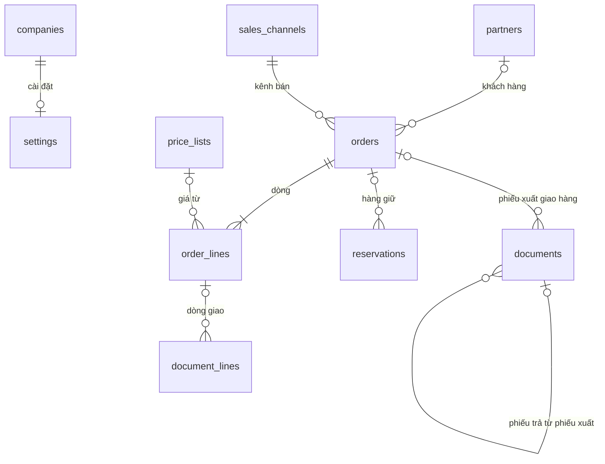

Lược đồ (chép từ tệp `database/migrations/0007_sales.sql`):

```sql
-- CONG_VIEC_08: Bán hàng (MODULE_05, phần 1), schema `sales` (tài liệu 12 mục 2, tài liệu 16).
-- Khóa ngoại từ `sales` chỉ trỏ vào `sales`, `core`, `catalog`, `crm`.
-- Số đã giao, đã trả của dòng đơn bán tính từ phiếu kho, không lưu trùng.

CREATE SCHEMA IF NOT EXISTS sales;

-- Cài đặt bán hàng theo công ty: chiết khấu tay tối đa không cần duyệt (QUYTAC_NGHIEPVU_68).
CREATE TABLE sales.settings (
    company_id                      uuid        PRIMARY KEY REFERENCES core.companies(id),
    max_manual_discount_percent     numeric(5,2) NOT NULL DEFAULT 0 CHECK (max_manual_discount_percent BETWEEN 0 AND 100),
    updated_by                      uuid        REFERENCES core.users(id),
    updated_at                      timestamptz NOT NULL DEFAULT now(),
    version                         integer     NOT NULL DEFAULT 1
);

-- Đơn bán (CHUC_NANG_54; QUYTAC_NGHIEPVU_67 đến 71).
CREATE TABLE sales.orders (
    id                      uuid        PRIMARY KEY DEFAULT gen_random_uuid(),
    company_id              uuid        NOT NULL REFERENCES core.companies(id),
    document_no             text,                                                   -- cấp khi gửi lần đầu
    customer_id             uuid        REFERENCES crm.partners(id),                -- để trống: người mua không lấy hóa đơn
    buyer_name              text,
    channel_id              uuid        NOT NULL REFERENCES catalog.sales_channels(id),
    customer_group_id       uuid        REFERENCES catalog.customer_groups(id),    -- nhóm khách lúc lập (tra giá)
    warehouse_id            uuid        NOT NULL,                                   -- kho xuất (inventory.warehouses, kiểm trong service)
    order_date              date        NOT NULL,
    delivery_address        text,
    note                    text,
    currency                char(3)     NOT NULL REFERENCES core.currencies(code),
    status                  text        NOT NULL DEFAULT 'draft' CHECK (status IN ('draft', 'pending', 'confirmed', 'rejected', 'withdrawn', 'delivered', 'cancelled', 'closed')),
    exceptions              jsonb       NOT NULL DEFAULT '[]'::jsonb,               -- ngoại lệ cần duyệt lần gửi gần nhất
    approval_request_id     uuid        REFERENCES core.approval_requests(id),
    net_amount              numeric(20,4) NOT NULL DEFAULT 0,                       -- chưa gồm thuế giá trị gia tăng
    tax_amount              numeric(20,4) NOT NULL DEFAULT 0,
    total_amount            numeric(20,4) NOT NULL DEFAULT 0,                       -- gồm thuế
    closed_reason           text,
    created_by              uuid        NOT NULL REFERENCES core.users(id),
    created_at              timestamptz NOT NULL DEFAULT now(),
    updated_at              timestamptz NOT NULL DEFAULT now(),
    submitted_at            timestamptz,
    confirmed_at            timestamptz,
    closed_at               timestamptz,
    closed_by               uuid        REFERENCES core.users(id),
    version                 integer     NOT NULL DEFAULT 1,
    UNIQUE (company_id, document_no)
);
CREATE INDEX sales_orders_company_idx ON sales.orders (company_id, created_at DESC);
CREATE INDEX sales_orders_customer_idx ON sales.orders (company_id, customer_id);
CREATE INDEX sales_orders_approval_idx ON sales.orders (approval_request_id);

CREATE TABLE sales.order_lines (
    id                      uuid        PRIMARY KEY DEFAULT gen_random_uuid(),
    order_id                uuid        NOT NULL REFERENCES sales.orders(id) ON DELETE CASCADE,
    line_no                 integer     NOT NULL,
    variant_id              uuid        NOT NULL REFERENCES catalog.variants(id),
    unit_id                 uuid        NOT NULL REFERENCES catalog.units(id),
    quantity                numeric(20,4) NOT NULL CHECK (quantity > 0),
    base_quantity           numeric(20,4) NOT NULL CHECK (base_quantity > 0),
    price_list_id           uuid        REFERENCES catalog.price_lists(id),
    list_price              numeric(20,4) NOT NULL CHECK (list_price >= 0),         -- giá bảng giá theo đơn vị của dòng
    price_includes_vat      boolean     NOT NULL,
    discount_percent        numeric(5,2) NOT NULL DEFAULT 0 CHECK (discount_percent BETWEEN 0 AND 100),
    unit_price              numeric(20,4) NOT NULL CHECK (unit_price >= 0),         -- sau chiết khấu, cùng cách tính thuế với bảng giá
    vat_rate                text        NOT NULL CHECK (vat_rate IN ('0', '5', '8', '10', 'exempt', 'not_declared')),
    net_amount              numeric(20,4) NOT NULL,                                 -- chưa thuế
    tax_amount              numeric(20,4) NOT NULL,
    total_amount            numeric(20,4) NOT NULL,                                 -- gồm thuế
    UNIQUE (order_id, line_no)
);

-- Phiếu xuất giao hàng, phiếu nhận hàng trả lại do module Kho ghi (CHUC_NANG_56, 57).
ALTER TABLE inventory.documents DROP CONSTRAINT documents_type_check;
ALTER TABLE inventory.documents ADD CONSTRAINT documents_type_check
    CHECK (type IN ('receipt_other', 'issue_other', 'adjustment', 'transfer', 'purchase_receipt', 'purchase_return', 'sales_issue', 'sales_return'));
ALTER TABLE inventory.documents DROP CONSTRAINT documents_reason_code_check;
ALTER TABLE inventory.documents ADD CONSTRAINT documents_reason_code_check
    CHECK (reason_code IN ('internal_use', 'gift', 'damaged', 'expired_disposal', 'opening_balance', 'found', 'stocktake', 'transfer', 'purchase', 'purchase_return', 'sale', 'sales_return', 'other'));
ALTER TABLE inventory.documents DROP CONSTRAINT documents_purchase_source_check;
ALTER TABLE inventory.documents ADD CONSTRAINT documents_trade_source_check
    CHECK (type NOT IN ('purchase_receipt', 'purchase_return', 'sales_issue', 'sales_return') OR source_id IS NOT NULL);
ALTER TABLE inventory.documents ADD CONSTRAINT documents_purchase_partner_check
    CHECK (type NOT IN ('purchase_receipt', 'purchase_return') OR partner_id IS NOT NULL);
```

## 11. Database migration 0008 – CONG_VIEC_09 (giao dịch nội bộ)

Tệp `database/migrations/0008_internal_trade.sql` thêm cột giao dịch nội bộ cho đơn bán, đơn mua, phiếu kho và bảng biên bản chênh lệch. Đơn bán và đơn mua đối ứng ở hai schema khác nhau trỏ nhau bằng mã, không đặt khóa ngoại (kiểm trong service). Không thêm quyền, loại chứng từ. Phiếu nhập mua nội bộ dùng trạng thái `in_transit` (đã có) cho "Chờ nhận", `source_type` `purchasing.order`, `source_id` là đơn mua đối ứng.

| Bảng | Cột, ràng buộc | Mục đích |
|---|---|---|
| `sales.orders` | `status` thêm `counterpart_pending`; `warehouse_id` cho phép trống, ràng buộc `orders_warehouse_check` (trống chỉ khi `counterpart_pending`, `cancelled`, `closed`); thêm `counterpart_order_id` (đơn mua đối ứng ở công ty mua), `is_counterpart` (mặc định `false`; đơn sinh từ đơn mua), `counterpart_rejected_reason`; chỉ mục `counterpart_order_id` | Đơn bán nội bộ, đơn bán đối ứng (QUYTAC_NGHIEPVU_73, QUYTAC_NGHIEPVU_74). Đơn đối ứng: `price_list_id` của dòng trống, `list_price` = `unit_price` = giá chưa thuế theo đơn mua |
| `purchasing.orders` | Như trên: `status` thêm `counterpart_pending`; `warehouse_id` cho phép trống (`orders_warehouse_check`); thêm `counterpart_order_id` (đơn bán đối ứng ở công ty bán), `is_counterpart`, `counterpart_rejected_reason`; chỉ mục `counterpart_order_id` | Đơn mua nội bộ, đơn mua đối ứng |
| `inventory.documents` | Thêm `counterpart_document_id` (khóa ngoại `inventory.documents`; phiếu xuất giao hàng gốc bên bán); chỉ mục | Phiếu nhập mua nội bộ (QUYTAC_NGHIEPVU_76) |
| `inventory.document_lines` | Thêm `counterpart_line_id` (khóa ngoại `inventory.document_lines`; dòng xuất gốc) | Ghép dòng nhập với dòng xuất, serial đã xuất |
| `inventory.internal_discrepancies` (mới) | `company_id` (công ty bán), `warehouse_id` (kho xuất), `issue_document_id`, `issue_line_id`, `receipt_document_id`, `receipt_line_id` (trống khi dòng nhận 0), `variant_id` (mặt hàng bên bán), `shortage_base_quantity` (lớn hơn 0, đơn vị cơ sở bên bán), `value` (theo giá vốn phiếu xuất), `serials` (`text[]`, serial đã xuất chưa nhận), `reason`, `status` (`open`, `returned`, `written_off`), `return_document_id` (phiếu nhận hàng trả lại), `resolution_note`, `resolved_by`, `resolved_at`, `created_at`, `version` | Biên bản chênh lệch giao nhận nội bộ (QUYTAC_NGHIEPVU_77). Duy nhất `(receipt_document_id, issue_line_id)`; chỉ mục `(company_id, status, created_at DESC)` |

Quy tắc xóa và lưu giữ bổ sung:
- Không xóa đơn đối ứng: từ chối, kết thúc chuyển `cancelled` (đơn bán) hoặc `closed` (đơn mua), giữ lý do.
- Phiếu nhập nội bộ "Chờ nhận" không xóa; khi nhận, dòng ghi lại theo số thực nhận (dòng nhận 0 bỏ).
- Không xóa biên bản chênh lệch; xử lý chuyển `returned` hoặc `written_off`.

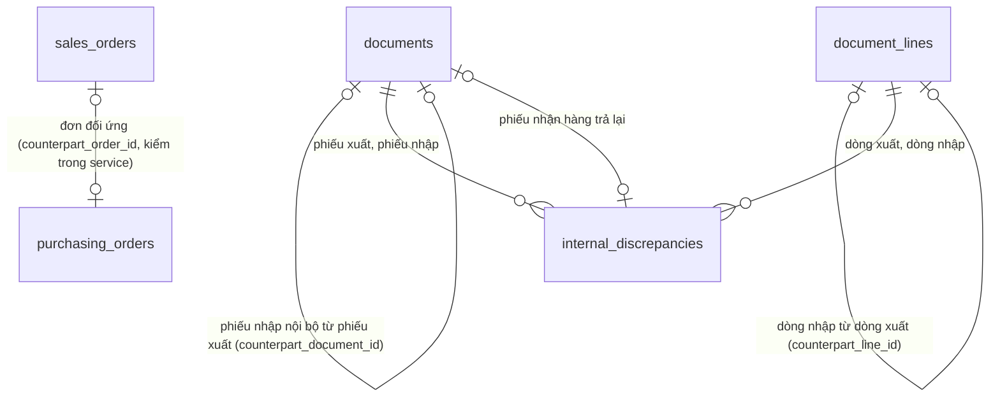

Lược đồ (chép từ tệp `database/migrations/0008_internal_trade.sql`):

```sql
-- CONG_VIEC_09: Giao dịch nội bộ giữa công ty con (MODULE_05, phần 2; tài liệu 16).
-- Đơn bán và đơn mua đối ứng trỏ nhau bằng mã, không khóa ngoại khác schema (kiểm trong service).
-- Phiếu nhập mua nội bộ sinh khi bên bán ghi sổ phiếu xuất giao hàng, chờ bên mua nhận (trạng thái in_transit).

-- Đơn bán: trạng thái chờ bên bán xác nhận đơn đối ứng; kho xuất chọn khi xác nhận, đơn đối ứng bị từ chối trước khi chọn kho không có kho (QUYTAC_NGHIEPVU_74).
ALTER TABLE sales.orders DROP CONSTRAINT orders_status_check;
ALTER TABLE sales.orders ADD CONSTRAINT orders_status_check
    CHECK (status IN ('counterpart_pending', 'draft', 'pending', 'confirmed', 'rejected', 'withdrawn', 'delivered', 'cancelled', 'closed'));
ALTER TABLE sales.orders ALTER COLUMN warehouse_id DROP NOT NULL;
ALTER TABLE sales.orders ADD CONSTRAINT orders_warehouse_check CHECK (warehouse_id IS NOT NULL OR status IN ('counterpart_pending', 'cancelled', 'closed'));
ALTER TABLE sales.orders ADD COLUMN counterpart_order_id uuid;                          -- đơn mua đối ứng ở công ty mua
ALTER TABLE sales.orders ADD COLUMN is_counterpart boolean NOT NULL DEFAULT false;     -- đơn sinh từ đơn mua của công ty mua
ALTER TABLE sales.orders ADD COLUMN counterpart_rejected_reason text;
CREATE INDEX sales_orders_counterpart_idx ON sales.orders (counterpart_order_id);

-- Đơn mua: như trên, kho nhận chọn khi xác nhận.
ALTER TABLE purchasing.orders DROP CONSTRAINT orders_status_check;
ALTER TABLE purchasing.orders ADD CONSTRAINT orders_status_check
    CHECK (status IN ('counterpart_pending', 'draft', 'pending', 'approved', 'rejected', 'withdrawn', 'received', 'closed'));
ALTER TABLE purchasing.orders ALTER COLUMN warehouse_id DROP NOT NULL;
ALTER TABLE purchasing.orders ADD CONSTRAINT orders_warehouse_check CHECK (warehouse_id IS NOT NULL OR status IN ('counterpart_pending', 'cancelled', 'closed'));
ALTER TABLE purchasing.orders ADD COLUMN counterpart_order_id uuid;                     -- đơn bán đối ứng ở công ty bán
ALTER TABLE purchasing.orders ADD COLUMN is_counterpart boolean NOT NULL DEFAULT false; -- đơn sinh từ đơn bán của công ty bán
ALTER TABLE purchasing.orders ADD COLUMN counterpart_rejected_reason text;
CREATE INDEX purchasing_orders_counterpart_idx ON purchasing.orders (counterpart_order_id);

-- Phiếu nhập mua nội bộ trỏ phiếu xuất giao hàng gốc bên bán; dòng nhập trỏ dòng xuất (QUYTAC_NGHIEPVU_76).
ALTER TABLE inventory.documents ADD COLUMN counterpart_document_id uuid REFERENCES inventory.documents(id);
ALTER TABLE inventory.document_lines ADD COLUMN counterpart_line_id uuid REFERENCES inventory.document_lines(id);
CREATE INDEX documents_counterpart_idx ON inventory.documents (counterpart_document_id);

-- Biên bản chênh lệch giao nhận nội bộ thuộc công ty bán (QUYTAC_NGHIEPVU_77).
CREATE TABLE inventory.internal_discrepancies (
    id                      uuid        PRIMARY KEY DEFAULT gen_random_uuid(),
    company_id              uuid        NOT NULL REFERENCES core.companies(id),        -- công ty bán
    warehouse_id            uuid        NOT NULL REFERENCES inventory.warehouses(id),  -- kho xuất
    issue_document_id       uuid        NOT NULL REFERENCES inventory.documents(id),
    issue_line_id           uuid        NOT NULL REFERENCES inventory.document_lines(id),
    receipt_document_id     uuid        NOT NULL REFERENCES inventory.documents(id),
    receipt_line_id         uuid        REFERENCES inventory.document_lines(id),        -- dòng nhập; trống khi không nhận được gì của dòng xuất
    variant_id              uuid        NOT NULL REFERENCES catalog.variants(id),      -- mặt hàng bên bán
    shortage_base_quantity  numeric(20,4) NOT NULL CHECK (shortage_base_quantity > 0), -- đơn vị cơ sở bên bán
    value                   numeric(20,4) NOT NULL,                                     -- theo giá vốn phiếu xuất
    serials                 text[]      NOT NULL DEFAULT '{}',                          -- serial đã xuất chưa nhận
    reason                  text        NOT NULL,                                       -- lý do của bên nhận
    status                  text        NOT NULL DEFAULT 'open' CHECK (status IN ('open', 'returned', 'written_off')),
    return_document_id      uuid        REFERENCES inventory.documents(id),             -- phiếu nhận hàng trả lại khi nhập lại kho
    resolution_note         text,
    resolved_by             uuid        REFERENCES core.users(id),
    resolved_at             timestamptz,
    created_at              timestamptz NOT NULL DEFAULT now(),
    version                 integer     NOT NULL DEFAULT 1,
    UNIQUE (receipt_document_id, issue_line_id)
);
CREATE INDEX internal_discrepancies_company_idx ON inventory.internal_discrepancies (company_id, status, created_at DESC);
```

## 12. Database migration 0009 – CONG_VIEC_12 (khuyến mãi)

Tệp `database/migrations/0009_promotions.sql` thêm chương trình khuyến mãi và cột khuyến mãi của dòng đơn bán. Khóa ngoại chỉ trỏ vào `sales`, `core`, `catalog`. Đã dùng của chương trình (tiền đã giảm, số suất đã tặng) tính từ `sales.order_lines` của đơn `pending`, `confirmed`, `delivered`, `closed`, không lưu trùng. Loại chứng từ duyệt `sales.promotion`, dãy số tiền tố `KM` tạo khi gửi lần đầu (không có trong database migration).

| Bảng | Cột, ràng buộc | Mục đích |
|---|---|---|
| `sales.promotions` (mới) | `company_id`, `document_no` (cấp khi gửi lần đầu; duy nhất theo công ty), `name`, `kind` (`product_discount`, `order_discount`, `buy_get`), `valid_from`, `valid_to` (không trước `valid_from`); giảm theo đơn: `min_order_amount` (từ 0, gồm thuế), `order_discount_percent` (lớn hơn 0 đến 100), `max_order_discount` (lớn hơn 0; trống: không giới hạn); mua X tặng Y: `buy_variant_id`, `buy_quantity`, `gift_variant_id`, `gift_quantity` (lớn hơn 0, đơn vị cơ sở); `budget_amount` (lớn hơn 0, gồm thuế; trống: không giới hạn), `max_gift_sets` (lớn hơn 0; trống: không giới hạn); `note`, `status` (`draft`, `pending`, `active`, `rejected`, `withdrawn`, `stopped`), `approval_request_id`, `stopped_reason`, `stopped_at`, `stopped_by`, `created_by`, `created_at`, `updated_at`, `version`. Ràng buộc theo loại: `order_discount` phải có ngưỡng, phần trăm; `buy_get` phải có đủ mặt hàng mua, tặng, số lượng. Chỉ mục `(company_id, status, valid_from, valid_to)`, `(approval_request_id)` | Chương trình khuyến mãi (QUYTAC_NGHIEPVU_79, QUYTAC_NGHIEPVU_80). Service chỉ ghi `budget_amount` cho giảm theo sản phẩm, theo đơn; `max_gift_sets` cho mua X tặng Y; trường của loại khác để trống |
| `sales.promotion_items` (mới) | `promotion_id` (xóa theo chương trình), `variant_id`, `discount_percent` (lớn hơn 0 đến 100); khóa chính `(promotion_id, variant_id)` | Mặt hàng, phần trăm của giảm theo sản phẩm |
| `sales.promotion_channels`, `sales.promotion_customer_groups` (mới) | `promotion_id` (xóa theo chương trình), `channel_id` hoặc `customer_group_id`; khóa chính hai cột | Điều kiện kênh, nhóm khách; không có dòng: mọi kênh trừ Nội bộ, mọi khách |
| `sales.order_lines` | Thêm `promotion_id` (chương trình giảm theo sản phẩm, hoặc chương trình tặng của dòng hàng tặng), `promotion_percent` (mặc định 0), `order_promotion_id` (chương trình giảm theo đơn), `order_discount_amount` (phần giảm theo đơn của dòng, gồm thuế, mặc định 0), `promotion_discount_total` (tổng giảm do khuyến mãi của dòng, gồm thuế, mặc định 0), `is_gift` (mặc định `false`), `gift_sets` (số suất của dòng tặng, mặc định 0); chỉ mục `promotion_id`, `order_promotion_id` | Khuyến mãi đã áp trên dòng (QUYTAC_NGHIEPVU_81 đến QUYTAC_NGHIEPVU_83). Tiền đã giảm của chương trình theo sản phẩm = tổng `promotion_discount_total − order_discount_amount` trên dòng không phải hàng tặng; theo đơn = tổng `order_discount_amount` |
| `sales.orders` | Thêm `gift_shortages` (`jsonb`, mặc định `[]`; `[{promotionName, missingSets}]`) | Suất tặng thiếu do kho xuất không đủ hàng tặng lúc lưu đơn (tặng theo tồn còn lại, QUYTAC_NGHIEPVU_81); ghi lại mỗi lần lưu |

Quy tắc xóa và lưu giữ bổ sung:
- Không xóa chương trình; dừng chuyển `stopped`, giữ lý do, người, thời điểm.
- Sửa chương trình thay toàn bộ dòng `sales.promotion_items`, `sales.promotion_channels`, `sales.promotion_customer_groups`.
- Dòng đơn bán (gồm dòng hàng tặng) ghi lại toàn bộ mỗi lần lưu đơn như trước.

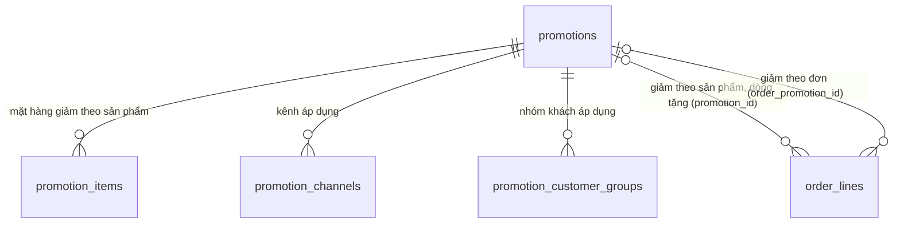

Lược đồ (chép từ tệp `database/migrations/0009_promotions.sql`):

```sql
-- CONG_VIEC_12: Khuyến mãi (MODULE_05, phần 3; tài liệu 16).
-- Đã dùng của chương trình tính từ dòng đơn bán, không lưu trùng.

-- Chương trình khuyến mãi (CHUC_NANG_62; QUYTAC_NGHIEPVU_79, 80).
CREATE TABLE sales.promotions (
    id                      uuid        PRIMARY KEY DEFAULT gen_random_uuid(),
    company_id              uuid        NOT NULL REFERENCES core.companies(id),
    document_no             text,                                                   -- cấp khi gửi lần đầu
    name                    text        NOT NULL,
    kind                    text        NOT NULL CHECK (kind IN ('product_discount', 'order_discount', 'buy_get')),
    valid_from              date        NOT NULL,
    valid_to                date        NOT NULL,
    -- Giảm theo đơn: ngưỡng tổng đơn gồm thuế, phần trăm giảm, mức giảm tối đa (trống: không giới hạn).
    min_order_amount        numeric(20,4) CHECK (min_order_amount >= 0),
    order_discount_percent  numeric(5,2) CHECK (order_discount_percent > 0 AND order_discount_percent <= 100),
    max_order_discount      numeric(20,4) CHECK (max_order_discount > 0),
    -- Mua X tặng Y: số lượng theo đơn vị cơ sở.
    buy_variant_id          uuid        REFERENCES catalog.variants(id),
    buy_quantity            numeric(20,4) CHECK (buy_quantity > 0),
    gift_variant_id         uuid        REFERENCES catalog.variants(id),
    gift_quantity           numeric(20,4) CHECK (gift_quantity > 0),
    -- Giới hạn (trống: không giới hạn): tổng tiền giảm gồm thuế, tổng số suất tặng.
    budget_amount           numeric(20,4) CHECK (budget_amount > 0),
    max_gift_sets           integer     CHECK (max_gift_sets > 0),
    note                    text,
    status                  text        NOT NULL DEFAULT 'draft' CHECK (status IN ('draft', 'pending', 'active', 'rejected', 'withdrawn', 'stopped')),
    approval_request_id     uuid        REFERENCES core.approval_requests(id),
    stopped_reason          text,
    stopped_at              timestamptz,
    stopped_by              uuid        REFERENCES core.users(id),
    created_by              uuid        NOT NULL REFERENCES core.users(id),
    created_at              timestamptz NOT NULL DEFAULT now(),
    updated_at              timestamptz NOT NULL DEFAULT now(),
    version                 integer     NOT NULL DEFAULT 1,
    UNIQUE (company_id, document_no),
    CHECK (valid_to >= valid_from),
    CHECK (kind <> 'order_discount' OR (min_order_amount IS NOT NULL AND order_discount_percent IS NOT NULL)),
    CHECK (kind <> 'buy_get' OR (buy_variant_id IS NOT NULL AND buy_quantity IS NOT NULL AND gift_variant_id IS NOT NULL AND gift_quantity IS NOT NULL))
);
CREATE INDEX sales_promotions_company_idx ON sales.promotions (company_id, status, valid_from, valid_to);
CREATE INDEX sales_promotions_approval_idx ON sales.promotions (approval_request_id);

-- Giảm theo sản phẩm: mỗi mặt hàng một phần trăm giảm.
CREATE TABLE sales.promotion_items (
    promotion_id            uuid        NOT NULL REFERENCES sales.promotions(id) ON DELETE CASCADE,
    variant_id              uuid        NOT NULL REFERENCES catalog.variants(id),
    discount_percent        numeric(5,2) NOT NULL CHECK (discount_percent > 0 AND discount_percent <= 100),
    PRIMARY KEY (promotion_id, variant_id)
);

-- Điều kiện kênh, nhóm khách (không có dòng: mọi kênh trừ Nội bộ, mọi khách).
CREATE TABLE sales.promotion_channels (
    promotion_id            uuid        NOT NULL REFERENCES sales.promotions(id) ON DELETE CASCADE,
    channel_id              uuid        NOT NULL REFERENCES catalog.sales_channels(id),
    PRIMARY KEY (promotion_id, channel_id)
);
CREATE TABLE sales.promotion_customer_groups (
    promotion_id            uuid        NOT NULL REFERENCES sales.promotions(id) ON DELETE CASCADE,
    customer_group_id       uuid        NOT NULL REFERENCES catalog.customer_groups(id),
    PRIMARY KEY (promotion_id, customer_group_id)
);

-- Dòng đơn bán: khuyến mãi đã áp (QUYTAC_NGHIEPVU_81 đến 83).
ALTER TABLE sales.order_lines ADD COLUMN promotion_id uuid REFERENCES sales.promotions(id);            -- giảm theo sản phẩm hoặc mua X tặng Y (dòng tặng)
ALTER TABLE sales.order_lines ADD COLUMN promotion_percent numeric(5,2) NOT NULL DEFAULT 0;
ALTER TABLE sales.order_lines ADD COLUMN order_promotion_id uuid REFERENCES sales.promotions(id);      -- giảm theo đơn chia vào dòng
ALTER TABLE sales.order_lines ADD COLUMN order_discount_amount numeric(20,4) NOT NULL DEFAULT 0;      -- phần giảm theo đơn của dòng, gồm thuế
ALTER TABLE sales.order_lines ADD COLUMN promotion_discount_total numeric(20,4) NOT NULL DEFAULT 0;   -- tổng giảm do khuyến mãi của dòng, gồm thuế
ALTER TABLE sales.order_lines ADD COLUMN is_gift boolean NOT NULL DEFAULT false;
ALTER TABLE sales.order_lines ADD COLUMN gift_sets integer NOT NULL DEFAULT 0;                         -- số suất của dòng tặng
CREATE INDEX sales_order_lines_promotion_idx ON sales.order_lines (promotion_id);
CREATE INDEX sales_order_lines_order_promotion_idx ON sales.order_lines (order_promotion_id);
-- Suất tặng thiếu do kho xuất không đủ hàng tặng lúc lưu đơn (tặng theo tồn còn lại): [{promotionName, missingSets}].
ALTER TABLE sales.orders ADD COLUMN gift_shortages jsonb NOT NULL DEFAULT '[]'::jsonb;
```

## 13. Database migration 0010 – CONG_VIEC_13 (schema `finance`)

Tệp `database/migrations/0010_finance.sql` tạo schema `finance` của MODULE_06 Tài chính – Kế toán (phần 1), 5 bảng và một hàm. Khóa ngoại từ `finance` chỉ trỏ vào `finance`, `core`, `crm`; phiếu kho, biên bản chênh lệch nội bộ (`source_id` của khoản công nợ) không đặt khóa ngoại. Khoản `internal_write_off` là khoản giảm phải thu của công ty bán khi biên bản chênh lệch nội bộ được ghi tổn thất (giá đơn bán của phần thiếu, quyết định của người dùng 2026-11-10). Số dư quỹ, số dư công nợ, tiền trả trước tính từ dữ liệu, không lưu trùng. Quyền `finance.debt.view`, `finance.fund.manage`, `finance.debt.manage`, `finance.payment.manage`, vai trò `accountant`, loại chứng từ `finance.receipt` (không duyệt), `finance.payment` (cần duyệt) ghi vào bảng của `core` bằng hàm đồng bộ danh mục quyền (`apps/api/src/permissions/permission-catalog.ts`). Dãy số tiền tố `PT`, `PC` tạo khi gửi lần đầu (không có trong database migration).

| Bảng | Mục đích | Cột chính | Ràng buộc, chỉ mục |
|---|---|---|---|
| `funds` | Quỹ tiền mặt, tài khoản ngân hàng (CHUC_NANG_65; QUYTAC_NGHIEPVU_85) | `company_id`, `code` (1 đến 20 ký tự), `name`, `kind` (`cash`, `bank`), `bank_name`, `account_no`, `account_holder`, `opening_balance` (`numeric(20,4)`, không âm), `status` (`active`, `inactive`), `created_by`, `created_at`, `updated_at`, `version` | Duy nhất `(company_id, code)` (service kiểm thêm không phân biệt hoa thường); `bank` phải có `bank_name`, `account_no` |
| `debt_items` | Khoản công nợ (CHUC_NANG_66; QUYTAC_NGHIEPVU_86, 87, 90) | `company_id`, `partner_id` (`crm.partners`), `side` (`receivable`, `payable`), `direction` (`debit` tăng nợ, `credit` giảm nợ), `source_type` (`opening`, `sales_issue`, `sales_return`, `purchase_receipt`, `purchase_return`, `payment`, `internal_write_off`; database migration 0019 thêm `collection_statement`), `source_id` (phiếu kho, phiếu thu chi, biên bản chênh lệch nội bộ ghi tổn thất, dòng bảng đối soát thu hộ hoặc bảng đối soát thu hộ; số dư đầu kỳ trống), `original_item_id` (khoản tăng của phiếu gốc khi trả hàng, ghi tổn thất), `document_no`, `document_date`, `due_date` (chỉ khoản tăng), `amount` (lớn hơn 0, gồm thuế), `open_amount` (0 đến `amount`), `note`, `created_by`, `created_at` | `due_date` có khi và chỉ khi `debit`; `source_id` trống khi và chỉ khi `opening`; duy nhất `(source_type, source_id)` khi có `source_id`; chỉ mục `(company_id, side, partner_id, direction)`, `(company_id, side, partner_id)` với `open_amount > 0` |
| `debt_allocations` | Trừ nợ: ghép khoản giảm với khoản tăng (QUYTAC_NGHIEPVU_87) | `company_id`, `debit_item_id`, `credit_item_id` (xóa theo khoản), `amount` (lớn hơn 0), `created_at` | Chỉ mục `debit_item_id`, `credit_item_id`; service chỉ ghép hai khoản cùng công ty, đối tác, phía |
| `payments` | Phiếu thu, phiếu chi (CHUC_NANG_67; QUYTAC_NGHIEPVU_88, 89) | `company_id`, `document_no` (cấp khi gửi lần đầu), `kind` (`customer_receipt`, `supplier_payment`, `customer_refund`, `supplier_refund`), `partner_id`, `fund_id`, `payment_date`, `amount` (lớn hơn 0), `note`, `status` (`draft`, `pending`, `posted`, `rejected`, `withdrawn`), `approval_request_id` (`core.approval_requests`), `post_error` (khóa thông báo lỗi khi duyệt xong không ghi sổ được, ví dụ `insufficientFundBalance`), `posted_at`, `created_by`, `created_at`, `updated_at`, `version` | Duy nhất `(company_id, kind, document_no)`; chỉ mục `(company_id, status, payment_date)`, `(fund_id, status)`, `approval_request_id` |
| `payment_lines` | Chứng từ còn nợ người lập chọn trừ | `payment_id` (xóa theo phiếu), `debit_item_id`, `amount` (lớn hơn 0) | Khóa chính `(payment_id, debit_item_id)` |

Hàm `finance.inventory_debt_amount(document)`: giá trị công nợ gồm thuế của một phiếu kho, làm tròn 4 chữ số (QUYTAC_NGHIEPVU_86): xuất giao hàng, nhận hàng trả lại theo `sales.order_lines.total_amount` tỷ lệ số lượng cơ sở; nhập mua, trả hàng nhà cung cấp theo `purchasing.order_lines.amount` nhân (1 + thuế suất 0, 5, 8, 10%; miễn thuế, không kê khai tính 0) tỷ lệ số lượng cơ sở, nhập mua trừ phần không đạt kiểm tra chất lượng. Dùng chung cho mã ứng dụng (khi ghi sổ) và tính lại phiếu cũ.

Tính lại phiếu cũ (chạy một lần trong database migration): tạo khoản tăng cho phiếu xuất giao hàng, nhập mua đã ghi sổ có đối tác (hạn thanh toán theo số ngày được nợ hiện tại của hồ sơ); tạo khoản giảm cho phiếu nhận hàng trả lại, trả hàng nhà cung cấp, gắn khoản tăng của phiếu gốc; trừ khoản giảm vào khoản tăng của phiếu gốc theo ngày chứng từ, không vượt số còn lại. Phần còn lại của khoản giảm giữ làm trả trước.

Quy tắc xóa và lưu giữ bổ sung:
- Không xóa quỹ; ngừng dùng chuyển `inactive`.
- Không xóa phiếu thu chi; phiếu đã ghi sổ không sửa. Sửa phiếu chưa ghi sổ thay toàn bộ dòng `payment_lines`.
- Khoản công nợ từ phiếu kho, phiếu thu chi không xóa, không sửa số tiền; `open_amount` chỉ giảm khi trừ nợ. Chỉ xóa được khoản số dư đầu kỳ chưa trừ nợ, chưa được chọn trên phiếu thu chi.
- Trừ nợ không xóa (chỉ mất theo khoản số dư đầu kỳ bị xóa, khi chưa có trừ nợ).

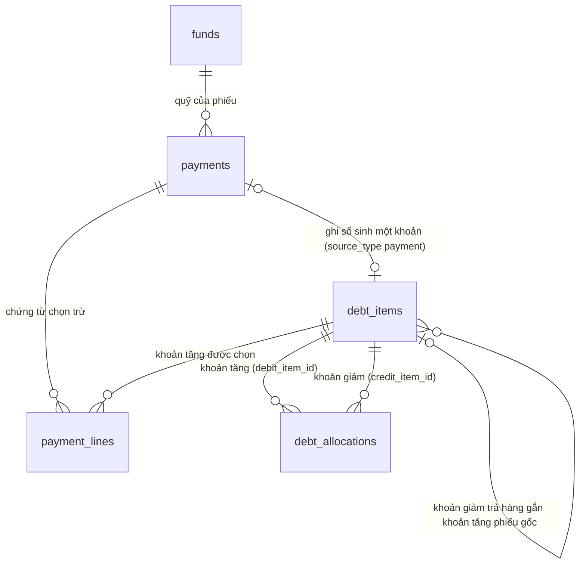

Lược đồ (chép từ tệp `database/migrations/0010_finance.sql`):

```sql
-- CONG_VIEC_13: Công nợ phải thu, phải trả (MODULE_06, phần 1; tài liệu 16).
CREATE SCHEMA IF NOT EXISTS finance;

-- Quỹ tiền mặt, tài khoản ngân hàng của công ty (CHUC_NANG_65; QUYTAC_NGHIEPVU_85). Số dư hiện tại tính từ phiếu thu chi đã ghi sổ.
CREATE TABLE finance.funds (
    id                      uuid        PRIMARY KEY DEFAULT gen_random_uuid(),
    company_id              uuid        NOT NULL REFERENCES core.companies(id),
    code                    text        NOT NULL CHECK (length(code) BETWEEN 1 AND 20),
    name                    text        NOT NULL,
    kind                    text        NOT NULL CHECK (kind IN ('cash', 'bank')),
    bank_name               text,
    account_no              text,
    account_holder          text,
    opening_balance         numeric(20,4) NOT NULL DEFAULT 0 CHECK (opening_balance >= 0),
    status                  text        NOT NULL DEFAULT 'active' CHECK (status IN ('active', 'inactive')),
    created_by              uuid        NOT NULL REFERENCES core.users(id),
    created_at              timestamptz NOT NULL DEFAULT now(),
    updated_at              timestamptz NOT NULL DEFAULT now(),
    version                 integer     NOT NULL DEFAULT 1,
    UNIQUE (company_id, code),
    CHECK (kind <> 'bank' OR (bank_name IS NOT NULL AND account_no IS NOT NULL))
);

-- Khoản công nợ (CHUC_NANG_66; QUYTAC_NGHIEPVU_86, 87, 90): tăng nợ (debit) hoặc giảm nợ (credit) của một đối tác ở phía phải thu hoặc phải trả.
CREATE TABLE finance.debt_items (
    id                      uuid        PRIMARY KEY DEFAULT gen_random_uuid(),
    company_id              uuid        NOT NULL REFERENCES core.companies(id),
    partner_id              uuid        NOT NULL REFERENCES crm.partners(id),
    side                    text        NOT NULL CHECK (side IN ('receivable', 'payable')),
    direction               text        NOT NULL CHECK (direction IN ('debit', 'credit')),
    source_type             text        NOT NULL CHECK (source_type IN ('opening', 'sales_issue', 'sales_return', 'purchase_receipt', 'purchase_return', 'payment', 'internal_write_off')),
    source_id               uuid,                                                   -- phiếu kho, phiếu thu chi hoặc biên bản chênh lệch nội bộ ghi tổn thất; số dư đầu kỳ: trống
    original_item_id        uuid        REFERENCES finance.debt_items(id),          -- trả hàng: khoản tăng của phiếu gốc, trừ trước
    document_no             text        NOT NULL,
    document_date           date        NOT NULL,
    due_date                date,                                                   -- chỉ khoản tăng nợ
    amount                  numeric(20,4) NOT NULL CHECK (amount > 0),              -- tiền tệ công ty, gồm thuế
    open_amount             numeric(20,4) NOT NULL CHECK (open_amount >= 0),
    note                    text,
    created_by              uuid        REFERENCES core.users(id),
    created_at              timestamptz NOT NULL DEFAULT now(),
    CHECK (open_amount <= amount),
    CHECK ((direction = 'debit') = (due_date IS NOT NULL)),
    CHECK ((source_type = 'opening') = (source_id IS NULL))
);
CREATE UNIQUE INDEX debt_items_source_idx ON finance.debt_items (source_type, source_id) WHERE source_id IS NOT NULL;
CREATE INDEX debt_items_partner_idx ON finance.debt_items (company_id, side, partner_id, direction);
CREATE INDEX debt_items_open_idx ON finance.debt_items (company_id, side, partner_id) WHERE open_amount > 0;

-- Trừ nợ: ghép một khoản giảm với một khoản tăng (QUYTAC_NGHIEPVU_87).
CREATE TABLE finance.debt_allocations (
    id                      uuid        PRIMARY KEY DEFAULT gen_random_uuid(),
    company_id              uuid        NOT NULL REFERENCES core.companies(id),
    debit_item_id           uuid        NOT NULL REFERENCES finance.debt_items(id) ON DELETE CASCADE,
    credit_item_id          uuid        NOT NULL REFERENCES finance.debt_items(id) ON DELETE CASCADE,
    amount                  numeric(20,4) NOT NULL CHECK (amount > 0),
    created_at              timestamptz NOT NULL DEFAULT now()
);
CREATE INDEX debt_allocations_debit_idx ON finance.debt_allocations (debit_item_id);
CREATE INDEX debt_allocations_credit_idx ON finance.debt_allocations (credit_item_id);

-- Phiếu thu, phiếu chi (CHUC_NANG_67; QUYTAC_NGHIEPVU_88, 89).
CREATE TABLE finance.payments (
    id                      uuid        PRIMARY KEY DEFAULT gen_random_uuid(),
    company_id              uuid        NOT NULL REFERENCES core.companies(id),
    document_no             text,                                                   -- cấp khi gửi lần đầu
    kind                    text        NOT NULL CHECK (kind IN ('customer_receipt', 'supplier_payment', 'customer_refund', 'supplier_refund')),
    partner_id              uuid        NOT NULL REFERENCES crm.partners(id),
    fund_id                 uuid        NOT NULL REFERENCES finance.funds(id),
    payment_date            date        NOT NULL,
    amount                  numeric(20,4) NOT NULL CHECK (amount > 0),
    note                    text,
    status                  text        NOT NULL DEFAULT 'draft' CHECK (status IN ('draft', 'pending', 'posted', 'rejected', 'withdrawn')),
    approval_request_id     uuid        REFERENCES core.approval_requests(id),
    post_error              text,                                                   -- duyệt xong nhưng không ghi sổ được (số dư quỹ, số còn nợ đã đổi)
    posted_at               timestamptz,
    created_by              uuid        NOT NULL REFERENCES core.users(id),
    created_at              timestamptz NOT NULL DEFAULT now(),
    updated_at              timestamptz NOT NULL DEFAULT now(),
    version                 integer     NOT NULL DEFAULT 1,
    UNIQUE (company_id, kind, document_no)
);
CREATE INDEX payments_company_idx ON finance.payments (company_id, status, payment_date);
CREATE INDEX payments_fund_idx ON finance.payments (fund_id, status);
CREATE INDEX payments_approval_idx ON finance.payments (approval_request_id);

-- Chứng từ còn nợ người lập chọn trừ (thu tiền khách hàng, trả tiền nhà cung cấp).
CREATE TABLE finance.payment_lines (
    payment_id              uuid        NOT NULL REFERENCES finance.payments(id) ON DELETE CASCADE,
    debit_item_id           uuid        NOT NULL REFERENCES finance.debt_items(id),
    amount                  numeric(20,4) NOT NULL CHECK (amount > 0),
    PRIMARY KEY (payment_id, debit_item_id)
);

-- Giá trị công nợ của phiếu kho đã ghi sổ (QUYTAC_NGHIEPVU_86): gồm thuế theo đơn bán, đơn mua; nhập mua chỉ phần đạt kiểm tra chất lượng.
-- Dùng chung cho mã ứng dụng (khi ghi sổ) và tính lại phiếu cũ bên dưới.
CREATE FUNCTION finance.inventory_debt_amount(document uuid) RETURNS numeric LANGUAGE sql STABLE AS $$
    SELECT round(coalesce(CASE d.type
        WHEN 'sales_issue' THEN (
            SELECT sum(sl.total_amount * abs(dl.base_quantity) / sl.base_quantity)
            FROM inventory.document_lines dl JOIN sales.order_lines sl ON sl.id = dl.source_line_id
            WHERE dl.document_id = d.id)
        WHEN 'sales_return' THEN (
            SELECT sum(sl.total_amount * abs(rl.base_quantity) / sl.base_quantity)
            FROM inventory.document_lines rl JOIN inventory.document_lines dl ON dl.id = rl.source_line_id
            JOIN sales.order_lines sl ON sl.id = dl.source_line_id
            WHERE rl.document_id = d.id)
        WHEN 'purchase_receipt' THEN (
            SELECT sum(pl.amount * (1 + CASE WHEN pl.vat_rate IN ('0', '5', '8', '10') THEN pl.vat_rate::numeric / 100 ELSE 0 END)
                       * (abs(dl.base_quantity) - coalesce(dl.rejected_base_quantity, 0)) / pl.base_quantity)
            FROM inventory.document_lines dl JOIN purchasing.order_lines pl ON pl.id = dl.source_line_id
            WHERE dl.document_id = d.id)
        WHEN 'purchase_return' THEN (
            SELECT sum(pl.amount * (1 + CASE WHEN pl.vat_rate IN ('0', '5', '8', '10') THEN pl.vat_rate::numeric / 100 ELSE 0 END)
                       * abs(rl.base_quantity) / pl.base_quantity)
            FROM inventory.document_lines rl JOIN inventory.document_lines dl ON dl.id = rl.source_line_id
            JOIN purchasing.order_lines pl ON pl.id = dl.source_line_id
            WHERE rl.document_id = d.id)
    END, 0), 4)
    FROM inventory.documents d WHERE d.id = document
$$;

-- Tính lại công nợ của phiếu kho đã ghi sổ trước khi nâng cấp: khoản tăng trước, rồi khoản giảm do trả hàng trừ vào phiếu gốc.
INSERT INTO finance.debt_items (company_id, partner_id, side, direction, source_type, source_id, document_no, document_date, due_date, amount, open_amount)
SELECT d.company_id, d.partner_id,
    CASE WHEN d.type = 'sales_issue' THEN 'receivable' ELSE 'payable' END, 'debit', d.type, d.id, coalesce(d.document_no, ''), d.document_date,
    d.document_date + coalesce((SELECT p.payment_term_days FROM crm.partner_profiles p WHERE p.company_id = d.company_id AND p.partner_id = d.partner_id), 0),
    finance.inventory_debt_amount(d.id), finance.inventory_debt_amount(d.id)
FROM inventory.documents d
WHERE d.type IN ('sales_issue', 'purchase_receipt') AND d.status = 'posted' AND d.partner_id IS NOT NULL AND finance.inventory_debt_amount(d.id) > 0;

INSERT INTO finance.debt_items (company_id, partner_id, side, direction, source_type, source_id, original_item_id, document_no, document_date, amount, open_amount)
SELECT d.company_id, d.partner_id,
    CASE WHEN d.type = 'sales_return' THEN 'receivable' ELSE 'payable' END, 'credit', d.type, d.id, o.id, coalesce(d.document_no, ''), d.document_date,
    finance.inventory_debt_amount(d.id), finance.inventory_debt_amount(d.id)
FROM inventory.documents d
LEFT JOIN finance.debt_items o ON o.source_id = d.source_id AND o.direction = 'debit'
WHERE d.type IN ('sales_return', 'purchase_return') AND d.status = 'posted' AND d.partner_id IS NOT NULL AND finance.inventory_debt_amount(d.id) > 0
ORDER BY d.posted_at;

-- Trừ khoản giảm vào khoản tăng của phiếu gốc (theo thứ tự ghi sổ, không vượt số còn lại).
DO $$
DECLARE
    credit record;
    applied numeric;
BEGIN
    FOR credit IN SELECT c.id, c.company_id, c.original_item_id, c.open_amount FROM finance.debt_items c
                  WHERE c.direction = 'credit' AND c.original_item_id IS NOT NULL ORDER BY c.document_date, c.created_at LOOP
        SELECT least(credit.open_amount, open_amount) INTO applied FROM finance.debt_items WHERE id = credit.original_item_id;
        IF applied > 0 THEN
            INSERT INTO finance.debt_allocations (company_id, debit_item_id, credit_item_id, amount) VALUES (credit.company_id, credit.original_item_id, credit.id, applied);
            UPDATE finance.debt_items SET open_amount = open_amount - applied WHERE id IN (credit.id, credit.original_item_id);
        END IF;
    END LOOP;
END $$;
```

## 14. Database migration 0011 – CONG_VIEC_14 (schema `accounting`)

Tệp `database/migrations/0011_accounting.sql` tạo schema `accounting` của MODULE_06 Tài chính – Kế toán (phần 2), 5 bảng; thêm ba hàm của schema `finance` dùng chung cho công nợ và bút toán (THAY_DOI_10). Khóa ngoại từ `accounting` chỉ trỏ vào `accounting`, `core`, `crm`; chứng từ gốc (`source_id` của bút toán: phiếu kho, phiếu thu chi, biên bản chênh lệch nội bộ) không đặt khóa ngoại. Chế độ kế toán không lưu ở `accounting`: đọc từ `core.companies.accounting_regime` (`TT99_2025`, `TT133`). Danh mục tài khoản, định khoản mặc định của hai chế độ không nằm trong database migration mà nạp khi khởi tạo từ `apps/api/src/accounting/charts.ts`. Quyền `finance.ledger.view`, `finance.ledger.setup`, `finance.journal.manage`, `finance.period.close` (nhạy cảm), vai trò `chief_accountant`, quyền thêm của `accountant`, loại chứng từ `accounting.journal` (cần duyệt) ghi vào bảng của `core` bằng hàm đồng bộ danh mục quyền (`apps/api/src/permissions/permission-catalog.ts`). Dãy số tiền tố `PKT` tạo khi gửi lần đầu.

| Bảng | Mục đích | Cột chính | Ràng buộc, chỉ mục |
|---|---|---|---|
| `settings` | Cài đặt kế toán của công ty đã khởi tạo (QUYTAC_NGHIEPVU_93, 97); không có dòng là chưa khởi tạo | `company_id` (khóa chính), `locked_through` (đã khóa sổ đến hết ngày), `initialized_by`, `initialized_at`, `version` | Ghi sổ chứng từ đọc với `FOR SHARE`; khóa sổ, mở lại với `FOR UPDATE` |
| `accounts` | Hệ thống tài khoản (CHUC_NANG_69; QUYTAC_NGHIEPVU_93) | `company_id`, `code` (3 đến 20 chữ số hoặc chữ cái), `name`, `parent_id`, `nature` (`debit`, `credit`, `both`), `is_system` (nạp từ chế độ), `status` (`active`, `inactive`), `created_at`, `updated_at`, `version` | Duy nhất `(company_id, code)`; chỉ mục `parent_id`; service kiểm số hiệu bắt đầu bằng số hiệu cha |
| `posting_rules` | Định khoản mặc định (CHUC_NANG_70; QUYTAC_NGHIEPVU_94) | `company_id`, `role` (18 vai trò ở `apps/api/src/accounting/postings.ts`; CONG_VIEC_17 thêm `commission_expense`, `staff_payable`; CONG_VIEC_19 thêm `collector_receivable`, `collection_fee`: 22 vai trò), `account_id`, `updated_at`, `updated_by`; CONG_VIEC_43 bỏ `staff_payable`, thêm `service_expense` | Khóa chính `(company_id, role)` |
| `journals` | Bút toán: tự sinh, phiếu kế toán, kết chuyển (CHUC_NANG_71 đến 73; QUYTAC_NGHIEPVU_95 đến 97) | `company_id`, `journal_no` (phiếu kế toán: cấp khi gửi; tự sinh: số chứng từ gốc; kết chuyển: `KC-YYYY-MM`), `journal_date`, `source_type` (`manual`, `inventory_document`, `payment`, `internal_write_off`, `closing`; database migration 0016 thêm `commission`; database migration 0019 thêm `collection_statement`), `source_id`, `description`, `status` (`draft`, `pending`, `posted`, `rejected`, `withdrawn`), `approval_request_id` (`core.approval_requests`), `post_error` (khóa thông báo khi duyệt xong không ghi sổ được, ví dụ `periodLocked`), `total_amount` (tổng Nợ, `numeric(20,4)`), `created_by`, `posted_at`, `created_at`, `updated_at`, `version` | Không phải `manual` thì phải `posted`; duy nhất `(source_type, source_id)` khi có `source_id`; chỉ mục `(company_id, status, journal_date)`, `approval_request_id` |
| `journal_lines` | Dòng bút toán | `journal_id` (xóa theo bút toán), `line_no`, `account_id`, `partner_id` (`crm.partners`), `debit`, `credit` (không âm, `numeric(20,4)`), `description` | Duy nhất `(journal_id, line_no)`; đúng một bên lớn hơn 0; chỉ mục `account_id`, `partner_id` |

Hàm làm tròn dùng chung (THAY_DOI_10, quyết định của người dùng 2026-11-10; QUYTAC_NGHIEPVU_86, QUYTAC_NGHIEPVU_95):
- `finance.company_minor_units(company)`: số chữ số lẻ của tiền tệ công ty (`core.currencies.minor_units`, không có thì 0).
- `finance.line_share(amount, before, quantity, base, units)`: phần tiền của một lần giao, nhận, trả = `round(amount × min(before + quantity, base) / base, units) − round(amount × min(before, base) / base, units)`; tổng các lần đúng bằng tiền dòng đơn làm tròn.
- `finance.inventory_amounts(document)`: tiền gồm thuế (`gross`), chưa thuế (`net`) của phiếu kho đã ghi sổ, cộng `line_share` từng dòng: xuất giao hàng, nhận hàng trả lại theo `sales.order_lines.total_amount`, `net_amount`; nhập mua (phần đạt kiểm tra chất lượng), trả hàng nhà cung cấp theo `purchasing.order_lines.amount` (gồm thuế: nhân 1 + thuế suất); lũy kế trước tính từ các phiếu cùng loại cùng dòng đơn đã ghi sổ trước (theo `posted_at`, `id`).
- `finance.inventory_debt_amount(document)` (mục 13) thay bằng `gross` của `finance.inventory_amounts`; công nợ phiếu kho, ghi tổn thất nội bộ làm tròn đến đơn vị tiền tệ thay cho 4 chữ số lẻ. Bút toán dùng `gross`, `net`; thuế là phần chênh lệch.

Quy tắc xóa và lưu giữ bổ sung:
- Không xóa tài khoản; ngừng dùng chuyển `inactive`. Đổi chế độ kế toán khi công ty chưa có bút toán xóa toàn bộ `posting_rules`, `accounts`, `settings` của công ty (bỏ khởi tạo).
- Bút toán tự sinh, phiếu kế toán đã ghi sổ không sửa, không xóa. Sửa phiếu kế toán chưa ghi sổ thay toàn bộ `journal_lines`.
- Bút toán kết chuyển chỉ bị xóa khi mở lại tháng của nó.

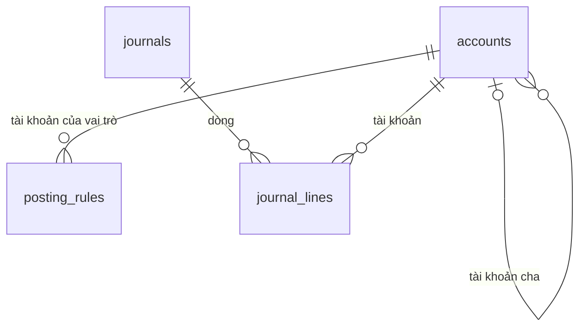

Lược đồ (chép từ tệp `database/migrations/0011_accounting.sql`):

```sql
-- CONG_VIEC_14: Kế toán tổng hợp (MODULE_06, phần 2; tài liệu 16).
CREATE SCHEMA IF NOT EXISTS accounting;

-- Ngày khóa sổ của công ty đã khởi tạo kế toán (QUYTAC_NGHIEPVU_93, 97); chế độ kế toán lấy từ core.companies.accounting_regime. Không có dòng: chưa khởi tạo.
CREATE TABLE accounting.settings (
    company_id              uuid        PRIMARY KEY REFERENCES core.companies(id),
    locked_through          date,                                                   -- đã khóa sổ đến hết ngày này
    initialized_by          uuid        NOT NULL REFERENCES core.users(id),
    initialized_at          timestamptz NOT NULL DEFAULT now(),
    version                 integer     NOT NULL DEFAULT 1
);

-- Hệ thống tài khoản của công ty (QUYTAC_NGHIEPVU_93).
CREATE TABLE accounting.accounts (
    id                      uuid        PRIMARY KEY DEFAULT gen_random_uuid(),
    company_id              uuid        NOT NULL REFERENCES core.companies(id),
    code                    text        NOT NULL CHECK (code ~ '^[0-9A-Za-z]{3,20}$'),
    name                    text        NOT NULL,
    parent_id               uuid        REFERENCES accounting.accounts(id),
    nature                  text        NOT NULL CHECK (nature IN ('debit', 'credit', 'both')),
    is_system               boolean     NOT NULL DEFAULT false,                     -- nạp từ chế độ kế toán
    status                  text        NOT NULL DEFAULT 'active' CHECK (status IN ('active', 'inactive')),
    created_at              timestamptz NOT NULL DEFAULT now(),
    updated_at              timestamptz NOT NULL DEFAULT now(),
    version                 integer     NOT NULL DEFAULT 1,
    UNIQUE (company_id, code)
);
CREATE INDEX accounts_parent_idx ON accounting.accounts (parent_id);

-- Định khoản mặc định: vai trò tài khoản dùng khi sinh bút toán (QUYTAC_NGHIEPVU_94).
CREATE TABLE accounting.posting_rules (
    company_id              uuid        NOT NULL REFERENCES core.companies(id),
    role                    text        NOT NULL,
    account_id              uuid        NOT NULL REFERENCES accounting.accounts(id),
    updated_at              timestamptz NOT NULL DEFAULT now(),
    updated_by              uuid        REFERENCES core.users(id),
    PRIMARY KEY (company_id, role)
);

-- Bút toán (chứng từ kế toán): tự sinh từ chứng từ nghiệp vụ, phiếu kế toán nhập tay, kết chuyển khóa sổ (QUYTAC_NGHIEPVU_95 đến 97).
CREATE TABLE accounting.journals (
    id                      uuid        PRIMARY KEY DEFAULT gen_random_uuid(),
    company_id              uuid        NOT NULL REFERENCES core.companies(id),
    journal_no              text,                                                   -- phiếu kế toán: cấp khi gửi; tự sinh: số chứng từ gốc
    journal_date            date        NOT NULL,
    source_type             text        NOT NULL CHECK (source_type IN ('manual', 'inventory_document', 'payment', 'internal_write_off', 'closing')),
    source_id               uuid,                                                   -- phiếu kho, phiếu thu chi, biên bản; kết chuyển, nhập tay: trống
    description             text        NOT NULL,
    status                  text        NOT NULL DEFAULT 'posted' CHECK (status IN ('draft', 'pending', 'posted', 'rejected', 'withdrawn')),
    approval_request_id     uuid        REFERENCES core.approval_requests(id),
    post_error              text,                                                   -- khóa thông báo khi duyệt xong nhưng không ghi sổ được (kỳ đã khóa)
    total_amount            numeric(20,4) NOT NULL DEFAULT 0,                       -- tổng Nợ
    created_by              uuid        REFERENCES core.users(id),
    posted_at               timestamptz,
    created_at              timestamptz NOT NULL DEFAULT now(),
    updated_at              timestamptz NOT NULL DEFAULT now(),
    version                 integer     NOT NULL DEFAULT 1,
    CHECK (source_type = 'manual' OR status = 'posted')
);
CREATE UNIQUE INDEX journals_source_idx ON accounting.journals (source_type, source_id) WHERE source_id IS NOT NULL;
CREATE INDEX journals_company_idx ON accounting.journals (company_id, status, journal_date);
CREATE INDEX journals_approval_idx ON accounting.journals (approval_request_id);

CREATE TABLE accounting.journal_lines (
    id                      uuid        PRIMARY KEY DEFAULT gen_random_uuid(),
    journal_id              uuid        NOT NULL REFERENCES accounting.journals(id) ON DELETE CASCADE,
    line_no                 integer     NOT NULL,
    account_id              uuid        NOT NULL REFERENCES accounting.accounts(id),
    partner_id              uuid        REFERENCES crm.partners(id),
    debit                   numeric(20,4) NOT NULL DEFAULT 0 CHECK (debit >= 0),
    credit                  numeric(20,4) NOT NULL DEFAULT 0 CHECK (credit >= 0),
    description             text,
    UNIQUE (journal_id, line_no),
    CHECK ((debit > 0) <> (credit > 0))
);
CREATE INDEX journal_lines_account_idx ON accounting.journal_lines (account_id);
CREATE INDEX journal_lines_partner_idx ON accounting.journal_lines (partner_id);

-- THAY_DOI_10: tiền công nợ, bút toán làm tròn theo đơn vị nhỏ nhất của tiền tệ công ty. Mỗi lần giao, nhận, trả của một dòng đơn lấy phần
-- theo số lượng lũy kế (làm tròn lũy kế sau trừ làm tròn lũy kế trước) để tổng các lần đúng bằng tiền của dòng đơn.
CREATE FUNCTION finance.company_minor_units(company uuid) RETURNS integer LANGUAGE sql STABLE AS $$
    SELECT coalesce((SELECT cur.minor_units FROM core.companies c JOIN core.currencies cur ON cur.code = c.base_currency WHERE c.id = company), 0)
$$;

CREATE FUNCTION finance.line_share(amount numeric, before numeric, quantity numeric, base numeric, units integer) RETURNS numeric LANGUAGE sql IMMUTABLE AS $$
    SELECT round(amount * least(before + quantity, base) / base, units) - round(amount * least(before, base) / base, units)
$$;

-- Tiền gồm thuế và chưa thuế của phiếu kho đã ghi sổ (phiếu đang ghi sổ đã có posted_at): xuất giao hàng, nhận hàng trả lại theo đơn bán;
-- nhập mua (phần đạt kiểm tra chất lượng), trả hàng nhà cung cấp theo đơn mua.
CREATE FUNCTION finance.inventory_amounts(document uuid, OUT gross numeric, OUT net numeric) LANGUAGE sql STABLE AS $$
    WITH d AS (SELECT id, type, company_id, posted_at, finance.company_minor_units(company_id) AS units FROM inventory.documents WHERE id = document),
    lines AS (
        -- Xuất giao hàng: lũy kế các phiếu xuất ghi sổ trước của cùng dòng đơn bán.
        SELECT sl.total_amount AS total, sl.net_amount AS net_total, sl.base_quantity AS base, abs(dl.base_quantity) AS quantity,
            coalesce((SELECT sum(abs(o.base_quantity)) FROM inventory.document_lines o JOIN inventory.documents od ON od.id = o.document_id
                      WHERE o.source_line_id = sl.id AND od.type = 'sales_issue' AND od.status = 'posted' AND (od.posted_at, od.id) < (d.posted_at, d.id)), 0) AS before
        FROM d JOIN inventory.document_lines dl ON dl.document_id = d.id JOIN sales.order_lines sl ON sl.id = dl.source_line_id
        WHERE d.type = 'sales_issue'
        UNION ALL
        -- Nhận hàng trả lại: lũy kế các phiếu trả ghi sổ trước của cùng dòng đơn bán.
        SELECT sl.total_amount, sl.net_amount, sl.base_quantity, abs(rl.base_quantity),
            coalesce((SELECT sum(abs(o.base_quantity)) FROM inventory.document_lines o JOIN inventory.documents od ON od.id = o.document_id
                      JOIN inventory.document_lines oi ON oi.id = o.source_line_id
                      WHERE oi.source_line_id = sl.id AND od.type = 'sales_return' AND od.status = 'posted' AND (od.posted_at, od.id) < (d.posted_at, d.id)), 0)
        FROM d JOIN inventory.document_lines rl ON rl.document_id = d.id JOIN inventory.document_lines il ON il.id = rl.source_line_id
        JOIN sales.order_lines sl ON sl.id = il.source_line_id
        WHERE d.type = 'sales_return'
        UNION ALL
        -- Nhập mua: phần đạt kiểm tra chất lượng, lũy kế các phiếu nhập ghi sổ trước của cùng dòng đơn mua.
        SELECT pl.amount * (1 + CASE WHEN pl.vat_rate IN ('0', '5', '8', '10') THEN pl.vat_rate::numeric / 100 ELSE 0 END), pl.amount, pl.base_quantity,
            abs(dl.base_quantity) - coalesce(dl.rejected_base_quantity, 0),
            coalesce((SELECT sum(abs(o.base_quantity) - coalesce(o.rejected_base_quantity, 0)) FROM inventory.document_lines o JOIN inventory.documents od ON od.id = o.document_id
                      WHERE o.source_line_id = pl.id AND od.type = 'purchase_receipt' AND od.status = 'posted' AND (od.posted_at, od.id) < (d.posted_at, d.id)), 0)
        FROM d JOIN inventory.document_lines dl ON dl.document_id = d.id JOIN purchasing.order_lines pl ON pl.id = dl.source_line_id
        WHERE d.type = 'purchase_receipt'
        UNION ALL
        -- Trả hàng nhà cung cấp: lũy kế các phiếu trả ghi sổ trước của cùng dòng đơn mua.
        SELECT pl.amount * (1 + CASE WHEN pl.vat_rate IN ('0', '5', '8', '10') THEN pl.vat_rate::numeric / 100 ELSE 0 END), pl.amount, pl.base_quantity, abs(rl.base_quantity),
            coalesce((SELECT sum(abs(o.base_quantity)) FROM inventory.document_lines o JOIN inventory.documents od ON od.id = o.document_id
                      JOIN inventory.document_lines oi ON oi.id = o.source_line_id
                      WHERE oi.source_line_id = pl.id AND od.type = 'purchase_return' AND od.status = 'posted' AND (od.posted_at, od.id) < (d.posted_at, d.id)), 0)
        FROM d JOIN inventory.document_lines rl ON rl.document_id = d.id JOIN inventory.document_lines il ON il.id = rl.source_line_id
        JOIN purchasing.order_lines pl ON pl.id = il.source_line_id
        WHERE d.type = 'purchase_return'
    )
    SELECT coalesce(sum(finance.line_share(total, before, quantity, base, (SELECT units FROM d))), 0),
           coalesce(sum(finance.line_share(net_total, before, quantity, base, (SELECT units FROM d))), 0)
    FROM lines
$$;

CREATE OR REPLACE FUNCTION finance.inventory_debt_amount(document uuid) RETURNS numeric LANGUAGE sql STABLE AS $$
    SELECT gross FROM finance.inventory_amounts(document)
$$;
```

## 15. Database migration 0012 – CONG_VIEC_15 (báo cáo tài chính)

Tệp `database/migrations/0012_financial_statements.sql` thêm một cột vào bảng `accounting.accounts`. Báo cáo tài chính không lưu trong cơ sở dữ liệu: tính khi xem từ `accounting.journals`, `accounting.journal_lines` đã ghi sổ; mẫu báo cáo khai báo trong `apps/api/src/accounting/statement-templates.ts`. Không thêm quyền, chỉ mục.

| Bảng | Cột | Kiểu | Mục đích | Ràng buộc |
|---|---|---|---|---|
| `accounts` | `is_long_term` | `boolean NOT NULL DEFAULT false` | Tài khoản chi tiết đánh dấu dài hạn: số dư vào chỉ tiêu dài hạn của báo cáo tình hình tài chính; tài khoản con kế thừa (QUYTAC_NGHIEPVU_101) | Tài khoản cũ nhận `false`; service chỉ cho đặt `true` với tài khoản không phải hệ thống (`is_system = false`) |

Lược đồ (chép từ tệp `database/migrations/0012_financial_statements.sql`):

```sql
-- CONG_VIEC_15: Báo cáo tài chính (MODULE_06, phần 3; tài liệu 16).
-- Tài khoản chi tiết đánh dấu dài hạn: số dư vào chỉ tiêu dài hạn của báo cáo tình hình tài chính (QUYTAC_NGHIEPVU_101); tài khoản con kế thừa.
ALTER TABLE accounting.accounts ADD COLUMN is_long_term boolean NOT NULL DEFAULT false;
```

## 16. Database migration 0013, 0014 – CONG_VIEC_16 (hóa đơn điện tử)

Tệp `database/migrations/0013_einvoices.sql` (lát L0) thêm 5 bảng vào schema `finance`; tệp `database/migrations/0014_einvoice_returns.sql` (lát L1) thêm bảng việc chờ xử lý hóa đơn trả hàng và một chỉ mục của `einvoices`. Khóa ngoại trỏ vào `finance`, `core` (`companies`, `users`), `inventory.documents`. Tiền `numeric(20,4)`. Không thêm hàm; dòng hóa đơn tính bằng `finance.line_share`, `finance.company_minor_units` (mục 14), tiền hàng trả của việc chờ bằng `finance.inventory_amounts`.

| Bảng | Mục đích | Cột chính | Ràng buộc, chỉ mục |
|---|---|---|---|
| `einvoice_settings` | Cài đặt hóa đơn điện tử của công ty (CHUC_NANG_76; QUYTAC_NGHIEPVU_103); không có dòng là chưa cài đặt | `company_id` (khóa chính), `enabled`, `start_date`, `provider` (`simulator`, `misa`), `environment` (`test`, `production`), `with_tax_code`, `template_code` (`1`, `2`), `connection` (jsonb: `appId`, `taxCode`, `username`), `secret_value` (mật khẩu mã hóa AES-256-GCM), `simulation` (`normal`, `pending_code`, `temporary_error`, `data_error`, `timeout`, `rejected`), `updated_at`, `updated_by`, `version` | Bật thì phải có `start_date` |
| `einvoice_series` | Ký hiệu hóa đơn theo năm (QUYTAC_NGHIEPVU_103) | `company_id`, `year` (2000 đến 2099), `series` | Khóa chính `(company_id, year)`; `series` khớp `^[CK][0-9]{2}T[A-Z]{2}$`; lưu cài đặt thay toàn bộ ký hiệu của công ty |
| `einvoices` | Hóa đơn điện tử gốc, điều chỉnh, thay thế (CHUC_NANG_77 đến 79; QUYTAC_NGHIEPVU_104 đến 107); nội dung cố định khi lập | `company_id`, `source_document_id` (phiếu xuất giao hàng; phiếu nhận hàng trả lại với hóa đơn điều chỉnh), `kind` (`original`, `adjustment`, `replacement`), `related_invoice_id` (hóa đơn gốc của hóa đơn điều chỉnh, thay thế), `reference_id` (mã tham chiếu gửi nhà cung cấp; gửi lại hóa đơn bị từ chối thì cấp mã mới), `provider`, `invoice_date`, `template_code`, `series` (trống khi năm chưa có ký hiệu), `invoice_no`, `with_tax_code`, `tax_authority_code`, `provider_transaction_id`, `seller`, `buyer` (jsonb), `currency`, `net_amount`, `tax_amount`, `total_amount`, `note`, `status` (`pending`, `retrying`, `awaiting_code`, `issued`, `failed`, `rejected`, `setup_error`), `replaced_by_id` (ghi khi hóa đơn thay thế phát hành), `last_error`, `attempt_count`, `next_attempt_at`, `due_date` (ngày làm việc tiếp theo ngày hóa đơn), `overdue_notified_at`, `issued_at`, `pdf_content`, `xml_content`, `created_at`, `version` | `reference_id` duy nhất; duy nhất `source_document_id` với `kind = 'original'` (một phiếu xuất một hóa đơn gốc); duy nhất `(company_id, series, invoice_no)` khi có số; chỉ mục `(company_id, invoice_date DESC)`, `next_attempt_at` với hóa đơn đang chờ gửi, `related_invoice_id` (0014) |
| `einvoice_lines` | Dòng hóa đơn | `invoice_id` (xóa theo hóa đơn), `line_no`, `item_code`, `item_name`, `unit_name`, `quantity`, `unit_price` (chưa thuế), `vat_rate` (`0`, `5`, `8`, `10`, `exempt`, `not_declared`), `net_amount`, `tax_amount`, `total_amount`, `is_promotion` | Khóa chính `(invoice_id, line_no)`; hóa đơn điều chỉnh ghi tiền âm |
| `einvoice_attempts` | Mỗi lần gọi nhà cung cấp, ghi trước khi gọi (QUYTAC_NGHIEPVU_105) | `invoice_id` (xóa theo hóa đơn), `operation` (`publish`, `status`), `started_at`, `finished_at`, `outcome` (`issued`, `awaiting_code`, `rejected`, `temporary_error`, `data_error`, `unknown`, `not_found`; trống là đang gọi), `error_code`, `message` | Chỉ mục `(invoice_id, started_at DESC)`; không lưu mật khẩu, mã truy cập |
| `einvoice_return_tasks` (0014) | Việc chờ kế toán xử lý hóa đơn của phiếu nhận hàng trả lại (CHUC_NANG_78; QUYTAC_NGHIEPVU_106) | `company_id`, `return_document_id`, `original_invoice_id` (hóa đơn gốc của phiếu xuất), `status` (`open`, `adjusted`, `buyer_invoice`), `adjustment_invoice_id`, `buyer_invoice_series`, `buyer_invoice_no`, `buyer_invoice_date`, `resolved_by`, `resolved_at`, `created_at`, `version` | `return_document_id` duy nhất; `adjusted` phải có `adjustment_invoice_id`; `buyer_invoice` phải có số, ngày hóa đơn của người mua; chỉ mục `(company_id, status, created_at DESC)` |

Quy tắc xóa và lưu giữ bổ sung:
- Không xóa hóa đơn, lần gửi, việc chờ; hóa đơn bị thay thế giữ nguyên, ghi `replaced_by_id` khi hóa đơn thay thế phát hành. Gửi lại hóa đơn bị từ chối xóa số, mã của cơ quan thuế, mã giao dịch cũ (vẫn còn trong lần gửi).
- Tệp PDF, XML lưu trong cơ sở dữ liệu (`bytea`) khi phát hành.
- Ký hiệu theo năm được thay toàn bộ mỗi lần lưu cài đặt.

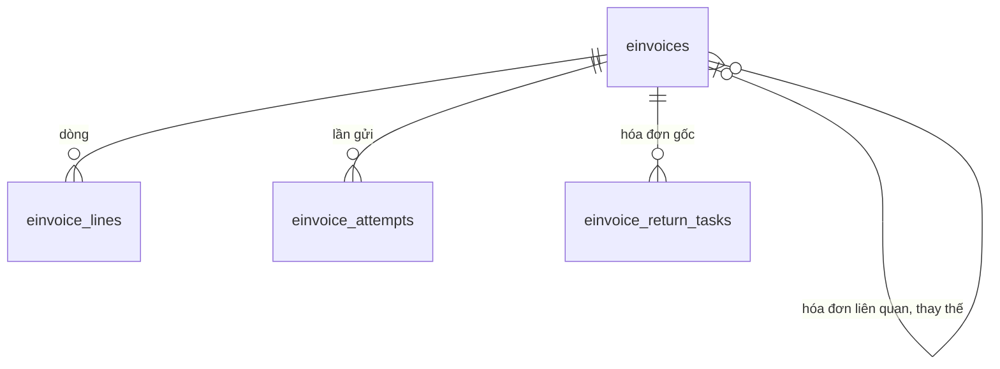

Lược đồ (chép từ tệp `database/migrations/0013_einvoices.sql`):

```sql
-- CONG_VIEC_16: Hóa đơn điện tử (CHUC_NANG_76 đến 79; QUYTAC_NGHIEPVU_103 đến 107; tài liệu 16).

-- Cài đặt hóa đơn điện tử theo công ty (CHUC_NANG_76; QUYTAC_NGHIEPVU_103).
CREATE TABLE finance.einvoice_settings (
    company_id          uuid        PRIMARY KEY REFERENCES core.companies(id),
    enabled             boolean     NOT NULL DEFAULT false,
    start_date          date,
    provider            text        NOT NULL DEFAULT 'simulator' CHECK (provider IN ('simulator', 'misa')),
    environment         text        NOT NULL DEFAULT 'test' CHECK (environment IN ('test', 'production')),
    with_tax_code       boolean     NOT NULL DEFAULT true,              -- có mã của cơ quan thuế
    template_code       text        NOT NULL DEFAULT '1' CHECK (template_code IN ('1', '2')),
    connection          jsonb       NOT NULL DEFAULT '{}'::jsonb,       -- thông tin kết nối thường (mã ứng dụng, mã số thuế, tên đăng nhập)
    secret_value        bytea,                                          -- mật khẩu mã hóa AES-256-GCM
    simulation          text        NOT NULL DEFAULT 'normal' CHECK (simulation IN ('normal', 'pending_code', 'temporary_error', 'data_error', 'timeout', 'rejected')),
    updated_at          timestamptz NOT NULL DEFAULT now(),
    updated_by          uuid        REFERENCES core.users(id),
    version             integer     NOT NULL DEFAULT 0,
    CHECK (NOT enabled OR start_date IS NOT NULL)
);

-- Ký hiệu hóa đơn theo năm (6 ký tự: C hoặc K, 2 số năm, T, 2 chữ cái).
CREATE TABLE finance.einvoice_series (
    company_id          uuid        NOT NULL REFERENCES core.companies(id),
    year                integer     NOT NULL CHECK (year BETWEEN 2000 AND 2099),
    series              text        NOT NULL CHECK (series ~ '^[CK][0-9]{2}T[A-Z]{2}$'),
    PRIMARY KEY (company_id, year)
);

-- Hóa đơn điện tử (CHUC_NANG_77 đến 79). Nội dung cố định khi lập.
CREATE TABLE finance.einvoices (
    id                  uuid        PRIMARY KEY DEFAULT gen_random_uuid(),
    company_id          uuid        NOT NULL REFERENCES core.companies(id),
    source_document_id  uuid        NOT NULL REFERENCES inventory.documents(id),
    kind                text        NOT NULL DEFAULT 'original' CHECK (kind IN ('original', 'adjustment', 'replacement')),
    related_invoice_id  uuid        REFERENCES finance.einvoices(id),   -- hóa đơn gốc của hóa đơn điều chỉnh, thay thế
    reference_id        uuid        NOT NULL UNIQUE DEFAULT gen_random_uuid(),  -- mã tham chiếu gửi nhà cung cấp, chống lập trùng
    provider            text        NOT NULL,
    invoice_date        date        NOT NULL,
    template_code       text        NOT NULL,
    series              text,
    invoice_no          text,
    with_tax_code       boolean     NOT NULL,
    tax_authority_code  text,
    provider_transaction_id text,
    seller              jsonb       NOT NULL,                           -- {name, taxCode, address}
    buyer               jsonb       NOT NULL,                           -- {partnerId, name, taxCode, address, anonymous}
    currency            text        NOT NULL,
    net_amount          numeric(20,4) NOT NULL,
    tax_amount          numeric(20,4) NOT NULL,
    total_amount        numeric(20,4) NOT NULL,
    note                text,
    status              text        NOT NULL DEFAULT 'pending'
        CHECK (status IN ('pending', 'retrying', 'awaiting_code', 'issued', 'failed', 'rejected', 'setup_error')),
    replaced_by_id      uuid        REFERENCES finance.einvoices(id),
    last_error          text,
    attempt_count       integer     NOT NULL DEFAULT 0,
    next_attempt_at     timestamptz NOT NULL DEFAULT now(),
    due_date            date        NOT NULL,                           -- ngày làm việc tiếp theo ngày hóa đơn
    overdue_notified_at timestamptz,
    issued_at           timestamptz,
    pdf_content         bytea,
    xml_content         bytea,
    created_at          timestamptz NOT NULL DEFAULT now(),
    version             integer     NOT NULL DEFAULT 0
);
CREATE UNIQUE INDEX einvoices_original_source_idx ON finance.einvoices (source_document_id) WHERE kind = 'original';
CREATE UNIQUE INDEX einvoices_number_idx ON finance.einvoices (company_id, series, invoice_no) WHERE invoice_no IS NOT NULL;
CREATE INDEX einvoices_company_idx ON finance.einvoices (company_id, invoice_date DESC);
CREATE INDEX einvoices_sending_idx ON finance.einvoices (next_attempt_at) WHERE status IN ('pending', 'retrying', 'awaiting_code');

CREATE TABLE finance.einvoice_lines (
    invoice_id          uuid        NOT NULL REFERENCES finance.einvoices(id) ON DELETE CASCADE,
    line_no             integer     NOT NULL,
    item_code           text,
    item_name           text        NOT NULL,
    unit_name           text,
    quantity            numeric(20,4) NOT NULL,
    unit_price          numeric(20,4) NOT NULL,                         -- chưa thuế
    vat_rate            text        NOT NULL CHECK (vat_rate IN ('0', '5', '8', '10', 'exempt', 'not_declared')),
    net_amount          numeric(20,4) NOT NULL,
    tax_amount          numeric(20,4) NOT NULL,
    total_amount        numeric(20,4) NOT NULL,
    is_promotion        boolean     NOT NULL DEFAULT false,
    PRIMARY KEY (invoice_id, line_no)
);

-- Mỗi lần gọi nhà cung cấp; ghi trước khi gọi. Không lưu mật khẩu, mã truy cập.
CREATE TABLE finance.einvoice_attempts (
    id                  uuid        PRIMARY KEY DEFAULT gen_random_uuid(),
    invoice_id          uuid        NOT NULL REFERENCES finance.einvoices(id) ON DELETE CASCADE,
    operation           text        NOT NULL CHECK (operation IN ('publish', 'status')),
    started_at          timestamptz NOT NULL DEFAULT now(),
    finished_at         timestamptz,
    outcome             text        CHECK (outcome IN ('issued', 'awaiting_code', 'rejected', 'temporary_error', 'data_error', 'unknown', 'not_found')),
    error_code          text,
    message             text
);
CREATE INDEX einvoice_attempts_invoice_idx ON finance.einvoice_attempts (invoice_id, started_at DESC);
```

Lược đồ (chép từ tệp `database/migrations/0014_einvoice_returns.sql`):

```sql
-- CONG_VIEC_16 lát L1: xử lý hóa đơn khi trả hàng, hóa đơn thay thế (CHUC_NANG_78, 79; QUYTAC_NGHIEPVU_106, 107; tài liệu 16).

-- Việc chờ kế toán xử lý hóa đơn của phiếu nhận hàng trả lại.
CREATE TABLE finance.einvoice_return_tasks (
    id                      uuid        PRIMARY KEY DEFAULT gen_random_uuid(),
    company_id              uuid        NOT NULL REFERENCES core.companies(id),
    return_document_id      uuid        NOT NULL UNIQUE REFERENCES inventory.documents(id),
    original_invoice_id     uuid        NOT NULL REFERENCES finance.einvoices(id),   -- hóa đơn của phiếu xuất gốc
    status                  text        NOT NULL DEFAULT 'open' CHECK (status IN ('open', 'adjusted', 'buyer_invoice')),
    adjustment_invoice_id   uuid        REFERENCES finance.einvoices(id),
    buyer_invoice_series    text,
    buyer_invoice_no        text,
    buyer_invoice_date      date,
    resolved_by             uuid        REFERENCES core.users(id),
    resolved_at             timestamptz,
    created_at              timestamptz NOT NULL DEFAULT now(),
    version                 integer     NOT NULL DEFAULT 0,
    CHECK (status <> 'adjusted' OR adjustment_invoice_id IS NOT NULL),
    CHECK (status <> 'buyer_invoice' OR (buyer_invoice_no IS NOT NULL AND buyer_invoice_date IS NOT NULL))
);
CREATE INDEX einvoice_return_tasks_company_idx ON finance.einvoice_return_tasks (company_id, status, created_at DESC);

-- Hóa đơn điều chỉnh có nguồn là phiếu nhận hàng trả lại; hóa đơn thay thế cùng nguồn với hóa đơn bị thay thế.
CREATE INDEX einvoices_related_idx ON finance.einvoices (related_invoice_id) WHERE related_invoice_id IS NOT NULL;
```

## 17. Database migration 0015, 0016, 0017 – CONG_VIEC_17 (hoa hồng đội kinh doanh)

Đã bỏ theo THAY_DOI_18 (CONG_VIEC_43, 2026-11-11): database migration 0061 xóa 7 bảng `finance.commission_*`, cột `sales.orders.commission_user_id`, định khoản `staff_payable`, quyền `finance.commission.*`, loại chứng từ `finance.commission` (mục 27). Ràng buộc `accounting.journals.source_type` vẫn nhận `commission` để đọc bút toán cũ. Nội dung dưới đây giữ để tra cứu.

Tệp `database/migrations/0015_commissions.sql` (lát L0) thêm cột nhân viên hưởng hoa hồng vào `sales.orders` và 7 bảng vào schema `finance`; tệp `database/migrations/0016_commission_postings.sql` (lát L1) thêm nguồn bút toán `commission` vào ràng buộc `accounting.journals.source_type` và định khoản mặc định hai vai trò mới cho công ty đã khởi tạo kế toán (`commission_expense`: 6411 với Thông tư 99/2025, 6421 với Thông tư 133; `staff_payable`: 334; công ty thiếu tài khoản thì không thêm); tệp `database/migrations/0017_commission_line_basis.sql` (sửa sau rà soát) thêm tiền gồm thuế của phát sinh. Khóa ngoại trỏ vào `finance`, `core` (`companies`, `users`), `catalog` (`categories`, `sales_channels`), `sales` (`orders`, `order_lines`), `inventory.documents`; chứng từ nguồn của phát sinh (`source_id`: lần trừ nợ hoặc phiếu kho) không đặt khóa ngoại. Tiền `numeric(20,4)`, phần trăm, hệ số `numeric(7,4)`. Không thêm hàm; tiền từng dòng tính bằng `finance.line_share`, `finance.company_minor_units` (mục 14). Quyền `finance.commission.view`, `finance.commission.manage`, `finance.commission.setup` (nhạy cảm), loại chứng từ `finance.commission` (cần duyệt) ghi vào bảng của `core` bằng hàm đồng bộ danh mục quyền (`apps/api/src/permissions/permission-catalog.ts`). Dãy số tiền tố `HH` tạo khi gửi lần đầu. Công ty khởi tạo kế toán về sau nhận định khoản hai vai trò từ `apps/api/src/accounting/charts.ts`.

| Bảng | Mục đích | Cột chính | Ràng buộc, chỉ mục |
|---|---|---|---|
| `sales.orders` (cột mới) | Nhân viên hưởng hoa hồng gán khi gửi đơn (CHUC_NANG_81; QUYTAC_NGHIEPVU_109) | `commission_user_id` (`core.users`) | Đơn cũ nhận `NULL`; đã gán thì giữ |
| `commission_settings` | Cài đặt hoa hồng của công ty (CHUC_NANG_80; QUYTAC_NGHIEPVU_108); không có dòng là chưa cài đặt | `company_id` (khóa chính), `enabled`, `start_date`, `assignment` (`customer_owner`, `order_creator`), `combination` (`matrix`, `channel_factor`), `default_percent`, `tiers` (jsonb: `[{fromPercent, multiplier}]` tăng dần), `updated_at`, `updated_by`, `version` | Bật thì phải có `start_date`; `default_percent` 0 đến 100; lập bảng hoa hồng khóa dòng này (`FOR UPDATE`) |
| `commission_rates` | Mức theo ngành hàng (kênh trống: mọi kênh), theo ngành hàng và kênh | `company_id`, `category_id`, `channel_id`, `percent` | Duy nhất `(company_id, category_id, kênh hoặc UUID 0)`; `percent` 0 đến 100; lưu cài đặt thay toàn bộ |
| `commission_channel_factors` | Hệ số theo kênh (kết hợp kênh nhân hệ số) | `company_id`, `channel_id`, `factor` | Khóa chính `(company_id, channel_id)`; `factor` 0 đến 10; lưu cài đặt thay toàn bộ |
| `commission_targets` | Chỉ tiêu tiền thu chưa thuế theo tháng | `company_id`, `user_id`, `month` (`YYYY-MM`), `amount` | Khóa chính `(company_id, user_id, month)`; `amount` lớn hơn 0 |
| `commission_statements` | Bảng hoa hồng tháng (CHUC_NANG_83; QUYTAC_NGHIEPVU_111, 112) | `company_id`, `month`, `document_no` (cấp khi gửi), `status` (`draft`, `pending`, `posted`, `rejected`, `withdrawn`), `total_amount`, `approval_request_id`, `post_error` (khóa thông báo khi duyệt xong không ghi sổ được), `created_by`, `created_at`, `submitted_at`, `posted_at`, `version` | Duy nhất `(company_id, month)` với bảng không ở `rejected`, `withdrawn` |
| `commission_statement_lines` | Dòng bảng theo nhân viên | `statement_id` (xóa theo bảng), `user_id`, `base_amount` (có dấu), `commission_before`, `target_amount`, `achieved_percent`, `multiplier`, `amount` | Khóa chính `(statement_id, user_id)` |
| `commission_events` | Phát sinh hoa hồng theo dòng đơn, có dấu (CHUC_NANG_82; QUYTAC_NGHIEPVU_110) | `company_id`, `user_id`, `order_id`, `source_type` (`receipt`, `refund`, `retail_delivery`, `retail_return`), `source_id` (lần trừ nợ `finance.debt_allocations` hoặc phiếu kho), `document_id` (phiếu xuất hoặc phiếu trả), `order_line_id`, `event_date`, `base_amount` (tiền chưa thuế), `gross_amount` (tiền gồm thuế, 0017), `percent`, `amount`, `statement_id` (bảng xóa thì trả về `NULL`), `created_at` | Duy nhất `(source_type, source_id, order_line_id)`; chỉ mục `(company_id, event_date)` với phát sinh chưa vào bảng, `(company_id, user_id, event_date)`, `statement_id` |
| `accounting.journals` (0016) | Bút toán bảng hoa hồng | `source_type` thêm `commission`, `source_id` là bảng hoa hồng | Duy nhất `(source_type, source_id)` như cũ |
| `accounting.posting_rules` (0016) | Định khoản mặc định vai trò `commission_expense`, `staff_payable` của công ty đã khởi tạo kế toán | `company_id`, `role`, `account_id` | Bỏ qua khi đã có (`ON CONFLICT DO NOTHING`) |

Quy tắc xóa và lưu giữ bổ sung:
- Không xóa phát sinh. Bỏ bảng nháp xóa bảng và dòng; phát sinh trả về chưa vào bảng (`ON DELETE SET NULL`). Bảng bị từ chối, đã rút giữ lại, phát sinh trả về.
- Bảng đã ghi sổ không sửa, không xóa.
- Mức, hệ số kênh được thay toàn bộ mỗi lần lưu cài đặt; chỉ tiêu để trống thì xóa dòng chỉ tiêu.
- Phát sinh ghi trước database migration 0017 có `gross_amount` bằng 0.

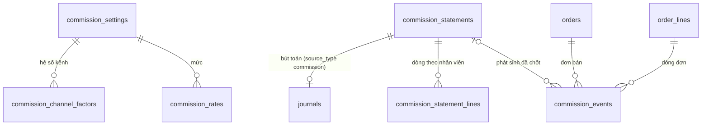

Lược đồ (chép từ tệp `database/migrations/0015_commissions.sql`):

```sql
-- CONG_VIEC_17: Hoa hồng đội kinh doanh (CHUC_NANG_80 đến 83; QUYTAC_NGHIEPVU_108 đến 112; tài liệu 16).

-- Nhân viên hưởng hoa hồng gán khi gửi đơn lần đầu (QUYTAC_NGHIEPVU_109).
ALTER TABLE sales.orders ADD COLUMN commission_user_id uuid REFERENCES core.users(id);

-- Cài đặt hoa hồng theo công ty (QUYTAC_NGHIEPVU_108).
CREATE TABLE finance.commission_settings (
    company_id          uuid        PRIMARY KEY REFERENCES core.companies(id),
    enabled             boolean     NOT NULL DEFAULT false,
    start_date          date,
    assignment          text        NOT NULL DEFAULT 'customer_owner' CHECK (assignment IN ('customer_owner', 'order_creator')),
    combination         text        NOT NULL DEFAULT 'matrix' CHECK (combination IN ('matrix', 'channel_factor')),
    default_percent     numeric(7,4) NOT NULL DEFAULT 0 CHECK (default_percent BETWEEN 0 AND 100),
    tiers               jsonb       NOT NULL DEFAULT '[{"fromPercent": 0, "multiplier": 1}]'::jsonb,   -- [{fromPercent, multiplier}] tăng dần, bậc đầu từ 0
    updated_at          timestamptz NOT NULL DEFAULT now(),
    updated_by          uuid        REFERENCES core.users(id),
    version             integer     NOT NULL DEFAULT 0,
    CHECK (NOT enabled OR start_date IS NOT NULL)
);

-- Mức hoa hồng: theo ngành hàng (kênh trống: mọi kênh), theo ngành hàng và kênh (chỉ dùng khi kết hợp kiểu bảng).
CREATE TABLE finance.commission_rates (
    id                  uuid        PRIMARY KEY DEFAULT gen_random_uuid(),
    company_id          uuid        NOT NULL REFERENCES core.companies(id),
    category_id         uuid        NOT NULL REFERENCES catalog.categories(id),
    channel_id          uuid        REFERENCES catalog.sales_channels(id),
    percent             numeric(7,4) NOT NULL CHECK (percent BETWEEN 0 AND 100)
);
CREATE UNIQUE INDEX commission_rates_key_idx ON finance.commission_rates (company_id, category_id, coalesce(channel_id, '00000000-0000-0000-0000-000000000000'::uuid));

-- Hệ số theo kênh (kết hợp kiểu kênh nhân hệ số; kênh không khai là 1).
CREATE TABLE finance.commission_channel_factors (
    company_id          uuid        NOT NULL REFERENCES core.companies(id),
    channel_id          uuid        NOT NULL REFERENCES catalog.sales_channels(id),
    factor              numeric(7,4) NOT NULL CHECK (factor BETWEEN 0 AND 10),
    PRIMARY KEY (company_id, channel_id)
);

-- Chỉ tiêu tiền thu (chưa thuế) theo tháng từng nhân viên.
CREATE TABLE finance.commission_targets (
    company_id          uuid        NOT NULL REFERENCES core.companies(id),
    user_id             uuid        NOT NULL REFERENCES core.users(id),
    month               text        NOT NULL CHECK (month ~ '^[0-9]{4}-(0[1-9]|1[0-2])$'),
    amount              numeric(20,4) NOT NULL CHECK (amount > 0),
    PRIMARY KEY (company_id, user_id, month)
);

-- Bảng hoa hồng tháng (CHUC_NANG_83; QUYTAC_NGHIEPVU_111, 112).
CREATE TABLE finance.commission_statements (
    id                  uuid        PRIMARY KEY DEFAULT gen_random_uuid(),
    company_id          uuid        NOT NULL REFERENCES core.companies(id),
    month               text        NOT NULL CHECK (month ~ '^[0-9]{4}-(0[1-9]|1[0-2])$'),
    document_no         text,
    status              text        NOT NULL DEFAULT 'draft' CHECK (status IN ('draft', 'pending', 'posted', 'rejected', 'withdrawn')),
    total_amount        numeric(20,4) NOT NULL DEFAULT 0,
    approval_request_id uuid,
    post_error          text,
    created_by          uuid        REFERENCES core.users(id),
    created_at          timestamptz NOT NULL DEFAULT now(),
    submitted_at        timestamptz,
    posted_at           timestamptz,
    version             integer     NOT NULL DEFAULT 0
);
-- Mỗi tháng một bảng đang dùng (bị từ chối, đã rút thì lập lại).
CREATE UNIQUE INDEX commission_statements_month_idx ON finance.commission_statements (company_id, month) WHERE status NOT IN ('rejected', 'withdrawn');

CREATE TABLE finance.commission_statement_lines (
    statement_id        uuid        NOT NULL REFERENCES finance.commission_statements(id) ON DELETE CASCADE,
    user_id             uuid        NOT NULL REFERENCES core.users(id),
    base_amount         numeric(20,4) NOT NULL,          -- tiền chưa thuế đã thu (có dấu)
    commission_before   numeric(20,4) NOT NULL,          -- hoa hồng trước hệ số
    target_amount       numeric(20,4),
    achieved_percent    numeric(9,4),
    multiplier          numeric(7,4) NOT NULL,
    amount              numeric(20,4) NOT NULL,
    PRIMARY KEY (statement_id, user_id)
);

-- Phát sinh hoa hồng theo dòng hàng, có dấu (CHUC_NANG_82; QUYTAC_NGHIEPVU_110).
CREATE TABLE finance.commission_events (
    id                  uuid        PRIMARY KEY DEFAULT gen_random_uuid(),
    company_id          uuid        NOT NULL REFERENCES core.companies(id),
    user_id             uuid        NOT NULL REFERENCES core.users(id),
    order_id            uuid        NOT NULL REFERENCES sales.orders(id),
    source_type         text        NOT NULL CHECK (source_type IN ('receipt', 'refund', 'retail_delivery', 'retail_return')),
    source_id           uuid        NOT NULL,                       -- phiếu thu chi hoặc phiếu kho
    document_id         uuid        NOT NULL REFERENCES inventory.documents(id),   -- phiếu xuất hoặc phiếu trả của dòng
    order_line_id       uuid        NOT NULL REFERENCES sales.order_lines(id),
    event_date          date        NOT NULL,
    base_amount         numeric(20,4) NOT NULL,                     -- tiền chưa thuế
    percent             numeric(9,4) NOT NULL,
    amount              numeric(20,4) NOT NULL,
    statement_id        uuid        REFERENCES finance.commission_statements(id) ON DELETE SET NULL,
    created_at          timestamptz NOT NULL DEFAULT now()
);
CREATE INDEX commission_events_open_idx ON finance.commission_events (company_id, event_date) WHERE statement_id IS NULL;
CREATE INDEX commission_events_user_idx ON finance.commission_events (company_id, user_id, event_date);
CREATE INDEX commission_events_statement_idx ON finance.commission_events (statement_id);
-- Mỗi lần trừ nợ (hoặc phiếu kho bán lẻ) ghi một lần cho mỗi dòng đơn.
CREATE UNIQUE INDEX commission_events_source_idx ON finance.commission_events (source_type, source_id, order_line_id);
```

Lược đồ (chép từ tệp `database/migrations/0016_commission_postings.sql`):

```sql
-- CONG_VIEC_17 lát L1: bút toán bảng hoa hồng (QUYTAC_NGHIEPVU_112; tài liệu 16).
ALTER TABLE accounting.journals DROP CONSTRAINT journals_source_type_check;
ALTER TABLE accounting.journals ADD CONSTRAINT journals_source_type_check CHECK (source_type IN ('manual', 'inventory_document', 'payment', 'internal_write_off', 'closing', 'commission'));
INSERT INTO accounting.posting_rules (company_id, role, account_id)
SELECT s.company_id, r.role, a.id
FROM accounting.settings s JOIN core.companies c ON c.id = s.company_id
CROSS JOIN (VALUES ('commission_expense', '6411', '6421'), ('staff_payable', '334', '334')) AS r(role, code_tt99, code_tt133)
JOIN accounting.accounts a ON a.company_id = s.company_id AND a.code = CASE WHEN c.accounting_regime = 'TT133' THEN r.code_tt133 ELSE r.code_tt99 END
ON CONFLICT DO NOTHING;
```

Lược đồ (chép từ tệp `database/migrations/0017_commission_line_basis.sql`):

```sql
-- CONG_VIEC_17 sửa sau rà soát: tiền gồm thuế đã thu của từng dòng đơn, để chia lần thu sau theo phần còn phải thu của từng dòng (QUYTAC_NGHIEPVU_110).
ALTER TABLE finance.commission_events ADD COLUMN gross_amount numeric(20,4) NOT NULL DEFAULT 0;
```

## 18. Database migration 0018 – CONG_VIEC_18 (đối soát ngân hàng)

Tệp `database/migrations/0018_bank_reconciliation.sql` (lát L0) thêm 2 bảng vào schema `finance`. Lát L1 không thêm database migration.

| Bảng | Mục đích | Cột chính | Ràng buộc, chỉ mục |
|---|---|---|---|
| `bank_connections` | Kết nối dịch vụ trung gian của quỹ ngân hàng (CHUC_NANG_84; QUYTAC_NGHIEPVU_113) | `company_id`, `fund_id` (`finance.funds`), `provider` (`simulator`, `sepay`), `secret_value` (khóa xác thực webhook, mã hóa AES-256-GCM bằng `common/secret-box`), `secret_hint` (bốn ký tự cuối), `enabled`, `last_received_at`, `updated_by`, `updated_at`, `version` | Duy nhất `fund_id` (mỗi quỹ một kết nối); service kiểm quỹ loại `bank` của công ty, đang dùng khi tạo |
| `bank_transactions` | Giao dịch ngân hàng nhận qua webhook (CHUC_NANG_85 đến CHUC_NANG_87; QUYTAC_NGHIEPVU_114 đến QUYTAC_NGHIEPVU_117) | `company_id`, `connection_id`, `fund_id`, `external_id` (mã giao dịch của dịch vụ), `transaction_at`, `transaction_date` (ngày theo giờ Việt Nam), `direction` (`in`, `out`), `amount` (lớn hơn 0), `content`, `reference_code`, `balance_after`, `status` (`unmatched`, `matched`, `ignored`), `payment_id` (phiếu đã ghép), `matched_by` (trống: tự ghép), `matched_at`, `suggested_partner_id`, `suggestion_reason` (`sales_order`, `partner_code`, `tax_code`), `receipt_id` (phiếu thu lập từ gợi ý), `ignore_reason`, `raw_payload` (dữ liệu webhook gốc), `created_at`, `version` | Duy nhất `(connection_id, external_id)`; `matched` khi và chỉ khi có `payment_id`; `ignored` khi và chỉ khi có `ignore_reason`; duy nhất `payment_id` khi có (một phiếu một giao dịch); chỉ mục `(fund_id, transaction_date)`; chỉ mục `(company_id, transaction_date)`; chỉ mục `(fund_id, direction, amount)` với giao dịch chưa ghép |

Quy tắc xóa và lưu giữ bổ sung:
- Không xóa giao dịch ngân hàng; nội dung (mã, thời điểm, chiều, số tiền, nội dung, mã tham chiếu, số dư, dữ liệu gốc) không sửa; chỉ đổi trạng thái, phiếu ghép, gợi ý, phiếu thu lập từ gợi ý, lý do bỏ qua.
- Không xóa kết nối; tắt bằng `enabled`. Đổi khóa ghi đè `secret_value`, `secret_hint`.
- Ghép, bỏ ghép không đổi phiếu thu chi.

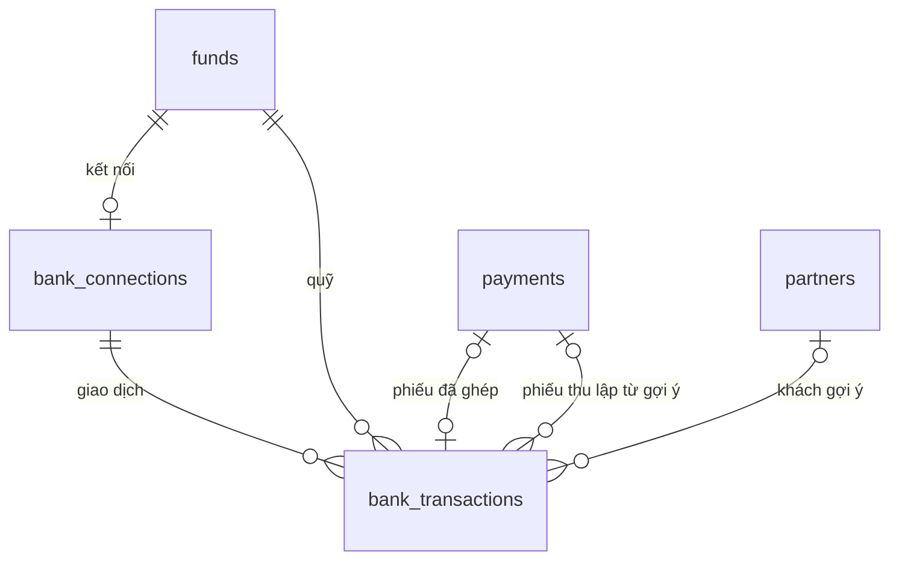

Lược đồ (chép từ tệp `database/migrations/0018_bank_reconciliation.sql`):

```sql
-- CONG_VIEC_18: Đối soát ngân hàng (CHUC_NANG_84 đến 87; QUYTAC_NGHIEPVU_113 đến 117).

-- Kết nối dịch vụ trung gian của quỹ ngân hàng (QUYTAC_NGHIEPVU_113).
CREATE TABLE finance.bank_connections (
    id                  uuid        PRIMARY KEY DEFAULT gen_random_uuid(),
    company_id          uuid        NOT NULL REFERENCES core.companies(id),
    fund_id             uuid        NOT NULL UNIQUE REFERENCES finance.funds(id),
    provider            text        NOT NULL CHECK (provider IN ('simulator', 'sepay')),
    secret_value        bytea       NOT NULL,                 -- khóa xác thực webhook, mã hóa
    secret_hint         text        NOT NULL,                 -- bốn ký tự cuối
    enabled             boolean     NOT NULL DEFAULT true,
    last_received_at    timestamptz,
    updated_by          uuid        REFERENCES core.users(id),
    updated_at          timestamptz NOT NULL DEFAULT now(),
    version             integer     NOT NULL DEFAULT 0
);

-- Giao dịch ngân hàng nhận qua webhook; không sửa nội dung, không xóa (QUYTAC_NGHIEPVU_114).
CREATE TABLE finance.bank_transactions (
    id                  uuid        PRIMARY KEY DEFAULT gen_random_uuid(),
    company_id          uuid        NOT NULL REFERENCES core.companies(id),
    connection_id       uuid        NOT NULL REFERENCES finance.bank_connections(id),
    fund_id             uuid        NOT NULL REFERENCES finance.funds(id),
    external_id         text        NOT NULL,
    transaction_at      timestamptz NOT NULL,
    transaction_date    date        NOT NULL,                 -- ngày theo giờ Việt Nam
    direction           text        NOT NULL CHECK (direction IN ('in', 'out')),
    amount              numeric(20,4) NOT NULL CHECK (amount > 0),
    content             text        NOT NULL DEFAULT '',
    reference_code      text,
    balance_after       numeric(20,4),
    status              text        NOT NULL DEFAULT 'unmatched' CHECK (status IN ('unmatched', 'matched', 'ignored')),
    payment_id          uuid        REFERENCES finance.payments(id),
    matched_by          uuid        REFERENCES core.users(id),   -- trống: tự ghép
    matched_at          timestamptz,
    suggested_partner_id uuid       REFERENCES crm.partners(id),
    suggestion_reason   text        CHECK (suggestion_reason IN ('sales_order', 'partner_code', 'tax_code')),
    receipt_id          uuid        REFERENCES finance.payments(id),   -- phiếu thu lập từ gợi ý, chờ ghi sổ
    ignore_reason       text,
    raw_payload         jsonb       NOT NULL,
    created_at          timestamptz NOT NULL DEFAULT now(),
    version             integer     NOT NULL DEFAULT 0,
    UNIQUE (connection_id, external_id),
    CHECK ((status = 'matched') = (payment_id IS NOT NULL)),
    CHECK ((status = 'ignored') = (ignore_reason IS NOT NULL))
);
-- Một phiếu ghép tối đa một giao dịch (QUYTAC_NGHIEPVU_117).
CREATE UNIQUE INDEX bank_transactions_payment_idx ON finance.bank_transactions (payment_id) WHERE payment_id IS NOT NULL;
CREATE INDEX bank_transactions_fund_idx ON finance.bank_transactions (fund_id, transaction_date);
CREATE INDEX bank_transactions_company_idx ON finance.bank_transactions (company_id, transaction_date);
CREATE INDEX bank_transactions_open_idx ON finance.bank_transactions (fund_id, direction, amount) WHERE status = 'unmatched';
```

## 19. Database migration 0019 – CONG_VIEC_19 (đối soát thu hộ)

Tệp `database/migrations/0019_collection_statements.sql` (lát L0) thêm 3 bảng vào schema `finance`; thêm nguồn `collection_statement` vào ràng buộc `finance.debt_items.source_type`, `accounting.journals.source_type`; định khoản mặc định hai vai trò mới cho công ty đã khởi tạo kế toán (`collector_receivable`: 1388; `collection_fee`: 6418 với Thông tư 99/2025, 6421 với Thông tư 133; công ty thiếu tài khoản thì không thêm). Lát L1 không thêm database migration. Khóa ngoại từ bảng mới trỏ vào `core`, `crm`, `sales`, `finance`.

| Bảng | Mục đích | Cột chính | Ràng buộc, chỉ mục |
|---|---|---|---|
| `collectors` | Đơn vị thu hộ (CHUC_NANG_88; QUYTAC_NGHIEPVU_118) | `company_id`, `partner_id` (`crm.partners`; service kiểm hồ sơ khách hàng đang dùng), `kind` (`cod`, `gateway`), `status` (`active`, `inactive`), `created_by`, `created_at`, `version` | Duy nhất `(company_id, partner_id)` |
| `collection_statements` | Bảng đối soát thu hộ (CHUC_NANG_89 đến CHUC_NANG_91; QUYTAC_NGHIEPVU_118 đến QUYTAC_NGHIEPVU_122) | `company_id`, `collector_id`, `statement_no` (số bảng của đơn vị, 1 đến 100 ký tự), `document_no` (số nội bộ `DST…`, cấp khi gửi lần đầu), `statement_date`, `status` (`draft`, `pending`, `posted`, `rejected`, `withdrawn`), `total_collected`, `total_fee`, `approval_request_id`, `post_error` (khóa thông báo khi duyệt xong không ghi sổ được), `created_by`, `created_at`, `submitted_at`, `submitted_by` (người gửi lần gần nhất, được rút), `posted_at`, `version` | Chỉ mục `(company_id, statement_date)`, `approval_request_id`; số bảng không trùng trong cùng đơn vị (trừ `rejected`, `withdrawn`) kiểm trong service |
| `collection_statement_lines` | Dòng bảng đối soát (CHUC_NANG_89; QUYTAC_NGHIEPVU_119) | `statement_id` (xóa theo bảng), `line_no` (dòng trong tệp), `reference` (mã vận đơn hoặc mã giao dịch, 1 đến 100 ký tự), `order_no` (số đơn trong tệp, chữ hoa), `order_id` (`sales.orders`, trống khi không tìm thấy), `customer_id` (khách của đơn lúc nhập), `collected_amount`, `fee_amount` (không âm), `collected_date` | Duy nhất `(statement_id, line_no)`; chỉ mục `reference`, `order_id` |
| `finance.debt_items` (0019) | Khoản công nợ của bảng đối soát | `source_type` thêm `collection_statement`; `source_id` là dòng bảng (khoản giảm phải thu của khách) hoặc bảng (khoản phải thu của đơn vị thu hộ) | Duy nhất `(source_type, source_id)` như cũ |
| `accounting.journals` (0019) | Bút toán bảng đối soát | `source_type` thêm `collection_statement`, `source_id` là bảng | Duy nhất `(source_type, source_id)` như cũ |
| `accounting.posting_rules` (0019) | Định khoản mặc định vai trò `collector_receivable`, `collection_fee` của công ty đã khởi tạo kế toán | `company_id`, `role`, `account_id` | Bỏ qua khi đã có (`ON CONFLICT DO NOTHING`) |

Định khoản khi ghi sổ (QUYTAC_NGHIEPVU_121): Nợ `collector_receivable` (đối tác của đơn vị) tổng tiền thu hộ / Có `receivable` gộp theo khách (đơn không có khách: không có đối tác); Nợ `collection_fee` / Có `collector_receivable` (đối tác của đơn vị) tổng phí. Ngày bút toán là ngày bảng, số là `document_no`. Phiếu thu khách hàng, phiếu chi hoàn tiền cho khách hàng có đối tác là đơn vị thu hộ (có dòng `finance.collectors`) hạch toán `collector_receivable` thay vì `receivable` (sửa lỗi rà soát, commit 0480edc).

Quy tắc xóa và lưu giữ bổ sung:
- Bỏ bảng nháp chưa gửi lần nào xóa bảng và dòng; nhập lại, bỏ dòng xóa dòng của bảng nháp, bị từ chối, đã rút.
- Bảng đã ghi sổ, dòng, khoản công nợ, bút toán của bảng không sửa, không xóa. Bảng bị từ chối, đã rút giữ lại.
- Không xóa đơn vị thu hộ; ngừng dùng bằng `status`.

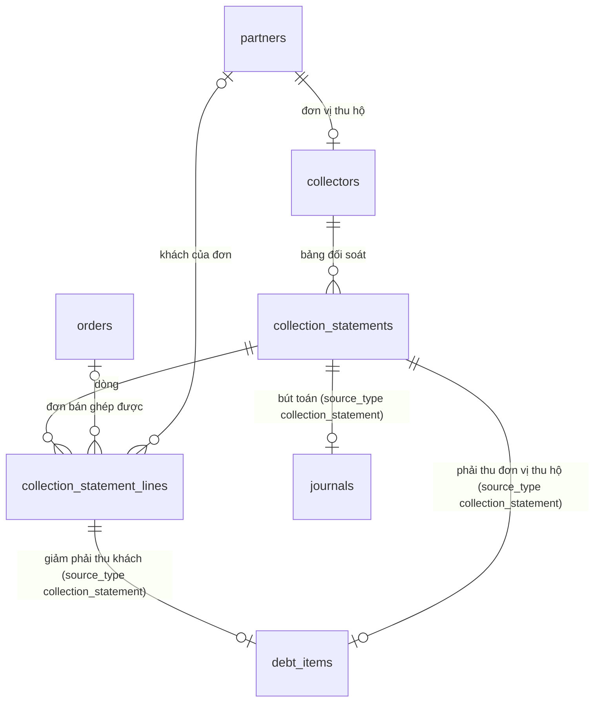

Lược đồ (chép từ tệp `database/migrations/0019_collection_statements.sql`):

```sql
-- CONG_VIEC_19: Đối soát thu hộ COD, cổng thanh toán (CHUC_NANG_88 đến 91; QUYTAC_NGHIEPVU_118 đến 122).

-- Đơn vị thu hộ: đối tác có hồ sơ khách hàng của công ty (CHUC_NANG_88).
CREATE TABLE finance.collectors (
    id                  uuid        PRIMARY KEY DEFAULT gen_random_uuid(),
    company_id          uuid        NOT NULL REFERENCES core.companies(id),
    partner_id          uuid        NOT NULL REFERENCES crm.partners(id),
    kind                text        NOT NULL CHECK (kind IN ('cod', 'gateway')),
    status              text        NOT NULL DEFAULT 'active' CHECK (status IN ('active', 'inactive')),
    created_by          uuid        NOT NULL REFERENCES core.users(id),
    created_at          timestamptz NOT NULL DEFAULT now(),
    version             integer     NOT NULL DEFAULT 0,
    UNIQUE (company_id, partner_id)
);

-- Bảng đối soát thu hộ (CHUC_NANG_89, 90).
CREATE TABLE finance.collection_statements (
    id                  uuid        PRIMARY KEY DEFAULT gen_random_uuid(),
    company_id          uuid        NOT NULL REFERENCES core.companies(id),
    collector_id        uuid        NOT NULL REFERENCES finance.collectors(id),
    statement_no        text        NOT NULL CHECK (length(statement_no) BETWEEN 1 AND 100),   -- số bảng của đơn vị thu hộ
    document_no         text,                                                               -- số nội bộ, cấp khi gửi lần đầu
    statement_date      date        NOT NULL,
    status              text        NOT NULL DEFAULT 'draft' CHECK (status IN ('draft', 'pending', 'posted', 'rejected', 'withdrawn')),
    total_collected     numeric(20,4) NOT NULL DEFAULT 0,
    total_fee           numeric(20,4) NOT NULL DEFAULT 0,
    approval_request_id uuid,
    post_error          text,
    created_by          uuid        NOT NULL REFERENCES core.users(id),
    created_at          timestamptz NOT NULL DEFAULT now(),
    submitted_at        timestamptz,
    submitted_by        uuid        REFERENCES core.users(id),     -- người gửi, được rút
    posted_at           timestamptz,
    version             integer     NOT NULL DEFAULT 0
);
CREATE INDEX collection_statements_company_idx ON finance.collection_statements (company_id, statement_date);
CREATE INDEX collection_statements_approval_idx ON finance.collection_statements (approval_request_id);

CREATE TABLE finance.collection_statement_lines (
    id                  uuid        PRIMARY KEY DEFAULT gen_random_uuid(),
    statement_id        uuid        NOT NULL REFERENCES finance.collection_statements(id) ON DELETE CASCADE,
    line_no             integer     NOT NULL,                       -- dòng trong tệp
    reference           text        NOT NULL CHECK (length(reference) BETWEEN 1 AND 100),
    order_no            text        NOT NULL,
    order_id            uuid        REFERENCES sales.orders(id),
    customer_id         uuid        REFERENCES crm.partners(id),
    collected_amount    numeric(20,4) NOT NULL CHECK (collected_amount >= 0),
    fee_amount          numeric(20,4) NOT NULL CHECK (fee_amount >= 0),
    collected_date      date,
    UNIQUE (statement_id, line_no)
);
CREATE INDEX collection_statement_lines_reference_idx ON finance.collection_statement_lines (reference);
CREATE INDEX collection_statement_lines_order_idx ON finance.collection_statement_lines (order_id);

-- Nguồn công nợ, nguồn bút toán của bảng đối soát (QUYTAC_NGHIEPVU_120, 121).
ALTER TABLE finance.debt_items DROP CONSTRAINT debt_items_source_type_check;
ALTER TABLE finance.debt_items ADD CONSTRAINT debt_items_source_type_check
    CHECK (source_type IN ('opening', 'sales_issue', 'sales_return', 'purchase_receipt', 'purchase_return', 'payment', 'internal_write_off', 'collection_statement'));
ALTER TABLE accounting.journals DROP CONSTRAINT journals_source_type_check;
ALTER TABLE accounting.journals ADD CONSTRAINT journals_source_type_check
    CHECK (source_type IN ('manual', 'inventory_document', 'payment', 'internal_write_off', 'closing', 'commission', 'collection_statement'));
INSERT INTO accounting.posting_rules (company_id, role, account_id)
SELECT s.company_id, r.role, a.id
FROM accounting.settings s JOIN core.companies c ON c.id = s.company_id
CROSS JOIN (VALUES ('collector_receivable', '1388', '1388'), ('collection_fee', '6418', '6421')) AS r(role, code_tt99, code_tt133)
JOIN accounting.accounts a ON a.company_id = s.company_id AND a.code = CASE WHEN c.accounting_regime = 'TT133' THEN r.code_tt133 ELSE r.code_tt99 END
ON CONFLICT DO NOTHING;
```

## 20. Database migration 0020 – CONG_VIEC_20 (báo cáo tài chính hợp nhất)

Tệp `database/migrations/0020_consolidations.sql` (lát L1) thêm 3 bảng vào schema `finance` và chỉ mục `inventory.movements_company_variant_idx` (sửa sau rà soát). Lát L0, L2 không thêm database migration; lát L2 thêm loại chứng từ `finance.consolidation` qua danh mục đồng bộ khi khởi động (`apps/api/src/permissions/permission-catalog.ts`), dãy số `HN` tạo khi gửi lần đầu. Khóa ngoại từ bảng mới trỏ vào `core`, `accounting`, `crm`, `catalog`, `finance`. Không ghi vào schema `accounting`: bút toán loại trừ chỉ nằm trong bảng hợp nhất.

| Bảng | Mục đích | Cột chính | Ràng buộc, chỉ mục |
|---|---|---|---|
| `consolidations` | Bảng hợp nhất theo kỳ (CHUC_NANG_93, CHUC_NANG_95; QUYTAC_NGHIEPVU_128) | `group_company_id` (công ty gốc), `from_date`, `to_date`, `document_no` (`HN…`, cấp khi gửi lần đầu), `status` (`draft`, `pending`, `posted`, `rejected`, `withdrawn`), `member_ids` (thành viên lúc tính lại gần nhất), `warnings` (chênh lệch công nợ nội bộ, JSON), `report` (B01-DN, B02-DN lưu lúc gửi, dùng khi chờ duyệt và khi chốt, JSON), `calculated_at`, `approval_request_id`, `post_error` (khóa thông báo khi duyệt xong không chốt được), `created_by`, `submitted_by` (người gửi lần gần nhất, được rút), `created_at`, `submitted_at`, `posted_at`, `version` | `to_date >= from_date`; duy nhất `(group_company_id, from_date, to_date)` khi `status` không phải `rejected`, `withdrawn`; chỉ mục `approval_request_id` |
| `consolidation_entries` | Dòng bút toán loại trừ, điều chỉnh tay (CHUC_NANG_93, CHUC_NANG_94; QUYTAC_NGHIEPVU_125, QUYTAC_NGHIEPVU_126) | `consolidation_id` (xóa theo bảng), `entry_no` (các dòng cùng số là một bút toán cân), `kind` (`intercompany_balance`, `internal_sales`, `manual`), `company_id`, `account_id` (tài khoản của công ty), `partner_id` (đối tác của bút toán tự động và của dòng điều chỉnh tay), `debit`, `credit`, `description`, `created_by` (trống: tự động) | `debit`, `credit` không âm, đúng một bên lớn hơn 0; chỉ mục `(consolidation_id, entry_no)` |
| `inventory.movements` (0020) | Đọc tồn cuối kỳ theo công ty, mặt hàng cho lãi chưa thực hiện | `company_id`, `variant_id`, `moved_at`, `quantity` | Chỉ mục `movements_company_variant_idx (company_id, variant_id, moved_at) INCLUDE (quantity)` |
| `consolidation_profit_lines` | Lãi chưa thực hiện từng mặt hàng mua nội bộ (CHUC_NANG_93, CHUC_NANG_94; QUYTAC_NGHIEPVU_127) | `consolidation_id` (xóa theo bảng), `buyer_company_id`, `seller_company_id`, `variant_id` (mặt hàng của bên mua), `internal_quantity`, `ending_quantity`, `unit_margin`, `estimated_amount`, `override_amount` (không âm), `override_reason` | Duy nhất `(consolidation_id, buyer_company_id, seller_company_id, variant_id)` |

Bút toán lãi chưa thực hiện không lưu: khi tính báo cáo, mỗi công ty mua có tổng số dùng (`override_amount`, không có thì `estimated_amount`) lớn hơn 0 cộng Nợ tài khoản vai trò `cogs` / Có tài khoản vai trò `goods` của công ty đó. Bút toán đưa vào báo cáo như dòng bổ sung, chỉ ở cột kỳ này của cột hợp nhất.

Quy tắc xóa và lưu giữ bổ sung:
- Bỏ bảng nháp chưa gửi lần nào xóa bảng, bút toán, dòng lãi (xóa theo khóa ngoại).
- Tính lại xóa và lập lại bút toán tự động (`kind` khác `manual`) và dòng lãi; giữ số sửa của dòng lãi cùng công ty mua, công ty bán, mặt hàng; giữ điều chỉnh tay.
- Bảng đã chốt (`posted`) không sửa, không xóa; bảng bị từ chối, đã rút giữ lại.

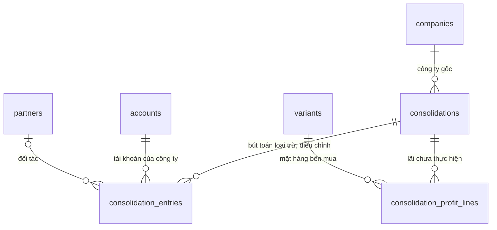

Lược đồ (chép từ tệp `database/migrations/0020_consolidations.sql`):

```sql
-- CONG_VIEC_20: Báo cáo tài chính hợp nhất (CHUC_NANG_92 đến 95; QUYTAC_NGHIEPVU_123 đến 128).

-- Bảng hợp nhất theo kỳ của tập đoàn (QUYTAC_NGHIEPVU_128).
CREATE TABLE finance.consolidations (
    id                  uuid        PRIMARY KEY DEFAULT gen_random_uuid(),
    group_company_id    uuid        NOT NULL REFERENCES core.companies(id),       -- công ty gốc
    from_date           date        NOT NULL,
    to_date             date        NOT NULL CHECK (to_date >= from_date),
    document_no         text,
    status              text        NOT NULL DEFAULT 'draft' CHECK (status IN ('draft', 'pending', 'posted', 'rejected', 'withdrawn')),
    member_ids          uuid[]      NOT NULL DEFAULT '{}',                         -- thành viên lúc tính lại gần nhất
    warnings            jsonb       NOT NULL DEFAULT '[]'::jsonb,                  -- chênh lệch công nợ nội bộ
    report              jsonb,                                                     -- số báo cáo chốt khi duyệt
    calculated_at       timestamptz,
    approval_request_id uuid,
    post_error          text,
    created_by          uuid        NOT NULL REFERENCES core.users(id),
    submitted_by        uuid        REFERENCES core.users(id),
    created_at          timestamptz NOT NULL DEFAULT now(),
    submitted_at        timestamptz,
    posted_at           timestamptz,
    version             integer     NOT NULL DEFAULT 0
);
CREATE UNIQUE INDEX consolidations_period_idx ON finance.consolidations (group_company_id, from_date, to_date) WHERE status NOT IN ('rejected', 'withdrawn');
CREATE INDEX consolidations_approval_idx ON finance.consolidations (approval_request_id);

-- Bút toán loại trừ, điều chỉnh: các dòng cùng "entry_no" là một bút toán cân Nợ Có (QUYTAC_NGHIEPVU_125 đến 127).
CREATE TABLE finance.consolidation_entries (
    id                  uuid        PRIMARY KEY DEFAULT gen_random_uuid(),
    consolidation_id    uuid        NOT NULL REFERENCES finance.consolidations(id) ON DELETE CASCADE,
    entry_no            integer     NOT NULL,
    kind                text        NOT NULL CHECK (kind IN ('intercompany_balance', 'internal_sales', 'manual')),
    company_id          uuid        NOT NULL REFERENCES core.companies(id),
    account_id          uuid        NOT NULL REFERENCES accounting.accounts(id),
    partner_id          uuid        REFERENCES crm.partners(id),
    debit               numeric(20,4) NOT NULL DEFAULT 0 CHECK (debit >= 0),
    credit              numeric(20,4) NOT NULL DEFAULT 0 CHECK (credit >= 0),
    description         text        NOT NULL,
    created_by          uuid        REFERENCES core.users(id),                    -- trống: tự động
    CHECK ((debit > 0) <> (credit > 0))
);
CREATE INDEX consolidation_entries_idx ON finance.consolidation_entries (consolidation_id, entry_no);

-- Lãi chưa thực hiện từng mặt hàng mua nội bộ (QUYTAC_NGHIEPVU_127).
CREATE TABLE finance.consolidation_profit_lines (
    id                  uuid        PRIMARY KEY DEFAULT gen_random_uuid(),
    consolidation_id    uuid        NOT NULL REFERENCES finance.consolidations(id) ON DELETE CASCADE,
    buyer_company_id    uuid        NOT NULL REFERENCES core.companies(id),
    seller_company_id   uuid        NOT NULL REFERENCES core.companies(id),
    variant_id          uuid        NOT NULL REFERENCES catalog.variants(id),      -- mặt hàng của bên mua
    internal_quantity   numeric(20,4) NOT NULL,
    ending_quantity     numeric(20,4) NOT NULL,
    unit_margin         numeric(20,4) NOT NULL,
    estimated_amount    numeric(20,4) NOT NULL,
    override_amount     numeric(20,4) CHECK (override_amount >= 0),
    override_reason     text,
    UNIQUE (consolidation_id, buyer_company_id, seller_company_id, variant_id)
);

-- Tồn cuối kỳ theo công ty, mặt hàng cho lãi chưa thực hiện.
CREATE INDEX movements_company_variant_idx ON inventory.movements (company_id, variant_id, moved_at) INCLUDE (quantity);
```

## 21. Database migration 0021 – CONG_VIEC_21 (gán khách hàng cho nhân viên kinh doanh)

Đã tắt theo THAY_DOI_18 (CONG_VIEC_43, 2026-11-11): database migration 0062 xóa quyền `crm.customer.view_all`, `crm.customer.assign`, loại chứng từ `crm.customer_assignment` (cùng yêu cầu duyệt, chính sách duyệt, dãy số). Bảng `crm.customer_assignments`, `crm.customer_assignment_lines`, `crm.partner_owner_history`, cột `crm.partner_profiles.owner_user_id`, chỉ mục `partner_profiles_owner_idx` giữ nguyên để tra cứu; không còn mã đọc, ghi các bảng giao khách, lịch sử phụ trách (mục 27).

Tệp `database/migrations/0021_customer_assignments.sql` thêm 3 bảng vào schema `crm`, chỉ mục `crm.partner_profiles_owner_idx`, ghi lịch sử cho hồ sơ đã có nhân viên phụ trách, thêm quyền `crm.customer.view_all`, `crm.customer.assign` và thêm `crm.customer.view_all` vào vai trò tự tạo đang có `crm.partner.view` hoặc `sales.order.view` (THAY_DOI_12). Vai trò hệ thống nhận quyền mới, loại chứng từ `crm.customer_assignment` qua danh mục đồng bộ khi khởi động (`apps/api/src/permissions/permission-catalog.ts`); dãy số `GK` tạo khi gửi lần đầu. Khóa ngoại từ bảng mới trỏ vào `core`, `crm`. Cột `crm.partner_profiles.owner_user_id` (mục 8) giữ nguyên; từ CONG_VIEC_21 chỉ đổi qua phiếu giao khách khi đã có giá trị (QUYTAC_NGHIEPVU_134).

| Bảng | Mục đích | Cột chính | Ràng buộc, chỉ mục |
|---|---|---|---|
| `customer_assignments` | Phiếu giao khách (CHUC_NANG_97; QUYTAC_NGHIEPVU_131 đến QUYTAC_NGHIEPVU_133) | `company_id`, `document_no` (`GK…`, cấp khi gửi lần đầu), `target_user_id` (nhân viên nhận), `reason`, `status` (`draft`, `pending`, `applied`, `rejected`, `withdrawn`), `approval_request_id`, `apply_error` (khóa thông báo lý do không áp dụng được), `apply_error_detail` (danh sách khách đã đổi nhân viên phụ trách), `created_by`, `submitted_by` (người gửi lần gần nhất, được rút), `created_at`, `submitted_at`, `applied_at`, `updated_at`, `version` | `status` trong 5 giá trị; chỉ mục `(company_id, created_at DESC)`, `approval_request_id` |
| `customer_assignment_lines` | Khách trong phiếu (CHUC_NANG_97; QUYTAC_NGHIEPVU_131, QUYTAC_NGHIEPVU_133) | `assignment_id` (xóa theo phiếu), `partner_id`, `previous_user_id` (nhân viên phụ trách lúc gửi, ghi khi gửi) | Khóa chính `(assignment_id, partner_id)` |
| `partner_owner_history` | Lịch sử phụ trách (CHUC_NANG_98; QUYTAC_NGHIEPVU_133 đến QUYTAC_NGHIEPVU_135) | `company_id`, `partner_id`, `user_id`, `valid_from`, `valid_to` (trống: đang phụ trách), `assignment_id` (trống: đặt trên hồ sơ, tự lập khi thêm, nhận đối tác, hoặc ghi từ database migration), `created_by` | Chỉ mục `(company_id, partner_id, valid_from DESC)`; duy nhất `(company_id, partner_id)` khi `valid_to IS NULL` (mỗi khách tại mỗi công ty một dòng đang mở) |
| `partner_profiles` (0021) | Điều kiện phạm vi xem theo nhân viên phụ trách (QUYTAC_NGHIEPVU_129) | `company_id`, `owner_user_id` | Chỉ mục `partner_profiles_owner_idx (company_id, owner_user_id)` |

Dữ liệu thêm khi chạy:
- Mỗi hồ sơ đối tác có `owner_user_id` được một dòng lịch sử đang mở từ `updated_at` của hồ sơ, `created_by` là `updated_by` (QUYTAC_NGHIEPVU_134).
- `core.permissions`: `crm.customer.view_all` ("Xem mọi khách hàng, đơn bán của công ty"), `crm.customer.assign` ("Giao, chuyển khách hàng cho nhân viên"), không nhạy cảm; đã có thì bỏ qua.
- `core.role_permissions`: vai trò tự tạo (`is_system` sai) đang có `crm.partner.view` hoặc `sales.order.view` thêm `crm.customer.view_all`.

Quy tắc xóa và lưu giữ bổ sung:
- Bỏ phiếu nháp chưa gửi lần nào xóa phiếu và các dòng khách (xóa theo khóa ngoại).
- Phiếu đã gửi không xóa; phiếu đã áp dụng không sửa. Lịch sử phụ trách không xóa, không sửa (chỉ đóng dòng đang mở bằng `valid_to`).

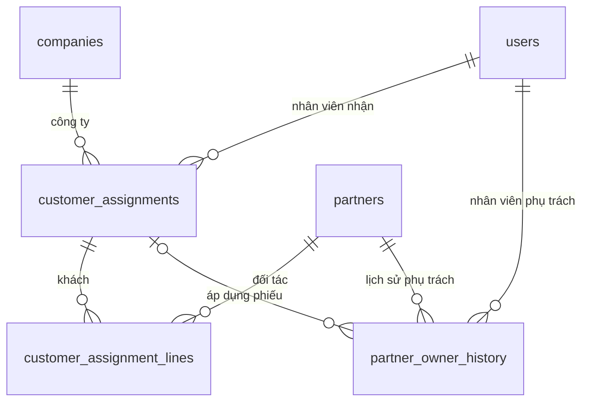

Lược đồ (chép từ tệp `database/migrations/0021_customer_assignments.sql`):

```sql
-- CONG_VIEC_21: Gán khách hàng cho nhân viên kinh doanh (CHUC_NANG_96 đến 98; QUYTAC_NGHIEPVU_129 đến 135; THAY_DOI_12).

-- Phiếu giao khách (QUYTAC_NGHIEPVU_131, 132).
CREATE TABLE crm.customer_assignments (
    id                  uuid        PRIMARY KEY DEFAULT gen_random_uuid(),
    company_id          uuid        NOT NULL REFERENCES core.companies(id),
    document_no         text,
    target_user_id      uuid        NOT NULL REFERENCES core.users(id),           -- nhân viên nhận
    reason              text        NOT NULL,
    status              text        NOT NULL DEFAULT 'draft' CHECK (status IN ('draft', 'pending', 'applied', 'rejected', 'withdrawn')),
    approval_request_id uuid,
    apply_error         text,                                                     -- khóa thông báo lý do không áp dụng được
    apply_error_detail  text,                                                     -- danh sách khách đã đổi nhân viên phụ trách
    created_by          uuid        NOT NULL REFERENCES core.users(id),
    submitted_by        uuid        REFERENCES core.users(id),
    created_at          timestamptz NOT NULL DEFAULT now(),
    submitted_at        timestamptz,
    applied_at          timestamptz,
    updated_at          timestamptz NOT NULL DEFAULT now(),
    version             integer     NOT NULL DEFAULT 1
);
CREATE INDEX customer_assignments_company_idx ON crm.customer_assignments (company_id, created_at DESC);
CREATE INDEX customer_assignments_approval_idx ON crm.customer_assignments (approval_request_id);

-- Khách trong phiếu; nhân viên phụ trách lúc gửi để kiểm khi áp dụng (QUYTAC_NGHIEPVU_133).
CREATE TABLE crm.customer_assignment_lines (
    assignment_id       uuid        NOT NULL REFERENCES crm.customer_assignments(id) ON DELETE CASCADE,
    partner_id          uuid        NOT NULL REFERENCES crm.partners(id),
    previous_user_id    uuid        REFERENCES core.users(id),
    PRIMARY KEY (assignment_id, partner_id)
);

-- Lịch sử phụ trách: mỗi khách tại mỗi công ty một dòng đang mở (valid_to trống).
CREATE TABLE crm.partner_owner_history (
    id                  uuid        PRIMARY KEY DEFAULT gen_random_uuid(),
    company_id          uuid        NOT NULL REFERENCES core.companies(id),
    partner_id          uuid        NOT NULL REFERENCES crm.partners(id),
    user_id             uuid        NOT NULL REFERENCES core.users(id),
    valid_from          timestamptz NOT NULL DEFAULT now(),
    valid_to            timestamptz,
    assignment_id       uuid        REFERENCES crm.customer_assignments(id),
    created_by          uuid        REFERENCES core.users(id)
);
CREATE INDEX partner_owner_history_partner_idx ON crm.partner_owner_history (company_id, partner_id, valid_from DESC);
CREATE UNIQUE INDEX partner_owner_history_open_idx ON crm.partner_owner_history (company_id, partner_id) WHERE valid_to IS NULL;

CREATE INDEX partner_profiles_owner_idx ON crm.partner_profiles (company_id, owner_user_id);

-- Hồ sơ đã có nhân viên phụ trách: lịch sử bắt đầu từ lần cập nhật hồ sơ gần nhất (QUYTAC_NGHIEPVU_134).
INSERT INTO crm.partner_owner_history (company_id, partner_id, user_id, valid_from, created_by)
SELECT company_id, partner_id, owner_user_id, updated_at, updated_by FROM crm.partner_profiles WHERE owner_user_id IS NOT NULL;

-- Quyền mới; vai trò tự tạo đang xem đối tác hoặc đơn bán giữ được phạm vi xem như cũ (THAY_DOI_12).
-- Vai trò hệ thống được đồng bộ từ danh mục quyền khi khởi động.
INSERT INTO core.permissions (code, app_code, name_vi, name_en, is_sensitive) VALUES
    ('crm.customer.view_all', 'crm', 'Xem mọi khách hàng, đơn bán của công ty', 'View all customers and sales orders of the company', false),
    ('crm.customer.assign', 'crm', 'Giao, chuyển khách hàng cho nhân viên', 'Assign customers to staff', false)
ON CONFLICT (code) DO NOTHING;
INSERT INTO core.role_permissions (role_id, permission_code)
SELECT DISTINCT rp.role_id, 'crm.customer.view_all' FROM core.role_permissions rp JOIN core.roles r ON r.id = rp.role_id
WHERE NOT r.is_system AND rp.permission_code IN ('crm.partner.view', 'sales.order.view')
ON CONFLICT DO NOTHING;
```

## 22. Database migration 0023 – CONG_VIEC_23 (tài khoản người mua VComm)

Tệp `database/migrations/0023_buyer_accounts.sql` tạo schema `marketplace` (MODULE_09) và sửa bảng của `core`.

| Bảng | Mục đích | Cột chính | Ràng buộc, chỉ mục |
|---|---|---|---|
| `marketplace.buyer_accounts` | Tài khoản người mua (CHUC_NANG_104 đến CHUC_NANG_108; QUYTAC_NGHIEPVU_141 đến QUYTAC_NGHIEPVU_145) | `user_id` (khóa chính, `core.users`), `referrer_user_id` (trống được), `registered_at`, `is_sales_staff`, `sales_company_id`, `sales_department_id`, `sales_membership_created`, `previous_department_id` (phòng ban trước khi đánh dấu), `updated_at`, `version` | Người giới thiệu khác chính mình; `is_sales_staff` đúng khi và chỉ khi có công ty và phòng ban; chỉ mục `(referrer_user_id, registered_at DESC)`, `(registered_at DESC)` |
| `marketplace.referrer_history` | Lịch sử người giới thiệu (QUYTAC_NGHIEPVU_143) | `buyer_user_id`, `previous_referrer_id`, `new_referrer_id`, `source` (`registration`, `self`, `admin`), `reason`, `changed_by`, `changed_at` | Lý do 1 đến 500 ký tự, bắt buộc khi `source` = `admin`; chỉ mục `(buyer_user_id, changed_at DESC)` |
| `marketplace.sales_flag_history` | Lịch sử đánh dấu nhân viên kinh doanh (QUYTAC_NGHIEPVU_144) | `buyer_user_id`, `action` (`flag`, `unflag`), `company_id`, `department_id`, `changed_by`, `changed_at` | Chỉ mục `(buyer_user_id, changed_at DESC)` |
| `core.companies` (0023) | Công ty vận hành sàn (QUYTAC_NGHIEPVU_147) | `is_marketplace_operator` (mặc định sai) | Chỉ mục duy nhất một phần: tối đa một công ty có giá trị đúng |
| `core.sessions` (0023) | Phiên ứng dụng VComm | `client_type` thêm `vcomm_app` | Token làm mới 90 ngày |
| `core.otp_codes` (0023) | Mã OTP theo mục đích (QUYTAC_NGHIEPVU_141) | `purpose` (`login`, `register`, `password_reset`; mặc định `login`) | Chỉ mục `(phone, purpose, created_at DESC)` |

Dữ liệu thêm khi chạy: `core.permissions` `marketplace.buyer.view` ("Xem tài khoản người mua"), `marketplace.buyer.manage` ("Đổi người giới thiệu, đánh dấu nhân viên kinh doanh", nhạy cảm); vai trò hệ thống Quản trị tập đoàn, Quản trị công ty nhận khi đồng bộ danh mục quyền.

Quy tắc xóa và lưu giữ: tài khoản người mua, lịch sử không xóa. Tài khoản nhân viên có số điện thoại dùng ứng dụng lần đầu được tạo dòng `buyer_accounts` không có người giới thiệu. Đánh dấu không gán vai trò (THAY_DOI_15). Bỏ đánh dấu: thành viên do đánh dấu tạo chuyển `inactive` khi không còn vai trò; thành viên có sẵn được trả lại phòng ban cũ.

## 23. Database migration 0024 – CONG_VIEC_27 (đội kinh doanh nhiều cấp)

| Bảng | Mục đích | Cột chính | Ràng buộc, chỉ mục |
|---|---|---|---|
| `core.departments` (0024) | Đơn vị kinh doanh (QUYTAC_NGHIEPVU_148) | `sales_unit_type` (`division`, `region`, `team`; trống: không phải đơn vị kinh doanh); người quản lý dùng `manager_user_id` có sẵn | Thứ bậc kiểm ở dịch vụ |
| `marketplace.sales_team_proposals` | Đề xuất thay đổi đội (QUYTAC_NGHIEPVU_153) | `company_id`, `proposer_user_id`, `kind` (`add`, `move`, `appoint`, `remove`), `target_user_id`, `department_id` (trống khi `remove`), `reason`, `status` (`pending`, `approved`, `rejected`, `withdrawn`), `decided_by`, `decided_at`, `decision_note`, `created_at` | Chỉ mục duy nhất một phần `(target_user_id) WHERE status = 'pending'`; chỉ mục theo công ty và trạng thái, theo người đề xuất |
| `marketplace.sales_flag_history` (0024) | Lịch sử đội kinh doanh (QUYTAC_NGHIEPVU_152) | `action` thêm `move`, `appoint`, `unappoint`; `proposal_id` (đề xuất đã duyệt) | |

Khóa: mọi thay đổi cây, quản lý, thành viên đội của một công ty lấy khóa tư vấn trong giao dịch (`pg_advisory_xact_lock`) theo công ty, chạy lần lượt. Đề xuất, lịch sử không xóa.

## 24. Database migration 0025 – CONG_VIEC_24 (đặt hàng trên VComm)

| Bảng | Mục đích | Cột chính | Ràng buộc, chỉ mục |
|---|---|---|---|
| `marketplace.provinces`, `marketplace.wards` | Danh mục tỉnh, xã hai cấp từ 01/07/2025 (QUYTAC_NGHIEPVU_156) | `code` (mã Tổng cục Thống kê), `name`, `full_name`, `unit_type` (tỉnh: `city`, `province`; xã: `ward`, `commune`, `special_zone`); xã có `province_code` | Khóa chính `code`; xã duy nhất (`code`, `province_code`); chỉ mục (`province_code`, `name`). Dữ liệu danh mục (34 tỉnh, 3.321 xã) nạp ngay trong database migration, cả trên môi trường thật; nguồn kho `thanglequoc/vietnamese-provinces-database` v5.2.0, giấy phép MIT |
| `marketplace.store_settings` | Cài đặt bán hàng VComm (QUYTAC_NGHIEPVU_154) | `company_id` (khóa chính), `channel_id`, `warehouse_id`, `shipping_fee`, `free_shipping_threshold`, `package_length_cm`, `package_width_cm`, `package_height_cm`, `minimum_weight_grams`, `updated_by`, `version` | Phí ≥ 0; kích thước 1 đến 200; khối lượng 1 đến 50.000 |
| `marketplace.listings` | Đăng bán (QUYTAC_NGHIEPVU_155) | `product_id` (khóa chính), `company_id`, `is_published`, `description` (≤ 5.000 ký tự), `updated_by` | Chỉ mục một phần theo công ty khi đang đăng bán |
| `marketplace.buyer_accounts` (0025) | Người mua thử (QUYTAC_NGHIEPVU_158) | `is_test_buyer` (mặc định `false`) | |
| `marketplace.buyer_addresses` | Sổ địa chỉ (QUYTAC_NGHIEPVU_156) | `buyer_user_id`, `recipient_name` (1 đến 100), `phone`, `province_code`, `ward_code`, `street_address` (1 đến 200), `is_default` | Khóa ngoại (`ward_code`, `province_code`) bảo đảm xã thuộc tỉnh; duy nhất một mặc định mỗi người mua; tối đa 10 kiểm ở dịch vụ |
| `marketplace.cart_lines` | Giỏ hàng (QUYTAC_NGHIEPVU_157) | `buyer_user_id`, `variant_id`, `quantity` (1 đến 999), `added_at` | Khóa chính (`buyer_user_id`, `variant_id`); tối đa 50 dòng kiểm ở dịch vụ |
| `marketplace.orders` | Đơn VComm, mở rộng đơn bán (QUYTAC_NGHIEPVU_158, 159, 162) | `sales_order_id` (duy nhất), `company_id`, `buyer_user_id`, người nhận và địa chỉ sao chép (`recipient_name`, `recipient_phone`, `province_code`, `province_name`, `ward_code`, `ward_name`, `street_address`), `goods_amount`, `shipping_fee`, `cod_amount`, `payment_method` (`cod`), `status` (`awaiting_shipment`, `awaiting_pickup`, `shipping`, `delivered`, `completed`, `cancelled`), `delivered_at`, `completed_at`, `completed_amount`, `cancel_reason`, `cancelled_by_kind` (`buyer`, `staff`, `carrier`), `version` | Đã hủy khi và chỉ khi có bên hủy; Hoàn tất khi và chỉ khi có thời điểm, giá trị hoàn tất; chỉ mục theo người mua, theo công ty và trạng thái, theo thời điểm giao của đơn Đã giao |
| `marketplace.order_events` | Lịch sử trạng thái đơn | `order_id`, `status`, `note`, `actor_user_id` (trống: hệ thống, đơn vị vận chuyển) | Không sửa, không xóa |
| `marketplace.carriers` | Đơn vị vận chuyển (QUYTAC_NGHIEPVU_160) | `code` (`ghn`), `is_enabled`, `updated_by` | Thông tin kết nối ở biến môi trường, không lưu trong cơ sở dữ liệu |
| `marketplace.shipments` | Vận đơn | `order_id`, `carrier_code`, `tracking_code`, `carrier_status`, `fee`, `is_active`, `created_by`, `synced_at` | Duy nhất (`carrier_code`, `tracking_code`); mỗi đơn tối đa một vận đơn đang hoạt động |
| `marketplace.carrier_webhook_events` | Lần nhận webhook | `carrier_code`, `tracking_code`, `payload`, `result` | Chỉ mục theo đơn vị, mã vận đơn, thời điểm |
| `marketplace.return_requests` | Yêu cầu trả hàng (QUYTAC_NGHIEPVU_161) | `order_id`, `buyer_user_id`, `reason` (`defective`, `wrong_item`, `not_as_described`, `other`), `description` (1 đến 500), `status` (`pending`, `approved`, `rejected`, `withdrawn`, `received`, `not_received`), `decision_note`, `decided_by`, `decided_at`, `closed_by`, `closed_at`, `stock_document_id` (phiếu nhận hàng trả lại), `version` | Duy nhất một yêu cầu chờ duyệt hoặc đã duyệt mỗi đơn |
| `marketplace.return_request_lines` | Dòng trả hàng | `request_id`, `order_line_id`, `quantity` (> 0) | Khóa chính (`request_id`, `order_line_id`) |
| `marketplace.return_request_images` | Ảnh trả hàng | `buyer_user_id`, `request_id` (trống khi chưa gửi), `storage_key`, `content_type` (`image/jpeg`, `image/png`), `size_bytes` (≤ 5 MB) | Tệp lưu ở kho tệp (`return-requests/<người mua>/...`) |

Quyền thêm: `marketplace.order.view`, `marketplace.order.manage`. Đơn bán của đơn VComm dùng dãy số `sales.order` (DBH), không gắn khách hàng; giữ hàng nguồn `sales.order` không thời hạn. Đơn, lịch sử, vận đơn, yêu cầu trả hàng không xóa; dòng giỏ hàng xóa khi đặt hoặc khi người mua bỏ; phiếu xuất nháp của đơn xóa khi hủy trước khi lấy hàng.


Database migration 0026 (sửa sau rà soát CONG_VIEC_24): `marketplace.shipments.tracking_code` cho phép trống khi `carrier_status = 'requesting'` (vận đơn đang chờ xác nhận tạo; ràng buộc `shipments_tracking_check`).

## 25. Database migration 0027 đến 0031 – CONG_VIEC_25 (thanh toán đơn người mua)

| Bảng | Mục đích | Cột chính | Ràng buộc, chỉ mục |
|---|---|---|---|
| `marketplace.payment_methods` (0027) | Phương thức thanh toán theo cổng (QUYTAC_NGHIEPVU_163) | `code` (khóa chính: `cod`, `vnpay_qr`, `vnpay_atm`, `vnpay_card`), `gateway_code` (`cod`, `vnpay`), `sort_order`, `is_enabled`, `updated_by`, `updated_at` | Nạp sẵn bốn dòng: `cod` bật, ba phương thức VNPAY tắt. Thông tin kết nối cổng ở biến môi trường, không lưu trong cơ sở dữ liệu |
| `marketplace.store_settings` (0027) | Mở đặt hàng (QUYTAC_NGHIEPVU_164) | `ordering_open` (mặc định `false`) | |
| `marketplace.orders` (0027, 0028, 0031) | Phương thức, sổ thanh toán của đơn (QUYTAC_NGHIEPVU_165, 167, 169) | `payment_method` (`cod`, `vnpay_qr`, `vnpay_atm`, `vnpay_card`); `status` thêm `awaiting_payment`; `cancelled_by_kind` thêm `system` (quá hạn thanh toán); `payment_deadline`, `paid_amount` (≥ 0, mặc định 0), `refunded_amount` (≥ 0, mặc định 0), `paid_at`; `shipping_fee_document_id` (phiếu xuất mang phí giao hàng, khóa ngoại `inventory.documents`; 0031, sửa sau rà soát) | Phương thức khác `cod` thì `cod_amount = 0` (`orders_cod_amount_method_check`); Chờ thanh toán phải có hạn thanh toán (`orders_payment_deadline_check`); chỉ mục một phần `payment_deadline` khi Chờ thanh toán |
| `marketplace.payments` (0028) | Lần thanh toán qua cổng (QUYTAC_NGHIEPVU_165, 166) | `order_id`, `gateway_code` (`vnpay`), `method` (`vnpay_qr`, `vnpay_atm`, `vnpay_card`), `reference` (duy nhất, gửi cổng), `amount` (> 0), `status` (`pending`, `succeeded`, `failed`), `gateway_transaction_no`, `bank_code`, `response_code`, `created_by`, `created_at`, `completed_at` | Chờ kết quả khi và chỉ khi chưa có `completed_at`; chỉ mục (`order_id`, `created_at`) |
| `marketplace.payment_notifications` (0028) | Kết quả cổng gửi về (IPN), lưu để tra soát | `gateway_code`, `reference`, `payload` (chỉ tham số `vnp_` dạng chuỗi, tối đa 30 tham số, mỗi giá trị 255 ký tự), `result_code` (mã trả lời cổng), `received_at` | Chỉ mục (`reference`, `received_at`); không sửa, không xóa |
| `marketplace.refunds` (0028) | Việc hoàn tiền (QUYTAC_NGHIEPVU_168) | `order_id`, `payment_id`, `return_request_id`, `reason` (`paid_after_cancel`, `duplicate_payment`, `order_cancelled`, `return_received`), `amount` (> 0), `status` (`pending`, `completed`), `bank_transaction_no` (≤ 100), `refunded_on`, `note` (≤ 500), `completed_by`, `completed_at`, `version` | Đã hoàn khi và chỉ khi có `completed_at`, mã giao dịch, ngày hoàn; duy nhất theo `payment_id`, theo `return_request_id` (khi có); chỉ mục (`status`, `created_at`), `order_id` |
| `marketplace.buyer_bank_accounts` (0029) | Tài khoản nhận hoàn tiền của người mua (QUYTAC_NGHIEPVU_168) | `buyer_user_id` (khóa chính), `bank_name` (2 đến 100), `account_number` (6 đến 20 chữ số), `account_holder` (2 đến 100), `updated_at` | Mỗi người mua một tài khoản |
| `accounting.journals` (0030) | Nguồn bút toán (QUYTAC_NGHIEPVU_169) | `source_type` thêm `marketplace_payment`, `marketplace_refund` | |
| `accounting.posting_rules` (0030) | Vai trò định khoản `service_revenue` (doanh thu cung cấp dịch vụ, phí giao hàng) | Công ty đã khởi tạo kế toán nhận tài khoản 511 (Thông tư 99) hoặc 5113 (Thông tư 133) | Đã có thì bỏ qua |

Quyền thêm (danh mục quyền trong mã nguồn, không cần database migration): `marketplace.payment.manage`. Lần thanh toán, kết quả cổng gửi về, việc hoàn tiền không xóa. Số bút toán tiền thu là số tham chiếu của lần thanh toán; số bút toán hoàn tiền là `<số đơn>-HT`, mã giao dịch ngân hàng ghi ở diễn giải (sửa sau rà soát).

## 26. Database migration 0044 đến 0048 – CONG_VIEC_26 (hoa hồng theo đơn và ví hoa hồng)

| Bảng | Mục đích | Cột chính | Ràng buộc, chỉ mục |
|---|---|---|---|
| `marketplace.product_commissions` (0044) | Thiết lập hoa hồng từng sản phẩm (QUYTAC_NGHIEPVU_200) | `product_id` (khóa chính, khóa ngoại `catalog.products`), `company_id`, `calculation` (`percent`, `fixed`), `referral`, `staff`, `team_head`, `regional_director`, `director` (mỗi mức ≥ 0), `updated_by`, `updated_at`, `version` | Phần trăm: tổng năm mức ≤ 100. Số tiền cố định không vượt giá bán kiểm ở API |
| `marketplace.commission_settings` (0044, 0048) | Cài đặt hoa hồng chung (QUYTAC_NGHIEPVU_204, 205, 208) | `company_id` (khóa chính), `tax_threshold` (mặc định 5.000.000, ≥ 0), `tax_rate` (mặc định 10, 0 đến 100), `minimum_withdrawal` (mặc định 100.000, > 0), `withdrawal_fees` (jsonb `{byCount, byAmount}`, mặc định hai bảng trống; 0048), `updated_by`, `updated_at`, `version` | Chưa có dòng thì dùng mặc định |
| `marketplace.order_commissions` (0045) | Hoa hồng của đơn chốt lúc đặt (QUYTAC_NGHIEPVU_201, 202) | `order_id`, `order_line_id` (khóa ngoại `sales.order_lines`), `share` (`referral`, `staff`, `team_head`, `regional_director`, `director`), `beneficiary_user_id`, `calculation`, `rate` (> 0, mức chụp lúc đặt), `amount` (tính khi hoàn tất, ≥ 0), `status` (`pending`, `credited`), `created_at`, `credited_at` | Duy nhất (`order_line_id`, `share`); Đã cộng ví khi và chỉ khi có `amount`, `credited_at`; chỉ mục `order_id`, (`beneficiary_user_id`, `status`) |
| `marketplace.wallets` (0045) | Ví hoa hồng (QUYTAC_NGHIEPVU_203) | `user_id` (khóa chính, khóa ngoại `core.users`), `balance` (≥ 0), `updated_at` | Số dư chỉ đổi qua giao dịch ví, khóa dòng ví khi ghi; tạo khi cộng hoa hồng lần đầu |
| `marketplace.wallet_transactions` (0045, 0046) | Giao dịch ví (QUYTAC_NGHIEPVU_202 đến 204) | `user_id` (khóa ngoại `marketplace.wallets`), `kind` (`commission`, `withdrawal`, `withdrawal_reversal`), `amount` (≠ 0; trừ thì âm), `balance_after` (≥ 0), `order_id`, `withdrawal_id` (0046), `note`, `created_at` | Hoa hồng khi và chỉ khi có `order_id`; hoa hồng khi và chỉ khi không có `withdrawal_id`; duy nhất (`user_id`, `order_id`) khi là hoa hồng; duy nhất (`withdrawal_id`, `kind`); chỉ mục (`user_id`, `created_at`); không sửa, không xóa |
| `marketplace.withdrawals` (0046, 0048) | Yêu cầu rút tiền (QUYTAC_NGHIEPVU_204 đến 206, 208) | `company_id`, `user_id`, `amount` (> 0), `bank_name`, `account_number`, `account_holder` (chụp lúc tạo), `status` (`pending`, `approved`, `rejected`, `cancelled`, `paid`), `tax_amount`, `fee_amount` (0048), `net_amount`, `reject_reason`, `bank_transaction_no`, `paid_on`, `created_at`, `decided_by`, `decided_at`, `paid_by`, `paid_at`, `version` | Đã duyệt, đã chi khi và chỉ khi có thuế, phí, thực nhận (`withdrawals_decided_amounts_check`, 0048); thực nhận + thuế + phí = số tiền (`withdrawals_net_amount_sum_check`, 0048); bị từ chối khi và chỉ khi có lý do; đã chi khi và chỉ khi có mã giao dịch, ngày chi; chỉ mục duy nhất `user_id` khi `pending` hoặc `approved` (một yêu cầu đang chờ mỗi người); chỉ mục (`company_id`, `status`, `created_at`) |
| `accounting.journals` (0047) | Nguồn bút toán (QUYTAC_NGHIEPVU_207) | `source_type` thêm `marketplace_commission`, `marketplace_withdrawal` | |
| `accounting.posting_rules` (0047, 0048) | Vai trò định khoản `commission_payable` (3388), `personal_income_tax` (3335); `other_income` (711, phí rút tiền; 0048) | Công ty đã khởi tạo kế toán nhận tài khoản theo mã | Đã có thì bỏ qua |

0048 ghi `fee_amount = 0` cho yêu cầu đã duyệt, đã chi trước đó. Chi phí hoa hồng dùng vai trò định khoản có sẵn `commission_expense` (6411 theo Thông tư 99, 6421 theo Thông tư 133). Số bút toán hoa hồng là `<số đơn>-HH`; số bút toán chi trả là `RTHH-` và 8 ký tự đầu mã yêu cầu, mã giao dịch ngân hàng ghi ở diễn giải. Không thêm quyền mới.

## 27. Database migration 0061 đến 0063 – CONG_VIEC_43 (sửa theo mô hình B2C, THAY_DOI_18)

Tệp `database/migrations/0061_remove_team_commissions.sql` (lát L0), `0062_disable_customer_assignment_service_kind.sql` (lát L1, L2), `0063_service_documents.sql` (lát L3).

| Bảng | Mục đích | Cột chính | Ràng buộc, chỉ mục |
|---|---|---|---|
| `finance.commission_events`, `commission_statement_lines`, `commission_statements`, `commission_targets`, `commission_channel_factors`, `commission_rates`, `commission_settings` (0061) | Xóa bảng hoa hồng đội kinh doanh cũ (QUYTAC_NGHIEPVU_278) | – | `DROP TABLE` theo thứ tự phụ thuộc |
| `sales.orders` (0061) | Xóa cột nhân viên hưởng hoa hồng | `commission_user_id` đã xóa | |
| `accounting.posting_rules` (0061) | Xóa vai trò `staff_payable` | | |
| `core.role_permissions`, `core.permissions` (0061, 0062) | Xóa quyền `finance.commission.*`, `crm.customer.view_all`, `crm.customer.assign` khỏi mọi vai trò rồi xóa quyền; Nhân viên bán hàng (vai trò hệ thống) bỏ `sales.order.manage`; Kế toán, Kế toán trưởng (vai trò hệ thống) thêm `sales.access`, `sales.order.view`, `sales.order.manage` | | Vai trò công ty tự tạo giữ nguyên quyền Bán hàng |
| `core.approval_requests`, `core.approval_policies`, `core.number_sequences`, `core.document_types` (0061, 0062) | Xóa loại chứng từ `finance.commission`, `crm.customer_assignment` cùng yêu cầu duyệt, chính sách duyệt, dãy số | | Bước duyệt, cấp duyệt xóa theo; `crm.customer_assignments.approval_request_id` không có khóa ngoại, phiếu cũ giữ nguyên |
| `catalog.products` (0062) | Loại sản phẩm (QUYTAC_NGHIEPVU_275) | `kind` (`goods`, `service`; mặc định `goods`) | `CHECK (kind IN ('goods', 'service'))`; `products_service_untracked_check`: dịch vụ không theo dõi lô, serial. Sản phẩm đã có giữ Hàng hóa |
| `sales.settings` (0062) | Cho phép lập đơn bán tay có hàng hóa (QUYTAC_NGHIEPVU_276) | `allow_manual_goods_orders` (`boolean`, mặc định `false`) | |
| `inventory.documents` (0063) | Phiếu dịch vụ tự lập khi đơn xác nhận (QUYTAC_NGHIEPVU_275 đến 277) | `is_service` (`boolean`, mặc định `false`) | `documents_service_type_check`: chỉ `sales_issue`, `purchase_receipt` là phiếu dịch vụ. Phiếu dịch vụ không ghi `inventory.movements` (thẻ kho), `inventory.balances`, `inventory.costs`; dòng có `cost_value` 0 |
| `accounting.posting_rules` (0063) | Vai trò định khoản `service_expense` (chi phí dịch vụ mua vào: 6427 theo Thông tư 99, 6422 theo Thông tư 133) cho công ty đã khởi tạo kế toán | | Đã có thì bỏ qua; kế toán đổi được |

Quy tắc xóa và lưu giữ bổ sung:
- Bút toán cũ nguồn `commission` (nếu có) giữ nguyên trong sổ.
- Không xóa dữ liệu giao khách, lịch sử phụ trách, giao dịch nội bộ đã có.
- Phiếu dịch vụ không sửa, không xóa (ghi sổ ngay khi lập).

## 28. Database migration 0070 đến 0072 – CONG_VIEC_46 (schema `hr`, Nhân sự phần 1)

| Tệp | Nội dung |
|---|---|
| `0070_hr_employees.sql` | Schema `hr`; `hr.employees` (cột `*_encrypted` mã hóa AES-256-GCM ở máy chủ, `*_last4` để che, `identity_hash` HMAC kiểm trùng; chỉ mục duy nhất mã không phân biệt hoa thường theo công ty, tài khoản theo công ty, số giấy tờ của hồ sơ đang làm); `hr.employee_documents`; `hr.dependents`; `hr.work_events` (duy nhất hồ sơ và ngày hiệu lực; `applied_at`) |
| `0071_hr_contracts.sql` | `hr.contracts` (kiểm loại và ngày kết thúc, thử việc có mức công việc và lương chính thức, đã ký có ngày ký và tệp, đã chấm dứt có ngày và lý do), `hr.contract_appendices` (không có thời hạn), `hr.contract_allowances` |
| `0072_hr_contract_reminders.sql` | `hr.contract_reminders` (duy nhất hợp đồng và mốc) |

- Khóa ngoại chỉ trỏ `core` (công ty, người dùng, phòng ban, chi nhánh, yêu cầu duyệt). Module Nhân sự chỉ ghi schema `hr`; cập nhật thành viên công ty qua hàm của module người dùng.
- Không xóa cứng hồ sơ, hợp đồng, phụ lục; quyết định công tác chưa hiệu lực nhập tay được xóa; khi nghỉ việc xóa quyết định chưa áp dụng từ ngày nghỉ.
- Lưu giữ: hồ sơ đã nghỉ giữ nguyên, khóa truy cập; thời hạn lưu, khử nhận dạng chưa xác định (tài liệu `22` mục 8).
- Tiền: `numeric(20,4)`.

## 29. Database migration 0073 đến 0075 – CONG_VIEC_47 (Nhân sự phần 2: chấm công, nghỉ phép, tăng ca, bảng công)

| Tệp | Nội dung |
|---|---|
| `0073_hr_attendance.sql` | `hr.attendance_settings` (theo công ty: thời giờ theo ngày hoặc tuần, ân hạn, phép tồn, nghỉ trước, giới hạn năm 200 hoặc 300 giờ, số đơn giải trình); `hr.shifts` (mã duy nhất không phân biệt hoa thường); `hr.work_schedules` (7 cột ca thứ hai đến chủ nhật, một lịch mặc định mỗi công ty); `hr.work_schedule_assignments` (phòng ban hoặc hồ sơ, từ ngày); `hr.shift_assignments` (hồ sơ, ngày, ca hoặc nghỉ); `hr.holidays` (công ty trống là lịch chung tập đoàn; ngày dành cho người nước ngoài); cột `hr.employees.attendance_code`; `hr.attendance_locations` (tọa độ, bán kính 50–1000 m, `cidr[]`, mã QR); `hr.attendance_imports`; `hr.attendance_corrections`; `hr.attendance_punches` (thời điểm làm tròn phút, duy nhất theo hồ sơ và phút khi chưa xóa; xóa mềm); `hr.attendance_days` (kết quả từng ngày); `hr.timesheet_periods` (duy nhất công ty, năm, tháng; `payroll_locked_at` do CONG_VIEC_48 ghi) |
| `0074_hr_leave.sql` | `hr.leave_types` (loại theo luật có `system_code`); `hr.employee_leave_policies`; `hr.leave_requests`, `hr.leave_request_days`; `hr.leave_ledger` (năm phát sinh, loại giao dịch cộng dần, trừ tháng, nghỉ, điều chỉnh, hết hạn, thanh toán; duy nhất cộng dần, trừ tháng theo hồ sơ và tháng; hết hạn theo hồ sơ và năm); cột nghỉ trên `hr.attendance_days` |
| `0075_hr_overtime_timesheets.sql` | `hr.overtime_requests` (tối đa 12 giờ; văn bản đồng ý bắt buộc khi trạng thái đồng ý là `document`); cột giờ tăng ca ban ngày, đêm, đêm sau tăng ca ngày trên `hr.attendance_days`; `hr.timesheet_lines` (duy nhất kỳ và hồ sơ) |

- Khóa ngoại chỉ trỏ `core` và bảng `hr`. Module chỉ ghi schema `hr`.
- Không xóa cứng lượt chấm, đơn, phiếu, kỳ; lượt thủ công xóa mềm. Giao dịch sổ phép do hệ thống sinh khi chốt (trừ tháng, thanh toán phép) được xóa khi mở lại kỳ và tính lại khi chốt lần sau (ghi nhật ký `timesheet.reopen`); giao dịch khác không xóa, đảo bằng giao dịch điều chỉnh.
- Dòng bảng công (`hr.timesheet_lines`) tính lại khi kỳ chưa chốt; kỳ đã chốt thì đóng băng.
- Số ngày, giờ: `numeric(6,2)`; phút: `integer`. Tọa độ GPS: `numeric(9,6)`, chỉ lưu tại lượt chấm.
## 29. Database migration 0076 đến 0078 – CONG_VIEC_48 (schema `hr`, Nhân sự phần 3: lương)

| Tệp | Nội dung |
|---|---|
| `0076_hr_payroll_setup.sql` | `hr.payroll_parameters` (tham số pháp luật dùng chung tập đoàn, duy nhất ngày hiệu lực là ngày đầu tháng; nạp bộ 2026-07-01, 2027-01-01), `hr.payroll_tax_brackets` (biểu thuế, bậc cuối không ngưỡng), `hr.payroll_company_settings`, `hr.payroll_branch_regions` (vùng 1 đến 4), `hr.payroll_department_groups` (`selling`, `admin`), `hr.allowance_types` (duy nhất tên không phân biệt hoa thường trong công ty; miễn đến mức cần số tiền), cột `allowance_type_id` của `hr.contract_allowances` (trống với dòng cũ), `hr.employee_insurance_salaries` (duy nhất hồ sơ và tháng hiệu lực), `hr.employee_payroll_profiles` (miễn đóng cần lý do), `hr.employee_tax_commitments` (duy nhất hồ sơ và năm) |
| `0077_hr_payrolls.sql` | `hr.payrolls` (duy nhất công ty và tháng khi chưa hủy; số chứng từ duy nhất trong công ty; đã hủy có lý do), `hr.payroll_lines` (số liệu chụp lại khi tính, cảnh báo `text[]`, giải trình `jsonb`; duy nhất bảng lương và hồ sơ), `hr.payroll_adjustments` (cộng thêm hoặc khấu trừ, khấu trừ không chịu thuế) |
| `0078_hr_payroll_postings.sql` | Nguồn bút toán `payroll`, `payroll_payment` trong `accounting.journals`; 8 vai trò định khoản lương cho công ty đã khởi tạo kế toán (Thông tư 99/2025: 334, 6411, 6421, 3383, 3384, 3386, 3382, 3388; Thông tư 133: 334, 6421, 6422, 3383, 3384, 3385, 3382, 3388); cột trả lương (`payment_date`, `fund_id`, `paid_by`) của `hr.payrolls`; cột gửi email phiếu lương của `hr.payroll_lines` |

- Khóa ngoại trỏ `core`, `hr`, `finance.funds` (quỹ chi lương). Module Nhân sự chỉ ghi schema `hr`; bút toán ghi qua `LedgerService` của module Kế toán.
- Không xóa cứng bảng lương (hủy có lý do); dòng lương tính lại được tạo lại khi bảng lương còn sửa được; đã duyệt thì không sửa.
- Tiền `numeric(20,4)`, tỷ lệ `numeric(7,4)` dạng phần.
## 28. Database migration 0064 – CONG_VIEC_44 (ứng dụng kho, đếm kiểm kê cộng dồn)

Tệp `database/migrations/0064_stocktake_count_entries.sql` (lát L0). Mã 0065, 0066 dành riêng cho CONG_VIEC_44 không dùng.

| Bảng | Mục đích | Cột chính | Ràng buộc, chỉ mục |
|---|---|---|---|
| `inventory.stocktake_count_entries` (mới) | Lịch sử đếm, chỉ thêm (QUYTAC_NGHIEPVU_284) | `stocktake_id`, `stocktake_line_id`, `counted_by`, `counted_at`, `quantity` (`numeric(20,4)`, có dấu), `added_serials`, `removed_serials` (`text[]`), `client_type` (`web`, `warehouse_app`, `sales_app`, `vcomm_app`) | Khóa ngoại tới `inventory.stocktakes`, `inventory.stocktake_lines`, `core.users`; chỉ mục (`stocktake_id`, `counted_at` giảm dần) |
| `inventory.stocktake_lines` | Một dòng cho mỗi (đợt, biến thể, lô, vị trí) | | Chỉ mục duy nhất `stocktake_lines_key_idx` (`stocktake_id`, `variant_id`, `lot_id`, `location_id`) `NULLS NOT DISTINCT` |

Quy tắc xóa và lưu giữ bổ sung: lịch sử đếm không sửa, không xóa; giữ cùng đợt kiểm kê. Quyền mới `inventory.stocktake.count` đồng bộ từ `apps/api/src/permissions/permission-catalog.ts`, không cần database migration.
## 28. Database migration 0083 – CONG_VIEC_50 (báo cáo quản trị)

Tệp `database/migrations/0083_analytics.sql`. Không thêm bảng nghiệp vụ: báo cáo quản trị chỉ đọc dữ liệu của Kho, Bán hàng, Tài chính – Kế toán, VComm (`inventory.documents`, `inventory.document_lines`, `inventory.movements`, hàm `finance.inventory_amounts`, `finance.debt_items`, `finance.debt_allocations`, `marketplace.order_commissions`, `marketplace.wallets`, `marketplace.withdrawals`), không lưu số liệu tính sẵn. Quyền `analytics.*` thêm qua danh mục quyền đồng bộ lúc khởi động. Database migration 0084, 0085 chưa dùng.

| Bảng | Mục đích | Cột chính | Ràng buộc, chỉ mục |
|---|---|---|---|
| `core.apps` | Dòng mini app Báo cáo quản trị (CHUC_NANG_175) | `code` = `analytics`, `name_vi` = "Báo cáo quản trị", `name_en` = "Management reports", `base_url` = `/analytics`, `icon` = `chart`, `sort_order` = 90 | |
| `inventory.documents` | Báo cáo bán hàng theo khoảng ngày phiếu (QUYTAC_NGHIEPVU_337) | | Chỉ mục `documents_posted_report_idx` (`company_id`, `type`, `document_date`) `WHERE status = 'posted'` |
| `inventory.movements` | Báo cáo tồn kho và luân chuyển theo công ty, thời điểm (QUYTAC_NGHIEPVU_340) | | Chỉ mục `movements_company_moved_idx` (`company_id`, `moved_at`) |
| `marketplace.order_commissions` | Báo cáo hoa hồng theo thời điểm ghi có (QUYTAC_NGHIEPVU_342) | | Chỉ mục `order_commissions_credited_idx` (`credited_at`) `WHERE status = 'credited'` |

Lược đồ (chép từ tệp `database/migrations/0083_analytics.sql`):

```sql
-- CONG_VIEC_50: mini app Báo cáo quản trị (MODULE_15). Chỉ đọc dữ liệu của các module khác; không thêm bảng nghiệp vụ.

INSERT INTO core.apps (code, name_vi, name_en, base_url, icon, sort_order) VALUES
    ('analytics', 'Báo cáo quản trị', 'Management reports', '/analytics', 'chart', 90);

-- Chỉ mục cho báo cáo theo khoảng ngày (CONG_VIEC_50 mục 9).
CREATE INDEX documents_posted_report_idx ON inventory.documents (company_id, type, document_date) WHERE status = 'posted';
CREATE INDEX movements_company_moved_idx ON inventory.movements (company_id, moved_at);
CREATE INDEX order_commissions_credited_idx ON marketplace.order_commissions (credited_at) WHERE status = 'credited';
```

Quy tắc xóa và lưu giữ bổ sung:
- Không có dữ liệu mới cần xóa, lưu giữ; nhật ký xuất Excel ghi vào nhật ký thao tác (`core.audit_events`, hành động `analytics.<nhóm báo cáo>.export`) theo quy tắc lưu giữ của nhật ký thao tác.
## 30. Database migration 0098 đến 0100 – CONG_VIEC_54 (schema `hr`, Nhân sự phần 4: tuyển dụng, đánh giá hiệu suất)

| Tệp | Nội dung |
|---|---|
| `0098_hr_recruitment.sql` | `hr.recruitment_settings` (khóa chính công ty; số ngày giữ 0 đến 90, mặc định 30; số tháng kho 1 đến 24, mặc định 12); `hr.recruitment_requests` (trạng thái nháp, chờ duyệt, đã duyệt, bị từ chối, đã rút, đã hủy, hoàn thành, đã đóng; số lượng 1 đến 100; lương tối thiểu lớn hơn 0, không lớn hơn tối đa; `hired_count` không vượt `headcount`; số duy nhất theo công ty); `hr.job_postings` (thuộc nhu cầu; trạng thái nháp, đang đăng, đã đóng; khoảng lương riêng có khi và chỉ khi hiển thị `custom_range`; chỉ mục tin công khai đang đăng); `hr.candidates` (mã hồ sơ `reference` duy nhất; `email_key`, `phone_key` chuẩn hóa để đánh dấu trùng; nguồn, ngôn ngữ; `erase_due`, `erased_at`, `erasure_reason`; chưa xóa thì bắt buộc email, điện thoại); `hr.candidate_files` (loại sơ yếu lý lịch, bằng chứng đồng ý, bằng chứng yêu cầu xóa; `storage_key` duy nhất, `NULL` khi đã xóa tệp); `hr.candidate_consents` (mục đích tuyển dụng hoặc kho; kênh trang tuyển dụng hoặc nhập tay; phiên bản, nguyên văn điều khoản, ngôn ngữ, ngày đồng ý, IP, trình duyệt, ngày rút; nhập tay bắt buộc có tệp bằng chứng); `hr.applications` (giai đoạn mới, sàng lọc, phỏng vấn, đề nghị, nhận việc; kết quả bị loại, ứng viên rút và lý do; kết quả có khi và chỉ khi có ngày kết thúc; bị loại bắt buộc lý do; `employee_id` trỏ hồ sơ nhân sự đã lập; duy nhất ứng viên và tin khi chưa kết thúc) |
| `0099_hr_recruitment_process.sql` | `hr.interviews` (thời lượng 15 đến 480 phút; trực tiếp có địa điểm, trực tuyến có liên kết; trạng thái đã lên lịch, đã xong, đã hủy; `calendar_sequence` cho tệp lịch); `hr.interview_interviewers` (người phỏng vấn của vòng); `hr.interview_evaluations` (điểm 1 đến 5, đề xuất đạt, cân nhắc, không đạt; duy nhất theo vòng và người phỏng vấn); `hr.candidate_emails` (loại mời phỏng vấn, cập nhật, hủy, báo kết quả, thư đề nghị; người nhận, thân thư `NULL` khi xóa ứng viên); `hr.job_offers` (lương lớn hơn 0; hạn trả lời trước ngày bắt đầu; trạng thái nháp, chờ duyệt, đã duyệt, bị từ chối, đã rút, đã gửi, đã chấp nhận, bị từ chối bởi ứng viên, hết hạn, đã hủy; `response_token_hash` kiểu `bytea` duy nhất (mã băm SHA-256), hạn liên kết, kênh trả lời liên kết hoặc nhập tay, IP, trình duyệt; số duy nhất theo công ty; mỗi hồ sơ ứng tuyển tối đa một đề nghị chưa kết thúc) |
| `0100_hr_performance.sql` | `hr.review_templates`; `hr.review_criteria` (trọng số 1 đến 100, duy nhất mẫu và thứ tự; tổng 100 kiểm ở dịch vụ); `hr.review_cycles` (tỷ trọng mục tiêu cộng năng lực bằng 100; ngưỡng 1 ≤ C < B < A ≤ 5; hạn đặt mục tiêu ≤ hạn tự đánh giá ≤ hạn chấm; trạng thái nháp, đang mở, đã chốt, đã công bố); `hr.review_cycle_departments`; `hr.reviews` (duy nhất kỳ và hồ sơ nhân sự; điểm mục tiêu, năng lực, tổng; điểm hiệu chỉnh 1 đến 5 có khi và chỉ khi có lý do; loại phiếu, xác nhận đã xem, ý kiến tối đa 2000 ký tự); `hr.review_goals` (trọng số 1 đến 100, điểm tự đánh giá và điểm người chấm 1 đến 5); `hr.review_criterion_scores` (điểm tự đánh giá và người chấm từng tiêu chí); `hr.review_reminders` (loại đặt mục tiêu hoặc chấm; khóa chính phiếu và loại để mỗi loại nhắc một lần) |

- Khóa ngoại trỏ `core` (công ty, người dùng, phòng ban, chi nhánh) và `hr.employees` (CONG_VIEC_46). Module Nhân sự chỉ ghi schema `hr`.
- Quyền `hr.recruitment.request`, `hr.recruitment.manage`, `hr.review.manage`, vai trò `hr_manager`, `hr_staff` thêm quyền, loại chứng từ `hr.recruitment_request`, `hr.job_offer` khai báo trong `apps/api/src/permissions/permission-catalog.ts` (đồng bộ vào `core` khi khởi động như các module trước); dãy số `TD`, `DNNV` tự tạo khi gửi lần đầu nếu công ty chưa cài.
- Xóa ứng viên là khử nhận dạng, không xóa dòng: họ tên `-`, xóa email, điện thoại, khóa chuẩn hóa, nơi ở, thư giới thiệu, lương mong muốn, ghi chú nguồn; tệp xóa trên kho lưu trữ, `storage_key` về `NULL`; xóa nguyên văn điều khoản, IP, trình duyệt của đồng ý; ghi chú kết thúc hồ sơ; nhận xét phỏng vấn; người nhận, thân email; ghi chú, ghi chú trả lời, IP, trình duyệt, mã băm liên kết của đề nghị. Giữ nguồn, tin, giai đoạn, lý do kết thúc, điểm phỏng vấn, ngày, mức lương đề nghị để thống kê.
- Tiền: `numeric(18,2)` (khác `numeric(20,4)` của CONG_VIEC_46).

## Database migration 0086 đến 0089 – CONG_VIEC_51 (điểm thưởng, schema `loyalty`)

| Bảng | Mục đích | Cột chính | Ràng buộc, chỉ mục |
|---|---|---|---|
| `loyalty.program_phases` (0086) | Giai đoạn chương trình (QUYTAC_NGHIEPVU_345) | `company_id`, `starts_on`, `ends_on`, `earn_percent`, `point_value`, `redeem_max_percent`, `redeem_min_points`, `validity_months`, `order_cap_points`, `monthly_cap_points`, `version` | Loại trừ `daterange(starts_on, ends_on, '[]')` chồng lấn |
| `loyalty.tiers` (0086) | Bảng hạng (QUYTAC_NGHIEPVU_351) | `sort_order` (duy nhất), `name_vi`, `name_en`, `min_annual_spend`, `multiplier` (1 đến 5) | Nạp bốn hạng mặc định |
| `loyalty.accounts` (0087) | Ví điểm | `user_id` (khóa chính), `balance` (≥ 0), `tier_id`, `spend_year`, `spend_current_year`, `spend_previous_year`, `locked`, `lock_reason` | Khóa dòng khi ghi |
| `loyalty.lots` (0087) | Lô điểm (QUYTAC_NGHIEPVU_344) | `user_id`, `source_type`, `source_id`, `company_id`, `points`, `remaining`, `point_value`, `earned_on`, `expires_on`, `expiry_notified_at` | Duy nhất (`source_type`, `source_id`); chỉ mục lô còn điểm theo hạn |
| `loyalty.entries` (0087) | Bút toán điểm | `kind` (`earn`, `redeem`, `redeem_refund`, `earn_reversal`, `expire`, `adjust_add`, `adjust_subtract`), `points`, `amount`, `balance_after`, `source_type`, `source_id`, `company_id` | Trigger chặn sửa, xóa |
| `loyalty.entry_lots` (0087) | Phân bổ bút toán vào lô | `entry_id`, `lot_id`, `points`, `point_value` | Trigger chặn sửa, xóa |
| `loyalty.tier_history`, `loyalty.lock_history` (0087) | Lịch sử hạng, khóa | người, hạng hoặc hành động, lý do, thời điểm | |
| `loyalty.document_points` (0088) | Điểm của chứng từ bán (QUYTAC_NGHIEPVU_346 đến 349) | khóa chính (`source_type`, `source_id`), `company_id`, `user_id`, `document_date`, `goods_amount`, `returned_amount`, `phase_id`, `tier_id`, `multiplier`, điểm dùng, hoàn, dự kiến, đã tích, trừ lại, `shortfall_amount`, `earn_status`, `skip_reason` | |
| `loyalty.refund_links` (0088) | Bút toán hoàn điểm gắn chứng từ bán gốc | `entry_id`, `sale_source_type`, `sale_source_id` | |
| `marketplace.orders` (0088) | Tiền điểm của đơn | `points_amount` (≥ 0) | Tiền phải trả = tiền hàng + phí giao hàng − `points_amount` |
| `accounting.journals`, `accounting.posting_rules` (0088) | Nguồn `loyalty_entry`, `loyalty_seller_entry`, `loyalty_order_redeem`; vai trò `loyalty_expense` (6418 / 6421), `loyalty_liability` (3388), `loyalty_intercompany_receivable` (1368), `loyalty_intercompany_payable` (3368) | | |
| `loyalty.adjustments` (0089) | Phiếu điều chỉnh (QUYTAC_NGHIEPVU_353) | `document_no` (`DD`), `user_id`, `direction`, `points`, `reason`, `status`, `failure_reason`, `phase_id`, `point_value`, `approval_request_id`, `entry_id`, `version` | Loại chứng từ `loyalty.adjustment` cần duyệt |

Không xóa dữ liệu điểm; lưu giữ cùng dữ liệu kế toán.

## 31. Database migration 0079 đến 0082 – CONG_VIEC_49 (cộng đồng phần 1, THAY_DOI_22)

Tệp `database/migrations/0079_community_collaborators.sql` (lát L1), `0080_shopping_wallets.sql`, `0081_group_buys.sql` (lát L2), `0082_community_feed.sql` (lát L3).

| Bảng | Mục đích | Cột chính | Ràng buộc, chỉ mục |
|---|---|---|---|
| `marketplace.collaborators` (0079) | Hồ sơ cộng tác viên (QUYTAC_NGHIEPVU_324) | `user_id` (khóa chính, khóa ngoại `core.users`), `company_id`, `code` (duy nhất, trống đến khi duyệt), `status` (`pending`, `approved`, `rejected`, `suspended`), `label` (`kol`, `koc` hoặc trống), `channel` (≤ 200 ký tự), `terms_version` (> 0), `reason` (1 đến 500 ký tự), `submitted_at`, `decided_by`, `decided_at`, `updated_at`, `version` | `code` theo mẫu `^[A-HJ-NP-Z2-9]{8}$`; Đã duyệt, Tạm ngừng phải có mã; nhãn chỉ khi Đã duyệt, Tạm ngừng; Từ chối, Tạm ngừng phải có lý do; chỉ mục (`company_id`, `status`, `submitted_at`) |
| `marketplace.collaborator_history` (0079) | Lịch sử hồ sơ cộng tác viên | `user_id`, `action` (`submit`, `approve`, `reject`, `suspend`, `restore`, `label`), `label`, `reason`, `changed_by`, `changed_at` | Chỉ mục (`user_id`, `changed_at`) |
| `marketplace.collaborator_clicks` (0079) | Lượt bấm đường dẫn, căn cứ phần cộng tác viên (QUYTAC_NGHIEPVU_325, 326) | `buyer_user_id`, `collaborator_user_id` (khóa ngoại `marketplace.collaborators`), `product_id`, `first_clicked_at`, `last_clicked_at`, `click_count` (> 0) | Khóa chính (`buyer_user_id`, `collaborator_user_id`, `product_id`); người mua khác cộng tác viên; chỉ mục (`buyer_user_id`, `product_id`, `last_clicked_at`), (`collaborator_user_id`, `last_clicked_at`) |
| `marketplace.collaborator_click_log` (0079) | Nhật ký từng lượt ghi: giới hạn 200 lượt mỗi ngày, thống kê lượt bấm | `id` (`bigserial`), `buyer_user_id`, `collaborator_user_id`, `product_id`, `clicked_at` | Chỉ mục (`buyer_user_id`, `clicked_at`), (`collaborator_user_id`, `clicked_at`) |
| `marketplace.product_commissions` (0079) | Mức hoa hồng thứ sáu (QUYTAC_NGHIEPVU_326) | Thêm `collaborator` (`numeric(18,4)`, ≥ 0, mặc định 0) | Thay ràng buộc tổng: phần trăm tổng sáu mức ≤ 100 (`product_commissions_percent_total_check`) |
| `marketplace.order_commissions` (0079) | Phần cộng tác viên của đơn | `share` thêm `collaborator` | |
| `marketplace.orders` (0079, 0080, 0081) | Người giới thiệu chụp lúc đặt; phần trả bằng ví; nhóm mua chung (QUYTAC_NGHIEPVU_327, 330, 332) | Thêm `referrer_user_id` (0079; đơn cũ để trống), `wallet_amount` (≥ 0, mặc định 0), `wallet_refunded_amount` (≥ 0, mặc định 0) (0080), `group_buy_id` (khóa ngoại `marketplace.group_buys`) (0081); `status` thêm `awaiting_group` (0081) | `wallet_refunded_amount` ≤ `wallet_amount` (`orders_wallet_refund_check`); chỉ mục (`group_buy_id`, `status`) khi có nhóm. `paid_amount` giữ nghĩa cũ: tiền thu qua cổng hoặc COD |
| `marketplace.referral_bonus_settings` (0079) | Cài đặt thưởng giới thiệu (QUYTAC_NGHIEPVU_327) | `company_id` (khóa chính), `is_enabled` (mặc định `false`), `bonus_amount` (1 đến 10.000.000), `minimum_order` (≥ 0, mặc định 0), `updated_by`, `updated_at`, `version` | Chưa có dòng thì chương trình tắt |
| `marketplace.referral_bonuses` (0079) | Thưởng giới thiệu đã cộng | `referred_user_id` (khóa chính), `beneficiary_user_id`, `order_id` (duy nhất), `amount` (> 0), `credited_at` | Khóa chính bảo đảm mỗi người được giới thiệu một lần; chỉ mục (`beneficiary_user_id`, `credited_at`) |
| `marketplace.wallet_transactions` (0079) | Giao dịch thưởng giới thiệu trên ví hoa hồng | `kind` thêm `referral_bonus` | Thưởng giới thiệu, hoa hồng khi và chỉ khi có `order_id`, không có `withdrawal_id`; chỉ mục duy nhất (`user_id`, `order_id`) khi `kind = 'referral_bonus'` |
| `accounting.journals` (0079) | Nguồn bút toán thưởng giới thiệu | `source_type` thêm `marketplace_referral_bonus` | Số bút toán `<số đơn>-TG` |
| `marketplace.shopping_wallets` (0080) | Ví mua sắm (QUYTAC_NGHIEPVU_332) | `user_id` (khóa chính, khóa ngoại `core.users`), `balance` (≥ 0, mặc định 0), `updated_at` | Số dư chỉ đổi qua giao dịch ví mua sắm, khóa dòng ví khi ghi; tạo khi phát sinh giao dịch đầu tiên |
| `marketplace.shopping_wallet_transactions` (0080) | Giao dịch ví mua sắm | `user_id` (khóa ngoại `marketplace.shopping_wallets`), `kind` (`group_buy_refund`, `group_buy_difference`, `order_payment`, `order_refund`, `return_refund`), `amount` (≠ 0), `balance_after` (≥ 0), `order_id` (bắt buộc), `note`, `created_at` | `order_payment` khi và chỉ khi số tiền âm; chỉ mục (`user_id`, `created_at`), `order_id`; không sửa, không xóa |
| `marketplace.shopping_wallet_settings` (0080) | Khóa ví mua sắm toàn hệ thống (QUYTAC_NGHIEPVU_390, THAY_DOI_22) | `company_id` (khóa chính), `is_locked` (mặc định `false`), `updated_by`, `updated_at`, `version` | Chưa có dòng thì không khóa |
| `marketplace.wallet_blocks` (0080) | Chặn ví theo tài khoản (QUYTAC_NGHIEPVU_391, THAY_DOI_22) | `user_id`, `wallet` (`shopping`, `commission`), `is_blocked`, `reason` (1 đến 500 ký tự), `updated_by`, `updated_at`, `version` | Khóa chính (`user_id`, `wallet`); chưa có dòng là không chặn |
| `marketplace.wallet_block_history` (0080) | Lịch sử chặn, gỡ chặn | `user_id`, `wallet`, `action` (`block`, `unblock`), `reason`, `changed_by`, `changed_at` | Chỉ mục (`user_id`, `changed_at`) |
| `marketplace.group_buy_settings` (0081) | Cài đặt mua chung theo biến thể (QUYTAC_NGHIEPVU_328) | `variant_id` (khóa chính, khóa ngoại `catalog.variants`), `company_id`, `is_enabled`, `max_duration_hours` (1 đến 168), `max_per_buyer` (1 đến 999), `updated_by`, `updated_at`, `version` | |
| `marketplace.group_buy_setting_tiers` (0081) | Bậc giá của cài đặt | `variant_id` (xóa theo cài đặt), `tier_no` (1 đến 5), `min_quantity` (≥ 2), `unit_price` (> 0, gồm thuế) | Khóa chính (`variant_id`, `tier_no`); tăng dần số lượng, giảm dần giá kiểm ở API |
| `marketplace.group_buys` (0081) | Nhóm mua chung (QUYTAC_NGHIEPVU_329, 331) | `company_id`, `variant_id`, `opener_user_id`, `opener_kind` (`collaborator`, `staff`), `status` (`open`, `succeeded`, `failed`, `cancelled`), `starts_at`, `ends_at`, `tiers` (`jsonb`, chụp lúc mở), `max_per_buyer`, `final_quantity`, `final_price`, `cancel_reason` (1 đến 500 ký tự), `closed_at`, `created_at`, `version` | `ends_at` > `starts_at`; Đang mở khi và chỉ khi chưa có `closed_at`; Thành công khi và chỉ khi có giá chốt; Đã hủy khi và chỉ khi có lý do hủy; chỉ mục `ends_at` khi đang mở, (`company_id`, `status`, `created_at`), `opener_user_id` khi đang mở |
| `marketplace.posts` (0082) | Bài đăng, đánh giá, bài VComm (QUYTAC_NGHIEPVU_333) | `company_id`, `author_user_id`, `kind` (`member`, `review`, `official`), `content` (1 đến 2.000 ký tự), `rating` (1 đến 5), `order_line_id` (duy nhất, khóa ngoại `sales.order_lines`), `reviewed_product_id`, `status` (`visible`, `auto_hidden`, `hidden`, `deleted`), `hidden_reason` (1 đến 500 ký tự), `is_pinned`, `like_count`, `comment_count` (≥ 0), `created_at`, `updated_at`, `version` | Bài đánh giá khi và chỉ khi có sao, dòng đơn, sản phẩm được đánh giá; chỉ bài VComm được ghim; Đã ẩn khi và chỉ khi có lý do ẩn; chỉ mục bảng tin (`company_id`, `is_pinned`, `created_at`) khi đang hiện, (`author_user_id`, `created_at`), `reviewed_product_id` khi là đánh giá đang hiện |
| `marketplace.post_images` (0082) | Ảnh bài đăng tải lên trước khi đăng | `uploader_id`, `post_id` (trống đến khi gắn bài), `sort_order`, `storage_key`, `content_type` (`image/jpeg`, `image/png`), `size_bytes` (1 đến 5.242.880), `created_at` | Chỉ mục (`post_id`, `sort_order`), (`uploader_id`, `created_at`) khi chưa gắn bài |
| `marketplace.post_products` (0082) | Sản phẩm gắn bài (tối đa 3, kiểm ở API) | `post_id`, `product_id`, `sort_order` | Khóa chính (`post_id`, `product_id`); chỉ mục `product_id` |
| `marketplace.post_comments` (0082) | Bình luận một cấp (QUYTAC_NGHIEPVU_334) | `post_id`, `author_user_id`, `content` (1 đến 1.000 ký tự), `status` (như bài), `hidden_reason`, `created_at`, `version` | Đã ẩn khi và chỉ khi có lý do ẩn; chỉ mục (`post_id`, `created_at`), (`author_user_id`, `created_at`) |
| `marketplace.post_likes` (0082) | Lượt thích | `post_id`, `user_id`, `created_at` | Khóa chính (`post_id`, `user_id`) |
| `marketplace.content_reports` (0082) | Báo cáo vi phạm (QUYTAC_NGHIEPVU_335) | `post_id` hoặc `comment_id` (đúng một), `reporter_id`, `reason` (`spam`, `scam`, `abuse`, `prohibited`, `other`), `description` (≤ 500 ký tự), `status` (`pending`, `resolved`, `dismissed`), `handled_by`, `handled_at`, `created_at` | Chỉ mục duy nhất (`post_id`, `reporter_id`), (`comment_id`, `reporter_id`); chỉ mục (`status`, `created_at`) khi chờ xử lý |
| `marketplace.community_bans` (0082) | Khóa đăng bài, bình luận của tài khoản | `user_id`, `until` (trống là vĩnh viễn), `reason` (1 đến 500 ký tự), `banned_by`, `created_at`, `lifted_by`, `lifted_at` | Chỉ mục (`user_id`, `created_at`); đang hiệu lực khi chưa mở khóa và chưa hết hạn |
| `marketplace.community_settings` (0082) | Công tắc, từ cấm (QUYTAC_NGHIEPVU_334, 335) | `company_id` (khóa chính), `posting_enabled`, `comments_enabled` (mặc định `true`), `banned_words` (`text[]`, tối đa 500), `updated_by`, `updated_at`, `version` | Chưa có dòng thì bật cả hai, không có từ cấm |
| `core.permissions` (0082) | Quyền mới | `marketplace.community.manage` (ứng dụng `crm`, nhạy cảm) | Đã có thì bỏ qua; gán cho Quản trị tập đoàn, Quản trị công ty qua danh mục quyền |

Quy tắc xóa và lưu giữ bổ sung:
- Hồ sơ cộng tác viên, lịch sử, lượt bấm, thưởng giới thiệu, giao dịch ví mua sắm, lịch sử chặn ví, nhóm mua chung không xóa.
- Bài đăng, bình luận xóa mềm (trạng thái `deleted`); dòng đơn đã có bài đánh giá (kể cả đã xóa) không đánh giá lại.
- Ảnh bài đăng lưu ở kho tệp với khóa `community/<người tải lên>/<mã>`; ảnh chưa gắn bài chưa có việc dọn tự động.
- Trả bằng ví, hoàn vào ví không sinh bút toán (số dư ví là tiền người mua trả trước trên 131); thưởng giới thiệu dùng vai trò định khoản có sẵn `commission_expense`, `commission_payable`.
