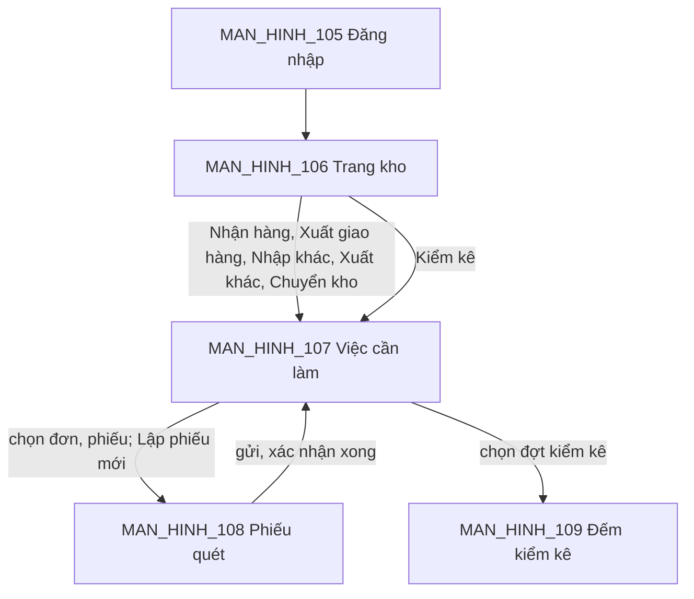

# CONG_VIEC_44: Ứng dụng kho trên điện thoại (MODULE_03)

- Mô tả: Ứng dụng Expo cho Thủ kho, Quản lý kho: tra tồn, nhận hàng từ đơn mua, xuất giao hàng cho đơn bán, phiếu nhập khác, xuất khác, chuyển kho (xuất, nhận), đếm kiểm kê bằng máy quét mã vạch cầm tay hoặc camera điện thoại; dùng lại API kho đã có.
- Phiên bản: 0.1
- Ngày cập nhật: 2026-11-11
- Trạng thái: Đã nghiệm thu 2026-11-11, chờ phát hành (tồn đọng: thử camera trên điện thoại thật).
- Nguồn: CONG_VIEC_05 mục 2 (ngoài phạm vi: ứng dụng kho Expo); tài liệu `05` mục 2.1, `12` (thư mục `apps/mobile-warehouse`), `22` mục 3 (phiên ứng dụng kho 90 ngày); quyết định của người dùng ngày 2026-11-11 (mục 13).

## 1. Mục tiêu

Thủ kho làm việc ngay tại kệ: quét mã thay vì gõ, lập và gửi phiếu, xác nhận xuất, nhận, đếm kiểm kê trên điện thoại hoặc máy quét cầm tay Android; kết quả ghi sổ giống hệt khi làm trên web. Nhiều người đếm cùng một đợt kiểm kê mà không ghi đè số của nhau.

## 2. Phạm vi

Trong phạm vi:
- Ứng dụng mới `apps/mobile-warehouse` (Expo SDK 58, khổ điện thoại, xem trước bằng bản web), cách làm theo `apps/mobile-vcomm`.
- Thao tác: tra tồn; nhận hàng từ đơn mua; xuất giao hàng cho đơn bán; phiếu nhập khác, xuất khác (lập, gửi, rút); chuyển kho (lập, gửi; xác nhận xuất; nhập số thực nhận, xác nhận nhận); đếm kiểm kê.
- Quét mã: máy quét cầm tay chế độ bàn phím (gõ chuỗi kèm Enter) và camera điện thoại (`expo-camera`).
- API: đăng nhập ứng dụng kho (API_137); cộng số đếm kiểm kê (API_138); quyền mới đếm kiểm kê, đếm mù.

Ngoài phạm vi:
- Làm việc khi mất mạng (người dùng chọn bắt buộc có mạng).
- Duyệt phiếu, lập, bắt đầu, kết thúc, hủy kiểm kê, phiếu điều chỉnh, giữ hàng, tồn an toàn, cài đặt kho, in tem: làm trên web.
- Nhận trả hàng từ khách, trả hàng nhà cung cấp, kiểm tra chất lượng khi nhận, nhận hàng giao dịch nội bộ: làm trên web (đề xuất công việc sau nếu cần).
- Phát hành ứng dụng lên kho ứng dụng (App Store, Google Play), tích hợp máy quét theo intent của hãng (Zebra DataWedge…).

## 3. Yêu cầu nghiệp vụ và chức năng

| Mã | Yêu cầu | Người cần |
|---|---|---|
| YCAU_NGHIEPVU_53 | Thủ kho nhập, xuất, chuyển kho, tra tồn ngay tại kệ trên điện thoại hoặc máy quét cầm tay, quét mã vạch thay gõ tay; kết quả ghi sổ như trên web | Thủ kho, Quản lý kho |
| YCAU_NGHIEPVU_54 | Nhiều Thủ kho cùng đếm một đợt kiểm kê bằng quét mã, số đếm cộng dồn không ghi đè lẫn nhau; người đếm không thấy tồn sổ sách; chỉ Quản lý kho lập và kết thúc kiểm kê | Quản lý kho, Thủ kho |
| YCAU_NGHIEPVU_55 | Ứng dụng kho dùng chung tài khoản, phân quyền theo chi nhánh, xác thực hai lớp như web; phiên dài để không đăng nhập lại mỗi ca | Thủ kho, quản trị |

| Mã | Chức năng | Yêu cầu |
|---|---|---|
| CHUC_NANG_159 | Ứng dụng kho: đăng nhập, chọn công ty và kho; quét mã (máy quét, camera); tra tồn; nhận hàng đơn mua; xuất giao hàng đơn bán; phiếu nhập khác, xuất khác; chuyển kho xuất, nhận; đếm kiểm kê cộng dồn | YCAU_NGHIEPVU_53, 54, 55 |

## 4. Quy tắc nghiệp vụ

| Mã | Quy tắc | Yêu cầu |
|---|---|---|
| QUYTAC_NGHIEPVU_280 | Ứng dụng kho đăng nhập bằng tài khoản nhân viên (email, tên đăng nhập hoặc số điện thoại và mật khẩu), xác thực hai lớp như web (tài khoản bắt buộc mà chưa đăng ký thì phải đăng ký trên web). Phiên loại `warehouse_app`, token làm mới 90 ngày, đổi mới mỗi lần dùng. Ứng dụng chỉ hiện công ty người dùng có `inventory.access` và kho người dùng thao tác được; mọi thao tác đi qua API kho hiện có với cùng quy tắc, quyền, luồng duyệt, đánh số như web (QUYTAC_NGHIEPVU_45 đến 55) | YCAU_NGHIEPVU_53, 55 |
| QUYTAC_NGHIEPVU_281 | Bắt buộc có mạng: ứng dụng không lưu phiếu, số đếm trên máy. Mất mạng khi gửi thì báo lỗi, dữ liệu đang nhập giữ trên màn hình để gửi lại; đóng ứng dụng hoặc rời màn hình thì mất phần chưa gửi (hỏi xác nhận trước khi rời màn hình có dữ liệu chưa gửi) | YCAU_NGHIEPVU_53 |
| QUYTAC_NGHIEPVU_282 | Quét mã trên màn hình lập phiếu, đếm: mã được tra theo thứ tự (1) mã vị trí đang dùng của kho đang chọn (không phân biệt hoa thường), khi kho dùng vị trí: đặt làm vị trí hiện tại cho các lần quét sau; kho dùng vị trí thì phải quét vị trí trước khi quét hàng; (2) mặt hàng khớp đúng mã vạch hoặc mã hàng của công ty chủ hàng (API_65 `/inventory/items`): thêm 1 đơn vị quét (đơn vị khớp mã vạch, không khớp thì đơn vị cơ sở; theo đơn thì quy đổi sang đơn vị dòng đơn; đếm kiểm kê quy đổi sang đơn vị cơ sở) vào dòng gần nhất cùng mặt hàng, đơn vị, vị trí, chưa có thì thêm dòng; khớp nhiều mặt hàng thì cho chọn; (3) đang chờ serial của một dòng (vừa quét mặt hàng theo dõi serial hoặc người dùng chạm dòng): ghi serial vào dòng đó, serial trùng thì báo; (4) chỉ khớp gần đúng theo tên thì cho chọn; (5) không khớp thì báo "Không tìm thấy mã <mã>." kèm rung. Hàng theo lô: nhập số lô, hạn dùng khi nhập; khi xuất gợi ý lô theo QUYTAC_NGHIEPVU_51, chọn lô khác ghi lý do; khi đếm chọn trong lô đã có, kể cả lô hết hạn | YCAU_NGHIEPVU_53 |
| QUYTAC_NGHIEPVU_283 | Quyền mới `inventory.stocktake.count` (phạm vi công ty, chi nhánh; không nhạy cảm) "Đếm kiểm kê", gán mặc định Thủ kho; Quản lý kho có sẵn vì có mọi quyền `inventory.*`. Người có quyền này tại kho được xem danh sách, chi tiết đợt kiểm kê của kho và cộng số đếm khi đợt đang đếm; không lập, bắt đầu, sửa số tuyệt đối, kết thúc, hủy. Đếm mù: người không có `inventory.stocktake.manage` tại kho không thấy tồn sổ sách, chênh lệch, giá trị chênh lệch của đợt kiểm kê và không thấy dòng chưa ai đếm | YCAU_NGHIEPVU_54 |
| QUYTAC_NGHIEPVU_284 | Số đếm cộng dồn: mỗi lần gửi từ ứng dụng cộng số lượng (có thể âm để sửa nhầm) vào dòng cùng biến thể, lô, vị trí; chưa có dòng thì thêm dòng tồn sổ sách 0. Số đếm sau khi cộng không âm. Hàng serial: gửi danh sách serial thêm, serial bỏ; số đếm bằng số serial khác nhau của dòng; serial đã đếm ở dòng khác của đợt bị từ chối. Mỗi lần cộng ghi một dòng lịch sử đếm (người đếm, thời điểm, số cộng, serial) không sửa, không xóa. Hai lần cộng đồng thời vào cùng dòng đều được tính. Quản lý kho vẫn sửa số tuyệt đối trên web (API_67, ghi đè) | YCAU_NGHIEPVU_54 |

Ngoại lệ:
- Cộng làm số đếm âm: "Số đếm sau khi cộng không được âm." (khóa `stocktakeCountNegative`) (QUYTAC_NGHIEPVU_284).
- Serial đã đếm ở dòng khác: "Serial đã được đếm ở dòng khác của đợt kiểm kê." (khóa `stocktakeSerialCounted`) (QUYTAC_NGHIEPVU_284).
- Cộng khi đợt không ở trạng thái đang đếm: lỗi hiện có `stocktakeNotCounting`.
- Đăng nhập ứng dụng kho bằng tài khoản không có `inventory.access` ở công ty nào: "Tài khoản không có quyền dùng ứng dụng kho." (khóa `warehouseAppNoAccess`), phiên vừa tạo bị thu hồi (QUYTAC_NGHIEPVU_280).

## 5. Vai trò và quyền

| Quyền | Phạm vi | Nhạy cảm | Vai trò mặc định |
|---|---|---|---|
| `inventory.stocktake.count` (mới) | Công ty, chi nhánh | Không | Thủ kho; Quản lý kho, quản trị tập đoàn, quản trị công ty (qua danh sách `inventory.*`) |

Các thao tác khác dùng quyền hiện có: tra tồn `inventory.stock.view`; nhập khác, xuất khác, chuyển kho `inventory.document.manage`; nhận đơn mua `inventory.purchase.receive`; xuất giao hàng `inventory.sales.issue`.

## 6. Dữ liệu

Database migration `0064_stocktake_count_entries.sql`:

| Bảng | Nội dung |
|---|---|
| `inventory.stocktake_count_entries` | Lịch sử đếm, chỉ thêm: đợt kiểm kê, dòng kiểm kê, người đếm, thời điểm, số cộng (`numeric(20,4)`, có dấu), serial thêm, serial bỏ (`text[]`), loại phiên (`warehouse_app`, `web`) |

Đổi `inventory.stocktake_lines`: thêm chỉ mục duy nhất (đợt, biến thể, lô, vị trí) coi giá trị rỗng là bằng nhau (`NULLS NOT DISTINCT`) để hai người cùng thêm dòng mới không sinh hai dòng. Chỉ mục tạo được khi dữ liệu hiện có không trùng (API_67 hiện đã gộp theo khóa này). Mã database migration 0065, 0066 không dùng.

Không đổi `core.sessions`: giá trị `warehouse_app` đã có trong ràng buộc `client_type` (database migration 0001, 0023).

## 7. Giao diện

Ứng dụng `apps/mobile-warehouse` (Expo, khổ điện thoại; bản web cổng 8084 để xem trước). Màu, khoảng cách theo tài liệu `15` (tệp chủ đề chép giá trị từ `packages/ui/src/styles.css` như `apps/mobile-vcomm`). Câu chữ trong `packages/i18n`, nhóm `warehouseApp`.

| Mã | Màn hình | Nội dung |
|---|---|---|
| MAN_HINH_105 | Đăng nhập | Tài khoản, mật khẩu; mã xác thực hai lớp hoặc mã dự phòng; tài khoản bắt buộc mà chưa đăng ký thì hướng dẫn đăng ký trên web |
| MAN_HINH_106 | Trang kho | Chọn công ty, kho (nhớ lựa chọn trên máy); ô quét tra tồn (tồn thực, đang giữ, khả dụng theo lô, vị trí; ẩn giá vốn); lưới thao tác theo quyền: Nhận hàng, Xuất giao hàng, Nhập khác, Xuất khác, Chuyển kho, Kiểm kê; đăng xuất |
| MAN_HINH_107 | Việc cần làm | Theo thao tác đã chọn: đơn mua chờ nhận, đơn bán chờ xuất, phiếu nháp hoặc bị từ chối của mình, phiếu chuyển chờ xuất (kho nguồn), chờ nhận (kho đích), đợt kiểm kê đang đếm; ô quét số đơn, số phiếu; nút "Lập phiếu mới" (nhập khác, xuất khác, chuyển kho) |
| MAN_HINH_108 | Phiếu quét | Dùng chung cho nhận đơn mua, xuất giao hàng, nhập khác, xuất khác, chuyển kho (lập, xác nhận xuất, nhận): đầu phiếu (kho, chủ hàng, lý do, kho đích), vị trí hiện tại, ô quét luôn sẵn sàng nhận máy quét, nút camera; danh sách dòng (mặt hàng, số lượng chỉnh được, đơn vị, lô, hạn dùng, serial, vị trí; còn phải nhận, xuất theo đơn); Lưu nháp, Gửi, Rút, Xác nhận xuất, Xác nhận nhận theo trạng thái phiếu và quyền |
| MAN_HINH_109 | Đếm kiểm kê | Đợt kiểm kê đang đếm: vị trí hiện tại, ô quét, nút camera; danh sách quét chưa gửi (mặt hàng, lô, số cộng, serial; sửa, bỏ); "Gửi số đếm"; lịch sử đếm của tôi trong đợt; người có quyền quản lý thấy thêm tồn sổ sách, chênh lệch |

Thành phần dùng chung: ô quét (nhận chuỗi kèm Enter, giữ tiêu điểm sau mỗi lần quét), lớp quét camera (đèn, đóng; dừng sau mỗi mã 1 giây để không đọc lặp), chọn lô, serial dạng thẻ bỏ được, hộp xác nhận rời màn hình. Danh sách đơn bán chờ xuất (`GET /inventory/sales-orders`) thêm trường `warehouseId` để lọc theo kho đang chọn.

Bản mẫu: `tai_lieu/ban_mau/MAN_HINH_105_DANG_NHAP_KHO.html` đến `MAN_HINH_109_DEM_KIEM_KE.html`.

## 8. API

| Mã | Endpoint | Nội dung |
|---|---|---|
| API_137 | `POST /auth/warehouse-app/login` | Như API_112 (`/auth/app/login`) nhưng phiên `warehouse_app`; trả `AppLoginResponse`. Làm mới, đăng xuất, xác thực hai lớp dùng API hiện có (`/auth/app/refresh`, API_10, `/auth/mfa/verify`) với header Authorization. Không có `inventory.access` ở công ty nào: thu hồi phiên, `403 warehouseAppNoAccess` |
| API_138 | `POST /inventory/stocktakes/{id}/count-additions` | Quyền `inventory.stocktake.count` hoặc `inventory.stocktake.manage` tại kho. Thân: `additions` (1 đến 500 phần tử: `variantId`, `lotId`, `locationId`, `quantity` (có dấu, khác 0 với hàng không serial), `serials`, `removedSerials`). Một giao dịch: khóa đợt kiểm kê, kiểm như API_67 lưu số đếm, cộng dồn, ghi lịch sử đếm. Trả `StocktakeResponse` (đếm mù theo QUYTAC_NGHIEPVU_283) |
| API_139 | `GET /inventory/stocktakes/{id}/count-entries?mine=` | Lịch sử đếm của đợt (mới nhất trước, 200 dòng): người đếm, thời điểm, mặt hàng, lô, vị trí, số cộng, serial; `mine=true` chỉ của mình. Quyền như API_138 |

Sửa API_67: `GET /inventory/stocktakes`, `GET /inventory/stocktakes/{id}` giữ phạm vi xem như cũ (kho người dùng thao tác được); người không có `inventory.stocktake.manage` tại kho (cả trên web) nhận `systemQuantity`, `difference`, `differenceValue` là `null` và chỉ nhận dòng đã có số đếm; thêm trường `canCount` (có quyền đếm hoặc quản lý tại kho).

Các thao tác khác dùng API hiện có: API_63 (`/inventory/warehouses` có `canOperate`, vị trí), API_64 (tồn, chi tiết), API_65 (phiếu, gợi ý lô, tìm mặt hàng), API_66 (kho đích, xuất, nhận), nhận đơn mua (`/inventory/purchase-orders`, `/inventory/purchase-receipts`), xuất giao hàng (`/inventory/sales-orders`, `/inventory/sales-issues`), API_15 (`/me` lấy công ty, quyền).

## 9. Bảo mật

- Token lưu trong bộ nhớ an toàn của máy (`expo-secure-store`), bản web dùng `sessionStorage` như `apps/mobile-vcomm`; không ghi token vào log.
- Ứng dụng gửi header Authorization, không dùng cookie nên không cần CSRF (luật hiện có của `AuthGuard`).
- Quyền chi tiết vẫn kiểm ở máy chủ theo chi nhánh sở hữu kho; ứng dụng ẩn nút chỉ để dễ dùng.
- Đếm mù kiểm ở máy chủ (QUYTAC_NGHIEPVU_283).
- Camera chỉ đọc mã, không lưu ảnh; xin quyền camera lần đầu bấm nút camera.

## 10. Tiêu chí nghiệm thu

| Mã | Chức năng | Tiêu chí | Cách kiểm tra | Mức |
|---|---|---|---|---|
| TIEUCHI_NGHIEMTHU_278 | CHUC_NANG_159 | Đăng nhập ứng dụng kho tạo phiên `warehouse_app` làm mới được bằng token; tài khoản không có `inventory.access` bị từ chối và phiên bị thu hồi; tài khoản bắt buộc xác thực hai lớp phải nhập mã trước khi gọi API kho | Gọi API | Bắt buộc |
| TIEUCHI_NGHIEMTHU_279 | CHUC_NANG_159 | Trên ứng dụng: nhận đơn mua, xuất giao hàng, nhập khác, xuất khác, chuyển kho xuất và nhận bằng quét mã cho tồn, thẻ kho như web; Thủ kho chi nhánh khác không thấy kho, bị từ chối khi gọi | Gọi API; xem trước bản web | Bắt buộc |
| TIEUCHI_NGHIEMTHU_280 | CHUC_NANG_159 | Hai người cộng số đếm đồng thời vào cùng dòng thì số đếm bằng tổng; cộng làm âm, serial trùng dòng khác, đợt không đang đếm bị từ chối; Thủ kho cộng được nhưng không lập, kết thúc, sửa số tuyệt đối; người chỉ có quyền đếm không thấy tồn sổ sách, chênh lệch; lịch sử đếm đủ từng lần | Kiểm thử tự động | Bắt buộc |
| TIEUCHI_NGHIEMTHU_281 | CHUC_NANG_159 | Quét bằng máy quét bàn phím và camera: mã vị trí đổi vị trí hiện tại, mã vạch thêm đúng mặt hàng và đơn vị, quét lại cộng số lượng, serial ghi vào dòng đang chờ; mã không khớp báo lỗi | Kiểm thử tự động phần tra mã; xem trước bản web (máy quét bàn phím); người dùng thử camera trên điện thoại | Bắt buộc (camera: Mong muốn) |

## 11. Kịch bản kiểm thử

| Mã | Tiêu chí | Nội dung |
|---|---|---|
| KICHBAN_KIEMTHU_423 | TIEUCHI_NGHIEMTHU_278 | Đăng nhập ứng dụng kho: đúng mật khẩu ra phiên `warehouse_app`, làm mới đổi token; sai mật khẩu 401; tài khoản không có quyền kho 403 và phiên bị thu hồi; tài khoản bắt buộc xác thực hai lớp gọi API kho trước khi nhập mã bị từ chối |
| KICHBAN_KIEMTHU_424 | TIEUCHI_NGHIEMTHU_279 | Bằng token ứng dụng kho (Authorization, không CSRF): Thủ kho lập, gửi phiếu nhập khác, xuất khác; nhận đơn mua; xuất giao hàng; chuyển kho xuất, nhận; tồn và thẻ kho đúng; Thủ kho chi nhánh khác bị từ chối |
| KICHBAN_KIEMTHU_425 | TIEUCHI_NGHIEMTHU_280 | Cộng số đếm: cộng hai lần, cộng âm hợp lệ, cộng làm âm bị từ chối, dòng mới tồn sổ sách 0, hai lần cộng đồng thời đều được tính, hai người cùng thêm dòng mới chỉ sinh một dòng; đợt chưa bắt đầu hoặc đã kết thúc bị từ chối |
| KICHBAN_KIEMTHU_426 | TIEUCHI_NGHIEMTHU_280 | Serial: thêm, bỏ serial, số đếm bằng số serial; serial đã đếm ở dòng khác bị từ chối. Quyền: Thủ kho cộng được, không lập, bắt đầu, lưu số tuyệt đối, kết thúc; đếm mù ẩn tồn sổ sách, chênh lệch, dòng chưa đếm; Quản lý kho thấy đủ; lịch sử đếm, lọc của tôi |
| KICHBAN_KIEMTHU_427 | TIEUCHI_NGHIEMTHU_281 | Bộ tra mã của ứng dụng: mã vị trí, mã vạch đơn vị khác đơn vị cơ sở, quét lại cộng dồn, serial đang chờ, mã không khớp, khớp nhiều mặt hàng; xem trước bản web nhập bằng bàn phím kèm Enter |

## 12. Ràng buộc kỹ thuật

- Thư viện mới: `expo-camera` (Expo SDK 58, giấy phép MIT; người dùng đồng ý 2026-11-11). Không thêm thư viện khác.
- Ứng dụng là gói riêng `apps/mobile-warehouse` (tài liệu `12`); chép tệp chủ đề, thành phần giao diện cơ bản, cách gọi API từ `apps/mobile-vcomm` và sửa cho nhân viên (gửi `X-Company-Id`, đăng nhập API_137). Không sửa `apps/mobile-vcomm`.
- Phần tra mã quét viết hàm thuần trong ứng dụng, có kiểm thử đơn vị.
- Kiểm thử ứng dụng: kiểm tra kiểu, kiểm thử đơn vị phần tra mã, xem trước bản web bằng Playwright; không có kiểm thử trên thiết bị thật trong môi trường của AI.

## 13. Quyết định của người dùng (2026-11-11)

- Đưa mọi thao tác vào ứng dụng: tra tồn, nhận hàng đơn mua, xuất giao hàng, nhập khác, xuất khác, chuyển kho, kiểm kê; duyệt vẫn trên web.
- Bắt buộc có mạng, không làm ngoại tuyến.
- Thêm quyền đếm kiểm kê cho Thủ kho; số đếm cộng dồn khi nhiều người cùng đếm.
- Đồng ý thêm `expo-camera`.
- Đếm mù cho người không có quyền quản lý kiểm kê, áp dụng cả web.
- Duyệt đặc tả, bản mẫu MAN_HINH_105 đến 109; AI làm tiếp qua các lát, báo sau mỗi lát.
- Nghiệm thu CONG_VIEC_44 ngày 2026-11-11; ba quyết định AI tự đưa ra ở tài liệu `07` (mục "Quyết định AI tự đưa ra (CONG_VIEC_44)") được chấp nhận cùng nghiệm thu.

## 14. Thành phần không được thay đổi

API, dữ liệu, giao diện của các công việc đã nghiệm thu, trừ phần sửa API_67 ở mục 8 (mở cho quyền đếm, đếm mù). Hành vi lưu số tuyệt đối (`PUT /inventory/stocktakes/{id}/counts`) giữ nguyên.

## 15. Các lát và điểm xem trước

| Lát | Nội dung | Màn hình, API | Tiêu chí |
|---|---|---|---|
| L0 | API_137; quyền `inventory.stocktake.count`; database migration 0064; API_138, API_139; sửa API_67 (đếm mù) | API_137 đến 139 | TIEUCHI_NGHIEMTHU_278, 280 |
| L1 | Ứng dụng `apps/mobile-warehouse`: đăng nhập, chọn công ty, kho, tra tồn bằng quét; ô quét, lớp camera | MAN_HINH_105, 106 | TIEUCHI_NGHIEMTHU_278, 281 (phần tra tồn) |
| L2 | Việc cần làm, phiếu quét: nhận đơn mua, xuất giao hàng, nhập khác, xuất khác, chuyển kho | MAN_HINH_107, 108 | TIEUCHI_NGHIEMTHU_279, 281 |
| L3 | Đếm kiểm kê | MAN_HINH_109 | TIEUCHI_NGHIEMTHU_280, 281 |

Điểm xem trước sau mỗi lát: ảnh chụp bản web khổ điện thoại (`tam_thoi/CONG_VIEC_44/`), báo phiên cha; người dùng cho làm tiếp theo kế hoạch.

## 16. Kết quả đối chiếu định nghĩa hoàn thành

Chưa đối chiếu.
