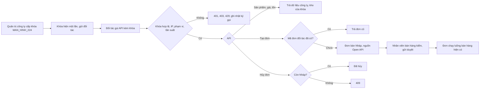

# CONG_VIEC_61: Mở rộng kinh doanh phần 1 – Open API cho đối tác (MODULE_16)

- Mô tả: Cổng API cho đối tác (đại lý, nhà bán lại, website và sàn bán hộ, cửa hàng liên kết) và phần mềm khác của chính công ty: cấp khóa API theo công ty và đối tác, phạm vi quyền theo khóa, giới hạn tần suất theo khóa, nhật ký từng lần gọi; API sản phẩm, giá, tồn; API đơn bán; khách hàng do đối tác tạo; tra, tích, đổi điểm tại đối tác.
- Phiên bản: 0.1
- Ngày cập nhật: 2026-11-12
- Trạng thái: Người dùng duyệt đặc tả và bản mẫu ngày 2026-11-12; lát L1 xong, chờ người dùng xem trước.
- Mức: Lớn (module mới, đổi phân quyền, thêm điểm tiếp nhận công khai, sửa cấu trúc dữ liệu bán hàng).
- Nhánh: `chuc-nang/CONG_VIEC_61-mo-rong-kinh-doanh`.
- Nguồn: tài liệu `01` mục 4 (MODULE_16), `04` mục 8 dòng 12, `05` mục 3 (MODULE_16), `05` mục 5 (phiên bản 6.x), `24` THAY_DOI_04; quyết định của người dùng ngày 2026-11-12 (mục 17).
- Ba phần còn lại của MODULE_16 (Dropship, trợ lý AI, quản lý sản xuất) đề nghị phiên điều phối cấp mã công việc riêng.

## 1. Mục tiêu

Đối tác và phần mềm khác của công ty kết nối thẳng với VComm mà không cần tài khoản nhân viên: tự lấy danh mục, giá, tồn và gửi đơn; công ty kiểm soát được ai gọi, gọi gì, gọi bao nhiêu, và thu hồi ngay khi cần.

## 2. Phạm vi

Trong phạm vi: CHUC_NANG_217 đến CHUC_NANG_221 (lát L1 đến L3); lát L4 (điểm thưởng tại đối tác) cần thêm mã, hỏi quy tắc trước khi làm (mục 16).

Ngoài phạm vi:

- Webhook VComm gọi ra đối tác (báo đổi trạng thái đơn, tồn): đối tác hỏi lại theo chu kỳ. Làm ở công việc sau nếu cần.
- Trang tài liệu API tự sinh (Swagger, OpenAPI). Giai đoạn này gửi đối tác tài liệu `17` mục 2-open (bản trích).
- Đối tác tự đăng ký, tự lấy khóa; môi trường thử riêng cho đối tác (đối tác dùng khóa "thử" trỏ vào kho, kênh thử của công ty).
- Đối tác đặt giá, giảm giá tay trên đơn; thanh toán qua API.
- Dropship (nhà cung cấp giao thẳng, đối soát): công việc riêng của MODULE_16.

## 3. Yêu cầu nghiệp vụ

| Mã                | Yêu cầu                                                                                                                                                       | Người cần                   |
| ----------------- | ------------------------------------------------------------------------------------------------------------------------------------------------------------- | --------------------------- |
| YCAU_NGHIEPVU_162 | Công ty cấp khóa API cho một đối tác trong danh mục đối tác của công ty, hoặc khóa nội bộ cho phần mềm của chính công ty; sửa cấu hình, cấp lại, thu hồi khóa | Quản trị công ty            |
| YCAU_NGHIEPVU_163 | Mỗi khóa chỉ dùng được các nhóm API (phạm vi) đã cấp, trong thời hạn, từ địa chỉ IP được phép, chỉ thấy dữ liệu công ty cấp khóa                              | Quản trị công ty, Đối tác   |
| YCAU_NGHIEPVU_164 | Giới hạn số lần gọi mỗi phút theo từng khóa để một đối tác không làm chậm hệ thống                                                                            | Quản trị công ty            |
| YCAU_NGHIEPVU_165 | Nhật ký từng lần gọi (ai, khi nào, gọi gì, kết quả) để tra lỗi với đối tác và phát hiện dùng sai                                                              | Quản trị công ty            |
| YCAU_NGHIEPVU_166 | Đối tác lấy danh mục sản phẩm, giá bán cho chính mình, tồn khả dụng ở các kho được chỉ định                                                                   | Đối tác                     |
| YCAU_NGHIEPVU_167 | Đối tác gửi đơn bán vào VComm, không tạo trùng khi gửi lại; xem trạng thái, hủy khi chưa xử lý                                                                | Đối tác, Nhân viên bán hàng |
| YCAU_NGHIEPVU_168 | Website, sàn bán hộ gửi đơn kèm khách hàng do đối tác tạo (người mua lấy hóa đơn) và người nhận để công ty giao thẳng                                         | Đối tác                     |
| YCAU_NGHIEPVU_169 | Cửa hàng liên kết tra, tích, đổi điểm VComm cho hội viên khi hội viên mua tại cửa hàng (hội viên xác nhận bằng mã OTP)                                        | Cửa hàng liên kết, Hội viên |

## 4. Chức năng

| Mã            | Chức năng                                                                  | Yêu cầu                     | Màn hình                                                                   | API                                      | Lát |
| ------------- | -------------------------------------------------------------------------- | --------------------------- | -------------------------------------------------------------------------- | ---------------------------------------- | --- |
| CHUC_NANG_217 | Quản lý khóa API: cấp, xem, sửa cấu hình, cấp lại, thu hồi                 | YCAU_NGHIEPVU_162, 163, 164 | MAN_HINH_224, MAN_HINH_225                                                 | API_255 đến API_258                      | L1  |
| CHUC_NANG_218 | Xác thực khóa, kiểm phạm vi, IP, giới hạn tần suất, ghi và xem nhật ký gọi | YCAU_NGHIEPVU_163, 164, 165 | MAN_HINH_226                                                               | API_259; bộ lọc chung cho mọi API `open` | L1  |
| CHUC_NANG_219 | API sản phẩm, giá, tồn cho đối tác                                         | YCAU_NGHIEPVU_166           | —                                                                          | API_260, API_261                         | L1  |
| CHUC_NANG_220 | API đơn bán: tạo nháp, tra, liệt kê, hủy                                   | YCAU_NGHIEPVU_167           | Sửa màn hình đơn bán (nhãn nguồn Open API, mã đơn đối tác, lọc theo nguồn) | API_262 đến API_264                      | L2  |
| CHUC_NANG_221 | API khách hàng do đối tác tạo; đơn ghi khách đó và người nhận giao thẳng   | YCAU_NGHIEPVU_168           | —                                                                          | Cần thêm mã API (mục 16)                 | L3  |
| (chưa cấp mã) | API điểm thưởng tại đối tác                                                | YCAU_NGHIEPVU_169           | —                                                                          | Cần thêm mã                              | L4  |

## 5. Quy tắc nghiệp vụ

| Mã                  | Quy tắc                                                                                                                                                                                                                                                                                                                                                                                                                                                                                                               |
| ------------------- | --------------------------------------------------------------------------------------------------------------------------------------------------------------------------------------------------------------------------------------------------------------------------------------------------------------------------------------------------------------------------------------------------------------------------------------------------------------------------------------------------------------------- |
| QUYTAC_NGHIEPVU_480 | Khóa API dạng `vck_` + 32 ký tự chữ, số ngẫu nhiên (khoảng 190 bit, `crypto.randomBytes`). Chỉ lưu bản băm SHA-256 và 8 ký tự đầu sau `vck_` (để nhận diện); khóa đầy đủ chỉ trả một lần trong kết quả cấp hoặc cấp lại. Không ghi khóa vào nhật ký thao tác, nhật ký gọi, log máy chủ                                                                                                                                                                                                                                |
| QUYTAC_NGHIEPVU_481 | Khóa thuộc đúng một công ty. Loại "Đối tác": gắn một đối tác đang giao dịch có hồ sơ khách hàng ở công ty đó; giá theo nhóm khách hàng của đối tác. Loại "Nội bộ": không gắn đối tác, dùng cho phần mềm của chính công ty. Một đối tác có nhiều khóa được. Loại khóa, công ty, đối tác không đổi sau khi cấp                                                                                                                                                                                                          |
| QUYTAC_NGHIEPVU_482 | Cấu hình khóa: tên (1 đến 100 ký tự, duy nhất trong công ty với khóa chưa thu hồi), phạm vi (ít nhất một), kênh bán (đang hoạt động), kho (ít nhất một khi có phạm vi Sản phẩm hoặc Đơn bán; kho thuộc công ty, đang hoạt động), giới hạn mỗi phút (1 đến 600, mặc định 60), hạn dùng (tùy chọn, từ ngày mai trở đi khi đặt mới), danh sách IP (tùy chọn, tối đa 20 địa chỉ IPv4, IPv6 hoặc dải CIDR). Sửa cấu hình có hiệu lực từ lần gọi kế tiếp; sửa dùng khóa lạc quan `version`                                  |
| QUYTAC_NGHIEPVU_483 | Trạng thái khóa: Đang dùng; Hết hạn (đã qua ngày hạn dùng theo giờ Việt Nam, tính khi gọi, gia hạn bằng sửa hạn dùng); Đã thu hồi (vĩnh viễn, kèm lý do 1 đến 500 ký tự, không sửa, không cấp lại). Cấp lại khóa: tạo chuỗi mới, chuỗi cũ hết dùng được ngay, giữ cấu hình và nhật ký                                                                                                                                                                                                                                 |
| QUYTAC_NGHIEPVU_484 | Xác thực: header `Authorization: Bearer <khóa>`. Thiếu khóa, sai khóa, khóa hết hạn, đã thu hồi, đối tác ngừng giao dịch đều trả `401 UNAUTHENTICATED` cùng một thông báo (không lộ lý do cho bên gọi; lý do ghi ở nhật ký gọi khi xác định được khóa). Lần gọi không xác định được khóa đếm theo IP, quá 20 lần mỗi phút trả `429` (như webhook hiện có)                                                                                                                                                             |
| QUYTAC_NGHIEPVU_485 | Khóa có danh sách IP: IP bên gọi ngoài danh sách trả `403 IP_NOT_ALLOWED`. IP lấy theo cấu hình proxy tin cậy hiện có của API (`trust proxy`)                                                                                                                                                                                                                                                                                                                                                                         |
| QUYTAC_NGHIEPVU_486 | Phạm vi quyền: `catalog.read` (sản phẩm, giá, tồn), `sales_order.write` (tạo, tra, hủy đơn), `customer.write` (khách hàng do đối tác tạo, L3), `loyalty.member` (điểm, L4). API ngoài phạm vi trả `403 SCOPE_NOT_GRANTED`                                                                                                                                                                                                                                                                                             |
| QUYTAC_NGHIEPVU_487 | Giới hạn tần suất theo khóa, cửa sổ một phút trên Redis (dùng `RateLimiter` hiện có). Vượt mức trả `429 RATE_LIMITED`, header `Retry-After`; mọi kết quả kèm `X-RateLimit-Limit`, `X-RateLimit-Remaining`. Redis lỗi thì cho qua và ghi log lỗi (giữ cách hiện có)                                                                                                                                                                                                                                                    |
| QUYTAC_NGHIEPVU_488 | Nhật ký gọi: mỗi lần gọi đã xác định được khóa ghi thời điểm, khóa, công ty, phương thức, đường dẫn (bỏ chuỗi truy vấn chứa dữ liệu cá nhân; chỉ giữ tham số trong danh sách cho phép: `page`, `pageSize`, `warehouse`, `updatedSince`), mã HTTP, mã lỗi, thời gian xử lý, IP, mã yêu cầu. Không ghi nội dung yêu cầu, kết quả, header. Ghi sau khi trả kết quả, lỗi ghi nhật ký không làm hỏng lần gọi. Tự xóa dòng quá 90 ngày, tác vụ nền hằng ngày                                                                |
| QUYTAC_NGHIEPVU_489 | Dữ liệu trả cho khóa: chỉ của công ty cấp khóa. Sản phẩm: sản phẩm, biến thể đang hoạt động công ty bán được (như danh sách chọn hàng của màn hình đơn bán), kèm đơn vị bán, mã vạch, thuế suất. Giá: bảng giá kênh của khóa và nhóm khách hàng của đối tác (khóa nội bộ: không theo nhóm), tính như màn hình đơn bán, chưa trừ khuyến mãi; không có giá thì trả `price: null`. Tồn: số khả dụng (tồn trừ giữ hàng, âm thì trả 0) theo từng kho của khóa                                                              |
| QUYTAC_NGHIEPVU_490 | Đơn bán qua API vào trạng thái Nháp, ghi nguồn `open_api`, khóa đã tạo, mã đơn đối tác. Khách hàng: khóa Đối tác là chính đối tác (L3: hoặc khách do đối tác tạo); khóa Nội bộ phải chỉ định khách hàng của công ty hoặc để trống (bán lẻ, có tên người mua). Kênh là kênh của khóa; kho thuộc danh sách kho của khóa. Dòng hàng dùng mã biến thể và mã đơn vị; giá, khuyến mãi, thuế tính lại như đơn nhập trên web; đối tác không gửi giá, không giảm tay. Nhân viên bán hàng kiểm tra rồi gửi duyệt như đơn thường |
| QUYTAC_NGHIEPVU_491 | Mã đơn đối tác bắt buộc (1 đến 50 ký tự chữ, số, `-`, `_`, `.`), duy nhất theo công ty và đối tác (khóa Nội bộ: theo khóa). Gửi lại đơn đã có cùng mã trả `200` kèm đơn đã tạo, không tạo đơn mới, không so nội dung                                                                                                                                                                                                                                                                                                  |
| QUYTAC_NGHIEPVU_492 | Đối tác tra, liệt kê đơn do mình tạo qua API (mọi khóa cùng đối tác; khóa Nội bộ: đơn của chính khóa) theo mã đơn đối tác; thấy trạng thái, số đơn VComm, tổng tiền, dòng hàng, ngày giao. Hủy được khi đơn còn Nháp (ghi lý do do đối tác gửi); trạng thái khác trả `409 BUSINESS_RULE`                                                                                                                                                                                                                              |
| QUYTAC_NGHIEPVU_493 | Nhật ký thao tác: cấp, sửa, cấp lại, thu hồi khóa ghi người làm, nội dung đổi (không ghi khóa). Tạo, hủy đơn qua API ghi tác nhân là khóa (tên khóa, đầu khóa), không gắn người dùng                                                                                                                                                                                                                                                                                                                                  |
| QUYTAC_NGHIEPVU_494 | Dự phòng cho L3 (khách hàng do đối tác tạo, người nhận giao thẳng); chi tiết chốt trước khi làm L3                                                                                                                                                                                                                                                                                                                                                                                                                    |
| QUYTAC_NGHIEPVU_495 | Dự phòng cho L4 (điểm thưởng tại đối tác); chi tiết chốt trước khi làm L4                                                                                                                                                                                                                                                                                                                                                                                                                                             |

## 6. Vai trò và quyền

| Quyền                     | Phạm vi gán | Nhạy cảm | Gán sẵn                             |
| ------------------------- | ----------- | -------- | ----------------------------------- |
| `platform.api_key.manage` | Công ty     | Có       | Quản trị tập đoàn, Quản trị công ty |
| `platform.api_log.view`   | Công ty     | Không    | Quản trị tập đoàn, Quản trị công ty |

| Chức năng                                                    | Quản trị tập đoàn | Quản trị công ty | Người có `platform.api_log.view` | Đối tác (khóa API)    |
| ------------------------------------------------------------ | ----------------- | ---------------- | -------------------------------- | --------------------- |
| CHUC_NANG_217 Cấp, sửa, cấp lại, thu hồi khóa                | Mọi công ty       | Công ty mình     | Không                            | Không                 |
| CHUC_NANG_217 Xem danh sách, chi tiết khóa (không thấy khóa) | Mọi công ty       | Công ty mình     | Có (chỉ xem)                     | Không                 |
| CHUC_NANG_218 Xem nhật ký gọi                                | Mọi công ty       | Công ty mình     | Công ty được gán                 | Không                 |
| CHUC_NANG_219 đến 221                                        | Không qua API này | Không            | Không                            | Theo phạm vi của khóa |

Đơn tạo qua API do nhân viên có quyền đơn bán hiện có xử lý; không thêm quyền bán hàng.

## 7. Luồng nghiệp vụ

Luồng 58 (Open API cho đối tác):

Ngoại lệ: khóa bị thu hồi trong lúc đối tác đang gọi thì lần gọi kế tiếp trả `401`; đơn đã tạo giữ nguyên.

## 8. Màn hình

| Mã                   | Tên                         | Mini app                      | Nội dung                                                                                                                                     | Bản mẫu                                       |
| -------------------- | --------------------------- | ----------------------------- | -------------------------------------------------------------------------------------------------------------------------------------------- | --------------------------------------------- |
| MAN_HINH_224         | Khóa API đối tác            | Nền tảng (menu nhóm Open API) | Danh sách khóa (tên, đối tác, đầu khóa, phạm vi, giới hạn, hạn, lần gọi gần nhất, trạng thái), lọc; ngăn kéo cấp khóa; hộp hiện khóa một lần | `ban_mau/MAN_HINH_224_KHOA_API.html`          |
| MAN_HINH_225         | Chi tiết khóa API           | Nền tảng                      | Số lần gọi 24 giờ, cao nhất một phút, lần gọi gần nhất; cấu hình; cấp lại; thu hồi; lịch sử thay đổi                                         | `ban_mau/MAN_HINH_225_CHI_TIET_KHOA_API.html` |
| MAN_HINH_226         | Nhật ký gọi API             | Nền tảng                      | Lọc theo khóa, kết quả, khoảng thời gian, đường dẫn; bảng phân trang                                                                         | `ban_mau/MAN_HINH_226_NHAT_KY_GOI_API.html`   |
| Sửa màn hình đơn bán | Danh sách, chi tiết đơn bán | Bán hàng                      | Nhãn nguồn "Open API" và mã đơn đối tác; lọc theo nguồn; hộp thông tin khóa đã tạo đơn                                                       | `ban_mau/SUA_DON_BAN_OPEN_API.html`           |

MAN_HINH_227 đến MAN_HINH_233 để dành cho L3, L4 nếu cần.

## 9. Dữ liệu

| Database migration | Bảng, cột                                                                                        | Nội dung                                                                                                                                                                                                                                                                                                                                                                                                                                                                                                                                                                                                                           |
| ------------------ | ------------------------------------------------------------------------------------------------ | ---------------------------------------------------------------------------------------------------------------------------------------------------------------------------------------------------------------------------------------------------------------------------------------------------------------------------------------------------------------------------------------------------------------------------------------------------------------------------------------------------------------------------------------------------------------------------------------------------------------------------------- |
| 0128 (L1)          | `core.api_keys`                                                                                  | `id`, `company_id`, `kind` (`partner`, `internal`), `partner_id` (khóa ngoại `crm.partners`, bắt buộc khi `partner`, trống khi `internal`), `name`, `key_prefix` (8 ký tự), `key_hash` (SHA-256, duy nhất), `scopes` (`text[]`, giá trị trong danh sách cố định, ít nhất một), `channel_id`, `rate_limit_per_minute` (1 đến 600), `expires_on` (`date`), `allowed_ips` (`inet[]`, tối đa 20), `status` (`active`, `revoked`), `revoked_reason`, `revoked_by`, `revoked_at`, `last_used_at`, `created_by`, `created_at`, `updated_at`, `version`. Duy nhất (`company_id`, `name`) khi chưa thu hồi; thu hồi khi và chỉ khi có lý do |
| 0128 (L1)          | `core.api_key_warehouses`                                                                        | (`api_key_id`, `warehouse_id`) khóa chính                                                                                                                                                                                                                                                                                                                                                                                                                                                                                                                                                                                          |
| 0128 (L1)          | `core.permissions`                                                                               | `platform.api_key.manage` (nhạy cảm), `platform.api_log.view`; gán Quản trị tập đoàn, Quản trị công ty                                                                                                                                                                                                                                                                                                                                                                                                                                                                                                                             |
| 0129 (L1)          | `core.api_call_logs`                                                                             | `id` (`bigserial`), `api_key_id`, `company_id`, `called_at`, `method`, `path` (≤ 300 ký tự), `status_code`, `error_code`, `duration_ms`, `ip` (`inet`), `request_id`. Chỉ mục (`company_id`, `called_at`), (`api_key_id`, `called_at`). Xóa dòng quá 90 ngày (QUYTAC_NGHIEPVU_488)                                                                                                                                                                                                                                                                                                                                                 |
| 0130 (L2)          | `sales.orders`                                                                                   | Thêm `source` (`web`, `open_api`; mặc định `web`), `api_key_id` (khóa ngoại `core.api_keys`), `partner_order_code` (≤ 50 ký tự). Nguồn `open_api` khi và chỉ khi có khóa và mã đơn đối tác. Chỉ mục duy nhất (`company_id`, `customer_id`, `partner_order_code`) cho khóa Đối tác, (`api_key_id`, `partner_order_code`) cho khóa Nội bộ                                                                                                                                                                                                                                                                                            |
| 0131               | Để dành L3 (khách do đối tác tạo: `crm.partners.created_by_api_key_id`, người nhận trên đơn), L4 | Chốt trước khi làm                                                                                                                                                                                                                                                                                                                                                                                                                                                                                                                                                                                                                 |

Khóa API, nhật ký thao tác không xóa; nhật ký gọi giữ 90 ngày.

## 10. API

Điểm tiếp nhận cho nhân viên (đăng nhập như hiện có, gốc `/api/v1`):

| Mã      | Phương thức, đường dẫn                                                       | Quyền                                                  | Mô tả                                                                                                                                          |
| ------- | ---------------------------------------------------------------------------- | ------------------------------------------------------ | ---------------------------------------------------------------------------------------------------------------------------------------------- |
| API_255 | `GET /platform/api-keys`                                                     | `platform.api_key.manage` hoặc `platform.api_log.view` | Danh sách khóa của công ty đang làm việc; lọc `q`, `status`, `kind`                                                                            |
| API_256 | `POST /platform/api-keys`                                                    | `platform.api_key.manage`                              | Cấp khóa; kết quả có trường `secret` (chỉ lần này)                                                                                             |
| API_257 | `GET`, `PATCH /platform/api-keys/{id}`                                       | xem: như API_255; sửa: `platform.api_key.manage`       | Chi tiết (kèm thống kê 24 giờ), sửa cấu hình (`version`)                                                                                       |
| API_258 | `POST /platform/api-keys/{id}/rotate`, `POST /platform/api-keys/{id}/revoke` | `platform.api_key.manage`                              | Cấp lại (trả `secret` mới), thu hồi (`reason`, `version`)                                                                                      |
| API_259 | `GET /platform/api-call-logs`                                                | `platform.api_log.view` hoặc `platform.api_key.manage` | Nhật ký gọi; lọc `apiKeyId`, `result` (`success`, `client_error`, `rate_limited`, `server_error`), `from`, `to`, `path`; trang tối đa 100 dòng |

Điểm tiếp nhận cho đối tác (khóa API, gốc `/api/v1/open`, không cookie, không CSRF, không `X-Company-Id`):

| Mã      | Phương thức, đường dẫn                                                | Phạm vi             | Mô tả                                                                                                                                                                                                                                                         |
| ------- | --------------------------------------------------------------------- | ------------------- | ------------------------------------------------------------------------------------------------------------------------------------------------------------------------------------------------------------------------------------------------------------- |
| API_260 | `GET /open/products`                                                  | `catalog.read`      | Sản phẩm, biến thể, đơn vị, mã vạch, thuế suất, giá (QUYTAC_NGHIEPVU_489); `page`, `pageSize` ≤ 100, `updatedSince`                                                                                                                                           |
| API_261 | `GET /open/stock`                                                     | `catalog.read`      | Tồn khả dụng theo biến thể, kho của khóa; lọc `warehouse` (mã kho), `sku` (tối đa 100 mã)                                                                                                                                                                     |
| API_262 | `POST /open/sales-orders`                                             | `sales_order.write` | Tạo đơn nháp: `partnerOrderCode`, `warehouseCode`, `orderDate` (mặc định hôm nay), `deliveryAddress`, `note`, `customerCode` (chỉ khóa Nội bộ), `buyerName`, `lines[]` (`sku`, `unitCode`, `quantity`; 1 đến 200 dòng). `201` khi tạo mới, `200` khi mã đã có |
| API_263 | `GET /open/sales-orders`, `GET /open/sales-orders/{partnerOrderCode}` | `sales_order.write` | Danh sách (lọc `status`, `updatedSince`), chi tiết đơn của đối tác                                                                                                                                                                                            |
| API_264 | `POST /open/sales-orders/{partnerOrderCode}/cancel`                   | `sales_order.write` | Hủy đơn Nháp, `reason` 1 đến 500 ký tự                                                                                                                                                                                                                        |

Mã lỗi thêm vào tài liệu `17` mục 1: `403 IP_NOT_ALLOWED`, `403 SCOPE_NOT_GRANTED`. Kết quả đối tác dùng chung mô hình lỗi, thông báo theo `Accept-Language`. L3, L4 cần thêm mã API (mục 16).

## 11. Dùng lại mã đã có

| Việc              | Mã dùng lại                                                                                                             | Thay đổi cần thiết                                                                                                            |
| ----------------- | ----------------------------------------------------------------------------------------------------------------------- | ----------------------------------------------------------------------------------------------------------------------------- |
| Giới hạn tần suất | `common/rate-limiter.ts` (`RateLimiter.hit`, Redis)                                                                     | Thêm tham số giới hạn theo lần gọi (`hit(route, key, perMinute)`), trả số lần còn lại cho header                              |
| Xác thực          | `auth/auth.guard.ts` (`@Public`, `@OwnRateLimit`)                                                                       | Bộ điều khiển `open` gắn `@Public()` `@OwnRateLimit()` và guard mới `ApiKeyGuard` (băm khóa, tra bảng, kiểm hạn, IP, phạm vi) |
| Băm, so sánh      | `node:crypto` (`createHash`, `randomBytes`), cách lưu băm token làm mới hiện có                                         | Không thêm thư viện                                                                                                           |
| Kiểm IP thuộc dải | `node:net` `BlockList`                                                                                                  | Không thêm thư viện                                                                                                           |
| Nhật ký thao tác  | `common/audit.service.ts`                                                                                               | Thêm tác nhân dạng khóa API (chưa có người dùng)                                                                              |
| Sản phẩm, giá     | `catalog/variant-search.ts`, `PriceListsService.lookup`                                                                 | Hàm đọc theo công ty của khóa thay vì `Actor` nhân viên                                                                       |
| Tồn               | `inventory/stock.service.ts`, `reservations.service.ts`                                                                 | Hàm đọc số khả dụng theo danh sách kho                                                                                        |
| Đơn bán           | `SalesOrdersService` (tạo nháp, giá, khuyến mãi), `saveSalesOrderSchema`                                                | Thêm `createFromOpenApi` gọi phần tạo nháp hiện có với tác nhân hệ thống, ghi nguồn, khóa, mã đơn đối tác                     |
| Tác vụ nền        | `apps/api/src/jobs`                                                                                                     | Thêm tác vụ dọn nhật ký gọi hằng ngày                                                                                         |
| Giao diện         | `packages/ui` (AppShell, Drawer, ConfirmDialog, Field, StatusBadge, StatusViews, format), mẫu màn hình Nhật ký thao tác | Không thêm thư viện                                                                                                           |

## 12. Phân tích giải pháp có sẵn – CONG_VIEC_61 – 2026-11-12

- Yêu cầu cần đáp ứng: YCAU_NGHIEPVU_162 đến 167 (L1, L2); L3, L4 phân tích lại trước khi làm.
- Nguồn đã tìm: mã nguồn dự án; nguồn riêng `V-com-ERP` (`server.ts` dòng 2628 đến 4300, tài liệu thiết kế `05`, `07`, `08`, `14`); kiến thức chung về cổng API công cộng.

| Ứng viên                                                                                             | Nguồn                   | Giấy phép                    | Tương thích công nghệ                                                                                                                                   | Công sức điều chỉnh                                                                        |
| ---------------------------------------------------------------------------------------------------- | ----------------------- | ---------------------------- | ------------------------------------------------------------------------------------------------------------------------------------------------------- | ------------------------------------------------------------------------------------------ |
| Hạ tầng của dự án: `RateLimiter` (Redis), guard xác thực, `secret-box`, nhật ký thao tác, tác vụ nền | Dự án                   | Của dự án                    | Đầy đủ                                                                                                                                                  | Thấp                                                                                       |
| `authenticateOpenApi` và nhóm `/api/openapi/*`                                                       | V-com-ERP               | Của người dùng               | Express + Supabase, khác kiến trúc; khóa lưu dạng rõ trong `ipos_stores.data.apiToken`, không phạm vi quyền, không giới hạn tần suất, không nhật ký gọi | Không dùng lại mã; chỉ tham khảo danh sách nhóm API (sản phẩm, tồn, đơn, khách hàng, điểm) |
| `@nestjs/throttler`                                                                                  | npm (NestJS chính thức) | MIT                          | Được                                                                                                                                                    | Thấp, nhưng trùng `RateLimiter` đã có, thêm thư viện cần duyệt                             |
| Cổng API riêng (Kong, Tyk, AWS API Gateway usage plans)                                              | Nguồn mở, AWS           | Apache-2.0 / dịch vụ trả phí | Thêm thành phần hạ tầng, khóa, tần suất ở ngoài ứng dụng, phạm vi dữ liệu vẫn phải kiểm trong ứng dụng                                                  | Cao (vận hành, chi phí)                                                                    |

- Phương án:
  1. Dùng lại nguyên trạng: không có (V-com-ERP thiếu điều kiện bảo mật người dùng yêu cầu).
  2. Dùng lại có điều chỉnh: hạ tầng của dự án (mục 11).
  3. Tham khảo cách làm, tự viết: khóa băm SHA-256 kèm tiền tố nhận diện (cách phổ biến của GitHub, Stripe), phạm vi quyền theo khóa.
  4. Tự viết mới hoàn toàn: không cần.
- Đề xuất: phương án 2 kết hợp 3 – không thêm thư viện, không thêm hạ tầng.
- Quyết định của người dùng: phương án 2 kết hợp 3 (duyệt cùng đặc tả) – 2026-11-12.

## 13. Tiêu chí nghiệm thu

| Mã                    | Tiêu chí                                                                                                                                                                    | Mức      | Lát |
| --------------------- | --------------------------------------------------------------------------------------------------------------------------------------------------------------------------- | -------- | --- |
| TIEUCHI_NGHIEMTHU_444 | Cho Quản trị công ty, khi cấp khóa cho đối tác có hồ sơ khách hàng ở công ty, thì nhận khóa `vck_…` một lần; danh sách chỉ hiện 8 ký tự đầu; cơ sở dữ liệu không có khóa rõ | Bắt buộc | L1  |
| TIEUCHI_NGHIEMTHU_445 | Cấp khóa sai (thiếu phạm vi, giới hạn ngoài 1 đến 600, kho công ty khác, đối tác ngừng giao dịch, IP sai định dạng, hạn dùng đã qua) thì báo lỗi đúng trường                | Bắt buộc | L1  |
| TIEUCHI_NGHIEMTHU_446 | Gọi API đối tác thiếu khóa, sai khóa, khóa hết hạn, khóa đã thu hồi, khóa vừa cấp lại (chuỗi cũ) đều nhận `401` cùng thông báo                                              | Bắt buộc | L1  |
| TIEUCHI_NGHIEMTHU_447 | Khóa có danh sách IP gọi từ IP khác nhận `403 IP_NOT_ALLOWED`; gọi API ngoài phạm vi nhận `403 SCOPE_NOT_GRANTED`                                                           | Bắt buộc | L1  |
| TIEUCHI_NGHIEMTHU_448 | Khóa giới hạn N mỗi phút: lần gọi thứ N+1 trong cùng phút nhận `429` kèm `Retry-After`; khóa khác không bị ảnh hưởng                                                        | Bắt buộc | L1  |
| TIEUCHI_NGHIEMTHU_449 | Mỗi lần gọi đã xác định khóa có một dòng nhật ký gọi đúng mã HTTP, mã lỗi, không có nội dung yêu cầu; dòng quá 90 ngày bị xóa sau tác vụ dọn                                | Bắt buộc | L1  |
| TIEUCHI_NGHIEMTHU_450 | Khóa công ty A không đọc được sản phẩm, tồn, đơn của công ty B; người có quyền ở công ty A không xem được khóa, nhật ký của công ty B                                       | Bắt buộc | L1  |
| TIEUCHI_NGHIEMTHU_451 | API sản phẩm trả giá đúng bảng giá kênh của khóa và nhóm khách của đối tác (bằng giá màn hình đơn bán); API tồn trả số khả dụng chỉ các kho của khóa                        | Bắt buộc | L1  |
| TIEUCHI_NGHIEMTHU_452 | Cấp, sửa, cấp lại, thu hồi khóa ghi nhật ký thao tác, không chứa khóa                                                                                                       | Bắt buộc | L1  |
| TIEUCHI_NGHIEMTHU_453 | Đối tác tạo đơn hợp lệ thì có đơn bán Nháp nguồn Open API, khách là đối tác, giá, khuyến mãi như đơn nhập trên web; nhân viên thấy nhãn nguồn, mã đơn đối tác               | Bắt buộc | L2  |
| TIEUCHI_NGHIEMTHU_454 | Gửi lại cùng mã đơn đối tác (kể cả hai lần gọi cùng lúc) chỉ có một đơn; lần sau nhận `200` với đơn cũ                                                                      | Bắt buộc | L2  |
| TIEUCHI_NGHIEMTHU_455 | Đơn với kho ngoài danh sách của khóa, mã biến thể, đơn vị không tồn tại hoặc không bán được bị từ chối đúng dòng                                                            | Bắt buộc | L2  |
| TIEUCHI_NGHIEMTHU_456 | Đối tác hủy được đơn Nháp; đơn đã gửi duyệt nhận `409`; đối tác không tra được đơn của đối tác khác                                                                         | Bắt buộc | L2  |
| TIEUCHI_NGHIEMTHU_457 | Màn hình MAN_HINH_224 đến 226 đủ trạng thái rỗng, đang tải, lỗi, không quyền; tiếng Việt và tiếng Anh                                                                       | Bắt buộc | L1  |

L3, L4: tiêu chí lập khi chốt quy tắc (cần thêm mã).

## 14. Kịch bản kiểm thử

| Mã                  | Tiêu chí | Kịch bản                                                                                                                     | Loại                  |
| ------------------- | -------- | ---------------------------------------------------------------------------------------------------------------------------- | --------------------- |
| KICHBAN_KIEMTHU_623 | 444      | Cấp khóa, kiểm kết quả có `secret`, bảng chỉ có băm, danh sách không có `secret`                                             | Tích hợp              |
| KICHBAN_KIEMTHU_624 | 445      | Bảy trường hợp cấp sai, mỗi trường hợp đúng trường lỗi                                                                       | Tích hợp              |
| KICHBAN_KIEMTHU_625 | 446      | Năm trường hợp khóa không hợp lệ cùng `401`, cùng thông báo                                                                  | Tích hợp              |
| KICHBAN_KIEMTHU_626 | 446      | Sai khóa 21 lần một phút từ một IP thì lần 21 nhận `429`                                                                     | Tích hợp              |
| KICHBAN_KIEMTHU_627 | 447      | IP ngoài danh sách, IP trong dải CIDR, IPv6                                                                                  | Đơn vị, tích hợp      |
| KICHBAN_KIEMTHU_628 | 447      | Khóa chỉ có `catalog.read` gọi tạo đơn nhận `403 SCOPE_NOT_GRANTED`                                                          | Tích hợp              |
| KICHBAN_KIEMTHU_629 | 448      | Giới hạn 3: lần 4 nhận `429`, `Retry-After`; khóa thứ hai vẫn gọi được; header còn lại đúng                                  | Tích hợp (Redis thật) |
| KICHBAN_KIEMTHU_630 | 449      | Gọi thành công, lỗi 422, 429 đều có dòng nhật ký; chuỗi truy vấn ngoài danh sách cho phép bị bỏ; tác vụ dọn xóa dòng 91 ngày | Tích hợp              |
| KICHBAN_KIEMTHU_631 | 450      | Khóa công ty A đọc mã biến thể của B nhận rỗng hoặc `404`; quản trị công ty A gọi API_255 đến 259 với khóa của B nhận `404`  | Tích hợp              |
| KICHBAN_KIEMTHU_632 | 451      | Đối tác nhóm Đại lý cấp 1 thấy giá nhóm; khóa nội bộ thấy giá kênh; tồn trừ giữ hàng, kho ngoài khóa không có                | Tích hợp              |
| KICHBAN_KIEMTHU_633 | 452      | Bốn thao tác quản lý khóa có nhật ký thao tác, không chứa chuỗi `vck_` đầy đủ                                                | Tích hợp              |
| KICHBAN_KIEMTHU_634 | 453      | Tạo đơn qua API, so tổng tiền với đơn cùng hàng nhập trên web                                                                | Tích hợp              |
| KICHBAN_KIEMTHU_635 | 454      | Hai yêu cầu song song cùng mã đơn: một `201`, một `200`, một đơn                                                             | Tích hợp              |
| KICHBAN_KIEMTHU_636 | 455      | Kho ngoài khóa, mã biến thể sai, đơn vị sai, hàng ngừng bán                                                                  | Tích hợp              |
| KICHBAN_KIEMTHU_637 | 456      | Hủy Nháp được; hủy Chờ duyệt `409`; đối tác khác tra mã đơn nhận `404`                                                       | Tích hợp              |
| KICHBAN_KIEMTHU_638 | 457      | Playwright: cấp khóa, sao chép, thu hồi; lọc nhật ký; năm trạng thái màn hình; đổi ngôn ngữ                                  | Giao diện             |

## 15. Ràng buộc kỹ thuật

- Bộ điều khiển `open` tách riêng, không dùng chung tác nhân nhân viên; mọi truy vấn lọc `company_id` của khóa trong câu truy vấn.
- So khóa bằng tra băm SHA-256 có chỉ mục duy nhất (không so chuỗi rõ); không ghi header `Authorization` vào log (kiểm lại bộ ghi log hiện có).
- Cập nhật `last_used_at` tối đa một lần mỗi phút mỗi khóa để không ghi cơ sở dữ liệu mỗi lần gọi.
- Ghi nhật ký gọi không chặn kết quả trả về; lỗi ghi chỉ ghi log máy chủ.
- Chống tạo trùng đơn dựa trên chỉ mục duy nhất trong cơ sở dữ liệu, bắt lỗi trùng rồi trả đơn cũ.
- Database migration 0128 đến 0131; ràng buộc kiểm tra dùng chung định nghĩa lại phải gồm mọi giá trị trên `main` mới nhất.

## 16. Điều kiện đặc biệt, điểm chưa xác minh

- L3, L4 cần thêm mã: API (khoảng 4 cho khách hàng, 4 cho điểm), CHUC_NANG (1 cho điểm), TIEUCHI_NGHIEMTHU, KICHBAN_KIEMTHU; đề nghị phiên điều phối cấp khi tới lát đó.
- L4 điểm thưởng tại đối tác cần người dùng chốt trước khi làm: ai chịu chi phí điểm tích tại đối tác (đối tác trả tiền điểm cho công ty?), đối tác được trả bao nhiêu khi hội viên đổi điểm, kỳ đối soát, hạch toán (đối tác bên ngoài không có 1368/3368), mã OTP gửi qua Zalo/SMS cho hội viên (chi phí tin nhắn), giới hạn chống gian lận. Có thể trùng nghiệp vụ MODULE_12 Cửa hàng liên kết.
- L3 cần chốt: khách do đối tác tạo có cần mã số thuế, địa chỉ hóa đơn; người nhận giao thẳng có ảnh hưởng phí giao hàng, thu hộ không.
- Chưa xác minh: proxy phía trước API trên môi trường thật có chuyển đúng IP người gọi (`X-Forwarded-For`) không — cần kiểm khi triển khai để danh sách IP có tác dụng.
- Luật Bảo vệ dữ liệu cá nhân: L1, L2 không trả dữ liệu cá nhân ngoài địa chỉ giao do chính đối tác gửi; L3, L4 cần đánh giá trước khi làm.

## 17. Quyết định của người dùng (2026-11-12)

| Câu hỏi                      | Quyết định                                                                                       |
| ---------------------------- | ------------------------------------------------------------------------------------------------ |
| Phần làm trước của MODULE_16 | Open API cho đối tác; ba phần còn lại công việc riêng                                            |
| Nhóm API                     | Sản phẩm, giá, tồn; Đơn bán; Khách hàng; Điểm thưởng                                             |
| Đối tác                      | Đại lý, nhà bán lại; website, sàn bán hộ; cửa hàng liên kết dùng điểm; phần mềm khác của công ty |
| Chủ khóa                     | Theo công ty và đối tác                                                                          |
| Phần mềm nội bộ              | Khóa nội bộ không gắn đối tác                                                                    |
| Giới hạn tần suất            | 60 mỗi phút mặc định, chỉnh theo khóa                                                            |
| Nhật ký gọi                  | Thông tin gọi, không nội dung, giữ 90 ngày                                                       |
| Quyền                        | Quyền mới, gán Quản trị tập đoàn, Quản trị công ty                                               |
| Hạn, IP                      | Hạn tùy chọn, danh sách IP tùy chọn                                                              |
| Khách hàng                   | Chỉ khách do đối tác tạo                                                                         |
| Điểm thưởng                  | Tra, tích và đổi điểm                                                                            |
| Đơn qua API                  | Vào Nháp, nhân viên xác nhận                                                                     |
| Tồn                          | Số khả dụng, kho chọn theo khóa                                                                  |
| Giá                          | Giá bán cho chính đối tác (kênh + nhóm khách)                                                    |
| Chống trùng                  | Bắt buộc mã đơn đối tác                                                                          |
| Mã đơn đối tác trùng, khác nội dung | Trả đơn cũ, không so nội dung |
| Duyệt đặc tả, bản mẫu | Duyệt, làm L1 (2026-11-12) |
| Chia lát                     | 4 lát, điểm thưởng làm sau cùng                                                                  |

## 18. Thành phần không được thay đổi

- Luồng duyệt, trạng thái, cách tính giá, khuyến mãi của đơn bán hiện có.
- Xác thực, giới hạn tần suất của API nhân viên, người mua, webhook hiện có.

## 19. Các lát và điểm xem trước

| Lát | Nội dung                                                                                                                                                                               | Điểm xem trước                                                                                              |
| --- | -------------------------------------------------------------------------------------------------------------------------------------------------------------------------------------- | ----------------------------------------------------------------------------------------------------------- |
| L1  | Database migration 0128, 0129; quản lý khóa (API_255 đến 258, MAN_HINH_224, 225); guard khóa, IP, phạm vi, tần suất; nhật ký gọi (API_259, MAN_HINH_226), tác vụ dọn; API_260, API_261 | Ảnh chụp ba màn hình; gọi thử bằng `curl` với khóa thử: thành công, 401, 403, 429; nhật ký hiện các lần gọi |
| L2  | Database migration 0130; API_262 đến 264; sửa màn hình đơn bán                                                                                                                         | `curl` tạo đơn, gửi lại cùng mã, hủy; ảnh đơn trên màn hình bán hàng                                        |
| L3  | Khách hàng do đối tác tạo, người nhận giao thẳng (chốt quy tắc, cấp thêm mã trước)                                                                                                     | Theo đặc tả bổ sung                                                                                         |
| L4  | Điểm thưởng tại đối tác (chốt quy tắc, cấp thêm mã trước)                                                                                                                              | Theo đặc tả bổ sung                                                                                         |

## 20. Kết quả đối chiếu định nghĩa hoàn thành

Chưa có.
