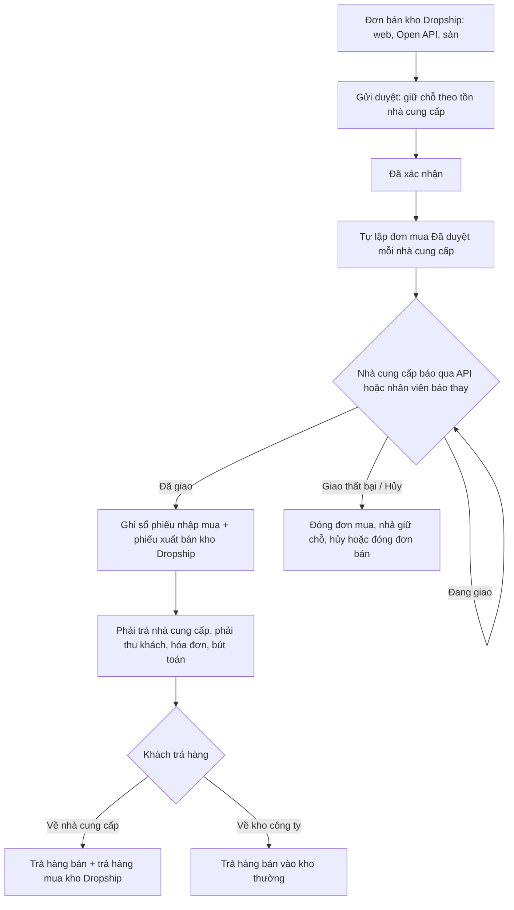
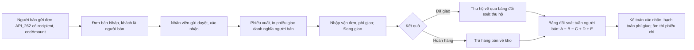

# CONG_VIEC_62: Mở rộng kinh doanh phần 2 – Dropship (MODULE_16)

- Mô tả: Hai chiều dropship. Chiều bán: công ty bán cho khách của mình, nhà cung cấp giao thẳng tới khách. Chiều cung cấp: công ty cung cấp hàng cho người bán dropship, giao thẳng người nhận cuối dưới danh nghĩa người bán, thu hộ và đối soát với người bán.
- Phiên bản: 0.1
- Ngày cập nhật: 2026-11-12
- Trạng thái: Đã duyệt đặc tả, bản mẫu (người dùng, 2026-11-12); đang làm L1
- Mức: Lớn (chức năng mới nhiều module: Kho, Mua hàng, Bán hàng, Tài chính, Open API; sửa cấu trúc dữ liệu kho, đơn mua, đơn bán, khóa API; định nghĩa lại ràng buộc kiểm tra dùng chung).
- Nhánh: `chuc-nang/CONG_VIEC_62-dropship`.
- Nguồn: THAY_DOI_04 (MODULE_16, nguồn tham khảo MOD-07 Dropship của V-com-ERP); `CONG_VIEC_61.md` mục 2; `CONG_VIEC_66.md` (khách do đối tác tạo, người nhận giao thẳng); quyết định của người dùng ngày 2026-11-12 (mục 17).
- Phụ thuộc: CONG_VIEC_61 (đã phát hành 0.7.0); CONG_VIEC_66 (chờ phát hành 0.9.0) cho chiều cung cấp (lát L4, L5); CONG_VIEC_19 (đối soát thu hộ) cho lát L5.

## 1. Mục tiêu

- Chiều bán: công ty bán thêm hàng không giữ trong kho; hệ thống tự đặt hàng nhà cung cấp, theo dõi giao, ghi sổ kho, công nợ, hóa đơn, bút toán như hàng có trong kho.
- Chiều cung cấp: người bán dropship (website, cửa hàng trực tuyến) gửi đơn qua Open API; công ty giao thẳng người nhận cuối dưới tên người bán, xuất hóa đơn và ghi công nợ cho người bán, thu hộ tiền người nhận và đối soát hằng tuần với người bán.

## 2. Phạm vi

Trong phạm vi: CHUC_NANG_222 đến CHUC_NANG_225.

Ngoài phạm vi:

- Giao một phần theo từng dòng của đơn mua dropship (mỗi đơn mua dropship giao một lần, cả đơn).
- Tạo vận đơn tự động cho đơn bán không phải đơn dropship của người bán.
- Cổng đăng nhập riêng cho nhà cung cấp, người bán (dùng Open API).
- Hàng ký gửi; một đơn bán vừa có hàng trong kho thật vừa có hàng dropship (tách hai đơn).
- Thu hộ cho đơn không phải của người bán dropship.

## 3. Yêu cầu nghiệp vụ

| Mã                | Yêu cầu                                                                                                                                       | Người cần                                       |
| ----------------- | --------------------------------------------------------------------------------------------------------------------------------------------- | ----------------------------------------------- |
| YCAU_NGHIEPVU_170 | Bán hàng không có trong kho: nhà cung cấp giao thẳng cho khách, công ty ghi nhận mua – bán, công nợ, hóa đơn đúng                             | Nhân viên bán hàng, Nhân viên mua hàng, Kế toán |
| YCAU_NGHIEPVU_171 | Biết còn bán được bao nhiêu hàng dropship theo số nhà cung cấp khai báo, không bán quá                                                        | Nhân viên bán hàng, Đối tác                     |
| YCAU_NGHIEPVU_172 | Nhà cung cấp nhận đơn, báo đang giao, đã giao, giao thất bại; nhân viên làm thay khi nhà cung cấp không có phần mềm                           | Nhà cung cấp, Nhân viên mua hàng                |
| YCAU_NGHIEPVU_173 | Xử lý hàng dropship bị trả: trả về nhà cung cấp hoặc về kho công ty; đối chiếu số đã giao, đã trả, còn phải trả với từng nhà cung cấp theo kỳ | Nhân viên mua hàng, Kế toán                     |
| YCAU_NGHIEPVU_174 | Người bán dropship gửi đơn, công ty xuất hóa đơn và ghi công nợ cho người bán, giao thẳng người nhận dưới tên người bán                       | Người bán dropship, Nhân viên bán hàng, Kế toán |
| YCAU_NGHIEPVU_175 | Người bán tra vận đơn, trạng thái giao của đơn qua Open API                                                                                   | Người bán dropship                              |
| YCAU_NGHIEPVU_176 | Thu hộ tiền người nhận cho người bán, tính phí giao, đối soát và trả tiền người bán hằng tuần                                                 | Kế toán, Người bán dropship                     |

## 4. Chức năng

| Mã            | Chức năng                                                                                                                                                                                      | Yêu cầu       | Màn hình                                   | API                                       | Lát    |
| ------------- | ---------------------------------------------------------------------------------------------------------------------------------------------------------------------------------------------- | ------------- | ------------------------------------------ | ----------------------------------------- | ------ |
| CHUC_NANG_222 | Kho loại Dropship; sản phẩm dropship (biến thể – nhà cung cấp – giá mua); tồn nhà cung cấp khai báo, giữ chỗ khi bán                                                                           | 170, 171      | MAN_HINH_234; sửa danh sách, biểu mẫu kho  | API_265, API_266; sửa API kho, tồn        | L1     |
| CHUC_NANG_223 | Đơn bán dropship: đơn mua tự sinh theo nhà cung cấp; báo đang giao, đã giao (ghi sổ phiếu nhập mua và phiếu xuất bán), giao thất bại; trả hàng; số hóa đơn nhà cung cấp; đối soát nhà cung cấp | 170, 172, 173 | MAN_HINH_235 đến 237; sửa chi tiết đơn bán | API_267 đến API_270                       | L2, L3 |
| CHUC_NANG_224 | Open API cho nhà cung cấp dropship: nhận đơn, báo giao, cập nhật tồn                                                                                                                           | 171, 172      | Sửa MAN_HINH_224, 225 (phạm vi mới)        | API_271, API_272, API_309                 | L3     |
| CHUC_NANG_225 | Người bán dropship: hóa đơn, công nợ theo người bán; phiếu giao danh nghĩa người bán; vận đơn, phí giao, trạng thái giao qua Open API; thu hộ; đối soát tuần, trả tiền người bán               | 174, 175, 176 | MAN_HINH_238 đến 241; sửa chi tiết đối tác | API_310 đến API_313; sửa API_262, API_263 | L4, L5 |

## 5. Quy tắc nghiệp vụ

| Mã                  | Quy tắc                                                                                                                                                                                                                                                                                                                                                                                                                                                                                                                                                                                                                                                                                                                                                                                                                                                                                                                                                                  |
| ------------------- | ------------------------------------------------------------------------------------------------------------------------------------------------------------------------------------------------------------------------------------------------------------------------------------------------------------------------------------------------------------------------------------------------------------------------------------------------------------------------------------------------------------------------------------------------------------------------------------------------------------------------------------------------------------------------------------------------------------------------------------------------------------------------------------------------------------------------------------------------------------------------------------------------------------------------------------------------------------------------ |
| QUYTAC_NGHIEPVU_496 | Kho loại Dropship: kho thêm thuộc tính loại (`Thường`, `Dropship`), chọn khi tạo, không đổi sau khi đã có chứng từ. Mỗi công ty tối đa một kho Dropship đang hoạt động. Kho Dropship không dùng vị trí, không nhận phiếu nhập, xuất, chuyển, điều chỉnh, kiểm kê lập tay; chỉ hệ thống ghi chứng từ theo QUYTAC_NGHIEPVU_501, 503. Tồn thật của kho luôn về 0 sau mỗi lần ghi sổ                                                                                                                                                                                                                                                                                                                                                                                                                                                                                                                                                                                         |
| QUYTAC_NGHIEPVU_497 | Sản phẩm dropship: mỗi biến thể hàng hóa (không phải dịch vụ, không quản lý lô, số serial) có tối đa một dòng dropship đang dùng trong công ty, gắn một nhà cung cấp đang giao dịch có hồ sơ nhà cung cấp ở công ty và đơn vị mua. Giá mua lấy từ bảng giá mua hiện có (`purchasing.supplier_prices`) của nhà cung cấp, biến thể, đơn vị, hiệu lực ngày đơn; không có giá thì không bán được (báo lỗi dòng)                                                                                                                                                                                                                                                                                                                                                                                                                                                                                                                                                              |
| QUYTAC_NGHIEPVU_498 | Tồn nhà cung cấp: số khai báo (số nguyên không âm, theo đơn vị cơ bản) do nhân viên mua hàng nhập (từng dòng hoặc tệp Excel) hoặc nhà cung cấp gửi qua Open API; mỗi lần đổi ghi người hoặc khóa đổi, thời điểm. Khả dụng = khai báo − giữ chỗ của đơn bán dropship đang mở; khi đơn mua dropship đã lập, giữ chỗ của đơn bán không hết hạn đến khi đơn mua kết thúc. Đơn bán gửi duyệt giữ chỗ theo khả dụng (như kho thường); không đủ thì báo lỗi dòng. Nhà cung cấp báo đã giao thì trừ số khai báo; giao thất bại, hủy thì nhả giữ chỗ, không cộng lại số khai báo                                                                                                                                                                                                                                                                                                                                                                                                  |
| QUYTAC_NGHIEPVU_499 | Đơn bán dropship là đơn bán có kho xuất là kho Dropship. Mọi dòng hàng hóa phải là sản phẩm dropship đang dùng; dòng dịch vụ được phép. Bắt buộc địa chỉ giao (hoặc người nhận theo CONG_VIEC_66). Giá bán, khuyến mãi, luồng duyệt, công nợ, hạn mức như đơn bán hiện có. Áp dụng cho đơn nhập trên web, đơn Open API, đơn sàn VComm khi kho đơn là kho Dropship                                                                                                                                                                                                                                                                                                                                                                                                                                                                                                                                                                                                        |
| QUYTAC_NGHIEPVU_500 | Đơn bán dropship chuyển Đã xác nhận thì hệ thống tự lập mỗi nhà cung cấp một đơn mua trạng thái Đã duyệt (không qua luồng duyệt mua hàng, không kiểm tra ngân sách mua), kho nhận là kho Dropship, giá theo QUYTAC_NGHIEPVU_497, liên kết đơn bán, địa chỉ giao và người nhận lấy từ đơn bán, người lập là người xác nhận đơn bán (đơn Open API: người cấp khóa). Trạng thái giao của đơn mua dropship: Chờ giao → Đang giao (kèm đơn vị vận chuyển, mã vận đơn tùy chọn) → Đã giao hoặc Giao thất bại; Chờ giao, Đang giao có thể Hủy                                                                                                                                                                                                                                                                                                                                                                                                                                   |
| QUYTAC_NGHIEPVU_501 | Báo Đã giao (nhân viên mua hàng hoặc nhà cung cấp qua Open API, kèm ngày giao không sau hôm nay, không trước ngày đơn mua): trong một giao dịch, hệ thống lập và ghi sổ phiếu nhập mua (kho Dropship, số lượng, giá của đơn mua) rồi phiếu xuất bán (các dòng của đơn bán thuộc nhà cung cấp đó), ngày chứng từ là ngày giao. Công nợ phải trả, phải thu, hóa đơn điện tử, bút toán, giá vốn chạy theo luồng ghi sổ phiếu kho hiện có; giá vốn bằng giá mua. Đơn mua chuyển Đã nhận, đơn bán Đã giao khi mọi nhà cung cấp đã giao. Lỗi ở bất kỳ bước nào thì không ghi gì và báo lỗi                                                                                                                                                                                                                                                                                                                                                                                     |
| QUYTAC_NGHIEPVU_502 | Giao thất bại hoặc Hủy (kèm lý do 1 đến 500 ký tự): đơn mua dropship chuyển Đóng, nhả giữ chỗ các dòng của nhà cung cấp đó. Nếu chưa nhà cung cấp nào của đơn bán giao thì đơn bán chuyển Đã hủy; nếu đã có nhà cung cấp giao thì đơn bán Đóng phần còn lại. Không lập lại đơn mua tự động; muốn bán lại thì lập đơn bán mới                                                                                                                                                                                                                                                                                                                                                                                                                                                                                                                                                                                                                                             |
| QUYTAC_NGHIEPVU_503 | Trả hàng dropship (đơn bán đã giao, theo phiếu xuất, số lượng không quá số đã xuất trừ đã trả), nhân viên chọn nơi nhận mỗi lần: (a) Về nhà cung cấp: khi nhà cung cấp xác nhận đã nhận, hệ thống ghi sổ phiếu trả hàng bán vào kho Dropship và phiếu trả hàng mua ra khỏi kho Dropship cùng số lượng, giá theo phiếu gốc (giảm phải thu, phải trả, hóa đơn điều chỉnh theo luồng hiện có); (b) Về kho công ty: phiếu trả hàng bán vào kho thường đang hoạt động do nhân viên chọn, theo luồng hiện có; công ty tự xử lý với nhà cung cấp sau                                                                                                                                                                                                                                                                                                                                                                                                                            |
| QUYTAC_NGHIEPVU_504 | Số hóa đơn nhà cung cấp: nhân viên ghi ký hiệu, số, ngày hóa đơn (1 đến 50 ký tự) trên đơn mua dropship đã giao; sửa được, có nhật ký. Báo cáo đối soát nhà cung cấp theo kỳ (từ ngày đến ngày, theo ngày chứng từ): mỗi nhà cung cấp có số đơn đã giao, giá trị nhận (có thuế), giá trị trả lại, số đơn chưa có số hóa đơn, công nợ phải trả cuối kỳ (lấy từ công nợ hiện có); xem chi tiết từng đơn; xuất Excel                                                                                                                                                                                                                                                                                                                                                                                                                                                                                                                                                        |
| QUYTAC_NGHIEPVU_505 | Open API nhà cung cấp: khóa loại Đối tác gắn nhà cung cấp (đối tác có hồ sơ nhà cung cấp ở công ty), phạm vi mới `dropship.supplier`. Khóa chỉ thấy đơn mua dropship của chính nhà cung cấp đó (mọi khóa cùng nhà cung cấp), kèm dòng hàng (mã hàng của nhà cung cấp nếu có, mã biến thể), địa chỉ giao, tên, điện thoại người nhận (dữ liệu cá nhân cần để giao hàng); không thấy giá bán, khách hàng, đơn bán. Báo trạng thái theo QUYTAC_NGHIEPVU_500, 501, 502 (giao thất bại bắt buộc lý do; nhà cung cấp không Hủy được). Cập nhật tồn theo danh sách biến thể dropship của mình (tối đa 500 dòng mỗi lần). Báo cùng trạng thái lần hai trả `200` không đổi gì; chuyển trạng thái sai trả `409 BUSINESS_RULE`                                                                                                                                                                                                                                                      |
| QUYTAC_NGHIEPVU_506 | Người bán dropship: hồ sơ khách hàng của đối tác ở công ty có cờ "Người bán dropship" (nhân viên có quyền sửa khách hàng bật, tắt). Đơn Open API của khóa gắn đối tác có cờ này và có người nhận (`recipient`) là đơn dropship của người bán: khách hàng trên đơn là chính người bán (không nhận `customerCode`, gửi thì lỗi trường), giá theo nhóm khách hàng, hạn mức công nợ của người bán; hóa đơn điện tử, công nợ theo người bán (luồng hiện có). Đơn không có người nhận, hoặc đối tác không có cờ, giữ cách của CONG_VIEC_61, 66. Đơn đã tạo không đổi khi cờ đổi                                                                                                                                                                                                                                                                                                                                                                                                |
| QUYTAC_NGHIEPVU_507 | Giao danh nghĩa người bán: phiếu giao in (PDF khổ A5) của đơn dropship người bán ghi người gửi là tên, điện thoại người bán (lấy từ hồ sơ đối tác), người nhận, địa chỉ, dòng hàng, số lượng, tiền thu hộ; không in tên công ty, giá bán, số đơn VComm (in mã đơn đối tác). Vận đơn: thủ kho tạo vận đơn với đơn vị vận chuyển đang bật (dùng lại kết nối của sàn), kèm tiền thu hộ của đơn; mã vận đơn, phí giao, trạng thái lấy từ đơn vị vận chuyển (Chờ giao → Đang giao → Đã giao hoặc Hoàn hàng); đơn vị vận chuyển chưa bật thì nhập tay đơn vị vận chuyển, mã vận đơn, phí (đồng, 0 đến 5.000.000), trạng thái. API tra đơn của người bán (API_263) trả thêm đơn vị vận chuyển, mã vận đơn, trạng thái giao, phí giao, tiền thu hộ                                                                                                                                                                                                                               |
| QUYTAC_NGHIEPVU_508 | Thu hộ: đơn dropship người bán gửi `codAmount` (đồng, 0 đến 50.000.000, mặc định 0). Tiền thu hộ về qua bảng đối soát thu hộ hiện có (CONG_VIEC_19) theo số đơn; dòng của đơn dropship người bán ghi giảm công nợ của người bán (khách trên đơn). Hoàn hàng: không có tiền thu hộ; trả hàng ghi theo QUYTAC_NGHIEPVU_503 (b)                                                                                                                                                                                                                                                                                                                                                                                                                                                                                                                                                                                                                                             |
| QUYTAC_NGHIEPVU_509 | Đối soát tuần với người bán (thứ Hai đến Chủ nhật, giờ Việt Nam): hệ thống lập bảng Nháp lúc 2 giờ thứ Hai cho người bán có đơn giao, hoàn hoặc thu hộ trong tuần; gồm A = tiền hàng có thuế của phiếu xuất trong tuần, B = trả hàng trong tuần, C = thu hộ đã ghi sổ trong tuần, D = tổng phí giao các đơn Đã giao hoặc Hoàn hàng trong tuần, E = thuế giá trị gia tăng của phí giao (thuế suất cài trong cài đặt dropship, mặc định 8%), số còn lại = A − B − C + D + E (dương: người bán phải nộp; âm: công ty phải trả). Kế toán xác nhận thì hạch toán D, E (Nợ phải thu người bán, Có doanh thu dịch vụ, Có thuế giá trị gia tăng đầu ra), ghi công nợ nguồn `dropship_settlement` và lập hóa đơn điện tử dịch vụ giao hàng cho người bán; số âm thì lập phiếu chi hoàn tiền khách (`customer_refund`, loại hiện có) theo số còn lại. A, B, C chỉ để đối chiếu (đã ghi công nợ theo luồng hiện có). Bảng đã xác nhận không sửa; sai thì điều chỉnh ở bảng tuần sau |

## 6. Vai trò và quyền

Quyền mới:

| Quyền                                | Thao tác                                                                              | Gán mặc định                                       |
| ------------------------------------ | ------------------------------------------------------------------------------------- | -------------------------------------------------- |
| `purchasing.dropship.manage`         | Sản phẩm dropship, tồn nhà cung cấp, báo giao thay, trả hàng, số hóa đơn nhà cung cấp | Trưởng phòng mua hàng, Nhân viên mua hàng          |
| `purchasing.dropship.view`           | Xem đơn dropship, báo cáo đối soát nhà cung cấp                                       | Trưởng phòng mua hàng, Nhân viên mua hàng, Kế toán |
| `sales.reseller_shipment.manage`     | Nhập vận đơn, phí giao, trạng thái giao, in phiếu giao danh nghĩa người bán           | Thủ kho, Nhân viên bán hàng                        |
| `finance.reseller_settlement.manage` | Xem, xác nhận bảng đối soát người bán, lập phiếu chi                                  | Kế toán                                            |

Loại kho chọn theo quyền quản lý kho hiện có; cờ "Người bán dropship" theo quyền sửa khách hàng hiện có; phạm vi khóa `dropship.supplier` theo quyền quản lý khóa API hiện có.

| Chức năng                     | Nhà cung cấp (khóa `dropship.supplier`) | Người bán (khóa `sales_order.write`) | Nhân viên mua hàng | Thủ kho | Kế toán |
| ----------------------------- | --------------------------------------- | ------------------------------------ | ------------------ | ------- | ------- |
| Sản phẩm, tồn dropship        | Cập nhật tồn của mình                   | Xem tồn khả dụng (API tồn hiện có)   | Đủ                 | Không   | Không   |
| Đơn mua dropship, báo giao    | Đơn của mình                            | Không                                | Đủ                 | Không   | Xem     |
| Trả hàng dropship             | Không                                   | Không                                | Đủ                 | Không   | Không   |
| Đối soát nhà cung cấp         | Không                                   | Không                                | Xem                | Không   | Xem     |
| Vận đơn, phiếu giao người bán | Không                                   | Tra qua API                          | Không              | Đủ      | Không   |
| Đối soát người bán            | Không                                   | Không                                | Không              | Không   | Đủ      |

## 7. Luồng nghiệp vụ

Luồng 59 (dropship):

Chiều cung cấp cho người bán:

Ngoại lệ: nhà cung cấp ngừng giao dịch thì sản phẩm dropship của họ không bán được, đơn mua đang mở giữ nguyên để xử lý; người bán bị tắt cờ thì đơn mới theo cách của CONG_VIEC_66.

## 8. Màn hình

| Mã           | Màn hình                                 | Mini app  | Nội dung chính                                                                                                                       | Bản mẫu                                         |
| ------------ | ---------------------------------------- | --------- | ------------------------------------------------------------------------------------------------------------------------------------ | ----------------------------------------------- |
| MAN_HINH_234 | Sản phẩm dropship                        | Mua hàng  | Danh sách biến thể – nhà cung cấp – giá mua – tồn khai báo – giữ chỗ – khả dụng – cập nhật lúc; thêm, ngừng; sửa tồn; nhập tệp Excel | `MAN_HINH_234_SAN_PHAM_DROPSHIP.html`           |
| MAN_HINH_235 | Đơn dropship                             | Mua hàng  | Danh sách đơn mua dropship: số, đơn bán, nhà cung cấp, người nhận, trạng thái giao, quá hạn; lọc                                     | `MAN_HINH_235_DON_DROPSHIP.html`                |
| MAN_HINH_236 | Chi tiết đơn dropship                    | Mua hàng  | Dòng hàng, người nhận, lịch sử trạng thái; báo Đang giao, Đã giao, Giao thất bại, Hủy; số hóa đơn nhà cung cấp; trả hàng             | `MAN_HINH_236_CHI_TIET_DON_DROPSHIP.html`       |
| MAN_HINH_237 | Đối soát nhà cung cấp dropship           | Mua hàng  | Báo cáo theo kỳ, theo nhà cung cấp; chi tiết; xuất Excel                                                                             | `MAN_HINH_237_DOI_SOAT_NHA_CUNG_CAP.html`       |
| MAN_HINH_238 | Giao hàng đơn người bán                  | Kho       | Danh sách đơn dropship người bán cần giao: nhập vận đơn, phí, trạng thái giao, in phiếu giao                                         | `MAN_HINH_238_GIAO_HANG_NGUOI_BAN.html`         |
| MAN_HINH_239 | Phiếu giao danh nghĩa người bán (bản in) | Kho       | PDF A5 theo QUYTAC_NGHIEPVU_507                                                                                                      | `MAN_HINH_239_PHIEU_GIAO_NGUOI_BAN.html`        |
| MAN_HINH_240 | Đối soát người bán                       | Tài chính | Danh sách bảng đối soát tuần: người bán, tuần, A, B, C, D, E, số còn lại, trạng thái                                                 | `MAN_HINH_240_DOI_SOAT_NGUOI_BAN.html`          |
| MAN_HINH_241 | Chi tiết bảng đối soát người bán         | Tài chính | Từng đơn, từng dòng thu hộ, phí; xác nhận; lập phiếu chi                                                                             | `MAN_HINH_241_CHI_TIET_DOI_SOAT_NGUOI_BAN.html` |

Sửa màn hình có sẵn: danh sách, biểu mẫu kho (cột, trường Loại kho); chi tiết đơn bán (khối "Dropship": đơn mua theo nhà cung cấp, trạng thái giao; khối "Người bán dropship": vận đơn, thu hộ); chi tiết đối tác (cờ Người bán dropship); khóa API MAN_HINH_224, 225 (phạm vi `dropship.supplier`). Bản mẫu phần sửa: `SUA_DROPSHIP_MAN_HINH_CO_SAN.html`.

## 9. Dữ liệu

| Database migration | Bảng, cột                                   | Nội dung                                                                                                                                                                                                                                                                                                                         |
| ------------------ | ------------------------------------------- | -------------------------------------------------------------------------------------------------------------------------------------------------------------------------------------------------------------------------------------------------------------------------------------------------------------------------------- |
| 0132               | `inventory.warehouses`                      | Thêm `kind` (`standard`, `dropship`, mặc định `standard`); chỉ mục duy nhất một kho `dropship` đang hoạt động mỗi công ty                                                                                                                                                                                                        |
| 0132               | `purchasing.dropship_products`              | `company_id`, `variant_id`, `supplier_id`, `unit_id`, `declared_quantity` (numeric ≥ 0), `declared_at`, `declared_by` hoặc `declared_via_api_key_id`, `status`, `version`; duy nhất (`company_id`, `variant_id`) khi đang dùng                                                                                                   |
| 0132               | `purchasing.dropship_stock_changes`         | Lịch sử đổi tồn: sản phẩm dropship, số cũ, số mới, nguồn (người hoặc khóa), thời điểm                                                                                                                                                                                                                                            |
| 0133               | `purchasing.orders`                         | Thêm `dropship_sales_order_id` (khóa ngoại `sales.orders`), `dropship_status` (`awaiting`, `shipping`, `delivered`, `failed`, `cancelled`), `carrier_name`, `tracking_code`, `delivered_on`, `dropship_reason`, `supplier_invoice_no`, `supplier_invoice_date`; ràng buộc: có `dropship_sales_order_id` thì có `dropship_status` |
| 0133               | `purchasing.dropship_events`                | Lịch sử trạng thái giao: đơn mua, trạng thái, nguồn (người hoặc khóa), thời điểm, ghi chú                                                                                                                                                                                                                                        |
| 0133               | `inventory.dropship_returns`                | Yêu cầu trả hàng về nhà cung cấp: phiếu xuất gốc, dòng, số lượng, trạng thái (`awaiting_supplier`, `received`, `cancelled`), phiếu trả hàng bán, phiếu trả hàng mua                                                                                                                                                              |
| 0133               | `core.api_keys`                             | Định nghĩa lại ràng buộc phạm vi gồm mọi giá trị trên `main` mới nhất và `dropship.supplier`                                                                                                                                                                                                                                     |
| 0134               | `crm.partner_profiles`                      | Thêm `is_dropship_reseller` (boolean, mặc định `false`)                                                                                                                                                                                                                                                                          |
| 0134               | `sales.orders`                              | Thêm `is_reseller_dropship`, `cod_amount` (numeric 0 đến 50.000.000), `carrier_name`, `tracking_code`, `shipping_fee`, `shipping_status` (`awaiting`, `shipping`, `delivered`, `returned`); ràng buộc: `cod_amount > 0` chỉ khi `is_reseller_dropship`                                                                           |
| 0135               | `finance.reseller_settlements`              | Bảng đối soát tuần: công ty, người bán, tuần, A, B, C, D, E, số còn lại, trạng thái (`draft`, `confirmed`), phiếu chi, `version`; duy nhất (công ty, người bán, tuần)                                                                                                                                                            |
| 0135               | `finance.reseller_settlement_lines`         | Dòng: loại (`issue`, `return`, `collection`, `shipping_fee`), chứng từ nguồn, đơn, số tiền                                                                                                                                                                                                                                       |
| 0135               | `finance.debt_items`, `accounting.journals` | Định nghĩa lại ràng buộc `source_type` gồm mọi giá trị trên `main` mới nhất và `dropship_settlement`                                                                                                                                                                                                                             |
| 0135               | `sales.settings` hoặc `finance` cài đặt     | Thuế suất phí giao dropship (mặc định 8%)                                                                                                                                                                                                                                                                                        |

Không xóa dữ liệu. Chứng từ kho của kho Dropship dùng loại, mã lý do hiện có (`purchase_receipt`/`purchase`, `sales_issue`/`sale`, `sales_return`, `purchase_return`); không định nghĩa lại `inventory.documents`.

## 10. API

Nhân viên (gốc `/api/v1`):

| Mã      | Phương thức, đường dẫn                                                                                                                          | Mô tả                                                                |
| ------- | ----------------------------------------------------------------------------------------------------------------------------------------------- | -------------------------------------------------------------------- |
| API_265 | `GET, POST /purchasing/dropship-products`; `PATCH /purchasing/dropship-products/{id}`                                                           | Danh sách (kèm khả dụng), thêm, sửa nhà cung cấp, đơn vị, ngừng dùng |
| API_266 | `PATCH /purchasing/dropship-products/{id}/stock`; `POST /purchasing/dropship-products/stock-import`                                             | Sửa tồn khai báo một dòng; nhập tệp Excel (mã biến thể, số lượng)    |
| API_267 | `GET /purchasing/dropship-orders`; `GET /purchasing/dropship-orders/{id}`                                                                       | Danh sách, chi tiết đơn mua dropship                                 |
| API_268 | `POST /purchasing/dropship-orders/{id}/shipping`, `/delivered`, `/failed`, `/cancel`; `PATCH /purchasing/dropship-orders/{id}/supplier-invoice` | Báo trạng thái thay nhà cung cấp; số hóa đơn nhà cung cấp            |
| API_269 | `POST /purchasing/dropship-returns`; `POST /purchasing/dropship-returns/{id}/received`, `/cancel`                                               | Trả hàng dropship (nơi nhận về nhà cung cấp hoặc kho công ty)        |
| API_270 | `GET /purchasing/dropship-reconciliation` (`from`, `to`, `supplierId`, `format=xlsx`)                                                           | Đối soát nhà cung cấp                                                |
| API_310 | `PATCH /sales/orders/{id}/reseller-shipment`; `GET /sales/orders/{id}/reseller-delivery-note`                                                   | Vận đơn, phí, trạng thái giao; phiếu giao PDF                        |
| API_312 | `GET /finance/reseller-settlements`, `GET /finance/reseller-settlements/{id}`                                                                   | Danh sách, chi tiết bảng đối soát người bán                          |
| API_313 | `POST /finance/reseller-settlements/{id}/confirm`                                                                                               | Xác nhận, hạch toán, lập phiếu chi khi âm                            |

Đối tác (gốc `/api/v1/open`, khóa API):

| Mã      | Phương thức, đường dẫn                                          | Phạm vi             | Mô tả                                                                                              |
| ------- | --------------------------------------------------------------- | ------------------- | -------------------------------------------------------------------------------------------------- |
| API_271 | `GET /open/dropship/orders`, `GET /open/dropship/orders/{code}` | `dropship.supplier` | Đơn mua dropship của nhà cung cấp; lọc `status`, `updatedSince`                                    |
| API_272 | `POST /open/dropship/orders/{code}/events`                      | `dropship.supplier` | `type` (`shipping`, `delivered`, `failed`), `carrierName`, `trackingCode`, `deliveredOn`, `reason` |
| API_309 | `PUT /open/dropship/stock`                                      | `dropship.supplier` | Danh sách `variantCode` hoặc `supplierSku`, `quantity`                                             |
| API_311 | `POST /sales/orders/{id}/reseller-shipment/carrier`             | —                   | Thủ kho tạo vận đơn với đơn vị vận chuyển đang bật                                                 |

Sửa API hiện có (tương thích ngược, chỉ thêm trường): API_262 nhận `codAmount`; API_263 trả `shipment` (`carrierName`, `trackingCode`, `status`, `shippingFee`, `codAmount`) hoặc `null`; API kho (danh sách, tạo, sửa) thêm `kind`; API tồn Open API (API_261) với kho Dropship trả số khả dụng theo QUYTAC_NGHIEPVU_498; chi tiết đơn bán thêm `dropship` (đơn mua theo nhà cung cấp) và `resellerShipment`; chi tiết đối tác thêm `isDropshipReseller`; khóa API nhận phạm vi `dropship.supplier`.

Mã lỗi dùng mã có sẵn (`VALIDATION_FAILED`, `NOT_FOUND`, `BUSINESS_RULE`, `CONFLICT_VERSION`, `SCOPE_NOT_GRANTED`).

## 11. Dùng lại mã đã có

| Việc                                  | Mã dùng lại                                                                                                                                                       | Thay đổi                                                                     |
| ------------------------------------- | ----------------------------------------------------------------------------------------------------------------------------------------------------------------- | ---------------------------------------------------------------------------- |
| Giữ chỗ khi gửi duyệt đơn bán         | `inventory/reservations.service.ts`                                                                                                                               | Kho Dropship: khả dụng tính theo QUYTAC_NGHIEPVU_498 thay số dư kho          |
| Sau khi đơn bán xác nhận              | `confirmedHooks` của `SalesOrdersService` (như `ServiceDocumentsService.salesConfirmed`)                                                                          | Thêm móc lập đơn mua dropship                                                |
| Lập đơn mua                           | `purchasing/orders.service.ts`, giá `supplier-prices.service.ts`                                                                                                  | Thêm hàm lập đơn Đã duyệt do hệ thống, không qua duyệt, không kiểm ngân sách |
| Ghi sổ phiếu nhập mua, phiếu xuất bán | `PurchaseReceiptsService`, `SalesDeliveriesService.postDraftAsSystem`, `StockDocumentsService.postDocument` và `postedHooks` (công nợ, hóa đơn điện tử, bút toán) | Gọi trong một giao dịch; bỏ kiểm tra chất lượng cho kho Dropship             |
| Trả hàng                              | `SalesDeliveriesService.returnAsSystem`, `createReturn`; trả hàng mua hiện có                                                                                     | Thêm chọn kho nhận cho nơi "về kho công ty"                                  |
| Open API                              | `api-key.guard.ts`, `@RequireScope`, nhật ký gọi, `orderScopeOf`                                                                                                  | Phạm vi mới; phạm vi theo nhà cung cấp                                       |
| Đơn Open API                          | `SalesOrdersService.createFromOpenApi`, `open-sales-orders.service.ts` (CONG_VIEC_61, 66)                                                                         | Nhánh người bán dropship, `codAmount`, `shipment`                            |
| Thu hộ                                | `finance` bảng đối soát thu hộ (CONG_VIEC_19)                                                                                                                     | Không đổi; dòng khớp đơn ghi giảm công nợ khách trên đơn (người bán)         |
| Bảng đối soát tuần, tác vụ nền        | Cách làm bảng đối soát cửa hàng liên kết (CONG_VIEC_55: tác vụ lập bảng, xác nhận, hạch toán)                                                                     | Viết bảng riêng `finance.reseller_settlements` theo cùng cách                |
| Phiếu chi hoàn tiền                   | `finance` phiếu chi loại `customer_refund`                                                                                                                        | Không đổi                                                                    |
| In PDF                                | Cách in PDF đang dùng (pdfkit hoặc pdf-lib theo mã hiện có)                                                                                                       | Mẫu phiếu giao mới                                                           |
| Nhập Excel                            | Cách nhập tệp Excel đang dùng (bảng giá mua)                                                                                                                      | Mẫu tệp tồn                                                                  |

## 12. Phân tích giải pháp có sẵn – CONG_VIEC_62 – 2026-11-12

- Yêu cầu cần đáp ứng: YCAU_NGHIEPVU_170 đến 176, QUYTAC_NGHIEPVU_496 đến 509, CHUC_NANG_222 đến 225.
- Nguồn đã tìm: mã nguồn dự án; nguồn riêng `V-com-ERP` MOD-07 (chưa đọc được trong phiên này: thêm kho vào phiên bị chặn, xem mục 16); kiến thức chung về chức năng dropship của Odoo (`stock_dropshipping`), ERPNext ("Supplier delivers to Customer" trên đơn bán).
- Từ khóa: dropship, drop shipping, supplier delivers to customer.

| Ứng viên                                                                                                  | Nguồn           | Giấy phép  | Tương thích công nghệ                          | Công sức điều chỉnh                                               |
| --------------------------------------------------------------------------------------------------------- | --------------- | ---------- | ---------------------------------------------- | ----------------------------------------------------------------- |
| Luồng đơn bán, đơn mua, phiếu kho, công nợ, hóa đơn, bút toán của dự án                                   | Dự án           | Của dự án  | Đầy đủ                                         | Thấp đến trung bình                                               |
| Odoo `stock_dropshipping` (tuyến Dropship: đơn bán sinh đơn mua, phiếu chuyển thẳng nhà cung cấp → khách) | Odoo            | LGPL-3.0   | Python, không dùng được mã                     | Chỉ tham khảo cách làm: kho ảo, đơn mua tự sinh theo nhà cung cấp |
| ERPNext đơn bán "Supplier delivers to Customer"                                                           | ERPNext         | GPL-3.0    | Python, không dùng được mã; GPL không cho chép | Chỉ tham khảo: đơn mua sinh từ đơn bán, giao thẳng                |
| Dịch vụ dropship bên ngoài (nền tảng kết nối nhà cung cấp)                                                | Dịch vụ trả phí | Thương mại | Thêm phụ thuộc ngoài, dữ liệu ra ngoài         | Cao                                                               |

- Phương án:
  1. Dùng lại nguyên trạng: không có.
  2. Dùng lại có điều chỉnh: luồng sẵn có của dự án (mục 11).
  3. Tham khảo cách làm, tự viết: kho Dropship ảo, đơn mua tự sinh theo nhà cung cấp, ghi sổ nhập – xuất cùng lúc (cách của Odoo; không chép mã).
  4. Tự viết mới hoàn toàn: không cần.
- Đề xuất: phương án 2 kết hợp 3; không thêm thư viện.
- Quyết định của người dùng: phương án 2 kết hợp 3 (duyệt cùng đặc tả) – 2026-11-12.

## 13. Tiêu chí nghiệm thu

| Mã                    | Tiêu chí                                                                                                                                                                                                          | Mức      | Lát    |
| --------------------- | ----------------------------------------------------------------------------------------------------------------------------------------------------------------------------------------------------------------- | -------- | ------ |
| TIEUCHI_NGHIEMTHU_458 | Tạo kho Dropship thứ hai đang hoạt động trong công ty bị từ chối; lập tay phiếu nhập, xuất, chuyển, kiểm kê vào kho Dropship bị từ chối                                                                           | Bắt buộc | L1     |
| TIEUCHI_NGHIEMTHU_459 | Thêm sản phẩm dropship sai (dịch vụ, có lô hoặc serial, nhà cung cấp không có hồ sơ, trùng biến thể) báo lỗi đúng trường; sửa tồn ghi lịch sử người đổi                                                           | Bắt buộc | L1     |
| TIEUCHI_NGHIEMTHU_460 | Đơn bán kho Dropship vượt khả dụng hoặc có dòng không phải sản phẩm dropship, hoặc không có giá mua hiệu lực, bị từ chối đúng dòng; trong khả dụng thì giữ chỗ và khả dụng giảm                                   | Bắt buộc | L1, L2 |
| TIEUCHI_NGHIEMTHU_461 | Đơn bán dropship hai nhà cung cấp được xác nhận thì có đúng hai đơn mua Đã duyệt, giá theo bảng giá mua, không tạo yêu cầu duyệt mua                                                                              | Bắt buộc | L2     |
| TIEUCHI_NGHIEMTHU_462 | Báo Đã giao: có phiếu nhập mua và phiếu xuất bán đã ghi sổ cùng ngày giao; phải trả nhà cung cấp, phải thu khách, bút toán đúng; giá vốn bằng giá mua; tồn kho Dropship về 0; báo lần hai không tạo thêm chứng từ | Bắt buộc | L2     |
| TIEUCHI_NGHIEMTHU_463 | Giao thất bại khi chưa nhà cung cấp nào giao: đơn bán Đã hủy, giữ chỗ được nhả; khi đã có nhà cung cấp giao: đơn bán Đóng phần còn lại                                                                            | Bắt buộc | L2     |
| TIEUCHI_NGHIEMTHU_464 | Trả về nhà cung cấp: khi nhà cung cấp xác nhận có phiếu trả hàng bán và trả hàng mua cùng số lượng, công nợ hai bên giảm đúng; trả về kho công ty: tồn kho thường tăng                                            | Bắt buộc | L3     |
| TIEUCHI_NGHIEMTHU_465 | Khóa nhà cung cấp chỉ thấy đơn của mình, không thấy giá bán, khách; báo trạng thái sai thứ tự nhận `409`; cập nhật tồn biến thể của nhà cung cấp khác bị từ chối dòng; khóa không có phạm vi nhận `403`           | Bắt buộc | L3     |
| TIEUCHI_NGHIEMTHU_466 | Báo cáo đối soát nhà cung cấp khớp tổng phiếu nhập, trả hàng mua và công nợ phải trả của kỳ; xuất Excel đúng số                                                                                                   | Bắt buộc | L3     |
| TIEUCHI_NGHIEMTHU_467 | Đơn Open API của người bán có cờ, có người nhận: khách là người bán, giá nhóm người bán, hóa đơn và công nợ theo người bán; gửi `customerCode` bị lỗi trường; đối tác không cờ giữ cách CONG_VIEC_66              | Bắt buộc | L4     |
| TIEUCHI_NGHIEMTHU_468 | Phiếu giao PDF không có tên công ty, giá bán; có tên, điện thoại người bán, tiền thu hộ; API_263 trả vận đơn, trạng thái giao sau khi thủ kho nhập                                                                | Bắt buộc | L4     |
| TIEUCHI_NGHIEMTHU_469 | Bảng đối soát tuần lập đúng A, B, C, D, E, số còn lại; xác nhận hạch toán phí giao, thuế; số âm có phiếu chi hoàn tiền đúng số; người bán công ty khác không lẫn                                                  | Bắt buộc | L5     |

Tiêu chí chung (mọi màn hình mới đủ trạng thái rỗng, đang tải, lỗi, không quyền, tiếng Việt và tiếng Anh) kiểm trong kịch bản giao diện của từng lát.

## 14. Kịch bản kiểm thử

| Mã                  | Tiêu chí    | Kịch bản                                                                                                                                           | Loại      |
| ------------------- | ----------- | -------------------------------------------------------------------------------------------------------------------------------------------------- | --------- |
| KICHBAN_KIEMTHU_639 | 458         | Tạo kho Dropship thứ hai; lập phiếu nhập khác, chuyển kho, kiểm kê vào kho Dropship                                                                | Tích hợp  |
| KICHBAN_KIEMTHU_640 | 459         | Bốn trường hợp thêm sai; sửa tồn hai lần, lịch sử hai dòng                                                                                         | Tích hợp  |
| KICHBAN_KIEMTHU_641 | 460         | Khai báo 10, đơn A 6 gửi duyệt, đơn B 5 bị từ chối, đơn B 4 được; dòng không dropship; không có giá mua                                            | Tích hợp  |
| KICHBAN_KIEMTHU_642 | 461         | Đơn hai nhà cung cấp xác nhận (không ngoại lệ và qua duyệt ngoại lệ): hai đơn mua, giá, không có yêu cầu duyệt mua                                 | Tích hợp  |
| KICHBAN_KIEMTHU_643 | 462         | Báo Đã giao: chứng từ, công nợ hai bên, bút toán, giá vốn, tồn 0; báo lại không đổi; hai yêu cầu báo song song chỉ một bộ chứng từ                 | Tích hợp  |
| KICHBAN_KIEMTHU_644 | 463         | Giao thất bại một nhà cung cấp trước và sau khi nhà cung cấp kia đã giao                                                                           | Tích hợp  |
| KICHBAN_KIEMTHU_645 | 464         | Trả về nhà cung cấp (chờ, xác nhận, hủy); trả về kho công ty; trả quá số đã xuất bị từ chối                                                        | Tích hợp  |
| KICHBAN_KIEMTHU_646 | 465         | Khóa nhà cung cấp A tra đơn của B nhận `404`; trường trả về không có giá bán, khách; chuyển trạng thái sai; tồn biến thể của B; khóa thiếu phạm vi | Tích hợp  |
| KICHBAN_KIEMTHU_647 | 466         | Kỳ có hai đơn giao, một trả, một chưa có số hóa đơn: số liệu và tệp Excel                                                                          | Tích hợp  |
| KICHBAN_KIEMTHU_648 | 467         | Người bán có cờ: đơn có người nhận; gửi `customerCode`; người bán không cờ; tắt cờ sau khi tạo đơn                                                 | Tích hợp  |
| KICHBAN_KIEMTHU_649 | 468         | Sinh PDF, kiểm văn bản có, không có; nhập vận đơn rồi tra API_263                                                                                  | Tích hợp  |
| KICHBAN_KIEMTHU_650 | 469         | Tuần có giao, hoàn, thu hộ: lập bảng, xác nhận, bút toán, phiếu chi; người bán công ty B không vào bảng của A                                      | Tích hợp  |
| KICHBAN_KIEMTHU_651 | 458 đến 466 | Playwright: MAN_HINH_234 đến 237, năm trạng thái, đổi ngôn ngữ                                                                                     | Giao diện |
| KICHBAN_KIEMTHU_652 | 467 đến 469 | Playwright: MAN_HINH_238, 240, 241, năm trạng thái, đổi ngôn ngữ                                                                                   | Giao diện |

## 15. Ràng buộc kỹ thuật

- Ghi sổ cặp phiếu (QUYTAC_NGHIEPVU_501, 503) trong một giao dịch, khóa dòng đơn mua (`FOR UPDATE`) để chống báo trùng song song.
- Giữ chỗ kho Dropship khóa dòng sản phẩm dropship khi tính khả dụng để hai đơn cùng lúc không vượt.
- Mỗi mini app chỉ ghi schema của mình: móc sau xác nhận đơn bán gọi dịch vụ của mua hàng (cùng tiến trình API, như các móc hiện có).
- Mọi truy vấn lọc `company_id`; Open API lọc theo nhà cung cấp của khóa trong câu truy vấn.
- Ràng buộc kiểm tra dùng chung định nghĩa lại (`core.api_keys` phạm vi; `finance.debt_items.source_type`; `accounting.journals.source_type`) phải gồm mọi giá trị trên `main` mới nhất lúc hợp nhất.
- Dữ liệu cá nhân người nhận trả cho nhà cung cấp chỉ tên, điện thoại, địa chỉ; nhật ký gọi không ghi nội dung (QUYTAC_NGHIEPVU_488).

## 16. Điều kiện đặc biệt, điểm chưa xác minh

1. Vận đơn đơn người bán: người dùng chọn tự tạo vận đơn, dùng lại kết nối đơn vị vận chuyển của sàn (`marketplace/carriers`: GHN, Viettel Post, J&T, GHTK, VNPost). Tạo vận đơn, phí, trạng thái, thu hộ lấy từ đơn vị vận chuyển; nhập tay chỉ khi đơn vị vận chuyển chưa bật. Chi tiết thiết kế (bảng vận đơn dùng chung cho đơn bán hay mở rộng `marketplace.shipments`) chốt trước khi làm L4; có thể cần thêm mã API, kịch bản kiểm thử.
2. Hóa đơn điện tử cho phí giao: người dùng chọn lập một hóa đơn dịch vụ giao hàng cho người bán khi xác nhận bảng đối soát tuần (D, thuế E), qua nhà cung cấp hóa đơn đang cài; mở rộng luồng hóa đơn cho nguồn `dropship_settlement`.
3. Mã API thêm: phiên điều phối cấp API_309 đến API_313 (2026-11-12). Các mã khác trong dải dành riêng.
4. Chiều cung cấp (L4, L5) dựa trên mã CONG_VIEC_66 chưa có trên `main`; làm L4 sau khi bản 0.9.0 hợp nhất vào `main` rồi hợp nhất `main` vào nhánh.
5. Nguồn riêng V-com-ERP MOD-07: người dùng chọn không đối chiếu (2026-11-12).
6. Chưa xác minh trong mã: bảng đối soát thu hộ ghi giảm công nợ theo khách trên đơn (giả định của QUYTAC_NGHIEPVU_508); kiểm khi làm L5, khác thì báo lại.

## 17. Quyết định của người dùng (2026-11-12)

| Câu hỏi                                 | Quyết định                                                                                       |
| --------------------------------------- | ------------------------------------------------------------------------------------------------ |
| Vai trò công ty                         | Cả hai chiều: bên bán dropship và bên cung cấp cho người bán dropship                            |
| Hạch toán                               | Qua kho Dropship ảo: phiếu nhập mua và phiếu xuất bán ghi cùng lúc khi nhà cung cấp báo đã giao  |
| Cập nhật giao                           | Nhân viên trên web và nhà cung cấp qua Open API                                                  |
| Tồn                                     | Nhà cung cấp khai báo tồn (nhập tay hoặc Open API), giữ chỗ khi bán                              |
| Đơn mua                                 | Tự sinh khi đơn bán xác nhận, tách theo nhà cung cấp, không qua luồng duyệt mua                  |
| Trả hàng                                | Nhân viên chọn từng lần: về nhà cung cấp hoặc về kho công ty                                     |
| Hóa đơn, đối soát nhà cung cấp          | Luồng hiện có, thêm số hóa đơn nhà cung cấp và báo cáo đối soát                                  |
| Chiều cung cấp                          | Hóa đơn, công nợ theo người bán; giao danh nghĩa người bán; trạng thái giao qua Open API; thu hộ |
| Thu hộ                                  | Đối soát tuần với người bán                                                                      |
| Phí giao                                | Theo đơn vị vận chuyển (phí thực tế), thu người bán                                              |
| Nhận biết đơn người bán                 | Cờ "Người bán dropship" trên hồ sơ khách của đối tác                                             |
| Thứ tự lát                              | Chiều bán trước, chiều cung cấp sau, thu hộ cuối                                                 |
| Duyệt đặc tả, bản mẫu, giải pháp có sẵn | Duyệt; làm L1                                                                                    |
| Vận đơn đơn người bán                   | Tự tạo vận đơn qua kết nối đơn vị vận chuyển hiện có                                             |
| Hóa đơn phí giao                        | Lập hóa đơn điện tử dịch vụ giao hàng khi xác nhận bảng đối soát tuần                            |
| Nguồn V-com-ERP                         | Không đối chiếu                                                                                  |

## 18. Thành phần không được thay đổi

- Luồng duyệt, trạng thái, cách tính giá, khuyến mãi của đơn bán và đơn mua hiện có; kho thường.
- Hành vi CONG_VIEC_61, 66 với đối tác không có cờ người bán dropship.
- Bảng đối soát thu hộ (CONG_VIEC_19), bảng đối soát cửa hàng liên kết (CONG_VIEC_55).

## 19. Các lát và điểm xem trước

| Lát | Nội dung                                                                                                                                                        | Điểm xem trước                                                                   |
| --- | --------------------------------------------------------------------------------------------------------------------------------------------------------------- | -------------------------------------------------------------------------------- |
| L1  | Database migration 0132; loại kho; sản phẩm dropship, tồn khai báo, nhập Excel; giữ chỗ kho Dropship (API_265, 266; MAN_HINH_234; sửa kho)                      | Ảnh MAN_HINH_234, biểu mẫu kho; gửi duyệt đơn vượt khả dụng bị chặn              |
| L2  | Database migration 0133 (phần đơn mua); đơn mua tự sinh, báo giao, ghi sổ cặp phiếu, giao thất bại, hủy (API_267, 268; MAN_HINH_235, 236; sửa chi tiết đơn bán) | Đi trọn một đơn: xác nhận → hai đơn mua → báo giao → chứng từ, công nợ, bút toán |
| L3  | Trả hàng, số hóa đơn nhà cung cấp, đối soát nhà cung cấp, Open API nhà cung cấp (API_269 đến 272, API_309; MAN_HINH_237; phạm vi khóa)                          | `curl` khóa nhà cung cấp; ảnh trả hàng, báo cáo                                  |
| L4  | Database migration 0134; người bán dropship, phiếu giao, vận đơn, API_262, 263 (API_310; MAN_HINH_238, 239; sửa chi tiết đối tác)                               | `curl` người bán tạo đơn, tra vận đơn; PDF phiếu giao                            |
| L5  | Database migration 0135; thu hộ, đối soát tuần người bán (API_312, 313; MAN_HINH_240, 241)                                                                      | Lập bảng tuần thử, xác nhận, phiếu chi                                           |

## 20. Kết quả đối chiếu định nghĩa hoàn thành

Chưa thực hiện.
