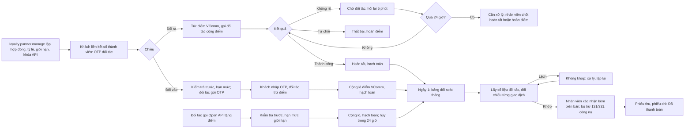

# CONG_VIEC_65: Điểm thưởng phần 3 (MODULE_11): đối tác liên minh điểm ngoài tập đoàn

- Mô tả: Đối tác ngoài tập đoàn có chương trình điểm riêng (hãng bay, ngân hàng) ký hợp đồng liên minh điểm với công ty vận hành sàn. Khách liên kết số thành viên đối tác trong ứng dụng VComm, đổi điểm VComm ra điểm đối tác và đổi điểm đối tác vào điểm VComm; VComm gọi API đối tác qua lớp kết nối chung (bộ giả lập trong công việc này). Đối tác mua điểm VComm tặng khách qua Open API, trả trước hoặc trả sau theo hợp đồng. Hạch toán từng giao dịch; đối soát tháng đối chiếu tự động với số liệu đối tác, nhân viên xác nhận, bù trừ, công nợ.
- Phiên bản: 0.1
- Ngày cập nhật: 2026-11-12
- Trạng thái: Đang thực hiện (người dùng duyệt đặc tả, bản mẫu và đề xuất mục 18 ngày 2026-11-12); lát L1 đạt xem trước (2026-11-12); lát L2 chờ xem trước.
- Nhánh: `chuc-nang/CONG_VIEC_65-doi-tac-lien-minh-diem`.
- Nguồn: tài liệu `01` (MODULE_11: đối soát liên minh; rủi ro ví điện tử), `05` mục 2.3; CONG_VIEC_51 (sổ cái điểm, QUYTAC_NGHIEPVU_344 đến 355); CONG_VIEC_55 (đối soát cửa hàng liên kết, công nợ, hạch toán theo giao dịch); CONG_VIEC_61 (khóa API, nhật ký gọi, tần suất); CONG_VIEC_53 (Smart OTP); CONG_VIEC_60 (tách công việc này, quyết định 4); quyết định của người dùng ngày 2026-11-12 (mục 17).
- Mức: Lớn (tích hợp bên ngoài, nghiệp vụ tài chính mới, sửa ràng buộc dùng chung `loyalty`, `accounting`, `finance`, `core.api_keys`; nhiều module: MODULE_11, MODULE_06, MODULE_16).
- Phụ thuộc: CONG_VIEC_51, 55, 61 (đã có trong `main`). Không phụ thuộc mã chưa phát hành của CONG_VIEC_60, 67; điểm ghép khi hợp nhất ghi ở mục 19.

## 1. Mục tiêu

Khách VComm dùng điểm VComm ở chương trình của đối tác lớn và gom điểm đối tác về VComm; đối tác dùng điểm VComm làm quà cho khách của họ. Công ty vận hành sàn kiểm soát rủi ro tiền với từng đối tác bằng tỷ lệ, giới hạn, trả trước hoặc hạn mức nợ, đối soát tháng và hạch toán.

## 2. Phạm vi

Trong phạm vi:
- Hợp đồng đối tác liên minh: chiều được phép, cách thanh toán (trả trước, trả sau), hạn mức, hạn thanh toán, thuế suất, giới hạn ba tầng; tỷ lệ quy đổi và đơn giá theo giai đoạn, riêng từng chiều; giá bán điểm tặng.
- Ứng dụng VComm: liên kết, hủy liên kết số thành viên đối tác (OTP do đối tác gửi); đổi ra; đổi vào (OTP đối tác mỗi lần); lịch sử đổi.
- Giao dịch đổi ra chờ đối tác xác nhận: hỏi lại tự động, quá 24 giờ chuyển nhân viên xử lý.
- Open API tặng điểm cho đối tác (phạm vi khóa mới `loyalty.partner`): tặng, tra, hủy.
- Hạch toán đổi ra, đổi vào, tặng điểm, hủy; bảng đối soát tháng, đối chiếu với danh sách giao dịch lấy từ API đối tác, xác nhận, bù trừ, công nợ, thu chi qua phiếu thu, phiếu chi hiện có.
- Lớp kết nối đối tác chung và bộ giả lập đối tác chạy trong máy chủ (máy phát triển, kiểm thử, môi trường thử nghiệm).

Ngoài phạm vi:
- Bộ chuyển đổi thật cho từng đối tác (viết khi có tài liệu API đối tác, công việc sau; chặn phát hành thật).
- Đổi vào khởi tạo từ ứng dụng đối tác; webhook từ đối tác gọi vào VComm.
- Tặng điểm bằng tải tệp trên web; khách chưa có tài khoản VComm.
- Đối tác trong tập đoàn (CONG_VIEC_60); cửa hàng liên kết (CONG_VIEC_55, 67).
- Chuyển, nạp, rút điểm giữa người dùng (rủi ro ví điện tử, giữ như CONG_VIEC_51).

## 3. Phân biệt với phần đã có (không trùng)

| Đối tượng | Bản chất | Nguồn |
|---|---|---|
| Cửa hàng liên kết | Cửa hàng ngoài tập đoàn tích, đổi điểm VComm tại quầy; đối soát tuần | CONG_VIEC_55, 67 (giữ nguyên) |
| Liên minh trong tập đoàn | Một loại điểm chung, chia chi phí, đối soát nợ nội bộ | CONG_VIEC_60 (giữ nguyên) |
| Khóa API đối tác | Khóa, băm, phạm vi, tần suất, nhật ký gọi | CONG_VIEC_61 (dùng lại, thêm phạm vi) |
| Đối tác liên minh ngoài tập đoàn (mới) | Đối tác có loại điểm riêng; quy đổi hai chiều qua API đối tác; mua điểm VComm tặng khách; đối soát tháng | Công việc này |

## 4. Yêu cầu nghiệp vụ và chức năng

- YCAU_NGHIEPVU_191: Công ty vận hành sàn quản lý hợp đồng đối tác liên minh ngoài tập đoàn: chiều được phép, tỷ lệ quy đổi, đơn giá, giới hạn, cách thanh toán.
- YCAU_NGHIEPVU_192: Khách liên kết số thành viên đối tác với tài khoản VComm sau khi đối tác xác minh.
- YCAU_NGHIEPVU_193: Khách đổi điểm VComm ra điểm đối tác; công ty trả đối tác theo đơn giá hợp đồng.
- YCAU_NGHIEPVU_194: Khách đổi điểm đối tác vào điểm VComm; đối tác trả công ty theo đơn giá hợp đồng.
- YCAU_NGHIEPVU_195: Đối tác mua điểm VComm tặng khách qua Open API, trả trước hoặc trả sau theo hợp đồng.
- YCAU_NGHIEPVU_196: Giao dịch với đối tác được đối soát hằng tháng, đối chiếu với số liệu đối tác, xác nhận, bù trừ, thanh toán.
- YCAU_NGHIEPVU_197: Đổi điểm, tặng điểm, đối soát với đối tác được hạch toán.

- CHUC_NANG_236: Quản lý đối tác liên minh: hợp đồng, tỷ lệ theo giai đoạn, giới hạn, khóa API, bộ giả lập (web quản trị).
- CHUC_NANG_237: Liên kết thành viên, đổi ra, đổi vào, lịch sử trên ứng dụng VComm; xử lý giao dịch chờ đối tác.
- CHUC_NANG_238: Open API tặng điểm cho đối tác.
- CHUC_NANG_239: Hạch toán, đối soát tháng, xác nhận, công nợ.

## 5. Quy tắc nghiệp vụ

- QUYTAC_NGHIEPVU_538 Hợp đồng đối tác liên minh (mã `LM…`): một hợp đồng cho một đối tác `crm.partners` đang hoạt động, không phải đối tác nội bộ, thuộc công ty vận hành sàn; một đối tác một hợp đồng. Trường: tên chương trình điểm của đối tác, tên đơn vị điểm (tiếng Việt, tiếng Anh, ví dụ "dặm", "miles"), số hợp đồng, ngày hiệu lực, ngày hết hạn (trống: không thời hạn), chiều được phép (đổi ra, đổi vào, tặng điểm; ít nhất một), cách thanh toán (`prepaid` trả trước, `postpaid` trả sau), hạn mức nợ (trả sau, đồng, > 0), hạn thanh toán bảng đối soát (1 đến 60 ngày, mặc định 15), thuế suất thuế giá trị gia tăng của phần chênh lệch (0 đến 10 %, mặc định 10 %), loại kết nối (`simulator`; giá trị khác thêm khi có bộ chuyển đổi thật), mẫu số thành viên (biểu thức chính quy, mặc định 6 đến 20 chữ, số). Trạng thái: nháp, đang hoạt động, tạm ngưng (kèm lý do), đã chấm dứt. Chỉ hợp đồng đang hoạt động, trong thời hạn mới đổi, tặng được; tra cứu, đối soát vẫn được. Cách thanh toán chỉ đổi được khi không còn giao dịch chưa chốt và không còn công nợ mở. Người có `loyalty.partner.manage` cài đặt.
- QUYTAC_NGHIEPVU_539 Tỷ lệ theo giai đoạn, riêng từng chiều (`outbound` đổi ra, `inbound` đổi vào, `gift` tặng điểm): từ ngày, đến ngày (trống: không thời hạn), không chồng lấn trong cùng chiều. Đổi ra, đổi vào: X điểm VComm = Y đơn vị điểm đối tác (số nguyên, ≥ 1); giao dịch theo bội số của Y đơn vị (số đơn vị = k × Y, số điểm VComm = k × X); đơn giá một đơn vị điểm đối tác (đồng, > 0; đổi ra: công ty trả đối tác; đổi vào: đối tác trả công ty). Tặng điểm: giá bán một điểm VComm (đồng, > 0). Giai đoạn chưa bắt đầu sửa, xóa được; đã bắt đầu chỉ sửa ngày kết thúc (không trước hôm nay), như QUYTAC_NGHIEPVU_345. Giao dịch chốt tỷ lệ, đơn giá của giai đoạn hiệu lực tại thời điểm tạo (giờ Việt Nam). Chiều không có giai đoạn hiệu lực thì không giao dịch được.
- QUYTAC_NGHIEPVU_540 Giới hạn ba tầng (trong hợp đồng, theo chiều; trống: không giới hạn): mỗi giao dịch: điểm VComm tối thiểu, tối đa; mỗi khách: tổng điểm VComm tối đa mỗi ngày, mỗi tháng (giờ Việt Nam, tính giao dịch đang chờ và hoàn tất); mỗi đối tác: tổng điểm VComm tối đa mỗi tháng. Tặng điểm: tối đa mỗi lần tặng; tổng mỗi khách mỗi tháng; tổng của đối tác mỗi tháng. Điểm đổi vào, điểm được tặng không tính vào trần tích tháng của giai đoạn chương trình, không tính chi tiêu xét hạng, không có hệ số hạng.
- QUYTAC_NGHIEPVU_541 Liên kết thành viên: khách chọn đối tác đang hoạt động, nhập số thành viên đúng mẫu; VComm gọi kết nối gửi mã OTP của đối tác tới khách (theo thông tin đối tác lưu); khách nhập mã trên ứng dụng; đối tác xác nhận thì lưu liên kết kèm tên đã che do đối tác trả. Mỗi khách một liên kết đang hiệu lực với mỗi đối tác; một số thành viên đối tác chỉ liên kết một tài khoản VComm (đang liên kết ở tài khoản khác: "Số thành viên đã liên kết với tài khoản VComm khác."). Tối đa 5 lần gửi mã mỗi giờ mỗi khách mỗi đối tác. Khách tự hủy liên kết khi không có giao dịch đang chờ với đối tác đó. Hợp đồng chấm dứt thì liên kết hết hiệu lực.
- QUYTAC_NGHIEPVU_542 Đổi ra (số `DL…`): điều kiện: hợp đồng cho phép chiều đổi ra, có giai đoạn tỷ lệ, liên kết hiệu lực, có giai đoạn chương trình điểm hiệu lực, ví không khóa, tài khoản hoạt động, số điểm trong giới hạn (QUYTAC_NGHIEPVU_540) và ≤ số dư lô còn hạn. Khách đã kích hoạt Smart OTP thì nhập mã Smart OTP (kiểm như CONG_VIEC_53); chưa kích hoạt thì không cần. Trong một giao dịch cơ sở dữ liệu: trừ điểm VComm từ lô hạn sớm nhất (bút toán dùng điểm, nguồn `partner_exchange`), lưu giao dịch Đang gửi đối tác với mã tham chiếu VComm duy nhất. Sau khi lưu: gọi kết nối cộng điểm đối tác (mã tham chiếu chống tạo trùng phía đối tác). Đối tác xác nhận: Hoàn tất, lưu mã giao dịch đối tác, hạch toán. Đối tác từ chối rõ ràng: Thất bại, hoàn điểm vào đúng lô (như QUYTAC_NGHIEPVU_349), không hạch toán. Không rõ kết quả: Chờ đối tác (QUYTAC_NGHIEPVU_543). Thông báo trong ứng dụng khi Hoàn tất, Thất bại, Đã hoàn điểm.
- QUYTAC_NGHIEPVU_543 Giao dịch đổi ra chờ đối tác: hết thời gian (10 giây), lỗi mạng, lỗi máy chủ đối tác là không rõ kết quả. Việc nền mỗi 5 phút hỏi trạng thái theo mã tham chiếu: hoàn tất hoặc từ chối thì xử lý như QUYTAC_NGHIEPVU_542; đối tác không có giao dịch thì gửi lại lệnh cộng cùng mã tham chiếu. Quá 24 giờ kể từ lúc tạo: Cần xử lý, thông báo trong ứng dụng cho người có `loyalty.partner.manage`, dừng hỏi tự động. Nhân viên có `loyalty.partner.manage` hỏi lại thủ công, hoặc chốt Hoàn tất (nhập mã giao dịch đối tác) hoặc Hoàn điểm (lý do 1 đến 500 ký tự). Giao dịch chờ, cần xử lý chưa vào bảng đối soát; ngày giao dịch của bút toán, đối soát là ngày hoàn tất.
- QUYTAC_NGHIEPVU_544 Đổi vào (số `DL…`): điều kiện như đổi ra về hợp đồng, giai đoạn tỷ lệ, liên kết, giới hạn, giai đoạn chương trình (để có giá trị một điểm, hạn dùng), ví không khóa, tài khoản hoạt động, và trả trước hoặc hạn mức (QUYTAC_NGHIEPVU_546). Bước 1: khách nhập số đơn vị đối tác (bội số Y); VComm gọi kết nối yêu cầu trừ điểm đối tác, đối tác gửi OTP cho khách; giao dịch Chờ OTP (hết hạn 5 phút). Bước 2: khách nhập OTP; VComm gọi kết nối xác nhận trừ: thành công thì Hoàn tất, cộng điểm VComm thành một lô (bút toán tích, nguồn `partner_exchange`, hạn dùng theo giai đoạn chương trình, giá trị một điểm của giai đoạn), hạch toán; OTP sai: báo lỗi, giữ Chờ OTP (đối tác quyết định số lần sai); đối tác từ chối: Thất bại; không rõ kết quả: Chờ đối tác, việc nền hỏi lại như QUYTAC_NGHIEPVU_543 (đối tác xác nhận đã trừ thì cộng điểm VComm; quá 24 giờ Cần xử lý: nhân viên chốt Hoàn tất hoặc Thất bại). Quá 5 phút chưa nhập OTP: Hết hạn.
- QUYTAC_NGHIEPVU_545 Tặng điểm qua Open API (số `TL…`): khóa API loại "Đối tác", đối tác là đối tác của hợp đồng, phạm vi đúng một giá trị `loyalty.partner`, không kênh bán, không kho; người có `loyalty.partner.manage` cấp, cấp lại, sửa, thu hồi trong chi tiết đối tác (định dạng, băm, cấp lại, thu hồi, tần suất, IP, nhật ký gọi như CONG_VIEC_61). Yêu cầu tặng: mã giao dịch đối tác (1 đến 50 ký tự chữ, số, `-`, `_`, `.`, duy nhất theo đối tác; gửi lại cùng mã trả `200` kèm giao dịch đã có, không so nội dung), số điện thoại khách, số điểm, nội dung (tùy chọn, 1 đến 200 ký tự, hiện cho khách). Điều kiện: hợp đồng cho phép tặng, đang hoạt động, có giai đoạn giá bán tặng, có giai đoạn chương trình điểm; số điện thoại có tài khoản người mua đang hoạt động ("Số điện thoại chưa có tài khoản VComm."); ví không khóa; giới hạn (QUYTAC_NGHIEPVU_540); trả trước hoặc hạn mức (QUYTAC_NGHIEPVU_546). Hoàn tất ngay: cộng một lô (bút toán tích, nguồn `partner_gift`), hạch toán, thông báo trong ứng dụng "<tên đối tác> tặng bạn N điểm". Tiền đối tác phải trả = số điểm × giá bán + thuế phần chênh lệch (QUYTAC_NGHIEPVU_547). Hủy qua API trong 24 giờ kể từ lúc tặng, khi lô còn đủ số điểm đã tặng (khách chưa dùng) và tháng chưa chốt đối soát: trừ lại toàn bộ lô (bút toán trừ lại điểm đã tích), hạch toán ngược. Kết quả không trả số dư, tên đầy đủ của khách; trả tên đã che.
- QUYTAC_NGHIEPVU_546 Trả trước, trả sau (áp cho đổi vào và tặng điểm; đổi ra không chặn): phát sinh chưa chốt = tiền đổi vào + tiền tặng (gồm thuế) − tiền đổi ra của giao dịch hoàn tất chưa vào bảng đối soát đã xác nhận. Trả trước: số dư trả trước = tiền đối tác đã nộp còn chưa cấn trừ (phiếu thu với đối tác ghi giảm phải thu chưa khớp chứng từ, CONG_VIEC_13) − công nợ phải thu mở của bảng đối soát − phát sinh chưa chốt; tiền của giao dịch mới vượt số dư trả trước thì từ chối ("Số dư trả trước của đối tác không đủ."). Trả sau: dư nợ = công nợ phải thu mở của bảng đối soát + phát sinh chưa chốt (không âm); dư nợ cộng tiền giao dịch mới vượt hạn mức, hoặc đối tác có bảng đối soát quá hạn thanh toán, thì từ chối ("Đối tác vượt hạn mức hoặc quá hạn thanh toán."). Số dư trả trước dưới 20 % mức nộp gần nhất hoặc dư nợ ≥ 80 % hạn mức: thông báo trong ứng dụng cho người có `loyalty.partner.manage`, một lần mỗi ngày.
- QUYTAC_NGHIEPVU_547 Hạch toán ở công ty vận hành sàn (bút toán tự sinh; đối tác của dòng phải thu, phải trả là đối tác liên minh; giá trị điểm = điểm × giá trị một điểm lúc cộng hoặc giá trị lúc tích của lô đã lấy):
  - Đổi ra hoàn tất (ngày hoàn tất): Nợ 3388 giá trị lúc tích của lô đã lấy / Có 331 tiền phải trả đối tác (số đơn vị × đơn giá); chênh lệch Nợ hoặc Có 641.
  - Đổi vào hoàn tất, tặng điểm: Nợ 131 tiền đối tác phải trả (gồm thuế) / Có 3388 giá trị điểm; chênh lệch dương (tiền chưa thuế − giá trị điểm) Có 511 doanh thu liên minh điểm (vai trò mới `loyalty_partner_revenue`) và Có 3331 thuế = làm tròn (chênh lệch × thuế suất); chênh lệch âm Nợ 641, không thuế.
  - Hủy tặng điểm: ghi ngược bút toán tặng. Hoàn điểm giao dịch đổi ra chưa hoàn tất: không có bút toán (chưa hạch toán).
  - Xác nhận bảng đối soát: bù trừ Nợ 331 / Có 131 bằng số nhỏ hơn giữa tổng phải thu và tổng phải trả của bảng; số còn lại ghi công nợ (QUYTAC_NGHIEPVU_549).
  - Bút toán điểm của nguồn `partner_exchange`, `partner_gift` không ghi theo từng bút toán điểm (như CONG_VIEC_55), chỉ ghi theo giao dịch.
- QUYTAC_NGHIEPVU_548 Bảng đối soát tháng (số `DM…`, loại chứng từ `loyalty.partner_settlement`, dãy số của công ty vận hành sàn, tự tạo khi chưa cấu hình): việc nền 3 giờ ngày 1 hằng tháng (giờ Việt Nam) lập bảng tháng trước cho mỗi đối tác có giao dịch hoàn tất trong tháng (theo ngày hoàn tất). Số liệu: tiền tặng điểm (A, gồm thuế), tiền đổi vào (B, gồm thuế), tiền đổi ra (C); số điểm, số đơn vị từng loại; phải thu = A + B; phải trả = C; bù trừ = nhỏ hơn giữa phải thu và phải trả; số còn lại = A + B − C (dương: đối tác phải trả; âm: công ty phải trả). Chi tiết theo từng giao dịch (ngày, số, loại, mã tham chiếu, mã giao dịch đối tác, khách đã che, điểm, đơn vị, tiền). Đối chiếu: gọi kết nối lấy danh sách giao dịch tháng của đối tác; so từng giao dịch theo mã tham chiếu VComm (tặng điểm: mã giao dịch đối tác): thiếu ở một bên, khác số đơn vị hoặc số điểm, khác trạng thái thì ghi dòng lệch; có lệch: Không khớp; không lấy được số liệu đối tác: Chưa đối chiếu được, kèm lỗi. Người có `loyalty.partner.manage` lập lại bảng khi chưa xác nhận (sau khi xử lý giao dịch chờ, hủy, hoặc đối tác sửa số liệu). Giao dịch hoàn tất sau khi bảng tháng đó đã xác nhận (ví dụ chốt tay giao dịch Cần xử lý) vào bảng của tháng hoàn tất.
- QUYTAC_NGHIEPVU_549 Xác nhận và thanh toán: chỉ bảng Khớp mới xác nhận được; người có `loyalty.partner.manage` xác nhận sau khi đối tác đồng ý ngoài hệ thống, nhập số biên bản đối chiếu hoặc ghi chú (1 đến 500 ký tự) và tệp biên bản (PDF, ảnh, tối đa 10 MB, tùy chọn; kho tệp hiện có). Khi xác nhận: hạch toán bù trừ (QUYTAC_NGHIEPVU_547); số còn lại khác 0 ghi một khoản công nợ với đối tác (phải thu: hạn = ngày xác nhận + hạn thanh toán; phải trả) và khớp ngay với tiền trả trước còn mở (trả trước) theo cách khớp công nợ hiện có; thu, chi qua phiếu thu, phiếu chi CONG_VIEC_13; công nợ về 0 thì bảng Đã thanh toán. Quá hạn: phải thu của bảng còn mở sau hạn. Trạng thái bảng: chưa đối chiếu được, không khớp, khớp, đã xác nhận, đã thanh toán. Bảng đã xác nhận không lập lại được; sai sót sau xác nhận xử lý bằng phiếu điều chỉnh điểm (CONG_VIEC_51), bút toán thủ công.
- QUYTAC_NGHIEPVU_550 Lớp kết nối đối tác: thao tác chung: gửi OTP liên kết, xác nhận liên kết; cộng điểm đối tác (đổi ra); yêu cầu trừ điểm đối tác kèm OTP, xác nhận trừ (đổi vào); hỏi trạng thái theo mã tham chiếu; lấy danh sách giao dịch tháng. Mỗi kết quả là một trong: thành công, từ chối (kèm mã lỗi đối tác), không rõ. Mã OTP, số thành viên đầy đủ, khóa bí mật đối tác không ghi vào log, nhật ký thao tác. Bộ giả lập (`simulator`) chỉ bật khi biến môi trường `LOYALTY_PARTNER_SIMULATOR=on` (máy phát triển, kiểm thử, môi trường thử nghiệm); môi trường thật không bật, đối tác loại `simulator` báo lỗi kết nối. Bộ giả lập lưu thành viên giả (số thành viên, tên, số dư đơn vị) và giao dịch giả trong cơ sở dữ liệu; mã OTP ghi log như `SMS_DRIVER=log`; người có `loyalty.partner.manage` đặt chế độ trả lời của bộ giả lập theo đối tác (bình thường, từ chối, không trả lời, sai lệch đối soát) và thêm thành viên giả trên màn hình chi tiết đối tác.
- QUYTAC_NGHIEPVU_551 Quyền mới (mini app `crm`, chỉ dùng tại công ty vận hành sàn): `loyalty.partner.view` (xem đối tác, tỷ lệ, giao dịch, tặng điểm, bảng đối soát, nhật ký gọi của khóa đối tác), `loyalty.partner.manage` (cài đặt hợp đồng, tỷ lệ, giới hạn, khóa API, bộ giả lập; xử lý giao dịch cần xử lý; lập lại, xác nhận bảng đối soát). Quản trị tập đoàn, quản trị công ty có sẵn hai quyền. Người mua chỉ thấy liên kết, giao dịch của mình. Kế toán có quyền công nợ lập phiếu thu, phiếu chi với đối tác. Khóa API `loyalty.partner` chỉ thấy giao dịch tặng của đối tác mình.

Thông báo lỗi mới (vi): "Đối tác chưa hoạt động hoặc hợp đồng hết hạn."; "Chưa có tỷ lệ quy đổi đang hiệu lực."; "Số điểm phải là bội số theo tỷ lệ quy đổi."; "Vượt giới hạn đổi điểm (giao dịch, ngày, tháng hoặc của đối tác)."; "Số thành viên không đúng định dạng."; "Số thành viên đã liên kết với tài khoản VComm khác."; "Chưa liên kết thành viên đối tác."; "Mã OTP không đúng hoặc đã hết hạn."; "Không kết nối được đối tác, vui lòng thử lại sau."; "Số dư trả trước của đối tác không đủ."; "Đối tác vượt hạn mức hoặc quá hạn thanh toán."; "Giao dịch tặng không hủy được (quá 24 giờ, khách đã dùng điểm hoặc tháng đã chốt)."; "Bảng đối soát chưa khớp, chưa xác nhận được."; "Còn giao dịch đang chờ với đối tác, chưa hủy liên kết được."

## 6. Vai trò và quyền

| Chức năng | Quản trị tập đoàn, quản trị công ty | `loyalty.partner.manage` | `loyalty.partner.view` | Người mua | Khóa API `loyalty.partner` |
|---|---|---|---|---|---|
| Hợp đồng, tỷ lệ, giới hạn, khóa API, bộ giả lập | Có | Có | Xem | Không | Không |
| Giao dịch đổi, tặng; xử lý giao dịch cần xử lý | Có | Có | Xem | Của mình (đổi, nhận tặng) | Tặng, tra, hủy của đối tác mình |
| Bảng đối soát: lập lại, xác nhận | Có | Có | Xem | Không | Không |
| Liên kết, đổi ra, đổi vào | Không | Không | Không | Có | Không |

## 7. Luồng nghiệp vụ

Luồng 64 (đối tác liên minh điểm ngoài tập đoàn):

## 8. Màn hình

| Mã | Tên | Ứng dụng | Nội dung | Bản mẫu |
|---|---|---|---|---|
| MAN_HINH_258 | Đối tác liên minh | `apps/web-crm`, nhóm menu "Điểm thưởng" | Danh sách hợp đồng (mã, đối tác, chương trình điểm, chiều, cách thanh toán, số dư trả trước hoặc dư nợ/hạn mức, trạng thái); lọc trạng thái; tạo | `ban_mau/MAN_HINH_258_DOI_TAC_LIEN_MINH.html` |
| MAN_HINH_259 | Chi tiết đối tác liên minh | `apps/web-crm` | Các khối: Hợp đồng (sửa, kích hoạt, tạm ngưng, chấm dứt); Tỷ lệ quy đổi theo chiều và giai đoạn; Giới hạn; Khóa API (cấp, hiện một lần, cấp lại, thu hồi, nhật ký gọi); Bộ giả lập (chế độ trả lời, thành viên giả; chỉ hiện khi loại kết nối `simulator`); số dư trả trước hoặc dư nợ | `ban_mau/MAN_HINH_259_CHI_TIET_DOI_TAC_LIEN_MINH.html` |
| MAN_HINH_260 | Giao dịch đổi điểm đối tác | `apps/web-crm` | Danh sách đổi ra, đổi vào (lọc đối tác, chiều, trạng thái, ngày); chi tiết; nút hỏi lại, chốt hoàn tất, hoàn điểm cho giao dịch Cần xử lý | `ban_mau/MAN_HINH_260_GIAO_DICH_DOI_DIEM_DOI_TAC.html` |
| MAN_HINH_261 | Điểm đối tác tặng | `apps/web-crm` | Danh sách giao dịch tặng (lọc đối tác, trạng thái, ngày): số, mã giao dịch đối tác, khách đã che, điểm, tiền, trạng thái | `ban_mau/MAN_HINH_261_DIEM_DOI_TAC_TANG.html` |
| MAN_HINH_262 | Đối soát đối tác liên minh | `apps/web-crm` | Danh sách bảng tháng (tháng, đối tác, phải thu, phải trả, bù trừ, còn lại, trạng thái, hạn) | `ban_mau/MAN_HINH_262_DOI_SOAT_DOI_TAC_LIEN_MINH.html` |
| MAN_HINH_263 | Chi tiết bảng đối soát đối tác | `apps/web-crm` | Số liệu A, B, C, bù trừ, còn lại; dòng lệch; chi tiết giao dịch; lập lại; xác nhận kèm biên bản; công nợ, phiếu thu chi | `ban_mau/MAN_HINH_263_CHI_TIET_DOI_SOAT_DOI_TAC.html` |
| MAN_HINH_264 | Đối tác liên minh (khách) | `apps/mobile-vcomm` | Danh sách đối tác đang hoạt động, trạng thái liên kết (số thành viên đã che); liên kết bằng OTP; hủy liên kết | `ban_mau/MAN_HINH_264_DOI_TAC_LIEN_MINH_KHACH.html` |
| MAN_HINH_265 | Đổi điểm với đối tác | `apps/mobile-vcomm` | Chọn chiều; nhập số đơn vị (bội số), xem số điểm VComm tương ứng, giới hạn còn lại; Smart OTP (đổi ra) hoặc OTP đối tác (đổi vào); kết quả, trạng thái chờ; lịch sử đổi và điểm được tặng | `ban_mau/MAN_HINH_265_DOI_DIEM_DOI_TAC.html` |

Sửa màn hình đã có: MAN_HINH_151 (Điểm của tôi) thêm lối vào MAN_HINH_264, 265; nhãn nguồn bút toán "Đổi điểm đối tác", "Đối tác tặng". MAN_HINH_147 (chi tiết ví điểm) hiện nhãn nguồn như trên.

## 9. Dữ liệu

| Database migration | Bảng, cột | Nội dung |
|---|---|---|
| 0150 (L1) | `loyalty.partner_contracts` | `id`, `company_id`, `code` (`LM…`), `partner_id` (duy nhất), `program_name`, `unit_name_vi`, `unit_name_en`, `contract_no`, `effective_from`, `effective_to`, `outbound_enabled`, `inbound_enabled`, `gift_enabled` (ít nhất một), `payment_mode` (`prepaid`, `postpaid`), `credit_limit` (bắt buộc khi `postpaid`), `payment_term_days`, `tax_percent`, `connector` (`simulator`), `member_pattern`, `status`, `status_reason`, người, thời điểm, `version` |
| 0150 (L1) | `loyalty.partner_limits` | Giới hạn theo (`contract_id`, `direction`): `min_points`, `max_points` (tặng: mỗi lần), `customer_daily_points`, `customer_monthly_points`, `partner_monthly_points`; tặng không dùng tối thiểu, mỗi ngày |
| 0150 (L1) | `loyalty.partner_rates` | `id`, `contract_id`, `direction` (`outbound`, `inbound`, `gift`), `starts_on`, `ends_on`, `vcomm_points`, `partner_units` (đổi), `unit_price`, `version`; không chồng lấn theo (`contract_id`, `direction`) kiểm trong giao dịch có khóa dòng hợp đồng |
| 0150 (L1) | `loyalty.partner_memberships` | `id`, `contract_id`, `user_id`, `member_number`, `member_name_masked`, `status` (`linked`, `unlinked`), `linked_at`, `unlinked_at`; duy nhất (`contract_id`, `member_number`) và (`contract_id`, `user_id`) khi `linked`; `loyalty.partner_link_requests` (yêu cầu liên kết chờ OTP, hết hạn 5 phút) |
| 0150 (L1) | `loyalty.partner_simulator_members`, `loyalty.partner_simulator_transactions`, `loyalty.partner_simulator_settings` | Dữ liệu bộ giả lập (chỉ dùng khi bật biến môi trường) |
| 0150 (L1) | `core.permissions` | `loyalty.partner.view`, `loyalty.partner.manage` |
| 0151 (L2) | `loyalty.partner_exchanges` | `id`, `document_no` (`DL…`), `contract_id`, `membership_id`, `user_id`, `direction`, `rate_id`, `vcomm_points`, `partner_units`, `unit_price`, `amount`, `tax_amount`, `point_value_amount`, `reference` (duy nhất), `partner_reference`, `status` (`sending`, `otp_pending`, `pending_partner`, `needs_review`, `completed`, `failed`, `refunded`, `expired`), `attempts`, `next_check_at`, `last_error_code`, `resolved_by`, `resolution_note`, `completed_at`, `settlement_id`, thời điểm |
| 0151 (L2) | `loyalty.entries`, `loyalty.lots` | Định nghĩa lại `entries_source_type_check`, `lots_source_type_check` gồm mọi giá trị trên `main` mới nhất và `partner_exchange`, `partner_gift` |
| 0151 (L2) | `loyalty.partner_exchanges` (bổ sung) | `point_value`, `validity_months` (đổi vào: giá trị một điểm, hạn dùng của giai đoạn lúc tạo), `otp_expires_at`, `redeem_entry_id`; `loyalty.partner_simulator_transactions` (giao dịch giả của bộ giả lập) |
| 0151 (L2) | Ràng buộc dùng chung | `accounting.journals.source_type` thêm `loyalty_partner_exchange` (chuyển từ 0153 vì L2 đã hạch toán); vai trò định khoản `loyalty_partner_receivable` (131), `loyalty_partner_payable` (331), `loyalty_partner_revenue` (511 theo Thông tư 99, 5113 theo Thông tư 133), `loyalty_partner_tax` (33311) |
| 0152 (L3) | `loyalty.partner_gifts` | `id`, `document_no` (`TL…`), `contract_id`, `api_key_id`, `partner_transaction_code` (duy nhất theo hợp đồng), `user_id`, `points`, `unit_price`, `amount`, `tax_amount`, `point_value_amount`, `message`, `lot_id`, `status` (`completed`, `cancelled`), `cancel_reason`, `cancelled_at`, `settlement_id`, `created_at` |
| 0152 (L3) | `core.api_keys` | `scopes` thêm `loyalty.partner`; `channel_id` cho phép trống khi và chỉ khi phạm vi chỉ gồm giá trị không cần kênh (`loyalty.partner`; khi hợp nhất cùng CONG_VIEC_67 gồm cả `loyalty.member`) |
| 0153 (L4) | `loyalty.partner_settlements` | `id`, `document_no` (`DM…`), `contract_id`, `period`, A, B, C, số điểm, số đơn vị, `offset_amount`, `net_amount`, `status`, `mismatches` jsonb, `reconcile_error`, `confirm_note`, `confirm_file_id`, `confirmed_by`, `confirmed_at`, `due_date`, `debt_item_id`, `paid_at`, `version`; duy nhất (`contract_id`, `period`) |
| 0153 (L4) | Ràng buộc dùng chung | `accounting.journals.source_type` thêm `loyalty_partner_gift`, `loyalty_partner_gift_cancel`, `loyalty_partner_settlement`; `finance.debt_items.source_type` thêm `loyalty_partner_settlement`; định nghĩa lại gồm mọi giá trị trên `main` mới nhất. Loại chứng từ `loyalty.partner_settlement` (đánh số, không duyệt) |

## 10. API

Điểm tiếp nhận nhân viên (gốc `/api/v1`, công ty vận hành sàn; xem `loyalty.partner.view`, sửa `loyalty.partner.manage`):

| Mã | Phương thức, đường dẫn | Mô tả |
|---|---|---|
| API_301 | `GET`, `POST /loyalty/partners`; `GET`, `PUT /loyalty/partners/{id}`; `POST /loyalty/partners/{id}/activate`, `/suspend`, `/terminate` | Hợp đồng, giới hạn (có `version`); kèm số dư trả trước hoặc dư nợ |
| API_302 | `GET`, `POST /loyalty/partners/{id}/rates`; `PUT`, `DELETE /loyalty/partner-rates/{rateId}` | Tỷ lệ theo chiều, giai đoạn |
| API_303 | `GET`, `POST /loyalty/partners/{id}/api-keys`; `PATCH /loyalty/partner-api-keys/{keyId}`; `POST .../rotate`, `/revoke`; `GET`, `PUT /loyalty/partners/{id}/simulator` | Khóa API phạm vi `loyalty.partner` (gọi service khóa của Nền tảng); bộ giả lập |
| API_304 | `GET /loyalty/partner-exchanges`, `GET /loyalty/partner-exchanges/{id}`; `POST .../{id}/recheck`, `/resolve` (`completed` kèm `partnerReference`, hoặc `refund` kèm lý do); `GET /loyalty/partner-gifts` | Giao dịch đổi, tặng; xử lý giao dịch cần xử lý |
| API_305 | `GET /loyalty/partner-settlements`, `GET .../{id}`; `POST .../{id}/rebuild`, `/confirm` (ghi chú, tệp) | Đối soát tháng |

Điểm tiếp nhận người mua (gốc `/api/v1`):

| Mã | Phương thức, đường dẫn | Mô tả |
|---|---|---|
| API_306 | `GET /buyer/loyalty/partners`; `POST /buyer/loyalty/partners/{id}/link` (số thành viên), `POST /buyer/loyalty/partner-links/{requestId}/verify` (OTP), `DELETE /buyer/loyalty/partners/{id}/link` | Đối tác, liên kết |
| API_307 | `POST /buyer/loyalty/partner-exchanges/quote`; `POST /buyer/loyalty/partner-exchanges` (chiều, số đơn vị, mã Smart OTP khi đổi ra); `POST /buyer/loyalty/partner-exchanges/{id}/otp` (đổi vào); `GET /buyer/loyalty/partner-exchanges`, `GET .../{id}` | Báo giá (số điểm tương ứng, giới hạn còn lại), đổi, lịch sử |

Điểm tiếp nhận đối tác (khóa API phạm vi `loyalty.partner`, gốc `/api/v1/open/loyalty-partner`):

| Mã | Phương thức, đường dẫn | Mô tả |
|---|---|---|
| API_308 | `POST /gifts`; `GET /gifts`, `GET /gifts/{partnerTransactionCode}`; `POST /gifts/{partnerTransactionCode}/cancel` | Tặng (`201` mới, `200` mã đã có), liệt kê, tra, hủy (lý do) |

## 11. Dùng lại mã đã có

| Việc | Mã dùng lại | Thay đổi |
|---|---|---|
| Lô, bút toán điểm | `loyalty/ledger.service.ts` (`creditLot`, `takeFromLots`, `addEntry`, hoàn vào lô) | Thêm nguồn `partner_exchange`, `partner_gift`; hàm cộng, trừ cho đối tác (không tính trần tháng, chi tiêu, hệ số) |
| Hạch toán | `LedgerService`, cách ghi theo giao dịch của `affiliate/postings.ts` | Bút toán đổi, tặng, bù trừ; bỏ qua bút toán theo từng bút toán điểm cho hai nguồn mới |
| Giai đoạn theo ngày, không chồng lấn | `loyalty/program.service.ts` | Mẫu cho tỷ lệ |
| Khóa API, xác thực, tần suất, nhật ký | `open-api/api-keys.service.ts`, `api-key.guard.ts` | Phạm vi `loyalty.partner`, khóa không kênh |
| Smart OTP | `loyalty/smart-otp.service.ts` | Không đổi |
| Công nợ, khớp, phiếu thu chi | `finance` debts (`lockPartner`, `matchDebit`), CONG_VIEC_13 | Không đổi |
| Đối soát | Cách làm của `affiliate/settlements.service.ts` | Bảng tháng mới |
| Việc nền, thông báo, dãy số, kho tệp, nhật ký thao tác | `jobs`, `notifications`, dãy số chứng từ, `file-storage.ts`, `audit.service.ts` | Không đổi |

## 12. Phân tích giải pháp có sẵn – CONG_VIEC_65 – 2026-11-12

- Nguồn đã tìm: mã nguồn dự án (CONG_VIEC_51, 55, 61, 67); nguồn riêng `V-com-ERP` đã đánh giá ở CONG_VIEC_61 mục 12 (không có liên minh điểm với đối tác ngoài).
- Không có thư viện chuẩn cho kết nối chương trình điểm của hãng bay, ngân hàng (mỗi đối tác một API riêng, thường cần hợp đồng mới có tài liệu).
- Phương án: dùng lại hạ tầng của dự án (mục 11), lớp kết nối chung và bộ giả lập tự viết; không thêm thư viện, không thêm hạ tầng.

## 13. Tiêu chí nghiệm thu

| Mã | Tiêu chí | Mức | Lát |
|---|---|---|---|
| TIEUCHI_NGHIEMTHU_514 | Hợp đồng: một đối tác một hợp đồng, không phải đối tác nội bộ; trả sau bắt buộc hạn mức; trạng thái; tỷ lệ không chồng lấn theo chiều, đã bắt đầu chỉ sửa ngày kết thúc; phân quyền xem, sửa | Bắt buộc | L1 |
| TIEUCHI_NGHIEMTHU_515 | Liên kết: OTP đối tác đúng mới liên kết; số thành viên sai mẫu, đã liên kết tài khoản khác bị từ chối; giới hạn gửi mã; hủy liên kết khi không có giao dịch chờ | Bắt buộc | L1 |
| TIEUCHI_NGHIEMTHU_516 | Đổi ra thành công: trừ điểm đúng lô, bội số, giới hạn ba tầng, Smart OTP khi đã kích hoạt; đối tác từ chối hoàn điểm đúng lô | Bắt buộc | L2 |
| TIEUCHI_NGHIEMTHU_517 | Đổi ra không rõ kết quả: Chờ đối tác, việc nền hỏi lại, gửi lại cùng mã tham chiếu không tạo trùng; quá 24 giờ Cần xử lý; nhân viên chốt hoàn tất hoặc hoàn điểm | Bắt buộc | L2 |
| TIEUCHI_NGHIEMTHU_518 | Đổi vào: OTP đối tác, cộng lô đúng hạn dùng, giá trị một điểm; OTP sai, hết hạn 5 phút; không tính trần tháng, chi tiêu xét hạng | Bắt buộc | L2 |
| TIEUCHI_NGHIEMTHU_519 | Tặng qua Open API: phạm vi khóa đúng; số điện thoại không có tài khoản bị từ chối; gửi lại cùng mã (kể cả song song) chỉ một giao dịch; giới hạn; hủy trong 24 giờ khi chưa dùng, quá hạn hoặc đã dùng bị từ chối | Bắt buộc | L3 |
| TIEUCHI_NGHIEMTHU_520 | Trả trước chặn khi số dư không đủ; trả sau chặn khi vượt hạn mức hoặc quá hạn thanh toán; cảnh báo ngưỡng | Bắt buộc | L3 |
| TIEUCHI_NGHIEMTHU_521 | Bút toán đổi ra (3388/331, chênh lệch 641), đổi vào và tặng (131/3388, chênh lệch 511 và 3331 hoặc 641), hủy tặng ghi ngược; báo cáo nghĩa vụ điểm khớp sổ cái | Bắt buộc | L2, L3 |
| TIEUCHI_NGHIEMTHU_522 | Bảng đối soát tháng: số liệu A, B, C, bù trừ, còn lại khớp giao dịch; đối chiếu số liệu đối tác: khớp, lệch từng loại, không lấy được | Bắt buộc | L4 |
| TIEUCHI_NGHIEMTHU_523 | Xác nhận chỉ khi khớp; bút toán bù trừ; công nợ đúng chiều, hạn; trả trước khớp ngay với tiền đã nộp; phiếu thu chi về 0 thì Đã thanh toán | Bắt buộc | L4 |
| TIEUCHI_NGHIEMTHU_524 | Bộ giả lập chỉ chạy khi bật biến môi trường; nhật ký gọi, log không chứa OTP, số thành viên đầy đủ, số điện thoại | Bắt buộc | L1 đến L4 |
| TIEUCHI_NGHIEMTHU_525 | MAN_HINH_258 đến 265 và phần sửa màn hình đủ trạng thái rỗng, đang tải, lỗi, không quyền; tiếng Việt, tiếng Anh; chạy được trên máy tính, máy tính bảng, điện thoại | Bắt buộc | L1 đến L4 |

## 14. Kịch bản kiểm thử

| Mã | Tiêu chí | Kịch bản | Loại |
|---|---|---|---|
| KICHBAN_KIEMTHU_705 | 514 | Tạo hợp đồng đúng, đối tác nội bộ, trùng đối tác, trả sau thiếu hạn mức; tỷ lệ chồng lấn, sửa giai đoạn đã bắt đầu; `loyalty.partner.view` gọi sửa | Tích hợp |
| KICHBAN_KIEMTHU_706 | 515 | Liên kết OTP đúng, sai, hết hạn; sai mẫu; số đã liên kết tài khoản khác; lần gửi mã thứ 6 trong giờ; hủy liên kết khi có giao dịch chờ | Tích hợp |
| KICHBAN_KIEMTHU_707 | 516 | Đổi ra thành công; bội số sai; vượt từng tầng giới hạn (biên); Smart OTP sai; đối tác từ chối hoàn điểm đúng lô | Tích hợp |
| KICHBAN_KIEMTHU_708 | 517 | Bộ giả lập không trả lời: Chờ đối tác; hỏi lại thấy hoàn tất; đối tác không có giao dịch thì gửi lại cùng mã; quá 24 giờ; chốt hoàn tất, hoàn điểm; người không quyền chốt | Tích hợp |
| KICHBAN_KIEMTHU_709 | 518 | Đổi vào OTP đúng, sai, hết hạn; hạn dùng, giá trị lô; trần tháng của chương trình không bị ảnh hưởng; chi tiêu không đổi | Tích hợp |
| KICHBAN_KIEMTHU_710 | 519 | Tặng đúng; khóa khác phạm vi; số chưa có tài khoản; hai yêu cầu song song cùng mã; vượt giới hạn | Tích hợp |
| KICHBAN_KIEMTHU_711 | 519 | Hủy tặng trong 24 giờ; quá 24 giờ; khách đã dùng một phần; tháng đã chốt | Tích hợp |
| KICHBAN_KIEMTHU_712 | 520 | Trả trước: nộp tiền, tặng tới đủ số dư, vượt bị chặn; trả sau: vượt hạn mức, bảng quá hạn; cảnh báo một lần mỗi ngày | Tích hợp |
| KICHBAN_KIEMTHU_713 | 521 | Bút toán từng loại (chênh lệch dương, âm); hủy tặng; báo cáo nghĩa vụ điểm | Tích hợp |
| KICHBAN_KIEMTHU_714 | 522 | Lập bảng tháng; bộ giả lập sai lệch: thiếu, thừa, khác số; không lấy được số liệu; lập lại sau xử lý | Tích hợp |
| KICHBAN_KIEMTHU_715 | 523 | Xác nhận bảng khớp, không khớp; bù trừ; công nợ phải thu, phải trả; trả trước khớp tiền đã nộp; phiếu thu, chi tới Đã thanh toán | Tích hợp |
| KICHBAN_KIEMTHU_716 | 524 | Tắt biến môi trường thì kết nối báo lỗi; tìm OTP, số thành viên, số điện thoại trong nhật ký gọi, nhật ký thao tác | Tích hợp |
| KICHBAN_KIEMTHU_717 | 525 | MAN_HINH_258 đến 263: năm trạng thái, đổi ngôn ngữ, ba kích thước | Giao diện (ảnh chụp) |
| KICHBAN_KIEMTHU_718 | 525 | MAN_HINH_264, 265 trên ứng dụng (khổ điện thoại): liên kết, đổi ra, đổi vào, chờ, lịch sử | Giao diện (ảnh chụp) |

Kiểm thử tự động: `apps/api/test/c65-*.test.ts`.

## 15. Ràng buộc kỹ thuật

- Mỗi mini app chỉ ghi schema của mình: phần đối tác liên minh ghi `loyalty`; khóa API qua service của Nền tảng; công nợ, bút toán qua service của Tài chính, Kế toán.
- Gọi kết nối đối tác ngoài giao dịch cơ sở dữ liệu; trạng thái giao dịch lưu trước khi gọi để không mất dấu khi máy chủ dừng giữa chừng.
- Chống tạo trùng: mã tham chiếu VComm duy nhất gửi đối tác; tặng điểm dựa trên chỉ mục duy nhất, bắt lỗi trùng rồi trả giao dịch cũ.
- Mọi truy vấn của khóa lọc theo hợp đồng của khóa.
- Mã OTP, số thành viên đầy đủ, số điện thoại, khóa bí mật không ghi vào nhật ký gọi, log, nhật ký thao tác.
- Ràng buộc kiểm tra dùng chung định nghĩa lại gồm mọi giá trị trên `main` mới nhất tại lúc viết database migration.
- Không thêm thư viện.

## 16. Thành phần không được thay đổi

- Tích, đổi điểm theo đơn VComm, bán tại quầy, cửa hàng liên kết; trần tháng, hạng, cảnh báo (CONG_VIEC_51, 53, 55).
- Khóa API, xác thực, tần suất của các phạm vi khác (CONG_VIEC_61, 66, 67); Smart OTP (CONG_VIEC_53); phiếu thu chi, công nợ (CONG_VIEC_13).

## 17. Quyết định của người dùng (2026-11-12)

| Câu hỏi | Quyết định |
|---|---|
| Chiều đổi | Hai chiều, khởi tạo trên ứng dụng VComm; VComm gọi API đối tác |
| Tỷ lệ quy đổi | Theo hợp đồng, riêng từng chiều, theo giai đoạn, kèm đơn giá thanh toán mỗi đơn vị điểm |
| Đối tác mua điểm | Hợp đồng chọn trả trước (ký quỹ) hoặc trả sau (hạn mức nợ); vượt thì chặn |
| Hạch toán tặng điểm | Nợ 131 giá bán / Có 3388 giá trị điểm; chênh lệch Có 511 kèm 3331, hoặc Nợ 641 |
| Hạch toán đổi | Đổi ra Nợ 3388 / Có 331, chênh lệch 641; đổi vào ghi như mua điểm; đối soát bù trừ 131 với 331 |
| Đối soát | Tháng; đối chiếu tự động với số liệu lấy từ API đối tác; nhân viên xác nhận sau khi đối tác đồng ý ngoài hệ thống |
| Kênh tặng | Open API, phạm vi khóa mới |
| Giới hạn | Ba tầng theo hợp đồng; không tính trần tháng, chi tiêu xét hạng |
| Lớp kết nối | Giao diện kết nối chung và bộ giả lập; bộ chuyển đổi thật làm khi có tài liệu đối tác |
| Liên kết thành viên | OTP do đối tác gửi |
| Xác thực đổi vào | OTP đối tác mỗi lần; đổi ra dùng Smart OTP khi khách đã kích hoạt |
| Lỗi kết nối khi đổi ra | Chờ, hỏi lại mỗi 5 phút, quá 24 giờ chuyển nhân viên xử lý |
| Tra cứu pháp lý | Không cần (người dùng quyết định) |

## 18. Đề xuất của AI (người dùng duyệt ngày 2026-11-12)

1. Đối tượng mới đặt trong schema `loyalty` (MODULE_11), màn hình quản trị trong mini app Khách hàng và Đối tác, nhóm menu "Điểm thưởng"; hai quyền mới `loyalty.partner.view`, `loyalty.partner.manage`.
2. Trả trước, hạn mức áp cho đổi vào và tặng điểm (phát sinh phải thu); đổi ra không chặn theo số dư, hạn mức (phát sinh phải trả, làm giảm dư nợ).
3. Số dư trả trước tính từ phiếu thu của đối tác chưa cấn trừ (không có bảng ký quỹ riêng); nộp tiền bằng phiếu thu hiện có.
4. Thuế giá trị gia tăng tính trên phần chênh lệch dương giữa tiền bán và giá trị điểm, thuế suất trong hợp đồng (mặc định 10 %).
5. Hủy tặng điểm qua API trong 24 giờ khi khách chưa dùng; đổi ra, đổi vào hoàn tất không hủy được (sai sót xử lý bằng phiếu điều chỉnh điểm).
6. Bảng chỉ xác nhận được khi Khớp; hạn thanh toán mặc định 15 ngày.
7. Bộ giả lập lưu trong cơ sở dữ liệu (bảng riêng), bật bằng biến môi trường, chỉnh chế độ trả lời trên màn hình chi tiết đối tác để xem trước, kiểm thử.
8. Điểm đổi vào, điểm tặng hiện trong sổ cái với loại tích, điểm đổi ra với loại dùng; báo cáo nghĩa vụ điểm (API_182) tính chung.

## 19. Ghép với công việc song song

- CONG_VIEC_60 (chưa vào `main`): `loyalty.lots.cost_bearer` mặc định `earning_company`; lô của nguồn đối tác ở công ty vận hành sàn nên ba kiểu cho cùng kết quả. Hai nguồn mới bị bỏ qua trong bút toán theo từng bút toán điểm, nên không chạm phần hạch toán theo kiểu. Quy tắc chống gian lận 2 (đổi điểm dồn dập) của CONG_VIEC_60 có áp cho đổi ra hay không: hỏi người dùng khi CONG_VIEC_60 vào `main`.
- CONG_VIEC_67 (chưa vào `main`): cùng sửa ràng buộc `core.api_keys` (`channel_id` trống, phạm vi); nhánh hợp nhất sau gộp `loyalty.member` và `loyalty.partner`. Ràng buộc nguồn chứng từ dùng chung: nhánh hợp nhất sau gộp mọi giá trị.

## 20. Các lát và điểm xem trước

| Lát | Nội dung | Điểm xem trước |
|---|---|---|
| L1 | Database migration 0150; lớp kết nối, bộ giả lập; API_301 đến 303 (trừ khóa API), API_306; MAN_HINH_258, 259, 264 | Ảnh MAN_HINH_258, 259, 264; liên kết thành viên bằng OTP bộ giả lập |
| L2 | Database migration 0151; đổi ra, đổi vào, chờ đối tác, việc nền hỏi lại, xử lý tay; hạch toán đổi; API_304 (đổi), API_307; MAN_HINH_260, 265; sửa MAN_HINH_151, 147 | Đổi ra thành công, từ chối, không trả lời; đổi vào; ảnh MAN_HINH_260, 265; bút toán |
| L3 | Database migration 0152; khóa API `loyalty.partner`, API_308, trả trước, trả sau, cảnh báo; hạch toán tặng; MAN_HINH_261, khối khóa API của MAN_HINH_259 | `curl` tặng, gửi lại cùng mã, hủy; chặn khi hết số dư trả trước |
| L4 | Database migration 0153; bảng đối soát tháng, đối chiếu, xác nhận, công nợ; API_305; MAN_HINH_262, 263 | Chạy việc nền lập bảng; bộ giả lập sai lệch; xác nhận; phiếu thu |

## 21. Điểm chưa xác định

- Tài liệu API của đối tác cụ thể: chặn phát hành lên môi trường thật cho tới khi có bộ chuyển đổi thật (công việc sau).
- Tài liệu hướng dẫn tích hợp Open API tặng điểm cho đối tác: gửi bản trích tài liệu `17` như CONG_VIEC_61.
