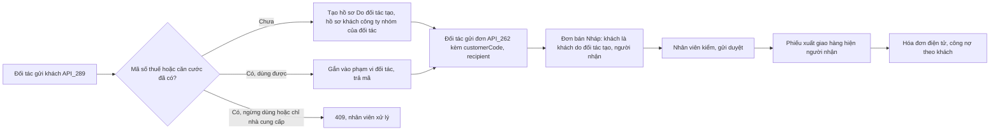

# CONG_VIEC_66: Mở rộng kinh doanh phần 5 – Open API khách hàng do đối tác tạo, đơn giao thẳng người nhận cuối (MODULE_16)

- Mô tả: Đối tác (website, sàn bán hộ, đại lý) và phần mềm của chính công ty tạo khách hàng (người mua lấy hóa đơn) qua Open API, gửi đơn bán ghi khách đó và người nhận để công ty giao thẳng. Tách từ CONG_VIEC_61 lát L3.
- Phiên bản: 0.1
- Ngày cập nhật: 2026-11-12
- Trạng thái: Đã nghiệm thu, chờ phát hành (người dùng, 2026-11-12)
- Mức: Lớn (sửa cấu trúc dữ liệu đối tác và đơn bán, sửa API đang dùng, thêm dữ liệu cá nhân nhận qua điểm tiếp nhận công khai).
- Nhánh: `chuc-nang/CONG_VIEC_66-open-api-khach-hang`.
- Nguồn: `CONG_VIEC_61.md` (mục 2, 3, 5, 16, 17); quyết định của người dùng ngày 2026-11-12 (mục 17).
- Phụ thuộc: CONG_VIEC_61 (đã phát hành 0.7.0).
- Phiếu thay đổi: THAY_DOI_32 (ngoại lệ QUYTAC_NGHIEPVU_56 cho khách cá nhân nguồn Open API; mở phạm vi `customer.write` của QUYTAC_NGHIEPVU_486). Lỗi: LOI_09 (dò hồ sơ qua số căn cước, mã số thuế; Trung bình; đã sửa ở commit `102dfed`).

## 1. Mục tiêu

Website, sàn bán hộ gửi đơn của người mua cuối vào VComm: người mua lấy hóa đơn là khách hàng của công ty (hóa đơn, công nợ theo khách đó), hàng giao thẳng tới người nhận; nhân viên thấy rõ khách nào do đối tác tạo và giao cho ai.

## 2. Phạm vi

Trong phạm vi: CHUC_NANG_221.

Ngoài phạm vi:

- Phí giao hàng, thu hộ trên đơn Open API (đối tác tự thu tiền khách).
- Hóa đơn cho khách, công nợ cho đối tác (đối tác thu hộ): người dùng chọn hóa đơn, công nợ cùng theo khách.
- Đối tác ngừng dùng, xóa khách; đối tác đọc khách hàng do nhân viên tạo.
- Màn hình mới (người dùng chọn sửa màn hình có sẵn). MAN_HINH_227 đến 230 không dùng, trả phiên điều phối.
- Tra, tích, đổi điểm tại đối tác: CONG_VIEC_67.

## 3. Yêu cầu nghiệp vụ

| Mã                | Yêu cầu                                                                                                               | Người cần                            |
| ----------------- | --------------------------------------------------------------------------------------------------------------------- | ------------------------------------ |
| YCAU_NGHIEPVU_168 | Website, sàn bán hộ gửi đơn kèm khách hàng do đối tác tạo (người mua lấy hóa đơn) và người nhận để công ty giao thẳng | Đối tác, Nhân viên bán hàng, Kế toán |

## 4. Chức năng

| Mã            | Chức năng                                                                                                                                                  | Yêu cầu           | Màn hình                                                                                                    | API                                                                        | Lát    |
| ------------- | ---------------------------------------------------------------------------------------------------------------------------------------------------------- | ----------------- | ----------------------------------------------------------------------------------------------------------- | -------------------------------------------------------------------------- | ------ |
| CHUC_NANG_221 | API khách hàng do đối tác tạo (tạo, liệt kê, xem, sửa liên hệ); đơn Open API ghi khách đó và người nhận giao thẳng; nhân viên thấy nguồn khách, người nhận | YCAU_NGHIEPVU_168 | Sửa danh sách, chi tiết đối tác (Khách hàng); sửa chi tiết đơn bán (Bán hàng); sửa chi tiết phiếu kho (Kho) | API_289 đến API_292; sửa API_262, API_263, danh sách đối tác (API hiện có) | L1, L2 |

## 5. Quy tắc nghiệp vụ

QUYTAC_NGHIEPVU_494 (khách hàng do đối tác tạo, người nhận giao thẳng) gồm các khoản:

| Khoản               | Nội dung                                                                                                                                                                                                                                                                                                                                                                                                                                                                                                                                                                 |
| ------------------- | ------------------------------------------------------------------------------------------------------------------------------------------------------------------------------------------------------------------------------------------------------------------------------------------------------------------------------------------------------------------------------------------------------------------------------------------------------------------------------------------------------------------------------------------------------------------------ |
| 1. Phạm vi          | Khách tạo qua khóa có phạm vi `customer.write`. Phạm vi khách: đối tác của khóa (mọi khóa cùng đối tác), khóa nội bộ thì chính khóa (như mã đơn đối tác, QUYTAC_NGHIEPVU_491). Đối tác chỉ thấy, dùng khách trong phạm vi của mình; ngoài phạm vi trả `404`                                                                                                                                                                                                                                                                                                              |
| 2. Thông tin        | Tổ chức, hộ kinh doanh: tên (1 đến 300 ký tự), mã số thuế (10 hoặc 13 số dạng `0123456789-001`), địa chỉ hóa đơn (1 đến 500 ký tự) bắt buộc; điện thoại, email tùy chọn. Cá nhân: tên, số điện thoại Việt Nam bắt buộc; địa chỉ, email, số căn cước (12 số) tùy chọn; bắt buộc `personalDataConsent: true` (đối tác xác nhận đã có đồng ý của khách theo hợp đồng). Hệ thống lưu thời điểm xác nhận và khóa gửi. Riêng khách cá nhân tạo qua Open API được để trống số căn cước (khác QUYTAC_NGHIEPVU_56); nhân viên sửa hồ sơ này trên web cũng không bắt buộc căn cước |
| 3. Hồ sơ tạo ra     | Hồ sơ đối tác dùng chung tập đoàn (như nhập trên web) đánh dấu "Do đối tác tạo" kèm khóa đã tạo; hồ sơ khách của công ty cấp khóa: là khách hàng, nhóm khách của đối tác (khóa nội bộ: không nhóm, giá kênh), hạn thanh toán 0 ngày, hạn mức công nợ để trống. Nhân viên sửa nhóm, hạn sau trên web được                                                                                                                                                                                                                                                                 |
| 4. Trùng            | Mã số thuế đã có hồ sơ trong tập đoàn: không tạo mới, không sửa hồ sơ đó; gắn hồ sơ vào phạm vi của đối tác; trả `200` chỉ gồm mã khách, loại, `managedByPartner: false`. Công ty chưa có hồ sơ khách của hồ sơ đó thì tạo như khoản 3. Hồ sơ đã ngừng dùng, hoặc hồ sơ của công ty đã ngừng dùng, hoặc chỉ là nhà cung cấp: trả `409 BUSINESS_RULE`, nhân viên xử lý. Gửi lại đúng khách do chính phạm vi đã tạo: `200` kèm đủ thông tin. Số căn cước đã có hồ sơ ngoài phạm vi: `409 BUSINESS_RULE`, không trả mã (chống dò, người dùng chọn 2026-11-12)               |
| 5. Đối tác xem, sửa | Danh sách, chi tiết: khách do phạm vi tạo trả đủ thông tin (không trả số căn cước); khách gắn do trùng chỉ trả mã, loại, `managedByPartner: false`. Sửa: chỉ khách do phạm vi tạo, chỉ tên, địa chỉ, điện thoại, email, theo khóa lạc quan `version`; không sửa loại, mã số thuế, căn cước; hồ sơ không do phạm vi tạo trả `409`. Không ngừng dùng, không xóa                                                                                                                                                                                                            |
| 6. Đơn ghi khách    | Đơn Open API có `customerCode`: khóa đối tác chỉ dùng khách trong phạm vi (khách do phạm vi tạo hoặc gắn do trùng), đang hoạt động, có hồ sơ khách đang hoạt động ở công ty; sai thì lỗi trường `customerCode`. Không gửi `customerCode`: khách là chính đối tác (như CONG_VIEC_61). Khóa nội bộ giữ cách cũ (mọi khách của công ty). Giá, khuyến mãi tính theo nhóm khách của khách trên đơn. Hóa đơn điện tử, công nợ theo khách trên đơn (luồng hiện có, không đổi)                                                                                                   |
| 7. Người nhận       | Đơn Open API có thể gửi `recipient` (tên 1 đến 100 ký tự, số điện thoại Việt Nam, địa chỉ 1 đến 500 ký tự), cả ba bắt buộc khi có; có `recipient` thì không gửi `deliveryAddress` (địa chỉ giao lấy từ người nhận). Không phí giao, không thu hộ. Người nhận hiện ở chi tiết đơn bán, chi tiết phiếu xuất giao hàng; nhân viên sửa đơn Nháp trên web không làm mất người nhận                                                                                                                                                                                            |
| 8. Nhật ký          | Tạo, gắn, sửa khách qua API ghi nhật ký thao tác với tác nhân là khóa (tên, đầu khóa), không ghi số căn cước. Nhật ký gọi giữ như QUYTAC_NGHIEPVU_488 (đường dẫn có mã khách, không có dữ liệu cá nhân; chuỗi truy vấn chỉ giữ tham số trong danh sách cho phép)                                                                                                                                                                                                                                                                                                         |

## 6. Vai trò và quyền

Không thêm quyền. Đối tác dùng theo phạm vi `customer.write` của khóa (đã có trong danh sách phạm vi). Nhân viên xem khách, người nhận theo quyền khách hàng, đơn bán, kho hiện có; số căn cước vẫn theo quyền xem định danh hiện có.

| Chức năng                                      | Đối tác (khóa có `customer.write`) | Đối tác (khóa có `sales_order.write`) | Nhân viên          |
| ---------------------------------------------- | ---------------------------------- | ------------------------------------- | ------------------ |
| Tạo, liệt kê, xem, sửa khách (API_289 đến 292) | Trong phạm vi                      | Không                                 | Không qua API này  |
| Đơn ghi khách, người nhận (API_262)            | Không                              | Trong phạm vi                         | Không qua API này  |
| Xem nhãn "Do đối tác tạo", người nhận          | Không                              | Không                                 | Theo quyền hiện có |

## 7. Luồng nghiệp vụ

Luồng 62 (khách do đối tác tạo, giao thẳng người nhận):

Ngoại lệ: khách bị nhân viên ngừng dùng thì đơn mới với khách đó bị từ chối; đơn đã tạo giữ nguyên.

## 8. Màn hình

Không màn hình mới (người dùng chọn 2026-11-12). Sửa:

| Màn hình                                  | Mini app   | Thay đổi                                                                                                                                                                            | Bản mẫu                                |
| ----------------------------------------- | ---------- | ----------------------------------------------------------------------------------------------------------------------------------------------------------------------------------- | -------------------------------------- |
| Danh sách đối tác                         | Khách hàng | Nhãn "Do đối tác tạo" cạnh tên; bộ lọc Nguồn (Mọi nguồn, Nhập trên web, Open API)                                                                                                   | `ban_mau/SUA_KHACH_HANG_OPEN_API.html` |
| Chi tiết đối tác                          | Khách hàng | Hộp thông tin: đối tác, khóa đã tạo, thời điểm tạo, thời điểm xác nhận đồng ý xử lý dữ liệu cá nhân; cá nhân không có căn cước hiện "Chưa có", ngăn kéo sửa không bắt buộc căn cước | `ban_mau/SUA_KHACH_HANG_OPEN_API.html` |
| Chi tiết đơn bán                          | Bán hàng   | Khối "Người nhận" (tên, điện thoại, địa chỉ) khi đơn có người nhận                                                                                                                  | `ban_mau/SUA_DON_BAN_NGUOI_NHAN.html`  |
| Chi tiết phiếu kho (phiếu xuất giao hàng) | Kho        | Khối "Người nhận" lấy từ đơn bán                                                                                                                                                    | `ban_mau/SUA_DON_BAN_NGUOI_NHAN.html`  |

## 9. Dữ liệu

| Database migration | Bảng, cột                | Nội dung                                                                                                                                                                                                                                                                                                            |
| ------------------ | ------------------------ | ------------------------------------------------------------------------------------------------------------------------------------------------------------------------------------------------------------------------------------------------------------------------------------------------------------------- |
| 0131               | `crm.partners`           | Thêm `created_via_api_key_id` (khóa ngoại `core.api_keys`). Định nghĩa lại `partners_check1`: `kind <> 'individual' OR citizen_id IS NOT NULL OR created_via_api_key_id IS NOT NULL`                                                                                                                                |
| 0131               | `crm.open_api_customers` | `company_id`, `scope_id` (đối tác của khóa hoặc khóa nội bộ), `partner_id` (khóa ngoại `crm.partners`), `api_key_id` (khóa đã tạo hoặc gắn), `is_owner` (phạm vi đã tạo hồ sơ), `personal_data_consent_at`, `created_at`. Khóa chính (`company_id`, `scope_id`, `partner_id`); chỉ mục (`company_id`, `partner_id`) |
| 0131               | `sales.orders`           | Thêm `recipient_name` (1 đến 100 ký tự), `recipient_phone` (`+84` và 9 số). Hai cột cùng có hoặc cùng trống; có người nhận thì `delivery_address` bắt buộc                                                                                                                                                          |

Không xóa dữ liệu. Không định nghĩa lại ràng buộc kiểm tra dạng danh sách giá trị.

## 10. API

Điểm tiếp nhận cho đối tác (gốc `/api/v1/open`, khóa API, phạm vi `customer.write`):

| Mã      | Phương thức, đường dẫn         | Mô tả                                                                                                                                                                                           |
| ------- | ------------------------------ | ----------------------------------------------------------------------------------------------------------------------------------------------------------------------------------------------- |
| API_289 | `POST /open/customers`         | Tạo khách: `kind` (`organization`, `household`, `individual`), `name`, `taxCode`, `citizenId`, `address`, `phone`, `email`, `personalDataConsent`. `201` khi tạo mới; `200` khi trùng (khoản 4) |
| API_290 | `GET /open/customers`          | Danh sách khách trong phạm vi; `page`, `pageSize` ≤ 100, `updatedSince`                                                                                                                         |
| API_291 | `GET /open/customers/{code}`   | Chi tiết khách trong phạm vi                                                                                                                                                                    |
| API_292 | `PATCH /open/customers/{code}` | Sửa `name`, `address`, `phone`, `email`; `version` bắt buộc                                                                                                                                     |

Kết quả khách: `code`, `kind`, `managedByPartner`; khi `managedByPartner: true` thêm `name`, `taxCode`, `address`, `phone`, `email`, `personalDataConsentAt`, `version`, `createdAt`, `updatedAt`.

Sửa API hiện có (tương thích ngược, chỉ thêm trường):

| Mã                                                 | Thay đổi                                                                                                   |
| -------------------------------------------------- | ---------------------------------------------------------------------------------------------------------- |
| API_262 `POST /open/sales-orders`                  | Khóa đối tác được gửi `customerCode` (khoản 6); thêm `recipient` (`name`, `phone`, `address`)              |
| API_263 `GET /open/sales-orders`…                  | Kết quả thêm `recipient` (hoặc `null`)                                                                     |
| `GET /crm/partners` (danh sách đối tác)            | Lọc `source` (`web`, `open_api`); mỗi dòng thêm `createdViaOpenApi`                                        |
| `GET /crm/partners/{id}`                           | Thêm `openApi` (tên đối tác, tên khóa, thời điểm tạo, thời điểm xác nhận đồng ý) của công ty đang làm việc |
| Chi tiết đơn bán, chi tiết phiếu kho (API hiện có) | Thêm `recipient`                                                                                           |

API_293, API_294 không dùng, trả phiên điều phối. Mã lỗi dùng mã có sẵn (`VALIDATION_FAILED`, `NOT_FOUND`, `BUSINESS_RULE`, `CONFLICT_VERSION`).

## 11. Dùng lại mã đã có

| Việc                                          | Mã dùng lại                                                                                                 | Thay đổi                                                                                  |
| --------------------------------------------- | ----------------------------------------------------------------------------------------------------------- | ----------------------------------------------------------------------------------------- |
| Xác thực khóa, phạm vi, tần suất, nhật ký gọi | `open-api/api-key.guard.ts`, `api-call-logs.service.ts`                                                     | Không đổi; gắn `@RequireScope("customer.write")`                                          |
| Phạm vi đối tác                               | `orderScopeOf` trong `open-sales-orders.service.ts`                                                         | Dùng chung cho khách                                                                      |
| Tạo đối tác, hồ sơ khách                      | `PartnersService` (`search`, ghi `crm.partners`, `crm.partner_profiles`)                                    | Thêm hàm tạo, sửa từ Open API (tác nhân là khóa); bỏ bắt buộc căn cước cho hồ sơ Open API |
| Số điện thoại                                 | `vietnamPhone` (chuẩn hóa `+84`) trong `contracts`                                                          | Dùng lại                                                                                  |
| Đơn bán                                       | `SalesOrdersService.createFromOpenApi`, `prepare`                                                           | Thêm người nhận                                                                           |
| Hóa đơn điện tử, công nợ                      | `einvoices.service.ts`, `accounting/postings.ts`                                                            | Không đổi (theo khách trên đơn)                                                           |
| Giao diện                                     | Màn hình đối tác (web-crm), chi tiết đơn bán (web-sales), chi tiết phiếu kho (web-inventory); `packages/ui` | Không thêm thư viện                                                                       |

## 12. Phân tích giải pháp có sẵn – CONG_VIEC_66 – 2026-11-12

- Yêu cầu cần đáp ứng: YCAU_NGHIEPVU_168.
- Nguồn đã tìm: mã nguồn dự án; nguồn riêng `V-com-ERP` (đã phân tích ở CONG_VIEC_61 mục 12: nhóm `/api/openapi/*` có khách hàng nhưng khóa lưu rõ, không phạm vi quyền).

| Ứng viên                                                                   | Nguồn     | Giấy phép      | Tương thích                              | Công sức điều chỉnh |
| -------------------------------------------------------------------------- | --------- | -------------- | ---------------------------------------- | ------------------- |
| Hạ tầng Open API của CONG_VIEC_61, `PartnersService`, `SalesOrdersService` | Dự án     | Của dự án      | Đầy đủ                                   | Thấp                |
| Mã khách hàng Open API của V-com-ERP                                       | V-com-ERP | Của người dùng | Express + Supabase, khác mô hình đối tác | Không dùng lại mã   |

- Phương án:
  1. Dùng lại nguyên trạng: không có.
  2. Dùng lại có điều chỉnh: hạ tầng dự án (mục 11).
  3. Tham khảo cách làm, tự viết: không cần.
  4. Tự viết mới hoàn toàn: không cần.
- Đề xuất: phương án 2, không thêm thư viện.
- Quyết định của người dùng: phương án 2 (duyệt cùng đặc tả) – 2026-11-12.

## 13. Tiêu chí nghiệm thu

| Mã                    | Tiêu chí                                                                                                                                                                                   | Mức      | Lát |
| --------------------- | ------------------------------------------------------------------------------------------------------------------------------------------------------------------------------------------ | -------- | --- |
| TIEUCHI_NGHIEMTHU_494 | Đối tác tạo khách tổ chức, cá nhân hợp lệ thì nhận `201` kèm mã; có hồ sơ "Do đối tác tạo" và hồ sơ khách công ty nhóm của đối tác, hạn thanh toán 0 ngày; khóa nội bộ: không nhóm         | Bắt buộc | L1  |
| TIEUCHI_NGHIEMTHU_495 | Thiếu mã số thuế, địa chỉ (tổ chức), thiếu điện thoại hoặc `personalDataConsent` (cá nhân), sai định dạng thì `400` đúng trường; cá nhân không có căn cước tạo được                        | Bắt buộc | L1  |
| TIEUCHI_NGHIEMTHU_496 | Mã số thuế, căn cước đã có: `200` chỉ có mã, loại, hồ sơ cũ không đổi; hồ sơ ngừng dùng hoặc chỉ là nhà cung cấp: `409`                                                                    | Bắt buộc | L1  |
| TIEUCHI_NGHIEMTHU_497 | Đối tác chỉ liệt kê, xem, sửa khách trong phạm vi; đối tác khác, công ty khác nhận `404`; sửa khách gắn do trùng nhận `409`; sửa sai `version` nhận `409`; không sửa được loại, mã số thuế | Bắt buộc | L1  |
| TIEUCHI_NGHIEMTHU_498 | Đơn có `customerCode` trong phạm vi thì đơn ghi khách đó, giá theo nhóm khách; mã ngoài phạm vi, khách ngừng dùng bị từ chối ở trường `customerCode`                                       | Bắt buộc | L1  |
| TIEUCHI_NGHIEMTHU_499 | Đơn có `recipient` đủ ba trường thì lưu, trả trong API_263; thiếu trường, sai điện thoại, gửi cùng `deliveryAddress` thì `400` đúng trường; nhân viên sửa đơn Nháp không mất người nhận    | Bắt buộc | L1  |
| TIEUCHI_NGHIEMTHU_500 | Phiếu xuất giao hàng của đơn ghi khách do đối tác tạo sinh hóa đơn điện tử và công nợ theo khách đó                                                                                        | Bắt buộc | L1  |
| TIEUCHI_NGHIEMTHU_501 | Tạo, gắn, sửa khách qua API có nhật ký thao tác tác nhân là khóa, không chứa số căn cước; nhật ký gọi không có dữ liệu cá nhân                                                             | Bắt buộc | L1  |
| TIEUCHI_NGHIEMTHU_502 | Danh sách đối tác có nhãn "Do đối tác tạo", lọc nguồn; chi tiết có hộp thông tin Open API; nhân viên sửa khách cá nhân không căn cước được                                                 | Bắt buộc | L2  |
| TIEUCHI_NGHIEMTHU_503 | Chi tiết đơn bán, chi tiết phiếu xuất hiện khối người nhận; đủ trạng thái rỗng, đang tải, lỗi, không quyền như màn hình hiện có; tiếng Việt, tiếng Anh                                     | Bắt buộc | L2  |

## 14. Kịch bản kiểm thử

| Mã                  | Tiêu chí | Kịch bản                                                                                                                                                                                             | Loại      |
| ------------------- | -------- | ---------------------------------------------------------------------------------------------------------------------------------------------------------------------------------------------------- | --------- |
| KICHBAN_KIEMTHU_681 | 494      | Tạo khách tổ chức bằng khóa đối tác nhóm Đại lý cấp 1: `201`, hồ sơ có `created_via_api_key_id`, hồ sơ khách công ty nhóm Đại lý cấp 1, hạn 0 ngày                                                   | Tích hợp  |
| KICHBAN_KIEMTHU_682 | 494      | Tạo khách cá nhân bằng khóa nội bộ: không nhóm; liên kết phạm vi là khóa                                                                                                                             | Tích hợp  |
| KICHBAN_KIEMTHU_683 | 495      | Sáu trường hợp sai: tổ chức thiếu mã số thuế, thiếu địa chỉ; cá nhân thiếu điện thoại, `personalDataConsent` sai; mã số thuế sai định dạng; email sai                                                | Tích hợp  |
| KICHBAN_KIEMTHU_684 | 496      | Trùng mã số thuế khách nhân viên tạo: `200` chỉ mã, hồ sơ không đổi, công ty có hồ sơ khách; trùng hồ sơ ngừng dùng, hồ sơ chỉ nhà cung cấp: `409`; gửi lại khách chính mình tạo: `200` đủ thông tin | Tích hợp  |
| KICHBAN_KIEMTHU_685 | 497      | Khóa thứ hai cùng đối tác thấy khách; đối tác khác, khóa công ty B nhận `404`                                                                                                                        | Tích hợp  |
| KICHBAN_KIEMTHU_686 | 497      | Sửa khách mình tạo đúng `version`; sai `version` `409`; sửa khách gắn do trùng `409`; gửi `taxCode` khi sửa `400`                                                                                    | Tích hợp  |
| KICHBAN_KIEMTHU_687 | 498      | Đơn với khách do đối tác tạo: khách đúng, tổng tiền bằng giá nhóm; mã khách đối tác khác, khách ngừng dùng bị từ chối                                                                                | Tích hợp  |
| KICHBAN_KIEMTHU_688 | 499      | Đơn có người nhận: lưu, trả về; thiếu tên, điện thoại sai, có cả `deliveryAddress` bị `400`; nhân viên sửa đơn Nháp giữ người nhận                                                                   | Tích hợp  |
| KICHBAN_KIEMTHU_689 | 500      | Gửi duyệt, xác nhận, ghi sổ phiếu xuất: hóa đơn "Chờ gửi" mang tên, mã số thuế khách; bút toán công nợ theo khách                                                                                    | Tích hợp  |
| KICHBAN_KIEMTHU_690 | 501      | Nhật ký thao tác tạo, sửa khách có tên khóa, không có số căn cước; nhật ký gọi đường dẫn không có chuỗi truy vấn ngoài danh sách                                                                     | Tích hợp  |
| KICHBAN_KIEMTHU_691 | 502      | Chụp màn hình danh sách lọc nguồn Open API, chi tiết khách có hộp Open API, ngăn kéo sửa cá nhân không căn cước; tiếng Việt, tiếng Anh; 1360 và 390 điểm ảnh                                         | Giao diện |
| KICHBAN_KIEMTHU_692 | 503      | Chụp màn hình chi tiết đơn bán, phiếu xuất có người nhận; đơn không có người nhận không hiện khối                                                                                                    | Giao diện |

## 15. Ràng buộc kỹ thuật

- Mọi truy vấn của khóa lọc `company_id` và phạm vi trong câu truy vấn.
- Tạo khách và gắn phạm vi trong một giao dịch; hai lần gửi cùng mã số thuế đồng thời dựa vào chỉ mục duy nhất `tax_code`, `citizen_id` hiện có: bắt lỗi trùng rồi xử lý như khoản 4.
- Không trả số căn cước qua API đối tác; không ghi vào nhật ký thao tác.
- Database migration 0131 chỉ thêm cột, bảng, định nghĩa lại `partners_check1` (không phải ràng buộc danh sách giá trị dùng chung).

## 16. Điều kiện đặc biệt, điểm chưa xác minh

- Hồ sơ đối tác dùng chung tập đoàn (QUYTAC_NGHIEPVU_56): khách cá nhân do đối tác tạo hiện trong danh sách đối tác của mọi công ty như khách nhập trên web; hồ sơ khách theo công ty chỉ có ở công ty cấp khóa.
- Dữ liệu cá nhân: đồng ý của khách do đối tác thu theo hợp đồng; hệ thống chỉ lưu xác nhận của đối tác. Nội dung điều khoản hợp đồng cần luật sư xem trước khi cấp phạm vi `customer.write` cho đối tác thật.
- Đối tác sửa tên, địa chỉ khách mình tạo làm đổi hồ sơ dùng chung; hóa đơn đã lập không đổi.

## 17. Quyết định của người dùng (2026-11-12)

| Câu hỏi                                      | Quyết định                                                                                                                                        |
| -------------------------------------------- | ------------------------------------------------------------------------------------------------------------------------------------------------- |
| Hóa đơn, công nợ đơn có khách do đối tác tạo | Cả hai theo khách; đối tác chỉ là kênh gửi đơn                                                                                                    |
| Thông tin bắt buộc                           | Theo loại: tổ chức, hộ kinh doanh có tên, mã số thuế, địa chỉ hóa đơn; cá nhân có tên, điện thoại, căn cước không bắt buộc (riêng nguồn Open API) |
| Trùng mã số thuế, căn cước                   | Dùng lại hồ sơ, chỉ trả mã, không sửa hồ sơ đó                                                                                                    |
| Người nhận                                   | Tên, điện thoại, địa chỉ; không phí giao, không thu hộ                                                                                            |
| Quyền của đối tác với khách                  | Tạo, xem, sửa liên hệ; không sửa loại, mã số thuế, căn cước; không ngừng dùng, không xóa                                                          |
| Nhóm khách, hạn thanh toán                   | Nhóm khách của đối tác (khóa nội bộ: không nhóm), hạn 0 ngày, hạn mức trống                                                                       |
| Dữ liệu cá nhân                              | Hợp đồng và trường xác nhận đồng ý trong API                                                                                                      |
| Màn hình                                     | Sửa màn hình có sẵn, không màn hình mới                                                                                                           |
| Duyệt đặc tả, bản mẫu                        | Duyệt, làm L1 (2026-11-12)                                                                                                                        |

## 18. Thành phần không được thay đổi

- Cách lập hóa đơn điện tử, hạch toán công nợ theo khách trên đơn.
- Luồng duyệt, cách tính giá, khuyến mãi của đơn bán.
- Xác thực, phạm vi, tần suất, nhật ký gọi của Open API.
- Quy tắc bắt buộc căn cước với hồ sơ cá nhân nhập trên web.

## 19. Các lát và điểm xem trước

| Lát | Nội dung                                                                                                    | Điểm xem trước                                                                                              |
| --- | ----------------------------------------------------------------------------------------------------------- | ----------------------------------------------------------------------------------------------------------- |
| L1  | Database migration 0131; API_289 đến 292; sửa API_262, 263; kiểm thử tích hợp TIEUCHI_NGHIEMTHU_494 đến 501 | `curl`: tạo khách tổ chức, cá nhân, trùng mã số thuế, sửa; tạo đơn có khách và người nhận; kết quả kiểm thử |
| L2  | Sửa màn hình đối tác, chi tiết đơn bán, chi tiết phiếu kho; API nhân viên trả nguồn khách, người nhận       | Ảnh chụp các màn hình đã sửa (1360 và 390 điểm ảnh, tiếng Việt, tiếng Anh)                                  |

## 20. Kết quả đối chiếu định nghĩa hoàn thành

| Mục                      | Kết quả                                                                                                                                                                                                                |
| ------------------------ | ---------------------------------------------------------------------------------------------------------------------------------------------------------------------------------------------------------------------- |
| Tiêu chí nghiệm thu      | TIEUCHI_NGHIEMTHU_494 đến 501 đạt bằng `apps/api/test/c66-open-api-customers.test.ts`; 502, 503 đạt bằng kiểm thử API và chụp màn hình ứng dụng chạy thật (1360 và 390 điểm ảnh, tiếng Việt, tiếng Anh)                |
| Kiểm thử toàn bộ máy chủ | 129 tệp, 699/699 kiểm thử đạt (`pnpm --filter api test`, 2026-11-12)                                                                                                                                                   |
| Kiểm tra kiểu            | `api`, `web-platform`, `web-crm`, `web-sales`, `web-inventory` đạt; tệp dịch khớp                                                                                                                                      |
| Rà soát mã               | Sửa: đối tác không được xóa địa chỉ tổ chức, điện thoại cá nhân khi sửa; mở phạm vi `customer.write` ở MAN_HINH_224 (trước đó bị khóa)                                                                                 |
| Rà soát bảo mật          | Tài liệu `22` mục CONG_VIEC_66: không lỗi mức Cao; LOI_09 dò mã số thuế, căn cước (Trung bình) đã sửa theo quyết định người dùng: chỉ dùng lại theo mã số thuế; không thêm thư viện; không có khóa bí mật trong commit |
| Tài liệu                 | `06`, `07`, `09`, `10`, `11`, `14`, `16`, `17`, `21`, `22`, `27` bổ sung; sổ chung `02`, `03`, `24`, `25` gửi phiên điều phối ghi                                                                                      |
| Thư viện mới             | Không                                                                                                                                                                                                                  |
| Mã trả lại               | MAN_HINH_227 đến 230, API_293, API_294                                                                                                                                                                                 |
