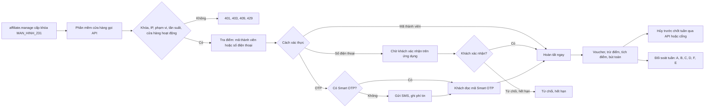

# CONG_VIEC_67: Cửa hàng liên kết phần 2 – tích, đổi điểm qua Open API (MODULE_12)

- Mô tả: Cửa hàng liên kết của CONG_VIEC_55 nối phần mềm bán hàng của mình với VComm qua Open API (CONG_VIEC_61) để tra điểm dùng được, tích, đổi điểm, dùng voucher, hủy giao dịch thay cho thao tác trên cổng `/merchant`. Khách xác thực bằng mã thành viên, xác nhận trên ứng dụng VComm, hoặc mã OTP (Smart OTP; chưa kích hoạt thì SMS, phí tin nhắn tính vào đối soát). Giao dịch qua API vào chung hạn mức, đối soát tuần, hạch toán, báo cáo, cảnh báo của CONG_VIEC_55.
- Phiên bản: 0.1
- Ngày cập nhật: 2026-11-12
- Trạng thái: Bản nháp, chờ người dùng duyệt đặc tả và bản mẫu.
- Nhánh: `chuc-nang/CONG_VIEC_67-cua-hang-lien-ket-2`.
- Nguồn: CONG_VIEC_61 (YCAU_NGHIEPVU_169, QUYTAC_NGHIEPVU_495 dự phòng, mục 16 điểm cần chốt cho L4), CONG_VIEC_55 (giao dịch, voucher, đối soát, hạch toán), CONG_VIEC_53 lát L6 (Smart OTP), CONG_VIEC_51 (sổ cái điểm); quyết định của người dùng ngày 2026-11-12 (mục 17).
- Mức: Lớn (sửa cấu trúc dữ liệu, API, bảng đối soát đã duyệt; nhiều module: MODULE_12, MODULE_16, MODULE_11).
- Phụ thuộc: CONG_VIEC_55, CONG_VIEC_61 (đã có trong `main`, bản 0.7.0). Không phụ thuộc mã chưa phát hành của CONG_VIEC_60.
- Thay đổi đã duyệt: thêm phí tin nhắn vào hợp đồng và bảng đối soát của CONG_VIEC_55 cần phiếu THAY_DOI (tài liệu `24`); đã đề nghị phiên điều phối cấp số.

## 1. Mục tiêu

Cửa hàng liên kết có phần mềm bán hàng riêng tích, đổi điểm VComm ngay trên phần mềm đó, không phải mở thêm cổng cửa hàng; công ty giữ nguyên kiểm soát rủi ro (hạn mức, đối soát, hạch toán) và kiểm soát khóa API (phạm vi, tần suất, nhật ký gọi).

## 2. Phạm vi

Trong phạm vi:
- Khóa API phạm vi `loyalty.member` gắn một cửa hàng liên kết và danh sách điểm bán; người có `affiliate.manage` cấp, cấp lại, sửa, thu hồi trong chi tiết cửa hàng.
- API cho phần mềm cửa hàng: điểm bán của khóa; tra điểm dùng được; gửi mã OTP SMS; tạo giao dịch (chống tạo trùng bằng mã giao dịch của đối tác); tra, liệt kê; hủy.
- Ba cách xác thực khách qua API: mã thành viên (cách 2 của CONG_VIEC_55), số điện thoại kèm xác nhận trên ứng dụng (cách 3), mã OTP (cách mới: Smart OTP hoặc SMS).
- Phí tin nhắn OTP theo hợp đồng, tính vào bảng đối soát tuần như phí dịch vụ.
- Cổng cửa hàng: chủ cửa hàng xem khóa của cửa hàng (không thấy khóa), số lần gọi, số tin nhắn trong kỳ. Giao dịch qua API hiện nguồn "Phần mềm cửa hàng" trên mọi danh sách giao dịch.

Ngoài phạm vi:
- Cách 1 (mã QR của cửa hàng) qua API: phần mềm cửa hàng dùng mã thành viên thay thế.
- Trả số dư điểm, tên đầy đủ, số điện thoại của khách cho đối tác.
- Webhook gọi ra phần mềm cửa hàng (đối tác hỏi lại trạng thái theo chu kỳ).
- Tạo, duyệt voucher qua API; đối soát qua API (giữ trên cổng cửa hàng).
- Đối tác liên minh điểm ngoài tập đoàn (CONG_VIEC_65).

## 3. Phân biệt với phần đã có

| Đối tượng | Nguồn | Công việc này |
|---|---|---|
| Giao dịch tại quầy trên cổng `/merchant` | CONG_VIEC_55 | Giữ nguyên; thêm nguồn `open_api`, thu ngân để trống khi qua API |
| Khóa API, nhật ký gọi, tần suất, IP | CONG_VIEC_61 | Dùng lại; khóa chỉ có `loyalty.member` không cần kênh bán, không cần hồ sơ khách hàng của đối tác |
| Smart OTP dùng điểm tại quầy | CONG_VIEC_53 | Dùng lại `SmartOtpService.verify` |
| Mã OTP SMS | CONG_VIEC_02, 23 | Dùng lại `PhoneOtpService` với mục đích mới `affiliate_redeem` |

## 4. Yêu cầu nghiệp vụ và chức năng

- YCAU_NGHIEPVU_169: Cửa hàng liên kết tra, tích, đổi điểm VComm cho hội viên qua phần mềm bán hàng của mình (Open API); hội viên xác thực bằng mã thành viên, xác nhận trên ứng dụng hoặc mã OTP; dùng chung hạn mức, đối soát, hạch toán của cửa hàng liên kết.

- CHUC_NANG_234: Quản lý khóa API của cửa hàng liên kết (web quản trị) và xem kết nối (cổng cửa hàng).
- CHUC_NANG_235: API điểm thưởng tại cửa hàng liên kết: điểm bán, tra điểm, gửi OTP, tạo, tra, hủy giao dịch; phí tin nhắn vào đối soát.

## 5. Quy tắc nghiệp vụ

- QUYTAC_NGHIEPVU_495 (chốt từ dự phòng của CONG_VIEC_61) Khóa API cửa hàng liên kết:
  1. Người có `affiliate.manage` ở công ty vận hành sàn cấp khóa cho cửa hàng ở trạng thái nháp, đang hoạt động hoặc tạm ngưng (không cấp cho cửa hàng đã chấm dứt). Khóa loại "Đối tác", đối tác là đối tác của cửa hàng, phạm vi đúng một giá trị `loyalty.member`, không kênh bán, không kho.
  2. Cấu hình: tên (như QUYTAC_NGHIEPVU_482), điểm bán (ít nhất một, thuộc cửa hàng), giới hạn mỗi phút (1 đến 600, mặc định 60), số tin OTP SMS tối đa mỗi ngày (0 đến 5.000, mặc định 200; 0 là không gửi SMS), hạn dùng, danh sách IP (tùy chọn). Định dạng khóa, băm, cấp lại, thu hồi, nhật ký gọi, nhật ký thao tác như QUYTAC_NGHIEPVU_480, 483, 487, 488, 493.
  3. Màn hình Khóa API của Nền tảng (MAN_HINH_224) hiện cả khóa cửa hàng liên kết (chỉ xem; sửa, thu hồi được bằng `platform.api_key.manage`); không cấp khóa `loyalty.member` ở màn hình đó.
  4. Xác thực khi gọi (bổ sung QUYTAC_NGHIEPVU_484): khóa `loyalty.member` không xét hồ sơ khách hàng của đối tác; đối tác ngừng giao dịch trả `401`. Cửa hàng không đang hoạt động hoặc ngoài thời hạn hợp đồng: API giao dịch, tra điểm, gửi OTP trả `409 BUSINESS_RULE` "Cửa hàng chưa hoạt động hoặc hợp đồng hết hạn."; tra, liệt kê giao dịch vẫn được.
  5. Điểm bán gửi theo `outletId`; điểm bán ngoài danh sách của khóa hoặc đã ngưng trả `422` trường `outletId`.

- Bổ sung QUYTAC_NGHIEPVU_394 (giao dịch qua API): giao dịch ghi nguồn `open_api`, khóa đã tạo, mã giao dịch đối tác; không có thu ngân. Mã giao dịch đối tác bắt buộc (1 đến 50 ký tự chữ, số, `-`, `_`, `.`), duy nhất theo cửa hàng; gửi lại cùng mã trả `200` kèm giao dịch đã có, không so nội dung (như QUYTAC_NGHIEPVU_491). Thứ tự tính tiền, tích, dùng điểm, voucher, hạn mức, quá hạn, trần mỗi giao dịch như QUYTAC_NGHIEPVU_394, 398, 399, 402.

- Bổ sung QUYTAC_NGHIEPVU_396, 397 (cách 2, 3 qua API):
  - Mã thành viên: phần mềm cửa hàng gửi chuỗi đọc được từ mã QR của khách; kiểm như cách 2; hoàn tất ngay.
  - Số điện thoại: tạo giao dịch chờ khách xác nhận trên ứng dụng (hết hạn 5 phút, một yêu cầu chờ mỗi số); giới hạn 10 yêu cầu bị từ chối hoặc hết hạn mỗi giờ tính theo khóa thay cho thu ngân. Phần mềm cửa hàng hỏi lại trạng thái bằng API tra giao dịch.

- Cách mới, mã OTP (bổ sung QUYTAC_NGHIEPVU_396):
  1. Phần mềm cửa hàng tra điểm bằng số điện thoại; kết quả cho biết khách có Smart OTP đang hoạt động hay không.
  2. Khách có Smart OTP: đọc mã 6 số trên ứng dụng VComm; kiểm bằng cách của CONG_VIEC_53 (bước 30 giây, mỗi bước dùng một lần, sai 5 lần liên tiếp khóa 15 phút).
  3. Khách chưa kích hoạt Smart OTP: phần mềm cửa hàng gọi API gửi mã; VComm gửi SMS mã 6 số (hiệu lực 5 phút, sai 5 lần hết hiệu lực, tối đa 5 mã mỗi giờ mỗi số – tính chung mọi mục đích). Khách có Smart OTP đang hoạt động thì không gửi SMS (`409` "Khách đã có Smart OTP, dùng mã trên ứng dụng VComm."). Số không có tài khoản người mua đang hoạt động: `409` "Số điện thoại chưa có tài khoản VComm.". Vượt số tin mỗi ngày của khóa: `429`.
  4. Tạo giao dịch kèm số điện thoại, mã OTP, số điểm muốn dùng, mã voucher (tùy chọn); mã đúng thì hoàn tất ngay, điểm dùng = nhỏ hơn giữa số yêu cầu và số tối đa dùng được (dưới mức tối thiểu thì không dùng điểm); mã sai trả `422` trường `otp`, không lập giao dịch.

- Bổ sung QUYTAC_NGHIEPVU_400 (hủy qua API): khóa hủy được giao dịch của chính cửa hàng (mọi nguồn) như chủ cửa hàng, lý do 1 đến 500 ký tự; nhật ký thao tác ghi tác nhân là khóa.

- Bổ sung QUYTAC_NGHIEPVU_402 (voucher qua API): voucher đi theo mã thành viên (cách 2), khách chọn khi xác nhận trên ứng dụng (cách 3); cách OTP: phần mềm cửa hàng gửi `voucherCode` khách đọc. Tra điểm trả danh sách voucher khách dùng được tại cửa hàng cho tiền hóa đơn (mã, tên, tiền giảm).

- Tra điểm (YCAU_NGHIEPVU_169): đầu vào điểm bán, tiền hóa đơn, mã thành viên hoặc số điện thoại. Kết quả: tên khách đã che, dùng điểm được hay không và lý do, điểm tối thiểu, tối đa dùng được, giá trị một điểm, điểm dự kiến tích (chưa xét hạn mức), voucher dùng được, khách có Smart OTP. Không trả số dư, tên đầy đủ, số điện thoại. Tra điểm không giữ điểm, không lập giao dịch.

- Bổ sung QUYTAC_NGHIEPVU_392, 403, 404 (phí tin nhắn):
  1. Hợp đồng thêm "Phí mỗi tin OTP" (đồng, 0 đến 10.000, mặc định 0); sửa áp cho tin gửi sau khi sửa.
  2. Mỗi tin SMS gửi thành công qua API ghi một dòng phí (cửa hàng, khóa, thời điểm, đơn giá lúc gửi). Gửi lỗi không tính. Máy phát triển ghi log vẫn tính để kiểm thử.
  3. Bảng đối soát tuần thêm phí tin nhắn (F) = tổng đơn giá các tin trong tuần; thuế của phí (E) = làm tròn ((D + F) × thuế suất); số còn lại = A + D + F + E − B − C (cộng phần thiếu, điều chỉnh như cũ). Cửa hàng có tin nhắn nhưng không có giao dịch trong tuần vẫn lập bảng.
  4. Hạch toán khi xác nhận bảng: F như phí dịch vụ, Có 511 vai trò `affiliate_fee_revenue`, thuế Có 3331; bên Nợ theo cách hiện có (331, phần vượt 131 bù trừ).

Thông báo lỗi mới (vi): "Khách đã có Smart OTP, dùng mã trên ứng dụng VComm."; "Mã OTP không đúng hoặc đã hết hạn."; "Đã hết số tin nhắn OTP trong ngày của khóa API."

## 6. Vai trò và quyền

| Chức năng | Quản trị tập đoàn, quản trị công ty | `affiliate.manage` | `affiliate.view` | `platform.api_key.manage` | Chủ cửa hàng | Thu ngân | Khóa API |
|---|---|---|---|---|---|---|---|
| Cấp, sửa, cấp lại, thu hồi khóa cửa hàng | Có | Có | Không | Sửa, thu hồi ở MAN_HINH_224 | Không | Không | Không |
| Xem khóa cửa hàng, nhật ký gọi | Có | Có | Có | Có | Khóa của cửa hàng mình | Không | Không |
| API điểm thưởng | Không | Không | Không | Không | Không | Không | Theo khóa, điểm bán của khóa |

Không thêm quyền mới.

## 7. Luồng nghiệp vụ

Luồng 63 (tích, đổi điểm qua Open API):

## 8. Màn hình

| Mã | Tên | Ứng dụng | Nội dung | Bản mẫu |
|---|---|---|---|---|
| MAN_HINH_231 | Kết nối phần mềm (thẻ trong chi tiết cửa hàng MAN_HINH_178) | `apps/web-crm` | Danh sách khóa của cửa hàng (tên, đầu khóa, điểm bán, giới hạn mỗi phút, tin SMS mỗi ngày, hạn, lần gọi gần nhất, trạng thái); ngăn kéo cấp, sửa; hộp hiện khóa một lần; cấp lại; thu hồi; liên kết nhật ký gọi (MAN_HINH_226 lọc theo khóa). Phí mỗi tin OTP trong phần hợp đồng | `ban_mau/MAN_HINH_231_KET_NOI_PHAN_MEM.html` |
| MAN_HINH_232 | Kết nối phần mềm (chủ cửa hàng) | `apps/web-affiliate` | Chỉ xem: khóa của cửa hàng, điểm bán, trạng thái, lần gọi gần nhất; số lần gọi và số tin SMS hôm nay, tuần này; phí tin nhắn tạm tính | `ban_mau/MAN_HINH_232_KET_NOI_PHAN_MEM_CUA_HANG.html` |
| MAN_HINH_233 | Dự phòng | — | Chưa dùng | — |

Sửa màn hình đã có: danh sách giao dịch (MAN_HINH_174 giao dịch hôm nay, MAN_HINH_176 thẻ Giao dịch, MAN_HINH_180 thẻ Giao dịch) hiện cách "Mã OTP" và nhãn nguồn "Phần mềm cửa hàng" thay tên thu ngân; bảng đối soát (MAN_HINH_176, MAN_HINH_180) thêm dòng "Phí tin nhắn OTP (F)" và số tin; hợp đồng (MAN_HINH_178) thêm "Phí mỗi tin OTP"; ứng dụng VComm (MAN_HINH_181) yêu cầu xác nhận hiện "Phần mềm cửa hàng" như yêu cầu cách 3.

## 9. Dữ liệu

| Database migration | Bảng, cột | Nội dung |
|---|---|---|
| 0146 (L1) | `core.api_keys` | `channel_id` cho phép trống; ràng buộc: trống khi và chỉ khi `scopes = {loyalty.member}` |
| 0146 (L1) | `affiliate.api_keys` | `api_key_id` (khóa chính, khóa ngoại `core.api_keys`), `merchant_id`, `sms_daily_limit` (0 đến 5.000, mặc định 200) |
| 0146 (L1) | `affiliate.api_key_outlets` | (`api_key_id`, `outlet_id`) khóa chính |
| 0147 (L1) | `affiliate.transactions` | `cashier_user_id` cho phép trống; thêm `source` (`portal`, `open_api`, mặc định `portal`), `api_key_id`, `partner_transaction_code`; ràng buộc: `open_api` khi và chỉ khi có khóa, mã đối tác, không thu ngân; `method` thêm `otp` (ràng buộc định nghĩa lại gồm `merchant_qr`, `buyer_qr`, `phone`, `otp`); chỉ mục duy nhất (`merchant_id`, `partner_transaction_code`) khi có mã; chỉ mục (`api_key_id`, `created_at`) |
| 0148 (L2) | `affiliate.merchants` | `sms_fee` numeric(18,4) mặc định 0, 0 đến 10.000 |
| 0148 (L2) | `affiliate.sms_charges` | `id`, `merchant_id`, `api_key_id`, `buyer_user_id`, `unit_price`, `sent_at`, `settlement_id`; chỉ mục (`merchant_id`, `sent_at`), (`api_key_id`, `sent_at`) |
| 0148 (L2) | `affiliate.settlements` | thêm `sms_count`, `sms_fee_amount` (F); định nghĩa lại ràng buộc `net_amount` gồm F |
| 0148 (L2) | `core.otp_codes` | ràng buộc `purpose` định nghĩa lại gồm mọi giá trị trên `main` mới nhất và `affiliate_redeem` |

Không đổi nguồn chứng từ `loyalty`, `accounting.journals`, `finance.debt_items` (giao dịch qua API dùng nguồn `affiliate_transaction` sẵn có).

## 10. API

Điểm tiếp nhận cho nhân viên và cổng cửa hàng (gốc `/api/v1`):

| Mã | Phương thức, đường dẫn | Quyền | Mô tả |
|---|---|---|---|
| API_295 | `GET`, `POST /affiliate/merchants/{id}/api-keys`; `PATCH /affiliate/api-keys/{id}`; `POST /affiliate/api-keys/{id}/rotate`, `/revoke`; `GET /merchant-portal/api-keys` | xem: `affiliate.view`; sửa: `affiliate.manage`; cổng: chủ cửa hàng | Quản lý khóa của cửa hàng (QUYTAC_NGHIEPVU_495); cấp, cấp lại trả `secret` một lần; cổng cửa hàng chỉ xem kèm số lần gọi, số tin SMS |

Điểm tiếp nhận cho phần mềm cửa hàng (khóa API phạm vi `loyalty.member`, gốc `/api/v1/open/affiliate`):

| Mã | Phương thức, đường dẫn | Mô tả |
|---|---|---|
| API_296 | `GET /outlets`; `POST /quote` | Điểm bán của khóa; tra điểm (`outletId`, `billAmount`, `memberCode` hoặc `phone`) |
| API_297 | `POST /otp` | Gửi mã OTP SMS (`phone`); `204` khi gửi |
| API_298 | `POST /transactions` | Tạo giao dịch: `partnerTransactionCode`, `outletId`, `billAmount`, `method` (`member_code`, `phone`, `otp`), `memberCode` hoặc `phone`, `otp`, `points`, `voucherCode`. `201` khi tạo mới (hoàn tất hoặc chờ), `200` khi mã đã có |
| API_299 | `GET /transactions`, `GET /transactions/{partnerTransactionCode}` | Liệt kê (lọc `status`, `from`, `to`, `page`, `pageSize` ≤ 100), tra trạng thái và số liệu giao dịch của cửa hàng tạo qua API |
| API_300 | `POST /transactions/{partnerTransactionCode}/cancel` | Hủy (`reason`) |

Kết quả giao dịch: mã đối tác, số `LK…`, trạng thái, cách, điểm bán, tiền hóa đơn, tiền giảm voucher, điểm dùng, tiền điểm, khách trả, điểm tích, lý do không tích, tên khách đã che, thời điểm. Nhật ký gọi giữ thêm tham số cho phép `status`, `from`, `to`.

## 11. Dùng lại mã đã có

| Việc | Mã dùng lại | Thay đổi |
|---|---|---|
| Khóa, băm, cấp lại, thu hồi | `open-api/api-keys.service.ts`, `api-key-secret.ts` | Tách phần ghi khóa dùng chung; cho phép khóa không kênh khi chỉ `loyalty.member` |
| Xác thực, tần suất, nhật ký gọi | `open-api/api-key.guard.ts` | Khóa `loyalty.member` không xét hồ sơ khách hàng; nạp cửa hàng, điểm bán của khóa |
| Giao dịch, tích, đổi, hủy, voucher | `affiliate/transactions.service.ts`, `vouchers.service.ts`, `postings.ts` | Tách tác nhân (thành viên cổng hoặc khóa API); thêm cách `otp` |
| Smart OTP | `loyalty/smart-otp.service.ts` (`state`, `verify`) | Không đổi |
| OTP SMS | `auth/phone-otp.service.ts` (`send`, `consume`) | Thêm mục đích `affiliate_redeem`; `send` trả đã gửi hay chưa để tính phí |
| Đối soát, hạch toán | `affiliate/settlements.service.ts` | Thêm F vào lập bảng, bút toán phí |
| Giao diện | `packages/ui`, màn hình Khóa API của CONG_VIEC_61 | Không thêm thư viện |

## 12. Phân tích giải pháp có sẵn – CONG_VIEC_67 – 2026-11-12

- Nguồn đã tìm: mã nguồn dự án (CONG_VIEC_51, 53, 55, 61); nguồn riêng `V-com-ERP` đã đánh giá ở CONG_VIEC_61 mục 12 (nhóm `/api/openapi/*` điểm thưởng không có xác thực khách, khóa lưu rõ).
- Phương án: dùng lại hạ tầng của dự án có điều chỉnh (mục 11); không thêm thư viện, không thêm hạ tầng.
- Đề xuất: như trên. Chờ người dùng duyệt cùng đặc tả.

## 13. Tiêu chí nghiệm thu

| Mã | Tiêu chí | Mức | Lát |
|---|---|---|---|
| TIEUCHI_NGHIEMTHU_504 | `affiliate.manage` cấp khóa cho cửa hàng: nhận `vck_…` một lần, phạm vi đúng `loyalty.member`, điểm bán thuộc cửa hàng; cửa hàng đã chấm dứt, điểm bán cửa hàng khác bị từ chối; `affiliate.view` chỉ xem; chủ cửa hàng chỉ xem khóa cửa hàng mình | Bắt buộc | L1 |
| TIEUCHI_NGHIEMTHU_505 | Khóa cửa hàng gọi API ngoài `loyalty.member` nhận `403`; khóa khác phạm vi gọi API điểm nhận `403`; cửa hàng tạm ngưng nhận `409` khi tạo giao dịch nhưng tra được giao dịch; điểm bán ngoài khóa nhận `422` | Bắt buộc | L1 |
| TIEUCHI_NGHIEMTHU_506 | Tra điểm trả điểm tối thiểu, tối đa, điểm dự kiến, voucher dùng được, tên đã che; không có số dư, số điện thoại, tên đầy đủ | Bắt buộc | L1 |
| TIEUCHI_NGHIEMTHU_507 | Mã thành viên qua API hoàn tất ngay, dùng một lần, hết hạn 60 giây; số tiền, điểm tích, dùng, voucher, hạn mức bằng giao dịch cùng dữ liệu trên cổng cửa hàng | Bắt buộc | L1 |
| TIEUCHI_NGHIEMTHU_508 | Số điện thoại qua API: chờ khách xác nhận trên ứng dụng, tra trạng thái thấy hoàn tất, từ chối, hết hạn; giới hạn 10 lần từ chối mỗi giờ theo khóa | Bắt buộc | L1 |
| TIEUCHI_NGHIEMTHU_509 | Gửi lại cùng mã giao dịch đối tác (kể cả hai lần cùng lúc) chỉ có một giao dịch, lần sau `200`; hủy qua API hoàn điểm, trừ điểm tích, trả voucher, bút toán ngược; tuần đã chốt không hủy được | Bắt buộc | L1 |
| TIEUCHI_NGHIEMTHU_510 | OTP: khách có Smart OTP hoàn tất bằng mã đúng, sai 5 lần bị khóa; khách chưa có Smart OTP nhận SMS, mã đúng hoàn tất, mã sai `422`; khách có Smart OTP không gửi SMS; giới hạn 5 mã mỗi giờ mỗi số, số tin mỗi ngày của khóa | Bắt buộc | L2 |
| TIEUCHI_NGHIEMTHU_511 | Mỗi tin SMS gửi thành công ghi phí theo đơn giá hợp đồng lúc gửi; bảng đối soát tuần có F, E tính trên D + F, số còn lại đúng; bút toán F vào 511, thuế vào 3331 | Bắt buộc | L2 |
| TIEUCHI_NGHIEMTHU_512 | Giao dịch qua API vào báo cáo, cảnh báo, đối soát như giao dịch cổng; danh sách giao dịch hiện nguồn "Phần mềm cửa hàng"; nhật ký gọi ghi mỗi lần gọi, không có mã OTP, số điện thoại | Bắt buộc | L1 |
| TIEUCHI_NGHIEMTHU_513 | MAN_HINH_231, 232 và phần sửa màn hình đủ trạng thái rỗng, đang tải, lỗi, không quyền; tiếng Việt, tiếng Anh; chạy được trên máy tính, máy tính bảng, điện thoại | Bắt buộc | L1, L2 |

## 14. Kịch bản kiểm thử

| Mã | Tiêu chí | Kịch bản | Loại |
|---|---|---|---|
| KICHBAN_KIEMTHU_693 | 504 | Cấp khóa đúng, cửa hàng chấm dứt, điểm bán cửa hàng khác, `affiliate.view` gọi cấp, chủ cửa hàng khác xem | Tích hợp |
| KICHBAN_KIEMTHU_694 | 505 | Phạm vi sai hai chiều, cửa hàng tạm ngưng, điểm bán ngoài khóa | Tích hợp |
| KICHBAN_KIEMTHU_695 | 506 | Tra điểm theo mã thành viên, số điện thoại; kiểm không có trường số dư, số điện thoại | Tích hợp |
| KICHBAN_KIEMTHU_696 | 507 | Mã thành viên qua API so số liệu với cổng; mã dùng lại, quá 60 giây | Tích hợp |
| KICHBAN_KIEMTHU_697 | 507 | Vượt hạn mức, quá hạn thanh toán: không tích, vẫn dùng điểm | Tích hợp |
| KICHBAN_KIEMTHU_698 | 508 | Số điện thoại: xác nhận, từ chối, hết hạn; lần từ chối thứ 11 trong giờ | Tích hợp |
| KICHBAN_KIEMTHU_699 | 509 | Hai yêu cầu song song cùng mã; hủy trước, sau chốt tuần | Tích hợp |
| KICHBAN_KIEMTHU_700 | 510 | Smart OTP đúng, sai 5 lần; SMS đúng, sai; khách có Smart OTP gọi gửi SMS; vượt 5 mã mỗi giờ; vượt số tin của khóa | Tích hợp |
| KICHBAN_KIEMTHU_701 | 511 | Ba tin SMS, đơn giá đổi giữa tuần; lập bảng, kiểm F, E, số còn lại, bút toán | Tích hợp |
| KICHBAN_KIEMTHU_702 | 512 | Báo cáo, cảnh báo đếm giao dịch API; nhật ký gọi không chứa `otp`, `phone` | Tích hợp |
| KICHBAN_KIEMTHU_703 | 513 | MAN_HINH_231: cấp, sao chép, cấp lại, thu hồi; năm trạng thái; đổi ngôn ngữ | Giao diện (ảnh chụp) |
| KICHBAN_KIEMTHU_704 | 513 | MAN_HINH_232, bảng đối soát có F, danh sách giao dịch có nguồn API; ba kích thước màn hình | Giao diện (ảnh chụp) |

Kiểm thử tự động: `apps/api/test/c67-*.test.ts`.

## 15. Ràng buộc kỹ thuật

- Mỗi mini app chỉ ghi schema của mình: phần `affiliate` không ghi trực tiếp `core.api_keys`, gọi service khóa API của Nền tảng.
- Mọi truy vấn của khóa lọc theo cửa hàng của khóa (từ `affiliate.api_keys`), điểm bán của khóa.
- Mã OTP, số điện thoại, mã thành viên không ghi vào nhật ký gọi, log, nhật ký thao tác.
- Chống tạo trùng dựa trên chỉ mục duy nhất, bắt lỗi trùng rồi trả giao dịch cũ.
- Ràng buộc kiểm tra dùng chung định nghĩa lại gồm mọi giá trị trên `main` mới nhất.

## 16. Thành phần không được thay đổi

- Giao dịch, voucher, đối soát, hạch toán của cổng cửa hàng (CONG_VIEC_55), trừ thêm F vào bảng đối soát theo phiếu thay đổi.
- Khóa API, xác thực, tần suất của các phạm vi khác (CONG_VIEC_61); Smart OTP (CONG_VIEC_53); sổ cái điểm (CONG_VIEC_51).

## 17. Quyết định của người dùng (2026-11-12)

| Câu hỏi | Quyết định |
|---|---|
| Đối tác Open API | Là cửa hàng liên kết của CONG_VIEC_55, dùng chung hợp đồng, hạn mức, phí, đối soát, hạch toán |
| Xác thực khách | Mã thành viên, xác nhận trên ứng dụng và OTP |
| Loại OTP | Smart OTP; chưa kích hoạt thì SMS |
| Phí SMS | Tính vào đối soát cửa hàng; đơn giá mỗi tin theo hợp đồng; hạch toán, thuế như phí dịch vụ |
| Chống lạm dụng SMS | 5 mã mỗi giờ mỗi số; số tin mỗi ngày theo khóa (mặc định 200) |
| Tra điểm | Chỉ điểm dùng được, điểm dự kiến; không trả số dư |
| Cấp khóa | Người có `affiliate.manage` trong chi tiết cửa hàng |
| Điểm bán | Khóa gắn danh sách điểm bán |
| Hủy qua API | Được, như chủ cửa hàng |
| Voucher qua API | Được |

## 18. Các lát và điểm xem trước

| Lát | Nội dung | Điểm xem trước |
|---|---|---|
| L1 | Database migration 0146, 0147; API_295 (MAN_HINH_231, 232); API_296, 298 (mã thành viên, số điện thoại), 299, 300; nhãn nguồn trên danh sách giao dịch | Ảnh MAN_HINH_231, 232; `curl` tra điểm, tạo bằng mã thành viên, số điện thoại (xác nhận trên ứng dụng), gửi lại cùng mã, hủy |
| L2 | Database migration 0148; cách OTP (Smart OTP, SMS, API_297); phí tin nhắn, bảng đối soát F, bút toán; sửa màn hình hợp đồng, đối soát | `curl` OTP hai loại; chạy việc nền lập bảng, ảnh bảng đối soát có F |

## 19. Điểm chưa xác định

- Số phiếu THAY_DOI cho phần phí tin nhắn (chờ phiên điều phối cấp).
- Tài liệu hướng dẫn tích hợp cho cửa hàng: gửi bản trích tài liệu `17` như CONG_VIEC_61.
- Ý kiến luật sư về điểm thưởng (như CONG_VIEC_51, 55): chặn phát hành thật, không chặn xây dựng.
