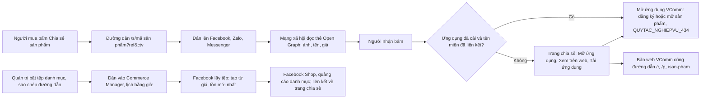

# CONG_VIEC_68: Chia sẻ sản phẩm lên mạng xã hội (MODULE_09)

- Mô tả: Đường dẫn chia sẻ sản phẩm hiện thẻ xem trước có ảnh, tên, giá trên Facebook, Zalo, Messenger, giữ mã giới thiệu và mã cộng tác viên, mở ứng dụng VComm hoặc bản web; tệp danh mục sản phẩm theo chuẩn Facebook Commerce Manager tự cập nhật giá, tồn.
- Phiên bản: 0.1
- Ngày cập nhật: 2026-11-12
- Trạng thái: Đang thực hiện (đặc tả, bản mẫu đã duyệt 2026-11-12)
- Mức: Vừa (chức năng mới trong MODULE_09; thêm cột vào bảng có sẵn, thêm endpoint; không đổi kiến trúc, không đổi API đang dùng).
- Nhánh: `chuc-nang/CONG_VIEC_68-chia-se-mang-xa-hoi`.
- Nguồn: yêu cầu của người dùng ngày 2026-11-12; quyết định của người dùng (mục 17).
- Phụ thuộc: CONG_VIEC_22 (nút "Chia sẻ sản phẩm", QUYTAC_NGHIEPVU_434), CONG_VIEC_49 (mã cộng tác viên, QUYTAC_NGHIEPVU_325), CONG_VIEC_24 (cửa hàng VComm, đăng bán, giá kênh).

## 1. Mục tiêu

Người mua, cộng tác viên dán đường dẫn sản phẩm lên Facebook, Zalo, Messenger thì hiện thẻ có ảnh, tên, giá như Lazada; người nhận bấm vào mua được ngay, hoa hồng vẫn theo mã giới thiệu và mã cộng tác viên. Công ty đưa toàn bộ sản phẩm đang bán lên Facebook Shop bằng tệp danh mục tự cập nhật.

## 2. Phạm vi

Trong phạm vi: CHUC_NANG_240 (phần 1), CHUC_NANG_241 (phần 2).

Ngoài phạm vi:

- Giá khuyến mãi trên thẻ và trong tệp danh mục (người dùng chọn giá kênh).
- Ảnh có khung thương hiệu (cần thư viện xử lý ảnh).
- Đẩy danh mục qua Graph API, thanh toán trên Facebook, đồng bộ đơn từ Facebook.
- Tạo Trang Facebook doanh nghiệp, tài khoản Commerce Manager (người dùng tự làm theo hướng dẫn mục 16).
- Phát hành ứng dụng lên App Store, Google Play; khai báo tên miền liên kết trong bản dựng ứng dụng (làm khi phát hành ứng dụng, mục 16).
- MAN_HINH_267, MAN_HINH_268, database migration 0155 không dùng, trả phiên điều phối.

## 3. Yêu cầu nghiệp vụ

| Mã                | Yêu cầu                                                                                                                                                  | Người cần                         |
| ----------------- | -------------------------------------------------------------------------------------------------------------------------------------------------------- | --------------------------------- |
| YCAU_NGHIEPVU_198 | Đường dẫn chia sẻ sản phẩm dán lên Facebook, Zalo, Messenger hiện thẻ xem trước có ảnh, tên, giá, mô tả ngắn, tên cửa hàng; giữ mã giới thiệu, cộng tác viên | Người mua, cộng tác viên          |
| YCAU_NGHIEPVU_199 | Người nhận bấm đường dẫn: mở ứng dụng VComm nếu đã cài; không thì xem trên bản web hoặc tải ứng dụng                                                      | Người nhận đường dẫn              |
| YCAU_NGHIEPVU_200 | Danh mục sản phẩm đang bán trên VComm có mặt trên Facebook Commerce Manager, giá và tình trạng còn hàng tự cập nhật                                     | Quản lý bán hàng VComm            |
| YCAU_NGHIEPVU_201 | Quản trị bật, tắt, lấy đường dẫn, đổi mã bí mật của tệp danh mục; người ngoài không tải được toàn bộ danh mục                                            | Quản lý bán hàng VComm            |

## 4. Chức năng

| Mã            | Chức năng                                                                                                                                                                  | Yêu cầu                              | Màn hình                                              | API                | Lát |
| ------------- | -------------------------------------------------------------------------------------------------------------------------------------------------------------------------- | ------------------------------------ | ----------------------------------------------------- | ------------------ | --- |
| CHUC_NANG_240 | Trang chia sẻ sản phẩm công khai có thẻ Open Graph, nút mở ứng dụng, xem trên web, tải ứng dụng; tệp liên kết ứng dụng; nút "Chia sẻ sản phẩm" trong ứng dụng tạo đường dẫn mới | YCAU_NGHIEPVU_198, YCAU_NGHIEPVU_199 | MAN_HINH_266 (mới); sửa MAN_HINH_201                  | API_314, API_315   | L1  |
| CHUC_NANG_241 | Tệp danh mục sản phẩm CSV theo chuẩn Facebook, tạo khi được gọi; thẻ "Tệp danh mục Facebook" ở Cài đặt bán hàng VComm                                                       | YCAU_NGHIEPVU_200, YCAU_NGHIEPVU_201 | Sửa MAN_HINH_86                                       | API_316, API_317   | L2  |

## 5. Quy tắc nghiệp vụ

| Mã                 | Nội dung                                                                                                                                                                                                                                                                                                                                                                                                                                                                       |
| ------------------ | ---------------------------------------------------------------------------------------------------------------------------------------------------------------------------------------------------------------------------------------------------------------------------------------------------------------------------------------------------------------------------------------------------------------------------------------------------------------------------- |
| QUYTAC_NGHIEPVU_552 | Đường dẫn chia sẻ: `<địa chỉ chia sẻ>/s/<mã sản phẩm>`, có thêm `ref=<mã giới thiệu>` khi người chia sẻ có mã giới thiệu, `ctv=<mã cộng tác viên>` khi là cộng tác viên Đã duyệt (thay đường dẫn `/r/…?sp=`, `/p/…?ctv=` của QUYTAC_NGHIEPVU_434 trong nút "Chia sẻ sản phẩm"). `<địa chỉ chia sẻ>` là biến cấu hình `SHARE_PUBLIC_URL`. Đường dẫn cũ `/r/`, `/p/` vẫn chạy. `ref` chỉ nhận số và dấu `+`, tối đa 15 ký tự; `ctv` chỉ nhận chữ, số, tối đa 8 ký tự; sai dạng thì bỏ qua tham số đó, trang vẫn hiện |
| QUYTAC_NGHIEPVU_553 | Nội dung thẻ xem trước (Open Graph, cùng nội dung trên trang): tiêu đề là tên sản phẩm; ảnh là ảnh đầu tiên của sản phẩm (không có ảnh thì không có thẻ ảnh); giá là giá kênh VComm gồm thuế như trên ứng dụng, nhiều phân loại khác giá thì ghi "Từ <giá thấp nhất>"; mô tả ngắn lấy mô tả đăng bán (không có thì mô tả sản phẩm), bỏ xuống dòng, tối đa 160 ký tự; tên cửa hàng là tên ngắn của công ty vận hành sàn. Không có giá khuyến mãi                                  |
| QUYTAC_NGHIEPVU_554 | Chỉ sản phẩm đang hiện trên cửa hàng VComm (đăng bán, đã duyệt, đang bán, có giá kênh) có trang chia sẻ. Sản phẩm khác, mã sai hoặc cửa hàng chưa cài đặt: trang báo "Sản phẩm không còn bán." kèm nút "Xem cửa hàng VComm" (mã trạng thái `404`), không có thẻ ảnh, giá. Hết hàng vẫn hiện trang, ghi "Hết hàng"                                                                                                                                                              |
| QUYTAC_NGHIEPVU_555 | Người nhận mở trang: nút "Mở ứng dụng VComm" mở `vcomm://` cùng đường dẫn ứng dụng; nút "Xem trên web" mở bản web VComm (`VCOMM_WEB_URL`); nút "Tải ứng dụng" cho App Store, Google Play khi có `APP_STORE_URL`, `GOOGLE_PLAY_URL`. Đường dẫn ứng dụng theo QUYTAC_NGHIEPVU_434: có `ref` thì `/r/<ref>?sp=<mã sản phẩm>[&ctv=]`; chỉ có `ctv` thì `/p/<mã sản phẩm>?ctv=`; không có mã thì `/san-pham/<mã sản phẩm>`. Đăng ký, ghi lượt bấm cộng tác viên, mở sản phẩm theo QUYTAC_NGHIEPVU_434, 325 (không đổi). Trang không tự chuyển hướng, không ghi lượt bấm |
| QUYTAC_NGHIEPVU_556 | Tệp liên kết ứng dụng: `/.well-known/apple-app-site-association` (khi có `APPLE_TEAM_ID`) và `/.well-known/assetlinks.json` (khi có `ANDROID_SHA256_CERT_FINGERPRINTS`) khai đường dẫn `/s/*` cho ứng dụng `vn.vcomm.app`; chưa cấu hình thì `404`. Ứng dụng mở bằng đường dẫn `/s/<mã sản phẩm>` thì chuyển như QUYTAC_NGHIEPVU_555                                                                                                                                      |
| QUYTAC_NGHIEPVU_557 | Tệp danh mục Facebook (CSV, UTF-8, chuẩn Commerce Manager): mỗi phân loại một dòng; gồm mọi sản phẩm đang hiện trên cửa hàng VComm (QUYTAC_NGHIEPVU_554) có ít nhất một ảnh; sản phẩm chưa có ảnh không đưa vào (Facebook bắt buộc ảnh). Cột: `id` (mã SKU), `item_group_id` (mã sản phẩm), `title` (tên, kèm giá trị phân loại), `description`, `availability` (`in stock` khi số có thể bán của phân loại lớn hơn 0, ngược lại `out of stock`), `condition` (`new`), `price` (giá kênh gồm thuế, dạng `129000 VND`), `link` (trang chia sẻ không mã), `image_link`, `additional_image_link` (tối đa 10 ảnh tiếp theo), `brand` (thương hiệu sản phẩm, không có thì tên ngắn công ty), `additional_variant_attribute` (tên phân loại:giá trị). Sản phẩm ngừng bán rời khỏi tệp ở lần lấy sau |
| QUYTAC_NGHIEPVU_558 | Bảo vệ tệp: đường dẫn `<địa chỉ chia sẻ>/api/v1/public/product-feeds/facebook/<mã bí mật>.csv`; mã bí mật 32 byte ngẫu nhiên. Mặc định tắt. Người có `marketplace.order.manage` bật, tắt, tạo lại mã (mã cũ hết hiệu lực ngay), thấy và sao chép đường dẫn; người chỉ có `marketplace.order.view` thấy trạng thái, lần lấy gần nhất, không thấy đường dẫn. Tắt, mã sai, cửa hàng chưa cài đặt: `404`. Bật, tắt, tạo lại mã ghi nhật ký thao tác (không ghi mã)          |
| QUYTAC_NGHIEPVU_559 | Tần suất: tệp tạo từ giá, tồn mới nhất khi được gọi, giữ tạm 5 phút; bật, tắt, tạo lại mã xóa bản giữ tạm. Hệ thống lưu thời điểm lấy gần nhất. Người dùng đặt lịch lấy hằng giờ trong Commerce Manager                                                                                                                                                                                                                                                                   |

## 6. Vai trò và quyền

Không thêm quyền.

| Chức năng                                    | Người ngoài (không đăng nhập) | Người mua                 | `marketplace.order.view` | `marketplace.order.manage` |
| -------------------------------------------- | ----------------------------- | ------------------------- | ------------------------ | -------------------------- |
| Trang chia sẻ, tệp liên kết (API_314, 315)   | Xem                           | Xem                       | Xem                      | Xem                        |
| Nút "Chia sẻ sản phẩm" tạo đường dẫn mới     | Không                         | Có                        | Không                    | Không                      |
| Tệp danh mục (API_316)                       | Có mã bí mật                  | Có mã bí mật              | Có mã bí mật             | Có mã bí mật               |
| Thẻ Tệp danh mục Facebook (API_317)          | Không                         | Không                     | Xem trạng thái           | Xem, bật, tắt, tạo lại mã  |

## 7. Luồng nghiệp vụ

Luồng 65 (chia sẻ sản phẩm lên mạng xã hội):

Ngoại lệ: sản phẩm ngừng bán thì trang báo "Sản phẩm không còn bán.", lần lấy tệp sau sản phẩm rời danh mục; tạo lại mã thì Commerce Manager báo lỗi lấy tệp đến khi dán đường dẫn mới.

## 8. Màn hình

| Màn hình     | Nơi                         | Nội dung                                                                                                                                                                                                                                                             | Bản mẫu                                     |
| ------------ | --------------------------- | -------------------------------------------------------------------------------------------------------------------------------------------------------------------------------------------------------------------------------------------------------------------- | ------------------------------------------- |
| MAN_HINH_266 | Trang công khai (API trả HTML) | Trang chia sẻ sản phẩm: ảnh, tên, giá ("Từ" khi nhiều giá), Hết hàng, mô tả ngắn, tên cửa hàng; nút "Mở ứng dụng VComm", "Xem trên web", "Tải trên App Store", "Tải trên Google Play" (khi có cấu hình); trạng thái "Sản phẩm không còn bán." với nút "Xem cửa hàng VComm". Điện thoại và máy tính; tiếng Việt, tiếng Anh theo ngôn ngữ trình duyệt | `ban_mau/MAN_HINH_266_TRANG_CHIA_SE_SAN_PHAM.html` |
| MAN_HINH_201 (sửa) | Ứng dụng VComm         | Nội dung gửi đi dùng đường dẫn mới (QUYTAC_NGHIEPVU_552); giải thích thêm "Dán lên Facebook, Zalo sẽ hiện ảnh, tên, giá sản phẩm."                                                                                                                               | `ban_mau/MAN_HINH_266_TRANG_CHIA_SE_SAN_PHAM.html` (khung bên) |
| MAN_HINH_86 (sửa) | Web-crm `/crm/store-settings` | Thẻ "Tệp danh mục Facebook": nhãn Đang bật hoặc Đang tắt, nút Bật, Tắt; đường dẫn tệp và nút Sao chép (chỉ người có quyền sửa); "Facebook lấy lần gần nhất"; nút "Tạo lại mã" có hộp xác nhận; hướng dẫn ngắn gắn vào Commerce Manager                           | `ban_mau/SUA_CAI_DAT_BAN_HANG_TEP_DANH_MUC.html` |

Không thêm giá trị vào tài liệu `15`: trang chia sẻ dùng màu, chữ, khoảng cách của `packages/ui` (chép giá trị như `apps/mobile-vcomm/src/lib/theme.ts`).

## 9. Dữ liệu

| Database migration | Bảng, cột                   | Nội dung                                                                                                                                                                                         |
| ------------------ | --------------------------- | ------------------------------------------------------------------------------------------------------------------------------------------------------------------------------------------------ |
| 0154               | `marketplace.store_settings` | Thêm `facebook_feed_enabled` (boolean, mặc định `false`), `facebook_feed_token` (text, duy nhất, 43 ký tự base64url, có thể trống), `facebook_feed_token_created_at`, `facebook_feed_fetched_at` (timestamptz) |

Không xóa dữ liệu. Không định nghĩa lại ràng buộc kiểm tra dùng chung.

## 10. API

| Mã      | Phương thức, đường dẫn                                                                 | Mô tả                                                                                                                                                                       |
| ------- | -------------------------------------------------------------------------------------- | --------------------------------------------------------------------------------------------------------------------------------------------------------------------------- |
| API_314 | `GET /s/{productId}` (ngoài tiền tố `/api/v1`, không đăng nhập)                         | Trang chia sẻ HTML (MAN_HINH_266); tham số `ref`, `ctv`. `200` hoặc `404` (QUYTAC_NGHIEPVU_554); `Cache-Control: public, max-age=300`; Content-Security-Policy không cho chạy script |
| API_315 | `GET /.well-known/apple-app-site-association`, `GET /.well-known/assetlinks.json`      | Tệp liên kết ứng dụng (QUYTAC_NGHIEPVU_556), `application/json`; chưa cấu hình `404`                                                                                         |
| API_316 | `GET /api/v1/public/product-feeds/facebook/{token}.csv` (không đăng nhập)               | Tệp danh mục CSV (QUYTAC_NGHIEPVU_557, 558, 559); `text/csv; charset=utf-8`; sai mã hoặc tắt `404`                                                                         |
| API_317 | `GET /api/v1/marketplace/product-feed`; `PUT /api/v1/marketplace/product-feed` (`enabled`, `version`); `POST /api/v1/marketplace/product-feed/regenerate` (`version`) | Trạng thái (`enabled`, `url` khi có quyền sửa, `tokenCreatedAt`, `lastFetchedAt`, `productCount`, `version`), bật, tắt, tạo lại mã. Bật lần đầu tự tạo mã. Sai `version` `409 CONFLICT_VERSION` |

Ảnh trong thẻ, tệp: `<địa chỉ chia sẻ>/api/v1/buyer/shop/images/{imageId}` (API hiện có, không đăng nhập). `SHARE_PUBLIC_URL` trỏ tới máy chủ API (mọi đường dẫn).

## 11. Dùng lại mã đã có

| Việc                                  | Mã dùng lại                                                                         | Thay đổi                                                         |
| ------------------------------------- | ----------------------------------------------------------------------------------- | ---------------------------------------------------------------- |
| Sản phẩm đang hiện, giá kênh, số có thể bán | `visibleProduct`, `pricedVariants`, `availableQuantities`, `loadStoreContext` (`marketplace/shop.service.ts`, `store.service.ts`) | Dùng lại; tách hàm đọc sản phẩm công khai không cần người mua |
| Ảnh sản phẩm công khai                | `GET /buyer/shop/images/{id}` (`shopImagePath`)                                      | Không đổi                                                        |
| Thoát ký tự HTML                      | `escapeHtml` trong `payments.controller.ts`                                          | Chuyển vào `common` dùng chung                                   |
| Đường dẫn ứng dụng                    | `productShareLink` (`apps/mobile-vcomm/src/lib/product-link.ts`), `r/[code].tsx`, `p/[id].tsx` | Đổi `productShareLink` sang `/s/`; thêm `s/[id].tsx` chuyển tiếp |
| Quyền, nhật ký, khóa lạc quan         | `BuyerAdminService.actor`, `AuditService`, `version` của `store_settings`            | Dùng lại                                                         |
| Thẻ Cài đặt bán hàng                  | `apps/web-crm/src/app/store-settings/page.tsx`, `packages/ui`                       | Thêm thẻ                                                         |
| Chuỗi giao diện                       | `packages/i18n` (API đã dùng `messages`)                                             | Thêm khóa                                                        |

## 12. Phân tích giải pháp có sẵn – CONG_VIEC_68 – 2026-11-12

- Yêu cầu cần đáp ứng: YCAU_NGHIEPVU_198 đến 201.
- Nguồn đã tìm: mã nguồn dự án; nguồn riêng `V-com-ERP` (không có chia sẻ mạng xã hội, tệp danh mục); thư viện công cộng.

| Ứng viên                                                                         | Nguồn       | Giấy phép         | Tương thích                                                                                 | Công sức điều chỉnh |
| -------------------------------------------------------------------------------- | ----------- | ----------------- | ------------------------------------------------------------------------------------------- | ------------------- |
| API NestJS trả HTML, CSV bằng chuỗi có thoát ký tự (mã dự án)                     | Dự án       | Của dự án         | Đầy đủ; đã có trang HTML ở `payments.controller.ts`                                          | Thấp                |
| Kết xuất máy chủ của Expo Router, Next.js cho trang chia sẻ                       | Công cộng   | MIT               | Phải đổi chế độ bản web hoặc thêm ứng dụng                                                   | Cao                 |
| Thư viện tạo tệp danh mục (gói npm nhỏ cho Google, Facebook feed)                 | Công cộng   | Nhiều loại        | Ít người duy trì; tệp chỉ khoảng 12 cột CSV                                                  | Không cần           |
| Facebook Catalog Batch API (đẩy danh mục qua Graph API)                           | Meta        | Điều khoản Meta   | Cần ứng dụng Meta, xét duyệt quyền, token của người dùng                                     | Cao                 |

- Phương án:
  1. Dùng lại nguyên trạng: không có.
  2. Dùng lại có điều chỉnh: mã dự án (mục 11).
  3. Tham khảo cách làm, tự viết: không cần.
  4. Tự viết mới hoàn toàn: không cần.
- Đề xuất: phương án 2, không thêm thư viện (người dùng chọn API trả HTML).
- Quyết định của người dùng: phương án 2 (duyệt cùng đặc tả) – 2026-11-12.

## 13. Tiêu chí nghiệm thu

| Mã                    | Tiêu chí                                                                                                                                                                                                 | Mức      | Lát |
| --------------------- | -------------------------------------------------------------------------------------------------------------------------------------------------------------------------------------------------------- | -------- | --- |
| TIEUCHI_NGHIEMTHU_526 | Trang chia sẻ sản phẩm đang bán có đủ thẻ `og:title`, `og:description`, `og:image` (đường dẫn tuyệt đối), `og:url`, `og:site_name`, `og:type`, giá; giá đúng giá kênh gồm thuế, "Từ" khi nhiều giá; ký tự đặc biệt trong tên, mô tả được thoát | Bắt buộc | L1  |
| TIEUCHI_NGHIEMTHU_527 | Nút trên trang giữ đúng `ref`, `ctv` theo QUYTAC_NGHIEPVU_555; `ref`, `ctv` sai dạng bị bỏ; nút tải ứng dụng chỉ hiện khi có cấu hình                                                                     | Bắt buộc | L1  |
| TIEUCHI_NGHIEMTHU_528 | Sản phẩm ngừng bán, chưa duyệt, mã sai, sản phẩm công ty khác: `404` "Sản phẩm không còn bán.", không lộ tên, giá; hết hàng vẫn hiện "Hết hàng"                                                              | Bắt buộc | L1  |
| TIEUCHI_NGHIEMTHU_529 | Nút "Chia sẻ sản phẩm" trong ứng dụng tạo đường dẫn `/s/` có `ref`, `ctv` đúng; ứng dụng mở `/s/<mã>` chuyển như đường dẫn cũ; đường dẫn cũ vẫn chạy                                                        | Bắt buộc | L1  |
| TIEUCHI_NGHIEMTHU_530 | Tệp liên kết ứng dụng trả đúng nội dung khi có cấu hình, `404` khi chưa có                                                                                                                                 | Mong muốn | L1  |
| TIEUCHI_NGHIEMTHU_531 | Tệp danh mục đúng cột Facebook; mỗi phân loại một dòng; giá, tình trạng còn hàng theo giá kênh, số có thể bán mới nhất (sau 5 phút giữ tạm); sản phẩm ngừng bán, chưa có ảnh không có; ký tự phẩy, ngoặc kép, xuống dòng đúng chuẩn CSV | Bắt buộc | L2  |
| TIEUCHI_NGHIEMTHU_532 | Tệp tắt, mã sai, mã cũ sau khi tạo lại: `404`; bật, tắt, tạo lại mã chỉ người có `marketplace.order.manage`, sai `version` `409`, có nhật ký thao tác không chứa mã; người chỉ xem không thấy đường dẫn          | Bắt buộc | L2  |
| TIEUCHI_NGHIEMTHU_533 | Thẻ "Tệp danh mục Facebook" ở Cài đặt bán hàng VComm đủ trạng thái tắt, bật, đang tải, lỗi, chỉ xem; tiếng Việt, tiếng Anh; 1360 và 390 điểm ảnh                                                             | Bắt buộc | L2  |

## 14. Kịch bản kiểm thử

| Mã                  | Tiêu chí | Kịch bản                                                                                                                                                                    | Loại      |
| ------------------- | -------- | --------------------------------------------------------------------------------------------------------------------------------------------------------------------------- | --------- |
| KICHBAN_KIEMTHU_719 | 526      | Sản phẩm hai phân loại khác giá, tên có `<b>&"`: trang `200`, đủ thẻ Open Graph, giá "Từ", tên đã thoát, ảnh tuyệt đối theo `SHARE_PUBLIC_URL`                                   | Tích hợp  |
| KICHBAN_KIEMTHU_720 | 526      | Sản phẩm không ảnh: không có `og:image`; mô tả dài cắt 160 ký tự; đọc thẻ bằng trình duyệt giả lập máy đọc của Facebook (`facebookexternalhit`)                                | Tích hợp  |
| KICHBAN_KIEMTHU_721 | 527      | `ref=0912345678&ctv=ab12cd34`: nút mở ứng dụng, xem trên web chứa `/r/0912345678?sp=…&ctv=AB12CD34`; chỉ `ctv`: `/p/…?ctv=`; không mã: `/san-pham/…`; `ref=<script>` bị bỏ  | Tích hợp  |
| KICHBAN_KIEMTHU_722 | 527      | Có, không có `APP_STORE_URL`, `GOOGLE_PLAY_URL`: nút tải hiện, ẩn đúng                                                                                                       | Tích hợp  |
| KICHBAN_KIEMTHU_723 | 528      | Sản phẩm ngừng đăng bán, chờ duyệt, mã không phải UUID, sản phẩm của công ty khác: `404`, không có tên, giá; hết hàng: `200` có "Hết hàng"                                      | Tích hợp  |
| KICHBAN_KIEMTHU_724 | 529, 530 | Hàm `productShareLink` ba trường hợp; ứng dụng chạy bản web mở `/s/<mã>?ref=` chuyển sang đăng ký có mã; tệp liên kết có, không có cấu hình                                  | Đơn vị, giao diện, tích hợp |
| KICHBAN_KIEMTHU_725 | 531      | Hai sản phẩm (một hai phân loại, một hết hàng), một không ảnh, một ngừng bán: số dòng, cột, `availability`, `price`, chuẩn CSV; đổi giá, tồn sau khi xóa giữ tạm thấy giá mới | Tích hợp  |
| KICHBAN_KIEMTHU_726 | 532      | Bật lần đầu tạo mã; tạo lại mã: mã cũ `404`, mã mới `200`; tắt `404`; sai `version` `409`; nhật ký không có mã                                                                  | Tích hợp  |
| KICHBAN_KIEMTHU_727 | 532      | Người chỉ có `marketplace.order.view`: trạng thái không có `url`, bật, tắt `403`; người mua `403`                                                                            | Tích hợp  |
| KICHBAN_KIEMTHU_728 | 533      | Chụp thẻ Tệp danh mục Facebook trạng thái tắt, bật, chỉ xem, hộp xác nhận tạo lại mã; tiếng Việt, tiếng Anh; 1360 và 390 điểm ảnh                                              | Giao diện |

## 15. Ràng buộc kỹ thuật

- Trang chia sẻ, tệp danh mục chỉ đọc dữ liệu của công ty vận hành sàn qua `visibleProduct` (lọc `company_id` trong truy vấn); không trả dữ liệu người dùng.
- Mọi giá trị đưa vào HTML được thoát ký tự; trang không có script; Content-Security-Policy `default-src 'none'; img-src <địa chỉ chia sẻ>; style-src 'unsafe-inline'`.
- So mã bí mật theo thời gian không đổi; không ghi mã vào nhật ký thao tác, log.
- Database migration 0154 chỉ thêm cột.
- Không thêm thư viện.

## 16. Điều kiện đặc biệt, điểm chưa xác minh

- Triển khai: `SHARE_PUBLIC_URL` (ví dụ `https://vcomm.vn`) phải trỏ tới máy chủ API qua HTTPS; ứng dụng đặt `EXPO_PUBLIC_SHARE_URL` cùng giá trị; API đặt `VCOMM_WEB_URL` là địa chỉ bản web VComm. Chưa đặt thì máy phát triển dùng `http://localhost:4000` và `http://localhost:8083`.
- Mở thẳng ứng dụng không qua trang: khi phát hành ứng dụng, khai `associatedDomains` (iOS) và `intentFilters` (Android) cho tên miền chia sẻ trong cấu hình ứng dụng, đặt `APPLE_TEAM_ID`, `ANDROID_SHA256_CERT_FINGERPRINTS`. Chưa kiểm được trên máy thật trong công việc này.
- Facebook, Zalo giữ thẻ đã đọc một thời gian; đổi giá xong muốn thẻ mới thì dùng Công cụ gỡ lỗi chia sẻ của Facebook (Sharing Debugger) để đọc lại.
- Commerce Manager: người dùng cần Trang Facebook doanh nghiệp, tài khoản Commerce Manager; thêm danh mục → Nguồn dữ liệu → Lịch dữ liệu → dán đường dẫn, chọn Hằng giờ, đơn vị tiền VND. Facebook khuyến nghị ảnh tối thiểu 500 × 500 điểm ảnh; ảnh nhỏ hơn có thể bị từ chối trên Facebook (không chặn ở VComm).
- Sản phẩm chưa có ảnh không vào tệp danh mục (Facebook bắt buộc ảnh; người dùng xác nhận 2026-11-12).

## 17. Quyết định của người dùng (2026-11-12)

| Câu hỏi                  | Quyết định                                                                                             |
| ------------------------ | ------------------------------------------------------------------------------------------------------ |
| Nơi chạy trang chia sẻ   | API NestJS trả HTML ở đường dẫn công khai `/s/`                                                         |
| Tên miền                 | Biến cấu hình `SHARE_PUBLIC_URL`, điền khi triển khai                                                   |
| Mở ứng dụng              | Nút mở ứng dụng (`vcomm://`), xem trên web, tải ứng dụng; tệp liên kết khi đã cấu hình                  |
| Ảnh thẻ                  | Ảnh chính sản phẩm, không khung                                                                         |
| Giá                      | Giá kênh VComm gồm thuế như ứng dụng; không giá khuyến mãi                                             |
| Sản phẩm trong tệp       | Mọi sản phẩm đang hiện trên cửa hàng VComm, hết hàng ghi `out of stock`                                 |
| Bảo vệ tệp               | Mã bí mật, quản trị bật, tắt, sao chép, tạo lại mã ở Cài đặt bán hàng (web-crm)                         |
| Tần suất                 | Tạo khi được gọi, giữ tạm 5 phút; Commerce Manager lấy hằng giờ                                        |
| Tra cứu pháp lý          | Không cần (người dùng quyết định)                                                                       |
| Sản phẩm chưa có ảnh     | Không đưa vào tệp danh mục; thẻ ghi số sản phẩm bị bỏ                                                   |
| Duyệt đặc tả, bản mẫu    | Duyệt, làm L1                                                                                            |

## 18. Thành phần không được thay đổi

- Đăng ký với mã giới thiệu, ghi lượt bấm cộng tác viên, mở sản phẩm sau đăng nhập (QUYTAC_NGHIEPVU_434, 325).
- Đường dẫn cũ `/r/<mã>?sp=`, `/p/<mã>?ctv=`.
- Cách tính giá kênh, số có thể bán, điều kiện sản phẩm hiện trên cửa hàng.
- Hoa hồng theo người giới thiệu, lượt bấm cộng tác viên.

## 19. Các lát và điểm xem trước

| Lát | Nội dung                                                                                                                         | Điểm xem trước                                                                                                                       |
| --- | -------------------------------------------------------------------------------------------------------------------------------- | ------------------------------------------------------------------------------------------------------------------------------------ |
| L1  | API_314, API_315; tách `escapeHtml`; nút chia sẻ ứng dụng dùng `/s/`; `s/[id].tsx`; chuỗi dịch; kiểm thử TIEUCHI_NGHIEMTHU_526 đến 530 | Ảnh trang chia sẻ (390, 1360 điểm ảnh; sản phẩm, không còn bán); bảng thẻ Open Graph đọc bằng trình duyệt giả lập máy đọc Facebook; kết quả kiểm thử |
| L2  | Database migration 0154; API_316, API_317; thẻ Tệp danh mục Facebook ở MAN_HINH_86; kiểm thử TIEUCHI_NGHIEMTHU_531 đến 533         | Tệp CSV mẫu, bảng đối chiếu cột bắt buộc của Facebook; ảnh thẻ (1360, 390 điểm ảnh, tiếng Việt, tiếng Anh)                           |
