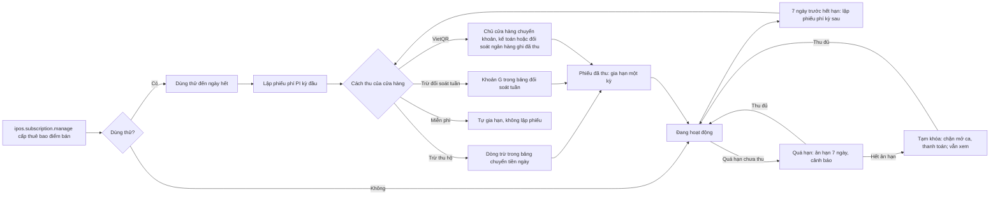
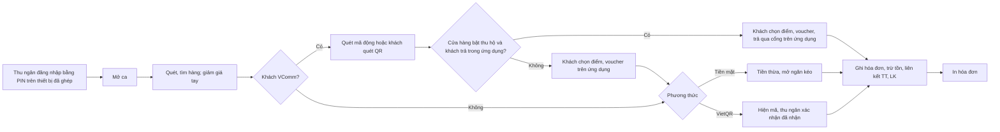
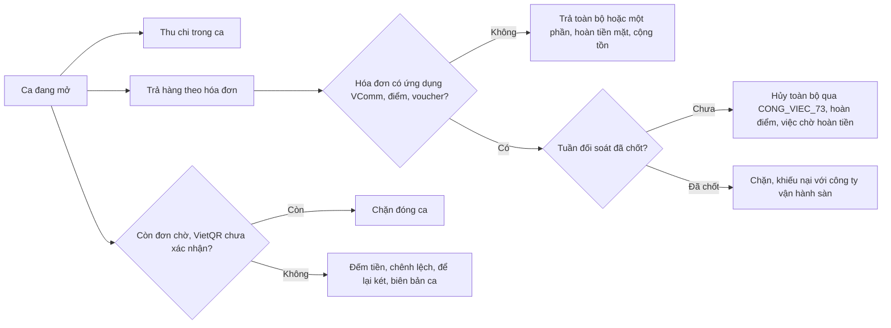

# CONG_VIEC_74: iPOS – ứng dụng bán hàng cho cửa hàng liên kết, đợt 1 (MODULE_17)

- Mô tả: iPOS là ứng dụng bán hàng tại quầy cho cửa hàng liên kết (CONG_VIEC_55). Cửa hàng thuê bao theo điểm bán. Thu ngân bán hàng trên máy tính bảng Android hoặc máy bán hàng Sunmi: quét mã, thu tiền mặt, VietQR hoặc qua ứng dụng VComm, in hóa đơn, mở ngăn kéo tiền, mở và đóng ca. Chủ cửa hàng quản lý hàng hóa, tồn kho đơn giản, thu ngân, quầy, báo cáo trên cổng cửa hàng. Công ty vận hành sàn cấp thuê bao, thu phí thuê bao theo cách cấu hình riêng cho từng cửa hàng, xem doanh thu và đối soát trong ERP.
- Phiên bản: 0.1
- Ngày cập nhật: 2026-11-17
- Trạng thái: Người dùng duyệt đặc tả, bản mẫu đợt 1 và 13 điểm mục 19 theo phương án đề xuất ngày 2026-11-17 (qua phiên điều phối). Lát L0 người dùng duyệt 2026-11-17 (chấp nhận `tax_percent`). Lát L1 người dùng duyệt 2026-11-17 (thêm Smart OTP cho đăng nhập lần đầu). Đang làm lát L2.
- Mức: Lớn (module mới, schema mới `ipos`, ứng dụng di động mới, sửa quy tắc đối soát đã duyệt, thu phí thuê bao).
- Nhánh: `chuc-nang/CONG_VIEC_74-ipos`.
- Nguồn: quyết định của người dùng ngày 2026-11-17 (mục 17); CONG_VIEC_55, 67 (cửa hàng liên kết, Open API điểm thưởng), CONG_VIEC_73 (đơn chờ thanh toán, thu hộ, hóa đơn ủy nhiệm), CONG_VIEC_72 (Smart OTP, mã động); ý tưởng từ nguồn riêng V-com-ERP (mục 12), không sao chép mã.
- Phụ thuộc:
  - Lát L0 đến L3, L5: chỉ cần `main` hiện tại (CONG_VIEC_55, 67 đã phát hành).
  - Lát L4 (thanh toán qua ứng dụng VComm, mã động, điểm): cần CONG_VIEC_72 và CONG_VIEC_73 (lát L1, L4, L7) có trong `main`.
  - Lát L7 (thu phí trừ thu hộ): cần CONG_VIEC_73 lát L5 (bảng chuyển tiền) có trong `main`.
- Thay đổi đã duyệt: THAY_DOI_39 (tài liệu 01, 12, 13, 16: MODULE_17, schema `ipos`, ứng dụng `apps/mobile-ipos`).
- Mã do phiên điều phối cấp (đợt 1, 2026-11-17): YCAU_NGHIEPVU_209 đến 218, QUYTAC_NGHIEPVU_593 đến 628, CHUC_NANG_252 đến 260, TIEUCHI_NGHIEMTHU_560 đến 589, KICHBAN_KIEMTHU_768 đến 809, MAN_HINH_283 đến 306, API_335 đến 370, database migration 0165 đến 0170, Luồng 68 đến 70. Đợt 2 xin cấp sau.

## 1. Mục tiêu

- Cửa hàng liên kết có phần mềm bán hàng đầy đủ do VComm cung cấp: một đơn bán xong trong dưới một phút, in hóa đơn ngay tại quầy, cuối ca biết chính xác tiền trong két.
- Khách VComm tích, dùng điểm và trả tiền qua ứng dụng ngay trên máy bán hàng, không cần cổng cửa hàng riêng.
- Công ty vận hành sàn có thêm nguồn thu phí phần mềm, thu được theo cách hợp với từng cửa hàng, và nhìn được doanh thu, tiền thu hộ, điểm của từng cửa hàng dùng iPOS.

## 2. Phạm vi

Đợt 1, trong phạm vi:
- Gói iPOS do công ty vận hành sàn khai báo; thuê bao theo điểm bán của cửa hàng liên kết: gói, kỳ, hạn, số quầy tối đa, số mặt hàng tối đa, dùng thử, gia hạn, khóa khi quá hạn.
- Thu phí thuê bao cấu hình theo từng cửa hàng, bốn cách: trừ vào bảng chuyển tiền thu hộ, trừ vào bảng đối soát điểm tuần, chuyển khoản VietQR, miễn phí hoặc dùng thử. Phiếu phí, công nợ, hóa đơn điện tử phí, bút toán ở công ty vận hành sàn.
- Tài khoản: chủ cửa hàng và thu ngân là thành viên cửa hàng liên kết (`affiliate.members`). Thu ngân tự đăng ký, chủ cửa hàng duyệt. Quầy, ghép thiết bị, mã PIN trên thiết bị đã ghép.
- Danh mục hàng: nhóm hàng, mặt hàng, biến thể đơn giản, mã vạch, đơn vị tính, giá bán, thuế suất, nhập từ Excel.
- Tồn kho đơn giản theo điểm bán: phiếu nhập, phiếu điều chỉnh, tự trừ khi bán, cộng lại khi trả, giá vốn bình quân, cảnh báo sắp hết.
- Bán tại quầy: tìm, quét mã vạch; giảm giá tay trong mức; thanh toán tiền mặt (tiền thừa), VietQR vào tài khoản của cửa hàng (thu ngân xác nhận), ứng dụng VComm (đơn chờ của CONG_VIEC_73), kết hợp tiền mặt và VietQR; khách VComm tích, dùng điểm, voucher.
- In hóa đơn bán lẻ, in lại, mở ngăn kéo tiền; máy in gắn sẵn Sunmi, máy in nhiệt rời (mạng LAN, Bluetooth); máy quét kiểu bàn phím, đầu quét gắn sẵn, camera.
- Ca: mở ca có tiền đầu ca, thu chi trong ca, đóng ca đếm tiền, chênh lệch có lý do, in biên bản ca.
- Trả hàng theo hóa đơn, hoàn tiền mặt.
- Báo cáo cửa hàng: doanh thu theo ngày, ca, thu ngân, phương thức; hàng bán chạy; tồn kho.
- ERP: doanh thu iPOS của từng cửa hàng (chỉ xem), đối soát thu hộ, đối soát điểm và voucher, phí thuê bao.

Ngoài phạm vi đợt 1 (đợt 2, cùng CONG_VIEC_74, cấp mã sau): khuyến mãi của cửa hàng; nhà cung cấp, phiếu nhập mua, công nợ phải trả; khách hàng riêng của cửa hàng, bán nợ; bàn, món, phiếu bếp; màn hình phụ cho khách (màn hình thứ hai gắn sẵn và máy tính bảng thứ hai); tên miền riêng cho từng cửa hàng.

Ngoài phạm vi CONG_VIEC_74:
- Bán khi mất mạng (người dùng chọn luôn có mạng). Mất mạng: màn hình báo, chặn thanh toán.
- Ứng dụng iOS, ứng dụng máy tính.
- Cửa hàng chưa ký liên kết tự đăng ký thuê bao.
- Hóa đơn điện tử cho doanh thu riêng của cửa hàng. Chỉ đơn thu hộ qua VComm có hóa đơn ủy nhiệm của CONG_VIEC_73.
- Ghi bút toán doanh thu, giá vốn, quỹ của cửa hàng vào sổ VComm: cửa hàng ngoài tập đoàn (giữ nguyên tắc CONG_VIEC_55).
- Máy cà thẻ, cân điện tử.
- Trả hàng một phần cho hóa đơn có phần trả qua ứng dụng VComm hoặc dùng điểm (CONG_VIEC_73 chỉ cho hủy toàn bộ; mục 19 điểm 6).

## 3. Phân biệt với phần đã có

| Đối tượng | Nguồn | Công việc này |
|---|---|---|
| Bán lẻ tại quầy của cửa hàng tập đoàn (`web-retail`) | CONG_VIEC_53 | Giữ nguyên. iPOS chỉ lấy cách làm (ca, két, trả hàng), không dùng lại bảng `retail`, không ghi kho, kế toán của công ty con |
| Cổng cửa hàng liên kết (`web-affiliate`): tích, đổi điểm, voucher, đối soát tuần | CONG_VIEC_55 | Giữ nguyên. iPOS dùng lại giao dịch điểm, voucher qua service; thêm nhóm menu iPOS cho chủ cửa hàng (mục 19 điểm 1); bảng đối soát tuần thêm dòng phí thuê bao khi cửa hàng chọn cách thu này |
| Open API điểm thưởng | CONG_VIEC_67 | Không dùng khóa API: iPOS nằm trong backend VComm, gọi thẳng service (mục 19 điểm 2) |
| Đơn chờ thanh toán, mã động, thu hộ, bảng chuyển tiền, hóa đơn ủy nhiệm, hoàn tiền | CONG_VIEC_73 | Dùng lại qua service, như cổng cửa hàng (API_329); bảng chuyển tiền thêm khoản trừ phí thuê bao khi cửa hàng chọn cách thu này |
| Cửa hàng, điểm bán, thành viên, hợp đồng | CONG_VIEC_55 (`affiliate.merchants`, `outlets`, `members`) | Dùng lại làm khách thuê và tài khoản; không sao chép dữ liệu |
| VietQR | Hàm tự viết trong `apps/api/src/retail/retail-stores.service.ts` | Tách hàm dùng chung, không thêm thư viện |

## 4. Yêu cầu nghiệp vụ và chức năng

| Mã | Yêu cầu | Người cần |
|---|---|---|
| YCAU_NGHIEPVU_209 | Công ty vận hành sàn khai báo gói iPOS và cấp thuê bao theo điểm bán cho cửa hàng liên kết: gói, kỳ, hạn, số quầy, số mặt hàng tối đa, dùng thử, gia hạn, khóa khi quá hạn | Quản trị công ty vận hành sàn |
| YCAU_NGHIEPVU_210 | Thu phí thuê bao theo cách cấu hình cho từng cửa hàng (trừ thu hộ, trừ đối soát điểm tuần, VietQR, miễn phí hoặc dùng thử); có phiếu phí, công nợ, hóa đơn điện tử, bút toán | Kế toán công ty vận hành sàn, chủ cửa hàng |
| YCAU_NGHIEPVU_211 | Chủ cửa hàng, thu ngân dùng tài khoản VComm sẵn có; thu ngân tự đăng ký chờ chủ duyệt; quầy gắn thiết bị đã ghép; đăng nhập nhanh bằng mã PIN | Chủ cửa hàng, thu ngân |
| YCAU_NGHIEPVU_212 | Chủ cửa hàng quản lý danh mục hàng: nhóm, mặt hàng, biến thể, mã vạch, đơn vị, giá bán, thuế suất; nhập từ Excel | Chủ cửa hàng |
| YCAU_NGHIEPVU_213 | Tồn kho đơn giản theo điểm bán: nhập, điều chỉnh, tự trừ khi bán, giá vốn bình quân, cảnh báo sắp hết | Chủ cửa hàng |
| YCAU_NGHIEPVU_214 | Thu ngân bán hàng tại quầy: quét mã, giảm giá tay, thu tiền mặt, VietQR, qua ứng dụng VComm; khách VComm tích, dùng điểm, voucher; in hóa đơn, mở ngăn kéo tiền | Thu ngân, khách mua |
| YCAU_NGHIEPVU_215 | Ca thu ngân: mở ca với tiền đầu ca, thu chi trong ca, đóng ca đếm tiền, xử lý tiền lệch | Thu ngân, chủ cửa hàng |
| YCAU_NGHIEPVU_216 | Trả hàng theo hóa đơn trong thời hạn, hoàn tiền, cộng lại tồn kho | Thu ngân, chủ cửa hàng |
| YCAU_NGHIEPVU_217 | Chủ cửa hàng xem báo cáo doanh thu, hàng bán chạy, tồn kho | Chủ cửa hàng |
| YCAU_NGHIEPVU_218 | Công ty vận hành sàn xem doanh thu iPOS của từng cửa hàng (chỉ xem), đối soát thu hộ, điểm và voucher, phí thuê bao trong ERP | Quản trị, kế toán công ty vận hành sàn |

| Mã | Chức năng | Yêu cầu |
|---|---|---|
| CHUC_NANG_252 | Gói iPOS và thuê bao điểm bán (ERP): danh mục gói; cấp, sửa, gia hạn, tạm khóa, hủy thuê bao; dùng thử; việc nền xét hạn | YCAU_NGHIEPVU_209 |
| CHUC_NANG_253 | Phí thuê bao: cách thu theo cửa hàng; lập phiếu phí theo kỳ; trừ thu hộ, trừ đối soát tuần, VietQR, miễn phí; công nợ, hóa đơn điện tử, bút toán; chủ cửa hàng xem, trả phí | YCAU_NGHIEPVU_210 |
| CHUC_NANG_254 | Tài khoản, quầy, thiết bị: thu ngân tự đăng ký, chủ duyệt; quầy; ghép, thu hồi thiết bị; đăng nhập thiết bị, mã PIN | YCAU_NGHIEPVU_211 |
| CHUC_NANG_255 | Danh mục hàng và tồn kho: nhóm, mặt hàng, biến thể, mã vạch, giá, thuế; nhập Excel; phiếu nhập, điều chỉnh; tồn theo điểm bán; giá vốn bình quân | YCAU_NGHIEPVU_212, 213 |
| CHUC_NANG_256 | Bán hàng tại quầy trên ứng dụng iPOS: giỏ hàng, quét mã, giảm giá tay, thanh toán tiền mặt, VietQR, ứng dụng VComm, kết hợp; điểm, voucher; in hóa đơn, ngăn kéo tiền, cài đặt thiết bị | YCAU_NGHIEPVU_214 |
| CHUC_NANG_257 | Ca và chốt két: mở ca, thu chi, đóng ca, chênh lệch, biên bản ca | YCAU_NGHIEPVU_215 |
| CHUC_NANG_258 | Trả hàng theo hóa đơn: chọn hàng, số lượng, hoàn tiền mặt, cộng tồn; hủy toàn bộ hóa đơn có phần trả qua ứng dụng VComm hoặc điểm | YCAU_NGHIEPVU_216 |
| CHUC_NANG_259 | Báo cáo cửa hàng trên cổng: doanh thu, ca, thu ngân, phương thức, hàng bán chạy, tồn kho | YCAU_NGHIEPVU_217 |
| CHUC_NANG_260 | Báo cáo, đối soát iPOS trong ERP: doanh thu từng cửa hàng; khớp hóa đơn iPOS với giao dịch thu hộ, điểm, voucher; phí thuê bao | YCAU_NGHIEPVU_218 |

## 5. Quy tắc nghiệp vụ

### Khách thuê, gói, thuê bao

- QUYTAC_NGHIEPVU_593 Khách thuê và cô lập dữ liệu:
  1. Mỗi cửa hàng liên kết (`affiliate.merchants`) là một khách thuê iPOS. Mọi bảng nghiệp vụ của schema `ipos` có `merchant_id`; bảng gắn điểm bán có thêm `outlet_id` thuộc đúng cửa hàng đó (ràng buộc khóa ngoại hai cột).
  2. Mọi truy vấn của thiết bị, thu ngân, chủ cửa hàng lọc theo cửa hàng của phiên ngay trong câu truy vấn; thu ngân chỉ thấy điểm bán được gán (`affiliate.member_outlets`). Đọc lệch cửa hàng là lỗi mức Cao trở lên.
  3. Có kiểm thử tự động cô lập: hai cửa hàng, mọi điểm tiếp nhận của iPOS gọi bằng phiên cửa hàng A với mã của cửa hàng B đều nhận `404`. Kiểm thử này là điều kiện để làm các lát sau L0.
  4. Dữ liệu iPOS thuộc cửa hàng; công ty vận hành sàn chỉ đọc qua báo cáo ERP (QUYTAC_NGHIEPVU_626, 627), không sửa.

- QUYTAC_NGHIEPVU_594 Gói iPOS: người có quyền `ipos.plan.manage` ở công ty vận hành sàn khai báo gói: mã (1 đến 20 ký tự chữ, số, gạch nối, duy nhất), tên (1 đến 100 ký tự), giá mỗi tháng chưa gồm thuế (đồng, ≥ 0), thuế suất (theo danh mục thuế suất của công ty), số quầy tối đa mỗi điểm bán (1 đến 50), số mặt hàng tối đa mỗi cửa hàng (100 đến 100.000; trống là không giới hạn), số ngày dùng thử mặc định (0 đến 90), trạng thái (đang bán, ngừng bán). Gói ngừng bán không cấp mới, thuê bao đang dùng giữ nguyên đến khi đổi gói. Sửa giá áp cho phiếu phí lập sau khi sửa.

- QUYTAC_NGHIEPVU_595 Thuê bao điểm bán:
  1. Người có `ipos.subscription.manage` cấp thuê bao trong chi tiết cửa hàng liên kết (MAN_HINH_178) cho điểm bán đang hoạt động của cửa hàng đang hoạt động; mỗi điểm bán tối đa một thuê bao chưa hủy.
  2. Trường: gói, kỳ (1, 6 hoặc 12 tháng), ngày bắt đầu, số ngày dùng thử (mặc định của gói), giá mỗi tháng riêng (trống: giá gói; giảm giá theo hợp đồng), số quầy tối đa riêng (trống: theo gói, không vượt 50).
  3. Trạng thái: dùng thử, đang hoạt động, quá hạn (đang trong ân hạn), tạm khóa, đã hủy. Ngày hết hạn = ngày bắt đầu (hoặc ngày hết dùng thử) cộng kỳ; gia hạn cộng thêm một kỳ từ ngày hết hạn hiện tại.
  4. Cấp thuê bao xong: cửa hàng thấy nhóm menu iPOS trên cổng cửa hàng; chủ cửa hàng được tạo quầy, ghép thiết bị.

- QUYTAC_NGHIEPVU_596 Hết hạn và khóa:
  1. Việc nền `ipos-subscriptions-daily` 0 giờ 30 (giờ Việt Nam): thuê bao quá ngày hết hạn mà phiếu phí kỳ mới chưa thu chuyển "quá hạn"; ân hạn 7 ngày vẫn bán được, ứng dụng và cổng hiện cảnh báo số ngày còn lại; hết ân hạn chuyển "tạm khóa": chặn mở ca và thanh toán, vẫn xem được báo cáo, hóa đơn, tồn kho, in lại hóa đơn.
  2. Thu đủ phiếu phí (hoặc người có `ipos.subscription.manage` gia hạn) thì về "đang hoạt động" ngay.
  3. Nhắc gia hạn: thông báo trên cổng cửa hàng và tin nhắn trong ứng dụng VComm cho chủ cửa hàng lúc còn 7 ngày, 1 ngày, ngày quá hạn.
  4. Cửa hàng liên kết tạm ngưng hoặc chấm dứt, điểm bán ngưng: thuê bao bị chặn bán như tạm khóa (không tự hủy); hợp đồng mở lại thì bán lại được nếu thuê bao còn hạn.
  5. Hủy thuê bao (lý do 1 đến 500 ký tự): không lập phiếu phí kỳ sau; không xóa dữ liệu (không xóa cứng dữ liệu nghiệp vụ); chủ cửa hàng còn xem được 12 tháng kể từ ngày hủy, sau đó nhóm menu iPOS ẩn; cấp lại thuê bao thì thấy lại dữ liệu cũ.

- QUYTAC_NGHIEPVU_597 Đổi gói và giới hạn:
  1. Đổi gói có hiệu lực từ ngày đổi; phiếu phí kỳ hiện tại không tính lại; kỳ sau theo gói mới.
  2. Số quầy đang hoạt động vượt giới hạn mới: không tự khóa quầy, chặn tạo thêm, cổng báo chủ cửa hàng ngừng bớt quầy; quầy thứ vượt giới hạn (theo thứ tự tạo mới nhất) không mở ca được.
  3. Số mặt hàng đang bán vượt giới hạn: chặn thêm mặt hàng, không ẩn mặt hàng đã có.

### Phí thuê bao

- QUYTAC_NGHIEPVU_598 Cách thu phí theo cửa hàng: người có `ipos.subscription.manage` chọn một cách cho mỗi cửa hàng (áp mọi thuê bao của cửa hàng): trừ vào bảng chuyển tiền thu hộ (chỉ chọn được khi cửa hàng bật thu hộ, CONG_VIEC_73 QUYTAC_NGHIEPVU_573), trừ vào bảng đối soát điểm tuần, chuyển khoản VietQR, miễn phí (kèm ngày hết miễn phí hoặc không thời hạn, lý do). Đổi cách áp cho phiếu phí lập sau khi đổi. Ghi nhật ký thao tác.

- QUYTAC_NGHIEPVU_599 Phiếu phí:
  1. Phiếu phí số `PI…` (dãy chứng từ của công ty vận hành sàn) lập cho mỗi thuê bao mỗi kỳ: khi hết dùng thử (kỳ đầu), và 7 ngày trước ngày hết hạn (kỳ tiếp), do việc nền `ipos-subscriptions-daily`. Cách thu miễn phí: không lập phiếu, tự gia hạn.
  2. Tiền = giá mỗi tháng (riêng hoặc của gói) × số tháng của kỳ; thuế = làm tròn theo đơn vị tiền tệ (tiền × thuế suất của gói); tổng = tiền + thuế.
  3. Trạng thái: chờ thu, đã thu, đã hủy. Người có `ipos.subscription.manage` hủy được phiếu chờ thu (lý do), lập lại phiếu.
  4. Lập phiếu ghi công nợ phải thu đối tác của cửa hàng (`finance.debt_items`, nguồn `ipos_fee_invoice`) và bút toán Nợ 131 vai trò `ipos_fee_receivable` / Có 511 vai trò `ipos_fee_revenue` / Có 3331 (thuế) ở công ty vận hành sàn; gửi hóa đơn điện tử phí qua module hóa đơn điện tử của công ty (CONG_VIEC_16).

- QUYTAC_NGHIEPVU_600 Thu bằng trừ thu hộ: phiếu phí chờ thu của cửa hàng chọn cách này được trừ vào bảng chuyển tiền thu hộ ngày gần nhất lập sau ngày lập phiếu (CONG_VIEC_73 QUYTAC_NGHIEPVU_585) thành dòng "Phí thuê bao iPOS"; tiền chuyển không đủ thì trừ phần có, phần còn lại trừ bảng sau. Bảng chuyển tiền ghi đã chuyển thì phiếu phí phần đã trừ coi như đã thu; bút toán Nợ 331 (phải trả cửa hàng về thu hộ) / Có 131 vai trò `ipos_fee_receivable`. Sau 7 ngày từ ngày lập phiếu chưa trừ đủ (cửa hàng ít giao dịch thu hộ), phần còn lại chuyển sang thu bằng VietQR, báo chủ cửa hàng.

- QUYTAC_NGHIEPVU_601 Thu bằng trừ đối soát điểm tuần: phiếu phí chờ thu được cộng vào bảng đối soát tuần kế tiếp của cửa hàng (CONG_VIEC_55 QUYTAC_NGHIEPVU_403) thành khoản "Phí thuê bao iPOS (G)" (đã gồm thuế, không tính thêm thuế của phí dịch vụ E): số còn lại = A + D + F + E + G − B − C. Cửa hàng không có giao dịch điểm trong tuần vẫn lập bảng nếu có G. Xác nhận bảng: bút toán G chuyển từ 131 vai trò `ipos_fee_receivable` sang công nợ của bảng đối soát (bù trừ theo cách hiện có); thanh toán bảng thì phiếu phí đã thu.

- QUYTAC_NGHIEPVU_602 Thu bằng VietQR: cổng cửa hàng (MAN_HINH_301) hiện mã VietQR vào tài khoản nhận tiền của công ty vận hành sàn, nội dung chuyển khoản là số phiếu `PI…`. Kế toán ghi đã thu bằng phiếu thu ngân hàng hiện có; đối soát ngân hàng tự động (CONG_VIEC_18) khớp nội dung chuyển khoản thì tự ghi đã thu. Thu một phần: phiếu vẫn chờ thu, hiện số còn phải thu.

- QUYTAC_NGHIEPVU_603 Miễn phí, dùng thử: thuê bao miễn phí không lập phiếu, gia hạn tự động từng kỳ đến ngày hết miễn phí; sau đó lập phiếu theo cách chọn lại. Dùng thử: không lập phiếu đến ngày hết dùng thử; nhắc chủ cửa hàng 3 ngày trước.

### Tài khoản, quầy, thiết bị

- QUYTAC_NGHIEPVU_604 Vai trò trên iPOS: dùng thành viên đang hoạt động của cửa hàng (`affiliate.members`, QUYTAC_NGHIEPVU_393). Chủ cửa hàng: mọi thao tác iPOS của cửa hàng, mọi điểm bán, bán được như thu ngân. Thu ngân: bán, trả hàng, ca tại điểm bán được gán. Trả hàng, giảm giá tay vượt mức của thu ngân cần chủ cửa hàng nhập mã PIN trên máy (QUYTAC_NGHIEPVU_613, 624). Khóa thành viên thì mọi phiên iPOS của người đó hết hiệu lực ngay.

- QUYTAC_NGHIEPVU_605 Thu ngân tự đăng ký:
  1. Trên ứng dụng iPOS (MAN_HINH_284): nhập mã cửa hàng (`CH…`), số điện thoại, họ tên; xác minh số điện thoại bằng mã OTP SMS (dùng lại `PhoneOtpService`, mục đích mới `ipos_register`; chưa có tài khoản VComm thì tạo theo họ tên như lời mời của QUYTAC_NGHIEPVU_393); chọn điểm bán muốn làm.
  2. Tạo yêu cầu chờ duyệt; mỗi số điện thoại tối đa một yêu cầu chờ mỗi cửa hàng; số đã là thành viên báo "Bạn đã là thành viên của cửa hàng, hãy đăng nhập".
  3. Chủ cửa hàng duyệt (gán điểm bán) thì tạo thành viên vai trò thu ngân, trạng thái hoạt động; từ chối (lý do không bắt buộc) thì yêu cầu kết thúc. Yêu cầu quá 7 ngày tự hết hạn. Người đăng ký nhận tin trong ứng dụng VComm.
  4. Vai trò luôn là thu ngân, không lấy vai trò từ dữ liệu gửi lên (chống tự nâng quyền).
  5. Giới hạn: 5 yêu cầu mỗi giờ mỗi địa chỉ IP, 3 yêu cầu mỗi ngày mỗi số điện thoại. Cách chủ cửa hàng mời thu ngân của CONG_VIEC_55 giữ nguyên.

- QUYTAC_NGHIEPVU_606 Quầy và thiết bị:
  1. Chủ cửa hàng tạo quầy cho điểm bán có thuê bao (tên 1 đến 50 ký tự, duy nhất trong điểm bán); số quầy đang hoạt động không vượt giới hạn của thuê bao.
  2. Ghép thiết bị: chủ cửa hàng bấm "Ghép thiết bị" ở quầy, nhận mã ghép 8 ký tự (chữ in hoa và số, bỏ ký tự dễ nhầm), hiệu lực 10 phút, dùng một lần; nhập mã trên ứng dụng iPOS. Mỗi quầy tối đa một thiết bị đang ghép; ghép mới thì thiết bị cũ hết hiệu lực.
  3. Thiết bị ghép nhận khóa thiết bị (ngẫu nhiên 256 bit, lưu băm ở máy chủ, lưu trên máy trong kho bảo mật của hệ điều hành). Chủ cửa hàng thu hồi thiết bị bất kỳ lúc nào; thiết bị không dùng 30 ngày tự hết hiệu lực.
  4. Mã ghép, khóa thiết bị không ghi vào log, nhật ký thao tác.

- QUYTAC_NGHIEPVU_607 Đăng nhập trên thiết bị:
  1. Lần đầu trên một thiết bị: số điện thoại và mã OTP (Smart OTP nếu đã kích hoạt, CONG_VIEC_72; chưa thì SMS); người đăng nhập phải là thành viên đang hoạt động của cửa hàng của thiết bị và được gán điểm bán của quầy (chủ cửa hàng: mọi điểm bán). Sau đó đặt mã PIN 6 số (không trùng 6 số giống nhau hoặc dãy tăng, giảm).
  2. Các lần sau trên cùng thiết bị: chọn tên trong danh sách người đã đăng nhập máy này, nhập mã PIN. Sai 5 lần liên tiếp: khóa đăng nhập PIN người đó trên máy 15 phút; quên PIN thì đăng nhập lại bằng OTP.
  3. Phiên loại `ipos` hết hạn sau 12 giờ hoặc khi đóng ca; không thao tác 15 phút thì khóa màn hình, mở lại bằng PIN. Đổi người trên quầy: khóa màn hình, người kia nhập PIN.
  4. Mã PIN lưu băm argon2id ở máy chủ, theo (thành viên, thiết bị); không ghi log.

### Danh mục hàng, tồn kho

- QUYTAC_NGHIEPVU_608 Danh mục hàng:
  1. Nhóm hàng: tên 1 đến 100 ký tự, hai cấp, thứ tự hiện trên máy bán.
  2. Mặt hàng: mã (1 đến 30 ký tự, duy nhất trong cửa hàng; trống thì tự sinh), tên (1 đến 200 ký tự), nhóm, đơn vị tính (1 đến 20 ký tự), giá bán (đồng, ≥ 0, đã gồm thuế), thuế suất giá trị gia tăng (0, 5, 8, 10 % hoặc không chịu thuế; chỉ để in và báo cáo), theo dõi tồn kho (có, không), ảnh (tùy chọn, ≤ 1 MB), trạng thái (đang bán, ngừng bán).
  3. Biến thể: tối đa 2 thuộc tính (ví dụ màu, cỡ), tối đa 100 biến thể mỗi mặt hàng; mỗi biến thể có mã, giá bán riêng (trống: giá mặt hàng), mã vạch.
  4. Mã vạch: 1 đến 50 ký tự, duy nhất trong cửa hàng; một biến thể nhiều mã vạch.
  5. Giá riêng theo điểm bán (tùy chọn) ghi đè giá bán.
  6. Không xóa mặt hàng đã bán; chỉ ngừng bán. Số mặt hàng đang bán không vượt giới hạn của gói (tính theo biến thể).

- QUYTAC_NGHIEPVU_609 Đồng bộ danh mục lên máy bán: máy bán tải danh mục (nhóm, mặt hàng đang bán, biến thể, mã vạch, giá của điểm bán) khi mở ca và mỗi 5 phút (chỉ phần thay đổi theo thời điểm cập nhật). Giá khi thanh toán lấy theo máy chủ; khác giá trên máy thì báo "Giá đã thay đổi" và cập nhật giỏ.

- QUYTAC_NGHIEPVU_610 Nhập Excel: tệp mẫu tải từ cổng; tối đa 5.000 dòng mỗi tệp; kiểm toàn bộ trước, hiện lỗi theo dòng, chỉ ghi khi không có lỗi (ghi tất cả hoặc không ghi gì). Dòng trùng mã thì cập nhật mặt hàng có sẵn (tên, nhóm, giá, thuế, mã vạch); nhóm chưa có thì tạo. Tồn đầu kỳ (tùy chọn) tạo phiếu nhập theo điểm bán chọn.

- QUYTAC_NGHIEPVU_611 Tồn kho:
  1. Tồn theo (điểm bán, biến thể) cho mặt hàng theo dõi tồn kho. Phiếu tồn số `PN…` (nhập), `PC…` (điều chỉnh) theo cửa hàng, do chủ cửa hàng lập: nhập có số lượng, giá nhập; điều chỉnh có số lượng thực tế, lý do. Phiếu ghi xong không sửa; sai thì lập phiếu điều chỉnh.
  2. Bán trừ tồn, trả hàng cộng tồn trong cùng giao dịch ghi hóa đơn. Cho phép tồn âm (mặc định, cài đặt được chặn) để không chặn bán khi chưa nhập kịp; báo cáo tồn hiện tồn âm màu cảnh báo (mục 19 điểm 5).
  3. Giá vốn bình quân gia quyền theo (điểm bán, biến thể) cập nhật khi nhập; bán ghi giá vốn tại thời điểm bán để tính lợi nhuận gộp. Tồn âm thì giá vốn dùng giá bình quân gần nhất.
  4. Cảnh báo sắp hết: mức tối thiểu theo biến thể (tùy chọn); cổng hiện danh sách dưới mức.

### Bán hàng, thanh toán, in

- QUYTAC_NGHIEPVU_612 Điều kiện bán: thuê bao của điểm bán đang dùng thử, đang hoạt động hoặc quá hạn trong ân hạn; cửa hàng liên kết đang hoạt động, trong thời hạn hợp đồng; quầy, thiết bị đang hoạt động; người bán có ca đang mở tại quầy; có mạng (mất mạng: màn hình báo "Mất kết nối, chưa thanh toán được", giữ giỏ hàng trên máy, chặn thanh toán).

- QUYTAC_NGHIEPVU_613 Giỏ hàng:
  1. Thêm hàng bằng quét mã vạch (máy quét kiểu bàn phím, đầu quét gắn sẵn, camera), tìm theo mã, tên, chọn theo nhóm. Quét khớp đúng một biến thể thì thêm 1 đơn vị; khớp nhiều thì cho chọn; không khớp báo "Không tìm thấy mã" kèm rung, tiếng.
  2. Số lượng: số dương, tối đa 3 chữ số thập phân (hàng cân thì nhập tay), tối đa 9.999 mỗi dòng; tối đa 200 dòng mỗi hóa đơn.
  3. Giảm giá tay: theo dòng hoặc theo hóa đơn, phần trăm hoặc số tiền; tổng giảm không vượt mức tối đa của thu ngân trong cài đặt (0 đến 100 %, mặc định 10 %); vượt mức thì chủ cửa hàng nhập mã PIN trên máy để duyệt tại chỗ, ghi người duyệt. Giảm theo hóa đơn phân bổ vào dòng theo tỷ lệ tiền để tính thuế, báo cáo.
  4. Tiền làm tròn đến đồng; tổng tiền = tổng (đơn giá × số lượng − giảm dòng) − giảm hóa đơn.
  5. Treo giỏ hàng: tối đa 5 giỏ treo mỗi quầy, lưu trên máy chủ theo quầy, xóa khi đóng ca.

- QUYTAC_NGHIEPVU_614 Khách hàng trên hóa đơn: khách lẻ (mặc định) hoặc khách VComm gắn qua mã động trên ứng dụng khách (quét hoặc nhập 18 số; CONG_VIEC_73 QUYTAC_NGHIEPVU_574) hoặc khi khách quét mã QR thanh toán (luồng 2). Không tìm khách theo số điện thoại trên iPOS (không trả thông tin khách cho cửa hàng); hóa đơn chỉ hiện tên đã che, hạng.

- QUYTAC_NGHIEPVU_615 Thanh toán:
  1. Phương thức: tiền mặt, VietQR (chuyển khoản vào tài khoản của cửa hàng), ứng dụng VComm.
  2. Tiền mặt và VietQR kết hợp được trong một hóa đơn; tiền mặt khách đưa được vượt phần còn lại, tiền thừa = tổng đã đưa − phải trả; nút mệnh giá nhanh.
  3. Ứng dụng VComm: theo QUYTAC_NGHIEPVU_616; không kết hợp phần trả trong ứng dụng với tiền mặt, VietQR trong cùng hóa đơn (CONG_VIEC_73 ngoài phạm vi), trừ trường hợp cửa hàng tắt thu hộ (QUYTAC_NGHIEPVU_616 khoản 4).
  4. VietQR: mã VietQR theo chuẩn của NAPAS (ngân hàng, số tài khoản, tên tài khoản của cửa hàng khai ở cài đặt bán hàng; số tiền; nội dung là số hóa đơn). Thu ngân bấm "Đã nhận tiền" sau khi kiểm tra tài khoản; ghi người xác nhận. Không đối soát tự động với ngân hàng của cửa hàng ở đợt 1.
  5. Bấm thanh toán mang khóa yêu cầu duy nhất do máy sinh; gửi lại cùng khóa trả hóa đơn đã ghi (chống trùng khi mạng chập chờn).

- QUYTAC_NGHIEPVU_616 Thanh toán qua ứng dụng VComm, điểm, voucher:
  1. Thu ngân chọn "Ứng dụng VComm": iPOS tạo đơn chờ thanh toán của CONG_VIEC_73 (QUYTAC_NGHIEPVU_575) cho điểm bán, tiền hóa đơn, dòng hàng, người tạo là thu ngân, qua service trong backend (mục 19 điểm 2). Màn hình hiện cả hai cách: ô quét mã động của khách (luồng 1) và mã QR thanh toán (luồng 2).
  2. Khách chọn điểm, voucher, cổng thanh toán trên ứng dụng VComm; iPOS hỏi trạng thái đơn mỗi 2 giây đến khi hoàn tất, hết hạn, bị hủy, khách từ chối. Hoàn tất: ghi hóa đơn iPOS với dòng thanh toán "Ứng dụng VComm" (tiền khách trả qua cổng), "Điểm" (tiền điểm), "Voucher" (tiền giảm voucher); liên kết số `TT…`, `LK…`.
  3. Thu ngân hủy được đơn chờ khi chưa hoàn tất; cổng báo thành công sau khi hủy thì xử lý như CONG_VIEC_73 QUYTAC_NGHIEPVU_579.
  4. Cửa hàng tắt thu hộ: đơn chờ cách thu "tại quầy"; khách chỉ chọn điểm, voucher trên ứng dụng, bấm xác nhận; phần còn lại thu bằng tiền mặt, VietQR như khoản 2 QUYTAC_NGHIEPVU_615.
  5. Khách VComm trả hoàn toàn bằng tiền mặt, VietQR mà muốn tích điểm: thu ngân quét mã động trước khi thanh toán; iPOS tạo đơn chờ cách thu "tại quầy", khách xác nhận trên ứng dụng (không dùng điểm thì chỉ tích). Điểm tích theo tỷ lệ của hợp đồng cửa hàng (CONG_VIEC_55).
  6. Hạn mức, trần mỗi giao dịch, quá hạn đối soát của cửa hàng liên kết áp như CONG_VIEC_55; bị chặn tích thì hóa đơn vẫn ghi, ghi lý do không tích.

- QUYTAC_NGHIEPVU_617 Mất mạng giữa chừng: đã gửi thanh toán mà không nhận kết quả thì máy hỏi lại theo khóa yêu cầu khi có mạng; đơn chờ ứng dụng VComm đang dở thì tra trạng thái đơn trước khi cho thu ngân hủy hoặc thu cách khác. Không ghi hóa đơn trên máy khi chưa có xác nhận của máy chủ.

- QUYTAC_NGHIEPVU_618 Ghi hóa đơn: trong một giao dịch cơ sở dữ liệu ghi hóa đơn bán lẻ iPOS (số theo QUYTAC_NGHIEPVU_619), dòng hàng (đơn giá, giảm, thuế suất, giá vốn), dòng thanh toán, trừ tồn, gắn ca, quầy, thu ngân, khách VComm (nếu có), liên kết `TT…`, `LK…`. Hóa đơn đã ghi không sửa; sai thì trả hàng hoặc hủy (QUYTAC_NGHIEPVU_624).

- QUYTAC_NGHIEPVU_619 Số hóa đơn: `<mã điểm bán>-<YYMMDD>-<số thứ tự 4 chữ số>` theo điểm bán, mỗi ngày đánh lại từ 0001 (ví dụ `DB01-261117-0042`); mã điểm bán 2 đến 10 ký tự do chủ cửa hàng đặt, duy nhất trong cửa hàng (mục 19 điểm 3). Phiếu trả hàng tiền tố `TR-`.

- QUYTAC_NGHIEPVU_620 In và thiết bị:
  1. Mẫu in khổ 58 mm hoặc 80 mm: tên cửa hàng, địa chỉ điểm bán, số điện thoại, số hóa đơn, ngày giờ, thu ngân, dòng hàng, giảm giá, tổng, thuế theo suất, phương thức, tiền khách đưa, tiền thừa, điểm tích, điểm dùng (khách VComm), mã QR tra cứu hóa đơn điện tử ủy nhiệm (khi có), lời chào cuối (0 đến 200 ký tự, cài đặt).
  2. In tiếng Việt có dấu: mặc định in dạng ảnh; in chữ theo bảng mã của máy là tùy chọn trong cài đặt thiết bị.
  3. Tự in sau thanh toán (cài đặt, mặc định bật), số liên (1 đến 3). In lại ghi dòng "In lại lần n" và nhật ký in lại.
  4. Ngăn kéo tiền mở khi thanh toán có tiền mặt, khi thu chi trong ca, khi chủ cửa hàng bấm "Mở ngăn kéo" (ghi nhật ký người mở, thời điểm).
  5. Cài đặt thiết bị lưu trên máy: máy in (máy in gắn sẵn, mạng LAN theo địa chỉ IP và cổng, Bluetooth), khổ giấy, mở ngăn kéo qua máy in, in thử. Lỗi máy in: báo "Không in được: <nguyên nhân>", hóa đơn vẫn ghi, cho in lại.
  6. Máy thử thật đợt 1: Sunmi T2 (máy in 80 mm gắn sẵn, cổng ngăn kéo). Máy in rời, máy quét rời, máy cầm tay: chưa kiểm thử trên máy thật (mục 20).

### Ca, chốt két

- QUYTAC_NGHIEPVU_621 Mở ca: người bán chọn quầy của thiết bị, nhập tiền đầu ca (0 đến 1.000.000.000 đồng); gợi ý tiền để lại của ca đóng gần nhất ở quầy, khác số đó thì ghi chú (1 đến 500 ký tự). Mỗi quầy, mỗi người cùng lúc tối đa một ca mở. Chặn khi thuê bao tạm khóa (QUYTAC_NGHIEPVU_596).

- QUYTAC_NGHIEPVU_622 Thu chi trong ca: thu thêm hoặc chi ra tiền mặt từ két (số tiền > 0, lý do bắt buộc 1 đến 200 ký tự, loại: nộp về chủ, chi phí, khác); ghi người, thời điểm; mở ngăn kéo; in phiếu thu chi (tùy chọn).

- QUYTAC_NGHIEPVU_623 Đóng ca:
  1. Chặn khi ca còn đơn chờ ứng dụng VComm chưa kết thúc, còn khoản VietQR chưa xác nhận.
  2. Người bán đếm tiền theo mệnh giá hoặc nhập tổng; tiền hệ thống tính = tiền đầu ca + tiền mặt bán − tiền mặt hoàn trả + thu − chi. Chênh lệch = tiền đếm − tiền hệ thống; khác 0 thì ghi lý do (1 đến 500 ký tự).
  3. Nhập tiền để lại két cho ca sau (0 đến tiền đếm); phần còn lại là tiền nộp.
  4. Biên bản ca: doanh thu theo phương thức (tiền mặt, VietQR, ứng dụng VComm, điểm, voucher), số hóa đơn, trả hàng, thu chi, tiền hệ thống, tiền đếm, chênh lệch, để lại, nộp; in được. Không ghi chứng từ quỹ, bút toán ở VComm.
  5. Chủ cửa hàng đóng hộ được ca của thu ngân (thu ngân quên đóng), ghi người đóng; ca mở quá 24 giờ cổng hiện cảnh báo.

### Trả hàng

- QUYTAC_NGHIEPVU_624 Trả hàng:
  1. Tìm hóa đơn theo số hoặc quét mã trên hóa đơn in, trong thời hạn trả (0 đến 90 ngày, cài đặt, mặc định 7), cùng cửa hàng (điểm bán bất kỳ có thuê bao của cửa hàng).
  2. Hóa đơn chỉ thanh toán bằng tiền mặt, VietQR: trả toàn bộ hoặc một phần (chọn dòng, số lượng ≤ số đã mua − đã trả); tiền hoàn = tiền sau giảm của phần trả (giảm hóa đơn phân bổ theo QUYTAC_NGHIEPVU_613); hoàn bằng tiền mặt từ két của ca đang mở; cộng lại tồn.
  3. Hóa đơn có dòng thanh toán ứng dụng VComm, điểm hoặc voucher: chỉ hủy toàn bộ hóa đơn, gọi hủy và hoàn tiền của CONG_VIEC_73 (QUYTAC_NGHIEPVU_583, 590), chỉ khi tuần đối soát điểm chưa chốt; phần trả qua ứng dụng do kế toán công ty vận hành sàn hoàn cho khách; phần tiền mặt, VietQR (cửa hàng tắt thu hộ) hoàn bằng tiền mặt. Tuần đã chốt: báo "Tuần đối soát đã chốt, không hủy được; liên hệ công ty vận hành sàn để khiếu nại".
  4. Thu ngân trả hàng cần chủ cửa hàng nhập mã PIN (cài đặt "Thu ngân tự trả hàng", mặc định tắt). Lý do trả bắt buộc (1 đến 200 ký tự). In phiếu trả hàng `TR-…`.

### Báo cáo, đối soát

- QUYTAC_NGHIEPVU_625 Báo cáo cửa hàng: chủ cửa hàng xem theo khoảng ngày (tối đa 366 ngày), điểm bán, quầy, thu ngân: doanh thu thuần (sau giảm, trừ trả hàng), số hóa đơn, giá trị trung bình, theo phương thức, theo giờ trong ngày, hàng bán chạy (số lượng, doanh thu, lợi nhuận gộp), danh sách ca và chênh lệch, tồn kho hiện tại và giá trị tồn. Xuất Excel. Thu ngân chỉ xem hóa đơn của ca mình.

- QUYTAC_NGHIEPVU_626 Doanh thu iPOS trong ERP (chỉ xem): người có `affiliate.view` ở công ty vận hành sàn xem theo cửa hàng, điểm bán, khoảng ngày: doanh thu thuần, số hóa đơn, theo phương thức, số ca, tổng chênh lệch két. Không xem dòng hàng, giá vốn, khách của cửa hàng (dữ liệu kinh doanh riêng của cửa hàng). Không ghi bút toán.

- QUYTAC_NGHIEPVU_627 Đối soát trong ERP:
  1. Thu hộ: khớp từng dòng thanh toán "Ứng dụng VComm" của hóa đơn iPOS với giao dịch thu hộ của CONG_VIEC_73 (số `TT…`, tiền); hiện dòng lệch: có thu hộ mà không có hóa đơn iPOS (ví dụ hóa đơn chưa ghi do lỗi), có hóa đơn mà thu hộ đã hủy, lệch tiền.
  2. Điểm, voucher: khớp dòng "Điểm", "Voucher" với giao dịch `LK…` của CONG_VIEC_55 và bảng đối soát tuần; hiện dòng lệch như trên.
  3. Phí thuê bao: danh sách phiếu phí theo trạng thái, cách thu, cửa hàng; tổng phải thu, đã thu, quá hạn.
  4. Đối soát chỉ đọc, không tự sửa dữ liệu; dòng lệch có nút mở chứng từ liên quan.

- QUYTAC_NGHIEPVU_628 Nhật ký và bảo mật: nhật ký thao tác ghi cấp, sửa, gia hạn, khóa, hủy thuê bao; đổi cách thu phí; hủy phiếu phí; ghép, thu hồi thiết bị; duyệt, từ chối thu ngân; giảm giá vượt mức (người duyệt); trả hàng, hủy hóa đơn; mở ngăn kéo ngoài thanh toán; in lại; đóng ca hộ; sửa giá. Mã PIN, mã ghép, khóa thiết bị, mã OTP, mã động không ghi vào log, nhật ký, thông báo lỗi.

Dự phòng: không có (dùng hết QUYTAC_NGHIEPVU_593 đến 628).

Thông báo lỗi mới (vi, có bản en trong `packages/i18n`): "Thuê bao iPOS của điểm bán đã tạm khóa do quá hạn. Liên hệ chủ cửa hàng để gia hạn."; "Mất kết nối, chưa thanh toán được"; "Mã ghép không đúng hoặc đã hết hạn"; "Mã PIN không đúng. Còn n lần thử"; "Đã vượt số quầy của gói"; "Đã vượt số mặt hàng của gói"; "Giá đã thay đổi"; "Còn đơn chờ thanh toán qua ứng dụng, chưa đóng ca được"; "Tuần đối soát đã chốt, không hủy được; liên hệ công ty vận hành sàn để khiếu nại"; "Bạn đã là thành viên của cửa hàng, hãy đăng nhập".

## 6. Vai trò và quyền

Quyền mới (công ty vận hành sàn): `ipos.plan.manage` (khai báo gói), `ipos.subscription.manage` (nhạy cảm: cấp, gia hạn, khóa, hủy thuê bao, cách thu phí, hủy phiếu phí). Xem dùng `affiliate.view`. Gán mặc định cho Quản trị tập đoàn, Quản trị công ty.

| Thao tác | Quản trị, `ipos.plan.manage` | `ipos.subscription.manage` | `affiliate.view` | Kế toán (`finance.*` hiện có) | Chủ cửa hàng | Thu ngân |
|---|---|---|---|---|---|---|
| Gói iPOS | Sửa | Xem | Xem | Không | Không | Không |
| Thuê bao, cách thu phí | Xem | Sửa | Xem | Xem | Xem của cửa hàng mình | Không |
| Phiếu phí | Xem | Hủy, lập lại | Xem | Ghi đã thu (phiếu thu hiện có) | Xem, trả VietQR | Không |
| Doanh thu, đối soát iPOS (ERP) | Xem | Xem | Xem | Xem | Không | Không |
| Danh mục hàng, tồn kho, cài đặt bán hàng | Không | Không | Không | Không | Sửa | Xem trên máy bán |
| Quầy, thiết bị, duyệt thu ngân | Không | Không | Không | Không | Sửa | Tự đăng ký |
| Bán, ca | Không | Không | Không | Không | Có | Có (điểm bán được gán) |
| Trả hàng, giảm giá vượt mức | Không | Không | Không | Không | Có, duyệt bằng PIN | Khi chủ duyệt hoặc cài đặt cho phép |
| Báo cáo cửa hàng | Không | Không | Không | Không | Mọi điểm bán | Hóa đơn ca mình |

## 7. Luồng nghiệp vụ

Luồng 68 (thuê bao và phí):

Luồng 69 (bán tại quầy):

Luồng 70 (ca và trả hàng):

## 8. Màn hình

Ứng dụng iPOS (`apps/mobile-ipos`, Expo, máy tính bảng Android, Sunmi; bố cục ngang, rộng tối thiểu 1024 điểm ảnh; máy cầm tay bố cục dọc ở đợt sau):

| Mã | Tên | Nội dung | Bản mẫu |
|---|---|---|---|
| MAN_HINH_283 | Ghép thiết bị và đăng nhập | Nhập mã ghép; chọn người đã đăng nhập máy này, nhập PIN; đăng nhập lần đầu bằng số điện thoại và OTP; đặt PIN; khóa màn hình | `ban_mau/CONG_VIEC_74_UNG_DUNG_IPOS.html` |
| MAN_HINH_284 | Thu ngân tự đăng ký | Mã cửa hàng, số điện thoại, OTP, họ tên, điểm bán; trạng thái chờ duyệt | như trên |
| MAN_HINH_285 | Mở ca | Quầy, tiền đầu ca, gợi ý tiền để lại, ghi chú; cảnh báo thuê bao quá hạn | như trên |
| MAN_HINH_286 | Bán hàng | Ô quét, tìm; lưới nhóm, mặt hàng; giỏ hàng (số lượng, giảm dòng); giảm hóa đơn; khách VComm; treo giỏ; thanh trạng thái (ca, mạng, máy in, thuê bao) | như trên |
| MAN_HINH_287 | Thanh toán | Tiền mặt (mệnh giá nhanh, tiền thừa), VietQR (mã, nút đã nhận), ứng dụng VComm (quét mã động, mã QR, trạng thái chờ khách); kết hợp tiền mặt và VietQR | như trên |
| MAN_HINH_288 | Kết quả thanh toán | Số hóa đơn, phương thức, điểm tích, dùng; trạng thái in; In lại, Đơn mới | như trên |
| MAN_HINH_289 | Hóa đơn trong ca | Danh sách hóa đơn ca hiện tại, tìm số; chi tiết, in lại | như trên |
| MAN_HINH_290 | Trả hàng | Tìm, quét hóa đơn; chọn dòng, số lượng; lý do; duyệt PIN chủ; hoàn tiền; hủy toàn bộ hóa đơn có ứng dụng VComm, điểm | như trên |
| MAN_HINH_291 | Thu chi và đóng ca | Thu chi; đếm tiền theo mệnh giá; tiền hệ thống, chênh lệch, lý do, để lại két; biên bản, in | như trên |
| MAN_HINH_292 | Cài đặt thiết bị | Máy in (gắn sẵn, LAN, Bluetooth), khổ giấy, in ảnh hoặc bảng mã, số liên, tự in, ngăn kéo, in thử, thông tin thiết bị và quầy | như trên |

Cổng cửa hàng (`apps/web-affiliate`, nhóm menu "iPOS" cho chủ cửa hàng, hiện khi cửa hàng có thuê bao; mục 19 điểm 1):

| Mã | Tên | Nội dung | Bản mẫu |
|---|---|---|---|
| MAN_HINH_293 | Tổng quan iPOS | Doanh thu hôm nay, tuần; ca đang mở; cảnh báo tồn thấp; thuê bao (gói, hạn, trạng thái); yêu cầu đăng ký thu ngân chờ duyệt | `ban_mau/CONG_VIEC_74_CONG_CUA_HANG_IPOS.html` |
| MAN_HINH_294 | Hàng hóa | Nhóm hàng; danh sách mặt hàng (tìm, lọc nhóm, trạng thái); ngăn kéo thêm, sửa (biến thể, mã vạch, giá theo điểm bán); nhập Excel (tải mẫu, kiểm, lỗi theo dòng, ghi) | như trên |
| MAN_HINH_295 | Tồn kho | Tồn theo điểm bán (lọc dưới mức, âm); phiếu nhập, phiếu điều chỉnh; lịch sử biến động | như trên |
| MAN_HINH_296 | Quầy và thiết bị | Quầy theo điểm bán, giới hạn của gói; ghép thiết bị (mã 8 ký tự, đếm ngược); thiết bị đang ghép, lần dùng gần nhất, thu hồi | như trên |
| MAN_HINH_297 | Thu ngân | Yêu cầu tự đăng ký chờ duyệt (duyệt, gán điểm bán, từ chối); danh sách thu ngân (điểm bán, trạng thái; khóa, mở dùng chức năng của MAN_HINH_177) | như trên |
| MAN_HINH_298 | Ca và chốt két | Danh sách ca (quầy, người, mở, đóng, chênh lệch); chi tiết biên bản; đóng hộ ca | như trên |
| MAN_HINH_299 | Hóa đơn và trả hàng | Danh sách hóa đơn, phiếu trả (lọc ngày, điểm bán, quầy, thu ngân, phương thức); chi tiết, in lại | như trên |
| MAN_HINH_300 | Báo cáo iPOS | Doanh thu, phương thức, theo giờ, hàng bán chạy, lợi nhuận gộp, ca, tồn kho; xuất Excel | như trên |
| MAN_HINH_301 | Thuê bao và phí | Thuê bao từng điểm bán; phiếu phí (trạng thái, cách thu); mã VietQR trả phí; lịch sử đã thu | như trên |
| MAN_HINH_302 | Cài đặt bán hàng | Mã điểm bán; tài khoản nhận VietQR; giảm giá tối đa của thu ngân; thời hạn trả hàng, thu ngân tự trả hàng; chặn tồn âm; mẫu in (lời chào, khổ giấy mặc định) | như trên |

ERP (`apps/web-crm`, mục Cửa hàng liên kết):

| Mã | Tên | Nội dung | Bản mẫu |
|---|---|---|---|
| MAN_HINH_303 | Gói iPOS | Danh sách gói, ngăn kéo thêm, sửa, ngừng bán | `ban_mau/CONG_VIEC_74_QUAN_TRI_IPOS.html` |
| MAN_HINH_304 | Thuê bao iPOS | Danh sách thuê bao mọi cửa hàng (lọc trạng thái, gói, hạn); khối "iPOS" trong chi tiết cửa hàng (MAN_HINH_178): cách thu phí, thuê bao từng điểm bán, cấp, sửa, gia hạn, tạm khóa, hủy | như trên |
| MAN_HINH_305 | Phí thuê bao iPOS | Phiếu phí (lọc trạng thái, cách thu, cửa hàng, kỳ); chi tiết (bút toán, công nợ, hóa đơn điện tử, nơi đã trừ); hủy, lập lại | như trên |
| MAN_HINH_306 | Doanh thu và đối soát iPOS | Thẻ Doanh thu (theo cửa hàng, điểm bán, phương thức); thẻ Đối soát thu hộ; thẻ Đối soát điểm, voucher (dòng lệch); thẻ Phí (tổng phải thu, đã thu, quá hạn) | như trên |

Sửa màn hình đã có: MAN_HINH_178 (chi tiết cửa hàng liên kết) thêm khối "iPOS"; MAN_HINH_176, 180 (bảng đối soát tuần) thêm dòng "Phí thuê bao iPOS (G)"; MAN_HINH_281, 282 của CONG_VIEC_73 (bảng chuyển tiền) thêm dòng "Phí thuê bao iPOS"; menu cổng cửa hàng thêm nhóm iPOS.

## 9. Dữ liệu

Schema mới `ipos` (THAY_DOI_39). Khóa ngoại chỉ trỏ vào `core`, `crm`, `affiliate` (đứng trước trong thứ tự phụ thuộc). Tiền `numeric(18,4)`; số lượng `numeric(18,3)`.

| Database migration | Bảng, cột | Nội dung |
|---|---|---|
| 0165 (L0) | `ipos.plans` | `code`, `name`, `monthly_price`, `tax_percent` (0, 5, 8, 10; không khóa ngoại sang `catalog`), `max_registers`, `max_items`, `trial_days`, `status`, `company_id` (công ty vận hành sàn), `version` |
| 0165 (L0) | `ipos.merchant_billing` | `merchant_id` (khóa chính), `method` (`collection_deduction`, `settlement_deduction`, `vietqr`, `free`), `free_until`, `free_reason`, `version` |
| 0165 (L0) | `ipos.subscriptions` | `merchant_id`, `outlet_id`, `plan_id`, `period_months` (1, 6, 12), `starts_on`, `trial_ends_on`, `ends_on`, `custom_monthly_price`, `custom_max_registers`, `status` (`trial`, `active`, `overdue`, `locked`, `cancelled`), `locked_manually` (khóa tay), `status_reason`, `cancelled_at`, `version`; chỉ mục duy nhất (`outlet_id`) khi chưa hủy; trigger chặn điểm bán không thuộc cửa hàng |
| 0166 (L1) | `ipos.registers` | `merchant_id`, `outlet_id`, `name`, `status`, `created_at` |
| 0166 (L1) | `ipos.devices` | `merchant_id`, `register_id`, `key_hash`, `model`, `app_version`, `paired_by`, `paired_at`, `last_seen_at`, `revoked_at`, `revoked_by` |
| 0166 (L1) | `ipos.pairing_codes` | `register_id`, `code_hash`, `expires_at`, `used_at`, `created_by` |
| 0166 (L1) | `ipos.member_pins` | (`member_id`, `device_id`) khóa chính, `pin_hash`, `failed_count`, `locked_until` |
| 0166 (L1) | `ipos.cashier_registrations` | `merchant_id`, `user_id`, `phone`, `full_name`, `requested_outlet_ids`, `status` (`pending`, `approved`, `rejected`, `expired`), `decided_by`, `decided_at`, `reason`; chỉ mục duy nhất (`merchant_id`, `phone`) khi `pending` |
| 0166 (L1) | `core.otp_codes`, `core.sessions` | ràng buộc `purpose` thêm `ipos_register`, `ipos_login`; loại phiên thêm `ipos` (định nghĩa lại gồm mọi giá trị trên `main` mới nhất) |
| 0167 (L2) | `ipos.categories`, `ipos.items`, `ipos.item_variants`, `ipos.item_barcodes`, `ipos.outlet_prices` | Theo QUYTAC_NGHIEPVU_608; chỉ mục duy nhất (`merchant_id`, `code`), (`merchant_id`, `barcode`) |
| 0167 (L2) | `ipos.stock_balances` | (`outlet_id`, `variant_id`) khóa chính, `quantity`, `average_cost`, `min_quantity` |
| 0167 (L2) | `ipos.stock_documents`, `ipos.stock_document_lines`, `ipos.stock_moves` | Phiếu `PN…`, `PC…`; biến động gắn nguồn (phiếu, hóa đơn, phiếu trả) |
| 0168 (L3) | `affiliate.outlets` | thêm `code` (2 đến 10 ký tự, duy nhất theo cửa hàng; trống tới khi chủ đặt) – ghi qua service của `affiliate` |
| 0168 (L3) | `ipos.settings` | (`merchant_id`) khóa chính: tài khoản VietQR (mã ngân hàng, số tài khoản, tên), `cashier_max_discount_percent`, `return_days`, `cashier_can_return`, `block_negative_stock`, `receipt_footer`, `paper_width` |
| 0168 (L3) | `ipos.shifts`, `ipos.cash_movements` | Ca (`register_id`, `member_id`, `opened_at`, `opening_cash`, `closed_at`, `closed_by`, `system_cash`, `counted_cash`, `difference`, `difference_reason`, `left_cash`, `denominations`), thu chi |
| 0168 (L3) | `ipos.sales`, `ipos.sale_lines`, `ipos.sale_payments` | Hóa đơn (`document_no`, `idempotency_key` duy nhất theo thiết bị, `shift_id`, `outlet_id`, `buyer_user_id`, `subtotal`, `discount`, `total`, `print_count`, `status`); dòng (`unit_price`, `discount`, `tax_rate`, `unit_cost`); thanh toán (`method` `cash`, `vietqr`, `vcomm_app`, `points`, `voucher`; `amount`, `tendered`, `confirmed_by`) |
| 0168 (L3) | `ipos.document_sequences` | (`outlet_id`, `day`, `kind`) khóa chính, `last_number` |
| 0168 (L3) | `ipos.held_carts` | Giỏ treo theo quầy (QUYTAC_NGHIEPVU_613) |
| 0169 (L4, L5) | `ipos.sale_payments` | thêm `instore_checkout_id`, `affiliate_transaction_id` (liên kết `TT…`, `LK…`, không khóa ngoại sang schema của CONG_VIEC_73 nếu đứng sau trong thứ tự phụ thuộc; kiểm ở service) |
| 0169 (L4, L5) | `ipos.returns`, `ipos.return_lines` | Phiếu trả `TR-…`, `kind` (`partial`, `full_cancel`), `refund_cash`, `approved_by`, `reason` |
| 0170 (L7) | `ipos.fee_invoices` | `document_no` (`PI…`), `merchant_id`, `subscription_id`, `period_start`, `period_end`, `amount`, `tax_amount`, `total`, `paid_amount`, `method`, `status` (`awaiting`, `paid`, `voided`), `settlement_id`, `payout_id`, `einvoice_id` |
| 0170 (L7) | `affiliate.settlements` | thêm `ipos_fee_amount` (G); định nghĩa lại ràng buộc `net_amount` gồm G – ghi qua service `affiliate` |
| 0170 (L7) | Bảng chuyển tiền thu hộ (CONG_VIEC_73) | thêm khoản trừ phí thuê bao iPOS – ghi qua service của CONG_VIEC_73 |
| 0170 (L7) | `finance.debt_items`, `accounting.journals` | `source_type` thêm `ipos_fee_invoice`; vai trò định khoản `ipos_fee_receivable` (131), `ipos_fee_revenue` (511) (định nghĩa lại gồm mọi giá trị trên `main` mới nhất) |

Dãy số `PI` dùng `NumberSequencesService` của công ty vận hành sàn. Không ghi `inventory`, `sales`, `retail`, `finance` quỹ cho hàng hóa của cửa hàng.

## 10. API

Điểm tiếp nhận cho ứng dụng iPOS (gốc `/api/v1/ipos/pos`, phiên loại `ipos` kèm khóa thiết bị; trừ ghép và đăng ký):

| Mã | Phương thức, đường dẫn | Mô tả |
|---|---|---|
| API_335 | `POST /ipos/devices/pair` (mã ghép); `POST /ipos/pos/auth/otp`, `POST /ipos/pos/auth/login` (số điện thoại, OTP); `POST /ipos/pos/auth/pin` (đặt PIN); `POST /ipos/pos/auth/pin-login`; `GET /ipos/pos/auth/members` (người đã đăng nhập máy này); `POST /ipos/pos/auth/lock` | Ghép thiết bị, đăng nhập (QUYTAC_NGHIEPVU_606, 607) |
| API_336 | `POST /ipos/cashier-registrations/otp`; `POST /ipos/cashier-registrations` | Thu ngân tự đăng ký (QUYTAC_NGHIEPVU_605), công khai có giới hạn tần suất |
| API_337 | `GET /ipos/pos/catalog?since=` | Đồng bộ danh mục cho máy bán (QUYTAC_NGHIEPVU_609) |
| API_338 | `GET /ipos/pos/shifts/current`; `POST /ipos/pos/shifts` (mở); `POST /ipos/pos/shifts/{id}/cash-movements`; `POST /ipos/pos/shifts/{id}/close`; `GET /ipos/pos/shifts/{id}/report` | Ca (QUYTAC_NGHIEPVU_621 đến 623) |
| API_339 | `GET`, `PUT`, `DELETE /ipos/pos/held-carts/{slot}` | Giỏ treo |
| API_340 | `POST /ipos/pos/sales` (khóa yêu cầu); `GET /ipos/pos/sales?shiftId=`; `GET /ipos/pos/sales/{id}`; `POST /ipos/pos/sales/{id}/print-log` | Ghi, tra hóa đơn, ghi lần in lại (QUYTAC_NGHIEPVU_613 đến 620) |
| API_341 | `POST /ipos/pos/vcomm-checkouts` (tiền, dòng, cách thu); `POST …/{id}/pay-code`; `GET …/{id}`; `POST …/{id}/cancel` | Đơn chờ ứng dụng VComm qua service CONG_VIEC_73 (QUYTAC_NGHIEPVU_616) |
| API_342 | `POST /ipos/pos/approvals/pin` | Chủ cửa hàng duyệt tại chỗ bằng PIN (giảm giá vượt mức, trả hàng); trả mã duyệt dùng một lần 2 phút |
| API_343 | `GET /ipos/pos/returns/lookup?documentNo=`; `POST /ipos/pos/returns` | Trả hàng, hủy hóa đơn (QUYTAC_NGHIEPVU_624) |

Điểm tiếp nhận cho chủ cửa hàng (gốc `/api/v1/merchant-portal/ipos`, phiên cổng cửa hàng, vai trò chủ cửa hàng):

| Mã | Phương thức, đường dẫn | Mô tả |
|---|---|---|
| API_344 | `GET /overview` | Tổng quan (MAN_HINH_293) |
| API_345 | `GET`, `POST`, `PATCH /categories`, `/items`, `/items/{id}/variants`; `PUT /items/{id}/outlet-prices` | Danh mục hàng (QUYTAC_NGHIEPVU_608) |
| API_346 | `GET /items/import-template`; `POST /items/import/validate`; `POST /items/import/commit` | Nhập Excel (QUYTAC_NGHIEPVU_610) |
| API_347 | `GET /stock`; `GET`, `POST /stock-documents`; `GET /stock-moves` | Tồn kho (QUYTAC_NGHIEPVU_611) |
| API_348 | `GET`, `POST`, `PATCH /registers`; `POST /registers/{id}/pairing-codes`; `GET /devices`; `POST /devices/{id}/revoke` | Quầy, thiết bị (QUYTAC_NGHIEPVU_606) |
| API_349 | `GET /cashier-registrations`; `POST …/{id}/approve` (điểm bán); `POST …/{id}/reject` | Duyệt thu ngân (QUYTAC_NGHIEPVU_605) |
| API_350 | `GET /shifts`, `GET /shifts/{id}`, `POST /shifts/{id}/close` (đóng hộ); `GET /sales`, `GET /sales/{id}`; `GET /returns` | Ca, hóa đơn, phiếu trả |
| API_351 | `GET /reports/{revenue,payments,hours,top-items,shifts,stock}`; `GET …/export` | Báo cáo cửa hàng (QUYTAC_NGHIEPVU_625) |
| API_352 | `GET`, `PUT /settings`; `PUT /outlets/{id}/code` | Cài đặt bán hàng, mã điểm bán |
| API_353 | `GET /subscription`; `GET /fee-invoices`; `GET /fee-invoices/{id}/vietqr` | Thuê bao, phí, mã VietQR trả phí (QUYTAC_NGHIEPVU_602) |

Điểm tiếp nhận cho ERP (gốc `/api/v1`):

| Mã | Phương thức, đường dẫn | Quyền | Mô tả |
|---|---|---|---|
| API_354 | `GET`, `POST`, `PATCH /ipos/plans` | xem: `affiliate.view`; sửa: `ipos.plan.manage` | Gói (QUYTAC_NGHIEPVU_594) |
| API_355 | `GET /ipos/subscriptions`; `GET`, `PUT /affiliate/merchants/{id}/ipos-billing`; `POST /affiliate/merchants/{id}/ipos-subscriptions`; `PATCH /ipos/subscriptions/{id}`; `POST …/{id}/renew`, `/lock`, `/unlock`, `/cancel` | xem: `affiliate.view`; sửa: `ipos.subscription.manage` | Thuê bao, cách thu (QUYTAC_NGHIEPVU_595 đến 598) |
| API_356 | `GET /ipos/fee-invoices`, `GET …/{id}`; `POST …/{id}/void`; `POST /ipos/subscriptions/{id}/fee-invoices` (lập lại) | xem: `affiliate.view`; sửa: `ipos.subscription.manage` | Phiếu phí (QUYTAC_NGHIEPVU_599 đến 603) |
| API_357 | `GET /ipos/reports/revenue`; `GET /ipos/reconciliation/{collection,loyalty,fees}` | `affiliate.view` | Doanh thu, đối soát (QUYTAC_NGHIEPVU_626, 627) |

Dự phòng: API_358 đến API_370 (không dùng ở đợt 1; đợt 2 dùng nếu phiên điều phối đồng ý, nếu không thì trả lại).

Việc nền: `ipos-subscriptions-daily` (0 giờ 30, xét hạn, lập phiếu phí, nhắc), `ipos-fee-collection` (sau khi lập bảng chuyển tiền ngày, bảng đối soát tuần: gắn phiếu phí cần trừ).

## 11. Dùng lại mã đã có

| Việc | Mã dùng lại | Thay đổi |
|---|---|---|
| Cửa hàng, điểm bán, thành viên, khóa, mở | `apps/api/src/affiliate/` (merchants, members) | Thêm mã điểm bán; đọc thành viên, điểm bán được gán |
| Đăng nhập OTP, phiên | `auth/phone-otp.service.ts`, `loyalty/smart-otp.service.ts`, dịch vụ phiên | Mục đích `ipos_register`, `ipos_login`; loại phiên `ipos` như phiên `warehouse` của CONG_VIEC_44 |
| Đơn chờ, mã động, thu hộ, hoàn tiền | Service của CONG_VIEC_73 (đơn chờ cổng cửa hàng API_329, refund của API_330) | Thêm người tạo là thu ngân iPOS, dòng hàng từ hóa đơn iPOS |
| Giao dịch điểm, voucher, đối soát tuần | `affiliate/transactions.service.ts`, `settlements.service.ts` | Bảng đối soát thêm G |
| Bảng chuyển tiền thu hộ | Service của CONG_VIEC_73 lát L5 | Thêm khoản trừ phí |
| Công nợ, bút toán, hóa đơn điện tử, đối soát ngân hàng | `finance` (debt items), `accounting` (postings), `einvoice`, `bank` | Nguồn `ipos_fee_invoice`, vai trò định khoản mới |
| VietQR | Hàm trong `retail/retail-stores.service.ts` | Tách sang `apps/api/src/common/vietqr.ts` dùng chung, `retail` gọi lại, không đổi kết quả |
| Ứng dụng Expo | `apps/mobile-warehouse` (khung, gọi API, kho bảo mật, quét mã bằng `expo-camera`, máy quét kiểu bàn phím) | Gói riêng `apps/mobile-ipos`; không sửa ứng dụng khác |
| Giao diện web | `packages/ui`, `packages/i18n`, khung `apps/web-affiliate`, `apps/web-crm` | Không thêm thư viện web |
| Mẫu in, mệnh giá, đếm két | Cách làm của `web-retail` (CONG_VIEC_53) | Viết lại cho máy in nhiệt, không dùng chung mã giao diện web |

## 12. Phân tích giải pháp có sẵn – CONG_VIEC_74 – 2026-11-17

- Nguồn đã tìm: mã nguồn dự án (mục 11); nguồn riêng V-com-ERP (`specs/018-o2o-tach-hai-san-pham`, `server.ts` nhóm `/api/ipos/*`, `/api/openapi/*`, tệp danh sách bản quyền); GitHub và kho thư viện công cộng với từ khóa chung (phần mềm bán hàng nguồn mở, in nhiệt ESC/POS, quét mã, đồng bộ ngoại tuyến), không chứa thông tin nội bộ.
- V-com-ERP: không có mã ứng dụng iPOS, không có tệp giấy phép, chỉ nguyên mẫu phía ERP. Lấy ý tưởng: bản quyền theo cửa hàng (loại gói, hạn, số quầy tối đa, tên miền riêng), thu ngân tự đăng ký luôn ở vai trò thu ngân chờ duyệt, báo cáo ca có tiền đầu ca và chênh lệch két, iPOS là sản phẩm riêng giao tiếp với VComm qua API, kiểm thử cô lập khách thuê trước khi làm bán hàng. Không lấy: đẩy báo cáo ca thành bút toán quỹ ở ERP (cửa hàng ngoài tập đoàn), khóa API lưu rõ, xác thực khóa theo tiền tố. Các chuỗi dạng khóa trong kho đó là dữ liệu giả (người dùng xác nhận 2026-11-17).
- Phần mềm bán hàng nguồn mở:

| Ứng viên | Giấy phép | Công nghệ | Mức phù hợp | Ghi chú |
|---|---|---|---|---|
| Odoo POS (Community) | LGPL-3.0 | Python, OWL | Thấp | Tham khảo nghiệp vụ ca, két |
| ERPNext, POS Awesome | GPL-3.0 | Python, Vue | Thấp | Tham khảo |
| NexoPOS | GPL-3.0 | Laravel, Vue | Thấp | Tham khảo |
| Vendure | GPL-3.0 hoặc thương mại | NestJS | Thấp | Tham khảo |
| OSPOS | MIT kèm điều khoản giữ dòng ghi nguồn | PHP | Thấp | Tham khảo |
| Medusa POS Starter | MIT | Expo | Trung bình | Tham khảo màn hình; không nhiều khách thuê |

- Thư viện (chưa cài; xin duyệt riêng ở lát cần, kèm phiên bản cố định):

| Thư viện | Dùng cho | Giấy phép | Mức phù hợp | Lát |
|---|---|---|---|---|
| `@point-of-sale/receipt-printer-encoder` | Tạo lệnh ESC/POS (chữ, ảnh, mã vạch, cắt giấy, mở ngăn kéo) dùng chung cho máy in rời và máy in gắn sẵn | MIT | Cao | L3 |
| Module máy in gắn sẵn Sunmi cho React Native (ví dụ `@mitsuharu/react-native-sunmi-printer-library`) | In trên Sunmi T2, mở ngăn kéo | MIT | Cao trên Sunmi | L3, chọn sau khi thử máy thật |
| Thư viện gửi dữ liệu qua mạng LAN (TCP) cho React Native | Máy in rời qua mạng LAN | Chọn khi tới lát | Trung bình | L3 |
| Thư viện Bluetooth cho React Native | Máy in rời Bluetooth | Chọn khi tới lát | Trung bình | L3 hoặc sau |
| Thư viện chụp thành phần giao diện thành ảnh (để in hóa đơn dạng ảnh) | In tiếng Việt có dấu đúng trên mọi máy | Chọn khi tới lát | Trung bình | L3 |
| `expo-camera`, `expo-secure-store` | Quét mã, lưu khóa thiết bị | MIT | Cao | Đã có trong dự án |

- Phương án: tham khảo nghiệp vụ, tự viết (không phần mềm bán hàng nguồn mở nào làm lõi; không sao chép mã GPL, LGPL, AGPL vì ứng dụng Android là phân phối phần mềm).
- Quyết định của người dùng: đồng ý hướng tự viết, thư viện xin duyệt riêng khi tới lát – 2026-11-17. Duyệt 13 điểm mục 19 theo phương án đề xuất – 2026-11-17.

## 13. Tiêu chí nghiệm thu

| Mã | Tiêu chí | Mức | Lát |
|---|---|---|---|
| TIEUCHI_NGHIEMTHU_560 | Hai cửa hàng: mọi điểm tiếp nhận iPOS (máy bán, cổng, ERP chỉ đọc) gọi bằng phiên cửa hàng A với mã của cửa hàng B nhận `404`; thu ngân không thấy điểm bán không được gán | Bắt buộc | L0 đến L5 |
| TIEUCHI_NGHIEMTHU_561 | `ipos.plan.manage` tạo, sửa, ngừng bán gói; gói ngừng bán không cấp mới; người không có quyền nhận `403` | Bắt buộc | L0 |
| TIEUCHI_NGHIEMTHU_562 | Cấp thuê bao cho điểm bán: dùng thử, ngày hết hạn đúng theo kỳ; mỗi điểm bán một thuê bao chưa hủy; cửa hàng chấm dứt không cấp được; cổng cửa hàng hiện nhóm menu iPOS | Bắt buộc | L0 |
| TIEUCHI_NGHIEMTHU_563 | Việc nền: quá hạn chưa thu chuyển quá hạn, vẫn bán trong 7 ngày kèm cảnh báo; hết ân hạn tạm khóa, chặn mở ca và thanh toán, vẫn xem, in lại được; thu đủ thì mở lại ngay | Bắt buộc | L0, L7 |
| TIEUCHI_NGHIEMTHU_564 | Hủy thuê bao không xóa dữ liệu; cấp lại thấy dữ liệu cũ; cửa hàng tạm ngưng thì chặn bán | Bắt buộc | L0 |
| TIEUCHI_NGHIEMTHU_565 | Đổi gói: giới hạn quầy, mặt hàng mới áp ngay; vượt giới hạn chặn tạo mới, quầy vượt không mở ca | Bắt buộc | L1, L2 |
| TIEUCHI_NGHIEMTHU_566 | Thu ngân tự đăng ký bằng mã cửa hàng và OTP, chờ duyệt; vai trò luôn là thu ngân dù gửi vai trò khác; chủ duyệt thì đăng nhập được, từ chối hoặc quá 7 ngày thì không; giới hạn tần suất | Bắt buộc | L1 |
| TIEUCHI_NGHIEMTHU_567 | Ghép thiết bị bằng mã 8 ký tự hiệu lực 10 phút, dùng một lần; ghép mới vô hiệu thiết bị cũ; thu hồi thì thiết bị không gọi được API | Bắt buộc | L1 |
| TIEUCHI_NGHIEMTHU_568 | Đăng nhập lần đầu bằng OTP, đặt PIN; lần sau bằng PIN; sai 5 lần khóa 15 phút; khóa thành viên thì phiên hết hiệu lực; không thao tác 15 phút khóa màn hình | Bắt buộc | L1 |
| TIEUCHI_NGHIEMTHU_569 | Danh mục: mã, mã vạch duy nhất trong cửa hàng (cửa hàng khác trùng được); biến thể, giá theo điểm bán; giới hạn mặt hàng của gói | Bắt buộc | L2 |
| TIEUCHI_NGHIEMTHU_570 | Nhập Excel 5.000 dòng: có lỗi thì không ghi dòng nào, hiện lỗi theo dòng; không lỗi thì ghi, cập nhật mặt hàng trùng mã, tạo phiếu nhập tồn đầu | Bắt buộc | L2 |
| TIEUCHI_NGHIEMTHU_571 | Phiếu nhập cập nhật tồn, giá vốn bình quân đúng; phiếu điều chỉnh; bán trừ tồn, trả cộng tồn trong cùng giao dịch; tồn âm cho phép hoặc chặn theo cài đặt | Bắt buộc | L2, L3 |
| TIEUCHI_NGHIEMTHU_572 | Máy bán đồng bộ danh mục khi mở ca và theo thay đổi; giá đổi trên máy chủ thì thanh toán báo "Giá đã thay đổi" | Bắt buộc | L3 |
| TIEUCHI_NGHIEMTHU_573 | Bán tiền mặt: tổng, giảm dòng, giảm hóa đơn, tiền thừa đúng; giảm vượt mức cần PIN chủ, ghi người duyệt; gửi lại cùng khóa yêu cầu (kể cả song song) chỉ một hóa đơn | Bắt buộc | L3 |
| TIEUCHI_NGHIEMTHU_574 | VietQR: chuỗi đúng chuẩn (đối chiếu hàm hiện có), nội dung là số hóa đơn; chưa xác nhận không ghi hóa đơn; kết hợp tiền mặt và VietQR | Bắt buộc | L4 |
| TIEUCHI_NGHIEMTHU_575 | Số hóa đơn theo điểm bán, ngày, liên tục không trùng khi nhiều quầy bán cùng lúc | Bắt buộc | L3 |
| TIEUCHI_NGHIEMTHU_576 | Mất mạng: chặn thanh toán, giữ giỏ; có mạng lại tra theo khóa yêu cầu, không ghi trùng | Bắt buộc | L3 |
| TIEUCHI_NGHIEMTHU_577 | In trên Sunmi T2: hóa đơn tiếng Việt có dấu đúng, khổ 80 mm, mở ngăn kéo khi có tiền mặt; in lại ghi "In lại lần n"; lỗi máy in vẫn ghi hóa đơn | Bắt buộc | L3 |
| TIEUCHI_NGHIEMTHU_578 | Ứng dụng VComm luồng 1 và 2: hoàn tất ghi hóa đơn có dòng ứng dụng VComm, điểm, voucher, liên kết `TT…`, `LK…`; hủy, hết hạn, khách từ chối không ghi hóa đơn | Bắt buộc | L4 |
| TIEUCHI_NGHIEMTHU_579 | Cửa hàng tắt thu hộ: khách chọn điểm, voucher trên ứng dụng, phần còn lại thu tiền mặt, VietQR; khách chỉ tích điểm khi trả tiền mặt; hạn mức chặn tích vẫn ghi hóa đơn | Bắt buộc | L4 |
| TIEUCHI_NGHIEMTHU_580 | Ca: mở, thu chi, đóng; tiền hệ thống, chênh lệch đúng; chặn đóng khi còn đơn chờ, VietQR chưa xác nhận; chủ đóng hộ; biên bản in được | Bắt buộc | L3 |
| TIEUCHI_NGHIEMTHU_581 | Trả một phần hóa đơn tiền mặt: số lượng không vượt, tiền hoàn theo phân bổ giảm, cộng tồn, hoàn từ két; thu ngân cần PIN chủ khi cài đặt tắt | Bắt buộc | L5 |
| TIEUCHI_NGHIEMTHU_582 | Hủy toàn bộ hóa đơn có ứng dụng VComm, điểm: gọi hoàn tiền của CONG_VIEC_73, hoàn điểm; tuần đã chốt bị chặn; không cho trả một phần | Bắt buộc | L5 |
| TIEUCHI_NGHIEMTHU_583 | Báo cáo cửa hàng: số liệu khớp hóa đơn, phiếu trả, ca; lợi nhuận gộp theo giá vốn lúc bán; xuất Excel; thu ngân chỉ xem ca mình | Bắt buộc | L5 |
| TIEUCHI_NGHIEMTHU_584 | ERP: doanh thu từng cửa hàng khớp tổng hóa đơn; không có dòng hàng, giá vốn; đối soát thu hộ, điểm hiện đúng các dòng lệch dựng sẵn | Bắt buộc | L6 |
| TIEUCHI_NGHIEMTHU_585 | Phiếu phí `PI…` lập đúng kỳ, tiền, thuế; công nợ, bút toán 131 / 511 / 3331, hóa đơn điện tử phí (bộ giả lập); miễn phí không lập phiếu, tự gia hạn | Bắt buộc | L7 |
| TIEUCHI_NGHIEMTHU_586 | Trừ thu hộ: dòng trừ trong bảng chuyển tiền, trừ một phần khi không đủ, quá 7 ngày chuyển VietQR; ghi đã chuyển thì phiếu đã thu, bút toán 331 / 131 | Bắt buộc | L7 |
| TIEUCHI_NGHIEMTHU_587 | Trừ đối soát tuần: G vào bảng, số còn lại đúng; tuần không có giao dịch vẫn lập bảng khi có G; VietQR: đối soát ngân hàng khớp nội dung tự ghi đã thu | Bắt buộc | L7 |
| TIEUCHI_NGHIEMTHU_588 | Nhật ký thao tác có đủ các thao tác của QUYTAC_NGHIEPVU_628; log, nhật ký, thông báo lỗi không chứa PIN, mã ghép, khóa thiết bị, OTP, mã động | Bắt buộc | L1 đến L7 |
| TIEUCHI_NGHIEMTHU_589 | Màn hình MAN_HINH_283 đến 306 và phần sửa màn hình đủ trạng thái có dữ liệu, rỗng, đang tải, lỗi, không quyền; tiếng Việt, tiếng Anh; ứng dụng chạy trên Sunmi T2 và máy tính bảng Android; cổng và ERP chạy trên máy tính, máy tính bảng | Bắt buộc | L0 đến L7 |

## 14. Kịch bản kiểm thử

| Mã | Tiêu chí | Kịch bản | Loại |
|---|---|---|---|
| KICHBAN_KIEMTHU_768 | 560 | Duyệt mọi đường dẫn iPOS bằng phiên cửa hàng A với mã cửa hàng B | Tích hợp |
| KICHBAN_KIEMTHU_769 | 560 | Thu ngân gán điểm bán 1 gọi dữ liệu điểm bán 2 | Tích hợp |
| KICHBAN_KIEMTHU_770 | 561 | Tạo, sửa, ngừng bán gói; người không quyền | Tích hợp |
| KICHBAN_KIEMTHU_771 | 562 | Cấp thuê bao dùng thử, không dùng thử, kỳ 1, 6, 12 tháng; trùng điểm bán; cửa hàng chấm dứt | Tích hợp |
| KICHBAN_KIEMTHU_772 | 563 | Chạy việc nền với ngày giả: quá hạn, ân hạn, tạm khóa, thu đủ mở lại | Tích hợp |
| KICHBAN_KIEMTHU_773 | 564 | Hủy, cấp lại thuê bao; cửa hàng tạm ngưng | Tích hợp |
| KICHBAN_KIEMTHU_774 | 565 | Đổi gói giảm quầy, mặt hàng | Tích hợp |
| KICHBAN_KIEMTHU_775 | 566 | Tự đăng ký có trường vai trò `owner`; duyệt, từ chối, hết hạn; vượt tần suất | Tích hợp |
| KICHBAN_KIEMTHU_776 | 567 | Mã ghép đúng, sai, hết hạn, dùng lại; ghép mới; thu hồi | Tích hợp |
| KICHBAN_KIEMTHU_777 | 568 | OTP, đặt PIN yếu bị từ chối, PIN sai 5 lần, khóa thành viên giữa phiên | Tích hợp |
| KICHBAN_KIEMTHU_778 | 569 | Mã vạch trùng trong cửa hàng, khác cửa hàng; giá theo điểm bán; vượt giới hạn | Tích hợp |
| KICHBAN_KIEMTHU_779 | 570 | Tệp 5.000 dòng có một dòng lỗi; tệp đúng có mặt hàng trùng mã | Tích hợp |
| KICHBAN_KIEMTHU_780 | 571 | Hai phiếu nhập giá khác, bán, trả; tồn âm hai cài đặt | Tích hợp |
| KICHBAN_KIEMTHU_781 | 572 | Đồng bộ theo thời điểm; đổi giá giữa lúc bán | Tích hợp |
| KICHBAN_KIEMTHU_782 | 573 | Giỏ nhiều dòng, giảm dòng và hóa đơn; giảm vượt mức có, không có PIN chủ | Tích hợp |
| KICHBAN_KIEMTHU_783 | 573 | Hai yêu cầu song song cùng khóa yêu cầu | Tích hợp |
| KICHBAN_KIEMTHU_784 | 574 | So chuỗi VietQR với hàm hiện có; kết hợp tiền mặt và VietQR | Đơn vị, tích hợp |
| KICHBAN_KIEMTHU_785 | 575 | Ba quầy bán đồng thời 300 hóa đơn, kiểm số liên tục | Tích hợp |
| KICHBAN_KIEMTHU_786 | 576 | Ngắt mạng trước, sau khi gửi thanh toán | Giao diện (máy thật) |
| KICHBAN_KIEMTHU_787 | 577 | In hóa đơn tiếng Việt dài, 80 mm, mở ngăn kéo, in lại, rút giấy | Giao diện (Sunmi T2) |
| KICHBAN_KIEMTHU_788 | 577 | Mẫu in: so ảnh mẫu in 58 mm, 80 mm | Đơn vị (ảnh) |
| KICHBAN_KIEMTHU_789 | 578 | Luồng 1 (quét mã động), luồng 2 (QR) hoàn tất qua bộ giả lập cổng | Tích hợp |
| KICHBAN_KIEMTHU_790 | 578 | Đơn chờ hết hạn, bị hủy, khách từ chối | Tích hợp |
| KICHBAN_KIEMTHU_791 | 579 | Thu hộ tắt: điểm trên ứng dụng, phần còn lại tiền mặt; chỉ tích điểm; vượt hạn mức | Tích hợp |
| KICHBAN_KIEMTHU_792 | 580 | Ca đầy đủ: thu, chi, bán, trả, đóng có chênh lệch | Tích hợp |
| KICHBAN_KIEMTHU_793 | 580 | Đóng ca khi còn đơn chờ, VietQR chưa xác nhận; chủ đóng hộ | Tích hợp |
| KICHBAN_KIEMTHU_794 | 581 | Trả một phần hai lần đến hết số lượng; phân bổ giảm hóa đơn | Tích hợp |
| KICHBAN_KIEMTHU_795 | 582 | Hủy hóa đơn có ứng dụng VComm trước, sau chốt tuần; thử trả một phần | Tích hợp |
| KICHBAN_KIEMTHU_796 | 583 | Báo cáo một tuần dữ liệu dựng sẵn so với tính tay; thu ngân xem | Tích hợp |
| KICHBAN_KIEMTHU_797 | 584 | Doanh thu ERP; kiểm không có trường dòng hàng, giá vốn | Tích hợp |
| KICHBAN_KIEMTHU_798 | 584 | Đối soát với ba loại lệch dựng sẵn | Tích hợp |
| KICHBAN_KIEMTHU_799 | 585 | Lập phiếu phí kỳ đầu, kỳ tiếp; giá riêng; miễn phí đến ngày | Tích hợp |
| KICHBAN_KIEMTHU_800 | 586 | Trừ thu hộ đủ, thiếu, quá 7 ngày | Tích hợp |
| KICHBAN_KIEMTHU_801 | 587 | Trừ đối soát tuần có, không có giao dịch điểm; VietQR khớp đối soát ngân hàng | Tích hợp |
| KICHBAN_KIEMTHU_802 | 588 | Quét log, nhật ký sau toàn bộ kịch bản tìm PIN, mã ghép, OTP | Tích hợp |
| KICHBAN_KIEMTHU_803 | 589 | Ứng dụng iPOS: năm trạng thái mỗi màn hình; đổi ngôn ngữ | Giao diện (ảnh chụp) |
| KICHBAN_KIEMTHU_804 | 589 | Cổng cửa hàng nhóm iPOS: năm trạng thái; máy tính, máy tính bảng | Giao diện (ảnh chụp) |
| KICHBAN_KIEMTHU_805 | 589 | ERP MAN_HINH_303 đến 306, khối iPOS trong chi tiết cửa hàng | Giao diện (ảnh chụp) |

Dự phòng: KICHBAN_KIEMTHU_806 đến 809.

Kiểm thử tự động: `apps/api/test/c74-*.test.ts` (tích hợp, PostgreSQL thật); `apps/mobile-ipos` kiểm thử đơn vị bằng Vitest (tính tiền, mẫu in); ảnh chụp giao diện bằng Playwright cho web, ảnh chụp máy thật cho ứng dụng.

## 15. Ràng buộc kỹ thuật

- Module `apps/api/src/ipos` chỉ ghi schema `ipos`; thay đổi dữ liệu `affiliate`, CONG_VIEC_73, `finance`, `accounting` qua service của module đó.
- Mọi truy vấn iPOS lọc theo `merchant_id` của phiên (và điểm bán được gán) trong câu truy vấn (QUYTAC_NGHIEPVU_593); có kiểm thử cô lập trước khi làm lát L1.
- Phiên `ipos` gắn thiết bị: mỗi yêu cầu từ máy bán gửi khóa thiết bị; thiết bị thu hồi hoặc khác quầy của ca thì từ chối.
- Tiền `numeric`; số hóa đơn cấp trong giao dịch, khóa dòng dãy số.
- Chống ghi trùng bằng khóa yêu cầu (chỉ mục duy nhất), bắt lỗi trùng rồi trả hóa đơn cũ.
- Ứng dụng Expo chạy dạng bản dựng phát triển (thư viện máy in có mã gốc), không chạy trên Expo Go; cài trên máy của cửa hàng (cách phân phối: mục 20).
- Không ghi PIN, mã ghép, khóa thiết bị, OTP, mã động vào log, nhật ký, thông báo lỗi.
- Ràng buộc kiểm tra dùng chung (mục đích OTP, loại phiên, nguồn công nợ, bút toán) định nghĩa lại gồm mọi giá trị trên `main` mới nhất.

## 16. Thành phần không được thay đổi

- Bán lẻ tại quầy của cửa hàng tập đoàn (CONG_VIEC_53), ứng dụng kho, ứng dụng VComm (trừ phần CONG_VIEC_73 đã có).
- Giao dịch, voucher, hạch toán của cửa hàng liên kết (CONG_VIEC_55, 67), trừ khoản G trong bảng đối soát tuần.
- Đơn chờ, thu hộ, phí, hóa đơn ủy nhiệm của CONG_VIEC_73, trừ khoản trừ phí thuê bao trong bảng chuyển tiền.
- Khóa API, Open API (CONG_VIEC_61, 67).

## 17. Quyết định của người dùng (2026-11-17)

| Câu hỏi | Quyết định |
|---|---|
| Xây iPOS thế nào | Xây mới dạng ứng dụng riêng theo ý tưởng của V-com-ERP, không sao chép mã |
| Mã nguồn, dữ liệu | Ứng dụng riêng, dùng chung cơ sở dữ liệu VComm (schema `ipos`, tách khỏi dữ liệu tập đoàn); backend là module trong backend VComm; có đối soát, báo cáo trong ERP |
| Đối soát, báo cáo ERP | Doanh thu cửa hàng (chỉ xem), đối soát thu hộ, đối soát điểm và voucher, phí thuê bao |
| Nền tảng | Ứng dụng Expo cho máy tính bảng Android và máy Sunmi; trang web quản trị cho chủ cửa hàng; không iOS, không ứng dụng máy tính |
| Ngoại tuyến | Luôn cần mạng |
| Khách thuê | Chỉ cửa hàng liên kết, thuê bao theo điểm bán |
| Tài khoản | Tài khoản VComm (thành viên cửa hàng liên kết); thu ngân tự đăng ký, chủ cửa hàng duyệt |
| Thu phí | Linh động theo từng cửa hàng: trừ thu hộ, trừ đối soát điểm tuần, VietQR, miễn phí hoặc dùng thử |
| Hóa đơn điện tử | Chưa lập cho doanh thu riêng của cửa hàng; chỉ đơn thu hộ có hóa đơn ủy nhiệm |
| Thiết bị | Máy Sunmi (in, quét gắn sẵn), máy in nhiệt rời kèm ngăn kéo, máy quét rời, màn hình phụ (cả hai loại); máy thử Sunmi T2 |
| Phạm vi thêm | Khuyến mãi, nhà cung cấp và phiếu nhập mua, khách hàng riêng và bán nợ, bàn và món, màn hình phụ, tên miền riêng |
| Phát hành | Chia hai đợt: đợt 1 bán lẻ cốt lõi, thuê bao, kết nối VComm, máy in, máy quét, Sunmi; đợt 2 phần thêm |
| Giải pháp có sẵn | Tự viết theo nghiệp vụ tham khảo; thư viện xin duyệt riêng khi tới lát |

## 18. Các lát và điểm xem trước (đợt 1)

| Lát | Nội dung | Điểm xem trước |
|---|---|---|
| L0 | Database migration 0165; module `ipos`, quyền mới; gói, thuê bao, cách thu (lưu cấu hình), việc nền xét hạn (chưa lập phiếu phí); khung `apps/mobile-ipos`; kiểm thử cô lập; API_354, 355; MAN_HINH_303, 304 | Ảnh MAN_HINH_303, 304; chạy kiểm thử cô lập |
| L1 | Database migration 0166; quầy, ghép thiết bị, đăng nhập OTP, PIN, tự đăng ký, duyệt; API_335, 336, 348, 349; MAN_HINH_283, 284, 296, 297 | Ghép Sunmi T2 với quầy, đăng nhập PIN; thu ngân tự đăng ký, chủ duyệt |
| L2 | Database migration 0167; danh mục, nhập Excel, tồn kho; API_345 đến 347; MAN_HINH_294, 295 | Nhập tệp Excel mẫu, tạo phiếu nhập, xem tồn |
| L3 | Database migration 0168; ca, bán tiền mặt, giảm giá, giỏ treo, số hóa đơn, in, ngăn kéo, cài đặt thiết bị, cài đặt bán hàng; API_337 đến 340, 342, 352; MAN_HINH_285 đến 289, 291, 292, 302; xin duyệt thư viện in | Bán và in trên Sunmi T2, mở ngăn kéo, đóng ca có chênh lệch |
| L4 | Database migration 0169 (phần thanh toán); VietQR; ứng dụng VComm luồng 1, 2, điểm, voucher, thu hộ tắt; API_341; MAN_HINH_287 phần ứng dụng VComm, VietQR. Cần CONG_VIEC_72, 73 trong `main` | Bán với khách quét mã trên ứng dụng VComm (bộ giả lập cổng) |
| L5 | Database migration 0169 (phần trả hàng); trả hàng, hủy hóa đơn; báo cáo cửa hàng, tổng quan, ca và hóa đơn trên cổng; API_343, 344, 350, 351; MAN_HINH_290, 293, 298 đến 300 | Trả một phần, hủy hóa đơn có điểm; xem báo cáo |
| L6 | Doanh thu, đối soát thu hộ, điểm trong ERP; API_357; MAN_HINH_306 (trừ thẻ Phí) | Ảnh MAN_HINH_306 với dữ liệu lệch dựng sẵn |
| L7 | Database migration 0170; phiếu phí, bốn cách thu, công nợ, bút toán, hóa đơn điện tử phí, dòng G, khoản trừ bảng chuyển tiền, đối soát ngân hàng; API_353, 356; MAN_HINH_301, 305, thẻ Phí của 306; sửa MAN_HINH_176, 180, 281, 282. Cần CONG_VIEC_73 lát L5 trong `main` | Chạy việc nền lập phiếu, bảng đối soát có G, bảng chuyển tiền có khoản trừ, sổ cái |

Đợt 2 (cấp mã sau): khuyến mãi; nhà cung cấp, phiếu nhập mua, công nợ phải trả; khách hàng riêng, bán nợ; bàn, món, phiếu bếp; màn hình phụ; tên miền riêng.

## 19. Điểm AI đề xuất cần người dùng duyệt

| Số | Điểm | Đề xuất | Phương án khác |
|---|---|---|---|
| 1 | Trang web quản trị của chủ cửa hàng | Thêm nhóm menu "iPOS" vào cổng cửa hàng `apps/web-affiliate` sẵn có: cùng đăng nhập, cùng tài khoản, chủ cửa hàng không phải nhớ hai địa chỉ; tên miền riêng (đợt 2) trỏ vào cổng này | Ứng dụng web mới `apps/web-ipos` (tách hẳn, thêm một ứng dụng phải triển khai, đăng nhập riêng) |
| 2 | Cách iPOS gọi điểm, voucher, đơn chờ, hoàn tiền | Gọi thẳng service trong backend (như cổng cửa hàng gọi API_329), không cần khóa API, không qua mạng | Gọi Open API của CONG_VIEC_67, 73 bằng khóa API riêng của từng điểm bán (như phần mềm bên ngoài; thêm quản lý khóa, nhật ký gọi) |
| 3 | Số hóa đơn | `<mã điểm bán>-<YYMMDD>-<4 chữ số>` theo điểm bán, mã điểm bán do chủ cửa hàng đặt | Dãy liên tục theo cửa hàng `IP<YYMM>-<6 chữ số>` |
| 4 | Đăng nhập trên máy | Lần đầu OTP (Smart OTP hoặc SMS), sau đó PIN 6 số trên máy đã ghép; phiên 12 giờ hoặc đến khi đóng ca | Mỗi lần mở ca đều đăng nhập OTP |
| 5 | Tồn âm | Mặc định cho phép bán khi tồn âm, cảnh báo; cài đặt chặn được | Mặc định chặn |
| 6 | Trả một phần cho hóa đơn trả qua ứng dụng VComm hoặc dùng điểm | Không cho (chỉ hủy toàn bộ, đúng phạm vi CONG_VIEC_73); trả một phần thì hủy toàn bộ rồi bán lại phần khách giữ | Mở thêm công việc cho CONG_VIEC_73 hỗ trợ hoàn một phần |
| 7 | Giá bán và thuế | Giá bán đã gồm thuế giá trị gia tăng; thuế suất chỉ để in và báo cáo | Giá chưa thuế, cộng thuế khi bán |
| 8 | Hạch toán phí thuê bao | Doanh thu 511 vai trò mới `ipos_fee_revenue`, thuế 3331, phải thu 131 vai trò `ipos_fee_receivable`; ghi nhận khi lập phiếu cho cả kỳ | Phân bổ doanh thu theo tháng của kỳ (chi phí trả trước của khách) |
| 9 | Sửa quy tắc đã duyệt | Bảng đối soát tuần (CONG_VIEC_55) thêm G; bảng chuyển tiền (CONG_VIEC_73) thêm khoản trừ phí. Phạm vi THAY_DOI_39 hiện gồm tài liệu 01, 12, 13, 16: đề nghị mở rộng sang 07, 09, 14 cho hai thay đổi này | Lập phiếu thay đổi riêng |
| 10 | Thời điểm lập phiếu phí kỳ tiếp | 7 ngày trước ngày hết hạn | Ngày hết hạn |
| 11 | Cách thu trừ thu hộ khi không đủ tiền | Trừ dần, quá 7 ngày chuyển sang VietQR, báo chủ cửa hàng | Chờ đến khi đủ, không chuyển |
| 12 | ERP xem doanh thu | Chỉ số tổng, không xem dòng hàng, giá vốn của cửa hàng | Xem cả chi tiết hóa đơn |
| 13 | Quyền mới | `ipos.plan.manage`, `ipos.subscription.manage` (nhạy cảm); xem dùng `affiliate.view` | Dùng chung `affiliate.manage` |

## 19a. Điều chỉnh khi lập trình

| Lát | Điều chỉnh | Lý do |
|---|---|---|
| L0 | Thuế suất gói lưu `tax_percent` (0, 5, 8, 10) | Schema `ipos` không được trỏ vào `catalog`; người dùng chấp nhận 2026-11-17 |
| L0 | Thêm `locked_manually` để phân biệt khóa tay với tạm khóa do quá hạn | Mở khóa tay không được mở thuê bao đang quá hạn |
| L1 | Đăng nhập lần đầu: Smart OTP (dùng lại `SmartOtpService.verify`, chung bộ đếm sai, khóa 15 phút); mã SMS chỉ khi chưa kích hoạt Smart OTP và còn thời hạn chuyển đổi của cổng cửa hàng (QUYTAC_NGHIEPVU_560, 561 của CONG_VIEC_72) | Người dùng yêu cầu khi duyệt L1 (2026-11-17); hợp nhất nhánh CONG_VIEC_72 (commit `f776efc`) vào nhánh này |
| L1 | Sai PIN báo "Mã PIN không đúng." không kèm số lần còn lại; lần thứ 5 trả `429` kèm thời gian chờ | Mô hình lỗi chung không có tham số trong câu thông báo; người dùng chấp nhận 2026-11-17 |
| L1 | Chưa gửi tin trong ứng dụng VComm cho người đăng ký khi được duyệt, từ chối | Người dùng chấp nhận làm ở lát sau (2026-11-17) |
| L1 | Phiên gắn thiết bị theo chuỗi phiên (`family_id`) vì token làm mới đổi mã phiên mỗi lần dùng | Giữ gắn thiết bị qua các lần làm mới |
| L1 | Danh sách điểm bán để thu ngân chọn khi đăng ký lấy theo mã cửa hàng, không cần OTP | Tên, địa chỉ điểm bán là thông tin công khai của cửa hàng |
| L2 | Giới hạn mặt hàng của cửa hàng lấy giới hạn lớn nhất trong các thuê bao chưa hủy (một gói không giới hạn thì không giới hạn) | Gói gắn theo điểm bán, còn danh mục dùng chung cả cửa hàng |
| L2 | Biến thể lưu cùng mặt hàng (`POST`, `PATCH /items`), không có API `/items/{id}/variants` riêng; biến thể bỏ khỏi danh sách thì ngừng bán | Lưu mặt hàng, biến thể, mã vạch trong một giao dịch, kiểm giới hạn một lần |
| L2 | Chưa có ảnh mặt hàng | Ảnh chỉ để hiện trên máy bán; làm cùng màn hình bán hàng ở lát L3 |
| L2 | Nhập Excel mỗi dòng là một mặt hàng không thuộc tính; mặt hàng có biến thể sửa trên cổng (dòng trùng mã của mặt hàng có biến thể không nhận mã vạch, tồn đầu kỳ) | Giữ tệp mẫu đơn giản cho cửa hàng nhỏ |
| L2 | Nhập Excel gửi lại tệp khi ghi (kiểm lại toàn bộ trong cùng giao dịch), máy chủ không giữ tệp | Không lưu tệp của cửa hàng; dữ liệu đổi giữa hai bước vẫn được kiểm |
| L2 | Tồn âm chỉ phát sinh khi bán (lát L3); cài đặt chặn tồn âm làm cùng `ipos.settings` ở lát L3 | Phiếu điều chỉnh nhận số lượng thực tế ≥ 0 |

## 20. Rủi ro và điểm chưa xác định

- Máy in rời, máy quét rời, máy cầm tay: chưa có máy thử; chỉ kiểm thử thật trên Sunmi T2. Chọn thư viện truyền dữ liệu khi có dòng máy.
- Cách phân phối ứng dụng iPOS lên máy cửa hàng (Google Play, tệp cài đặt, quản lý thiết bị của Sunmi): **CHƯA XÁC ĐỊNH**, cần chốt trước khi triển khai thật.
- Tài liệu API máy in Sunmi T2 đối chiếu khi làm lát L3.
- Nghĩa vụ hóa đơn từ máy tính tiền của cửa hàng: người dùng tự xác nhận (phiên không tra cứu pháp lý).
- Lát L4, L7 phụ thuộc tiến độ CONG_VIEC_72, 73.
